# 香港储蓄险配置科普实战手册202512

> 内容整理自公开课程，仅供学习交流。

# 第一课：登船之前，先想清楚三件事

## ⛵写在开头：日子越不确定，越要给自己留点确定感

### 1.项目介绍

#### 1.1 为什么要开这趟课？

大家好，这趟课我们聊聊香港的分红储蓄险，从零开始。

说到港险，耳边总有两类说法：一类认为那是家底厚的人才能碰，上班族想都别想；另一类则觉得保险不靠谱，港险更和自己八竿子打不着。

但恰恰是这种先入为主，容易让你与一类省心、起伏小、能让钱慢慢变多的工具擦肩。

香港分红储蓄险确实设了门槛，但并非只为有钱人准备。下面几类人，值得认真看一看：

+ **创业者与企业主**：赛道增长快，个人身家却与行业景气紧紧捆着，需要给家庭留一块缓冲。
+ **自由职业者**：进账忽高忽低，想锁住一笔钱，给未来垫个稳底。
+ **手有闲钱的人**：几十万暂时用不上，又不擅长打理，盼着稳中求进。
+ **老练的投资者**：A股、基金、房产都有，仍想补点波动小的品种。
+ **需要美元资产的家庭**：孩子将来留学、家里有海外生意或全球化安排。
+ **先学再定的谨慎派**：买不买还没想好，但愿意系统弄懂这类工具的玩法。

只要对上号，这趟旅程就值得一走。

社群里的伙伴，多数时间在琢磨怎么赚钱。赚钱当然要紧，可赚到手之后如何安放——让它更稳、扛得住通胀、甚至还能增值——同样不可轻视。

这趟课不推销任何产品，而是从财富布局入手，顺带帮你梳理家庭资产，把“钱该如何分堆”想明白；同时一起搞清楚：不少人都说港险分红储蓄好，好在哪里、该注意什么、如何避开销售话术的坑，最终挑到更合身的方案。目的是陪你搭建一套让财富稳步增长的系统。

#### 1.2 这类产品到底是什么？

常听人说港险储蓄收益高，指的通常是主流那类——分红型储蓄保险。

港险储蓄其实是个大家族：分红储蓄、短期固收、保费融资单、IUL（指数万用寿险）。这些品种的差别，会在“02. 香港储蓄险的类型与选择”里展开。本课只讲分红储蓄，因为它对普通人更友好。

不妨这样想：你签下一张分红储蓄保单，纸面上是保险，骨子里却是一项服务——一个由国际一流资管机构打理的全球投资组合。关键在于它有保底设计：只要拿够一定年头（通常七年上下），亏损的风险就基本可以避开。

这份手册会拆开讲它的底层逻辑、收益从哪来、安不安全、有哪些风险、怎么挑产品，帮你把判断做扎实。

### 2. 完整学习与行动路径

除了把原理讲透，手册还照着普通人的真实路径走一遍：先接触概念、判断自己合不合适，再看懂产品、读明白计划书，最后了解怎么投保、怎么管保单。

路线见下图：

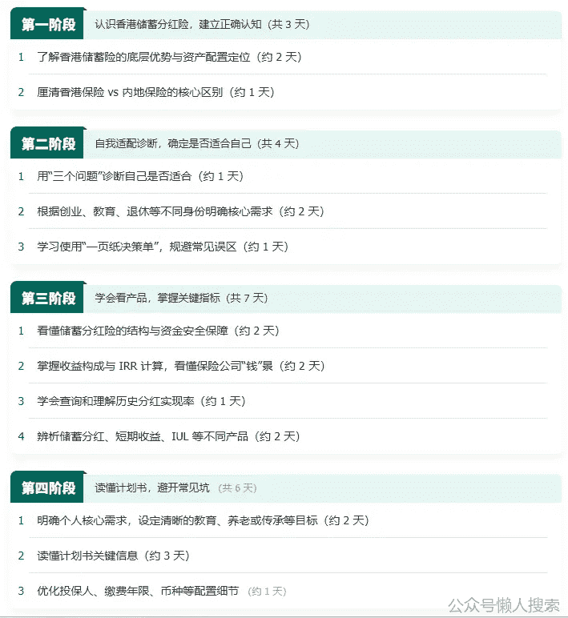

想用最短时间抓住重点？下面有各章摘要和索引，按需跳读即可：

**1. 港险储蓄适不适合你？**
三道关键题，加一份测评，帮你摸清自己该不该买。

**2. 挑产品要看哪些指标，自己到底需不需要**
a. 核心指标：IRR（内部回报率）与历史分红实现率。
b. 需不需要，看产品能做什么：
i. 全球配置、分散风险：资金投向世界各地，可买的品种更丰富。
ii. 资产增值：不懂投资，却希望钱能长大。
iii. 强制储蓄：怕自己乱花，用保单管住手。
iv. 财富传承：受保人可无限次更换，让钱稳稳传到下一代。
v. 私密隔离：隔离婚姻与债务带来的风险。
vi. 灵活提取：部分产品能按你的需要取钱。
c. 买港险有哪些风险？如何防范？

**3. 怎么设计一套合身的储蓄险方案。**

**4. 投保与保单管理的实操。**

#### 2.1 新手常问的几个问题

**港险肯定比内地险好吗？值得专门跑一趟香港吗？**
这份手册不会轻飘飘给个“好”或“不好”，而是把两边在收益水平、保障范围、理赔是否方便、汇率波动等维度摆开对比，让你按自己的情况拿主意。

**完全不懂保险，能看明白吗？**
手册用大白话讲保险。只要肯耐心读，零基础也能搭起完整框架；遇到不懂的词，文中有解释和例子，也能在学习群里问教练。

**买港险分红储蓄，有没有硬杠杠？**
签单必须本人到香港；年交保费建议不低于 1 万美元（折合约 7.2 万元人民币）。

#### 2.2 出发前，先摆正几个认知

以下内容仅供学习交流，既不是投资建议，也不是投保建议。买保险要结合年龄、收入、家庭结构、风险承受力等通盘考虑。投保前请找持牌顾问咨询，并仔细读条款。

#### 2.3 有哪些风险，该怎么应对

**风险**：分红储蓄险的流动性、汇率波动、分红不确定等，都要放在心上。别看见别人买就跟着冲。

**建议**：按课里讲的配置思路来定保险比例，别把全部家当押上去。保险资产占家庭可投资资产的两到三成为宜。同时要确保这笔钱短期用不上，最好留给十年后的自己，免得早期退保吃亏。

干了这行十年，见过太多中产和创业者：有人一门心思想暴富，结果被股市套牢；有人把身家全压进房子，最后卡在流动性上；也有人只认“现金为王”，十年下来资产不升反降。

港险储蓄不是包治百病的灵药，但能让家庭财富结构更稳、更有厚度、也更知道往哪走。

它至少能帮你做三件事：

+ 把长期收益锁住（有机会拿到年化 6% 至 6.5% 的复利）；
+ 把货币风险摊开（资金投向全球）；
+ 把财富传下去（受保人可无限次更换）。

好的家庭理财观，说白了就两条：

1. 懂得家庭财务要“反脆弱”：把资产分好区，各管各的，互不牵连。
2. 盯住能生息的现金流资产，再用这些利息去养自己的现金流。

所以，这堂课不教你追高，而是一场需要花时间理解、琢磨、动手的探索：用足够长的周期，让口袋里的钱稳步变大、跑赢通胀、提前备好雨伞。

如果你也认同“先把财富布局搭好，再谈收益”，欢迎一起上船。

# 必修篇

# 一、香港分红储蓄险：它在财富版图里站哪、强在哪

## 01. 分红储蓄险的三根底层支柱

💡

**本章速览**

这一章，我们把财富布局、保险监管、全球投资三件事串起来看。

**本章路线图**

学完并完成操作，路线图上的这一格就点亮了：

第一阶段：认识香港分红储蓄险，建立正确认知（3 天）

+ 弄清港险储蓄的底层优势，以及它在资金布局中的位置（约 2 天）
+ 分清港险与内地险的关键差别（约 1 天）

### 1. 重新定位：它在家庭财富结构里的角色

先别急着看细节，回答一个根本问题：香港分红储蓄险，在我整个财富盘子里，到底算什么？

投资课里孟岩讲过一句话：收益的大头，其实由你怎么分配资金决定。也就是说，在纠结买什么、什么时候买、能赚多少之前，先把钱的去处安排好，更重要。

琢磨资金安排时，人通常盼着闲钱收益高些、将来现金流多些、要用钱时手头有准备。从不梳理资产，再能赚，账也可能一团乱；反过来，有一套清晰稳当的财富架构，就能看清属于自己的“导航图”——现在在哪、要去哪、路怎么走，心里都有数。

这就是布局资金的意义：让财富和努力都变得清楚。

规划资金时，可以拆成四个格子，像公司里不同部门各管一摊：

+ **第一格：保障金（托底用）**
干什么：扛突发风险，别让生活被一场意外改写。
放什么：重疾、医疗、定期寿险、意外险这类消费型保险。
关键：靠杠杆，花小钱把大风险转出去。

+ **第二格：活钱（日常周转）**
干什么：应付日常开销和短期急用。
放什么：活期存款、货币基金。
关键：流动、安全，随时能取。

+ **第三格：稳钱（保本求升）**
干什么：给一到三年的中期目标攒着，比如买房首付、买车。
放什么：大额存单、国债、稳健型理财。
关键：稳当、安全，收益跑得过通胀。

+ **第四格：进取钱（博增值）**
干什么：冲着长期高回报去，也甘愿担风险。
放什么：股票、基金、房产等。
关键：搏高收益，让财富往上走；赚了亏了，都不耽误正常日子。

那么，香港分红储蓄险该放进哪一格？

它的特别之处，是同时踩进第三格和第四格，还捎带第一格里的一部分传承功能。

所以，读懂港险分红储蓄，不是随手买张保单，而是给已有的资金安排请进一位“战略级帮手”：把财务地基打牢，投资时更沉得住气，也为将来的人生大事备下一笔确定性较高的资源。

这样，盲目投资导致的亏损可以少一些，闲钱也能用得更充分，拿到收益的机会自然更大。

下面展开讲：港险分红储蓄为何能在资金布局里横跨几个格子，成为一个值得考虑的选择。

### 2. 把鸡蛋从单一人民币的篮子里挪出来

先看一个场景，就明白什么叫分散单一货币的风险。

假设你手头有 100 万闲钱，自己又完全不懂投资。大概率会先丢进余额宝、零钱通、银行定期，或者打听大额存单。可很快会发现，利息少得可怜。支付宝里那些标着“热销、年化 15% 到 30%”的基金，看着心动，真下手又怕亏。一开始多半只敢拿一点点试水：赚了想落袋又怕错过涨幅，亏了又下不了手割肉。

不懂行，就很难把这一百万的大部分放进去。结果涨也涨不了多少，“稳”和“博”两头都够不着。

再说，余额宝也好、A股基金也罢，看着是把钱分放在“货币基金”“股票基金”几个篮子里，可本质上押的还是人民币升值这条路。国家经济一打喷嚏，这些资产很可能一起感冒。

就像鸡蛋分装进几只篮子，可篮子全码在同一辆货车上。车一颠，照样有蛋磕破。

这就是“同一个币种、换着品种买”藏着的隐患。所以老练的投资者会从三头下手：身份、业务、资产，各做一层对冲。

资产对冲是打底，像把家当分放在不同房间。没人会把现金、首饰、重要文件全堆在客厅，总得分一些到书房、保险柜。把资产换成不同货币，好比把人民币那摊（客厅里的现金）挪一部分去“美元房”（书房）、“欧元房”（保险柜）。万一“客厅”（人民币区）物价飞涨，手里钱的购买力缩水，“书房”（美元区）物价也许还稳，那边的钱照样经花。这就是跨币种分散：让全部身家的购买力更稳当。

业务对冲像房子的承重墙，核心是让家里的收入来源多几条。生意或收入只靠一个地方、一个行业，就像房子只有一面承重墙，风险全压在一处；把业务铺到不同地区或领域，等于多砌几面承重墙，一面出问题，整体还站得住。社群里不少伙伴，主业收入不差，仍会搞点副业，防着主业出岔子——比如裁员——让自己多一条退路。做国内电商的，不少会去碰跨境；产品经理用 AI 写代码做海外产品、赚美元。说到底，都是让收入多几个来源，给事业开第二条增长曲线。

身份对冲，等于给房子多开几道门、多配几把钥匙。意思是，通过合理规划，让子女拿到国际化的教育背景和身份选项，下一代可以在全球挑发展的地方；自己和伴侣也能在宜居国家旅居，养老多几种过法。一道门因政策或环境走不通了，还能不慌不忙换另一道。

对普通人而言，货币层面的对冲，是门槛最低、最容易上手的第一步。香港分红储蓄险，恰好是个不错的落点。

原因有两层：它能配多种货币，底层又投全球市场。

其一，香港是国际金融中心，资金进出自由，可投世界各地；港险保单支持多种货币计价，天生适合做多币种安排。

其二，能投全球，险企在做策略时就会同时盘算收益和自身能不能活下去。眼下它们主要押美股，用美元或港币结算——过去十年美股平均回报约一成，这是底气。

正因为能全球布局，港险分红储蓄才敢给出平均 6.0% 到 6.5% 的预期回报。但得说清楚：预期回报≠保底兑现。

内地险监管严，定价时更看重白纸黑字的保证收益，预定利率上限由监管定，底层资产也基本只能投国内，预期收益自然常低于港险分红储蓄。

所以，头一回听说港险分红储蓄的预期收益比余额宝、比内地险高出一截，多数人第一反应都是：真的假的？这怪不得谁——两地储蓄险的设计思路、投资门道，我们了解得太少。

特别提醒一句：预期收益高，不等于港险分红储蓄就一定比内地储蓄险更合你的身，还得把自己的需求摆进去综合掂量。

想通这层就明白：买港险分红储蓄，实质是持有一笔多币种的全球投资资产。比如拿的是美元保单，人民币对美元汇率一波动，这笔资产的美元价值自成一体，天然就把单一货币的风险摊薄了。

它不像换业务、换身份那样要大动干戈，也不用你亲自飞海外看房、埋头研究股市。只要按规矩投一次保，就能高效配上一类重要的外币资产。整个流程有成熟的顾问体系托着，你自己又清楚港险投保的要害和坑，普通人做全球配置的门槛就低了，拿到收益的机会也就大了。

这趟学习，就是陪你全面认识港险分红储蓄，弄清投保时该盯什么、该躲什么，最后做出清楚的配置决定。

### 3. 投资半径更宽：钱能买到全球的好资产

眼下多数港险分红储蓄以美元计价，资金池主要买美元计价的全球金融资产。

香港险企的资产池——尤其是分红险的参与型基金——大致投向这几类：

+ 美元债（美国国债、企业债）；
+ 以美元计价的国际基金；
+ 全球大公司的美元股票或债券。

背后有三重原因：

**1.监管端要求：**
香港《保险业条例》和相关指引（如 GL13《资产负债管理》）要求险企做到“资产与负债的币种对得上，期限、流动性等特征也要匹配”。说白了，卖出一张美元保单，就得备好对应的美元资产（比如美债）来托住这笔负债。这样汇率波动的风险能压到最低，投的品种也更透明、更高效。这就在一定程度上保证：拿着保单，我们的钱确实投向了美元资产，风险能分散，收益也有机会往上走。所以险企自然愿意发美元保单，让投资端和负债端对齐，风险最小。当然，哪天美元资产不灵了，险企也会去寻找“下一个美元资产”。这就是不困在一个市场、能放眼全球的好处。

**2.汇率稳定：**
这是历史留下的安排。1983 年起，香港实行联系汇率制，港币不随行就市自由浮动，而是紧贴美元，汇率大致在 1 美元兑 7.8 港币上下小幅波动（±0.05）。也就是说，港币实际上和美元“拴在一起”，价值几乎同进同退。所以，哪怕险企收进来的是港币保费，后台多半也会换成美元去投——既然如此，不如直接拿美元计价，更省事、也更稳。

**3.美元是全球资产配置的核心：**
美元眼下在全球金融体系里坐着头把交椅：投资市场最广（美国债市、美股、美企债等），金融工具最全，抗通胀的本事也不弱，变现还快。对险企而言，要兑现长期分红和保证回报，就得挑稳当、好转手、收益能算得清的资产——美元债正是当今全球比较可靠的长期收益来源之一。于是，美元资产成了香港险企现阶段组合里的“主仓”，美元计价的储蓄险也就顺理成章做了主角。

那对我们来说，握着一张港险分红储蓄保单，到底意味着什么？

其一，有专业班子替你盯着投资。自己下场，研究、看盘耗神费力；险企背后有一大支资管队伍，全天候盯着全球市场，调仓换挡。我们交的保费，等于顺带买到了这种“大机构级”的服务，省心也省力。

其二，配置更灵活：能买的品种多了，顺着周期轮动，赚钱的概率也高些。

2.1 险企的资金池能在全球找机会。把时间拉长（比如看过去三十年的数据），全球几大类资产——股票、债券、黄金、房地产——很少齐涨齐跌，更像踩跷跷板：

+ 股市走强，债市收益常常就往下走；
+ 经济放慢、股市打蔫，债券价格反倒往上爬；
+ 通胀抬头或避险情绪浓时，黄金往往冒尖；
+ 利率走低的阶段，房产更招人喜欢。

险企能在不同经济阶段腾挪这些资产，靠全球轮动把风险摆平，把长期收益稳住。好比调色师面前摆着一盘全球颜料，按市场阶段挑颜色，调出一条更平顺的收益曲线。

2.2 再往下分散，风险就更低。险企的钱可以撒向全球各地、各类资产——债、股、房产、基金，甚至一些基建项目。这样全球铺开，组合就不至于吊在一个市场上；某个地方起浪，别处的资产还能顶一顶。

**香港储蓄分红险：让专业团队替你长线打理**

买这类保单，说到底是把一部分资产交给一支持久作战的团队去配置。对方不靠短期冲刺取胜，而是通过多市场分散、稳步推进来控制回撤，再把投资所得中的一部分按约定回馈给保单持有人，让资产随着时间逐步长大。

在感受过它的基本优势后，下面我会带你走完整个决策流程：先看自己适不适合，再弄懂它是什么、靠什么增值，随后判断哪些产品值得考虑、有哪些风险和坑，最后落到怎么投保。

当然，香港储蓄分红险并非零风险。风险部分之所以放在后面，是因为会涉及一些专业名词；先把基础概念铺好，读起来会更顺。如果你希望第一时间了解，也可以直接跳到《香港储蓄分红险的风险有哪些？》。

## 02. 这类产品在家庭资产中的位置

### 1. 三类资金工具怎么分工

**先给结论**

+   **香港储蓄分红险**：把长期外币资产锁定下来，靠复利稳步积累，更适合充当家庭财富的底层配置。
+   **银行理财**：回报相对有限、期限偏短，适合放临时闲钱。
+   **基金股票**：起伏明显，长期持有并不容易，更适合愿意主动管理的人。

世上没有一款产品能包打天下，成熟家庭往往做的是组合搭配。

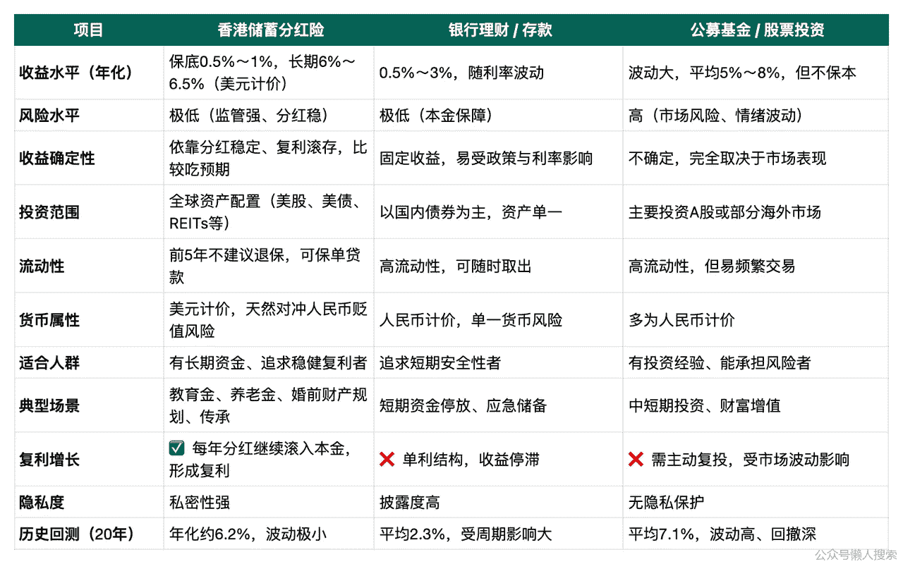

### 2. 港险与内地险，思路差异在哪

+   **内地保险**：重心落在“保”，解决风险兜底。
+   **香港保险**：重心落在“储”，追求财富积累。

二者谈不上孰优孰劣，底层思路本就不同：

内地保单更擅长“托住下限”，
香港保单更擅长“滚出复利”。

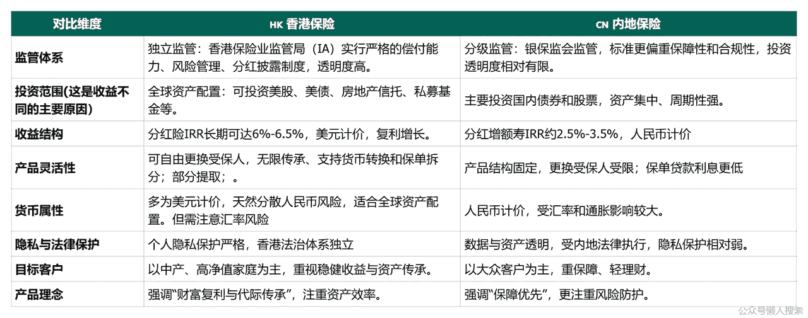

# 二、这笔钱该不该交给香港储蓄分红险？

## 01. 先做适配判断

💡

**读前提示**

香港储蓄分红险有它的长处，却不是人人适用。先确认自己是否匹配，再研究买哪款、怎么买，既能少走弯路、降低试错成本，也能让家庭财务安排更合理。因此本章要解决的就是“要不要买、适不适合买”。后面会安排三轮自测，逐层深入，把需求看得更清楚。

**本章学习路线**

完成本章的学习和操作，即可完成路线图中的：

第二阶段：自我适配诊断，确定是否适合自己（共 4 天）

+   用“三道题”做初步判断（约 1 天）
+   结合创业、教育、退休等身份明确核心诉求（约 2 天）
+   学会填写“一页纸决策单”，并绕开常见误区（约 1 天）

### 1. 三道自测题，先看合不合拍

先给自己做个小体检。

**第一题：你最希望这笔钱完成什么任务？（可多选）**

A. 孩子读书或自己退休时要用的钱（5～30 年后启用）
B. 把财富安排给下一代
C. 让资产与经营风险隔开
D. 一至五年内拿到年化 10% 以上的高回报

**逐项来看：**

选 A，说明你在为未来确定会发生的支出做准备，比如学费、养老。需要时可以先取一部分，剩余资金继续留在保单里复利滚动。

选 B，意味着你关心资金能否顺利、合法、清楚地交到后代手里。香港保单支持无限次更换受保人，也能拆分成多份，比如两个孩子按比例承接，减少后续纠纷。

选 C，重点在于经营或职业风险来临时，这部分资产能在法律层面相对独立，不至于轻易被债务或诉讼拖进去。

选 D，则是希望一至五年就看见年化 10% 以上的显著回报。

这一题真正要厘清的，是你想让这笔钱“承担哪项家庭任务”。

若答案落在 A、B、C，目标通常偏长期、偏稳健，与香港储蓄分红险的匹配度较高——它的特征是“确定性较强、可复利累积、风险相对低、流动性适中”。

若答案只有 D，期待短期内获得明显回报，那要提前打个预防针：储蓄险不是短线工具，它靠时间发酵，可能并不合你的节奏。

**第二题：你的资产底子怎么样？（多选）**

A. 有持续稳定的现金流入
B. 即使暂时断流，手头现金或可变现资产也够支撑未来 5～10 年生活
C. 已备好相当于 12 个月生活费的应急资金
D. 重疾险、医疗险、意外险等基础保障已经配齐
E. 这笔钱至少 5～10 年不会被动用

**这一题看的是长期缴费能力。**

如果多个选项都能打勾，说明你的财务结构比较扎实，有条件进入长期配置阶段。

不管收入来自工资、投资，还是一笔暂时闲置的资金，只要不会影响日常运转，都可以作为储蓄险的来源。

反过来，若收入忽高忽低、保障缺口明显、应急金也没着落，那当前更该做的是“先筑底”，而不是急着“做投资”。

把保障账户和活钱账户补齐，再考虑储蓄险。先后顺序对了，家庭财富系统才稳。

**第三题：面对波动，你是什么心态？**

A. 能接受“涨得慢但拿得稳”，不太焦虑
B. 偏爱快进快出的收益，不愿久等
C. 任何时候都不能接受账面浮亏，还要求资金随时能用

**分别说明：**

选 A，比较适合储蓄险这类靠复利慢慢积累的工具——速度不快，但胜在拿得住。

选 B，可能更贴近股票、基金等权益类资产。

选 C，更在意“本金安全、利息确定”，银行大额存单或国债或许更让人踏实。

不过要分清：波动不等于亏损。储蓄险前几年现金价值偏低、回本需要时间，是因为保险成本与初期费用要在前段摊销；也正因为流动性受限，资金才能被真正“锁”下来做长期安排。把周期拉长，复利效果通常会越来越明显。

**如何理解评估结果**

+   **高度匹配**：长期目标清楚 + 资金较充裕 + 偏好稳健
+   **较为匹配**：有财务目标 + 基础保障较完整 + 能接受长期锁定
+   **暂时不合**：缺少长期规划 + 资金偏紧 + 近期可能用钱
+   **并不合适**：只想追高收益 + 抱着短期投机心态

把三道题合起来看：第一题选 A、B、C 属于高度匹配；第二题打勾越多越匹配；第三题只有选 A 才算合拍，B、C 都不太合适。

再补一句：若当前资金状况还不适合把香港储蓄分红险纳入长期安排，不妨先补齐活钱与基础保障（重疾险、医疗险、意外险），同时继续学习相关知识，等条件成熟再考虑配置。

### 2. 十八分评分表，细化匹配度

每项 0～2 分，合计满分 18 分。

**A. 目标期限**
- 长期目标清楚（教育、养老、传承）—— 2
- 有部分长期目标，但尚未量化 —— 1
- 主要想要短期回报 —— 0

**B. 资金可锁多久**
- 能锁定 ≥5～10 年 —— 2
- 能锁定 3～5 年 —— 1
- 随时可能要用 —— 0

**C. 收入稳定性**
- 家庭现金流稳、负债率低 —— 2
- 大体稳定，偶尔波动 —— 1
- 起伏大或不确定性高 —— 0

**D. 兜底与备用金**
- 保障齐全 + 应急金 ≥6～12 个月 —— 2
- 只完成其中一项 —— 1
- 两项都缺 —— 0

**E. 对慢增长的接受度**
- 能接受“稳但不快”，愿意长期持有 —— 2
- 心态可调，但容易着急 —— 1
- 偏好快节奏、频繁操作 —— 0

**F. 外币使用需求**
- 有美元支出、出国教育或全球资产配置需求 —— 2
- 目前没有明确需求 —— 1
- 明确用不上 —— 0

**G. 可投入资金与资产结构**
- 每年能拿出不低于 7 万、连缴 5 年，且约占总资产 20%～30% —— 2
- 资产规模尚可，但结构较集中，基本能每年拿出 7 万、连缴 5 年 —— 1
- 资产规模偏小，又过度集中在单一资产（例如只有一套背着房贷的房子） —— 0

**H. 家庭责任阶段**
- 正处于责任高峰期（育儿、赡养、教育金规划） —— 2
- 责任适中，尚未组建家庭 —— 1
- 责任较轻或阶段不稳定（频繁换城市、换行业） —— 0

**I. 对分红的认识**
- 明白“分红不等于保证 6.5% 收益”，能接受浮动 —— 2
- 知道分红随市场变化，但理解不深 —— 1
- 以为投保后马上就能拿钱 —— 0

**结果说明：**

+   13～18 分：匹配度高，可以进入方案设计。
+   7～12 分：中等匹配，先补齐保障和活钱再考虑。
+   6 分及以下：匹配度低，建议先缓一缓，梳理家庭资产与现金流。

### 3. 按身份找需求：四类人的决策单

匹配度确认后，再从自己的身份出发，把核心诉求理顺。

#### 3.1 创业者｜把一部分利润放到风险之外

+   **处境**：收入与行业景气度绑得很紧，公司一波动，家庭也可能受牵连。
+   **适合信号**：每年有利润结余，希望留出一块能穿越周期的底层资产。
+   **建议**：一次性缴或分年缴都可；坚持“美元计价 + 长期持有”；投入上限可参考净资产的 20% 以内，或年利润的 30%。
+   **红线**：不要靠高成本短贷去续缴；不要把周转资金锁进长期保单。

#### 3.2 自由职业者/高收入个体｜构建安心的现金池

+   **处境**：收入起伏明显，心理上更想要稳定感。
+   **适合信号**：有稳定的基础客户和回款周期，能留出 5 年以上的长期资金。
+   **建议**：先把保障与应急金搭好，再配储蓄险；以年缴为主，额度可参考“近 3 年平均结余 × 2”。
+   **红线**：应急金没到位前不要贸然上车；不要把短期项目款拿去缴费。

#### 3.3 教育金家庭｜让时间沉淀确定性

+   **处境**：10～15 年后需要一笔海外学费。
+   **适合信号**：时间节点清楚，金额预算明确。
+   **建议**：优先看带多元货币转换功能的产品；按目标金额倒推缴费；让现金价值增长节点与学费高峰对齐。
+   **红线**：过早提取会打断复利；不要用“高预期”替代“历史兑现记录”。

#### 3.4 退休预备者｜打造可领可留的养老现金流

+   **处境**：希望退休后有一笔低波动、可预期的现金流补充。
+   **适合信号**：可以考虑“567 提取模式”——5 年缴完保费，第 6 年起每年领取总保费的 7%，一直领到身故；人在就有钱领，未领完的部分还能设置第二受保人，让孩子继续接棒。
+   **建议**：以年缴为主，持有期尽量拉到 10 年以上；与养老金、社保、债券等形成多来源组合。
+   **红线**：不要把养老筹码全押在一款产品上；提取路径和货币也要分散。

### 4. 一页纸决策单 1.0：把规划摊开看

#### 4.1 用一张表理清需求

结合前面的判断，把自己的情况填进下表，思路会更直观。

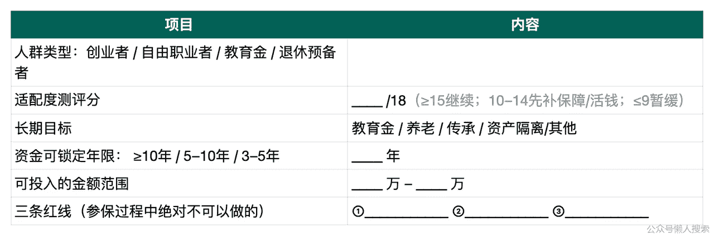

#### 4.2 四类画像，看看你像谁

**画像 1：为孩子备教育金的家长**

代表：35 岁的互联网中层王女士

+   家庭情况：孩子 3 岁，计划 15 年后出国留学
+   年收入：家庭年收入 80 万
+   需求：为孩子准备 100 万教育金
+   痛点：不清楚该存多少，也担心通胀侵蚀

适配度：★★★★★

+   ✓ 教育时间固定，保单期限容易对齐
+   ✓ 目标金额可以测算
+   ✓ 有强制储蓄作用
+   ✓ 复利增值有助于对抗通胀

**画像 2：高净值创业者**

代表：42 岁的科技公司创始人李先生

+   家庭情况：公司经营稳定，个人资产 2000 万
+   年收入：波动较大，年均 300 万以上
+   需求：资产隔离、财富传承、税务筹划
+   痛点：担心经营风险波及家庭，想提前做传承安排

适配度：★★★★★

+   ✓ 资产隔离，与经营风险形成区隔
+   ✓ 财富传承，可指定受益人
+   ✓ 税务筹划，香港无遗产税
+   ✓ 强制储蓄，减少经营冲动带来的资金消耗

**画像 3：自由职业者/新经济工作者**

代表：30 岁的自由设计师张先生

+   家庭情况：单身，收入不稳定
+   年收入：40～60 万波动
+   需求：养老金储备、强制储蓄
+   痛点：没有社保/企业年金，担心老了没保障

适配度：★★★★☆

+   ✓ 强制储蓄，收入越不稳定越需要
+   ✓ 补充未来养老金
+   ✓ 灵活性较好，可选带缓交功能的产品
+   ✗ 要注意流动性风险

**画像 4：退休规划中的中年人**

代表：48 岁的企业高管陈女士

+   家庭情况：孩子已独立，即将退休
+   年收入：150 万，有社保
+   需求：养老金补充、资产保值增值
+   痛点：退休后收入下降，想要稳定的现金流

适配度：★★★★☆

+   ✓ 补充养老金
+   ✓ 提供稳定现金流
+   ✓ 保值增值
+   ✗ 配置的时间窗口在收窄

### 5. 三个容易踩的坑

**坑一：“别人都买了，我也得买”**

✗ 跟风最容易出错

✓ 应回到自己的需求与实际情况

**坑二：“储蓄险收益高，能替代其他投资”**

✗ 储蓄险不是投资品

✓ 它只是资产配置的一环，替代不了股票、基金等

**坑三：“香港储蓄分红险一定比内地保险好”**

✗ 不同产品对应不同人群

✓ 关键看需求与产品的匹配程度

### 6. 本章收束：三条判断线

+   **需求线**：有明确的长期财务目标
+   **资金线**：有长期不用的闲置资金
+   **认知线**：理解产品特点，也接受它的局限

记住：储蓄险是好工具，但不是所有人都需要。适合自己的，才是最好的。

# 三、看懂产品，避开坑，守住增值

## 01. 弄懂它的运转方式

💡

**读前提示**

搞清适不适合之后，另一个问题就来了：怎么看懂一款产品值不值得买？本章的核心，就是帮你认清香港储蓄分红险的利与弊。

**本章学习路线**

完成本章并动手操作，即可完成路线图中的：

第三阶段：会看产品，掌握关键指标（共 7 天）

+   看懂储蓄分红险的结构与资金安全保障（约 2 天）
+   掌握收益构成与 IRR 计算，看懂保险公司的“钱”景（约 2 天）
+   学会查询和理解历史分红实现率（约 1 天）
+   分清储蓄分红、短期收益、IUL 等不同产品（约 2 天）

在内地买保险，很多人会被琳琅满目的产品弄花眼：有的每年往回返钱，有的每年只往外交钱；有的急用时可以取，有的却取不出来。

你可能也会犯嘀咕：保险公司年年返钱，难道不亏？这样的好事真能轮到我？精算师那么会算，真会让我占便宜？

看到这些疑问，其实已经摸到门道了——即使是同一类保险，功能也可能差很多；设计成不同样子，是为了适配不同人的需求。买保险，核心就是“合不合身”。

不少人挑保险时，只盯着合同上的保额、分红、收益率，或者听别人随口一说，却很少深究这些数字背后的运行逻辑。

一旦理解了底层机制，你就不容易被高收益宣传牵着走，也不会被销售话术绕晕。你会更清楚：哪类产品适合自己，从而少花冤枉钱和精力。

所以请记住，真要买香港储蓄分红险，第一步不是急着挑“哪家公司、哪款产品”，而是先回答：我的需求是什么（上一节已经处理），以及它到底是什么、如何帮我增值、我交的钱去了哪里、安不安全。

接下来的几个章节，我们会把这些关键问题逐一拆开。

### 1. 它到底是什么？一个故事讲清

香港储蓄分红险是什么？听完下面这段故事，大概就有画面了。

先说明一点：目前市面上常见产品多以美元计价；为方便算账，下面的例子先用港币。

香港某珠宝工坊招了五十名新手学徒，日常工作是打磨金饰、镶嵌钻石。干活时稍一分神，就可能摔坏一颗宝石——最便宜的一颗也要 5 万港币！还可能因此丢了工作，收入说断就断。

学徒们每天提心吊胆，生怕手一抖，辛苦钱全赔进去。工坊老板老陈也头疼：“总这样不行，宝石碎了是实打实的损失，学徒又赔不起。”于是，他请来一位脑子灵活的财务顾问阿财，帮忙设计解决办法。

**【第一阶段：消费型保险出现】**

阿财提出：“不如每人每年出一点钱，我帮大家建一个‘碎宝石赔付池’，谁弄坏了宝石，就从池子里出钱赔。”

众人听完，觉得可行。

阿财接着算账：“按以往情况，一年大约会碎 5 颗，每颗赔 5 万港币，合计 25 万港币（这是保障成本）。我负责设立赔付池、管理账目、做记录、出赔付报告，保证公平和资金安全，另外收取 10% 的管理费。”

两项相加：25 万 + 2.5 万 = 27.5 万港币。五十人平摊，每人每年交 5,500 港币——这笔钱就是保费，也就是交给保险方的费用。

大家一合计，觉得划算：哪天真失手打碎宝石，也不用自己掏 5 万，于是都同意了这个安排。

**客户所交费用 = 预期赔付开销 + 运营服务报酬**

**——这便是消费型保险的雏形，主要功能是在风险发生、需要大额支出时提供经济补偿。**

**【第二阶段：储蓄险想法萌芽】**

学徒里有个叫阿稳的，做事仔细，从没出过差错。他心里盘算：“我一年交 5,500 港币，干十年就是 5.5 万港币，要是始终平安，这钱不就白交了？可又不敢不交，万一真出事呢？”

于是他去找阿财商量：“要是我十年都没弄坏宝石，这笔钱能不能退一部分？反正我也没用到。”

阿财想了想，说：“可以这样——这 10 年你若一直平安，我就把你交的钱还给你。不过每年要多收 1,000 港币，我拿这部分去做稳健投资，十年后除了本金，再分你一些收益。否则别人赔付太多，我又把钱退你，那我就亏了。”

阿稳一听，马上点头：“有道理！既有保障，到期还能拿回本金，甚至有点利息，比我想的好。”

于是，阿财在原赔付池的基础上，增加了“到期返还本金”的安排。

**这便是储蓄型保险的雏形——既能防风险，也能帮人存钱。发生意外有池子赔；平安到期，则拿回本金和约定利息。**

**【第三阶段：储蓄分红险的出现】**

故事走到这里，储蓄分红险的雏形已经呼之欲出——它后来如何演变成香港市场常见的分红储蓄产品，我们下节接着聊。

# 保险居然能赚回来？一个故事讲清储蓄分红险

阿稳那天回家，嘴就没合拢过，拉着阿狗就把新契约说了个遍。消息像长了轮子，几天工夫就在学徒圈里传遍。大家越算越心动：交出去的钱还能拿回来，比原先那种只保风险、钱如泼出去的水的方案强了不止一星半点。

人群里有个叫阿灵的，脑子向来转得快，消息也更灵通，于是也找上门来。

她开门见山：“阿财，听说你在做投资？如今外面行情火热，我能不能多交点钱，将来除了拿回本金和利息，再额外分一点你赚的钱？”

阿财乐了：“你这要求提得挺会挑时候。不过这想法不算离谱——大家的钱拿去投资，赚得比预期多，分些回报也合理。但得看行情：赚得多就多分，赚得少就少分。”

他随后补了一句：“这样，你再多出一笔钱，我单独拿去投资，给你开一个分红账户，赚了按约定比例分账。无论市场怎么起伏，你的本金和基础利息不会有一丝折损。”

阿灵眼睛发亮：“那就是说，市场好、你管理得当、大家表现都好——我们就能赚得更多？”

阿财点头：“对，这就是‘分红’，赚得多了，一起分享。”

那年市场相当给力，投资回报超过预期，加上学徒们做事比往年谨慎，赔付少了一截。年底阿财一盘账，账上多了笔结余，便按约定把这部分盈余分给了每个人。

大家第一次发现，保险居然也能“赚钱”。

一份新契约随之成型：

保费 = 保障成本 + 管理费用 + 投资资金

——这就是储蓄分红险的初始模样，也是此番航海我们要重点弄懂的品种。

从这个故事能提炼出一条主线：保险本质上分成两大类，消费型和返还型（也叫储蓄型）。

+   **消费型保险**，更像请人办事的付费服务，租金、打车的钱花完就结束，没有沉淀价值；

做“基础保障”时，主流选择就是消费型，像重疾、医疗、意外这类。它胜在便宜、杠杆高，核心作用是防范突发风险，万一身体出问题导致收入中断，能有一笔钱顶上来，缓冲经济损失，而不只是治病的报销工具。

所以选消费型产品，琢磨的始终是——怎么用最低的成本，换到最扎实的保护。

+   **储蓄型保险**（这里主要指储蓄分红险），则更接近购置房产或金条：资产留在手上，可以自用、传承，放久了还具备升值潜力。

当一个家庭把基础保障配齐后，许多人会追问：保障之外的闲钱，能不能放进一个安全的地方，既能稳稳增值，又能充当未来的储备金？储蓄型保险就是在这个节骨眼登场的。

它和传统认知里的“保险”不太一样，它更像一个按复利生长的长期账户：有基础的保障兜底，有投资收益让钱生钱，还能承担财富传承、分配与增值的功能。

两种类型各有分工，并非非此即彼。这也是我们反复强调的原因：做保险配置时，既要加固基础保障，也要评估储蓄险的适配度，让财务状况在安全与增长之间找到平衡。

补充一点：如果买消费型，比如意外险、医疗险，内地产品通常优先；储蓄型则不必拘泥，内地和香港都可以比较。核心原则始终是一句话——花更少的钱，办更大的事。

### 2.香港储蓄分红险的结构核心在哪里？

弄明白保费构成后，还要看清它的内部骨架：储蓄第一、保障第二。它既不是单纯的保障型保险，也不是纯投资工具，而是“保障＋储蓄／投资”的长线机制。保险壳只是“外衣”，真正的内核是资产管理。

最朴素的解读是：它的核心功能是储蓄增值，保障部分虚弱到几乎可以忽略。

参考下面这张图的差异：

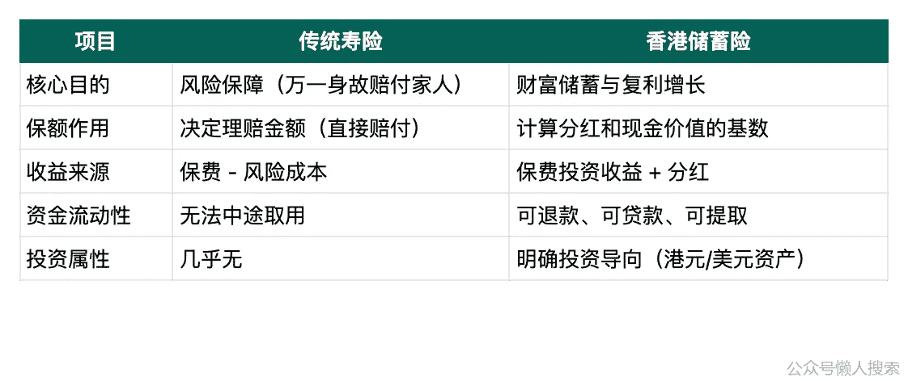

既然如此，干脆把保障功能拿掉，只做储蓄投资，不行吗？

现实情况是，香港储蓄分红险的合同里仍然会出现“身故赔付”“保额”等字样，但它们是陪衬，不是主角，目的是满足保险合同的法理要求。

通常身故赔付 = 保单现金价值 + 已分红 + 累积利息，或已缴保费的 100%-110%，取两者较高。也就是说，如果你在合同期内身故，保险公司会把你的储蓄部分完整退回，甚至额外带上一些红利——这相当于给资金加了一重“安全托底”，但你期待的“几百块保费撬动一百万赔付”这种高杠杆，并不存在。

换句话说：买香港储蓄分红险，出发点不是“保命”，而是“保钱”——让这笔资金在你活着时持续增长，在你离开后也能平稳交给家人。

那合同里的“保额”究竟有何用？保额、保费、赔偿金是三件事。保额更像一个坐标，保险公司拿“基本保额”作基数，推算未来的分红、现金价值的涨幅，以及身故时该赔多少。

你可以把它理解为“本金的影子刻度”：它不是真正赔给你的金额，而是用来计算收益的标尺。保单上之所以有“保额”，是为了让保单具备合同属性（合规要求），同时给收益增长搭出一套计算结构。

继续用前面“打碎宝石保障基金”的故事，来看看这些概念怎么落地。

**阿稳看懂了“保额”和“现金价值”**

几年以后，阿财替学徒们打理的“打碎宝石基金”已经成了一座大蓄水池，每个人名下都有独立账户。阿稳拿着合同来找他：“阿财，这上面写‘基本保额 10 万港币’，是不是真出事最多赔我 10 万？”

阿财摇摇头：“储蓄险里的保额，不是赔付上限，是计算用的标尺。假定你买了银行理财，说明书上写着‘按 10 万港币本金计算收益’，这 10 万就是参考基数。保险公司所谓‘分红按保额的 5%’，意思是拿这 10 万做底，每年划出 5,000 港币分红。”

阿稳一下子通了：“原来‘保额’就是‘虚拟本金’！它不决定最终赔多少，只决定我按什么基准赚钱！”

阿财点头：“没错。再打个比方，假如你现在打算退保，保单现金价值是 8 万港币，今年我分给你的利润是 3,000 港币红利。那你这张保单的状态就是：

+   保额：10 万港币（合同里的计算基准）
+   现金价值：8 万港币（退保时真金白银拿到手的数）
+   红利：3,000 港币（当年派发的收益，会滚入现金价值）

如果选择退保，不需要退出‘打碎宝石基金’，直接拿走现金价值加累计红利，也就是 83,000 港币；如果继续持有，每年的分红会叠加原资金继续‘利滚利’，现金价值越滚越高，你的基金池也就越来越大。”

阿稳听完直点头：“原来如此！”

**阿灵看懂了“现金价值”和“身故赔付”**

过阵子，阿灵也带着合同来了：“那‘现金价值’又是怎么来的？我看这个数字每年都在变。”

阿财解释：“现金价值，是已经写在你名下的钱。你每期交的保费，扣掉保障成本和营运费用之后，余下的全部进到这个账户；随着时间推移，投资收益和分红年年加进来，现金价值自然就一年比一年高。”

阿灵又问：“那‘身故赔付’怎么理解？是不是人没了，这笔钱才能落到家人手里？”

阿财回应：“是，但要留意——在香港储蓄分红险里，‘身故赔付’主要是兜底条款。合同上通常这么写：赔付金额取‘保单现金价值＋已分红＋累积利息’和‘已缴保费的 100%-110%’两者中的较大者。

意思就是：万一你不在了，保险公司至少把你账户里攒下的储蓄全部退还；如果当时收益还不够高，也会按已交保费放一个倍数。举个例子，某产品第一年交 1 万美金，人走了给 10,500 美金。它追求的不是‘多赔钱’，而是保证你这笔储蓄不会因为任何原因归零。”

阿灵恍然：“所以这个‘赔付’，其实是在给我的钱上保险！”

阿财点头：“对，你买的不是‘保命’，而是‘保钱’。活着，钱在涨；离开，钱也能完好地传给家人。”

## 02. 香港储蓄险的品种与选择思路

借助前面的小故事，消费型和储蓄险的差异已经清楚了。这一节展开说说：储蓄险具体有哪些品种，以及这次航海的主力队员——储蓄分红险，到底要防哪几种风险。

### 1.储蓄险四大家族：储蓄分红险、短期固定收益类、保费融资单、IUL（指数万用寿险）

#### 1.1储蓄分红险

最常见、也最受内地客户追捧，很多人嘴上说的“到香港买保险”，十有八九指的就是它。

保证收益率通常落在 0.5% 至 2.5% 之间，长期预期年化大约在 6% 至 6.5%。

它适合 10-20 年的长线持有，可以放进家庭资产配置篮子里，用于教育金、养老金、婚前财产规划等场景。

#### 1.2短期固定收益类

约 5 年期限，保证收益可以做到 4%-5%。

这类方案匹配短期资金规划，或者当作紧急备用金，也可以理解成内地大额存单的平替，但要把汇率波动这一变量纳入考量。

顺带一提，美元存单收益率一般也有三四个点，可惜期限往往只有三个月或半年。如果希望锁定 5 年左右 4% 上下的确定性利率，这类保单便很有存在价值。

#### 1.3保费融资产品

玩法类似早年“贷款买房”——从银行贷款，赚取贷款利息与保单收益之间的息差。

举个例子：投入 200 万，买到 800 万保额的保单，9 年后退出，扣除贷款和利息仍净赚 150 万，相当于每年进账 16.6 万，年化约 8.25%。

**资金门槛**

+   一般建议保费在 800 万港币以上才做得有意义。
+   因为融资比例通常在 75% 左右，自己要先拿出 25% 的首期资金。

**资质门槛**

银行会执行“信贷审批”：

+   需提供总保费 1.05 倍的资产证明（总流动资产－总负债＝1.05 倍总保费）
+   100% 自付部分的境外资产证明
+   征信报告

银行要核实的，是你确实具备还款实力，而不是拿保险来“套现”。

#### 1.4 IUL（指数万用寿险）

适合对投资市场有一定认知的人。它的运作方式是把你的资金和标普 500 等全球指数拴在一起——指数涨，你跟着分红利；指数跌，有保底保护，不至于血本无归。它不是赌博，而是“系着安全带的投资”。

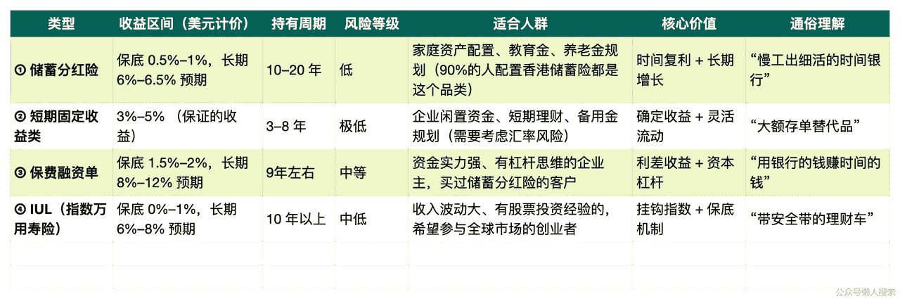

### 2.储蓄分红险的风险点：哪些地方需要留意？

先明确基调：香港储蓄分红险定位于“低风险、长期型”。

它的波动比基金小，收益通常又比银行存款略高，属于追求稳健增值的理财型保险。

但请记住，它并非“零风险”，潜在风险主要有三类：

+   风险一：非保证收益风险（投资波动风险）

分红部分属于“非保证收益”，会跟着保险公司投资表现起伏。市场环境变差，分红就可能缩水。例如演示 IRR 6.5%，那是在理想的分红实现率假设下算出来的，实际回报要由公司投资能力和派息政策决定，分红实现率通常在 70%-100% 之间浮动。

**✅ 如何应对？优先选历史分红实现率高、投资组合扎实的公司（如友邦、宏利）；持有期拉长到 15 年以上，抗波动能力更强。**

+   风险二：汇率风险

多数香港储蓄分红险以美元计价。假若未来美元兑人民币走弱，换回人民币时实际回报会打折；反之美元走强，回报会增厚。你 10 年前存入 10 万美元，美元升值时取回，保险收益本身不错，折成人民币甚至可能比账面值多赚 20%；美元贬值，感受则相反。

**✅ 如何应对？香港保险并非只有美元保单，人民币、欧元、英镑等多种货币都可以投，部分产品还有【货币转换】功能。另外，期交型产品相当于分批持有美元资产，也能起到对冲作用。**

+   风险三：流动性风险（提前退保损失）

储蓄分红险的前期费用高，前 5-8 年退保，现金价值往往低于已交保费。只有持有到至少 10 年，复利的威力才开始显现。买后第 3 年急着用钱退保，能拿回的可能只是一部分本金。

**✅ 如何应对？投保前理清资金用途，别把几年内就要动用的钱投进去；如果未来有急用钱的可能，干脆不要买。**

## 03. 保费去向与安全性：钱去了哪？安全吗？

### 1.保费是怎么分配的？

前面提过，我们交给保险公司的保费，并不会直接全部拿去“生息”。这背后有一套分配逻辑，目标是让保险公司和客户双赢。

可以这样理解：每一笔保费缴出去，等于同时完成两件事：

+   一部分买下保险公司的保障承诺（死亡、身故、合同责任）＋初期费用＋营运成本；
+   另一部分进入保险公司的投资账户，通过债券、股票、不动产等长期资产配置来追求回报。

因此，保费会被拆成保障成本、管理费用、投资资金三个去向。

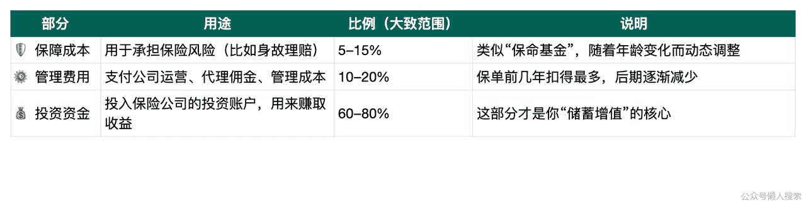

其中投资资金主要配置于美债美股等资产，通常不会拿来“冒险炒股”，而是贯彻“稳健、分散、长期”的路线。这也是它“收益不飙涨、但安心”的根本原因。

大家常听到的“70% 固收类＋30% 权益类”，只是分析师给出的粗略估算，并非保险公司合同或监管报告中承诺披露的精确比例。

不过，买储蓄险不必把保险公司的每笔投资都弄个门儿清，毕竟我们要的就是省事和稳。

需要提示的是，不同保险公司的产品结构、投资组合和保障成本不一样，具体配比差异可能很大。投保合同里也不会写明“我拿你保费的 X% 投到哪里”，而是通过“保单的现金价值、红利、保额”等数据，把保单价值展示出来。

补充几个基本概念：

保单的现金价值：当前保单值多少钱？相当于你决定退保时，保险公司愿意按什么价码把保单买回来。

红利：保险公司拿着资金去投资，获得利润后分给客户的那部分。

保额：可以理解为虚拟本金，用作计算收益和保障的参考值，用来推算红利、现金价值、理赔金额等，并非固定的“赔付款”。

即使不清楚底层投资细节，我们照样能筛出相对靠谱的产品。下一节就会展开讲：怎么判断一款储蓄分红险的收益和可靠性。

### 2.保单资金安全吗？谁在替你盯着？

许多人潜意识里把“保险公司投资稳健”等同于“我的钱安全”。实际上，真正兜住资金安全的，不只是投资纪律和香港市场机制，更关键的是法律结构与监管体系。

香港是全亚洲最成熟、最国际化的金融市场之一。无论是 1997 年亚洲金融风暴、2008 年全球金融危机，还是 2020 年的疫情，香港的保险公司都扛了过来，也拿下了国际评级机构的信任。

它的保险渗透率（即买保险的人口比例）全球第一，保险密度（人均保费支出）全球第二。

这意味着，香港几乎每个家庭都在跟保险打交道。体量如此庞大的保险经济，已经深深扎进香港的经济土壤，长成一棵根系交错的“大树”。这棵树的健康度，与银行、法律、税务等周边生态密不可分，一荣俱荣、一损俱损，监管体系因此被倒逼得极为严密。

这也是国际保险集团把总部或区域中心扎堆设在香港的原因。在这座城市，银行、监管、法律、税务共同织成了一张精密又透明的网，稳稳托住保险业的长期运转。

那这套体系是怎么守护你的保单的？拆成五个层面来看。

#### 2.1法律隔离：保单持有人基金（Participating Fund）独立存在

每一家在香港销售储蓄险（尤其是分红型/储蓄型）的保险公司，都必须设立专门的「参与基金（Participating Fund）」，也就是 Par Fund。

该基金由保险公司发起，受香港保险业监管局（Insurance Authority，IA）监督，目标非常明确：让客户的钱永远不与保险公司的运营资金混同。

所有储蓄险和分红险的投资运作，都必须遵守香港《保险业条例》（Insurance Ordinance）及相关配套指引，尤其是《GL13：投资及衍生品使用指引》。

保费交付之后，会被划入保险公司按监管要求设立的基金账户里，资金使用全程受限。

这笔基金到底属于谁？答案是：属于全体保单持有人，不属于保险公司。

保险公司只是受托管理人，不能随意挪动这笔钱，也不能拿它去填补公司其他业务的窟窿。哪怕保险公司经营遇困，Par Fund 里的资产依旧归客户所有，不会被当成公司资产清算。

只有这样，投保人在任何情形下，才能守住保单承诺的利益。

回到“打碎宝石保障基金”的故事：阿稳和同事们把钱交给阿财，这笔钱必须放进一个专用账户，不能与阿财的个人财务纠缠在一起。阿财可以按照合同管理、投资，但绝不能私下调用。这笔钱的所有权，始终在投保人这边。

→ 关键监管文件可在官网查询：https://www.ia.org.hk/en/index.html

#### 2.2财务监管：资本金与偿付能力要求

香港保险业监管局要求保险公司维持充足的“偿付能力比率”——说得直白些，哪怕你要“赔到天荒地老”，也必须赔得起；资本薄了，就别想拿牌照卖保单。

大部分大型保险公司（如友邦、宏利）常年把偿付能力比率保持在 250%-400% 之间。一旦跌破红线，监管局会立即介入，要求补足资本或限制分红派发。

#### 2.3投资与风险监管：对投资类型严加设限

保险公司不能拿着客户的钱任性地买买买。监管条例对投资比例和风险分散有硬性规定。

例如香港《保险业条例》及 GL13 等配套指引明确指出：

+   投资组合必须与负债端相匹配（以长期债券为主体）；
+   股票、衍生品等高风险资产必须受比例控制；
+   严禁把资金集中押注在单一标的上。

此外，每项投资活动都要定期向监管局汇报。

#### 2.4资金托管与外部审计

保险公司每年必须聘请独立审计机构（通常是四大会计师事务所）对参与基金（Par Fund）做一次全面审计，核验：

+   资金是否分账管理；
+   投资动作是否合规；
+   费用扣除是否合理。

审计结果要报送香港保险业监管局（IA）备案。

如果保险公司触碰规矩，IA 会依法处罚，情节轻重对应不同后果：

+   暂停经营权或吊销牌照（营业授权被收回，不能再开展保险业务）；
+   公开谴责（处罚记录永久留档，公众可在监管局网站上查到，信誉影响长期存在）；
+   金钱罚款（金额视违规行为严重程度而定）；
+   禁止当事人再次申请牌照，或担任保险公司管理职务。

这里面最严厉的，就是吊销牌照。要知道，一家机构要在香港拿到保险牌照，门槛极高：资本金、风险管理、审计体系、管理资质全都要过关。

一旦被吊销，不止是失去经营资格，更等于整个品牌信誉和市场地位的“彻底清零”。正因为代价如此之大，香港保险公司普遍把合规和审计放在极高位置，在投资运作、客户资金管理、信息披露等方面，都认真守着规矩。

#### 2.5倾向投保人的法律保护

香港行的是普通法（Common Law），核心精神是“保护个体、讲求公平”。如果未来在理赔或合同解释上出现争议，法庭的态度通常会向消费者一方倾斜。这份法治底色，是保单持有人的最后一道防线。

## 04. 钱到手究竟有多少？

在拆解收益之前，先快速回顾前面的要点：客户资料受《个人资料（私隐）条例》（PDPO）严格保护，险企不能随意动用你的财务或健康信息；每张保单设有 21-30 天犹豫期，期内反悔退保可全额拿回保费；香港作为自由金融市场，全球顶尖险企同台竞技，激烈竞争倒逼它们不断打磨产品、提升回报、改善服务——正因如此，更换受保对象、拆分保单这类创新设计在香港储蓄型分红保单中更为常见，也更能满足财富传承和税务规划之类的高端需求。对消费者而言，多个品牌厮杀的市场里，你就是坐享其成的渔翁。

搞懂了前面这些，接下来绕不开的核心问题是：香港储蓄型分红保单到底能给到多少回报？这一节就专门拆解这件事。

这类产品的回报内核，说穿了就是“用时间换复利”。所以要弄明白三件事：复利从哪来、能滚多大、靠不靠谱。

一听到“年化 6%”“IRR 6.5%”这些字眼，多数人第一反应是：这钱真能到手吗？内地分红增额寿的预期回报也就 3% 上下，香港这边凭什么高出这么多？

这恰恰是读懂储蓄险的要害所在。下面就把收益掰开揉碎讲清楚，再聊聊怎么辨别哪些产品值得托付。

### 1. 收益拼图：保底回报 + 浮动分红

分红型储蓄保单好比一套双轨驱动系统：一轨是白纸黑字的保底回报，另一轨是随投资表现浮动的分红，见下图。

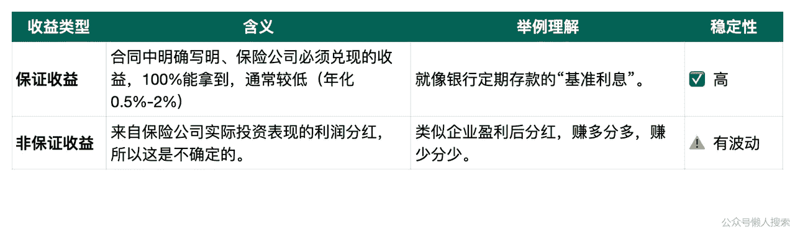

打个比方：保底回报兜的是底，让你清楚最坏情况下能拿多少；浮动分红开的是顶，给你争取更高回报的空间。

需要多花心思的，是浮动分红这块怎么构成。

香港金融环境特殊，险企在合规前提下能够配置全球资产，资产篮子里通常装两类东西（仅作示意，实际以产品合同为准）：

+ 固收类资产：债券、非标资产、银行存款这类收益平稳的品种，主要用来托住保底回报和流动性需求。
+ 权益类资产：股票、基金、股权投资、房产这类弹性较大的品种，主要负责撑起较高的预期回报。

投资端赚了钱之后，险企会按合同把一部分利润分给保单持有人，这就是常说的“分红”，也是浮动回报的大头。

但要留意：每家公司的产品架构、资产配比、保障成本都不一样，具体分配比例可能天差地别。

由此说来，香港险企面对的是全球资产池，美股、美债、欧洲、亚洲，哪边机会好就往哪边布局。

而内地险企的资金主要扎根本土，债券、股票、房地产能给出的回报空间相对有限。两边可投资产的差异，正是港险与内地分红险收益拉开差距的根本原因。

### 2. IRR：衡量真实回报的硬指标

#### 2.1 一张计划书的预期回报怎么读

翻开一份港险计划书，不少人头一个念头是：上面印的年回报 5%、6% 是真的吗？怎么算出来的？是不是每年就照这个数结息？

答案没那么简单，往下看便知。

保费交出去，并不是“交钱即生钱”，而是资金与时间两个变量共同发酵，即复利效应。储蓄险的收益关键正在于此：

+ 持有时间越久，承保开支、费用附加、销售开支这些前期成本被摊得越薄；
+ 分红或红利留在保单内不取，滚存生息，“利滚利”的加速度会让浮动部分更厚；
+ 香港监管要求演示文件必须展示标准、悲观、乐观三种情景下的回报路径。

好比同款产品、同样保费，甲拿满 10 年就收手，乙持有 20 年。乙靠着复利累积和开支摊薄，账户现金值与 IRR 通常会把甲甩开一截。

所以结论是：趁早入场 + 拿得够久 = 复利红利。

那险企到底怎么核算回报？和计划书上 5%-6% 的说法是什么关系？又凭什么客户赚钱、公司也赚钱？

险企算复利回报，并非简单地把一笔钱逐年滚利，而是用“内部回报率 IRR”这个工具。

说白了，你无需追问资金被投到哪些项目，也不必逐项核算管理费和保障成本。只盯住两端的数字——投进去多少、最后取回多少，险企据此倒推一个平均年化回报，这个数便是 IRR。

它把利息、红利、费用等复杂因素压缩成一个看得懂的复利增速，回答的问题是：这张保单平均每年让资金增长多少。

它反映保单真实的复利水平。合同上不会直接印出来，但通过每年的红利公告和账户价值表可以查到。

IRR 是必须重点盯的指标，看个例子更好懂：

假定拿一张储蓄型保单来看：年缴 1 万美元，连缴 5 年，险企逐年滚存。30 年后退保或支取，假设拿到 25.6 万美元（这就是复利滚出来的结果）。

中间夹杂着扣费、分红、滚存等一堆动作，险企不会让你逐笔算。他们只递给你一个答案——

这笔钱的平均年化回报（IRR）约 5-6%（属于内部模型，不会直接披露）。

这 5%-6% 便是 IRR。

拿不同产品的 IRR 做比较，口径必须对齐：

币种相同（USD / HKD）、缴费方式相同（趸交 / 期交）、持有期限相同（比如 20 年或 30 年）、领取方式相同（不领或按计划领），分红类型也要一致——英式产品别拿去和美式产品比。

这些条件齐了，算出来的 IRR 才有参照价值。

还有一点：长期 IRR 比短期 IRR 更值得看。

下面这张表列的是不同持有期的 IRR，期限越长越有参照意义。别误以为港险那个 6.5% 是保费刚交第一年就能拿到；前期往往连本金都还没回。

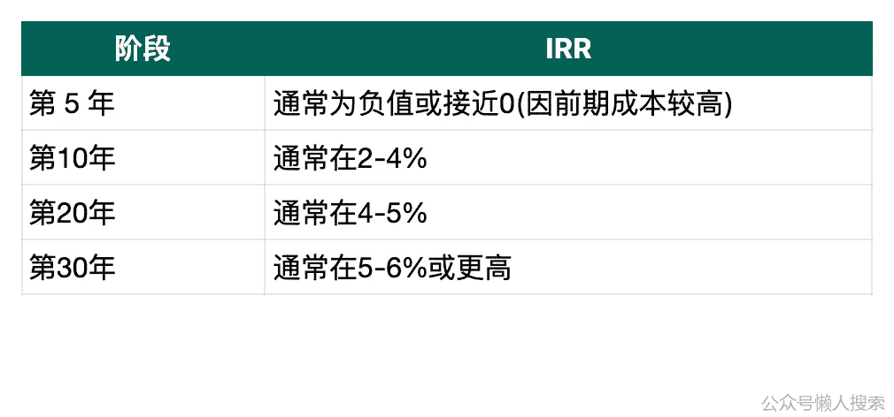

#### 2.2 IRR 数据去哪儿找

香港险企不会在合同或官网上直接标注“IRR = 5%”。不过，计算 IRR 所需的数据，险企必须提供，且能在官方文件里找到。

+ 第一步：找数据。

最直接的办法是看“利益演示表（Benefit Illustration）”，有两个入口：

入口一：官网查询。

入口二：向保险代理人索取产品 Illustration 文件（强制提供，最推荐，省时又准确）。

航海学习场景里，也可以直接问教练。

+ 第二步：锁定表格中的关键数据。

文件里一般会附一张类似下面的表。

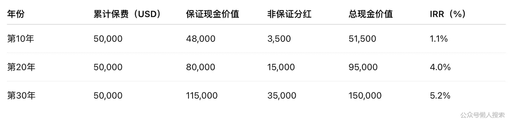

产品计划书通常给出总现金价值；具体产品的 IRR，可以让投保顾问帮你做一张对比表。

#### 2.3 为什么前期看着亏、后期反而赚

看险企能给多少钱，通常是站在终点往回看。可为什么早期看起来反而是亏的？

原因在于：保费交进去后，险企不会立刻把钱全额记入你的账户。资金还在铺路阶段，尚未进入投资池，得先分到以下三块：

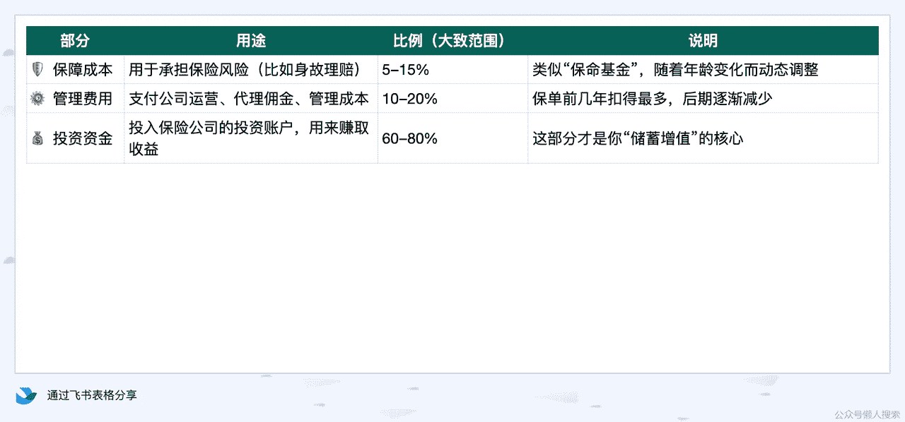

资金的整体流转路径，见下图。

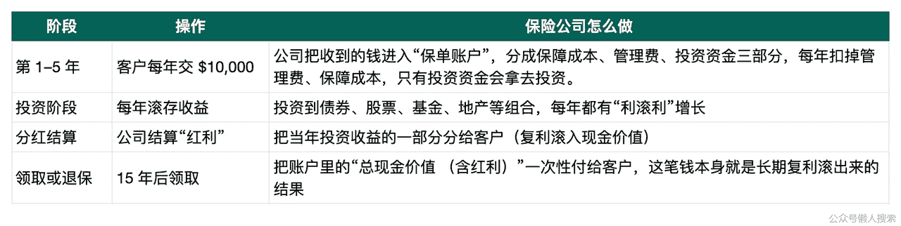

所以头几年退保会亏钱：险企的成本压在前头（先回本：销售费、管理费、风险准备金），收益却拖在后面（靠复利慢慢释放）。

举例：年缴 10,000 美元，第一年的 2,000–3,000 美元要拿去付销售佣金、管理费、开设基金账户等。因此账户上的现金值起初可能只有 60%–70%。

此时若提前退保，险企会把还没摊完的前期成本一口气全扣回去，“退保有损失”就是这么来的。

等前期费用摊完，后续管理费逐步走低，后面的资金全部进入投资池，收益继续利滚利（compound）。

再加上港险红利部分会自动累积，账户现金值的曲线往往在第 10 年之后加速上扬，回报越来越亮眼。

因此储蓄险通常是拿得越久回报越厚，复利的作用越明显。

## 05. 个个都说收益高，到底怎么挑

### 1. 险企怎么筛选

+ 偿付充足水平：数值越高通常意味着公司越稳，破产风险越低；在年报或监管披露文件里能查到。
+ 信用评级：国际评级机构会给险企打分，AA 及以上算高评级，A 算良好；低于 BBB 的不建议碰。
+ 运营时间与历史业绩：刚成立二三十年的，和经营了一两百年的，稳定性显然不在同一层次。
+ 股东背景与资本结构：能看清“后台是谁”。有人钟情百年老店，比如成立 180 多年的；也有人偏爱中资险企，如中国人寿、中国太平，不过也有一部分人对中资背景持负面看法，觉得背后有“看不见的手”。

### 2. 盯紧历史分红达成率

上一节讲了 IRR，它能衡量一款产品的真实预期年回报。你或许会追问：这个收益真能兑现吗？有没有办法判断可信度？

有。除了看 IRR，还要看“历史分红达成率（Fulfilment Ratio）”。它指的是险企过去发布的所有产品，在浮动回报部分实际兑现的比例。看个例子好理解：

某家公司分红达成率长期稳在 90% 以上，实际红利通常就接近计划书里的假设（比如演示 100 块，实际给到 90 块）。

要是常年低于 70%，实际红利可能长期跟不上演示（比如假设 100 块，实际只给 70 块）。

一句话：IRR 回答“这张保单最终能帮你赚多少”，分红达成率回答“险企以前说的话能不能兑现，别到头来全是画饼”。一个看收益，一个看信任。

各家公司分红政策、资产配置能力、投资风格不同，客户拿到的达成率自然也有差别。这也是选险企时要翻“过往红利兑现情况”的原因。

比率接近 100%，说明险企过去基本兑现了当初的浮动回报承诺；高于 100%，代表实际到手多于销售时的演示；低于 100%，则意味着没达到演示数额。

那分红达成率达到多少才值得考虑？给一个参考区间：

+ 90%-100% 以上：优秀，说明投资能力过硬且演示偏保守。
+ 80%-90%：合格，但要留意趋势变化。
+ 80% 以下：需警惕，可能演示过于激进或投资表现不佳。

所以分红达成率能检验预期收益 6.5% 到底是不是画饼。香港保险监管机构规定，险企必须在官网公布过去 5 年的分红达成率。买之前务必去查。

但也要清楚：历史分红达成率只是评估过往表现的参考，绝不是预测未来红利宣告的唯一指标。

投保前仍要综合考量产品适用性、保费承担能力、关键特性与风险等重要因素。

### 3. 分红达成率查询路径

可以在险企官网或监管机构网站查，也可以找投保顾问要一份汇总好的各家险企分红达成率对比表。

+ 第一步：点下方链接，会看到各公司披露分红达成率的页面，点选你想查的公司。

https://www.ia.org.hk/sc/fulfillment_ratio/list_of_insurer.html

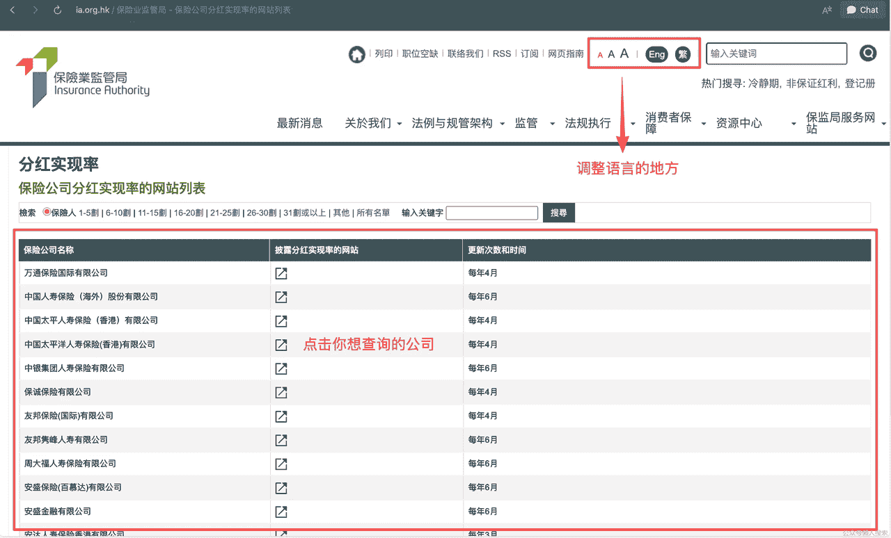

以“保诚保险”为例，点进链接后，可在保诚官网查看对应产品的“历史分红达成率”。

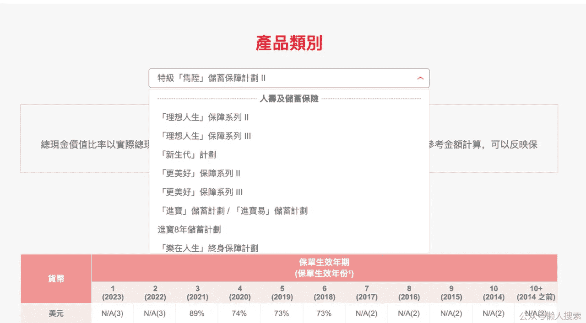

另外值得关注的是“账户现金总值比率”，它决定最终到手的金额。

举例：保单满 30 年时，计划书演示的收益总额（保底回报 + 分红）为 100 万，实际退保拿到 98 万，账户现金总值比率即为 98%。

### 3. 本章小结：三条判断标准

一句话概括：靠谱产品 = 稳的险企（安全）+ 兑现稳定（信任）+ 回报合理（回报），看三点：

+ 信用评级：国际三大评级机构为标普、穆迪、惠誉。AA 及以上算稳健；A 级算安全；低于 BBB 的不建议碰。
+ 内部回报率 IRR：收益度——平均每年让资金增长多少，重点看长期数值。
+ 历史分红达成率：信任度——险企过去承诺的预期收益能否兑现。

# 选修篇

# 一、如何设计你的储蓄分红险方案

## 01. 起步：先把需求和关键信息理清

💡 内容速览

想做一张合身的储蓄型分红保单方案，其实只要先完成这一项，就能把需求理清：请专业保险顾问出配置方案，或自己先筛选产品（通常建议找专业顾问，或问航海教练）、读懂计划书、敲定最终方案。

本节路线图

完成本章节的学习与操作，即可完成路线图中的：

第四阶段：读懂计划书，避开常见坑（共 6 天）

+ 明确个人核心需求，设定清晰的教育、养老或传承等目标（约 2 天）。
+ 读懂计划书关键信息（约 3 天）。
+ 敲定优化投保人、缴费年限、币种等配置细节（约 1 天）。

为了帮你设计出最匹配的储蓄型分红保单方案，先回顾重点，确保时间和金钱不白花。

如果基础保障型保险尚未配齐（如重疾险、医疗险、意外险），或者短期要用钱，建议优先做“保障类”方案，或先把应急金备好。

如果基础保障已到位，未来 5 年至少有 35 万人民币可投资资金，即便未来 10 年不动这笔钱，生活也不受影响，且你希望这笔钱慢慢增值、省心省力、不追求暴利。

那么，可以跟着教练一起设计你的“储蓄型分红保单方案”。

目标始终是让生活更舒适、开心，而不是追求刺激和富贵险中求。

想设计好一份最适合自己的储蓄型分红保单方案，大致需要以下步骤：

+ 确定主要需求。
+ 测算实现需求所需资金。
+ 确定交款方式：更倾向一笔付清还是分期交？
+ 产品选择：英式分红 vs 美式分红。
+ 提领方式：整笔取出 VS 每年提领。

接下来逐条拆解区别和要点，跟着操作，就能知道自己适合哪种储蓄型分红保单方案。

### 锁定主要用途

+ 教育金：给孩子备教育金必须提早动手，避免任何意外打乱教育计划。
+ 养老金：为未来的自己提前储备，养老金储备讲究确定性。
+ 财富传承：这笔钱未来能顺利、合法、清晰地传给下一代，且可实现无限传承。
+ 强制储蓄：没有具体或长远目标，单纯想存一笔钱。

用途不同，适合的产品方案完全不一样。所以上来不问需求就直接推产品的，都是假顾问。

### 2. 测算需求资金

#### 1. 教育金测算

案例：为 3 岁孩子准备大学及留学费用，目标金额 = 当前价格 ×（1 + 通胀率）^年数

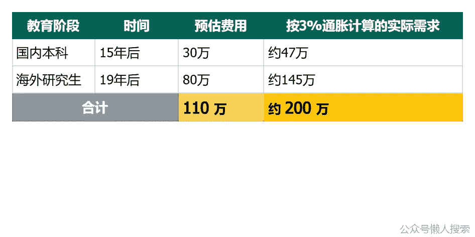

结论：孩子 18 岁开始用钱，你现在投保，有 15-19 年积累期。

提取方式：设定从第 15 年开始提取，每年取 20-40 万，提 4-6 年。

需要准备的不是 110 万，而是 200 万！

#### 2. 养老金测算

案例：40 岁开始准备，60 岁退休。

步骤 1：预估退休后的生活费。

+ 当前月生活费：1.5 万。
+ 退休后维持：60-70% 的生活水平 → 约 1 万/月。
+ 按 3% 通胀，20 年后需要：约 1.8 万/月。

步骤 2：计算养老金缺口。

+ 社保养老金：约 6000 元/月。
+ 企业年金：约 3000 元/月。
+ 合计：9000 元/月。
+ 缺口：9000 元/月，25 年约需 270 万。

步骤 3：确定储蓄险配置金额。

+ 建议准备缺口的 50-70% → 135-190 万。
+ 其余通过其他资产配置（基金、股票）。

#### 3. 财富传承测算

案例：希望给孩子留下一笔确定的财富，且代代相传。

考虑因素：

+ 希望传承的金额：500 万。
+ 时间规划：预计 25 年后。
+ 提取方式：不提取，或只在特殊情况下提取，让复利滚雪球。

这类保单的长处：

+ 确定性：可无限更换受保对象并拆分保单，受益人明确，定向传承无纠纷。
+ 杠杆性：可额外附加终身寿险，把身故保险金放大。
+ 隔离性：规避债务和婚姻风险。

### 3. 交款节奏：趸交还是分期

如果有一笔大额闲置资金 → 趸交/2 年期交。

如果希望分散压力 → 选 5 年期。

如果产品没有趸交，可选预缴：把两年或 5 年保费提前交给险企，险企会给出 4%-7% 的固定预缴利息。

预缴往往还伴随折扣和返赠，也就是险企给的优惠。比如全部保费 100 万人民币，选 5 年期产品，加上预缴利息和优惠，最后整体支出可能省下十几万。把这些算进去，整张保单的回报会更可观。

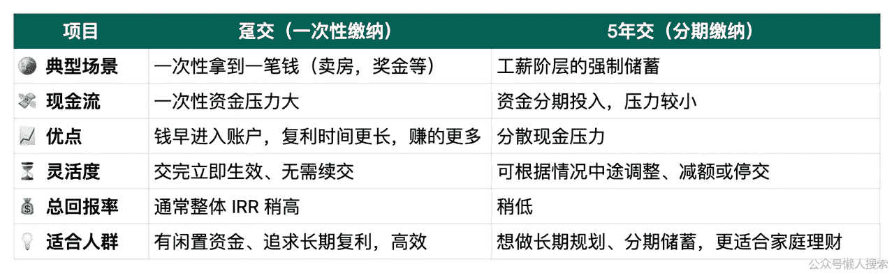

### 4. 产品类型：英式 vs 美式

香港储蓄型分红保单主要分两类：美式分红和英式分红。

美式分红：稳定现金流。

# 分红怎么领？先弄懂美式与英式的底层逻辑

买储蓄险之前，大多数人的第一个困惑是：分红将来到底以什么方式到手？答案藏在保险公司的派息机制里——一种是把红利折成现金每年发给你，另一种是让红利留在账户里继续滚存。这两条路线，对应的是完全不同的资金使用逻辑和收益预期。

## 美式分红：现金年年到账，适合靠息生活

这种模式最简单直接：每年产生的红利直接以现金形式发放，等于年年有真金白银进账，不用苦等十几年才看到回报。代价是长期收益率相对保守，大体维持在4.5%~5%这个区间。对已经退休、或者需要定期现金流维持生活节奏的人来说，这个选择非常契合。

拿某款代表产品来说：保费只交2年，第3年就能收回本金；从第3年起，每年按总保费的5%自动派发现金。第10年的IRR为3.71%，第20年的IRR为4.98%。

## 英式分红：红利留在保单里滚，追求长期爆发

这套逻辑走的是另一条路：红利不以现金给出，而是留在保单内部继续投资、持续滚存。好处是复利效应相当可观，持有时间拉到30年，复利有机会达到6.5%。不过，短期内看不到现金进账，账户净值的起伏也会更大一些。它更贴合年轻人，以及把目标放在长期财富增值、家族传承上的人。

以另一款产品为例：20年复利为6.12%，30年复利达到6.5%，收益由复归红利和终期红利两个引擎共同驱动。

## 到底怎么选？按需求对号入座

简单梳理一下：

- 需要固定现金流（比如养老）→ 选美式分红
- 追求长期收益最大化（教育金、传承）→ 选英式分红
- 两者都想兼顾 → 英式分红搭配定期提取功能

就大多数人的情况来说，我更推荐英式分红。不只是因为市面上主流的产品几乎都是英式设计，更关键的是，买香港保险的初心本来就是冲着长期收益去的。如果仅仅为了每年拿现金分红，那更适合五六十岁、已经进入退休躺平状态的人。

### 5. 提领方式：一次性取 VS 每年提领

买保险那一刻，很少有人能立刻决定：这份保单以后是选择一次性退保拿回全款，还是等到退休后每年慢慢领钱？所以最省心的做法是，投保之前就把同一款产品在两种情形的收益都看清楚——从买下一直持有到最后一次性退保，以及到了某个时间点开始逐年提领。

举个例子：30岁的女性，每年交5万美元，累计投入25万美元。假设分红实现率达到100%，20年后退保，含分红的退保金总额是676,783美元。这笔钱由三块构成：保证退保金额、复归红利（分的是保额，一经派发就确定了）和终期红利（身故或退保时才发放）。此时IRR为5.67%，换算成单利是9.48%。

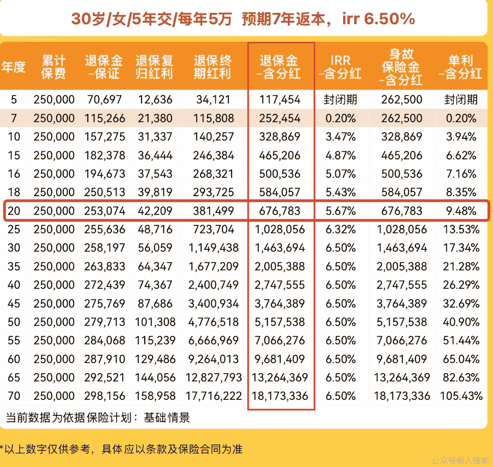

接着看同一方案在提领模式下的表现：

从第20年之后，也就是50岁那年起，每年拿走总保费的10%，也就是25,000美元；一直领到100岁，总计领走127.5万美元，保单里还剩886万美元可以留给下一代。

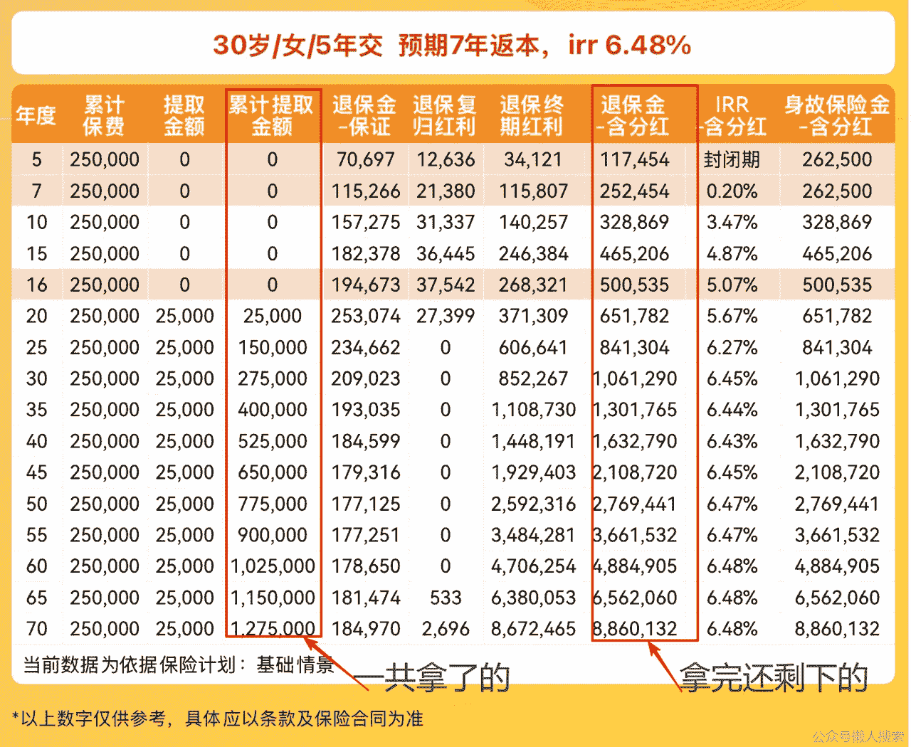

当然，提领演示只是帮助我们在配置前做到心里有数，并不代表日后一定要照着原计划执行。要知道，所有提领数字都建立在分红实现率100%的前提之上。

**需要专门提醒的是：香港储蓄分红险通常建议持有10年以上再考虑提领。买完就急着取钱，对多数产品的收益损耗相当大，特别容易出现“提着提着保单就断单了”的情况。**

## 02. 设计方案第二步：看懂计划书，不被销售牵着走

### 1.保单首页：

这页展示的是保单的基本档案，主要就是核对信息有没有出入。

---

受保人姓名：也就是被保险人，保障权益落在谁身上就是谁。

保单货币：比如美元。到底选哪种货币，要看未来的资金使用场景以及个人对汇率的偏好。

投保时的基本金额：这是用来测算保费和利益的基准线，跟实际赔多少钱没有直接关系。

保费供款年期：说白了就是“要交几年钱”，比如交5年。

保障年期：列明保障覆盖多长时间，不少储蓄分红险都能保终身。

补充一点：保费里的零头是保监局收取的征费，每张保单都有这一项。

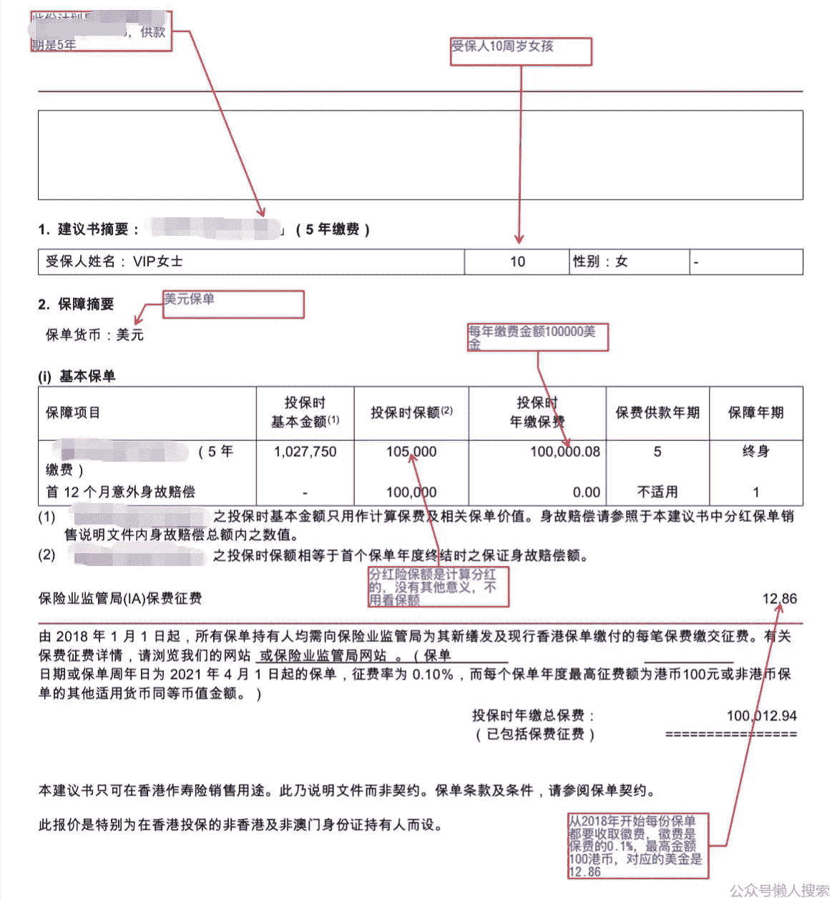

### 2.利益摘要：

这张表堪称整份保单的核心骨架，市面上那些简易版本计划书本质上都是从这一页演算出来的，它代表的也是“标准情况”——即分红实现率100%达成时的结果。

先看第一部分：保单年度终结以及缴付保费总额。翻译成人话就是：保单目前走到第几年了，累计已经交进去多少钱。

接着是第二部分：退保发还金额。这里记录的是如果你选择退保，能拿回来多少钱。里面明确分成保证与非保证两块。保证金额是白纸黑字写好的：到了哪一年、保单值多少，这部分铁定拿到手。非保证金额才是香港储蓄险高收益的真正来源，也就是分红。分红下面又拆出复归红利和终期红利，当然也存在没有复归红利的品种。一般来说，复归红利（派的是保额，一经派发即成定局）在总额中的占比低于终期红利（身故或退保时才兑现）。把这三块叠加起来，就是表格里显示的“总额”，代表那个年度预期的全部利益。

第三部分是身故赔偿金。香港储蓄分红险的身故杠杆极为有限，大约只有5%。例如第一年交了10万美元保费，万一不幸身故，拿到手的赔偿金约为10.5万美元。

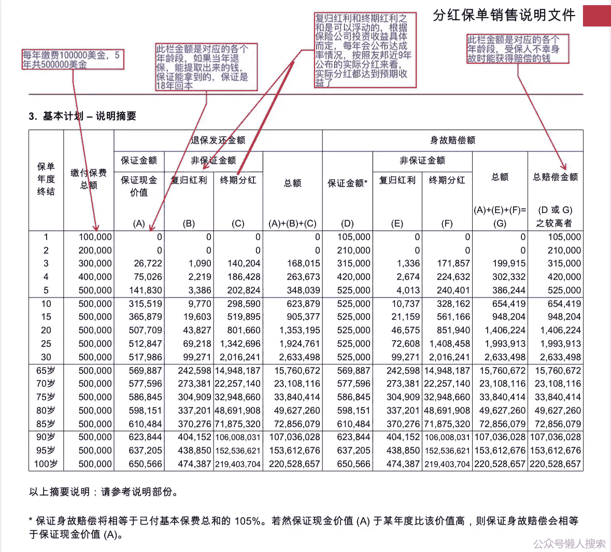

### 3.悲观、标准、乐观三种收益：

计划书会针对不同市场环境展示对应的分红预期，总共三档：

- 悲观：按最低收益假设来演算。
- 标准：偏保守的估计口径，保险公司需要对这个数字负责。
- 乐观：假设市场表现理想，给出最大化的收益预测。

我们要留意的，其实就是上一节利益摘要中的“标准情况”，因为它最接近真实落地的水平。

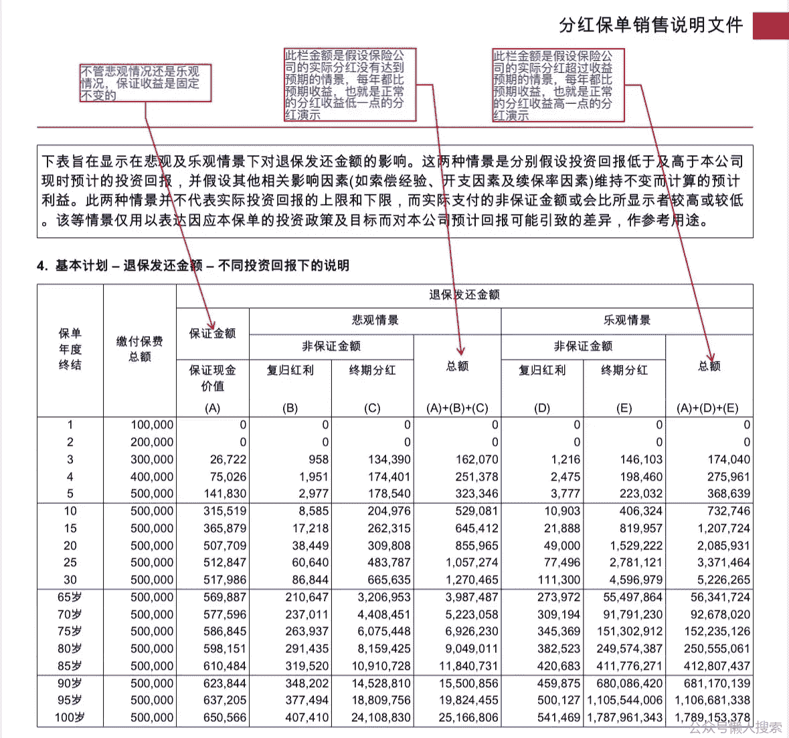

### 4.保单贷款：

保单的流动性先天较弱，但这反而使它成为资产固化的一件趁手工具。可万一真的急需用钱怎么办？这一页讲的就是保单贷款，拿来应对短期资金缺口是完全够用的。

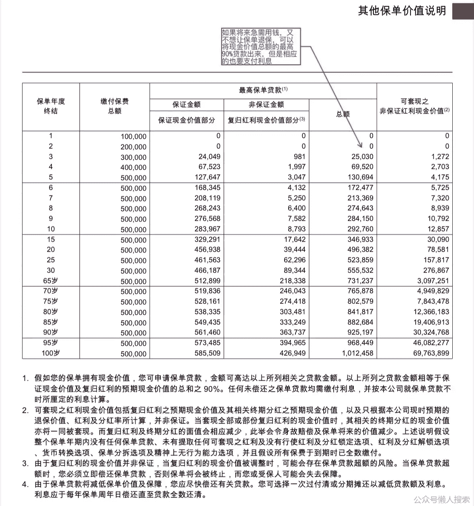

### 5.保单提领：

保单过了封闭期之后，只要产生资金需求，就可以放开手脚自由提领。市场上热传的各种提领密码，比如[557]，具体含义是：5年缴费期，第5年末起每年可以提取总保费的7%。这种“保费交完就能领、还能一直领到老”的玩法，确实精准击中了很多人想“提前变现”的心理。

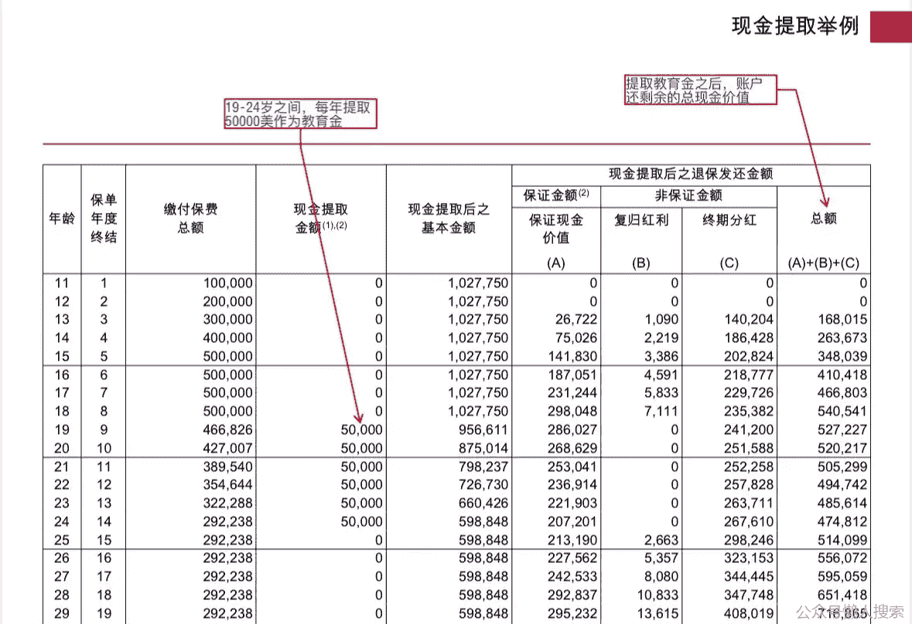

## 04. 设计方案第三步：优化配置细节

### 1.投保人、受保人、受益人的选择

这是方案设计真正意义上的“灵魂”。人选安排到位，保单价值就能最大化；安排错了，很可能目标直接落空。

**角色 1：投保人**

定义：出钱的人，也是保单控制权的持有者。

权利：能更改受益人、申请保单贷款、支取现金价值，也可以直接退保。

设计要点：投保人让谁来当，核心取决于【财富掌握在谁手中】。

常见安排：

- 夫妻共同出资时，收入更高的一方来当投保人
- 父母替子女投保时，父母担任投保人
- 如果目标是债务隔离，别犹豫，让企业主父母来做投保人

进阶设计：

可以预设【第二投保人】。第一投保人身故之后，保单管理权自动过渡给第二投保人。

**角色 2：被保险人**

定义：保单以其生命作为标的，本人没法领钱，可以看作“工具人”。

特点：被保险人身故，保险公司就要按约赔付身故保险金。

设计要点：被保险人定谁，要看【保单期限】的规划。

常规做法：为子女教育金做准备，就把孩子设为被保险人；为自己的养老金做储备，就把自己设为被保险人。

进阶设计：还可以设定【第二被保人】。这个功能对父母与孩子年龄差距悬殊，或者要做财富传承的家庭来说，分量极重。部分产品在投保时就能提前设置好，避免被保人一旦身故就直接触发赔付、合同立刻终止，导致复利增值被迫中断。

**角色 3：受益人**

定义：领取身故保险金的人。

权利：被保险人身故后，身故保险金归受益人所有。

设计要点：受益人怎么填，要同时考虑【风险隔离】与【传承意图】。

常规做法：建议写指定受益人，免得保险金落入遗产范畴，引发不必要的纠纷。

### 3.方案设计自查清单

还记得前面那张“一页纸决策单 1.0”吗？在原有基础上，再追加几个问题，把每个角落都照看到。我把核心问题汇总成10条：

- 我配置这份保单到底图什么？（教育/养老/传承）
- 需要准备多少资金？（把通胀因素算进去了吗？）
- 这笔钱大致什么时候要用？（确定持有期限）
- 将来是打算一次性退保，还是每年提领补充现金流？（动态收益和静态收益是两个概念）
- 每年缴费会影响正常生活品质吗？（最好控制在年收入30%以内）
- 我能保证按时缴费直到期满吗？（收入稳定性是前提）
- 挑选的产品类型适合自己吗？（保守/平衡/进取）
- 保证部分的占比，我能接受吗？（分红占总收益的权重可能相当高）
- 持有人/受保人/受益人三者安排是否妥当？（可以考虑提前设置第二持有人和第二受保人）
- 币种选择跟未来消费场景匹配吗？（关注有没有货币转换功能）
- 我有没有拿至少3款产品做过对比？（要确定这款在市场上足够能打，而不是看了一眼就冲动下单）

当这10个问题都有了明确答案，恭喜你，可以迈入下一步——正式投保。

本章小结：好方案的四个标准

- **目标明确**：清楚为什么买，要解决什么问题
- **金额合理**：不拖累生活，不超出资产配置比例
- **产品匹配**：特点贴合需求，条款看得明白
- **可持续性**：能坚持缴完费，不会中途放弃

提示：没有绝对最好的产品，只有最贴合自己的方案。

# 二、如何投保与管理

## 01. 投保前的准备工作

💡

**本章概要**

这一章聚焦两件事：投保流程和常见问题

**本章航线图**

学完并把本章操作过一遍，就能完成航线图里的：

第五阶段：搞懂投保流程，避开常见问题（共1天）

- 熟悉去香港投保的完整流程（约0.5天）
- 理清理赔与提取的流程（约0.5天）

### 1.确认产品和方案

动身之前，先敲定这些细节：

买哪家公司的产品、年交保费多少、分几年交清、预缴利息和保费优惠各是多少；

投保人、被保险人、受益人分别如何安排，币种选定哪一种。

### 2.预约保险公司

香港保险有一套硬规矩：必须提前几天预约，必须本人亲赴香港签单才能受到法律保护，在内地是没办法完成投保的；而且通常只有投保这一环需要人专程过去。

预约方式：让保险顾问协助你处理。

预约时间：一般安排在周一至周五的工作日。

预约地点：大都是保险公司总部或分公司。

### 3.准备证件

有效身份证（本人+被保险人都要带）

港澳通行证（务必确认签注还在有效期内，也可以提前在深圳前一晚赶去补签注）

入境小白条（过关时发的那张纸条，一定保存好别丢掉）

**建议同时准备：**

户口本（部分保险公司会要求查验）

结婚证（如果投保人和被保险人属于夫妻关系）

孩子的出生证明（被保险人是孩子时需要）

### 4.选择缴费方式

香港保险的首期保费，可以走这几条通道：

VISA信用卡刷卡（有额度上限，建议多带几张卡备着）

香港银行账户转账（最推荐，额度宽松不少；所以还没有港卡的话，投保当天也尽量抽空把卡开了，开户指引可以发给大家）

现金（香港过关时，个人最多能携带5000美元加2万人民币）

### 5.免责声明

**本手册只作学习参考，不会提到任何具体产品，也不构成投资建议或销售邀约。**

香港保险产品本身带有一定复杂性和风险，配置之前请务必做到：

1. 把产品条款和风险差异彻底弄清楚。不过条款、监管规则都可能动态调整，一切以保险公司最新正式文件为准。
2. 对照自己的真实需求和风险承受水平。每个人的财务状况、风险偏好、投资目标千差万别，手册内容未必适合所有人。
3. 找正规持牌顾问做一对一咨询。凡是涉及法律、税务、财务规划等复杂问题，一定要请教持牌的专业人士。

### 6.致谢

谢谢你能静下心读完这份手册。

财富管理是一门终身的功课，没有人能一步登天。真正重要的，是建立正确的认知，守住长期主义的定力，然后真的行动起来。

如果这份手册能帮助你：

- 看透香港储蓄分红险的本质
- 搭建一套有章法的决策体系
- 做出清醒理性的配置选择
- 为家人带去一份更踏实的未来

那就是我们最大的成就感。

最后，感谢赚钱团队，也谢谢每一位老板的同行。

人这一生，总得有一股善意的信念推着我们往前走。能在这里陪大家把财富打理得更明白，是我发自内心感到开心的事。

祝你在创业的路上，根基愈深，步履愈稳，走得更久更远；

祝你在理财的路上，判断愈准，回报愈丰，收获更多笃定。

往后常交流，逐步精进，一起等风来，也一起看花开。