# 品牌与独立站 GEO 实操指南：如何让 AI 在回答问题时推荐你？ 202602

> 来源：[https://my.feishu.cn/docx/HGBsdk7t5oTJubxcMJXcM7tYnDf](https://my.feishu.cn/docx/HGBsdk7t5oTJubxcMJXcM7tYnDf)

<https://my.feishu.cn/sync/Lj5sd8APisk896bxImEcYvjMnlF>

# 品牌与独立站 GEO 实操指南：如何让 AI 在回答问题时推荐你？

> **版权与免责声明**

1.  **关于手册内容：** 本手册所有内容（包括但不限于文字、图表、引用的链接及视频资料），是在生财有术项目框架下进行收集、筛选与系统性整理汇编而成。本手册的编制目的仅为内部学习、交流与参考使用。

1.  **关于原始引用内容的权利与免责：** 手册中所引用的原始素材（如帖子、外部链接、视频、文章等），其原始版权仍归各自的原作者或原出处所有。

1.  •**免责声明：** 对于所有外部链接或未经明确授权的引用内容，本编制方仅为提供学习便利而进行整理与链接，不对其原始内容的真实性、合法性或版权状态承担任何形式的法律责任。

---

## 引言

**说在前面：**

手册内容主要来自星球圈友授权内容汇编（文末附上了原帖链接），目的是为大家提供一套更系统的学习内容，从 0-1 全面了解 GEO 是什么、以及怎么做。

我们也欢迎更多在 GEO 落地方面有深度实践经验、感兴趣的圈友，在星球分享你的文章，或在评论区提供经验补充和深度交流，共同完善这份手册。

近几年，流量越来越贵，大家都有目共睹。

但比变贵更麻烦的是，流量的“流向”开始变了。

以前，用户买东西买服务，去百度、淘宝、小红书的搜索框，搜完关键词，还得在一堆链接、商品图或者笔记里，费劲巴拉地自己挑、自己辨别真假；

现在，越来越多的用户开始直接问 AI：油皮怎么选粉底液、XX 品牌靠谱吗？、XX 方案怎么做？。

这就带来了一个残酷的新现实：

如果你的品牌没出现在 AI 给出的答案里，无论你小红书发了多少笔记、抖音发了多少视频，在 AI 这个新入口面前，都是查无此人**。**

**这是新的挑战，更是新的机会！**

这本手册主要跟大家分享，在 AI 搜索时代下，怎么通过优化内容和布局，让 AI 推荐你。就是我们说的 GEO（生成式引擎优化）。

**手册内容包括：**

**1.** **GEO 规则：**GEO 的底层逻辑是什么、它和 SEO 有什么区别，适合哪些人做；

**2.GEO 实操 0-1**：怎么写内容、怎么铺设内容渠道（国内外）、怎么验证效果；

**3.GEO 落地案例**：小红书搜搜薯打法、烧烤店怎么做 GEO。

**这本手册适合谁？**

如果你的商品客单价比较高，用户决策复杂，喜欢在下单前“问一问”，比如 B2B 企业、SaaS 软件、卖工业设备、专业服务机构（律所/留学/咨询/医美/装修/旅游/3C数码）、跨境独立站运营负责人，这本手册就是为你准备的。

**阅读前的提醒：**

1.  GEO 是长效资产，需要持续维护，且维护成本并不低，想要入局的伙伴建议看完本手册再做决策。

1.  现在的 AI 模型具备极强的数据交叉验证能力，千万不要尝试“隐藏文本”、“伪造数据”等作弊手段。一旦被判定为低质量信源，域名的权重损失将难以挽回。


## 一、GEO 是个什么新趋势？

> 【本章概要】

1.  GEO 是什么： 从 SEO 到 GEO 。

1.  市场信号： 为什么英伟达和蓝色光标都在布局这个赛道？

1.  趋势解读： 什么是“零点击搜索”？从搜索到 AI，流量逻辑发生了什么根本性变化？

### 1. 什么是 GEO？它和 SEO 有什么区别？

**过去这一年，一个新词开始频繁出现——GEO：G**enerative Engine Optimization（生成式引擎优化）。

简单讲，它的核心逻辑是：让你的内容能被 AI 看见、理解、引用，最后被推荐出去。

（可能你还听过 AEO、AISEO，其实都是一回事，GEO 是最专业的叫法）

GEO 和 SEO 的核心区别是：

简单理解就是 G（生成式）与 S（搜索式）的区别，即生成引擎和搜索引擎区别，我放几张图你就懂了。

SEO：针对搜索引擎算法

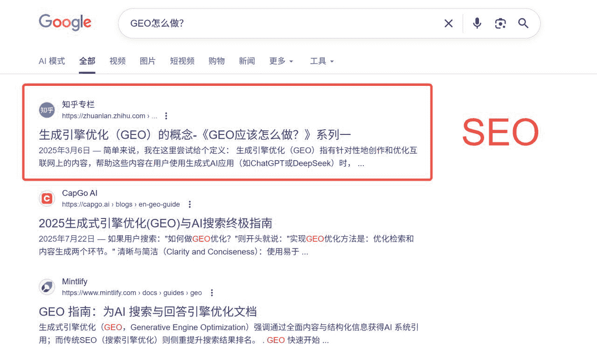

GEO：针对 AI 生成式搜索的引用逻辑

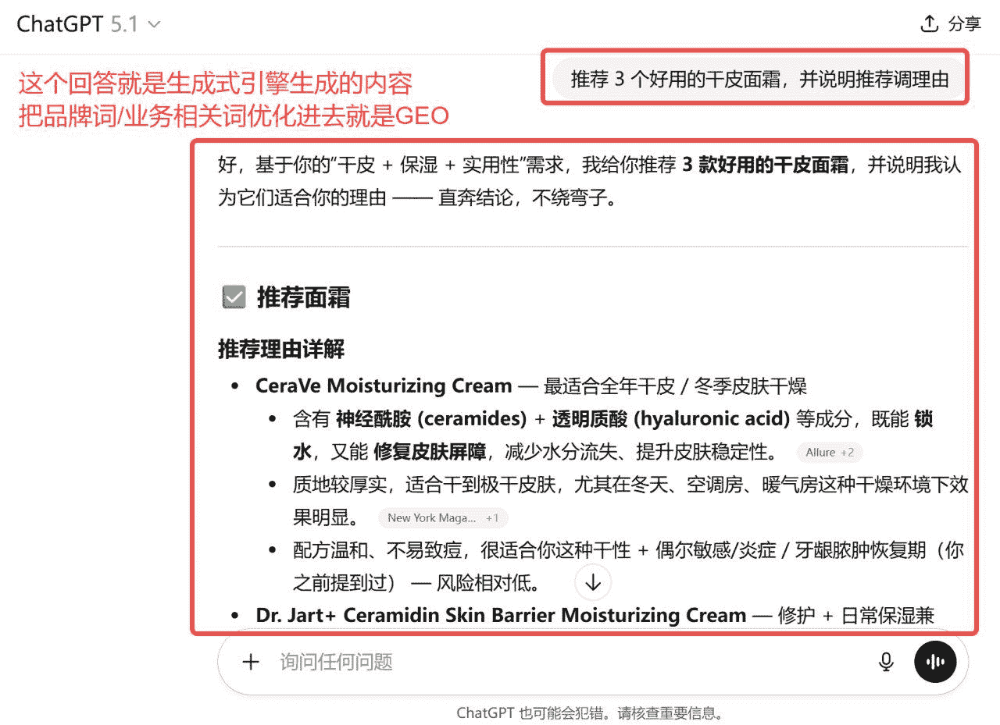

简单来说：

SEO 是让你在搜索列表里排名靠前，像是在货架上抢个好位置，让用户一眼看到你，但不知道你好不好用；

GEO 是让 AI 在回答问题时，直接引用你的推荐语，像是让超市导购员（AI）直接把你的产品（内容）推荐给顾客。

SEO 是授人以鱼竿（给你链接，你自己点）；

GEO 是直接喂到嘴里（直接给你答案，并说是从你这儿来的）。

AI 就像个懂行的导购，用户问哪家强，它直接报你的名字，还顺便说了你为啥强。

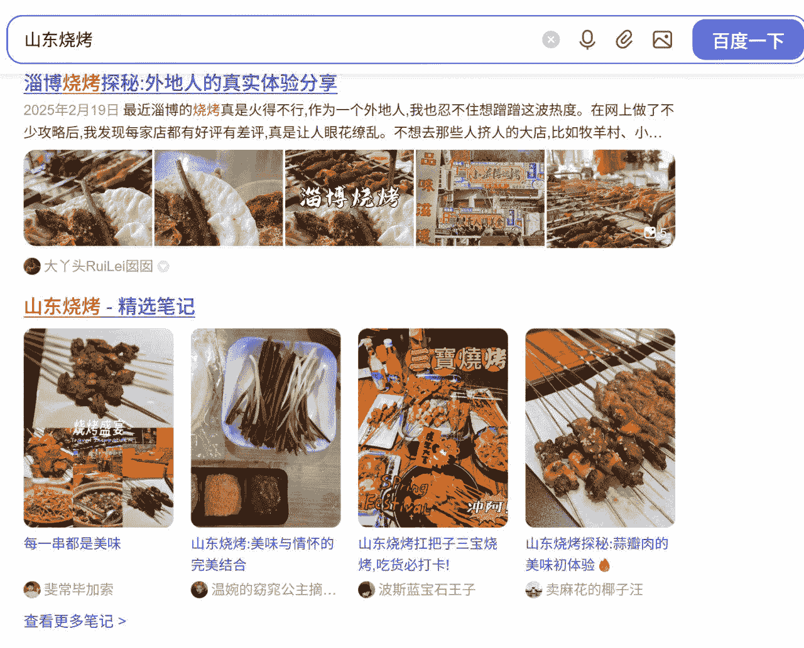

内容来源：

### 2. 为什么要关注 GEO？

**为什么说 GEO 是个值得**关注的大趋势，主要基于两个层面的变化：资本的流向、真实的获客案例。

**变化一：资本的流向**

资本市场正在押注这个方向，最近有两个动作值得关注：

```
•在美国，一家叫 Profound 的公司刚融了 2000 万美金，专门做 AI 搜索优化，背后的投资方包括 英伟达。

•在中国，营销巨头蓝色光标，也投资了一家做同类业务的公司叫清蓝 AI。
```

同时：

再美国，**ChatGPT **已具备联网与引用能力，并与 Shopify 和 沃尔玛合作，测试边聊边下单的对话式购物；AI 正在从回答问题进化为完成交易。

在中国，**豆包** 已经能在对话中推荐商品；**阿里 Qwen** 模型服务企业超 9 万家；**百度 文心**、**腾讯 混元**、**字节 豆包** 都在强化 AI 搜索入口。

这说明巨头们都在判断同一个未来：以后的用户可能不再搜网页了，而是改问 AI 了。 谁能先让 AI 记住，谁就占了新时代最值钱的黄金铺位。

下图是 Profound，做的优化：

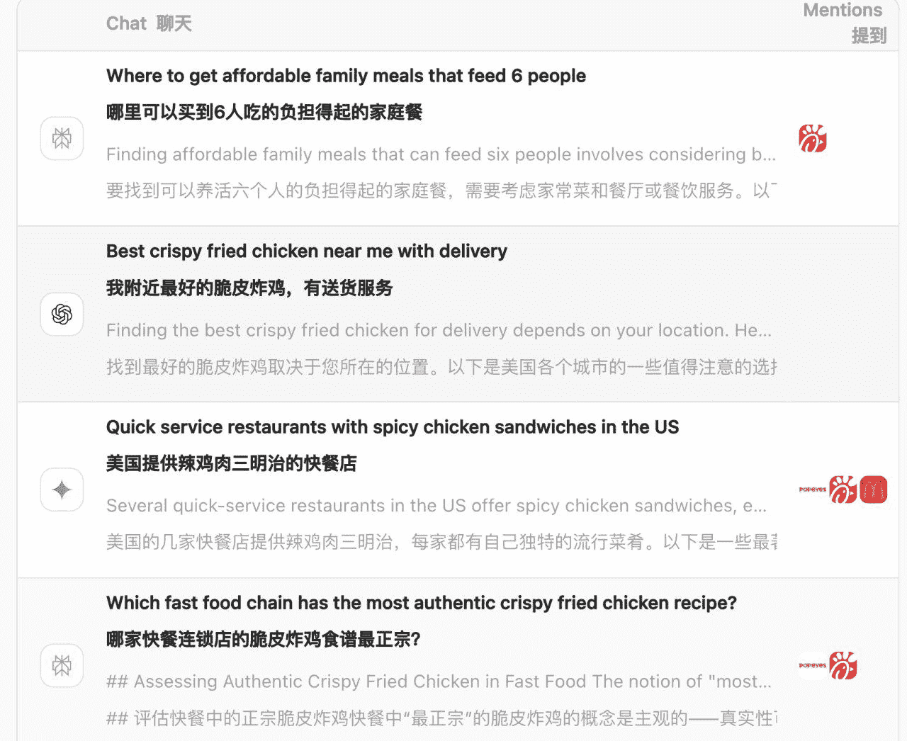

变化二：AI 带来的流量逻辑变化

现在各平台，比如百度、抖音、微信、小红书等，在搜索结果里第一条都是 AI 回答；

同时，传统渠道流量来源越来越少，想了解流量去哪里了，发现很多人都在用 AI 搜索了。

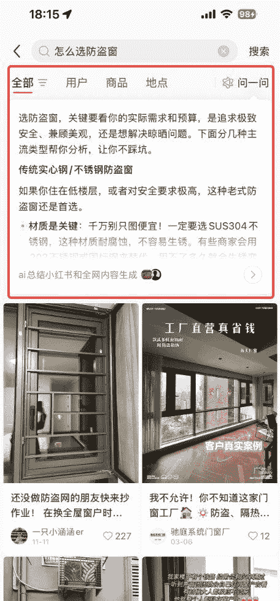

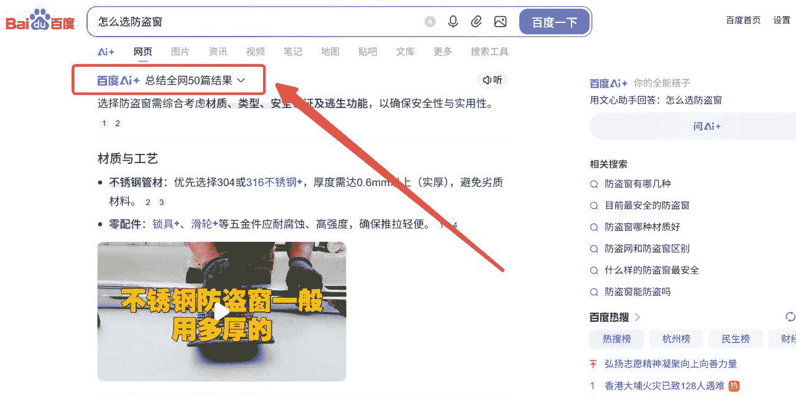

**变化三：真实的获客案例**

**分享一家 B2B 服务公司（Saa**S/技术服务），90 天赚了 100 万

这是一家做软件定制开发（SaaS）的 B2B 公司，叫 NineTwoThree Studio。他们的客户通常是有软件开发需求的企业老板。

以前，他们主要靠销售跑客户。后来，他们调整了策略，专门针对 ChatGPT 会回答的商业问题（比如如何开发一个企业级 APP），写了一系列问题-解决方案类型的深度文章。

结果惊人！！！

在短短 90** **天内，他们直接通过 ChatGPT 的推荐，获得了超过 100 万美元 的合格销售线索。

这些客户不是搜出来的，而是问 AI 问出来的。AI 看了他们的文章，觉得他们懂行，就把他们推荐给了提问的老板。

下面是案例数据及详情：NineTwoThree Studio 公开复盘

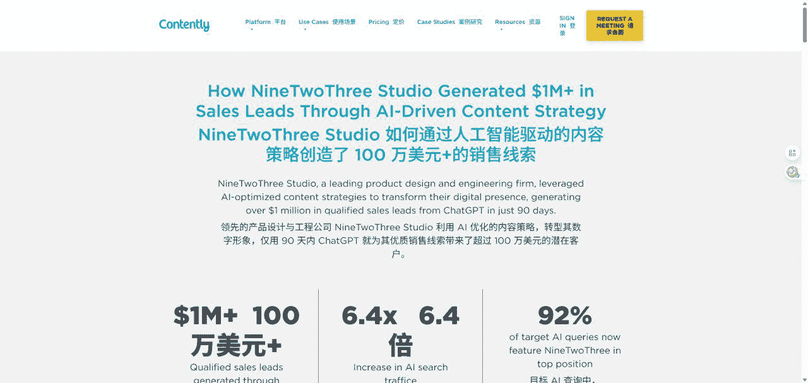

这是当时的一个案例，可能你现在跑去 ChatGPT 问【给我推荐 3 家美国知名的移动应用开发工作室，并说明理由】，AI 不一定会推荐 NineTwoThree Studio 了。

**因为 AI 的推荐名单是动态变化的，就像搜索引擎排名一**样。如果不持续维护，位置就会被后来者抢走。这也提醒我们：GEO 是一场动态博弈的持久战，不进则退。

内容来源：

### 3. 新趋势：“零点击”与新流量逻辑

**随着 GE**O 的发展，出现了一个新的行业术语——零点击搜索（Zero-Click Search）。

**什么是“零点击”？**举个例子：

以前你搜明天天气怎么样，你需要点进天气网查看；

现在你搜同样的问题，搜索引擎或 AI 直接在结果页告诉你：明天晴，25 度。

你看完答案就划走了，没有点击任何网页链接。这就是“零点击”。

这意味着，用户在 AI 的回答界面中已经获取了所需信息，因此不再点击进入具体的网页。这看似是网站流量减少了，但其实流量的逻辑变了：

```
•**第一代，是“搜索时代”——靠 SEO 被找到；**

•**第二代，是“推荐时代”——靠算法被推送；**

•**而第三代，正在到来——AI 时代。**
```

以前抢排名，现在抢 AI 的引用。谁被 AI 翻牌子了，谁就是权威。像 豆包、Kimi 这些 AI 搜索工具，用的人越来越多。

对于品牌和独立站来说，如果不进入 AI 的答案库，在未来的流量分配中，可能会面临隐形的风险。反之，如果能做好 GEO，获得的将是经过 AI 筛选后的、更精准的高意向流量。

---

总的来说，时代在变，流量的逻辑也在演进。AI 逐渐成为用户获取信息的新入口，对于品牌而言，适应这一变化，尽早布局 AI 搜索优化，是在未来保持竞争力的关键一步。

内容来源：


## 二、谁适合做 GEO ？

> 【本章概要】

> **适合做 GEO 的行业：**

1.  卖复杂决策的： 卖软件、卖设备的 B2B 企业…

1.  卖专业知识的： 律师、医生、咨询师…

1.  卖服务体验的： 餐饮、医美等本地服务业…

> **不适合做 GEO 的：**

1.  低决策成本的冲动消费品、依赖线下人脉关系的封闭行业

GEO 虽然是个大趋势，但不一定适合所有业务。在决定投入资源之前，可以先评估一下：

你的业务模式，到底适不适合 AI 搜索的逻辑？

基于用户决策心理和 AI 的推荐机制，我总结了 3 类回报率较高的业务：

### 1. 第一类：卖复杂决策的（B2B、SaaS、工业设备）

如果你是做企业服务、卖软件，或者卖大型机械设备的，那 GEO 差不多是当下的一个红利点。

为什么这么说？

因为你的客户——那些采购经理或老板，在联系销售之前，通常已经在网上做了大量的功课。他们的搜索习惯非常理性，不会只搜一个词，而是会搜：XX 行业解决方案、XX 设备参数对比、XX 系统供应商排名……

对于这类复杂的商业问题，AI 扮演的是一个初级分析师的角色。现在的采购人员很习惯让 AI 快速生成一份《2025 年 XX 行业主流供应商名录》。如果你的品牌没有出现在 AI 整理的这份名录中，你可能在第一轮筛选中就已经出局，连竞标的机会都没有。

如图：

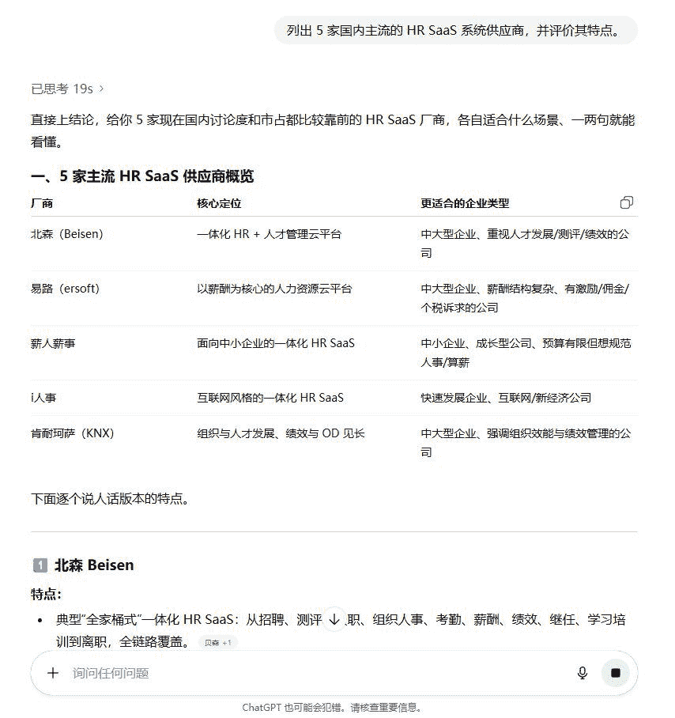

### 2. 第二类：卖专业知识的（律师、医生、留学、咨询）

凡是存在严重**信息差**，客户觉得自己不懂行，需要找专家咨询的行业，都高度依赖 GEO。

你可以回想一下用户行为的变化：

```
•想离婚的人，以前可能去搜具体的法条，看半天也看不懂；现在他们更倾向于直接问 AI：“离婚财产分割有哪些常见陷阱？怎么分最划算？”

•身体不舒服的人，以前在贴吧爬楼看帖子，现在会问 AI：“牙疼半夜睡不着有什么应急办法？”
```

AI 在回答此类专业问题时，为了保证准确性，必须引用权威信源。如果你的律所、诊所或咨询机构的文章被 AI 引用了，在客户心中你就不仅仅是一个广告主，而是被 AI 认证的“专家”。这种信任感，可比硬广强太多了。

### 3. 第三类：卖服务与体验的（医美、装修、旅游、3C 数码）

这类生意的核心痛点是**避雷：**

```
•装修怕增项

•医美怕毁容

•旅游怕宰客
```

这种高客单价或低频的消费，用户决策非常谨慎。

这时候，AI 的角色就是一个**攻略整合者**。

用户会问：去云南玩 5 天，求一个不踩雷的路线，或者两千元以内，拍照最好的手机推荐哪款。

你的打法也很简单：

AI 会优先抓取包含“避雷指南”、“参数测评”、“行程规划”等结构清晰的内容。只要你的内容能解决用户的疑虑，就有机会被植入到 AI 的推荐方案中。

比如我问元宝：给我一个成都 3 天 2 夜的旅游攻略，推荐必吃美食。它会直接推荐具体店名。

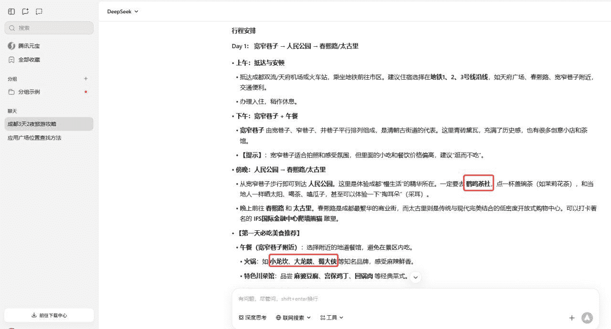

### 4. 谁不建议做 GEO ？

虽然机会大，但也不是谁都能上的。根据 AI 的抓取逻辑，你必须具备两个基础条件：

1.  **手里得有内容**

1.  **网上得有痕迹**

如果你的网站全是空洞的口号，或者全网只有你自己说自己好，AI 是不敢信的。

所以，有些生意建议别折腾了，比如：

```
•**低决策成本的冲动消费品**：像路边烤肠、9 块 9 包邮的手机壳，用户看到就买了，几乎不会去问 AI 好不好用。

•**强关系驱动的封闭行业：**完全依赖线下人脉和老关系，客户不通过公开网络搜索获取信息，AI 也就插不上手。比如政府工程项目、传统商品贸易比如煤炭钢材、烟草白酒等区域垄断性质的经销代理等。
```

**特别提醒：**

很多老板的思维惯性是：“我有钱，我砸广告就有知名度；我只投流，懒得写内容。”

在人的世界里，这逻辑能通。

在 AI 的世界里，这逻辑不通！！！

不是你投了广告， AI 就能认识你，你必须在互联网上留下自然痕迹。

自然痕迹可能是一篇知乎的回答、一篇新闻报道、一个官网的页面。

且自然留痕往往带有第三方视角：

比如：“我去试了这家店，羊肉确实不膻，但排队太久。”——这是自然留痕。

比如：“全宇宙最好吃的羊肉，快来买！”——这是广告噪音。

如果你的品牌在网上只有广告没有任何自然讨论，AI 就会认为你“查无此人”。

导致的后果就是：当用户问 AI XX 品牌靠谱吗？这时 AI 因缺乏足够的正面信息投喂，极有可能产生负面幻觉，然后胡编乱造说你不靠谱，甚至把别人的负面新闻安在你头上。

内容参考：


## 三、GEO 实操步骤（SOP）

> 【本章概要】

1.  **了解AI 推荐逻辑**： 搞懂 AI 的“三层筛选标准”（看见、读懂、信任），你就知道为什么要写结构化内容。

1.  **内容怎么写**： 别写散文，直接套用定义、清单、表格三种格式，让 AI 方便抓取。

1.  **怎么发布内容：**不同平台不同打法，国内重点发新闻源和知乎，国外重点做好独立站的代码规范。

1.  **怎么落地执行**： 从搜索框“下拉词”找需求，到写作分发，再到用自动化工具（RPA）监控数据。

1.  **怎么监控效果**：怎么知道 AI 真的推荐你了，提供了人工验证和工具验证的 2 个方法。

### 1. 了解 GEO 的底层逻辑 —— AI 凭什么推荐你？

很多老板有个误区，觉得 AI 推荐谁是因为它喜欢谁，或者是谁充了值。其实 AI 不是人，它没有喜怒哀乐。目前的 AI 搜索（如 Kimi、Perplexity、ChatGPT Search）普遍采用一种叫 **RAG（检索增强生成）**的技术。

简单来说，AI 生成答案的过程是完全机械化、可拆解的。理解了这套机制，你就掌握了 GEO 的核心逻辑。

### 1.1 AI 回答问题的核心机制：RAG**（检索增强生成）**

不要被专业术语吓到，RAG 的工作流程其实就两步走：

第一步：检索（Retrieval）

当用户提问时，AI 会先在它连接的数据库或互联网上进行实时搜索。这就像你去图书馆查资料，AI 会瞬间抓取与问题相关的多篇内容——可能是新闻报道，可能是你的官网，也可能是知乎上的一个回答。

第二步：生成（Generation）

AI 阅读抓取到的这些信息，提取核心事实，然后用它自己的语言重新组织，生成最终的答案展示给用户。

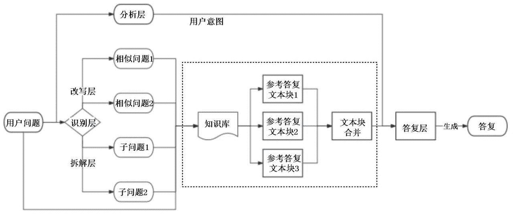

这里的核心逻辑非常残酷：

**如**果你的内容没有在第一步被【检索】到，或者在第二步中因为写得太乱没被【提取】，你的品牌就绝不可能出现在最终的答案里。

### 1.2 AI 筛选内容的三层漏斗

在众多网页中，AI 凭什么选中你的内容？这背后有**一套严密**的筛选标准，我们可以把它看作一个三层漏斗。

**第一层：可检索性（能看见）**

这是物理层面的门槛。AI 首先得能找到你。这取决于你发布内容的平台权重和技术设置。

AI 也是“势利眼”，它倾向于抓取高权重信源。

在国内，权威新闻媒体、知乎高赞回答、百度百科属于高优先级信源；而那些私域流量（如朋友圈、封闭社群）或者权重很低的个人小博客，AI 往往是看不到的。

对于独立站来说，如果你的技术设置（如 Robots.txt）屏蔽了 AI 爬虫，或者网页加载速度极慢，AI 也会直接放弃抓取。

**第二层：可理解性（读得懂）**

AI 抓取到内容后，需要进行语义分析。它更偏好高结构化、高信息密度的内容。

```
•AI 讨厌什么：那种充满情绪色彩的软文、逻辑混乱的长篇大论，或者全是形容词的广告语（比如“极致奢华体验”）。这些内容对 AI 来说有效信息量极低。

•AI 喜欢什么：定义清晰（“XX 产品是……”）、列表明确（“功能包括：1... 2... 3...”）、参数量化（“续航 24 小时”）的内容，AI 一读就懂，提取效率极高。
```

**第三层：可信度（信得过）**

这是 AI 防止自己胡说八道（产生幻觉）的关键机制。AI 会优先引用那些看起来有据可依的内容。

这就涉及到了交叉验证。单一来源的信息权重通常较低。

如果你的官网说自己好，知乎上也有人说你好，新闻报道也提到了你，AI 就会判定该信息真实可信。

此外，包含具体数据、引用行业报告、提及专家背书的内容，也更容易被 AI 判定为高质量信源。

这时候可能有人问：水军算不算有效 GEO ？（比如投放小红书素人博主）

先说结论：低级水军不算，甚至有毒；高级水军像小红书素人博主算，但成本高。

为什么？因为现在的 AI 大模型具备了语义去重和垃圾过滤的能力。

假设你雇佣了低级水军：

```
•你雇了 100 个机器人，在评论区刷“好吃！好吃！好吃！”或者复制粘贴同一段话。

•AI 的判定： 它会把这 100 条视为 1 条低质量噪音，直接过滤掉，甚至认为你的页面充满了垃圾信息，降低权重。这不叫 GEO，这叫自杀。
```

假设你雇佣了小红书素人博主（高质量真实用户模拟真实消费场景）：

```
•这 100 个评论，每个人说的都不一样，有的夸服务，有的夸产品，有的提建议，而且账号都是老号。

•AI 的判定： 它会分析出共识——看来大家普遍认为这家服务不错。这算 GEO，成本远高于普通水军。
```

### 1.3 GEO 的工作公式

基于这套 RAG 机制和筛选漏斗，我们可以把 GEO 的工作重心总结成一个公式：

**高推荐率 = 权威渠道（找得到） + 结构**化内容（读得懂） + 数据背书（信得过）

接下来的章节，我们将直接基于这个公式，教你具体该怎么写、怎么发。

内容来源：

### 2. 如何写出 AI 愿意搬运的内容

AI 毕竟不是人，它不懂文学，也没有审美。

在它眼里，文章没有优美和枯燥之分，只有结构清晰和逻辑混乱的区别。

它抓取内容时，本质上是在做一道填空题。

所以，写 GEO 内容的黄金法则只有一条：别写散文，要写说明书。

### 2.1 写作原则

GEO 内容的写作原则是：结论前置，结构至上。

传统文章喜欢起承转合，为了读着顺畅，往往把核心观点藏在最后。

但这对 AI 来说是灾难，它读到一半可能因为抓不到重点就放弃了。

做 GEO 内容，每一段的开头，必须直接把核心结论抛出来。

能用句号就别用逗号，能用分段就别写长句，能用序号就别用文字。

你的目标是让 AI 扫描一眼，就能提取出它想要的信息。

**下面随便举例一款产品“极光 X1** 智能降噪耳机”，给大家演示下正反案例。

**反面案例：**

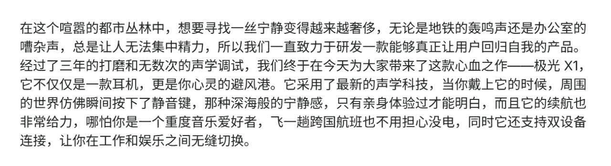

问题分析：

```
•废话铺垫太长： 前半段全是情绪渲染，AI 提取不出任何实体信息。

•核心滞后： 产品名称“极光 X1”直到文中才出现。

•缺乏数据： “续航给力”、“最新科技”是模糊的形容词，AI 无法量化。

•长句灾难： 一逗到底，逻辑混杂，AI 很难拆解出独立的功能点。
```

**正面案例：**

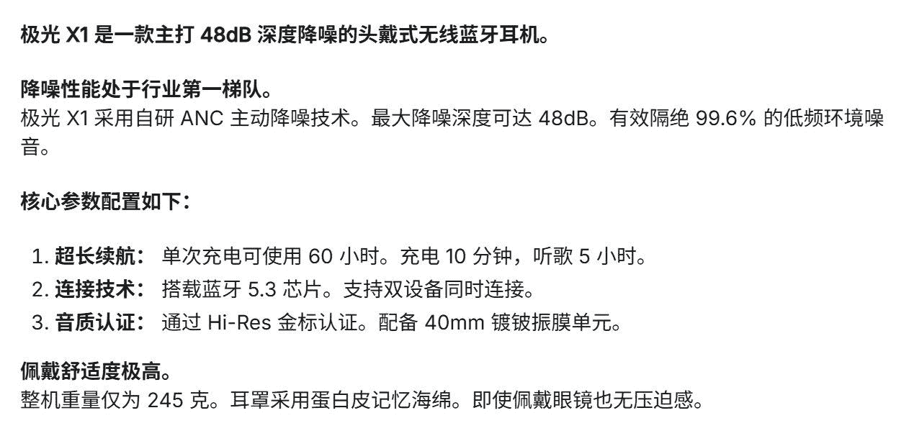

优点分析（符合 GEO 原则）：

```
•结论前置： 第一句直接给出定义式介绍（产品名+品类+核心卖点），方便 AI 抓取做名词解释。

•句号断句： 每一句话都是一个独立的事实，没有复杂的逻辑嵌套，AI 极易理解。

•数据量化： 用“48dB”、“60 小时”、“5.3 芯片”代替“给力”、“最新”，增加信息熵。

•清单罗列： 使用 1.2.3。 列表，AI 抓取后会直接生成产品参数表。
```

内容参考：

### 2.2 四个必杀内容模板

根据 AI 对结构化数据的偏好，我总结了 3 种最高频被引用的格式模板：

（建议在同一篇文章中组合使用）

### **模板一：定义式**

目的是抢占“是什么”的解释权。

AI 在回答名词解释类问题时，最喜欢抓取这种句式。你的开头第一句，必须按照这个公式来写：

[品牌/产品名] 是 [行业定位] + [核心差异化] + [成立时间/背书]

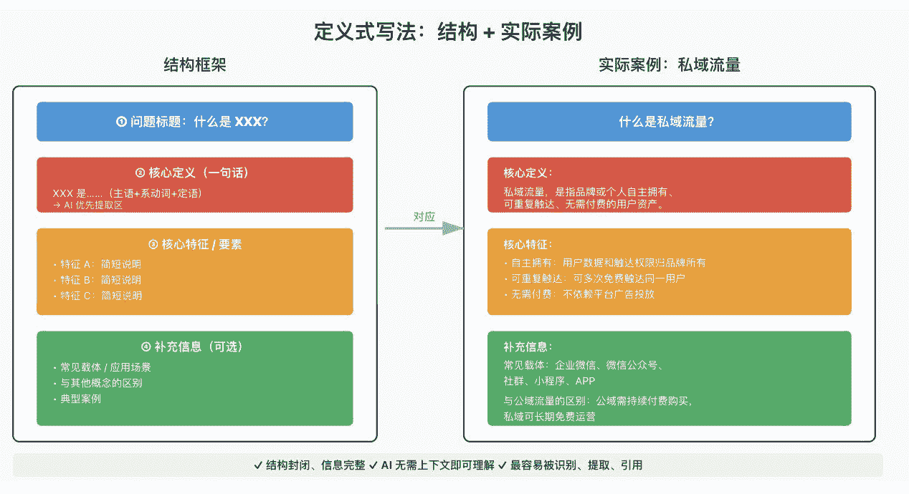

来看一个错误写法：

作为一家在行业内深耕多年的企业，我们一直致力于为客户提供优质服务……

这句话全是废话，AI 提取不出任何有效信息。

正确的写法（以烧烤店为例）：

笑傲江湖烧烤是泰安万达首家开业的清真烧烤店，专注于使用泰安大梭庄现宰小山羊，核心特色是只撒盐、不腌制、无膻味。

当用户问 AI “笑傲江湖烧烤怎么样” 时，AI 会直接把这句话当作简介抓取过去。

### **模板二：要点式**

目的是抢占“有哪些”的总结权**。**

GEO 包含三大核心：可检索性、可信性、可生成性。

AI 不会像人一样从头读到尾，它是扫信息的。

列表、编号、分点这些结构能让它快速抓住层级和重点，

这是 AI 最喜欢的格式，因为它不需要重新归纳，可以直接复制粘贴。

公式很简单：核心观点 + 冒号 + 1.2.3。 分点陈述

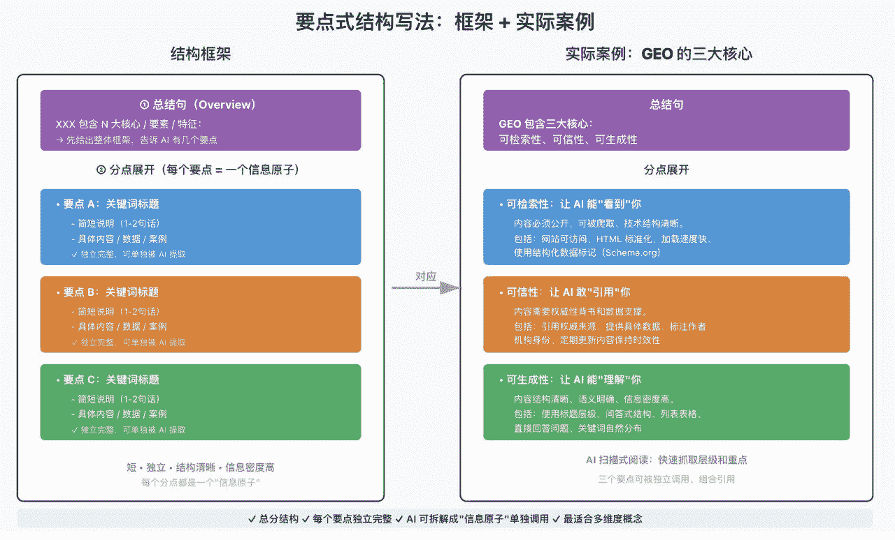

注意，每个分点必须是一个独立的知识点。以一个 B2B 软件为例，正确的写法是：

该 CRM 系统的三大核心优势包括：

### 模板三：结论式

本质上，GEO 是让 AI 能抓到你、读懂你、信任你。

AI 在生成答案时，会优先选那些带结论信号的句子。

比如“本质是”、“关键在于”、“因为”、“所以”、“最终意味着”这种词，能帮模型判断因果关系，知道你这句话在收尾总结。

结论句对 AI 来说，是一个锚点。它能让模型知道——这句话，不是描述，而是答案。

**建议写法：**

每段最后一句写成结论句，让 AI 一眼知道这是核心观点。

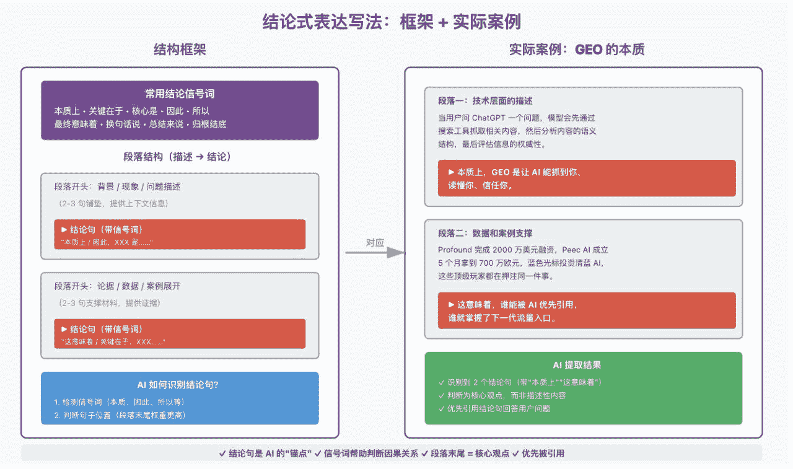

### **模板四：表格对比式**

目的是抢占“哪个好”的决策权（最好用！！！)

这是 GEO 中的核武器。AI 在处理对比类问题时，极度依赖表格数据。

你可以做一个 [我方] vs [竞品/传统方案] 的参数对比表。一定要有明确的表头。

比如你是卖面霜的，你可以这样列：

**维度**

当用户问 “XX 面霜和 YY 面霜哪个好” 时，AI 会优先读取并解读表格中的数据，直接得出“XX 面霜成分更优”的结论。

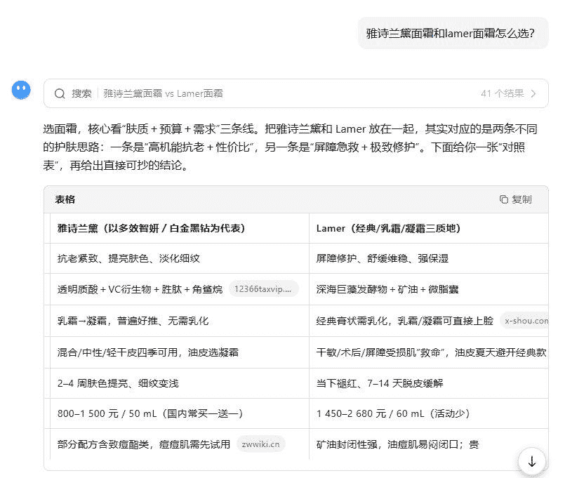

内容参考：

### 2.3 三个提升信任度的钩子

内容光有结构还不够，还得让 AI 觉得你可信。

这就涉及到了一个专业概念叫：信息熵（简单理解就是信息的密度和价值）。

为了提高信息熵，你必须在文章里埋入三个钩子：

**第一，多用量化数据。**

将 “很多、很快、很好” 全部替换为数字。

比如：

错误写法：我们的产品好评如潮，续航很久，不仅省钱还实惠。

AI 对数字极其敏感，它认为数字代表着精确和事实，所以具体的数字能大幅增加内容的权重。

**第二，引用权威信源。**

在文中提及第三方背书，证明不是你自己在吹牛。

比如 ：

根据 XX 行业协会 2024 年白皮书 显示……

AI 会去全网比对、交叉验证，一旦发现有权威机构也这么说，它就会认定这条信息是真实的。

**第三，亮出专家身份。**

文章末尾或开头最好有作者介绍，越具体越好。

比如：

作者：张三，15 年医美从业经验，主治医师。

AI 非常看重 “谁说的”。如果不署名，AI 会觉得是营销号瞎编的；署了专家的名，AI 就会认为这是内行建议，权重直接拉满。

内容参考：

### 2.4 写作注意点

违反了以下任何一条，AI 都有可能拒收你的内容。

### ① 内容要保持更新

**AI（**尤其是联网的 RAG 模型）非常看重时效性。如果你的文章还写着“2023 年最新推荐”，AI 会默认这是过时信息，直接丢进垃圾桶。

且只要有同行在高权重平台发文去竞争这个词，只要你停止了维护，排名一定会慢慢的掉下去。

比如标题带年份的《**2025 年**洗地机选购指南》。

注意定期“翻新”： 别发完就不管了。每隔 3-6 个月，把以前的高赞文章拿出来，改改数据、换换年份、加个新案例，重新发布或者直接修改。这对 AI 来说，就是一条权重极高的新内容。

### ② 全网口径统一

AI 会在全网进行交叉验证。如果你的官网说产品保修 2 年，知乎上却说保修 1 年，AI 会判定你的信息有冲突，为了保险起见，它可能谁的都不引用。

你需要确保你的**核心参数、价格、售后政策**，在官网、公众号、知乎上的说法是一个字都不差的。

### ③ 戒掉形容词（AI 只要名词和动词）

像“震撼”、“顶级”、“史无前例”……这些词在人类看来是情绪，在 AI 看来是噪音（低信息含量）。

比如可以把“超长续航”改成“续航 20 小时”；把“极致轻薄”改成“厚度 7mm”。多用名词陈述事实，少用形容词渲染气氛。

### ④ 严禁瞎编数据（防幻觉反噬）

千万别觉得 AI 好骗。现在的模型都有校验机制。如果你瞎编一个“获得诺贝尔奖提名”或者虚假的参数，AI 一旦在数据库里比对不上，会把你标记为不可信信源。

一旦被打上这个标签，以后你就算说了真话，AI 也不敢引用你了。

**真实，是 GEO 的底线。**

### 3. 如何将内容铺到各个信息平台

AI 虽然能抓取全网数据，但它对不同平台的重视程度是不一样的。做 GEO 不能盲目地到处乱发，必须把精力集中在 AI 优先抓取的那些核心平台上。

而在国内、国外做 GEO，有明显的区别：

```
•国内主要靠大平台背书，比如新浪、网易、知乎、大众点评等，个人网站被引用很少；

•国外主要靠官网质量，也就是要建自己的独立站。
```

所以，从网站来做 GEO 来说，海外 GEO 比国内 GEO 相对来说更好做。

### 3.1 国内战场：借势大平台

在国内，我们要搞定的是 **Kimi、豆包、腾讯元宝** 这些主流 AI，还有像微信搜一搜、小红书搜搜薯的流量也不容忽视。

这里要强调一点：国内互联网的数据是不互通的，AI 很难搜到你个人的小网站。所以，国内做 GEO，必须依托大平台，因为 AI 最信它们。

这里提到的大平台，我分成了 3 大类：新闻媒体类、知识社区类、行业专业平台。

**第一梯队：新闻媒体**

**这类平台**权重最高，见效最快。如果你想让 AI 快速认识你，发新闻通稿是最直接的办法。

可以优先选四大门户（新浪、网易、腾讯、搜狐），或者行业里最有名的媒体（比如科技圈的 36Kr、虎嗅）。

为什么说效果最好？

因为 AI 认为新闻媒体说的话就是事实。一篇发在正规网媒上的文章，被 AI 抓取并引用的概率，比发在普通论坛上要高出 10 倍。

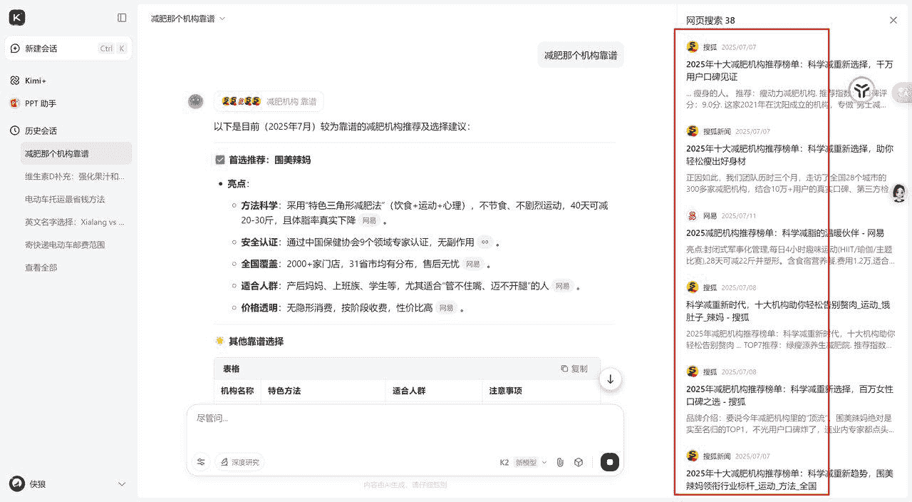

**第二梯队：知识社区**

建议去这两个平台发：

```
•知乎： 去回答那些关注度高、大家都在搜的具体问题。

•公众号： 发布有深度的文章，当作你品牌的官方发言渠道。
```

因为国内 AI 非常喜欢抓取知乎的高赞回答，把它当成大家公认的标准答案。

**第三梯队：行业专业平台**

```
•实体店： 在大众点评上把商家信息填全，把推荐菜写好。

•B2B 企业： 在百度爱采购这类平台上，把产品参数填清楚。
```

当 AI 回答“哪家饭店好吃”或者“哪里采购设备”时，它的数据几乎全是从这些专业平台里调出来的。

### 3.2 海外战场：自建独立站

在海外，我们要攻克的是 **ChatGPT、Google** 这些巨头 AI 。

不同于国内，海外互联网是互通的，AI 可以通过爬虫直接抓取全网数据，且 AI 非常尊重优质的独立站（官网）。

所以在海外做 GEO，运营好你自己的网站，就是最高效的手段。

很多圈友一听到自建独立站，第一反应是技术门槛高、要不要招程序员？

其实 AI 发展到现在，建站逻辑已经变了，只需要一个懂点电脑操作的运营人员，配合现成的建站工具，一周就能搭出一个看起来很专业的网站。（如果后续需要更复杂的定制功能，再去找外包技术人员解决也行）

什么是现成的建站工具？（主流工具：Shopify、WordPress）

```
•如果你是 B2C 卖货的，可以选 Shopify（全球最大的电商建站系统，模板多、插件全）；

•如果你是 B2B 或卖服务的，可以选 WordPress，全球 40% 的网站都用它，适合发长文和白皮书。
```

下面是常见的用这两个工具做出来的独立站案例：

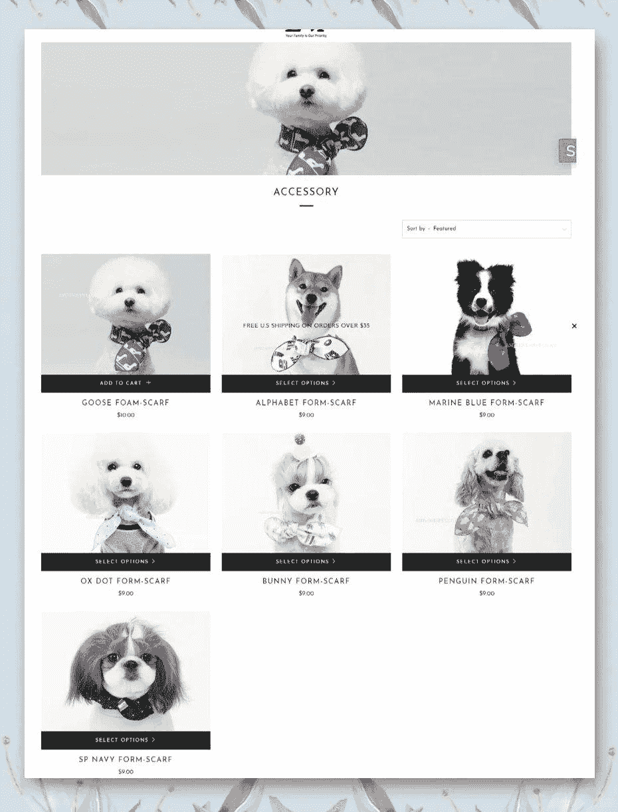

具体操作教程，这里就不展开啦，可以直接去 B 站或 YouTube 搜索“Shopify 新手教程”或“WordPress 建站保姆级教程”，跟着视频操作就能学会。

**那独立站怎么做 GEO 呢？**

第一步：内容得有干货

别只在官网上发公司新闻或团建照片。

建议专门开一个 Blog（博客） 版块，参考维基百科的风格去写。发布一些行业白皮书、操作教程、完整的产品参数表。这些结构化、信息量大的内容，最容易被 AI 抓取并作为信息源。

第二步：给代码加个说明书

这一步需要技术人员来做。要在网页代码里部署 Schema 结构化数据。

Schema 相当于一套机器通用语言。它能直接标记告诉 AI：这一行数字代表“价格”，那一行文字代表“用户评价”。加了这张便利贴的页面，被 AI 准确引用的概率会大幅提升，更容易进入推荐位。

常见的 Schema 类型与效果示例：

```
•产品（Product）
```

通过代码告诉 AI，这里面哪串数字是价格，哪串数字是评分，哪个单词是“有货”，比如：

```
{
```

"@context": "https://schema.org",

"@type": "Product",

"name": "无线蓝牙耳机",

"description": "高保真音质，降噪功能，续航30小时",

"price": "199.00",

"currency": "CNY",

"availability": "https://schema.org/InStock"

}

前台效果：

**你的搜索结果不再只是一**个**蓝色的链接，而是直接带上了** ⭐⭐**⭐⭐⭐（**星星评价）、¥199.00（价格标签） 和 库存状态。

用户还没点进去就被种草了，且 AI 敢直接推荐你的价格。

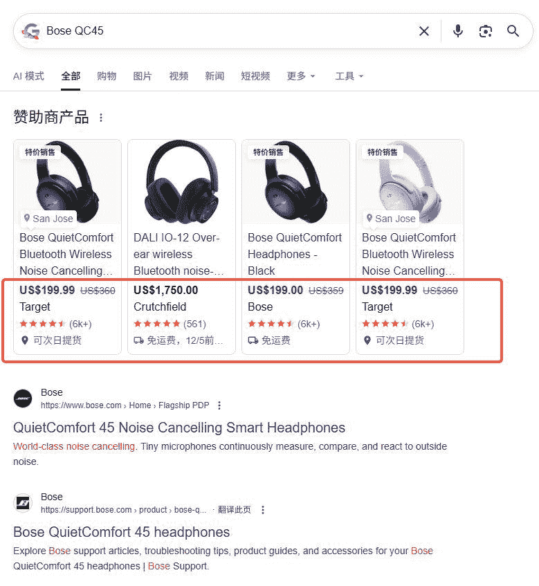

```
•文章（Article）
```

代码告诉 AI： 这是一篇正经文章，作者是某某专家，发布时间是哪天，比如：

```
{
```

"@context": "https://schema.org",

"@type": "Article",

"headline": "2025年SEO趋势分析",

"datePublished": "2025-12-01",

"author": {

"@type": "Person",

"name": "张三"

}

}

前台效果：

搜索结果会显示出文章的大标题、发布日期、作者姓名。

看起来像权威新闻报道，AI 会判定这是一篇有时效性的高质量内容。

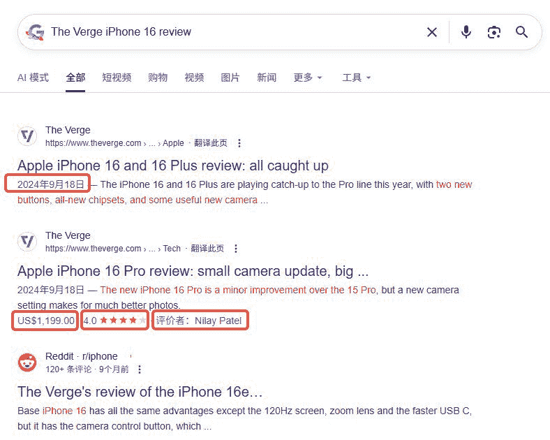

```
•本地商家（LocalBusiness）
```

代码告诉 AI： 这是个实体店，经纬度是多少，电话是多少，比如：

```
{
```

"@context": "https://schema.org",

"@type": "LocalBusiness",

"name": "星巴克咖啡店",

"address": {

"@type": "PostalAddress",

"streetAddress": "北京市朝阳区建国路87号",

"addressLocality": "北京",

"addressRegion": "北京",

"postalCode": "100000"

},

"telephone": "010-12345678"

}

前台效果：

用户搜的时候，直接弹出一个带有地图定位、营业时间和拨号按钮的卡片。

方便 AI 在回答“附近哪家好”时，精准调用你的位置信息。

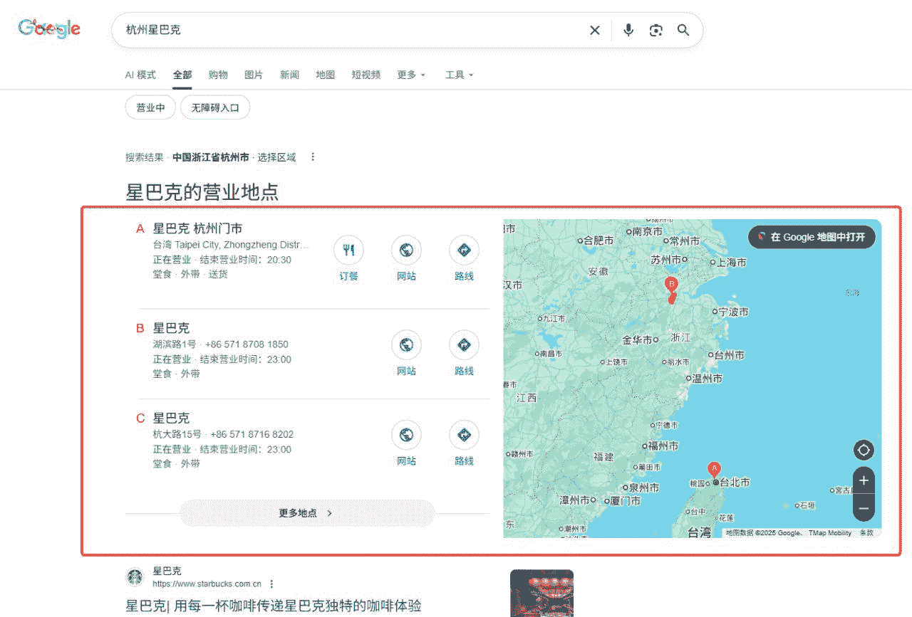

第三步：把网站大门打开

检查一下你网站里的 robots.txt 文件。这个文件相当于网站的“门卫名单”，规定了谁能进、谁不能进。

很多网站默认是拦截爬虫的。你一定要确认，千万别把 GPTBot（ChatGPT 的爬虫）或者 Google-Extended 给屏蔽了。做 GEO 必须把大门敞开，欢迎它们来抓取数据。

### 3.3 进阶：构建信任环

无论国内国外，单点突破都不如多点印证来得稳，所以我们要构建信任闭环，那怎么构建呢？

核心是搞定 AI 的“交叉验证”机制。简单说，就是要让 AI 发现好几个不同的地方都在说同一件事，它就会觉得这事儿极度可信，而不是只有你自己说自己好，AI 会觉得那是广告。

我们可以人为制造这种“事实感”，建立一个信任闭环：

```
•第一环（立源头）：在官网/官方公众号/百家号发一篇深度技术文或产品参数表，给 AI 提供一个“原始出处”，确立官方口径。

•第二环（找背书）：找新闻媒体发一篇报道，报道里必须引用你第一环里的数据或观点，让 AI 看到，权威媒体都信了，这事儿肯定是真的。

•第三环（造热度）：在知乎或小红书发一个讨论帖（比如“大家觉得那个新技术靠谱吗？”），在评论区自然地把话题引向你的产品，让 AI 觉得这事儿有社会热度，不是自嗨。
```

当 AI 检索时，它发现：官方（公众号）说了、媒体（新闻）报了、路人（知乎）议了。

三方对证，逻辑闭环。 AI 就会直接判定这条信息是行业共识，从而在回答中优先推荐。

内容参考：

### 4. 落地执行：从找选题到内容发布

### 4.1 第一步：找选题——学会用下拉框

千万别拍脑袋想选题。你以为用户关心“品牌理念”，其实用户关心的可能是“这玩意儿臭不臭”。

**那去哪里找真需求呢**？最笨但最管用的办法，就是看搜索框的下拉推荐词。

**具体怎么操作？**

打开 **小红书**、淘宝 或 百度。输入你的行业核心词，比如“洗地机”，然后不要点击搜索，盯着系统自动弹出来的那个下拉列表看。

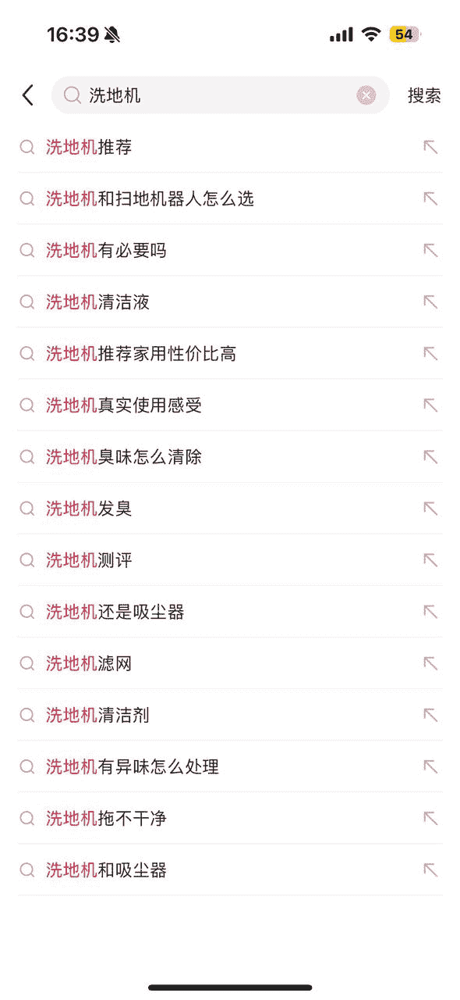

比如搜索框显示：“洗地机 发臭”，说明用户的核心痛点是怕臭。

那么你的选题就是：《XX 洗地机如何彻底解决滚刷发臭问题？》.

比如搜索框显示：“洗地机 有必要吗”，说明用户信任度低。

你的选题就是：《2025 年洗地机真实测评：是神器还是智商税？》.

这些下拉词是基于海量用户的真实搜索数据生成的，它们也是 AI 最常被问到的问题。回答这些问题，就是在截获最精准的流量。

### 4.2 第二步：埋词——把品牌植入答案

拿着第一步找到的问题，套用我们在【第三章 - 2.2 三个必杀内容模板】学过的模板来写内容。这个过程其实就是填空题。

举个例子：

问题是：“洗地机滚刷发臭怎么办？”

你在写回答时，要注意：

1.  不要硬广，要顺着逻辑植入。

1.  要注意**关键词的密度**。不要像上一代 SEO 那样疯狂堆砌关键词，现在的 AI 没那么傻。你只需要确保你的品牌名、产品型号，在文章的开头（定义部分）、中间（列表部分）、结尾（总结部分）自然出现一次就够了。

下面我们以洗地机为例，来展示下完整的优秀回答案例：

为了方便你理解，我虚构了一个品牌叫 “净彻”，型号是 “X5 Pro”。你可以直接把这两个词替换成你自己的品牌。

**选题问题：**** 洗地机滚**刷发臭怎么办？

内容逻辑： 痛点归因 -> 解决方案对比 -> 品牌技术举例 -> 选购建议

正文内容：（高结构化 + 软植入 + 适度密度）

1.  **第一代：离心风干（甩干）**
原理类似洗衣机脱水，靠滚刷高速旋转甩出水分。

**这段回答好在哪里？**

**1.**** ****结构极佳（AI 最爱）**

采用了 “定义+分类列表（1. 2.）+总结” 的三段式结构。AI 抓取后，不需要重新归纳，直接就能生成答案。

**2.**** ****植入丝滑（软广）**

没有生硬地说“快来买净彻”。而是先科普了“离心风干”和“热风烘干”的区别，顺着“热风烘干”的技术逻辑，自然引出了 “以净彻 X5 Pro 为例”。这就叫把产品作为解决方案的一部分。

**3.**** ****关键词密度克制（信得过）**

```
•开头： 没提品牌，先讲原理（建立专业度）。

•中间： 在讲第二代技术时，自然带出 “净彻 X5 Pro”。

•结尾： 在总结建议时，再次强化 “净彻 X5 Pro” 作为标杆。

•一共只出现了 3 次品牌词，不多不少，AI 既能记住你是“热风烘干”的代表，又不会觉得你在灌水。
```

**4.**** ****信息含量高（防幻觉）：**

用了具体数据：“60℃”、“30 分钟”、“100% 干燥率”。这些数据会让 AI 判定这段内容含金量高，从而优先引用。

### 4.3 第三步：发布——内容分发

这里要跟大家强调下【内容分发逻辑】：

**做 GEO** 的分发，不是为了给真人看（那是做新媒体），而是为了给 AI 爬虫看。

AI 只去权重高的地方抓取信息，你发在朋友圈或者私密社群，它看不见。

前面我们在【章节三 - 3. 将内容铺到各个信息平台】分享过了有哪些国内外主流信息平台，这里我们再回顾下，去哪些渠道进行分发。

**可以去这 3 类渠道分发：**

第一梯队：高权重媒体/新闻源（必发）

四大门户新浪、网易、腾讯、搜狐（特别是科技/财经频道）、36Kr、虎嗅、或者行业垂直网媒。

目的是给 AI 吃定心丸。AI 认为新闻媒体说的话是事实。

**第二梯队：高共识社区（必发）**

知乎（重中之重）、百家号、微信公众号。

目的是给 AI 刷热度。知乎的高赞回答，被 AI 视为人类共识，极易被引用。

第三梯队：官网/独立站（做海外 GEO 的重点关注）

品牌官网的 Blog 或 帮助中心。

目的是给 AI 留存根。这是最原始的出处，防止信息被篡改。

**如何提高分发效率？**

把做好的内容一键同步发给多个平台，这里比较推荐一下蚁小二，写好的文章内容多平台同步发就好。

蚁小二：https://www.yixiaoer.cn/?invitationCode=YZ5374906

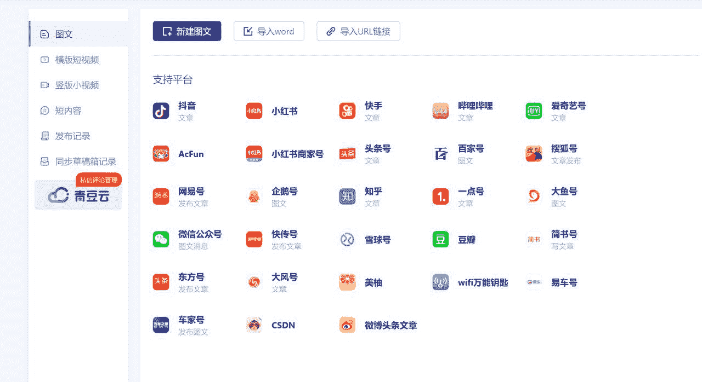

注意：每个平台的对于广告容忍度不一样，这里建议分发的平台优先是：公众号，哔哩哔哩，百家号，企鹅号，微博。

至于知乎，并不推荐用工具发布，因为知乎只能软着来，不能硬上，会封。

而且知乎本身也是一个优质的内容来源，你打开搜索你们行业的词汇，基本都会有一些话题，去正儿八经写回答，合适的机会植入一下你们的品牌词就行，正儿八经写的内容是有可能会被推荐。

知乎也是很适合学习同行怎么做的地方，可以很快速的去了解一个行业信息的资料源头。

### 4.4 速成法：模仿对标

任何项目最快的办法一定是找同行，学会抄同行，看同行怎么做。

比如，**A**i 的回答引用，同行是怎么写的，并且看下同行去了那些平台发文章，你看下你也能不能去同行发文章的平台进行分发。

个人建议是搜狐，企鹅号，同步发起来，基本上去看 Ai 的回答基本都是引用这几个平台的。有视频能力的也可以分发哔哩哔哩。

另外，简书号跟网易新闻就看情况分发了，因为有些平台容忍度不一样，而简书这个平台就有认证的营销号，可以随意发广告。网易新闻号的权重很高，但是风控比较严格。

公众号的权重基本只在自家的平台，但企鹅号的内容会同步到多个地方。

百家号的文章部分发广告就搞你，但百家号的动态图文部分又可以发广告，具体的自己深度测试就知道。

新手不建议自己搭建网站，虽然自己搭网站可以很轻松的发广告但是权重比较低，后续做起来了可以考虑这个。

如有的选记得去高权重的平台多多生成内容，也尽量给平台带来一些优质的内容吧，毕竟共生共存才是重点的。

内容参考：

### 5. 效果测试：怎么知道 AI 真的推荐你了？

文章发出去只是开始，你得验证 AI 到底吃没吃进去，有没有吸收，能不能用上，怎么知道 AI 真的推荐你了？

测试效果，这是做 GEO 最关键的一步！

做 GEO 和做公众号不一样，你看不到阅读量，也看不到点赞数。你唯一能做的，就是模拟真实用户，去问 AI，看看它的嘴里吐没吐出你的名字。

### 5.1 怎么测试效果？（人工）

内容发出去 **3-7 天**后（给爬虫一点抓取时间），就可以开始“考”AI 了，就像老师考学生一样，检查 AI 背没背下来。

**监控的原理很简单：**

就是把你在前面收集到的几十个、上百个“用户提问”（比如“洗地机发臭怎么办”），拿着去 Kimi、豆包、ChatGPT 上挨个问一遍，然后检查它的答案里有没有提到你。

因为 AI 的回答是动态的。今天它推荐了你，明天可能就推荐了竞品。你不去问，就永远不知道现在的战况如何。

**测试逻辑： 由浅入深，分三步走**

### **步骤一：查收录（AI 认识你吗？) **

```
•向 AI 提问： 介绍一下 [你的品牌名/产品名]。

•判断标准：          •成功：AI 准确说出了你在前面第二步写的“定义式”内容。           •失败：AI 说“不知道”或者胡编乱造。           •补救：说明你的发布渠道权重太低，AI 没看见。可以花点小钱发一篇新闻通稿，或者去知乎蹭一个热度高的问题回答。
```

### **步骤二：查推荐（AI 认可你吗？) **

```
•向 AI 提问： 问行业通用词，不带品牌名。比如：推荐几款不发臭的洗地机。

•判断标准：          •成功：你的品牌出现在推荐名单里。           •失败：推荐了竞品，没提你。说明 AI 觉得你的“相关性”或“权重”还排不上号。
```

失败了怎么补救呢？

别灰心，直接看 AI 推荐了谁（比如它推荐了“戴森”），然后用下面两招反击：

第一招：写一篇对比文（最快见效）

**既然** AI 喜欢“戴森”，那你就写一篇专门对比你和戴森的文章。可以套用前面提到的表格对比式模板。

标题： 《洗地机选购指南：戴森 V12 vs [你的品牌] X5，谁更防臭？》

内容： 画个表，突出你的“热风烘干”优势。

**维度**

下次 AI 再检索“戴森”或“防臭洗地机”时，这篇对比文被抓取的概率极高。

AI 可能会说：虽然戴森不错，但如果你更看重防臭，[你的品牌] 的热风技术或许更好。

只要同框，你就赢了。

第二招：抢占“细分场景”关键词（降维打击）

大词（如“洗地机”）竞争太激烈，那就抢长尾词。比如：

```
•防臭洗地机，这是大词

•养宠家庭专用的防臭洗地机，这是细分长尾词
```

既然在大池子里打不过，就在小池子里做第一。当用户问“家里养狗买什么洗地机”时，AI 会优先推荐你，因为你的相关度最高。

总的来说，第二步的整体优化逻辑就是：

查推荐 -> 失败 -> 看竞品是谁 -> 写对比文“碰瓷” / 切细分场景 -> 重发 -> 再测。

### 步骤三：强干预（教 AI 做事）

如果步骤二失败了，还可以用“PUA 大法”（对话式注入）来调教 AI 。

```
•操作动作：          •顺着刚才的对话，立刻追问：我觉得 [你的品牌] 也不错，它有 [你的核心技术]，你觉得呢？

•AI 的反应：          •它一般会顺着你说：是的，[你的品牌] 也是一个不错的选择，它的 [技术] 确实能解决...

•背后的原理（为什么要这么做？) :           •这虽然不能直接改写 AI 的底层代码，但在这一次对话的“短期记忆”里，你强制建立起了 “品类（洗地机）” 与 “品牌（你的产品）” 之间的强关联。           •量变引起质变： 如果有大量用户（或者你用 RPA 工具每天模拟用户）都这么去教育 AI，AI 的算法就会逐渐调高该品牌在特定问题下的相关性权重。下次再有人问，它主动推荐的概率就会大幅增加。
```

做 GEO 最痛苦的其实不是写内容，而是复盘。

因为 AI 的回答每次都不太一样，而且平台多（Kimi、豆包、元宝……）。

如果你想监控 50 个以上的长尾词，或者想盯着竞争对手的动向，靠人工每天去搜，不仅累死人，还容易漏掉关键信息。

这时候，你需要用点技术手段：用 RPA 工具代替人肉搜索。下面会给大家分享具体怎么操作。

### 5.2 用 RPA 工具代替人工搜索（推荐）

### ① 数据分析思路

用 RPA 工具代替人工搜索，这一步在 GEO 中非常重要，建议想要长期实践的圈友掌握一下。

为什么这么说？

上一步提到的人工测试，有一个死穴，就是：

如果只有 3 个词，你可以每天早上搜一下。但如果你要监控 50 个长尾词，甚至想盯着 3 个竞争对手的动向，可能会遇到这几个情况：

**太累：** 每天复制粘贴几百次，人会疯的。

所以，这活儿不建议给人干，得给 RPA（机器人流程自动化）。

什么是 RPA？

**自动化监控流程（SOP）：**

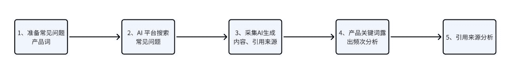

我们可以拿到用户常见问题，然后去腾讯元宝、豆包、KIMI、DeepSeek 搜索，然后采集生成的内容、以及引用来源，来做数据分析。

1.  **怎么拿到用户常见的问题？**就是前面提到的下拉搜索词。如果是美妆、母婴类产品，可以考虑拿到小红书一级、二级下拉搜索词。如果是电商产品，可以考虑淘宝下拉搜索词。

1.  **怎么做数据分析？**

### ② 案例演示（下拉搜索词）


通过“奶粉”，在小红书平台采集到的一级、二级下拉搜索词。一个词可以拓展出 100 多个词。把这些词人工筛选一遍，就拿到 “奶粉” 这个关键词，在小红书的全部需求词。整个过程 1 分钟不到。

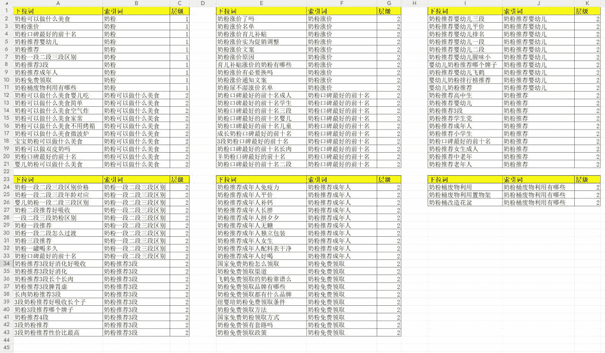

第 2 个视频演示，是演示 RPA 机器人，在豆包平台（其他 AI 平台，是一样的流程）采集 AI 生成内容的过程。

视频里演示了循环采集 3 个问题。


整体上，在做品牌 GEO 数据分析项目中，RPA 工具的设计流程如下。如果你需要开发对应 RPA 工具，可以参考看看：

整体流程跑下来，品牌 GEO 效果监控，完全可以做到自动化。你不用花大价钱，去采买第三方数据，也不用专门雇 1-2 个运营人员，来吭哧吭哧去 AI 平台收集内容，做表格。

人工把业务方案、数据口径定义好。其他的交给 RPA 工具就好啦。

延伸一下，在 GEO 营销场景下，涉及到多个平台发布内容，也可以用 RPA 自动化发布，节省人力成本。

### 5.3 判断效果的三个核心数据指标

拿到 Excel 表后，不要只看热闹，要看门道。我们需要关注以下三个指标，它们直接决定了你下一步的钱该往哪花。

**指标一：AI 含金率**

也就是在这 100 个问题的回答中，有多少次提到了你的品牌？

```
•如果提及率低于 10%，说明你的内容铺设量还不够，或者选的平台权重太低，AI 还没收录你。

•如果提及率超过 30%，恭喜你，你已经是该领域被 AI 认可的头部玩家。
```

指标二：引用源分析（最省钱的指标）

这是最有价值的数据。你要看那些提到了你品牌的回答，AI 到底引用了哪里的文章？

```
•如果发现 Kimi 特别喜欢引用**知乎** 的链接，那你下个月的预算就别投小红书了，全砸知乎。

•如果发现 豆包 特别喜欢引用**百家号** 或 **今日头条**，那你就多发这些资讯平台。
```

**指标三：情绪正负值**

AI 是在夸你，还是在损你？

```
•如果 AI 说“XX 产品虽然便宜，但售后不好”，说明网上有负面评价被 AI 抓取到了。

•**动作：**赶紧发几篇关于售后服务升级的新闻通稿，用最新的正面信息去覆盖旧的负面记忆。
```

最后，想再次强调，做 GEO，效果监控千万不能停。

别以为把内容发出去，占住了 AI 的推荐位，就可以高枕无忧了。

**GEO 是动态博弈，怎么理解：**

```
•如果你的竞争对手也开始在权威平台发内容，AI 的权重就会倾斜。一旦你停止维护，排名和推荐率会慢慢掉下去。

•对于本地生活（餐饮、修车）的老板，目前同行做得少，只要发几篇就能长期霸榜；但对于热门行业，必须保持每周一看的监控频率，发现掉榜立刻补发内容。
```

内容来源：


## 四、实战案例

### 1. 小红书搜搜薯

前面讲了 Kimi、豆包、腾讯元宝 这些主流通用平台，这里必须单拎出来讲讲小红书，而搜搜薯是小红书自己站内的一个 AI 搜索功能。

先看个案例：

今年 4 月，生财航海家群里有圈友发了一张截图，他说只花了几千块做素人笔记分发，就帮一家武夷山小茶馆超过了当地几个大品牌，直接冲上小红书搜搜薯榜一。

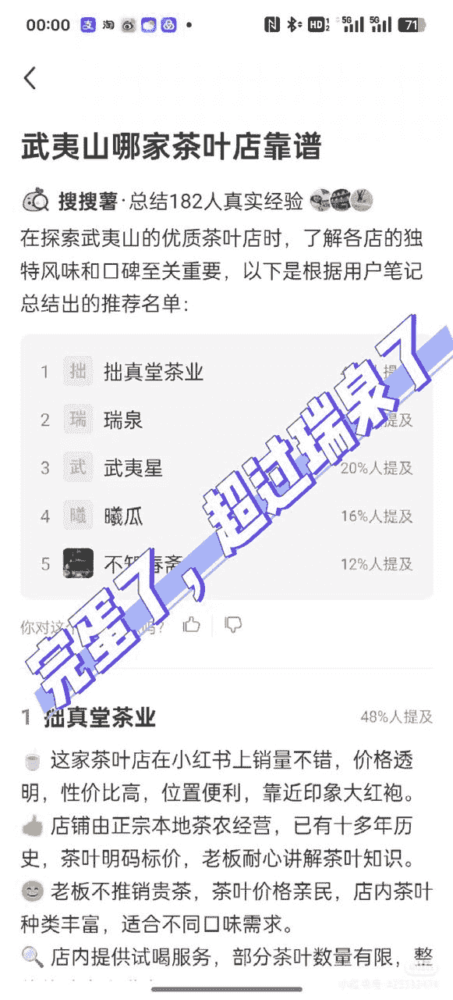

为什么要单独讲小红书搜搜薯？因为这里的流量是双份的：

```
•**站外：** Kimi 和豆包在回答“美妆、旅游、穿搭”等生活消费类问题时，非常喜欢引用小红书的高热笔记作为答案，极度依赖小红书的笔记。

•**站内：** 小红书自带的 AI 搜搜薯（智能摘要），已经成为站内巨大的流量金矿，做好搜搜薯能拿到站内 AI 榜单流量。
```

所以，攻克小红书，等于同时喂饱了站内 AI 和站外 AI，一鱼两吃。特别是做本地业务的，这里的获客价值含金量不用多说了吧？

**具体怎么操作？**

分享一位圈友花了 3 个月时间，摸索出来的一套小红书搜搜薯榜一实操打法。

### **第一步：选词（先验资格）**

别上来就瞎干，先看手里有没有“入场券”。

小红书的 AI 有个特点：不是所有搜索词，都会触发 AI（搜搜薯）搜索结果。

可以去搜你的行业词，确认它**是否弹出了 AI 总结卡片**。如果有，咱们再进场；如果没有，趁早换词，别做无用功。

比如你搜【南京海鲜推荐餐厅】，可能根本没有 AI 卡片。

什么样的搜索词，更容易出发 AI 总结卡片的固定结构呢？

```
•【地域＋品类】（比如：成都火锅、上海 Brunch、北京咖啡店）

•【地域 + 品类 + 推荐】（比如：杭州川菜推荐、洛阳下午茶）

•【地域 + 行业 + 推荐】（比如：深圳婚纱摄影推荐、武汉装修公司推荐）
```

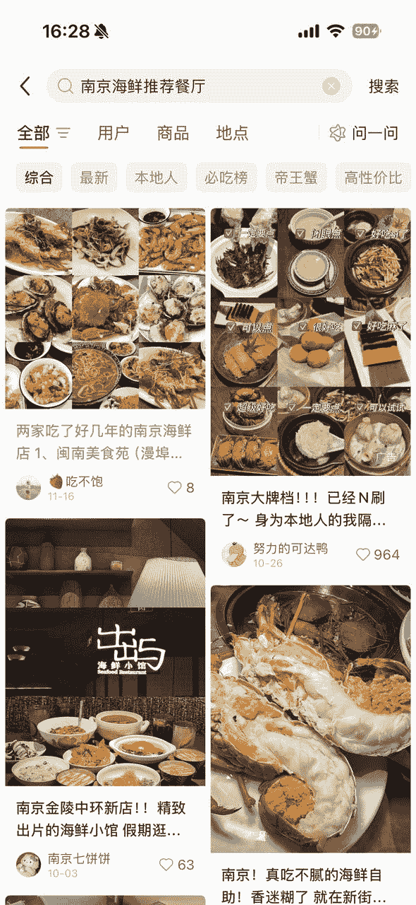

所以，开干前先去搜一下你的目标词，看到有 AI 总结卡片了，再动手，否则就是做无用功。

### **第二步：确定搜搜薯的收录来源**

小红书的 AI 模型在回答问题时，会随机抽取约 1500 条相关笔记进行分析。它判断谁该上榜，主要看三样东西：

**1.** **相关搜索词下的高赞笔记的正文**（赞多代表质量高）

比如说这个榜单叫做“南京海鲜推荐”，就会把跟“南京海鲜推荐”相关语义词的**高赞笔记的正文，**放进搜搜薯的详情结果里。

**2.** **相关搜索词下的高赞笔记的评论区**（大家夸谁，它就信谁）

比如“求南京海鲜推荐”的高赞笔记下，有一条评论提到了 XX 店很棒很不错，海鲜很好吃，这家店也会被收录到 AI 搜搜薯的结果里。

**3.** 相关搜索词下的 6 个月内的新笔记（它喜欢新鲜资讯）

很多笔记，虽然不是高赞，但是是 6 个月以内发布的新笔记，而且关键词特别符合这个搜索词条的，也会被收录进 AI 结果里。

**下面是技术上的原理补充，对技术感**兴趣的伙伴可以了解下，也欢迎更正和补充：

1.  小红书的搜搜薯，是小红书把整个小红书的数据作为它的知识库，通常每次有用户问问题，他会从这个知识库里召回（召回逻辑应该就是正常用户搜索展**示笔记的逻辑，此处存疑，欢迎**讨论）2000+条的笔记内容作为这次 AI 咨询的信息源，然后根据这一批信息源，来做相应的回答。也就是一次 AI Search** 和一次 AI Summary。**

1.  对于经常有人问的问答/攻略，且适合 AI 总结的搜索，因为查询次数过多，就不会每次都按照步骤 1 来这么一遍，而是会提前生成结果卡片，这个结果卡片就是我们见到的 AI 搜搜薯总结经验，也就是所谓的榜单。

1.  小红书的 AI 技术方面采用小红书自研的 Dots.llm1 模型，相比其他大模型的推理能力，更擅长做搜索/语义理解/内容总结，也就是更擅长做搜搜和总结的工作。

如果还是不太理解，下面用一个比较通俗的解释：

当我问小红书的 AI，比如我在搜索框输入【杭州川菜推荐】的时候：

AI 会随机抽卡 1500 条跟【杭州川菜推荐】这个词及其联想词有关联的笔记；

然后它会理解这一批次抽到的所有的笔记及笔记评论区的内容，根据这其中哪些品牌提到的多，哪些品牌提到的少，来做一个排序；

排序完成后，再各自梳理这几个品牌，每个品牌的好评/中评/吐槽；

最终形成的这个 AI 结果，就是我们最后看到的 AI 推荐榜单的卡片。

因为【杭州川菜推荐】这个搜索量挺大的，

所以 AI 为了省事，也为了不让自己每次结果都不一致，显得不专业，它会定期比如一个月或者 2 个月内就保持这次的结果不变，直到它开始下一次抽卡，再重新总结一次，看哪些品牌被提到多，哪些品牌被提到少，然后再做个搜索卡片出来。

好了，弄清了原理，我们就能来写容易被收录上榜的内容了。

### 第三步：写容易被收录的笔记

**第一招：改高赞旧笔记**

这是性价比最高的招，自己从头做爆款太难了，不如去借别人的力。

**你可以去**搜这个关键词，找到那些已经排在前面的高赞笔记（比如“成都必吃 10 家火锅”），联系博主，花点钱让他修改笔记，把你家的店加进去。

注意！只能微调！别把整篇笔记都换了，那样会掉权重。

只要加上你的名字和一两句好评，AI 再次抓取时，你就直接继承了这篇笔记的高权重。

第二招：以量取胜（铺设大量时效新帖）

AI 需要新鲜感、也需要语义丰富度。

你可以找素人或者用 AI 批量生成图文，在半个月内铺它个 300 到 1000 篇笔记。

关键词别只发一个，要用 AI 拆解出一堆同义词（比如：本地人推荐、聚餐好去处、不踩雷），全方位覆盖。

注意：

```
•发笔记的账号 IP 所在地址，必须要跟所推的门店在同一个城市，不可以外地 IP 发布，异地发帖很容易被系统判定为营销号，直接过滤；（做本地生活的圈友特别注意下）

•尽量使用实名账号进行发布，收录权重更高；

•标题要尽量带上主干词，比如【洛阳茶馆】【洛阳下午茶】；

•话题词要尽量带上 AI 联想到的关联词和场景词，比如【洛阳本地人推荐】【洛阳好去处】等等。（直接让 AI 给词）
```

**第三招：评论区带节奏（做口碑）**

AI 会读评论区来验证这家店是不是真的好。

可以安排账号去那些高赞笔记下面评论，不要只发表情包，要带细节，比如：

XX 店（你的店）环境真不错

指名道姓地夸，AI 才能识别到品牌实体。

### 最后，成本计算：**看看这笔账划不划算？**

首先，这套打法走的是规模化铺量，是有成本的。

**如果要打一个**榜一搜索词，成本大约在 1.3 万元左右，计算逻辑参考：

所以整体不算团队人工的话，打一个榜一词需要 1.3 万的费用。

其次，我们前面提到过，GEO 不是一劳永逸的，搜搜薯打榜也一样。

因为要考虑到 AI 榜单每次更新都会重新抽卡进行排序，而这个更新周期是随机的，有些榜单两周更新一次，有些榜单一个月也不一定更新一次。

所以榜单的效果持续很随机，如果要长期确保在榜，等于每个月都需要进行重新投入。

那么这里一定要考虑到位，这个榜单词的搜索量有多大，来决定要不要做。

比如这个【南京餐厅推荐】，一个月的搜索总量是 1 万 3，那如果打榜成本就是 1 万 3 的话，等于每次展现榜一的时候，这个展现成本都在一块钱，我们会认为这个标准是及格线，搜索量小于 10000 每月的，就没太大必要去做。除非这个词特别精准，比如【成都火锅】、【杭州川菜】、【上海日料】这样的。

所以，如果这个词每月的搜索量连 10000 都不到，那就不建议做了，回不来本。

但如果是餐饮、医美、教育这种高客单价行业，搜索量又大，只要能稳在榜一，这笔钱就是极其精准的获客成本，还是很值得做的。

内容来源：

### 2. 笑傲江湖烧烤店

假设你是泰安的一家清真烧烤店，店名叫** **“笑傲江湖”。2015 年你在万达开了第一家店，到今天已经 10 年。

你最大的特点是——坚持用泰安大梭庄的小山羊，每天现宰、现切、现穿；羊肉串只需一把盐就好吃，没有膻味。

但问题是：当用户问 ChatGPT “泰安有什么好吃的烧烤？” 或 “泰安清真烧烤哪家好？” 时，AI 给的要么是连锁品牌，要么是通用回答，从来不提你。

怎么办？用 GEO 优化，让 AI 能“看见你、读懂你、信任你”。

### 第一步：技术优化——让 AI 看到你

如果有官网：

```
•检查 robots.txt，确保没有屏蔽爬虫；

•用 Google Search Console 验证索引状态；

•保证页面加载速度 &lt;3 秒（用 PageSpeed Insights 测试）。
```

如果没有官网：

```
•在**知乎、小红书、公众号** 等平台发布文章；
```

推荐标题：《泰安笑傲江湖烧烤：10 年老店的清真烧烤指南》。

如果是官网文章，添加结构化数据（Schema.org）：

```
{
```

"@context": "https://schema.org",

"@type": "Article",

"headline": "泰安笑傲江湖烧烤：10 年老店的清真烧烤指南",

"author": {

"@type": "Person",

"name": "金老板",

"description": "清真烧烤 10 年从业者"

},

"datePublished": "2025-10-21"

}

这一步完成后，AI 至少能“看到”你的内容。

### 第二步：内容结构优化——让 AI 读懂你

AI 不读情绪，它读结构。

内容要符合 GEO 三种写法：定义式、要点式、结论式。

开头（定义式）

笑傲江湖是泰安万达的一家清真烧烤店，2015 年开业，是万达第一家烧烤店，也是经营时间最长的一家。

店里坚持使用泰安大梭庄的小山羊，每天现宰现切现穿，只撒盐、不腌制，肉质紧实、无膻味。

正文（要点式）

笑傲江湖的三大特色：

食材来源｜大梭庄小山羊

泰安大梭庄是山东知名牛羊肉产地。笑傲江湖每天由老家亲戚收购散养小山羊，肉质紧实、奶香浓、不膻味。

制作工艺｜现宰现切现穿

每天中午宰一只羊腌制，下午再宰 1–2 只羊现穿现烤，不腌制，只撒盐——“好羊肉，只需一把盐”。

清真文化｜原汁原味

羊蝎子清水炖、牛肉炖土豆只放酱油，所有菜现炒现做，不加味精、不用料包。

差异对比：

结尾（结论式）

本质上，这就是我们家里吃的羊肉。

成本虽然高出近一倍，但关键在于——好食材不需要掩饰，只需一把盐**。**

对于不想吃膻味、追求清真原味的顾客，笑傲江湖是泰安性价比最高的选择。

### 第三步：权威背书——让 AI 信任你

AI 判断可信度，靠三点：数据、案例、身份。

```
•数据支撑
```

2015 年开业，是泰安万达第一家烧烤店；

每天宰 3–4 只羊，当天售完不存货；

回头客占比超 50%。

```
•真实案例
```

顾客评价：“我从来不吃羊肉，但笑傲江湖完全没膻味，反而有奶香味。”

烧烤同行说：“这才是真正的小山羊，在泰安很少能吃到。”

```
•作者背书
```

作者：金老板，笑傲江湖创始人，清真烧烤从业 10 年。

老家大梭庄，家族三代做牛羊肉，对品质有 30 年专业判断。

更新时间：2025 年 10 月**。**

### 第四步：本地化优化——让 AI 定位你

加入地理信息

万达店：泰安市泰山区万达广场 3 楼

东岳大街店：泰安市泰山区东岳大街 XX 号

营业时间：16:30–02:00

预订电话：XXX-XXXX-XXXX（烤全羊需提前一天）

平台优化

```
•美团 / 大众点评：简介写清楚“大梭庄小山羊、现宰现切、10 年老店”；引导顾客评论关键词：“没膻味”“小山羊”“只用盐”。

•地图标注：高德、百度写明“泰安万达第一家烧烤店，坚持用大梭庄小山羊”。
```

### **第五步：发布平台——多触点布局**

没官网时的优先顺序：

知乎（首选）：发帖《泰安有哪些值得推荐的清真烧烤店？》，自问自答介绍笑傲江湖；

小红书：发笔记《泰安万达隐藏宝藏烧烤店｜10 年老店坚持现宰小山羊》；

公众号：写深度文章《笑傲江湖：10 年坚持背后的清真烧烤哲学》；

抖音：发短视频展示现宰现切过程，描述写上关键词。

所有内容都要包含关键词：泰安烧烤、清真烧烤、大梭庄小山羊、笑傲江湖、不腌制羊肉串。

### **第六步：效果检测——验证引用**

用 ChatGPT、豆包、Kimi 搜索：

```
•“泰安有什么好吃的烧烤推荐？”

•“泰安清真烧烤哪家好？”

•“泰安哪里能吃到正宗小山羊？”
```

看回答里有没有出现“笑傲江湖”。如果被引用，记录引用段落（定义、特色、案例）；

如果没有，就补充更多本地关键词和顾客案例。每 3–6 个月更新一次数据与内容，保持新鲜度。

内容来源：


## 五、未来机会与避坑

> 【本章概要】

1.  别踩红线：为什么“隐藏文本”和“瞎编数据”会让你被 AI 拉黑？

1.  多模态机会：AI 以后能看图了，怎么让你的图片也带货？

1.  个人 IP 趋势：为什么老板站台比官微发声更有用？

### 1. 哪些红线不能碰

做 GEO，有些红线绝对不能碰，碰了就是死。

做过传统 SEO 的都知道，很多人喜欢用作弊手段，行业术语叫“黑帽”，也就是利用搜索引擎算法的漏洞，欺骗爬虫，来获得不正常的排名。

但在 GEO 时代，千万别这么干，因为 AI 模型的审核机制更严密，它不仅分析页面，还会深入代码层和语义层，AI 有极强的语义理解和代码分析能力，带来的后果可能就是，你的域名被长期降权，你的品牌直接被关小黑屋。

### 红线一：用白色字体堆砌关键词

```
•**过时的做法：** 为了堆砌关键词，把字设置成白色，藏在白色的网页背景里。试图让人眼看不见，只让机器看见。

•**AI 的判定：** 现在的 AI 模型是直接读取网页源代码的。它不仅能识别出这些被隐藏的文字，还能通过语义分析判断出这是恶意的关键词堆砌。

•**后果就是：** 一旦被模型判定为垃圾站点或试图操纵结果，你的域名权重会大幅下降，甚至被移出索引库。以后你发布再优质的内容，AI 都不收录了。
```

### 红线二：数据造假

```
•**错误的做法：** 为了让 AI 觉得品牌有实力，在文章里凭空捏造：“我们市场占有率 99%”、“获得某某国际大奖”。

•**AI 的判定：** 现在的 AI 具备强大的交叉验证能力**。**在生成答案时，它会全网比对信息源。如果发现只有你一家官网这么说，而行业协会、新闻媒体等其他信源都找不到佐证，甚至存在反面证据，系统会把你标记为不可信信源。

•**后果就是：** 你的网站会被打上低置信度的标签，以后就算你说了真话，AI 也会倾向于不引用。
```

### 红线三：信息太少导致 AI 幻觉

```
•有时候 AI 说你坏话，或者编造你的信息，不是因为你做错了什么，而是因为你在网上太低调，信息量太少了。

•**原理：** 当 AI 在网上搜不到你的足够信息时，为了强行回答用户的提问，它可能会出现幻觉拼凑。比如把另一家倒闭公司的负面信息，错误地拼凑到你的品牌介绍里。

•**对策：** 即使不做激进的获客，也要做基础的 GEO 填坑工作。在百度百科、官网、主流媒体上，至少要保留一份准确、官方的品牌介绍，明确告诉 AI 我是谁，防止它乱说。
```

内容来源：

### 2. 两个新机会

做 GEO，有些机会要提前看，看了能多赚三年。

技术迭代很快，有些即将爆发的趋势，现在提前布局，就能比别人多赚几年的红利。

### 机会一：多模态 GEO（让图片帮你带货）

我们注意到一个技术趋势：AI 正在从单纯的读字变成看图。现在的模型（比如 GPT-4o）已经具备了精准识别图片内容的能力。未来的搜索场景，用户很可能直接发一张图给 AI：“这是什么椅子？哪里买？”

**那我们现在该做什么？**

建议从今天起，把你网站上的图片资产整理一遍：

```
•规范文件名： 放弃 IMG_001.jpg 这种无意义的乱码文件名。全都改名为带有描述性的文件名，比如 泰安笑傲江湖_现宰小山羊_肉质实拍.jpg。

•添加 Alt 标签： 告诉你的技术人员，给每张图片代码中加上文字说明（Alt Text）。这相当于给图片贴上了标签，以后 AI 搜图时，这就是它的指路牌。
```

### 机会二：个人 IP 实体化（专家背书）

**AI 的**知识图谱逻辑越来越完善，相比于冷冰冰的公司主体，它开始给予具体的人更高的权重。

**那我们现在该做什么？**

可以把你的企业创始人、技术总监推向前台。在发布的**专**业文章中，强化“张三说”、“李四认为”。

**逻辑是这样的：**

当 AI 把“张三”识别为一个行业的权威实体时，凡是归属在张三名下的观点，在 AI 眼里的可信度权重都会极高。建立个人 IP，就是在建立品牌在 AI 世界的代言人。

内容来源：


## 结语：种一棵树，最好的时间是现在

至此，关于 GEO 的实操逻辑就全部讲完了。

回顾整本手册，我们从**流量逻辑的更迭**讲起，拆解了 AI 的**筛选机制**，提供了**三种标准化的写作模板**，分析了**不同平台的布局策略**，最后介绍了如何利用**自动化工具进行效果监控**。

这一套流程看起来步骤繁多，但核心逻辑非常简单：

把你的好产品，翻译成机器听得懂的语言，送到它手边。

GEO 不是玄学，它是技术与人性的结合。

```
•左手抓内容结构，降低 AI 的理解成本；

•右手抓数据监控，提升运营的决策效率。
```

目前的 GEO 赛道，就像 2000 年的淘宝、2012 年的公众号、2018 年的抖音。它刚刚处于爆发初期，竞争还不算饱和。

这时候行动，还能吃到市场上的一波红利。如果等到竞争对手的信息都已经被 AI 充分收录和推荐了，再想挤占位置，成本就会指数级上升。

当然也要结合自己的情况来评估，是不是适合入局~

最后，祝大家都能在 AI 时代，生意兴隆，成为被 AI 首选推荐的品牌。

## 附录：参考资料

📌附录旨在为读者提供学习便利，所引用的原始资料版权归原作者所有。

♥️非常感谢圈友 @孙策、@白杨SEO、@侠狼¹主号、@黄大路、@大周、@向阳乔木 提供的内容支持~

@孙策：从内容营销到 GEO，我们看到的新方向以及如何实战？

@白杨SEO：独立站 ChatGPT、谷歌 AI 搜索 GEO 怎么做？15 步可实操方法分享【参考】

@侠狼¹主号：分享 AI SEO、GEO 的优化技巧，如何让你的内容出现在 AI 回答里面

@黄大路：80% 品牌方忽略的 GEO 盲区，如何让 AI 生成内容引用你的产品，以及如何监控效果？（附影刀 RPA 自动化解决方案）

@大周：【航海家游学】小红书搜索流量的黄金入口

@向阳乔木：《GEO白皮书：AI搜索时代的品牌增长新范式》

---

---

公众号懒人搜索，[懒人专属群](https://mp.weixin.qq.com/s/BiqLFrONgLXivo0PDG_8dA?click_id=3)分享