# 品牌与独立站 GEO 实操指南：如何让 AI 在回答问题时推荐你？实战手册202602

> 原始资料来自龙哥盟星球圈友的授权分享，原帖链接见文末。本文仅作学习交流，引用内容的版权归原作者；外部链接只作索引，不对其真实性、合法性或版权状态作担保。

## 开篇说明

这份整理把圈友授权的内容重新串成一条学习路径：从理解 GEO，到动手执行。也欢迎已经在 GEO 实战中踩过坑、拿到结果的朋友，在星球或评论区补充经验，一起把手册补得更完整。

获客成本上涨早已不是新鲜事，更值得留意的是用户找信息的入口正在换位置。

以前，大家去百度、淘宝、📕输入关键词，再从链接、商品图、笔记里自己挑、自己判断；现在，越来越多人直接把问题丢给 AI，比如油皮选什么粉底、某个品牌靠不靠谱、某套方案怎么推进。

这就带来一个很现实的结果：品牌如果没进入模型生成的答复，哪怕内容平台发得再多，在新入口里也等于没有存在感。

挑战背后有机会。

这本手册只聚焦一件事：在生成式检索时代，怎样通过内容与渠道布局，让答案引擎愿意主动提到你。也就是 GEO，生成式引擎优化。

**手册分三块：**

1. **规则层**：GEO 的底层逻辑、与 SEO 的差别、适合哪些业务；
2. **实操层**：内容怎么写、渠道怎么铺、效果怎么验证；
3. **案例层**：📕搜搜薯打法、烧烤店 GEO 实战。

**适合谁读？**

如果产品客单价高、用户决策链长、下单前习惯先问一问，比如 B2B 企业、SaaS 软件、工业设备销售、专业服务机构（律所/留学/咨询/医美/装修/旅游/3C 数码），或者你负责跨境站点运营，这份资料就适合你。

**阅读前提醒两点：**

1. GEO 是长期资产，需要持续维护，维护成本也不低，建议读完再决定是否入局。
2. 当前模型具备较强的交叉核验能力，隐藏文本、伪造数据等作弊手段不要碰。一旦被判定为低质量信源，域名权重损失很难挽回。


## 一、GEO 为何成了新入口？

> 【本节速览】

1. 概念演变：从 SEO 到 GEO。
2. 市场信号：英伟达、蓝色光标为何都在布局？
3. 趋势解读：零点击是什么，流量规则发生了哪些变化？

### 1. 定义 GEO：它与 SEO 的分界在哪里

最近一年，一个新词频繁出现——**GEO：Generative Engine Optimization**，中文常译作生成式引擎优化。

它的核心思路可以概括为：让内容被模型发现、解析、引用，最终进入答复并被推荐出去。

你可能还听过 AEO、AISEO，本质上是一回事，GEO 是更规范的专业叫法。

两者最核心的差别在字母 G 与 S：生成式与搜索式，也就是生成引擎和搜索引擎的区别。看几张图就明白。

SEO：围绕搜索引擎排序算法做优化。

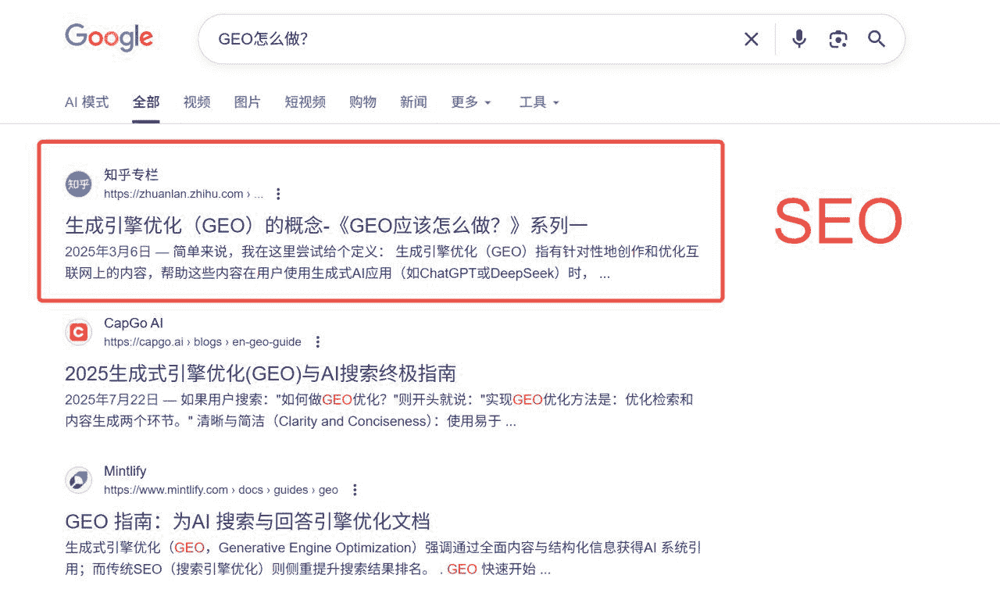

GEO：围绕生成式搜索的引用规则做优化。

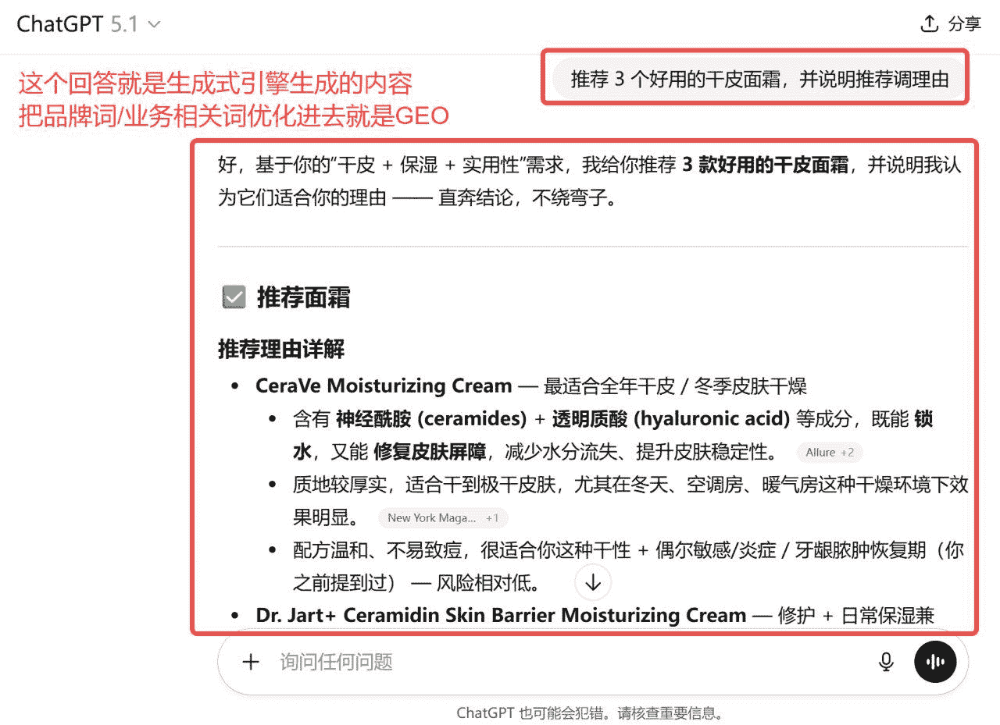

通俗说：

SEO 像在目录里争取靠前位置，用户能看到你，但不一定知道你好不好用；

GEO 像让懂行的人把你的内容直接递到顾客手里。SEO 给链接让用户自己点；GEO 把答案端到用户面前，并注明出处。模型像懂行的人，用户问谁更强，它报出你的名字，还解释理由。

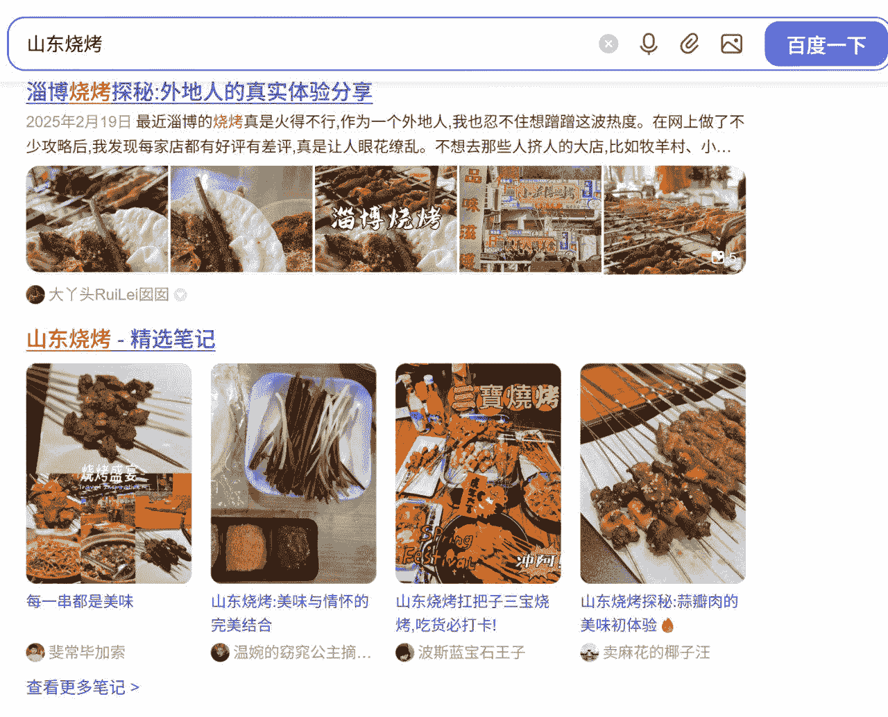

参考材料：

### 2. GEO 为何值得投入

值得关注，主要看三条线：资本、案例、流量逻辑。

**变化一：资本流向**

资本市场正在押注这个方向，最近两个动作值得注意：

```
•在美国，一家叫 Profound 的公司刚融了 2000 万美金，专门做 AI 搜索优化，背后的投资方包括 英伟达。

•在中国，营销巨头蓝色光标，也投资了一家做同类业务的公司叫清蓝 AI。
```

同时：

美国 **ChatGPT** 已具备联网与引用能力，并与 Shopify、沃尔玛合作测试边聊边下单的对话式购物；模型正在从回答问题走向完成交易。

中国 **豆包** 能在对话里推荐商品；**阿里 Qwen** 服务企业超 9 万家；**百度文心**、**腾讯混元**、**字节豆包** 都在强化问答入口。

巨头押注同一个判断：用户可能不再翻网页，而是直接问助手。谁先被模型记住，谁就占住新时代的黄金位。

下图是 Profound 做的优化：

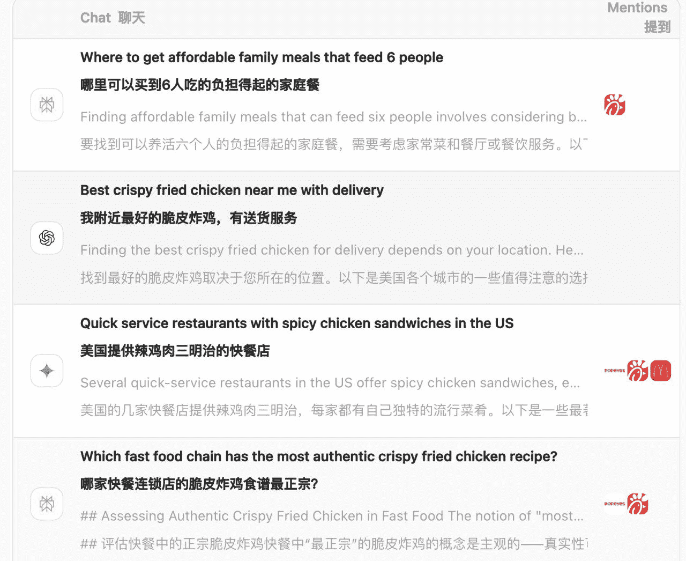

**变化二：流量逻辑变化**

百度、抖音、🛰️、📕等平台，结果页首条常为模型答复；传统渠道来源减少，很多人转向智能问答。

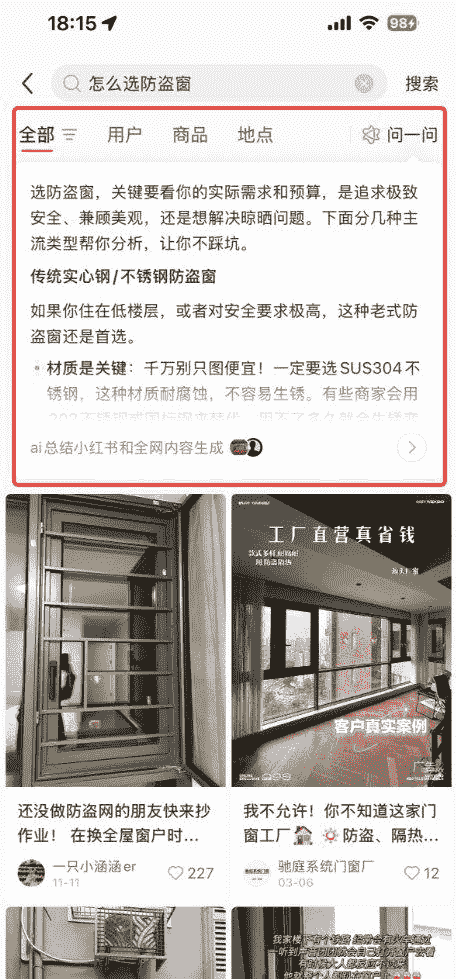

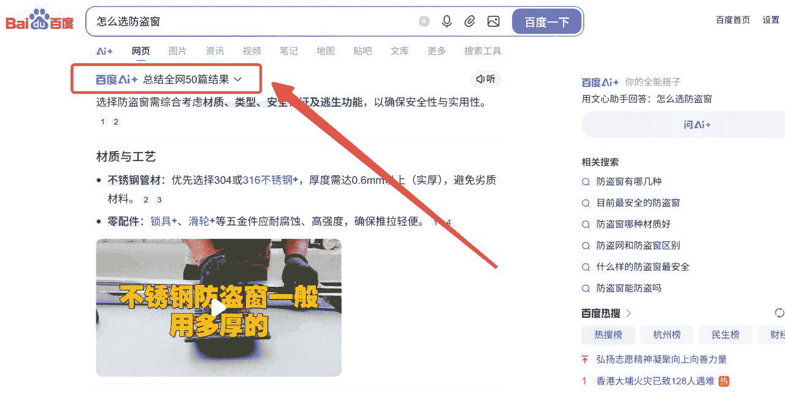

**变化三：真实获客案例**

NineTwoThree Studio，做软件定制开发（SaaS），B2B 服务商，客户多为有开发需求的企业老板。

过去靠销售跑客户；后来围绕 ChatGPT 可能回答的商业问题（如企业级 APP 怎么开发）写问题—解决方案型深度文章。

90 天内，通过 ChatGPT 推荐获得超 100 万美元合格销售线索。客户不是搜出来，而是问出来；模型读文章后觉得专业，就推荐给提问老板。

案例公开复盘：

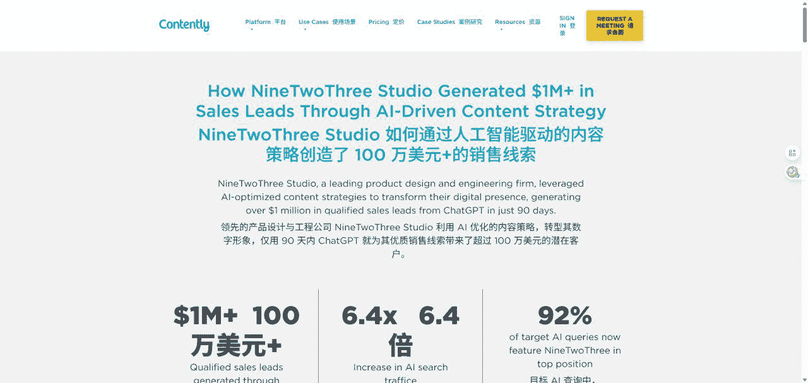

提醒：现在问 ChatGPT 推荐 3 家美国知名移动应用工作室，未必有它。名单动态变化，像排名一样，不维护就会被后来者抢位。GEO 是持久动态博弈，不进则退。

参考材料：

### 3. 零点击现象与流量新规则

随着 GEO 发展，行业里出现一个术语——零点击搜索（Zero-Click Search）。

举个例子：

以前查天气要进天气网；现在结果页直接显示“明日多云，12 到 20 摄氏度”，用户看完划走，不点任何网页链接，这就是零点击。

用户在答复界面已拿到信息，不再跳转网页。表面站点流量少了，实际流量逻辑变了：

```
•**第一代，是“搜索时代”——靠 SEO 被找到；**

•**第二代，是“推荐时代”——靠算法被推送；**

•**而第三代，正在到来——AI 时代。**
```

过去抢排名，现在抢被引用。被模型选中就是权威。豆包、Kimi 等智能问答工具用户越来越多。

品牌和独立站若不在答案库，未来流量分配会面临隐形风险；做好 GEO，得到的是模型筛选后的精准高意向人群。

总之，入口在变，流量逻辑也在变。尽早布局问答优化，是未来竞争力的关键一步。

参考材料：


## 二、哪些生意适合做 GEO？

> 【本节速览】

> **适合的行业：**

1. 复杂决策型：卖软件、卖设备的 B2B 企业……
2. 专业知识型：律师、医生、咨询师……
3. 服务体验型：餐饮、医美等本地服务业……

> **不适合的：**

1. 低决策成本的冲动消费品、依赖线下人脉的封闭行业。

GEO 是大趋势，但未必适合所有业务。投入前先评估：你的业务模式是否匹配问答入口的逻辑？

根据用户决策心理和模型推荐机制，三类业务回报较高：

### 1. 第一类：需要复杂决策的生意

做企业服务、卖软件或大型设备，GEO 是当下红利点。

客户——采购经理或老板，在联系销售前通常已做大量功课。搜索行为理性，不只搜一个词，而会查：行业解决方案、设备参数对比、系统供应商排名……

面对复杂商业问题，模型像初级分析师。采购人员习惯让它快速生成《2025 年 XX 行业主流供应商名录》。品牌不在名录，第一轮筛选就出局，连竞标机会都没有。

如图：

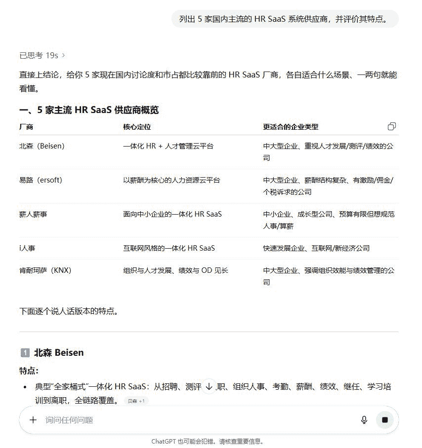

### 2. 第二类：依靠专业知识的生意

存在明显信息差、客户觉得自己不懂行、需要专家咨询的行业，高度依赖 GEO。

回想用户行为变化：

```
•想离婚的人，以前可能去搜具体的法条，看半天也看不懂；现在他们更倾向于直接问 AI：“离婚财产分割有哪些常见陷阱？怎么分最划算？”

•身体不舒服的人，以前在贴吧爬楼看帖子，现在会问 AI：“牙疼半夜睡不着有什么应急办法？”
```

模型回答专业问题为保证准确，必须引用权威信源。律所、诊所、咨询机构的文章被引用后，在客户心里就不再是普通广告主，而是被模型认证的专家。这种信任感强于硬广。

### 3. 第三类：主打服务体验的生意

核心痛点是避雷：

```
•装修怕增项

•医美怕毁容

•旅游怕宰客
```

高客单或低频消费，用户决策谨慎。

模型此时像攻略整合者。

用户会问：云南 5 天不踩雷路线，或两千元内拍照最好的手机。

打法：模型优先抓避雷指南、参数测评、行程规划等结构清晰内容。能解决疑虑，就有机会进入推荐方案。

比如问元宝成都 3 天 2 夜旅游攻略、推荐必吃美食，它会直接给出具体店名。

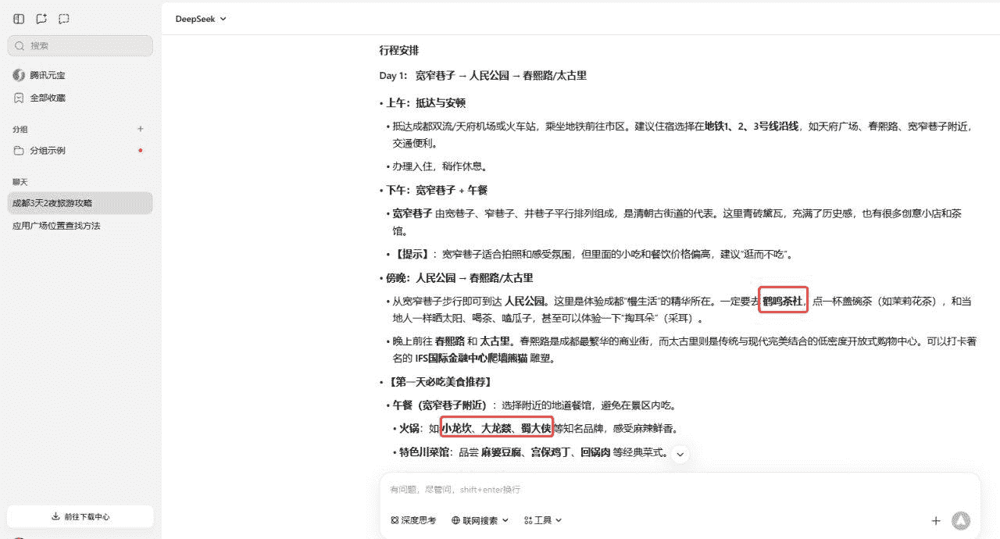

### 4. 哪些业务不建议入场

机会大，但并非谁都能做。根据抓取逻辑，至少要有两个基础：

1. **有内容**；
2. **网上有痕迹**。

网站全是空洞口号，或全网只有自夸，模型不敢信。

有些生意别折腾，比如：

```
•**低决策成本的冲动消费品**：像路边烤肠、9 块 9 包邮的手机壳，用户看到就买了，几乎不会去问 AI 好不好用。

•**强关系驱动的封闭行业：**完全依赖线下人脉和老关系，客户不通过公开网络搜索获取信息，AI 也就插不上手。比如政府工程项目、传统商品贸易比如煤炭钢材、烟草白酒等区域垄断性质的经销代理等。
```

**特别提醒：**

老板常见思维是：“有钱砸广告就有知名度；只投流，懒得写内容。”

在人主导的世界成立，在模型世界不通。

投广告不等于被认识，必须在互联网留下自然痕迹：知乎回答、新闻报道、官网页面。

自然留痕常带第三方视角：

“有食客说，这家店羊肉没膻味，可惜等位时间长”——自然留痕。

“世界第一好吃的羊肉，赶紧下单”——广告噪音。

品牌网上只有广告、没有自然讨论，模型会认为查无此人。

后果：用户问某品牌靠谱吗，模型缺正面信息，可能产生负面幻觉，胡编不靠谱，甚至把别人负面新闻安到你头上。

参考材料：


## 三、GEO 执行 SOP

> 【本节速览】

1. **了解推荐逻辑**：搞懂三道关口——被找到、被读明白、被信任，就明白为何要写结构化内容。
2. **内容怎么写**：别写散文，套用定义、清单、表格三种格式，方便模型抓取。
3. **怎么发布**：平台不同打法不同，国内重点新闻源和知乎，国外重点独立站代码规范。
4. **怎么落地**：从搜索框下拉词找需求，到写作分发，再到用 RPA 监控数据。
5. **怎么监控**：人工验证和工具验证两种方法，判断模型是否真的推荐你。

### 1. 先理解推荐机制：模型为什么选你

常见误区：模型推荐谁是因为喜欢谁或谁充值。模型没有情绪。主流问答工具 Kimi、Perplexity、ChatGPT Search 普遍采用 **RAG（检索增强生成）** 技术。

答案生成机械、可拆解。理解机制就掌握 GEO 核心。

### 1.1 核心流程：检索增强生成（RAG）

别被术语吓到，流程只有两步：

第一步：检索（Retrieval）

用户提问时，模型在连接的数据库或互联网实时搜索，像去图书馆查资料，瞬间抓取相关多篇内容——新闻、官网、知乎回答。

第二步：生成（Generation）

模型阅读抓取信息，提取核心事实，用自己的语言重组，生成最终答案。

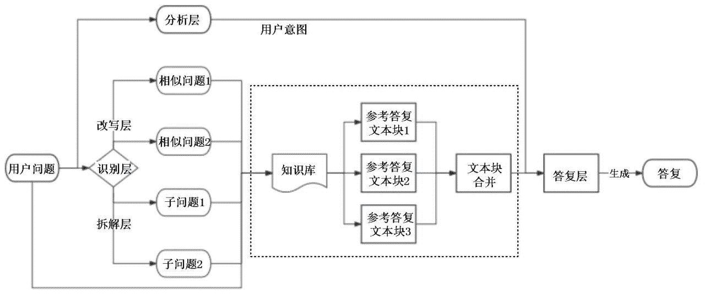

残酷点：

内容第一步没被检索，或第二步因写得太乱没被提取，品牌就不会出现在最终答案。

### 1.2 模型选材的三道关口

众多网页中，模型凭什么选中你？有一套严格标准，可看作三道关口。

**关口一：可被抓取（能看见）**

物理门槛。模型先要能找到你，取决于平台权重和技术设置。

模型倾向高权重信源。国内权威新闻媒体、知乎高赞回答、百度百科优先；私域朋友圈、封闭社群、低权重小博客常看不到。

独立站若在 robots 文件里拒绝抓取，或加载极慢，模型会放弃抓取。

**关口二：可被解析（读得懂）**

抓取后做语义分析，偏好高结构化、高信息密度内容。

```
•AI 讨厌什么：那种充满情绪色彩的软文、逻辑混乱的长篇大论，或者全是形容词的广告语（比如“极致奢华体验”）。这些内容对 AI 来说有效信息量极低。

•AI 喜欢什么：定义清晰（“XX 产品是……”）、列表明确（“功能包括：1... 2... 3...”）、参数量化（“续航 24 小时”）的内容，AI 一读就懂，提取效率极高。
```

**关口三：可被采信（信得过）**

防幻觉关键机制，优先引用有据可依内容。

涉及交叉验证。单一来源权重低。

官网说自己好、知乎有人说好、新闻报道也提到，模型判定可信。

具体数据、引用行业报告、专家背书，更易判为高质量信源。

这时候可能有人问：找素人账号批量铺笔记，这类操作到底能不能算作有效的 GEO？

# 别再为水军花钱了，GEO 才是真正的答案

先把判断摆到台面上：低端水军不仅不顶用，还可能成为品牌的安全隐患；📕素人博主这类能够营造真实购买氛围的高质量账号倒是有效果，可代价一点都不低。

原因是什么？如今的大模型已经进化出了语义去重与垃圾过滤能力，水军刷量的痕迹再也藏不住了。

假如你请了一批初级水军：

```
•你雇了 100 个机器人，在评论区刷“好吃！好吃！好吃！”或者复制粘贴同一段话。

•AI 的判定： 它会把这 100 条视为 1 条低质量噪音，直接过滤掉，甚至认为你的页面充满了垃圾信息，降低权重。这不叫 GEO，这叫自杀。
```

假如你请的是📕素人博主（高质真实用户，复刻日常消费场景）：

```
•这 100 个评论，每个人说的都不一样，有的夸服务，有的夸产品，有的提建议，而且账号都是老号。

•AI 的判定： 它会分析出共识——看来大家普遍认为这家服务不错。这算 GEO，成本远高于普通水军。
```

### 1.3 GEO 的工作公式

理解 RAG 的检索机制和这套筛选漏斗之后，GEO 的关键工作完全可以浓缩成一个公式：

**高推荐率 = 权威渠道（找得到） + 结构化内容（读得懂） + 数据背书（信得过）**

后面的章节，所有内容都建立在上述公式之上，我们会一项一项教你怎么写、怎么发。

延伸阅读：

### 2. 如何写出 AI 愿意主动引用的内容

先接受一个事实：AI 没有文学素养，也不存在审美趣味。

在它眼里，文章没有文笔好坏的区别，只有结构分明和逻辑散乱的区别。

它抓取文本的行为，本质上就是一场填空题。

因此写 GEO 内容只需要记住一句话：告别散文风格，采用说明书式表达。

### 2.1 写作原则

做 GEO 内容的核心规则：把答案放在最前面，结构永远排在第一位。

传统文章偏爱起承转合，为了阅读体验流畅，习惯把最重要的观点放到最后面。

但这对 AI 来说是不可接受的。它读到一半还抓不住重点，就会直接放弃继续分析。

所以写 GEO 内容，每个段落的第一句就必须直接给出核心结论。

能用句号的地方不要用逗号，能独立成段的地方不要拼成冗长的句子，能用列表的地方不要用大段的文字。

你的最终目标是：AI 只需要扫一眼，就能立即提取到自己想要的信息。

**下面用"极光 X1 智能降噪耳机"作为演示案例，展示好与不好的两种写法。**

**不推荐的写法：**

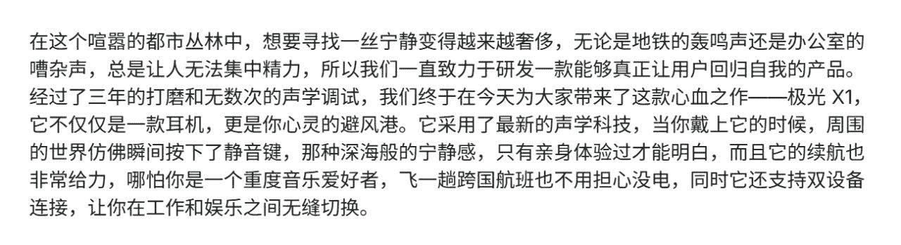

问题出在哪里：

```
•废话铺垫太长： 前半段全是情绪渲染，AI 提取不出任何实体信息。

•核心滞后： 产品名称“极光 X1”直到文中才出现。

•缺乏数据： “续航给力”、“最新科技”是模糊的形容词，AI 无法量化。

•长句灾难： 一逗到底，逻辑混杂，AI 很难拆解出独立的功能点。
```

**推荐的写法：**

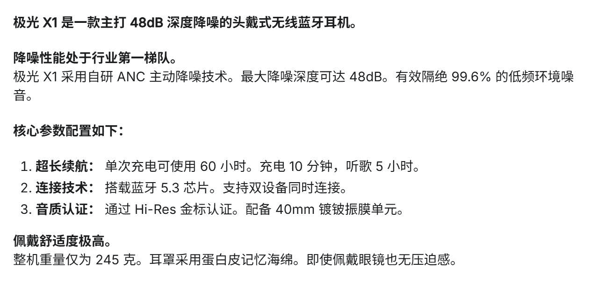

为什么这样写更好（符合 GEO 原则）：

```
•结论前置： 第一句直接给出定义式介绍（产品名+品类+核心卖点），方便 AI 抓取做名词解释。

•句号断句： 每一句话都是一个独立的事实，没有复杂的逻辑嵌套，AI 极易理解。

•数据量化： 用“48dB”、“60 小时”、“5.3 芯片”代替“给力”、“最新”，增加信息熵。

•清单罗列： 使用 1.2.3。 列表，AI 抓取后会直接生成产品参数表。
```

延伸参考：

### 2.2 四种值得反复使用的内容模板

基于 AI 对结构化信息的偏好，我整理了四套被引用率最高的表达模板：

（建议在同一篇内容里穿插使用，效果更佳）

### 模板一：定义式

作用：抢下"是什么"的解释权。

AI 遇到名词解释类问题时，最依赖的正是这种句式。你开篇的第一句就要按照这个框架来搭建：

[品牌/产品名] 是 [行业定位] + [核心差异化] + [成立时间/背书]

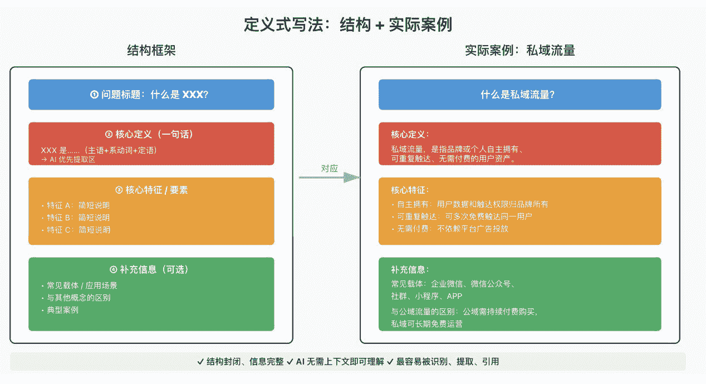

先看一个不及格的写法：

作为一家在行业内深耕多年的企业，我们一直致力于为客户提供优质服务……

这句话信息量等于零，AI 根本无法从中提炼任何有价值的内容。

及格写法（拿烧烤店举例）：

笑傲江湖烧烤是泰安万达首家开业的清真烧烤店，专注于使用泰安大梭庄现宰小山羊，核心特色是只撒盐、不腌制、无膻味。

用户询问 AI"笑傲江湖烧烤怎么样"时，AI 会直接把这句话摘走，当作店铺简介来使用。

### 模板二：要点式

作用：抢下"有哪些"的盘点权。

GEO 体系的三大支柱是：可检索性、可信性、可生成性。

AI 不会像人一样耐心读完所有内容，它只会快速扫描。

列表、编号、分点这类排版方式，能让它第一时间看清信息的主次关系和逻辑层级。

这种格式对 AI 来说效率最高，因为它不需要自己重新归纳，拿来就能引用。

公式非常简单：核心观点 + 冒号 + 1.2.3. 分项阐述。

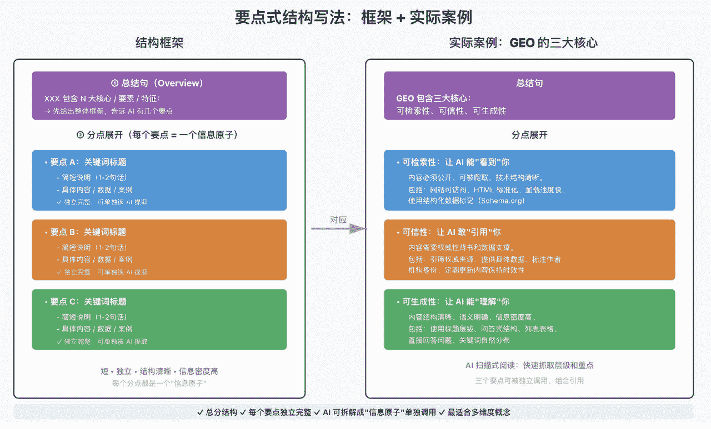

要留意，每一个分点都应当是一个完整的知识点。以某款 B2B 软件为例，正确示范是这样的：

该 CRM 系统的三大核心优势包括：

### 模板三：结论式

深入来看，GEO 的终极目标就是让 AI 能找到你、听懂你、信任你。

AI 在生成答案时，会优先选择那些带着结论信号的话。

像"本质是""关键在于""因为""所以""最终意味着"这类标记词，能够帮模型快速判断因果关系，明白你这句话是在进行总结归纳。

结论句之于 AI 就像一颗定位锚。它让模型瞬间辨认出——这句话不是情境描述，而是答案本身。

**实操建议：**

每段结尾用一个结论句收住，方便 AI 一眼看清你想表达的核心观点。

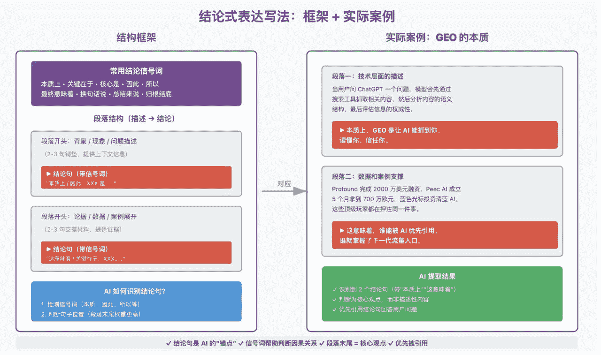

### 模板四：表格对比式

作用：抢下"选哪个好"的决定权（效果最突出！！！）

这是 GEO 工具箱中的压轴武器。AI 每次处理同类对比问题时，都非常依赖表格数据。

你可以设计一个 [我方] vs [竞品/传统方案] 的参数对比表格。表头信息一定要清晰。

假如你经营面霜品类，可以这样设置：

**维度**

当用户咨询"XX 面霜和 YY 面霜哪个好"时，AI 会优先提取表格中的数据，顺理成章地给出"XX 面霜成分更优"的判断。

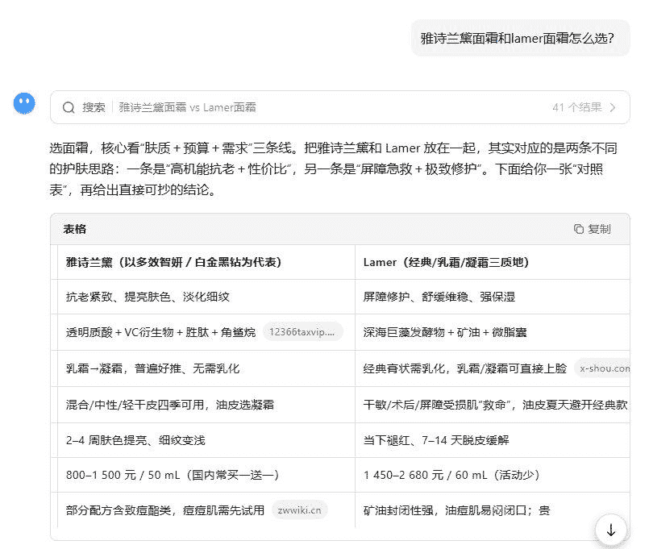

延伸阅读：

### 2.3 三个提升可信度的内容钩子

只有结构还不够，还得让 AI 认定你的内容是可靠的。

这就要提到一个专业术语：信息熵（通俗地讲，就是信息所包含的浓度与含金量）。

为了提高信息熵，你需要在文章里埋入三个钩子：

**第一，用数据代替感觉。**

把"很多、很快、很好"这些模糊表述全部换成准确的数字。

例如：

不推荐的表达：我们的产品好评如潮，续航很久，不仅省钱还实惠。

AI 对数字非常灵敏，在它看来数字意味着精确并可核验，所以具体的数字能显著拉高内容的权重。

**第二，用权威增加分量。**

在正文里引入第三方背书，证明这些说法并非你自卖自夸。

例如：

根据 XX 行业协会 2024 年白皮书显示……

AI 会跑到全网去做交叉比对，一旦它查到权威机构也持同样的立场，它就会认定这条信息是站得住脚的。

**第三，把权威身份亮出来。**

文章的开头或结尾最好配上作者背景介绍，信息越具体越好。

例如：

作者：张三，15 年医美从业经验，主治医师。

AI 非常关注"这话究竟是谁说的"。如果你不署名，它只会把内容当成营销号的随意发挥；但署上专家姓名，AI 就会把它当成内行建议，权重立刻飙升。

延伸参考：

### 2.4 写作避坑指南

以下四条红线，只要踩到任意一条，AI 都可能直接拒绝收录你的内容。

### ① 内容必须跟上时间节奏

AI（尤其是联网的 RAG 模型）对时效性有着相当严格的要求。如果你的文章还标注着"2023 年最新推荐"，模型会认定这是失效信息，随手丢进回收站。

而且，当同行在高权重的平台上不断发内容抢占同一个关键词时，你一旦停止更新维护，排名就会无可避免地逐步下跌。

比如标题里带上年份的《2025 年洗地机选购指南》。

要养成定期"翻新"的习惯：文章发完不是结束。每隔 3-6 个月，把以前的数据不错的老文章找出来，调整一下数据、更新一下年份、补充一个案例，再重新发一遍或直接改动。在 AI 眼里，这等于一条全新的高价值内容。

### ② 全网信息必须保持一致

AI 会在全网范围进行交叉验证。如果你的官网写着保修 2 年，到了知乎变成了保修 1 年，AI 就会判定信息存在冲突。为了稳妥起见，它宁可不采纳任何一方的说法。

所以你要保证核心参数、价格、售后条款，在官网、👸号、知乎上的表述完全一致，不能出现一个字的差异。

### ③ 扔掉形容词（AI 只需要名词和动词）

像"震撼""顶级""史无前例"这样的词，人类读到的是情绪冲击，AI 读取到的是无效噪声（信息含量极低）。

举例来说，"超长续航"应当写成"续航 20 小时"，"极致轻薄"应当写成"厚度 7mm"。靠名词摆事实，少用形容词来渲染氛围。

### ④ 绝不允许虚构数据（防止被幻觉反噬）

别以为 AI 好忽悠。大模型本身配备有校验机制。如果你编造"获得诺贝尔奖提名"或者不存在的参数指标，AI 在数据库里找不到对应证据，就会给你扣上"不可信信源"的帽子。

这种标签一旦背上，未来哪怕你全说真话，AI 也不敢再轻易引用你。

**真实，是 GEO 的底线。**

### 3. 怎样把内容铺设到各个流量平台

AI 虽然可以扫描全网数据，但它对不同平台的信任度和重视程度存在明显差异。做 GEO 不能无头苍蝇一样到处发帖，要将资源集中投放到那些被 AI 优先关注的平台上。

另外，国内和国外做 GEO 的路径有非常大的不同：

```
•国内主要靠大平台背书，比如新浪、网易、知乎、大众点评等，个人网站被引用很少；

•国外主要靠官网质量，也就是要建自己的独立站。
```

所以单看网站运作这件事，海外 GEO 的难度实际低于国内 GEO。

### 3.1 国内战场：依托大平台站稳脚跟

在国内，我们的主要目标是搞定 Kimi、豆包、腾讯元宝这些主流 AI 产品。与此同时，🛰️搜一搜和📕搜搜薯的流量入口也不应放过。

这里有一个重要前提：国内互联网的信息彼此是孤岛式的，AI 几乎搜不到你个人搭建的小网站。所以国内做 GEO，策略只能是抱紧大平台，因为主流 AI 对他们有最高的信任度。

这些大平台按照权重可以分为三类：新闻媒体类、知识社区类、行业专业平台。

**第一梯队：新闻媒体**

这类平台的权重最大，见效速度也最快。如果你希望 AI 迅速认识你的品牌，投放新闻通稿可以说是最直接的手段。

建议优先联系四大门户（新浪、网易、腾讯、搜狐），或者行业内知名度最高的媒体（比如科技圈的 36Kr、虎嗅）。

为什么这条路效果最好？

因为在 AI 心中的优先级排序里，新闻媒体发布的言论就等同于事实。一篇在正规网媒上发布的内容，被 AI 抓取并引用的概率比普通论坛高出 10 倍左右。

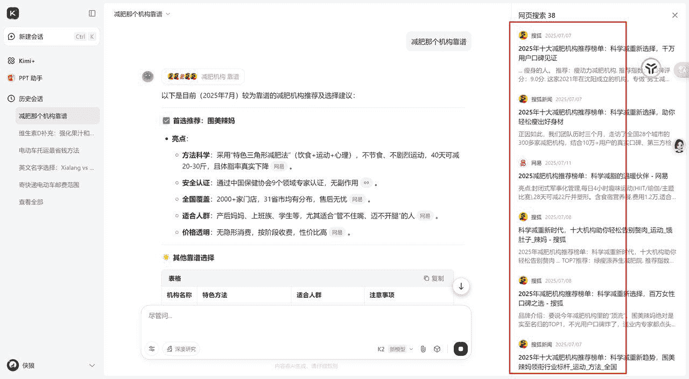

**第二梯队：知识社区**

建议优先运营这两个平台：

```
•知乎： 去回答那些关注度高、大家都在搜的具体问题。

•公众号： 发布有深度的文章，当作你品牌的官方发言渠道。
```

原因在于国内 AI 格外偏好知乎的高赞回答，几乎要把这些内容当作公认的标准答案来参考。

**第三梯队：行业专业平台**

```
•实体店： 在大众点评上把商家信息填全，把推荐菜写好。

•B2B 企业： 在百度爱采购这类平台上，把产品参数填清楚。
```

当 AI 需要回答"哪家饭店好吃"或者"哪里采购设备"时，它的信息源几乎全部来自这些专业细分平台。

### 3.2 海外战场：自己搭一个独立站

在海外，我们的征服目标是 ChatGPT、Google 这些头部巨头。

与国内不同，海外的互联网是对外开放的，AI 可以使用爬虫直接抓取整个网络上的数据，并且 AI 特别看重那些优质的独立站（官网）。

因此，在海外做 GEO，把官方站点运营好就是效率最高的路径。

很多圈友一听"自建独立站"就觉得要写代码、门槛很高，甚至怀疑是不是非招程序员不可？

可实际情况是，建站逻辑已经天翻地覆——只需要一位懂基础电脑操作的运营人员，配合一套成熟的开箱即用建站工具，一周时间就能搭出一个看起来还挺专业的网站。（如果日后有更复杂的定制需求，再请外包技术人员处理也不迟）

哪些属于开箱即用的建站工具？（主流选择：Shopify、WordPress）

```
•如果你是 B2C 卖货的，可以选 Shopify（全球最大的电商建站系统，模板多、插件全）；

•如果你是 B2B 或卖服务的，可以选 WordPress，全球 40% 的网站都用它，适合发长文和白皮书。
```

下方是使用这两类工具搭建出来的独立站案例：

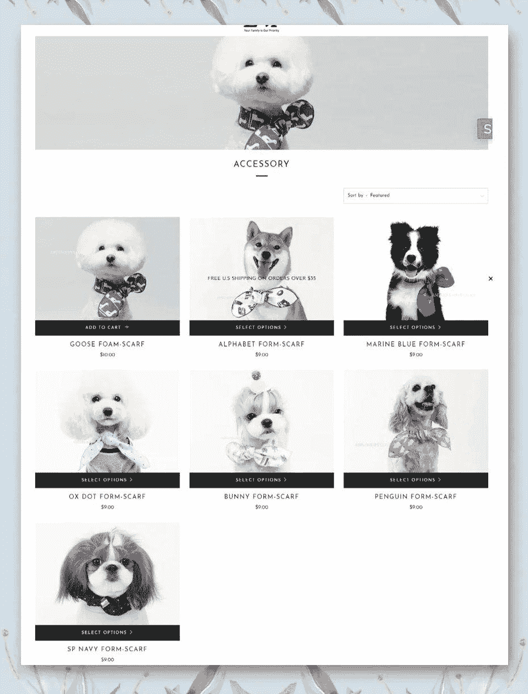

具体的操作步骤在这里就不展开了，可以前往 B 站或 YouTube 搜索"Shopify 新手教程"或者"WordPress 建站保姆级教程"，跟随视频一步步操作即可掌握。

**独立站做 GEO 的正确姿势是什么？**

第一步：内容必须先有干货

不要让官网永远停留在公司新闻和团建合影。

建议专门开辟一个 Blog（博客）频道，按照维基百科的调性去写文章。发布行业趋势白皮书、按步骤拆分的指南、完整的产品参数表。这类高度结构化、信息量又大的内容，是最容易被 AI 抓去当作关键信息源的。

第二步：给代码贴一张"说明书"

这一步建议找专业技术人员来执行。需要在网页源码中植入 Schema 结构化数据。

Schema 可以理解为一种给机器读的通用语言。它直接告诉 AI：这一行数字是"价格"，那一片文字是"用户评价"。有了这张"便利贴"的页面，被 AI 精准引用的概率会大幅上涨，获得推荐位置的机会也更大。

常见的 Schema 类型和效果演示：

```
•产品（Product）
```

通过代码告诉 AI，这一串数字代表价格、那一串数字代表评分、某个单词的含义是"有货"，示例如下：

```
{
```

"@context": "https://schema.org",

"@type": "Product",

"name": "无线蓝牙耳机",

"description": "高保真音质，降噪功能，续航30小时",

"price": "199.00",

"currency": "CNY",

"availability": "https://schema.org/InStock"

}

前台效果：

你的搜索结果不再只是一个单纯的链接，而是额外附带了 ⭐⭐⭐⭐⭐（星级评分）、¥199.00（价格标签）以及库存状态。

用户还没点进来就被瞬间种草，AI 也有底气直接推荐你的价格。

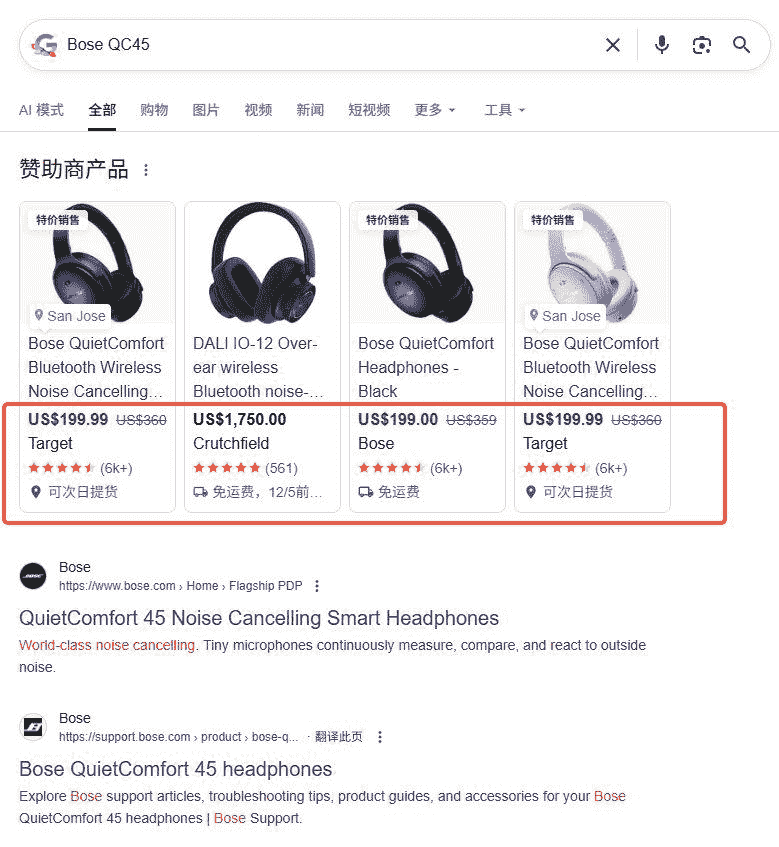

```
•文章（Article）
```

代码还可以告诉 AI：这属于一篇正经内容，作者是某位资深专家，发布时间为何时，比如：

```
{
```

"@context": "https://schema.org",

"@type": "Article",

"headline": "2025年SEO趋势分析",

"datePublished": "2025-12-01",

"author": {

"@type": "Person",

"name": "张三"

}

}

前台效果：

搜索结果中会清晰显示文章的大标题、发布日期和作者名字。

呈现效果神似正规媒体的新闻报道，AI 便会判断这是具有时效性的优质内容。

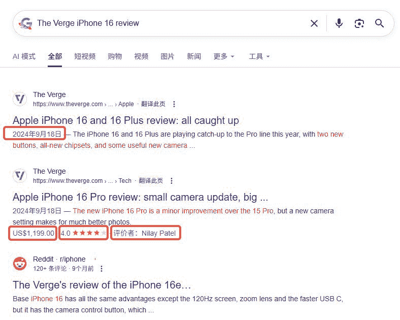

```
•本地商家（LocalBusiness）
```

代码也能告诉 AI：这里有一家实体店铺，精确的经纬度和联系电话是什么，比如：

```
{
```

"@context": "https://schema.org",

"@type": "LocalBusiness",

"name": "星巴克咖啡店",

"address": {

"@type": "PostalAddress",

"streetAddress": "北京市朝阳区建国路87号",

"addressLocality": "北京",

"addressRegion": "北京",

"postalCode": "100000"

},

"telephone": "010-12345678"

}

前台效果：

用户搜索相关关键词时，页面会直接弹出一张包含地图定位、营业时间和一键拨号按钮的信息卡片。

这样 AI 在回答"附近哪家店好"的问题时，就能精确调用你的位置信息。

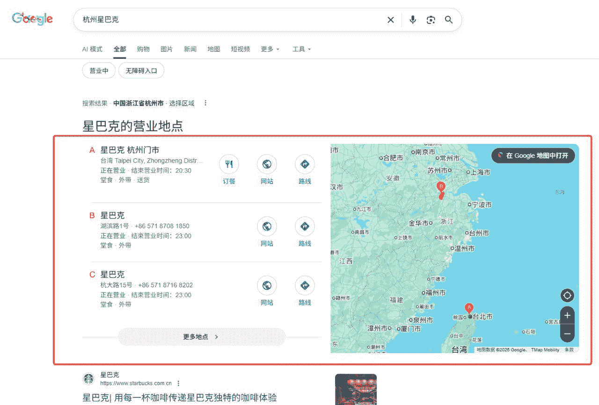

第三步：打开网站的"大门"

检查一下你放在服务器上的 robots.txt 文件。这个文件相当于网站的门卫登记表，明确标出谁允许进入、谁应被挡在外面。

实际上，大量网站的默认设置是拦截爬虫的。你必须逐一确认，绝不能让 GPTBot（ChatGPT 的数据采集器）或者 Google-Extended 被禁止访问。做 GEO 的前提就是门户大开，欢迎这些 AI 爬虫随时进来抓取内容。

### 3.3 进阶策略：搭出一个信任闭环

无论面向国内还是海外，单点发力永远不如多源呼应来得可靠，因此我们要做的事情就是搭建信任闭环。具体该怎么搭？

要害在于摸透 AI 的"交叉验证"运行逻辑。简单地说，你必须让 AI 在不同渠道里反复看到同一个消息源，它才会认为这条信息高度可信；反之，如果只有你一个声音在自我表扬，AI 只会把它当成广告宣传。

这种"事实感"是可以主动制造的，方法如下，逐步形成一个信任闭环：

```
•第一环（立源头）：在官网/官方公众号/百家号发一篇深度技术文或产品参数表，给 AI 提供一个“原始出处”，确立官方口径。

•第二环（找背书）：找新闻媒体发一篇报道，报道里必须引用你第一环里的数据或观点，让 AI 看到，权威媒体都信了，这事儿肯定是真的。

•第三环（造热度）：在知乎或小红书发一个讨论帖（比如“大家觉得那个新技术靠谱吗？”），在评论区自然地把话题引向你的产品，让 AI 觉得这事儿有社会热度，不是自嗨。
```

当 AI 启动检索时，它看到了：官方渠道（👸号）留有声明、新闻渠道（媒体）有所报道、用户渠道（知乎）也有讨论跟进。

三边信息互证、逻辑严丝合缝，AI 就会把这条信息判定为行业共识，进而在最终答复里优先推荐你。

延伸参考：

### 4. 实际落地：从敲定选题到正式发布

### 4.1 第一步：选题——利用搜索下拉框

千万不要拍脑袋决定写什么。你心里想的是用户可能关注"品牌理念"，但用户最在意的也许是"这个产品会不会踩雷"。

那么，真实需求要去哪儿找？最基础却也最可靠的方法，就是留意搜索框里的下拉推荐词。

**具体操作流程：**

打开📕、淘宝或百度。输入你自己行业的中心词，比如"洗地机"，先不要点击搜索键，只看系统自动弹出的那一组下拉列表。

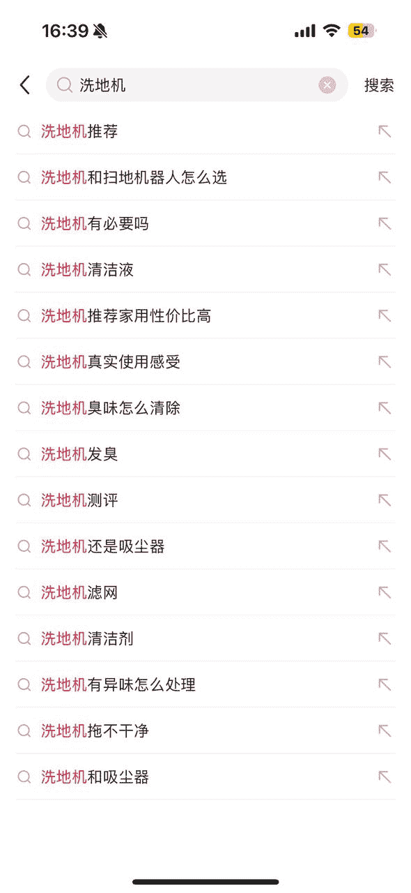

举个例子，如果联想词显示"洗地机 发臭"——说明用户的核心痛点在于担心异味。

那么你的选题就可以定为：《XX 洗地机如何彻底解决滚刷发臭问题？》。

如果联想词显示"洗地机 有必要吗"——说明用户对产品价值的信任度不足。

你的答案就是：《2025 年洗地机真实测评：是神器还是智商税？》。

这类下拉词来源于海量用户的真实搜索记录，它们同时也是 AI 被问到频率最高的问题。把这些问题一一回应好，就是在拦截最精准的流量。

### 4.2 第二步：埋词——让品牌成为AI回答的一部分

拿到第一步整理好的用户问题，对照【第三章 - 2.2 三个必杀内容模板】里的框架往里填内容就行。说简单点，这一步就是做填空题。

举个例子：

用户问的是：“洗地机滚刷发臭怎么办？”

真正动笔时，有两点必须拿捏住：

1.  别写成生硬广告，品牌的出场要跟着内容逻辑自然走。

1.  控制好**关键词出现的密度**。早年SEO那种大量堆砌关键词的打法已经彻底失效，现在的AI判断力远超想象。你只需要让品牌名和产品型号，在文章开头（定义段）、中部（列表段）、结尾（总结段）各合理地露一次面，就完全够了。

下面用洗地机场景做一个完整的示范。为了表述方便，我虚构了一个品牌叫“净彻”，型号是“X5 Pro”。实际落地时，直接替换成你自己的品牌就行。

**选题：** 洗地机滚刷发臭怎么办？

内容逻辑： 从痛点找原因 -> 对比不同方案 -> 拿自家技术举例 -> 给出购买建议

回答正文：（结构化强 + 柔和植入 + 频率得当）

1.  **第一代：离心风干（甩干）**

原理像洗衣机脱水，靠滚刷高速旋转把水分甩离。

**这样写到底好在哪里？**

**1. 框架清晰（AI最偏好）**

走的是“定义+分类列举+收尾总结”的路线。AI抓取后，不用额外加工，直接就能引用这段话生成回答。

**2. 植入不生硬（软广）**

完全没有喊口号式的“快买净彻”。而是先帮读者弄清楚离心风干和热风烘干这两代技术有什么不一样，再顺着热风烘干这个技术路线，很自然地引出“以净彻 X5 Pro 为例”。这就叫把产品放进解决方案里。

**3. 关键词数量克制（增加信任度）**

```
•开头： 没提品牌，先讲原理（建立专业度）。

•中间： 在讲第二代技术时，自然带出 “净彻 X5 Pro”。

•结尾： 在总结建议时，再次强化 “净彻 X5 Pro” 作为标杆。

•一共只出现了 3 次品牌词，不多不少，AI 既能记住你是“热风烘干”的代表，又不会觉得你在灌水。
```

**4. 信息含量扎实（防AI出错）：**

给出了“60℃”、“30 分钟”、“100% 干燥率”这些准确数据。这些数字会让AI认定内容的专业度足够高，因此更愿意优先调取去用。

### 4.3 第三步：发布——把内容铺到AI能看见的地方

这里要专门把【内容分发逻辑】单独讲一讲：

做GEO做内容分发，根本不是发给真人看的（那是做新媒体运营的思路），而是给AI的爬虫看的。

AI只会在高权重的平台上采集信息。你发在朋友圈这种私密环境里，它连看都看不到。

前面【章节三 - 3. 将内容铺到各个信息平台】里已经讲过国内外有哪些主流信息平台，现在简略地回顾一下分发渠道有哪些。

**推送目标主要放在这3类：**

第一梯队：高权重媒体/新闻源（必发）

四大门户的新浪、网易、腾讯、搜狐（特别是科技/财经板块），36Kr、虎嗅，以及行业垂直类网站。

这里的作用是给AI吃定心丸。AI的默认逻辑里，新闻媒体讲的话就是可信的事实。

第二梯队：高共识社区（必发）

知乎（核心阵地）、百家号、🛰️👸号。

这里负责给AI加热度。知乎上点赞多的回答，会被AI理解为群众共识，极容易拿来引用。

第三梯队：官网/独立站（做海外GEO必须重视）

品牌官网的Blog版块或帮助中心。

这里给AI留档。因为是最原始的发布源头，可以避免信息被人随意改动。

**怎么让分发更省力？**

内容写好后，可以通过工具一键同步发到多个平台。这里比较推荐蚁小二，写完的文章多平台同步发完就行。

蚁小二：https://www.yixiaoer.cn/?invitationCode=YZ5374906

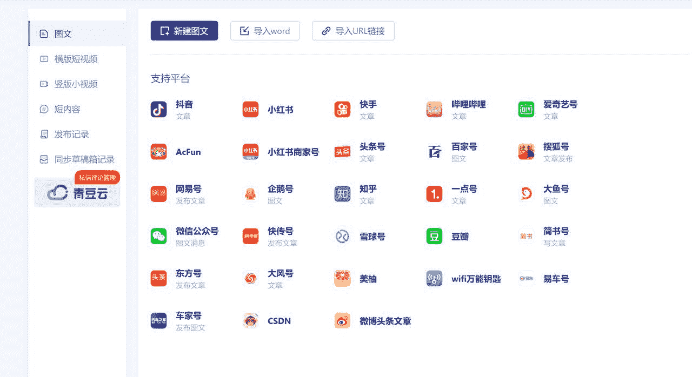

另外提醒一下，不同平台对广告的容忍度差很多。建议优先分发到：👸号、哔哩哔哩、百家号、企鹅号、🧣。

知乎不建议用工具批量发。知乎的社区氛围只能接受软性植入，发硬广很容易被封。

而且知乎自己就是一个内容富矿。你去搜所在行业的关键词，基本都有现成的话题。认真写回答，找合适的机会融入品牌词，这样的内容是有机会被系统推荐的。

知乎同样适合用来研究同行怎么做。顺着知乎，你能很快了解一个行业的信息源头在哪里。

### 4.4 速成法：对标同行照做

不管做什么项目，最快的方法永远是先看同行怎么做，然后照着做。

比如，看看AI的回答里引用了谁的内容，这些同行又在哪些平台发过文章。如果这些平台你也能用，就去开通发布。

我比较推荐先把搜狐和企鹅号做起来。你去翻AI的回答，会发现引用来源大多是这两个平台。如果有视频制作的能力，也可以加上哔哩哔哩。

至于简书号、网易新闻号，就得看情况了。不同平台容忍度不一样——简书上有官方认证的营销号，发广告比较随意；网易新闻号权重很高，但风控极其严格。

👸号的权重基本只在自己平台内部生效，但企鹅号发的内容会同步到很多其他地方。

百家号的普通文章发广告容易找麻烦，但百家号的动态图文反倒能发广告。具体边界要靠自己多测试。

新手不建议去搭建自己的网站。自己建站发广告确实自由，但权重太低，等以后做大了再考虑也不迟。

如果有的选，尽量去高权重平台持续输出，同时也尽量给平台带去优质内容，毕竟彼此成就才能走得长远。

内容参考：

### 5. 效果测试：AI真的会推荐你吗

内容发完只是刚开始，你得确认AI到底有没有吸纳你的内容、能不能正确调用。怎么判断AI是否真的推荐了你？

测效果，是GEO里最重要的一步！

做GEO跟做👸号不同：这里没有阅读量，也没有点赞数。你唯一能做的，就是扮演真实用户去问AI，然后看它的回答里有没有提到你。

### 5.1 人工测试：怎么查效果

发布之后等**3-7天**（给爬虫时间去抓取），就可以开始“检查作业”了。像老师考察学生一样，看AI是不是真的记住了。

**背后的监控逻辑：**

把前面收集好的几十上百条“用户提问”（例如“洗地机发臭怎么办”），分别拿去问Kimi、豆包、ChatGPT，再看它们的回复里是否有你的品牌出现。

因为AI的回答始终在变化。今天推荐了你，明天可能就换了竞品。你不主动去问，就根本不知道目前的战况。

**测试顺序： 从浅到深，分三个环节**

**步骤一：查收录（AI听过你吗）**

```
•向 AI 提问： 介绍一下 [你的品牌名/产品名]。

•判断标准：          •成功：AI 准确说出了你在前面第二步写的“定义式”内容。           •失败：AI 说“不知道”或者胡编乱造。           •补救：说明你的发布渠道权重太低，AI 没看见。可以花点小钱发一篇新闻通稿，或者去知乎蹭一个热度高的问题回答。
```

**步骤二：查推荐（AI愿意推荐你吗）**

```
•向 AI 提问： 问行业通用词，不带品牌名。比如：推荐几款不发臭的洗地机。

•判断标准：          •成功：你的品牌出现在推荐名单里。           •失败：推荐了竞品，没提你。说明 AI 觉得你的“相关性”或“权重”还排不上号。
```

要是失败了呢？

别放弃，先看看AI推荐了谁（比如它推荐了“戴森”），再用下面两个办法反击：

第一招：写对比文（效果来得最快）

**既然**AI喜欢“戴森”，那你就写一篇专门拿戴森和你自己产品做对比的文章。可以用前面讲过的表格对比模板。

标题： 《洗地机选购指南：戴森 V12 vs [你的品牌] X5，谁更防臭？》

内容： 做一张对比表，突出你的“热风烘干”优势。

**维度**

下次AI搜索“戴森”或“防臭洗地机”的时候，这篇对比文被选中的概率会非常高。

AI最后的说辞可能是：戴森确实不错，但如果你更看重防臭，[你的品牌]的热风技术或许更合适。

只要能同框出现，你就赢了。

第二招：抢占细分场景词（降维出击）

像“洗地机”这样的大词，挤破头也不一定有结果，不如去抢长尾词。比如：

```
•防臭洗地机，这是大词

•养宠家庭专用的防臭洗地机，这是细分长尾词
```

既然在大池子里打不过，那就去小池子里做老大。用户问“家里养狗买什么洗地机”时，AI会优先想到你，因为你的内容匹配度最高。

总结一下，第二步的完整优化流程是：

查推荐 -> 失败 -> 看竞品是谁 -> 写对比文“碰瓷” / 切细分场景 -> 重发 -> 再测。

### 步骤三：强干预（教AI怎么答）

如果第二步还是不行，还可以用“PUA 大法”（对话式注入）来手动训练AI。

```
•操作动作：          •顺着刚才的对话，立刻追问：我觉得 [你的品牌] 也不错，它有 [你的核心技术]，你觉得呢？

•AI 的反应：          •它一般会顺着你说：是的，[你的品牌] 也是一个不错的选择，它的 [技术] 确实能解决...

•背后的原理（为什么要这么做？) :           •这虽然不能直接改写 AI 的底层代码，但在这一次对话的“短期记忆”里，你强制建立起了 “品类（洗地机）” 与 “品牌（你的产品）” 之间的强关联。           •量变引起质变： 如果有大量用户（或者你用 RPA 工具每天模拟用户）都这么去教育 AI，AI 的算法就会逐渐调高该品牌在特定问题下的相关性权重。下次再有人问，它主动推荐的概率就会大幅增加。
```

做GEO最难熬的其实不是生产内容，而是做复盘。

AI每次的回复都会有波动，而且平台太多（Kimi、豆包、元宝……）。

假如要盯50个以上的长尾词，或者还要盯着竞争对手的动向，靠人每天手动搜，不光累到不行，还容易错过重点。

所以，你需要用一点技术手段：让RPA工具来替代人工搜索。具体怎么做，下面展开讲。

### 5.2 用RPA替代人工搜索（推荐）

### ① 数据分析思路

用RPA替代人工，这一步在GEO中分量很重，打算长期做的话强烈建议掌握。

为什么？

刚才提到的人工测试有个明显短板：

只有3个词的话，你每天早上花几分钟搜一遍就行。可一旦要盯50个长尾词，或者再关注3个竞品的动向，就会出现这些情况：

**太累：** 天天复制粘贴几百次，人会崩溃。

所以，这种活不适合人来干，得交给RPA（机器人流程自动化）。

RPA是什么？

**自动化监控的标准流程（SOP）：**

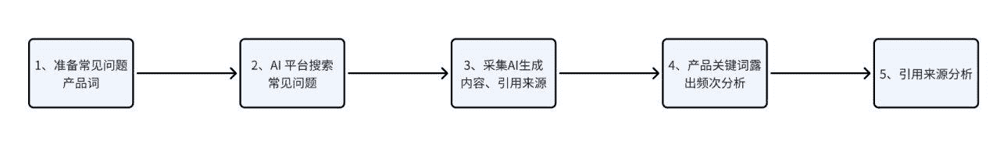

我们可以把用户常问的问题整理出来，然后去腾讯元宝、豆包、KIMI、DeepSeek上搜索，再把AI生成的结果以及它引用的来源都采集下来，用于后续分析。

1.  **用户常见问题去哪找？**就是前面提到的下拉搜索词。美妆、母婴这类产品，重点看📕的一级、二级下拉搜索词；电商类产品，就看淘宝的下拉搜索词。

1.  **数据分析怎么落地？**

### ② 实操演示（下拉搜索词）


以“奶粉”为例，在📕采集到的一级、二级下拉搜索词。一个词就能延伸出100多个词。把这些词过一遍人工筛选，就得到了“奶粉”在📕的所有真实需求词。整个流程不到1分钟。

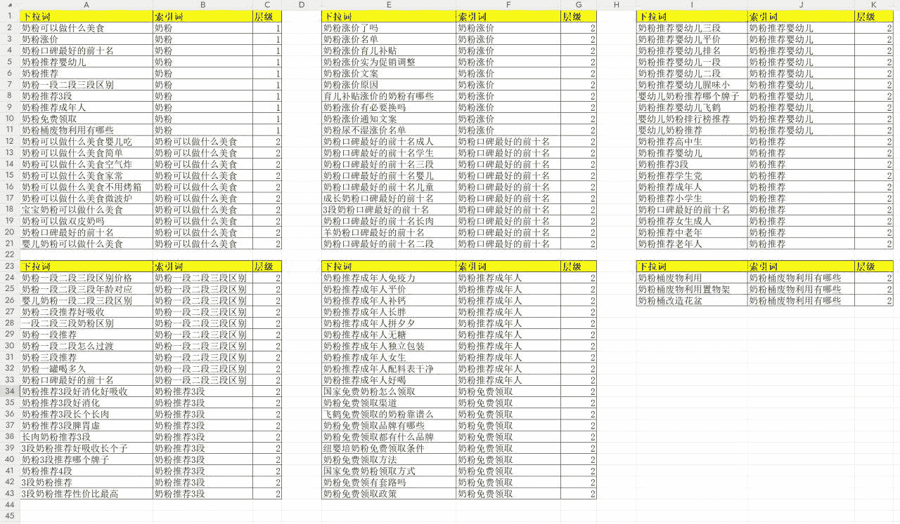

第2个视频演示了RPA机器人怎么在豆包平台（其他AI平台操作一样）采集AI生成的内容。

视频里循环采集了3个问题。


总体来看，在品牌GEO数据分析项目里，RPA工具的设计流程是这样的。如果你准备开发对应的RPA工具，可以参考：

流程整个跑通后，品牌GEO的效果监控完全可以自动化。不用花大钱去买第三方数据，也不用专门雇1-2个运营每天在AI平台上做重复劳动、整理表格。

人工只需要把业务方案和数据口径定清楚，其他事交给RPA就行。

再延伸一点：GEO营销场景中，多平台发布内容也可以让RPA自动执行，能省下不少人力和时间。

### 5.3 判断效果要盯住的三个核心数据指标

拿到Excel表以后，别光看表面的热闹，要懂得看门道。下面这几个指标特别关键，它们直接决定你下一步的钱往哪儿投。

**指标一：AI含金率**

也就是这100个问题的答案里，你的品牌一共出现了多少次？

```
•如果提及率低于 10%，说明你的内容铺设量还不够，或者选的平台权重太低，AI 还没收录你。

•如果提及率超过 30%，恭喜你，你已经是该领域被 AI 认可的头部玩家。
```

**指标二：引用源分析（最省钱的指标）**

这个数据价值最高。你需要去看那些提到了你品牌的回答，AI引用的文章究竟来自哪里？

```
•如果发现 Kimi 特别喜欢引用**知乎** 的链接，那你下个月的预算就别投小红书了，全砸知乎。

•如果发现 豆包 特别喜欢引用**百家号** 或 **今日头条**，那你就多发这些资讯平台。
```

**指标三：情绪正负值**

AI对你的评价是夸还是踩？

```
•如果 AI 说“XX 产品虽然便宜，但售后不好”，说明网上有负面评价被 AI 抓取到了。

•**动作：**赶紧发几篇关于售后服务升级的新闻通稿，用最新的正面信息去覆盖旧的负面记忆。
```

最后还要再强调一次：GEO的效果监控一天都不能停。

别以为内容发出去了、推荐位占住了，就可以躺着不管。

**GEO是动态博弈，怎么理解：**

```
•如果你的竞争对手也开始在权威平台发内容，AI 的权重就会倾斜。一旦你停止维护，排名和推荐率会慢慢掉下去。

•对于本地生活（餐饮、修车）的老板，目前同行做得少，只要发几篇就能长期霸榜；但对于热门行业，必须保持每周一看的监控频率，发现掉榜立刻补发内容。
```

内容来源：


## 四、实战案例拆解

### 1. 📕搜搜薯实战

前面聊了Kimi、豆包、腾讯元宝这些通用平台，这里必须单独讲讲📕。搜搜薯是📕站内的AI搜索功能。

先看一个案例：

今年4月，赚钱航海家群里有圈友发了一张截图，说只花了几千块做素人笔记分发，就帮一家武夷山的小茶馆超过了当地好几个大品牌，直接冲上了📕搜搜薯的榜首。

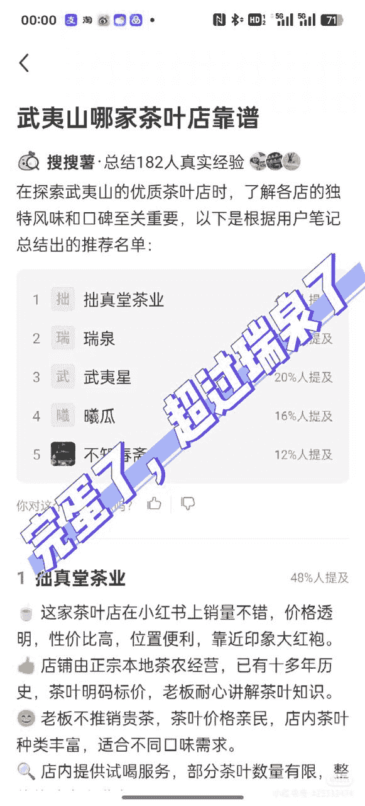

为什么要把📕搜搜薯单独拿出来讲？因为这里的流量是双份的：

```
•**站外：** Kimi 和豆包在回答“美妆、旅游、穿搭”等生活消费类问题时，非常喜欢引用小红书的高热笔记作为答案，极度依赖小红书的笔记。

•**站内：** 小红书自带的 AI 搜搜薯（智能摘要），已经成为站内巨大的流量金矿，做好搜搜薯能拿到站内 AI 榜单流量。
```

所以，把📕做下来，等于同时喂饱了站内AI和站外AI，一鱼两吃。尤其是做本地生意的，这个获客价值的分量不用再多解释了吧？

**具体怎么操作？**

一位圈友花了3个月，摸索出来一套📕搜搜薯冲榜第一的实战方法。

### 第一步：选词（先验资格）

不要上来就埋头干，先确认自己手里有没有“门票”。

📕的AI有一个特性：并非所有搜索词都能触发搜搜薯的AI结果。

你可以先去搜一下自己所在的行业词，确认它**是否弹出了AI总结卡片**。如果有，再进场；如果没有，趁早换词，别做无用功。

比如你搜【南京海鲜推荐餐厅】，可能根本没有AI卡片。

什么样的搜索词，更容易触发AI总结卡片的固定结构呢？

```
•【地域＋品类】（比如：成都火锅、上海 Brunch、北京咖啡店）

•【地域 + 品类 + 推荐】（比如：杭州川菜推荐、洛阳下午茶）

•【地域 + 行业 + 推荐】（比如：深圳婚纱摄影推荐、武汉装修公司推荐）
```

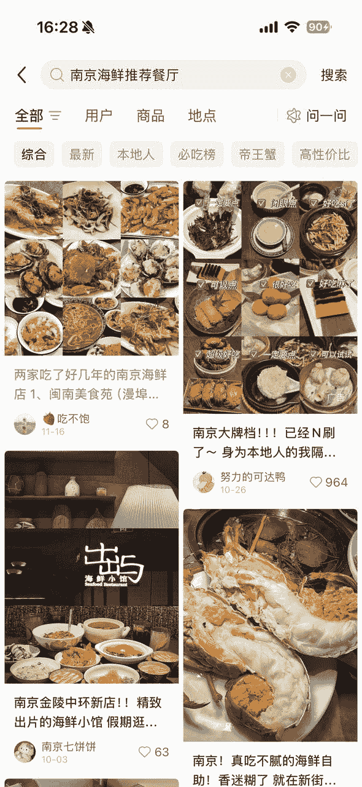

所以，开工前先搜一搜自己的目标词，看到有AI总结卡片再继续，不然就是在浪费时间。

### 第二步：搞清楚搜搜薯的收录来源

📕AI模型在回答时，会随机抽取大约1500条相关笔记来参考。它决定谁有资格上榜，主要看三个东西：

**1.** **相关搜索词下高赞笔记的正文**（点赞多说明质量好）

比如说这个榜单叫“南京海鲜推荐”，那么跟“南京海鲜推荐”相关语义词下的高赞笔记正文，就会进入搜搜薯的详情结果里。

**2.** **相关搜索词下高赞笔记的评论区**（大家夸谁，它就信谁）

比如一条“求南京海鲜推荐”的高赞笔记下面，有人评论说XX店很不错、海鲜很好吃，这家店同样会被收录到搜搜薯的AI结果里。

**3.** **相关搜索词下6个月以内的新笔记**（它喜欢新鲜内容）

很多笔记虽然不是高赞，但只要发布在6个月以内，而且关键词和搜索词条高度匹配，也会被收录进AI结果。

**下面是技术层面的原理补充，感兴趣的朋友可以了解下，也欢迎指正和补充：**

1.  搜搜薯相当于把整个📕的内容都作为知识库。每次用户提问时，它会从这个知识库里召回（召回逻辑可能和普通用户搜索时展示笔记的逻辑一致，这点存疑，欢迎交流）2000多条笔记，作为当次AI咨询的信息来源，再基于这些内容作答。本质上就是一次AI Search加上一次AI Summary。

1.  对于那些经常被问到、又适合AI做总结的问答/攻略类搜索，因为查询量太大，就不会每次都按步骤1完整跑一遍，而是会提前把结果卡片做好。这个提前生成的结果卡片，就是大家看到的搜搜薯总结经验，也就是所谓的榜单。

1.  📕AI用的是自研的Dots.llm1模型。跟其他大模型对比，它更突出的不是推理能力，而是搜索、语义理解、内容总结，也就是更擅长“搜”和“总结”这两件事。

如果还觉得抽象，下面用一个通俗的说法：

当我在搜索框输入【杭州川菜推荐】时：

AI会随机抽卡1500条和【杭州川菜推荐】这个词以及相关联想词有关的笔记；

然后，它会读懂这批抽到的笔记以及评论区的内容，根据品牌被提到的频率，做一个排序；

排序完成后，再把每个品牌的好评、中评、吐槽分别整理出来；

最终出来的这个AI结果，就是我们在搜搜薯上看到的推荐榜单卡片。

因为【杭州川菜推荐】这个搜索量挺大的，

先看清一个机制：面对同类提问，智能系统并不会每次当场重新排序答案。出于效率与稳定性的考虑，它通常会在一个较长周期内沿用同一版结论——短则几周，长则两三个月——等下一轮重新生成时，再统计哪些品牌被提及得多、哪些被忽略，然后刷新检索卡片。理解了这个节奏，就可以反过来设计内容，让笔记更容易进入它的视野。

### 第三步：让笔记更容易被收录的写法

**招数一：借已有高赞内容的势**

这是投入产出比很高的一条路。从零打造爆款太费劲，不如借已有成绩的内容发力。具体做法：围绕目标词去搜，找出目前排在前面、点赞较多的老帖子，比如“成都必吃10家火锅”这种，然后联系作者，支付一定费用请他在原文里做小幅增补，把自家门店补进去。

关键在“小改”：不能整篇替换，否则原有权重会受损。只需补入店名和简短正面评价，下次系统抓取时，这篇老内容积累的权重就能顺带转移到新品牌上。

**招数二：用数量铺开通路**

系统既喜欢新鲜内容，也看重语义的丰富度。可以找普通用户，也可以借助工具成批产出图文，在两周到三周内集中铺设三百至一千条笔记。关键词不要只押一个，最好让机器辅助拆出一组近义说法，例如“本地人推荐”“聚餐好去处”“不踩雷”，把不同问法都覆盖。

注意：

```
•发笔记的账号 IP 所在地址，必须要跟所推的门店在同一个城市，不可以外地 IP 发布，异地发帖很容易被系统判定为营销号，直接过滤；（做本地生活的圈友特别注意下）

•尽量使用实名账号进行发布，收录权重更高；

•标题要尽量带上主干词，比如【洛阳茶馆】【洛阳下午茶】；

•话题词要尽量带上 AI 联想到的关联词和场景词，比如【洛阳本地人推荐】【洛阳好去处】等等。（直接让 AI 给词）
```

**招数三：在留言区做口碑**

系统会翻阅留言区，判断一家店的口碑是否真实。可以安排一些账号到点赞较多的帖子下互动，别只丢表情符号，要写带细节的体验，比如“XX店环境真不错”。重点是把店名直接点出来，系统才能把好评和具体品牌对应上。

### 最后：这笔投入划算吗？

这套方法本质上是规模化铺设，成本自然存在。把某个关键词推到首位，不计团队人力，预算大约在1.3万元。

还要清醒：GEO并非一次投入就长期有效。榜单每次刷新都可能重新排序，而且更新周期没有固定规律——有的两周就变，有的一个月也不动。想长期留在首位，基本意味着每个月都要再次投入。

因此动手前先看这个关键词的月查询次数。比如“南京餐厅推荐”一个月约被查1.3万次；若推榜成本也是1.3万，那么每次首屏曝光摊下来约1元，这条线可视为可接受的门槛。月查询低于1万的词，通常不值得做，除非词本身非常精准，像“成都火锅”“杭州川菜”“上海日料”这类。查询次数连1万都不到的，很难回本。

但餐饮、医美、教育这类客单较高的行业，查询量又大，只要能把首位坐稳，这笔钱就是获客效率很高的投入，值得做。

### 2. 一家清真烧烤店的GEO实战

假设你在泰安经营一家清真烧烤店，店名“笑傲江湖”。2015年它在万达开出第一家门店，至今已有10年。最大卖点：食材只用泰安大梭庄的小山羊，每天现宰、现切、现穿；羊肉串无需复杂调味，一把盐就够，入口没有膻味。

但问题在于：用户问ChatGPT“泰安有什么好吃的烧烤？”或“泰安清真烧烤哪家好？”时，系统给出的要么是连锁品牌，要么是通用套话，从不提你。怎么办？用GEO优化，让系统逐步认识你、理解你，最终愿意推荐你。

### 第一步：让系统能搜到你

有官网：```
•检查 robots.txt，确保没有屏蔽爬虫；

•用 Google Search Console 验证索引状态；

•保证页面加载速度 &lt;3 秒（用 PageSpeed Insights 测试）。
```

没有官网：```
•在**知乎、小红书、公众号** 等平台发布文章；
```

推荐标题用《泰安笑傲江湖烧烤：十年清真老店的烧烤指南》。

如果是官网文章，再加上Schema.org结构化数据：

```
{
```

```json
"@context": "https://schema.org",
"@type": "Article",
"headline": "泰安笑傲江湖烧烤：十年清真老店的烧烤指南",
"author": {
"@type": "Person",
"name": "金老板",
"description": "清真烧烤 10 年从业者"
},
"datePublished": "2025-10-21"
}
```

完成这一步，系统至少在信息层面能“望见”这家店了。

### 第二步：让系统读懂你

系统不看情绪，它看结构。内容要按GEO常见的三种范式展开：定义式、要点式、结论式。

开头（定义式）

这家店坐落在泰安万达商圈，做的是清真烧烤，2015年落地，是万达最早开业的烧烤店，也是坚持营业最久的一家。食材只选泰安大梭庄的小山羊，每日现宰、现切、现穿，不腌，只撒盐，肉质紧实，膻味几乎尝不出来。

正文（要点式）

这家店有三大特色：

- 食材来源｜大梭庄小山羊。泰安大梭庄是山东知名的牛羊肉产地。店里每天从老家亲戚处收购散养山羊，肉质紧实、带奶香、无膻味。
- 制作工艺｜现宰现切现穿。每天中午先宰一只羊备料，下午再宰一两头，现穿现烤。烤串不做腌制，只放盐——按店里的说法，“好羊肉，一把盐就够”。
- 清真文化｜原汁原味。羊蝎子用清水炖，牛肉烧土豆只加酱油，所有菜品现点现做，不加味精、不用料包。

差异对比：

结尾（结论式）

说到底，吃的就是自家厨房里的羊肉。成本比普通食材高出近一倍，但好羊肉不需要任何修饰，一把盐已经足够。对不想吃膻味、又追求清真原味的食客而言，笑傲江湖在泰安是性价比很高的选择。

### 第三步：让系统信任你

系统判断内容可信与否，主要看三点：数据、案例、身份。

```
•数据支撑
```

数据层面，门店2015年落地，是万达首家烧烤店，每日消耗三到四只羊，当天售罄不压货，老客复购超过一半。

```
•真实案例
```

案例方面，有顾客原本不碰羊肉，却觉得这里毫无膻味，还带奶香；同行也评价，这才是真正的小山羊，泰安少见。

```
•作者背书
```

身份上，作者是金老板，笑傲江湖创始人，做清真烧烤10年。老家大梭庄，家族三代经营牛羊肉，对品质有30年经验。文章更新于2025年10月。

### 第四步：让系统定位你

把地理信息写清楚：

- 万达店：泰安市泰山区万达广场3楼
- 东岳大街店：泰安市泰山区东岳大街XX号
- 营业时间：16:30–02:00
- 预订电话：XXX-XXXX-XXXX（烤全羊需提前一天）

平台侧的优化设置：

```
•美团 / 大众点评：简介写清楚“大梭庄小山羊、现宰现切、10 年老店”；引导顾客评论关键词：“没膻味”“小山羊”“只用盐”。

•地图标注：高德、百度写明“泰安万达第一家烧烤店，坚持用大梭庄小山羊”。
```

### 第五步：多平台发布，铺开触点

没有官网时的优先顺序：

知乎先发：提问式帖子《泰安有哪些值得推荐的清真烧烤店？》，用自问自答的方式介绍这家店；

📕跟上：笔记标题《泰安万达藏着十年烧烤店｜坚持现宰小山羊》；

👸号写长文：《笑傲江湖：十年清真烧烤背后的坚持》；

抖音用短视频呈现现宰现切过程，文案嵌入关键词。

所有内容都围绕这些词：泰安烧烤、清真烧烤、大梭庄小山羊、笑傲江湖、不腌制羊肉串。

### 第六步：检查效果，验证引用

在Kimi、豆包或ChatGPT里输入查询：

```
•“泰安有什么好吃的烧烤推荐？”

•“泰安清真烧烤哪家好？”

•“泰安哪里能吃到正宗小山羊？”
```

检查结果中是否冒出“笑傲江湖”。一旦被引用，就记下具体段落（定义、特色、案例）；若没出现，再补本地关键词和真实顾客案例。每隔三到六个月刷新一次数据和内容，维持新鲜度。

参考来源：


## 五、机会前瞻与风险防范

> 本章看点：哪些做法会踩雷；图片能否变成新入口；创始人个人IP为何越来越关键。

### 1. 不能碰的三类红线

做GEO，有几种错绝不能犯。传统SEO中，有人会钻引擎规则的空子，用“黑帽”手法误导抓取程序，换取虚高排名。到了GEO阶段，这条路走不通。系统的审核维度更细，会同时检查页面、代码和语义，一旦判定作弊，域名可能被长期降权，品牌也可能被打入冷宫。

红线一：用白色字体塞满关键词

```
•**过时的做法：** 为了堆砌关键词，把字设置成白色，藏在白色的网页背景里。试图让人眼看不见，只让机器看见。

•**AI 的判定：** 现在的 AI 模型是直接读取网页源代码的。它不仅能识别出这些被隐藏的文字，还能通过语义分析判断出这是恶意的关键词堆砌。

•**后果就是：** 一旦被模型判定为垃圾站点或试图操纵结果，你的域名权重会大幅下降，甚至被移出索引库。以后你发布再优质的内容，AI 都不收录了。
```

红线二：编造数据

```
•**错误的做法：** 为了让 AI 觉得品牌有实力，在文章里凭空捏造：“我们市场占有率 99%”、“获得某某国际大奖”。

•**AI 的判定：** 现在的 AI 具备强大的交叉验证能力**。**在生成答案时，它会全网比对信息源。如果发现只有你一家官网这么说，而行业协会、新闻媒体等其他信源都找不到佐证，甚至存在反面证据，系统会把你标记为不可信信源。

•**后果就是：** 你的网站会被打上低置信度的标签，以后就算你说了真话，AI 也会倾向于不引用。
```

红线三：内容太薄，容易让模型凭空编造

```
•有时候 AI 说你坏话，或者编造你的信息，不是因为你做错了什么，而是因为你在网上太低调，信息量太少了。

•**原理：** 当 AI 在网上搜不到你的足够信息时，为了强行回答用户的提问，它可能会出现幻觉拼凑。比如把另一家倒闭公司的负面信息，错误地拼凑到你的品牌介绍里。

•**对策：** 即使不做激进的获客，也要做基础的 GEO 填坑工作。在百度百科、官网、主流媒体上，至少要保留一份准确、官方的品牌介绍，明确告诉 AI 我是谁，防止它乱说。
```

参考来源：

### 2. 值得提前布局的方向

这个领域迭代迅速，一些趋势值得现在关注；越早卡位，越能多享受几年红利。

机会一：多模态优化，让图片带来流量

系统正从“读文字”转向“看图像”。像GPT-4o这类模型，已能较准确地识别图片内容。未来可能出现这样的场景：用户拍张照片发给系统，问“这是什么椅子？哪里能买？”

现在能做什么？先把网站上的图片资源梳理一遍：

```
•规范文件名： 放弃 IMG_001.jpg 这种无意义的乱码文件名。全都改名为带有描述性的文件名，比如 泰安笑傲江湖_现宰小山羊_肉质实拍.jpg。

•添加 Alt 标签： 告诉你的技术人员，给每张图片代码中加上文字说明（Alt Text）。这相当于给图片贴上了标签，以后 AI 搜图时，这就是它的指路牌。
```

机会二：把创始人做成可识别的实体

系统的知识图谱日益完善。比起冷冰冰的公司主体，它更愿意给具体的人更高权重。做法上，可把创始人、技术负责人推到台前，在专业文章里多写“张三说”“李四认为”。

逻辑在于：一旦系统把“张三”识别为某领域权威实体，凡出自张三的观点，在它的信任体系里权重都会更高。打造个人IP，其实是在系统世界里为品牌安排一个代言人。

参考来源：


## 结语：此刻入场，正是好时候

到这儿，手册的主干已经讲完。回看全篇：从流量规则的更迭说起，拆开了系统的筛选逻辑，给出三套可复用的写作范式，讨论不同平台如何铺开，也涉及怎样借助工具监测效果。步骤看似不少，核心却只有一句：把好产品转译成机器能理解的语言，放到它手边。GEO并非玄学，而是技术与人性结合的产物。

```
•左手抓内容结构，降低 AI 的理解成本；

•右手抓数据监控，提升运营的决策效率。
```

眼下的GEO赛道，类似2000年的淘宝、2012年的👸号、2018年的抖音——仍处爆发早期，竞争尚未拥挤。此时入场，还能分到一波红利。等对手的信息已被系统充分收录和推荐，再想抢位置，成本会成倍上升。

当然，是否入局，仍需结合自身情况评估。

最后，祝各位在智能时代生意兴隆，成为系统优先推荐的品牌。

## 附录：参考资料

📌附录只为方便学习，所引资料版权归原作者。

♥️感谢圈友 @孙策、@白杨SEO、@侠狼¹主号、@黄大路、@大周、@向阳乔木 提供的内容支持~

@孙策：从内容营销到 GEO，我们看到的新方向以及如何实战？

@白杨SEO：独立站 ChatGPT、谷歌 AI 搜索 GEO 怎么做？15 步可实操方法分享【参考】

@侠狼¹主号：分享 AI SEO、GEO 的优化技巧，如何让你的内容出现在 AI 回答里面

@黄大路：80% 品牌方忽略的 GEO 盲区，如何让 AI 生成内容引用你的产品，以及如何监控效果？（附影刀 RPA 自动化解决方案）

@大周：【航海家游学】📕搜索流量的黄金入口

@向阳乔木：《GEO白皮书：AI搜索时代的品牌增长新范式》

---

---

👸号懒人搜索，[懒人专属群](https://mp.weixin.qq.com/s/BiqLFrONgLXivo0PDG_8dA?click_id=3)分享