# Reddit 从 0 到 1 入门指南 202602

> 来源：[https://my.feishu.cn/docx/JzmNdnORfoYeXZxNTj7cvtRung4](https://my.feishu.cn/docx/JzmNdnORfoYeXZxNTj7cvtRung4)

<https://my.feishu.cn/sync/Lj5sd8APisk896bxImEcYvjMnlF>

# Reddit 从 0 到 1 入门指南

> **版权与免责声明**

1.  **关于手册内容：**** 本手册**所有内容（包括**但不限于文字、图表、引用的**链接及视频资料），是在生财有术项目框架下进行收集、筛选与系统性整理汇编而成。本手册的编制目的仅为内部学习、交流与参考使用。

1.  **关于原始引用内容的权利与免责：** 手册中所引用的原始素材（如帖子、外部链接、视频、文章等），其原始版权仍归各自的原作者或原出处所有。

1.  •**免责声明：** 对于所有外部链接或未经明确授权的引用内容，本编制方仅为提供学习便利而进行整理与链接，不对其原始内容的真实性、合法性或版权状态承担任何形式的法律责任。


### 引言

Reddit 是很多做 AI 出海产品、海外营销的阵地和流量洼地，大家对这个平台关注也越来越多，星球上关于 Reddit 的玩法内容有一些，但信息比较散，所以生财整理了星球和外部的 Reddit 的内容信息，汇编成了这个手册，帮助大家从 0 到 1 全面了解 Reddit。

**本手册核心内容分为两个部分：**

```
•**基础篇：** 解决最棘手的“风控与封号”问题，手把手教你注册、养号、积累 Karma（积分），建立账号安全感。

•**进阶篇：**           •详解如何通过 Reddit 挖掘真实痛点、不花钱实现冷启动、通过“借力打力”获取精准搜索流量。           • 汇总 20+ 款高效工具，涵盖账号分析、关键词监控与内容创作，提升运营效率。
```

**总的来说**，**Reddit 的**核心门槛在于网络环境与真诚****利他。主要是以下两个：

**硬门槛：** 平台风控极其严格，对 IP 和网络环境要求很高，这部分需要圈友具备自行解决的能力。

**软门槛：** Reddit 极度排斥硬广。请做好“前期耐心养号、中期提供价值”的心理准备，封号是新手的必经之路。

这份手册内容适合想了解 Reddit 、做产品出海、品牌营销等圈友来了解，期待大家从中有一些启发收获，本手册内容偏向科普学习，对于私域引流、品牌营销等进阶内容会比较浅，欢迎对这块有深耕的圈友在星球分享文章，或评论区交流。


### 基础篇：新手入局与运营指南

### 一、什么是 Reddit

Reddit 是一个海外的社交新闻和论坛平台，被称为“互联网的首页”和“全球最大的兴趣社区”。用户可以在上面发布内容、投票和评论，形成高度互动的社区氛围。（网址：https://www.reddit.com/）需要自行配置网络环境才能登录。

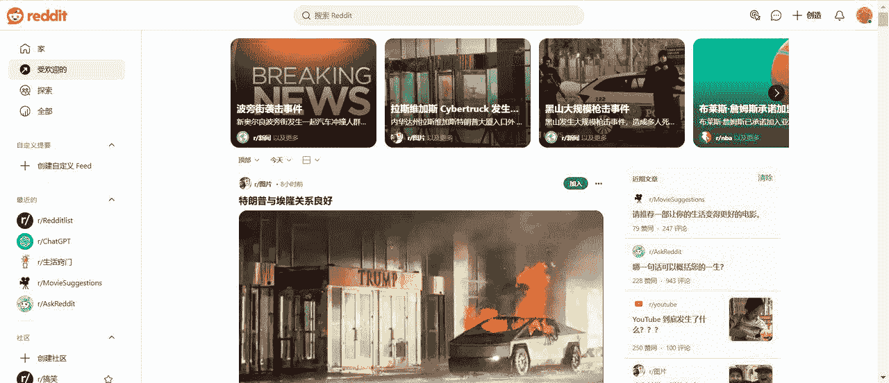

1.  **核心定义**：

1.  **用户画像**：

1.  **流量地位**：

另外，Reddit 上面是全英文的内容，如果有需要翻译解决语言不通问题，可以在电脑安装“沉浸式翻译插件”。

如何安装翻译工具：沉浸式翻译插件

第一步：进入沉浸式翻译官网：https://immersivetranslate.com/zh-Hans/

第二步：选择你对应的浏览器插件进行下载

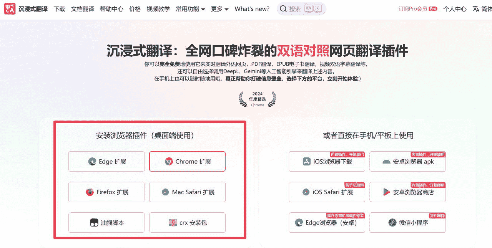

第三步：安装后需要翻译页面时，点击插件出现绿色的√即可进行翻译

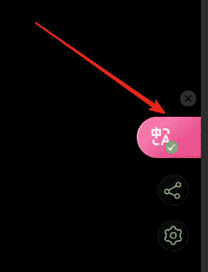

1.  Yangyi：生财有术航海家 AI 大会——Yangyi：出海营销第一站-如何做好 Reddit 营销

### 二、为什么 Reddit 很重要

很多出海的人做营销，会先选择 TikTok 或 Facebook，因为它们拥有几十亿的泛用户基础，但这忽略了 Reddit 这个巨大的“流量洼地”。以下是必须做 Reddit 的核心理由：

1.  Google 的“亲儿子”（SEO 价值极大）

1.  **AI 时代最重要的信息源**

1.  **早期产品的“流量洼地”**

1.  **商****业化红利期**：Reddit 上市后正在加速商业化（广告、API 收费），现在入局属于顺势而为。

1.  **一些案例分享：**

下面分享一些 Reddit 的案例，让大家了解它的价值性。

```
•案例 1：独立创客@do 小鱼
```

在对独立创客这条路产生兴趣后，我去收集和调研过近百个独立创客的案例，对他们的流量渠道、变现模式、构建过程进行了深度拆解。

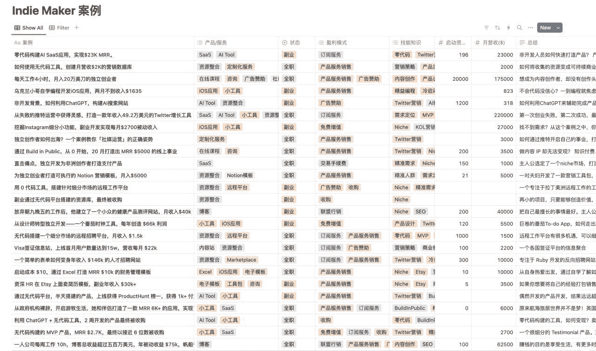

其中发现，有很多个成功的产品，都是靠 Reddit 发家，包括 SaaS 工具、Newsletter 简报、个人服务、数字数据库、社群等，这里分享几个案例 ⬇️

Loopcv 一个自动化求职平台，通过在 Reddit 发布还没有任何功能的落地页验证需求，在收到了几百个用户注册后，开始构建，通过 Reddit 冷启动，产品月营收在 $15K 左右。

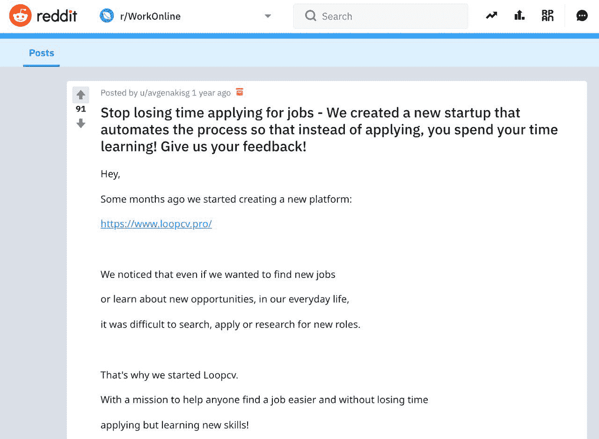

Stagetimer 一个非常细分小众的远程遥控计时器，最初是在细分社群中发布了产品想法，得到了反馈和验证后构建，在 Reddit 发布启动产品，月营收在 $8K 左右。

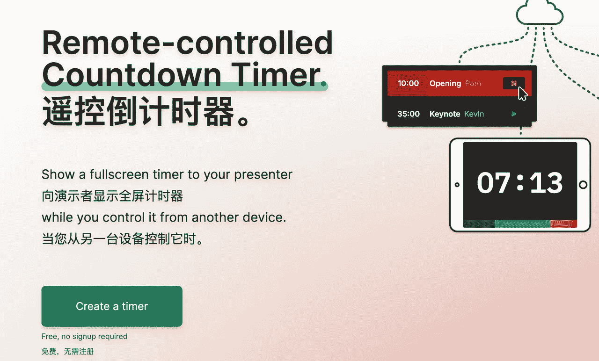

除了做 SaaS 工具的，还有卖 newsletter、卖模版、做社群的各路创客，大家在 Reddit 社区里面挖需求、找用户、寻建议、做转型。

比如，AI Tools 工具导航站的创作者，把自己的网站发到了 Reddit，有用户指出，要想办法引流用户回到你的网站来，而不是依赖添加网站书签，而 Newsletter 就是一种不错的方式。之后这位创作者就做了一个关于 AI 的 Newsletter —— World of AI，相互为产品做引流，达到了 $6K 左右的月收益

一位连续创业者积累了非常多的资源和工具，他在 Reddit 上面做了分享，发现很多人感兴趣，最终他将他的这些知识库和经营变成了标准化的产品，月收入在 $2.25K 左右**。**

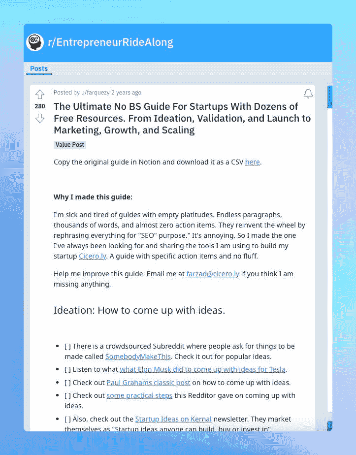

一个人的成功之路可能是运气，但很多人都在这条路上走通了，说明它具有普适性、适合大多数人。

```
•案例 2：Starter Story 的创始人 Pat，就是靠在 r/SideProject 持续分享创业故事冷启动的。帖子一条条爆，上千点赞、几十条评论，直接把网站从 0 拉到几千在线。后来他干脆在首页放了个大绿按钮收邮箱，把 Reddit 的流量沉淀成私域。

•案例 3：圈友彩笺一开始封了 6 个账号，后来像个普通用户一样混社区，账号反而活了，活跃在各个社区 r/SideProject、r/InternetIsBeautiful、r/beermoney，不仅能给产品带来流量，还能挖到一手风向标线索。
```

1.  Yangyi：生财有术航海家 AI 大会——Yangyi：出海营销第一站-如何做好 Reddit 营销

### 三、Reddit 的变现方式

在 Reddit 上赚钱，主要有以下几种成熟路径：

1.  Google SEO 引流变现（最推荐）

1.  **推广独立站/SaaS 产品**

1.  **Affiliate 联盟营销**

1.  **SEO 服务与账号买卖**

1.  **构建私域流量**

### 四、Reddit 版块介绍

要玩转 Reddit，需要先了解 Reddit 各个板块内容。

### **01. Subreddit****（子版块/社区）**

Subreddit 属于 reddit 的子版块，每个版块有专门主题讨论，表现形式为 r/xxxx。例如 r/ChatGPT 是专门讨论 ChatGPT 的，r/SaaS 是专门讨论软件创业的。

**规则各异**：每个 Subreddit 都有自己的“版规（Rules）”和“版主（Mod）”。有的版块允许发广告，有的发链接就封号，入乡必须随俗。

点击链接可以查看热门社区：https://www.reddit.com/best/communities/1/

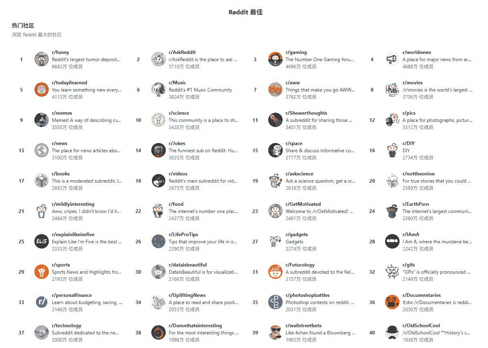

点击任意社区进去，每个社区右侧边有规则，需要阅读了解规则，减少误触规则。比如 r/Music，r/aww，点击进去可以查看社区，如果看不懂规则，可以截图发给 AI（豆包、ChatGPT 等），帮忙解读。

如果想要加入社区，就点击【加入】按钮，养号的时候，就可以加入一些大的热门社区。

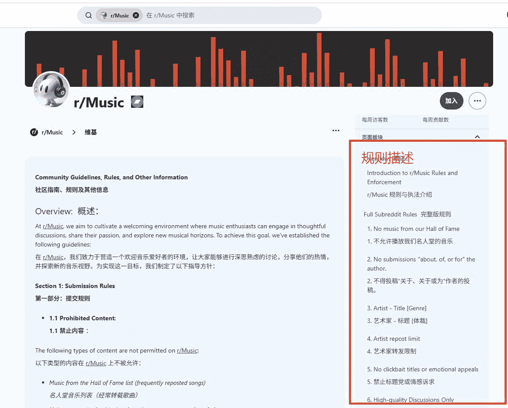

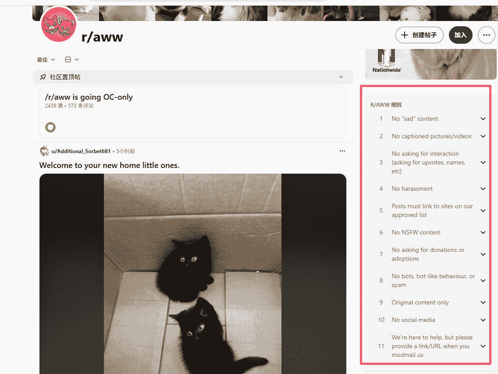

### 02.Karma（业力值/积分）

### **1.Karma 含义**

Karma 是 Reddit 社区的核心积分体系，通过用户的内容贡献（帖子、评论）和社区互动（点赞/点踩）动态变化，直接影响账号的信誉、权限和内容传播效果。对于希望在 Reddit 长期活跃或推广的用户而言，积累 Karma 是提升账号价值的关键。

**Karma 来源分为两种类型：**

Post Karma（帖子 Karma）：你发的帖子被其他用户点赞（upvote）时，你会获得 Karma。反之，如果被点踩（downvote），Karma 会减少。

Comment Karma（评论 Karma）：你的评论被点赞时，也会增加 Karma。

帖子的热度 = 点赞数（upvote） - 点踩数（downvote）。

如果你的内容有价值，大家会顶你上去；如果是硬广，会被踩到折叠。

**Karma 的显示位置：**

在主页右上角——打开“查看个人资料”——就可以看到 Karma 的信息。

你的总 Karma 是你在 Reddit 所有活动（发帖、评论）的累积分数。

每个 Subreddit 内的活动也有各自的独立数据，但这不会单独显示出来（除非 Subreddit 的管理员特别设置显示规则）。

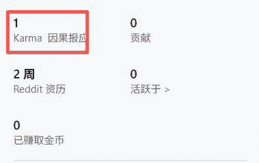

### **2.Karma 的作用**：

1.  **提升信誉**：总 Karma 越高，表明你的内容越受欢迎，账号看起来更可信。

1.  **解锁权限**：某些 Subreddit 会要求用户达到一定的 Karma 才允许发帖或评论，防止新号发垃圾内容。

1.  **运营优势**：一个高 Karma 的账号发帖更容易引起关注和互动，尤其是在热门 Subreddit 中。

### 3. **Karma 与账号权重的关系**

Karma 不是 Reddit 官方明确的“权重系统”，但它确实影响你的内容在社区中的接受程度：

1.  **信誉背书**：

1.  **点赞吸引力**：

1.  **专业领域优势**：

### 4.为什么高 Karma 账号值钱？

1.  **吸引流量**：

1.  **避免审核**：

1.  **账号买卖**：

### **5.如何积累高 Karma？**

1.  **参与热门话题**：

1.  **发高互动内容**：

1.  **避免踩雷**：

1.  **定期互动**：

**另外**，**Redd**it 内部的一套评分体系，CQS（贡献者质量分），用来判断你是不是垃圾账号。CQS 等级低（Low/Lowest）的账号发帖很容易被自动屏蔽。

1.  老彭：完全为第一次接触Reddit的新手小白准备的

### 五、如何注册 Reddit

注册虽然简单，但为了后续营销不死号，有讲究：Reddit 对于网络环境的要求非常严格，安全的网络环境可确保账号能成功注册。关于网络配置大家自行了解，这里就不多分享了。

1.  **注册入口**：访问 Reddit 官网或下载 App，点击“Sign Up”。（网址：https://www.reddit.com/）

1.  **账号选择**：

1.  **用户名（Username）设置**：

1.  **环境隔离**：

1.  注册完，一定要认证一下邮箱，有些频道会对未验证的账号进行风控，对发帖会有影响。

**注册流程：**

（1）Reddit一般提供的注册方式有四种，建议大家使用Google邮箱是最方便的。如果你没有谷歌邮箱，也可以会用自己的邮箱进行注册

（2）如果你想运营好你的Reddit账号，选择一个至关重要的名字还是很关键的建议最好能和你想推广的产品相关，或者就是容易记住的IP名字也是可以的注意，这个名字是无法修改的~输入一个密码，可以continue。注意，这里有时候会 something went wrong，往往是网络问题导致的状态码为403的请求异常，遇到这个问题，请刷新这个页面重新提交邮箱，昵称和密码，往往都可以解决~

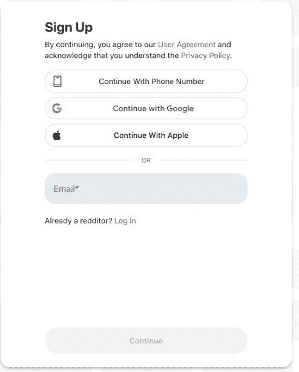

（3）选择一下性别身份

（4）选择你关注的**兴趣内容**，就可以进入了!reddit会根据你选择的话题，给你默认推荐几个subreddit，方便你进入后有对应的内容可以看。

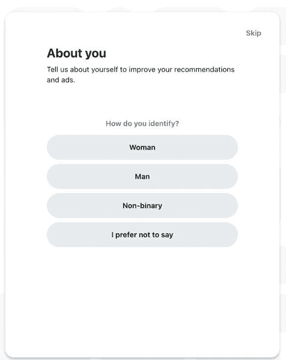

（5）最后，一定记得认证一下邮箱，原因如下:

有部分subreddit会对未验证的账号进行风控，你发帖和发评都会被限制

方便后续找回账号

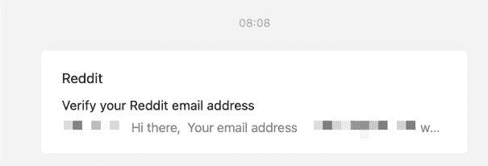

（6）最后，注册登录上去页面

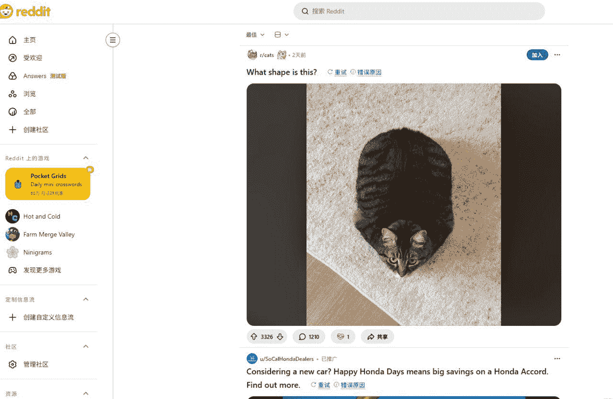

另外，再分享一下指纹浏览器的使用方式。

指纹浏览器是一种用于隔离网络和浏览器环境，降低账号关联风险的工具，在多账号操作场景中广泛应用。它有以下 2 个作用：

```
•隔离网络和浏览器环境，使账号之间不会关联，降低风险

•配合静态 IP 使用，确保每个环境独立，互不相关
```

指纹浏览器比较多，这里分享 3 个，大家自己看价格和性能选择使用。

1.比特浏览器：https://www.bitbrowser.cn/price/

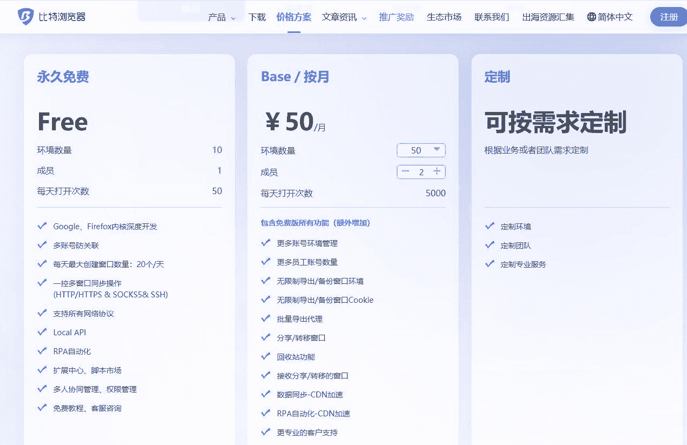

2.Hubstudio 浏览器：https://www.hubstudio.cn/pricing/index.html

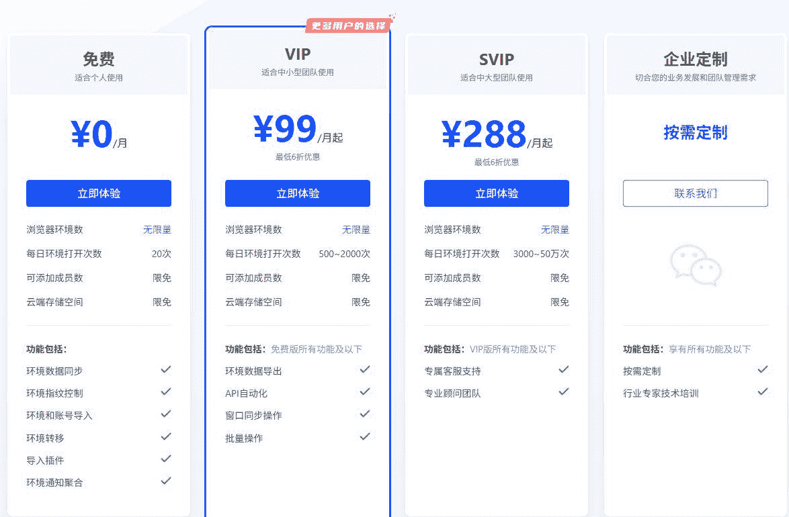

3.AdsPower 浏览器：https://www.adspower.net/

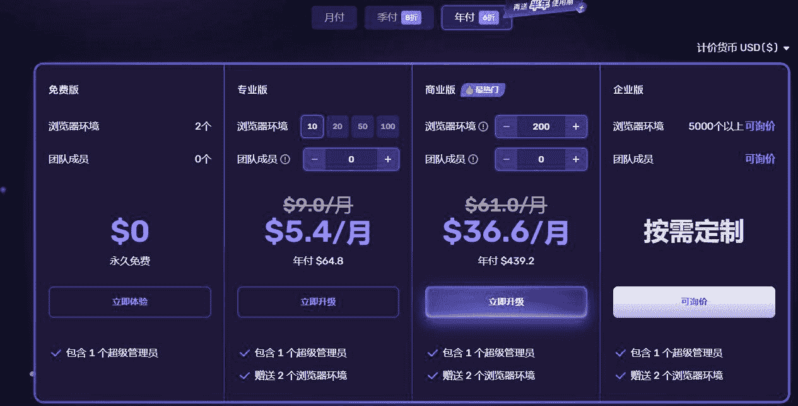

以 AdsPower 浏览器为例，分享一下圈友@gary 的教程：adspower浏览器基础使用教程

### 六、如何养号（关键）

Reddit 对新号非常不友好，直接发贴大概率被删或被封（Shadowban）。你需要经历一个“养号期”（7-30 天）。

首先一定要有一个纯净的网络环境。可以先阅读一下 reddit 的指南：https://www.reddit.com/r/NewToReddit/wiki/ntr-guidetoreddit/

reddit 上面有很多使用教程，大家也可以自己参与一些 Subreddit 去了解**。**

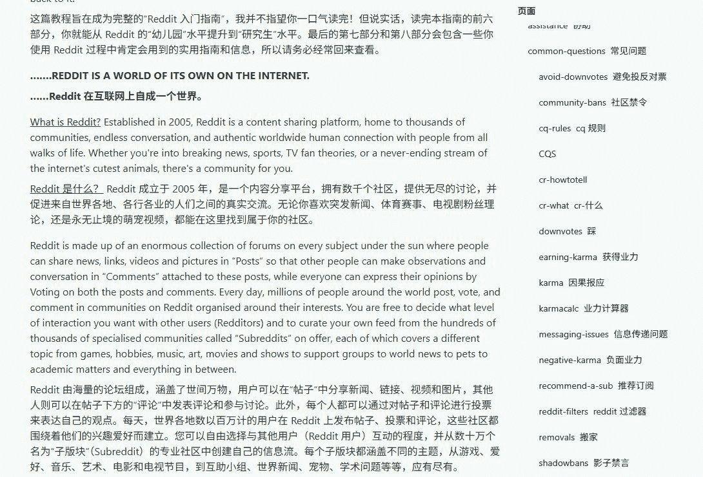

了解官方规则：https://redditinc.com/policies/reddit-rules

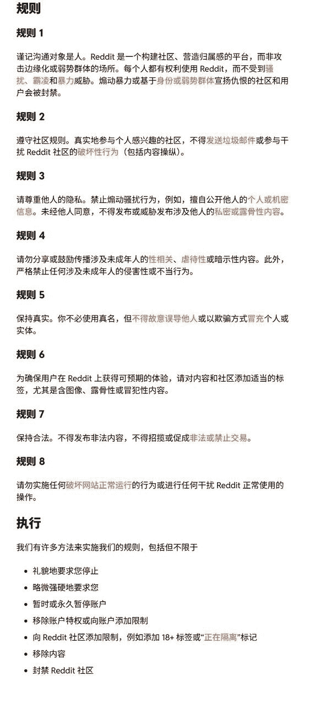

以下为操作方式：

1.  **心态准备：广撒网，优胜劣汰**

1.  **第一周：像个正常人（潜水期）**

> 经过实战检验，这些社区特别适合新手起步：

+   r/SideProject：最适合独立开发者展示自己的作品，询问建议

+   r/CasualConversation：日常闲聊讨论的绝佳场所，这里很适合水帖

+   r/NoStupidQuestions：提问无限制，回答超友好

+   r/TodayILearned：这是个分享学习心得的平台，有质量的内容会获得点赞

+   r/IndieGaming：是很适合独立游戏开发者的社区，有这个赛道的同学，可以试试

+   r/Awww：分享可爱的宠物，氛围友好，互动率极高，但是不要发 AI 图片哦

+   r/mildlyinteresting：分享生活中有趣的发现，规则相对宽松，互动性强

+   r/FreeKarma4You：这里都是希望获得 Karma 值的同好，可以互相帮忙

+   r**/e**xplainlikeimfive （ELI5）：以通俗易懂的方式解释复杂概念，特别适合技术开发者分享知识，回答问题可以快速积累 Karma

+   r/AskReddit：你只管回答各种问题，快速获得 Karma

1.  **获取“徽章”提高权重**

1.  **如何判断号是不是挂了？**

1.  do 小鱼：Reddit 出海指南：从 Build in Public 到社区驱动增长

### 七、发帖运营

### 01. 如何发帖

**发帖：**** 发帖前，一定要先**仔细阅读并理解目标社区**的规则，避免触发风控**。同样，第一条帖子非常重要，要认真准备。策略上，先评论，点赞，再发帖，最好是在通过评论获得了至少 10 个 Karma 值之后再考虑发帖。如果新号直接就发帖，没有点赞，评论等行为，很容易被封掉。

Reddit 上面有版块会教你基础发帖知识，可以进去看看。

如何练习发帖：https://www.reddit.com/r/LearnToReddit/

新账号去哪评论&发帖？https://www.reddit.com/r/NewToReddit/wiki/index/newusersubs/

发帖后如何验证帖子存活？在最新时间线可查看， 或者退出登录后可查看

**（1）内容发布流程**

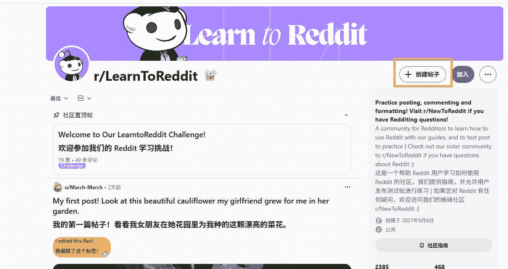

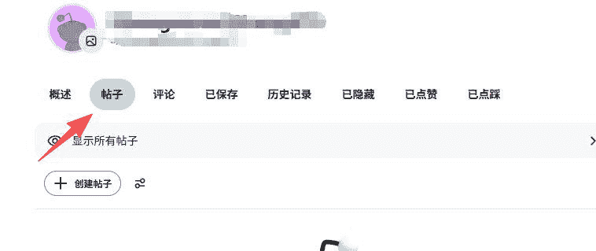

发布完，在个人资料——查看帖子状态，同时注意点赞、评论数据。reddit 上面有很多版块社区，发图文还是纯文字内容，可以根据社区用户喜好来，如果想要获得 karma，发图可以快点获得，但本质还是内容质量要好，才能获得更多的点赞评论数据。

**（2）发帖注意事项**

1.  **研读版规（最重要的事）**

1.  **标题党，但要真诚**

1.  **9:1 黄金法则**

1.  **内容形式**

### 02. 避免账号违规

Reddit 社区是一个极度重视“真实”的地方，任何广告痕迹过于明显的帖子都可能引发用户反感，甚至被管理员删除。许多品牌栽在这一点上：自以为低调的推广手段，其实用户早就一眼看穿。

**规避方法：**

```
•定期与社区用户互动，例如参与评论、回答问题。

•创建有趣或有价值的主题讨论，让用户主动参与。
```

reddit 有自己严格的规则和审核机制，如果不符合规定，就会面临封禁（Ban）的风险，如何知道自己的账号是否有被 Ban，如何避免被 Ban。

以下是一些常见的迹象，表明你的账号可能已经被 Ban：

> **A. 无法登录**

> •**登**录时收到提示信息：“Your account has been permanently suspended”。 •Reddit 直接拒绝你的登录请求，提示账号异常或被封禁。

> •Reddit 直接拒绝你的登录请求，提示账号异常或被封禁。

> **B. 帖子或评论功能受限**

> •你仍然可以登录账号，但无法发帖或评论。 •试图发布内容时，收到提示信息： •“Your account has been suspended from posting or commenting”.

> •试图发布内容时，收到提示信息：

> •“Your account has been suspended from posting or commenting”.

> **C. 帖子/评论被自动删除**

> •**你发布的内容立刻消失，或者显示“[re**moved]”或“[deleted]”。 •即便你发的是是正常的互动内容，也无法通过 Reddit 的审核机制。

> •即便你发的是是正常的互动内容，也无法通过 Reddit 的审核机制。

> D. 收到 Reddit 官方通知

> •在你的 Inbox（收件箱）中收到来自“Reddit”或“Subreddit Mods”的通知，告知你的账号因违规行为被封禁。

> E. 访问特定 Subreddit 受限

> •无法进入曾经参与的 Subreddit •提示：“you are banned from this subreddit”。

> •提示：“you are banned from this subreddit”。

**如果你遇到以上任何一种情况，说明你的账号可能已经被封禁或受到限制。**Reddit 的封禁并非“一刀切”，而是根据违规程度和情况采取不同的封禁类型。

下面是一些封禁的类型

> A. 社区级封禁 （Subreddit Ban）

> •**定义：** 你只是在某个特定的圈子（比如 r/marketing）里被版主“拉黑”了，但在 Reddit 其他地方还能正常玩。

> •**原因：** 通常是因为不懂规矩，触犯了这个版块的“家规”（比如不让发广告你硬发，或者发的内容跟主题无关），被版主（Mod）手动踢出去了。

> •**表现特征：** 你会收到一条私信通知，告诉你在这个版块不能发帖、评论了，但能看。

> B. 临时封禁 （Temporary Ban）

> •**定义：** 账号被官方关了几天“小黑屋”，相当于冷静期。

> •**原因：** 你的操作太像机器人了（比如点赞太快、发帖太猛），或者有轻微违规，系统为了保险起见，先暂停你的权限。

> •**表现特征：** 登录时会有红色提示“Temporarily suspended”。别慌，通常等个 3 天或 7 天，时间一到自动解封。

> **C. 永久封禁 （Permanent Ban） C**。永久封禁（Permanent Ban）

> •**定义：** 账号彻底“凉了”，直接被判了死刑，基本救不回来。

> •**原因：** 犯了原则性错误（诈骗、骚扰、发违禁品），或者你的号被系统判定为高风险的“垃圾号”。

> •**表现特征：** 登录后直接弹红字“Permanently suspended”。你的历史帖子可能还在，但账号本身已经废了，没法再登录操作。

> D. 阴影封禁 （Shadowban）

> •**定义：** 这是新手最容易踩坑的“幽灵模式”。Reddit 不直接告诉你封号了，让你自己在那儿自嗨，其实你发的东西别人压根看不见。

> •**原因：** 系统觉得你是营销号（特别是新注册就发链接的），把你屏蔽了。

> •**表现特征：** 你自己看发帖、评论都显示成功，一切正常。

> •**怎么测：** 退出登录，或者开一个浏览器的“无痕模式/隐私模式”看你自己的主页。如果显示“404”或者“用户不存在”，那就是中招了。

> E. IP 连带封禁 （IP Ban）

> •**定义：** 这是“连坐”制。问题不出在账号上，而是你用的网（IP 地址）“有毒”。

> •**原因：** 你用的代理 IP（梯子）不干净，之前有人用这个 IP 搞破坏，或者你在同一个 IP 上死号太多，Reddit 直接把这个 IP 拉黑了。

> •**表现特征：** 在这个网络环境下，不管你换什么号都登不上，新号也注册不了。解决办法只有换个干净的网络环境。

> F. 功能限制封禁 （Feature Ban）

> •**定义：** 账号变成了“只读模式”，没完全死，但废了一半。

> •**原因：** 内容质量太低，或者有轻微违规嫌疑，被系统降权了。

> •**表现特征：** 你能登录，也能看帖，但就是发不了东西，点赞也没反应，只能当个透明的围观群众。

账号被封禁以后，有的会出现一个申诉页面，可以提交申诉，但目前了解到的申诉成功概率比较低，申诉不成功的话，只能换号使用了。这里大家有什么心得方法，也可以在评论区交流呀。

1.  彩笺：如何“玩” reddit！


### 进阶篇：Reddit 的进阶玩法

在前面我们学习了 Reddit 的基础内容，包括各个版块、如何注册、养号、发帖等内容，相信大家对 Reddit 有了初步了解，在了解以后，有人可能想知道，我要怎么用 Reddit，上面有什么更多的使用场景和玩法呢？那么进阶篇，就是教大家如何在 Reddit 上挖掘产品需求、跑产品 MVP、营销等，解锁更多高阶玩法。

### 八、需求挖掘 & 验证 MVP

当你有了一个想要做的产品方向，如何判断是否是「真需求」，值得去花时间和精力开发，变成一套成熟的解决方案或者产品？我们可以通过 Reddit 挖掘需求和机遇、获得潜在用户。下面分享怎么去做需求挖掘&验证 MVP。

### 01. 看：观察活跃社区热门讨论话题，从评论区里面找需求

### **1.看社群规模**

人越多，机会越大。某个社群的成员数量庞大，说明这个领域有足够的关注度和潜在用户。

比如，我最近在小红书刷到几个产品，都以 ADHD 多动症人群为目标，去提供解决方案，并且互动量都很高，那么说明有很多问题困扰着这个人群。


在 Reddit 上面，我们可以直接搜索 ADHD 这个关键词，进入到子社区里面。

然后发现，这个社群人群基数大——200w 用户， 并且是排名前 1% 的社区，说明社区活跃，交流多。

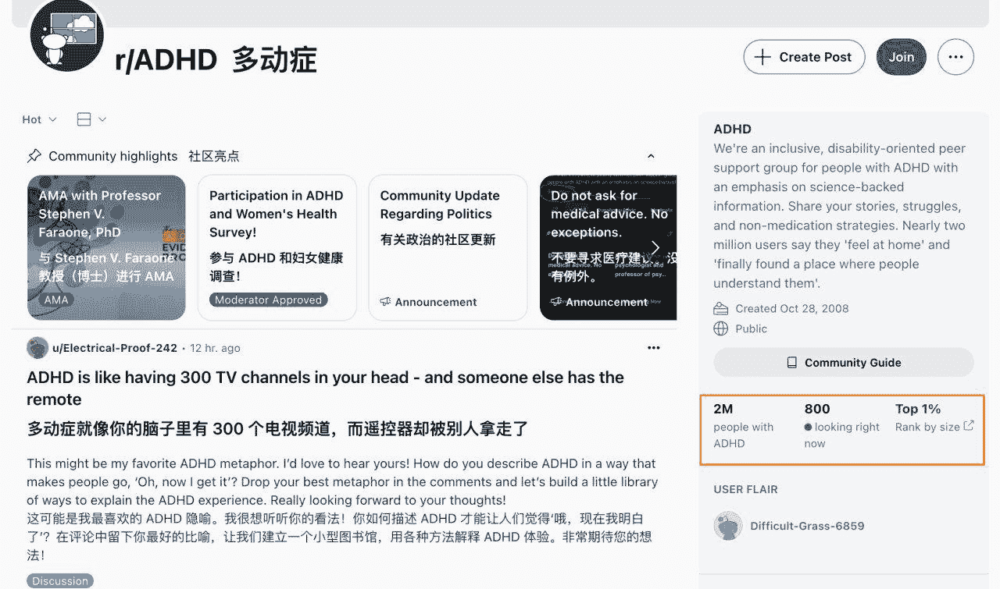

### **2.看讨论的主题和问题**

接下来筛选「Hot」热门帖子，去看看这个社区里面的人都在讨论什么。


关注那些**高赞、高评论**的话题，看看这个群体中，大家在关注的是哪些问题？

从评论区看是否存在很多「负面情绪」，当用户频繁抱怨某个问题时，往往意味着市场存在的真实痛点，也正是产品或者服务可以切入的机会。

自己看肯定很费劲，这个时候，就可以请出 AI 小助理。

找到一些评论比较多的帖子，让 AI 来帮我们「看」痛点，分析潜在的产品功能点：

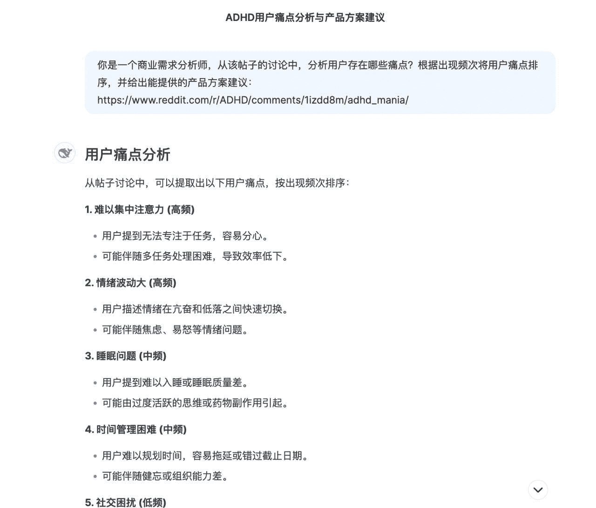

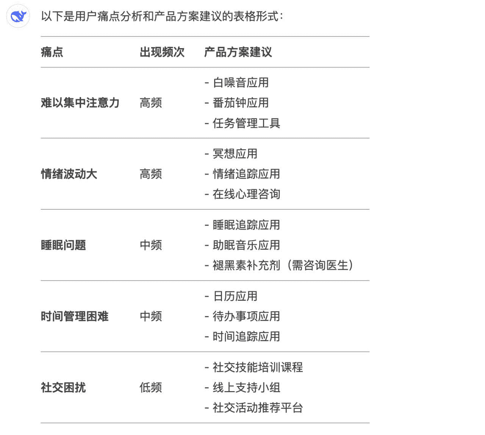

让 AI 去读热门的前 20 条评论大于 50 条的帖子，分析其中存在的问题，很快你就能聚合出高频出现的一些用户痛点和需求点，将其整理在表格里，根据痛点排序，再结合自身资源和情况，去判断你能针对什么问题提供解决方案。

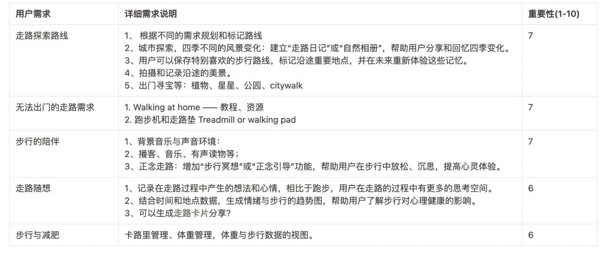

我之前通过 Reddit 针对「走路」这个场景收集到的一些需求

优秀圈友四喜也做了 AI Agent，来帮助挖掘和分析 Reddit 上面的用户需求：scys.com/articleDetail/xq_topic/4848144281141488

### 02.问：直接对话，获取用户反馈

当你看了大量的讨论后，对于用户群体的画像和常见问题已经有了一些初步的感知。这时候，如果已经有了一些初步的想法和感受，就可以直接在社区里面提问。

提问的方式，是把自己代入这个人群，根据你想要提供的解决方案提供一个场景，询问大家的意见。

比如，就刚刚 ADHD 这个人群，你想要进一步挖掘「注意力集中」的问题，看真实的用户是怎么面对和解决的，可以直接提问，可套用公式【用户画像】+【场景】+【困扰】+【寻求帮助】

比如，我是一个 ADHD 患者，我发现自己很难在独处的时候集中精力做完成的任务，有人有同样困扰吗？大家是如何解决的？

通过真实用户的反馈，能够了解到现有的一些解决方案。而用户的**「真实有效」的解决方案**，也能进一步助你完善产品的核心功能。

### 03.**验：快速测试，验证你的假设**

好了，这时候，你已经挖掘出了一些值得深入的真实的痛点，并且有了一些解决方案思路，接下来就是将其产品化。

但在之前，先不要着急开始开发，可以进一步发一篇主题帖，标题可参考：“我创建了 一个「XX 产品」，帮助我解决「XX 问题」”

在主题贴里面，以一个真实用户的身份，分享你如何用你自己的产品，解决了一个具体的问题，同时展示一些设计 Demo，并且询问更多的功能意见。

如果有用户直接反馈给你说愿意，能不能分享出来？或者直接请你把它变成一个产品。

这时候你就可以在帖子里埋一个落地邮箱注册页，开始收集潜在用户邮箱。

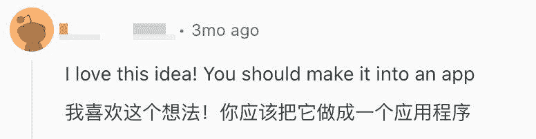

我把想法和原型发布在了 Reddit 相关子社区上面，得到了非常直接的用户正面反馈

这时，我们就完成了一个小的 MVP 验证闭环 —— 从痛点需求挖掘、到解决方案验证、再到种子用户的邮箱收集。

而在目标群体相关性高的社区里面做这件事情的好处是，你收集到的邮箱大概率是有效邮箱，不会是泛流量，或者看热闹、甚至是暗中观察你的竞争对手。

通过在 Reddit 子社区“看-问-验”三步法，可以快速跑通 MVP（最小可行产品）。接下来，你就可以规律地 Build in community 或者通过邮件向用户发布你的产品动态，像他们收集意见和反馈，避免闭门造车。

1.  do 小鱼：Reddit 出海指南：从 Build in Public 到社区驱动增长

### 九、产品获客增长

当你的产品做好了，Reddit 也是一个非常棒的冷启动产品发布平台，帮助产品获得首批用户。

### 01.直接在相关目标社区发布产品

简单高效，能直接为产品带货，吸引目标用户。

但是风险比较大，需要遵循组规，并且注意不要太硬。

可在产品正式发布的时候发布，不建议长期频繁发主题贴直接营销产品。

如果频繁发布的主题贴，都是硬广，很容易被系统判定为垃圾营销贴。

那么换个思路，从**想要营销别人到给用户提供价值**会怎样？

### 02.为提问的人带去有价值的解决方案

我们的产品、服务本身就是给对的用户提供价值的。

很多用户也在社区里面在寻觅更加合适的解决方案，不是吗？

哪里有问题哪里就有需求！

**如何捕捉他们的信号？**

目前我主要是用 2 种方式去找到与产品受众高相关性的帖子 ⬇️

**（1）谷歌搜索产品人群场景**

可套用搜索公式**【 How to +你的产品 or 服务的应用场景的关键词 + Reddit 】**

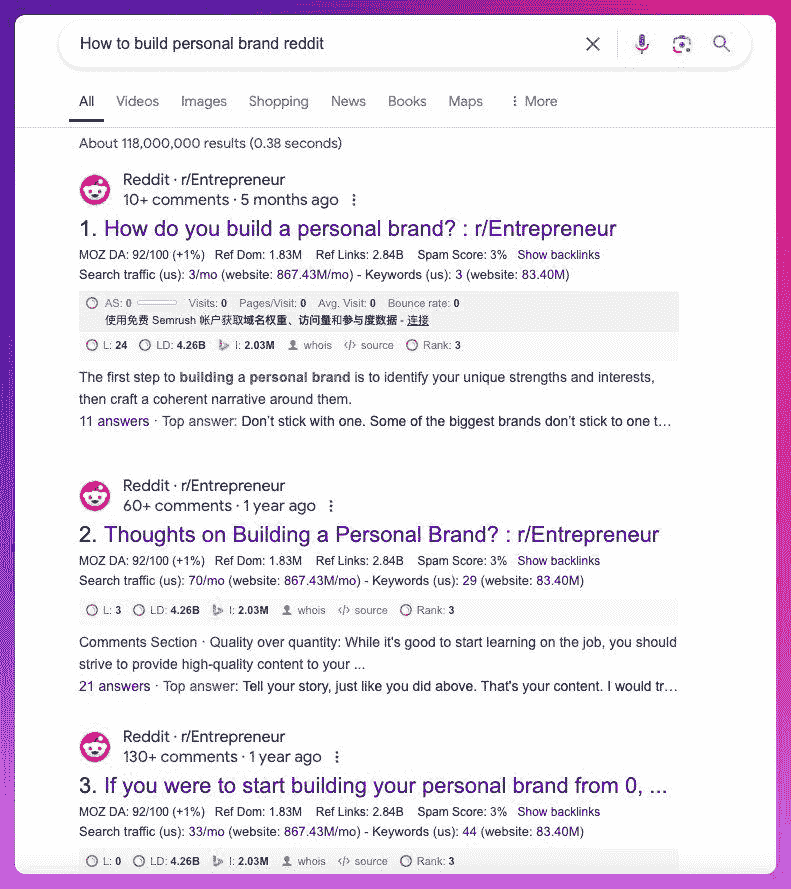

能直接定位到一系列的关于这个场景痛点下用户的提问。这个时候去回复 + 产品链接，不仅自然，针对的人群也很精准，更有利于转化，还不会被 ban 哦 👀

**（2）主动监测关键词**

一个免费的工具： f5bot.com

输入你需要检测的关键词后，一旦检测到出现在 Reddit，会通过邮件提示。

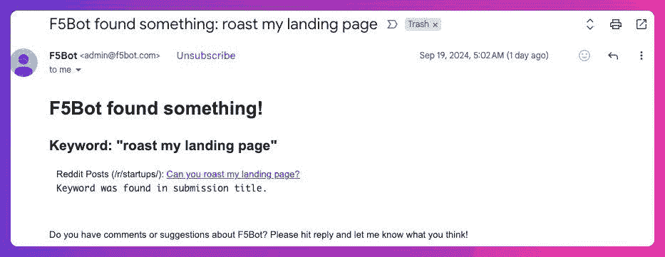

另外还会显示过去一周内的关键词出现次数 —— 等于变相可以调研关键词热度。

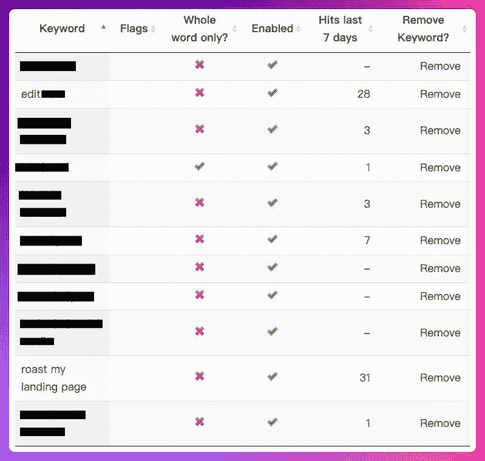

用这个工具可以监测哪些东西呢？

1.  **竞品关键词**：用来监测竞品如何在 Reddit 上面做营销，挖掘对方的营销渠道；

1.  **潜在关键词**：一些想要用来主打 SEO 的关键词，看看有没有热度和流量，用户是不是真的有在讨论；如果出现频繁，说明不错，可以用来做主打的 SEO 优化。

1.  **定位潜在用户**：通过关键词直接定位到潜在用户，在留言区里面评论介绍你的产品，引流到落地页等。

1.  **监控自己的产品**：看看有没有用户在讨论和提及产品，挖掘出你的「铁粉」或者「黑粉」用户。

1.  **挖掘 SEO 博文内容话题**：如果有一些想要做的主题博文，也可以通过这种方式去挖掘有没有用户在讨论，如果有的话，写好了博文，也可以在评论区留言引流到网站。

这个工具有一定的局限性。主要就是关键词本身和背后的需求并不是一一对应的，有的词会在莫名其妙的场合出现，并非理想的用户场景，需要进行一些过滤和筛选。

### 03.怎样转化目标用户？

试过了很多方式来做转化，有一些帖子流量大，但转化效果差；最好的还是直接定位到你的目标人群，让他们对你的产品感兴趣。

### **1.自问自答型**

就你的产品能解决的问题在相关社群里面提问，如：作为 ADHD ，我很难专注，有没有什么好的工具推荐？

公式：【人群】+【痛点】+【寻求工具解决方案】

比如，你是做 App 的，你就问有没有什么好的 app；做网站的，就问有没有什么好的网页。

那么进来这个帖子的，也自然是对用户感兴趣的。

然后在评论区里，可以用小号回答，或者以真实用户的身份回答：

【最近我找到了一个不错的工具，它解决了我的问题，叫「XX」】

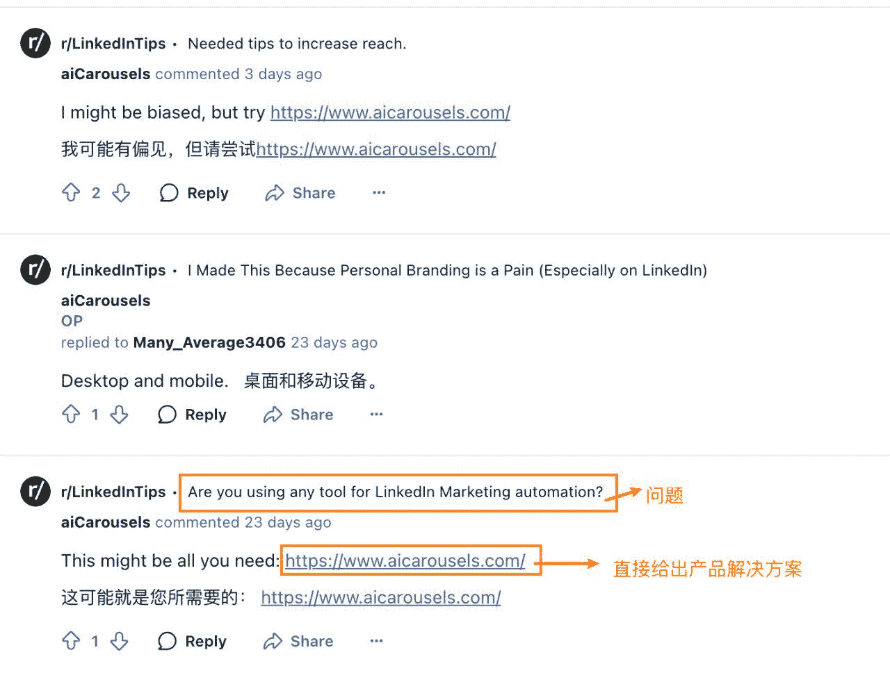

比如这个工具，就是通过评论区引流到网站

在 Reddit 帖子里留产品相关的信息，还有一个好处是， Reddit 网站权重高，用户可能在谷歌搜索，会给到 Reddit 的结果，也等于变相做了 SEO。

### 2. **真诚利他型**

另外，如果很难定位到你的场景，你可以把自己的昵称改成【产品/网站名称+ 解决方案】，在你的主页里，留下你的产品介绍，然后去目标用户发的帖子下面回答问题，不一定非与你的产品直接相关，但是能吸引到你的目标用户关注到你，这样进入你的主页后，也有机会通过简介了解到你的产品。

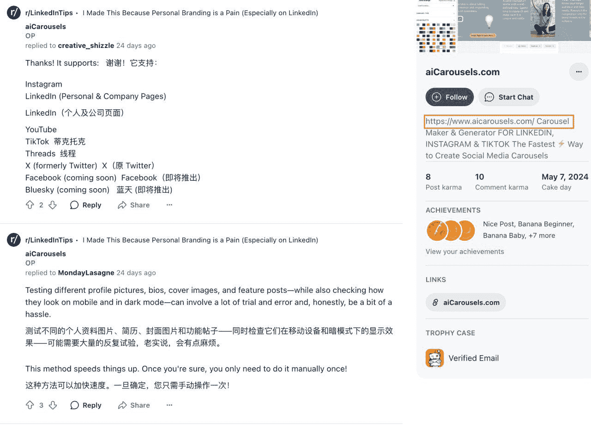

另外，如果你是做网站的，你可以把一些高赞的 Reddit 用户提问，变成你的 SEO 文章，在帖子下面发布，引流到你的主站去。

1.  do 小鱼：Reddit 出海指南：从 Build in Public 到社区驱动增长

### 十、Reddit 怎么做营销

**在 Reddit 做营**销，核心心法只有一句话：“提供价值，顺便卖货”。任何试图挑战社区智商的硬广（贴牛皮癣），结局只有封号。以下是四套经过实战验证的高阶玩法：

1.  ** 从 Build in Public（公开构建）到 Build in Community（社区共建）**

1.  **账号矩阵运营**

1.  利用 Reddit 广告（付费玩法）

1.  蹭热点（Newsjacking）

### 十一、工具库

Reddit 是全球巨大的流量洼地，但其复杂的“部落文化”和数以万计的子版块（Subreddits）常让新手望而却步。想在这里掘金，光靠直觉不行，必须依靠数据和工具。

为了帮大家少走弯路，我整理了这套覆盖全链路的工具清单。无论你是刚入门的探索者，还是资深的营销操盘手，都能找到趁手的武器：

🎯 新**手入门：先找“地盘”

**如果你刚接触 Reddit，不知道该去哪。

```
•**社区发现工具：** Reddit Best Communities、FindAReddit

•**价值：** 帮你快速定位与你产品或话题最匹配的精准社区，这是获得流量的第一步。
```

💡 创作者与产品人：找“灵感”与“美化”

如果你苦于没有选题，或者帖子不够吸睛。

```
•**灵感挖掘工具：** IdeaPicker、Product Hunt（找灵感）；**内容创作工具**：Canva、ShotEasy（做配图）

•**价值：** 看看市场上什么最火，用高质量的视觉内容提升点击率。
```

📊 运营与营销专家：看“数据”与“时机”

如果你想通过精细化运营提升转化率，避免盲目投放。

```
•**数据挖掘工具：** Subreddit Stats（看活跃度）、**营销工具**：GummySearch（挖痛点）、**研究与分析工具**：Later for Reddit（定时间）

•**价值：** 用数据说话，在用户最活跃的时间，把内容推给最需要的人。
```

根据你目前的阶段挑选 1-2 款工具深耕即可，工欲善其事，必先利其器，祝大家在 Reddit 探索愉快！（下面的工具，都需要先配置网络环境打开。)

### 01.社区发现工具

### 1.Reddit Best Communities

**网站名称**：Reddit Best Communities

**网站标签**：Reddit 社区推荐、热门 Subreddits、内容分类导航、社区参与指南

**地址**：https://www.reddit.com/best/communities/1/

**概述**：Reddit Best Communities 是 Reddit 用户快速发现热门社区和内容的捷径，特别适合想要挖掘目标用户所在社区、计划内容投放或研究热门趋势的开发者和营销团队。它为 Reddit 的深度使用提供了便捷的导航入口。

**主要作用**：

Reddit Best Communities 是一个由 Reddit 官方维护的页面，列出了最受欢迎的 Subreddits（子版块）和社区。这些社区按照主题和受欢迎程度排名，用户可以快速找到适合自己兴趣的热门社区，是 Reddit 新手和高级用户发现新内容的绝佳入口。

**使用场景**：

1.社区发现与分类：出海开发者可以通过这个页面找到与自己产品或目标用户相关的社区，为后续内容发布和推广活动打下基础。

2.内容创作选题参考：根据社区的主题和讨论内容，开发者或内容团队可以找到适合用户的热点话题，用于内容创作或运营活动。

3.营销活动策划：营销团队可以根据热门社区的规模和主题，选择目标社区策划广告投放或活动（如 AMA 活动）。

4.用户兴趣分析：帮助团队了解 Reddit 上不同社区的兴趣分布，优化自己的产品功能或内容策略。

**来源**：https://t.zsxq.com/BhWzI

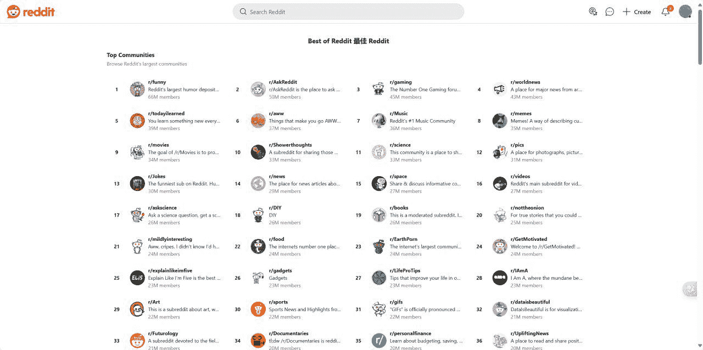

### 2.FindAReddit

**网站名称**：FindAReddit

**网站标签**：Reddit 社区搜索、Subreddit 发现工具、社区分类导航、营销推广资源

**地址**：https://www.findareddit.com/

**概述**：FindAReddit 是一个高效的 Reddit 社区搜索工具，尤其适合出海开发者、营销人员和研究人员。它能够帮助用户快速找到精准的 Reddit 社区，并提供详细的社区信息，为产品推广、市场调研和用户互动提供全方位支持。

**主要作用**：

FindAReddit 是一款专注于 Reddit 社区搜索和发现的工具，它可以帮助用户根据关键词快速找到与特定主题相关的 Subreddits（子版块）。工具还提供社区活跃度、订阅者数量和热门话题等信息，是开发者和营销人员进行市场研究和内容投放的理想工具。

**使用场景**：

1.精准社区搜索：开发者可以通过输入关键词找到与自己产品或服务相关的社区，用于目标用户群定位和互动。

2.内容推广与投放：营销团队可以利用工具寻找适合的 Subreddits 进行内容发布或广告投放，从而最大化触达目标用户。

3.市场调研与热点发现：工具能够显示社区内热门主题和活跃度，帮助团队了解 Reddit 用户的兴趣分布和趋势。

4.竞品分析：找到竞品相关的 Subreddits，研究用户的反馈与讨论，为优化自身产品或服务提供数据支持。

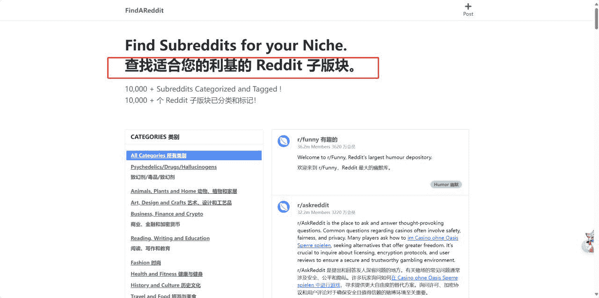

### 02.数据挖掘工具

### 1. Subreddit Stats

**网站名称**：Subreddit Stats

**网站标签**：Reddit 数据分析、社区统计、受众洞察、Subreddit 热度追踪

**地址**：https://subredditstats.com/

**主要作用**：Subreddit Stats 是一个 Reddit 社区统计和分析工具，专注于提供 Reddit 各个子版块（Subreddits）的详细数据分析，包括活跃用户数、帖子发布频率、热门话题和投票趋势等信息。开发者和营销人员可以通过这个工具了解社区的活跃度、趋势以及用户行为，从而制定更精准的内容和推广策略。

**使用场景**：

1.社区数据分析：开发者可以通过 Subreddit Stats 获取目标社区的关键数据，如用户增长趋势、发帖活跃时间等，为内容发布和推广选择最佳时间和地点。

2.目标市场研究：出海团队可以分析与自身产品或服务相关的 Subreddits，挖掘用户需求和兴趣点，优化产品设计或市场策略。

3.热点追踪与话题选择：利用工具的热门帖子统计功能，开发者和内容创作者可以找到社区内最受欢迎的内容主题，提升内容的相关性和吸引力。

4.广告与营销规划：营销团队可以根据社区的活跃度和用户画像，选择最佳的社区和投放时间，优化 Reddit 广告的 ROI。

5.竞品分析：通过对竞品相关社区的统计分析，开发者可以了解目标用户对竞品的反馈和讨论重点，为自己的产品改进提供参考。

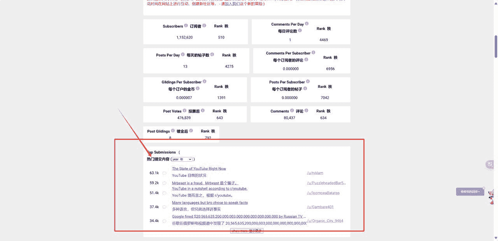

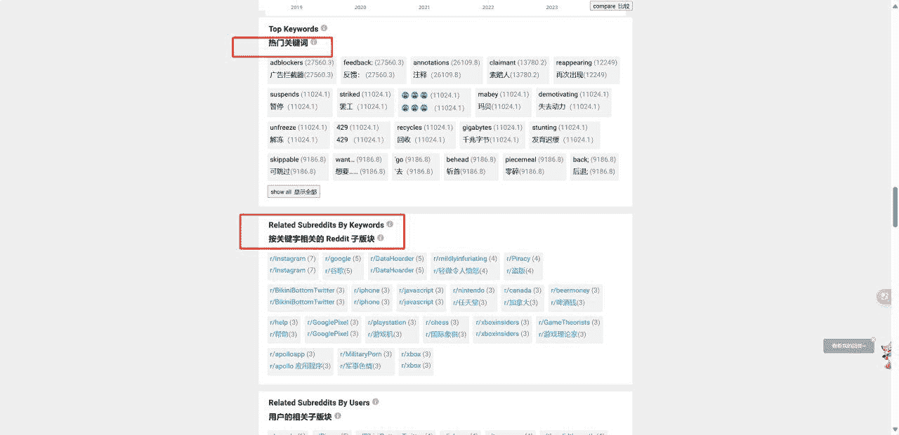

### 2.RedSim

**网站名称**： RedSim

**网站标签**： Reddit 社区可视化、子版块关系分析、社区探索、数据可视

**地址**：https://anvaka.github.io/redsim/

**网站主要作用**：

RedSim 是一个用于可视化展示 Reddit 子版块（subreddit）之间关系的工具，通过图形化的方式展示相关子版块如何连接，帮助用户探索 Reddit 的社区结构，发现新社区。用户输入一个感兴趣的子版块后，可以看到与之相关的其他子版块，以及它们之间的关系强度。

**使用场景**：

1.**目标社区探索**：输入一个核心子版块，发现与之相关联的其他子版块，寻找潜在的目标社区用于内容分发或广告投放。

2.**社区结构研究**：了解 Reddit 子版块的分类和相互联系，从中挖掘特定主题或兴趣领域的生态系统。

3.**市场调研和扩展**：通过探索与目标市场或产品相关的子版块，识别更多可能感兴趣的受众群体。

4.**内容创作灵感**：根据不同子版块的主题，找到创作新内容的切入点，提升内容的针对性和受众互动率。

5.**竞品分析**：通过分析竞争品牌活跃的子版块，找到其他潜在的推广社区，优化营销策略。

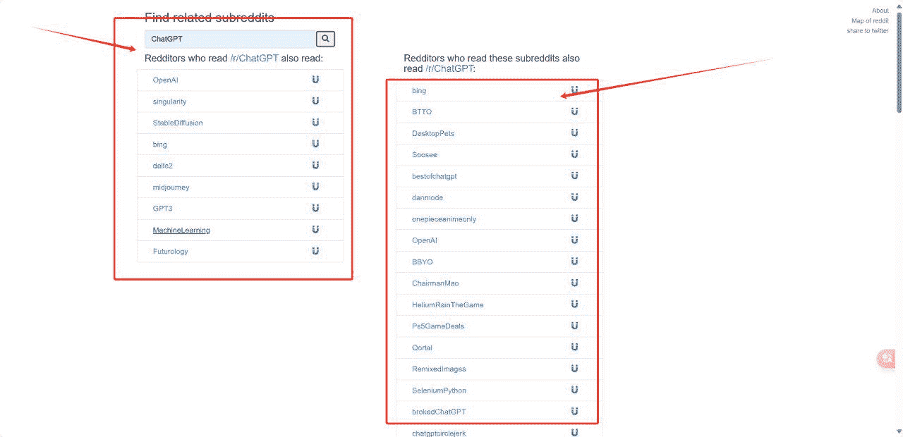

### 3.Keyworddit

**网站名称**： Keyworddit

**网站标签**： Reddit 关键词研究、SEO 工具、内容创作、市场调研

**地址**：https://www.highervisibility.com/seo/tools/keyworddit/?utm_source=toolbaseio

**网站主要作用**：

Keyworddit 是由 Reddit 开发的一款关键词生成工具，提供与人们搜索的关键词相关的搜索量数据和关键词创意。该工具通过提供人们已经在搜索的创意来帮助你改进 SEO。该工具使用起来非常简单，只需输入一个关键词，然后选择你想要查找的相关 subreddit，你就会得到一个每月排名的关键词列表。你还可以通过点击关键词创意旁边的上下文来查看 Google 搜索结果页面，这样你就可以看到 Reddit 内部与关键词相关的主题和帖子。Keyworddit 还让你可以轻松导出所有关键词列表。

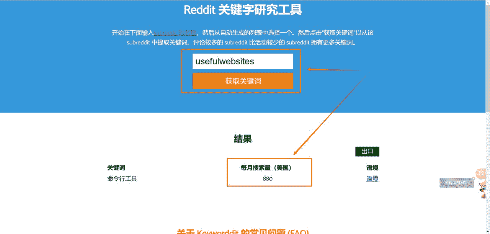

### **03.灵感挖掘工具**

### 1.There’s An AI For That

**网站名称**： There’s An AI For That

**标签**： AI 工具大全、人工智能资源、生产力工具、技术创新、创意工具

**地址**：https://theresanaiforthat.com/

**简介**

"There’s An AI For That" 是一个综合性的平台，专注于收集和分类全球最新的 AI 工具与解决方案。无论是个人用户还是企业团队，该平台都能帮助用户快速找到满足特定需求的人工智能工具，并追踪行业的最新趋势。该平台以其庞大的工具数据库和直观的搜索体验而著称。

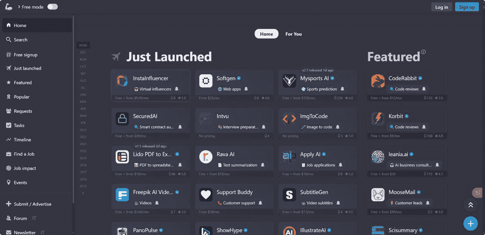

### 2. IdeaPicker

**网站名称**： IdeaPicker

**网站标签**： 创业想法、创意筛选、市场验证、项目开发

**地址**：https://ideapicker.io/ideas

**主要作用**：

IdeaPicker 是一个为创业者和开发者提供的在线工具，**用于发现和筛选创业想法。**平台通过系统化的评分机制和市场验证帮助用户选择最具潜力的创意。用户可以提交自己的想法，或浏览社区内已有的想法，以此找到灵感或验证可行性。

**核心功能**

1.创业想法评分：平台提供一个结构化的评分系统（如市场需求、可行性、盈利潜力等），帮助用户评估自己的想法或社区内其他想法的优劣。

2.创意库：用户可以浏览和搜索平台上已发布的想法库，从中寻找灵感或学习他人的思路。

3.市场验证：为用户的创意提供初步的市场验证，通过社区投票和反馈，帮助识别市场需求。

4.筛选工具：提供多维度筛选功能（如行业、目标受众、盈利潜力等），快速找到符合自己兴趣的创意。

5.社区互动：用户可以对他人的想法发表评论、点赞或提供改进建议，增加社区的互动性和价值。

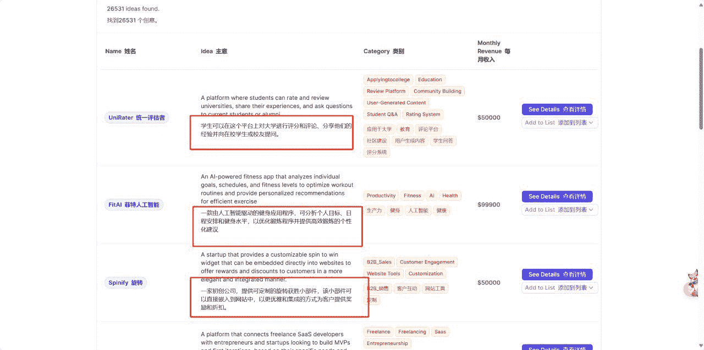

### 3.IndieIdeas

**网站名称**： IndieIdeas

**网站标签**： 创业想法、创意分享、市场验证、产品开发、创业社区

**地址**：https://indieideas.io/

**主要作用**：

IndieIdeas 是一个为创业者**、开发者和创意人士提供的社**区平台，用户可以在此分享、发现和验证创业想法。平台致力于帮助个人创业者（Indie Makers）从创意到执行的全过程，通过市场验证、用户反馈和资源共享，让想法更有可能落地成为可行的产品或服务。

**核心功能：**

1.创业想法分享：用户可以提交自己的创业想法，分享自己的灵感，并获取社区的反馈和建议。

2.想法验证（Idea Validation）：社区成员可以对创业想法投票或提供评论，从而帮助评估市场需求和可行性。

3.想法发现：浏览其他用户提交的创业想法，激发自己的灵感，或者寻找合作机会。

4.市场研究支持：平台提供关于创业趋势和市场需求的洞察，帮助用户更好地定位和发展自己的创意。

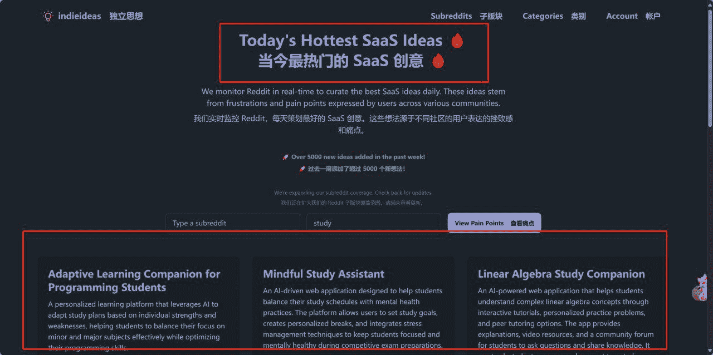

**下面几个找产品思路的网站是来自刘小排老师的帖子，对想做产品的圈友应该有帮助，建议再把小排老师的帖子看一遍：**https://articles.zsxq.com/id_qerx7rre5z5x.html

### 4.Product Hunt

**网站名称**： Product Hunt

**标签**： 产品发布、创业工具、技术趋势、用户社区、产品推广

**地址**：https://www.producthunt.com/

**网站简介：**

**Product Hunt 是一**个专注于发现和推广新产品的在线社区平台，涵盖技术、软件、硬件、应用程序和创业领域的新创意。它为开发者、设计师、创业者和早期用户提供了一个展示、探索和互动的空间，同时也是产品发布和获取早期用户反馈的首选平台之一。

**优点：**

1.**早期用户获取**： 吸引对新技术感兴趣的用户，建立初期用户群体。

2.**市场验证**： 通过社区的反馈了解产品的市场潜力和改进方向。

3.**高质量社区**： 聚集了创业者、投资者、技术爱好者等优质用户群体。

4.**趋势分析**： 每日热门榜单提供了对技术和市场趋势的实时洞察，获取灵感。

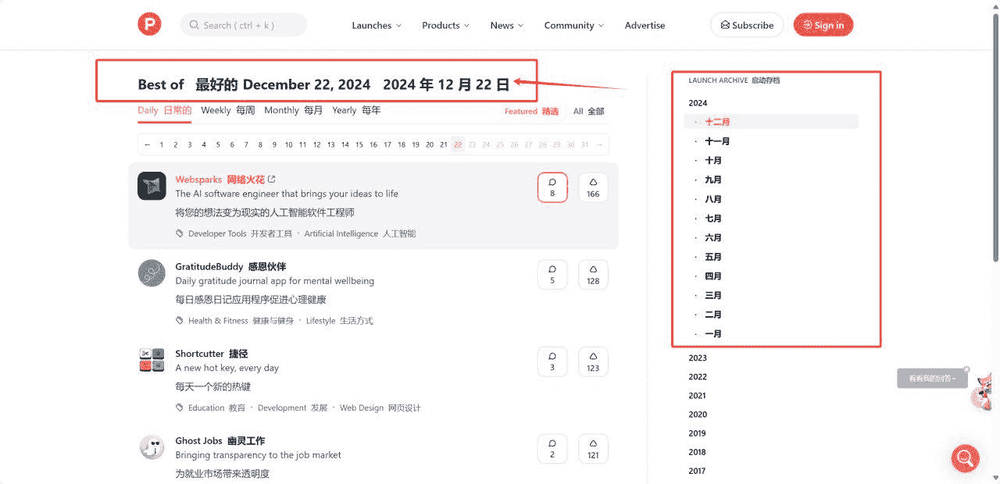

### 5.Hacker News

**网站名称**： Hacker News - Show HN

**标签**： 创意展示、产品发布、技术社区、创业分享、开发者工具

**地址**：https://news.ycombinator.com/show

**简介：**

Hacker News 的 **Show HN** 页面是一个专门为开发者、创业者和创意人士提供的分享平台。用户可以在这里展示他们正在开发的项目、新产品、工具或创意想法。该页面是 Hacker News 社区的重要组成部分，吸引了大量对技术和创业感兴趣的用户，提供早期反馈和讨论。

**优点：**

1.免费推广：Hacker News 社区拥有大量技术爱好者和潜在用户，是一个免费的宣传和推广平台。

2.真实反馈：社区成员提供的建议通常具有高质量和实际意义，有助于优化产品或解决技术问题。

3.快速验证创意：在项目初期快速获取市场和用户的真实反馈，帮助优化发展方向。

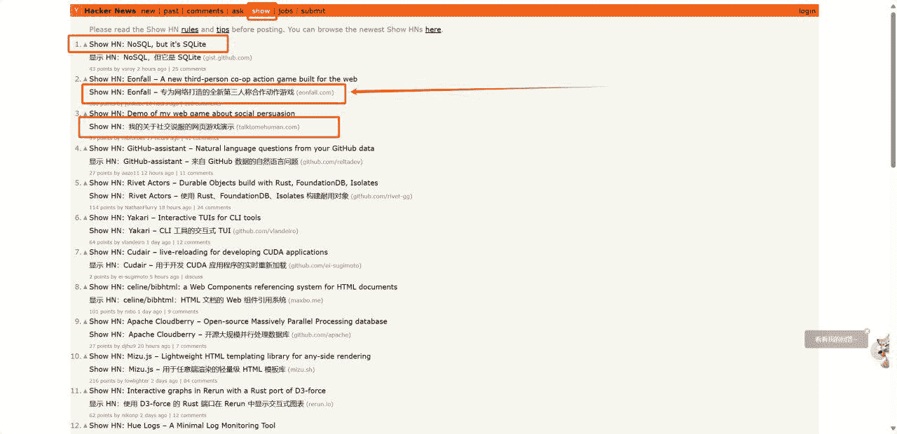

### 6.SEOBox

**网站名称**： SEOBox

**标签**： SEO 工具、域名数据、数字营销、网站优化

**地址**：https://seo.box/referring/

**工具简介**

SEO Box 是一款专注于简化 SEO 优化流程的一站式工具，它帮助用户研究和追踪哪些域名指向他们的网站（即“推荐域名”），并提供详细的数据来优化搜索引擎优化（SEO）策略。通过这一工具，用户可以了解链接的来源质量、数量以及其对网站流量和权重的影响。

**优点：**

1.帮助优化 SEO 策略：通过分析推荐域名的数据，用户可以精准优化外链建设，提升网站在搜索引擎中的表现。

2.高效竞争分析：发现竞争对手的外链资源，快速找到值得争取的链接机会。

3.防止不良链接：识别低质量或有害的推荐域名，及时采取行动避免搜索引擎处罚。

4.提高内容曝光率：通过了解哪些域名感兴趣于链接目标内容，优化内容策略以吸引更多外链。

**来源：**生财有术圈友、著名航海教练哥飞 。 这里收集的是通过 Stripe 平台进行收款、每个月最赚钱的 Top 100 产品。

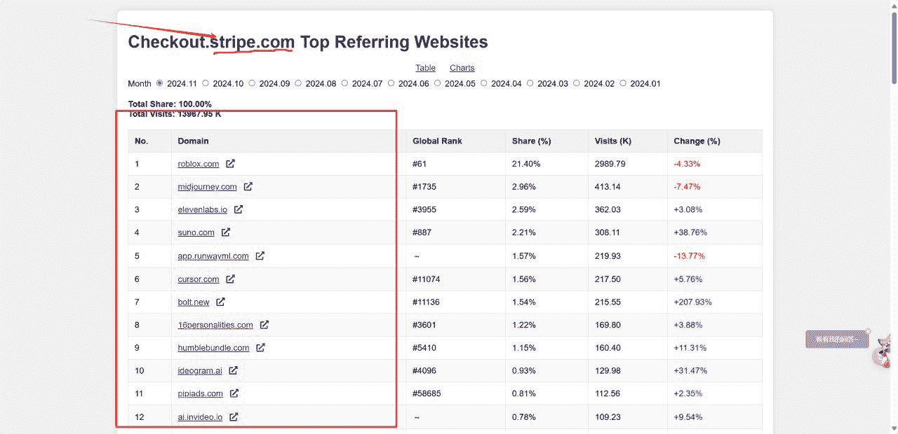

### 7. Toolify

**网站名称**： Toolify

**标签**： AI 工具平台、人工智能资源、生产力工具、技术应用

**地址**：https://www.toolify.ai/zh/

**简介：**

Toolify 是一个人工智能工具集合平台，专注于为用户提供各种基于 AI 的工具和解决方案，涵盖多个领域，如生产力提升、内容创作、编程辅助、图像处理等。它帮助用户发现和使用最新的 AI 技术，提升效率并解决特定问题。

**来源**：生财有术知名大佬、超级产品经理阳光杉木 。 这也是世界上第二大的 AI 产品导航网站。

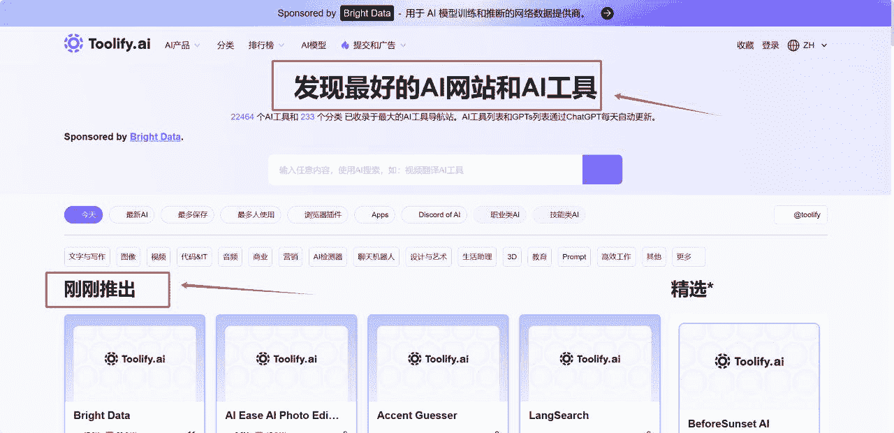

### 04.研究与分析工具

### 1.SnooSnoo

**网站名称**： SnooSnoo

**网站标签**： Reddit 用户数据分析、用户行为洞察、社交媒体工具

**地址**：https://snoosnoop.com/

**主要作用**：

SnooSnoo 是一款专注于 Reddit 用户数据分析 的工具，可以帮助用户深入了解特定 Reddit 用户的行为模式、兴趣爱好和互动习惯。通过输入 Reddit 用户名，SnooSnoo 提供该用户在 Reddit 上的帖子历史、评论数据、活跃时间和常访问的子版块等信息。这些数据可以用于用户研究、行为分析以及内容优化。

**优点**

1.  **用户活跃度分析**

确定用户的活跃时间，便于针对性地互动或在其活跃时段发布内容。

有助于品牌或内容创作者找到目标用户群体的高效接触时间。

1.  **兴趣图谱**

了解用户的兴趣领域，便于为目标用户推荐更精准的内容。

对市场营销团队来说，可以识别用户所在的社区，进行更精准的内容投放。

1.  **内容偏好分析**

帮助分析用户倾向于讨论的主题（如科技、娱乐、政治）。

用于优化内容创作策略，使之更贴近目标用户的需求和兴趣。

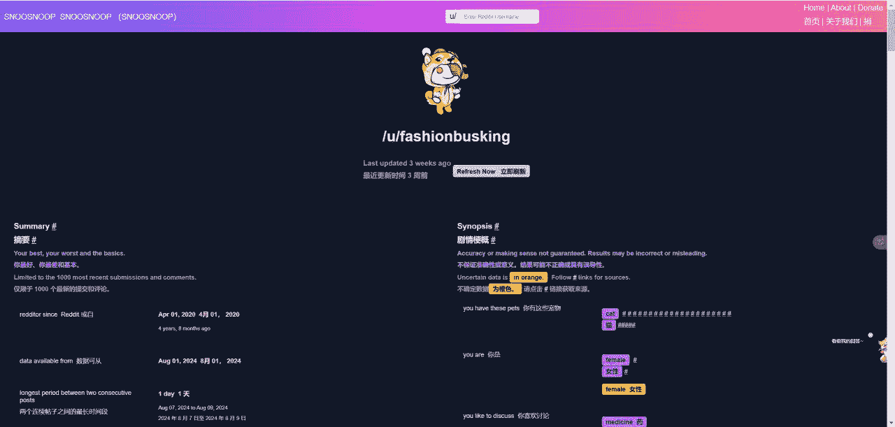

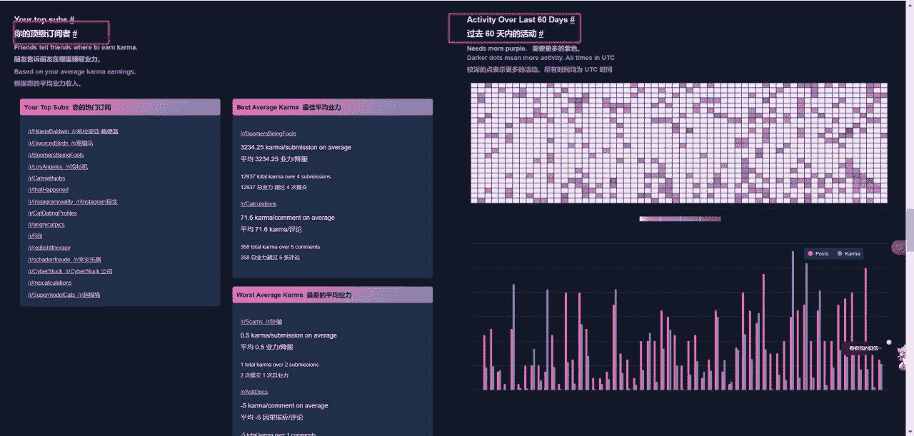

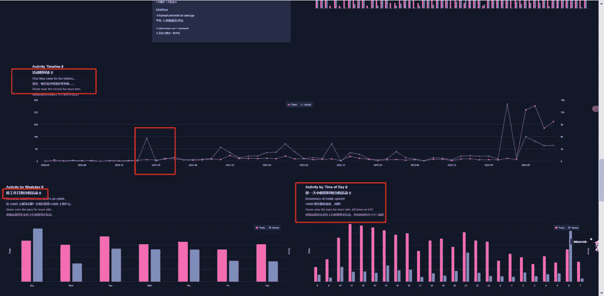

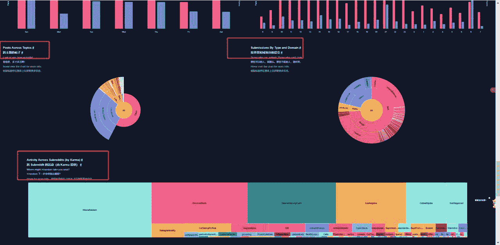

相似网站

### 2. Reddit Metis

**网站名称**： Reddit Metis

**网站标签**： Reddit 数据分析、子版块研究、用户行为分析、内容优化工具

**地址**：https://redditmetis.com/

**主要作用**：

Reddit Metis 是一**款专注于 Reddit 平台数据分析的工具，帮助用**户分析 Reddit 子版块的内容趋势、用户活跃时间、互动数据，以及帖子和评论的表现。这款工具对版主、营销人员、内容创作者以及品牌推广人员来说非常有用，可以帮助优化发帖策略、提升社区参与度以及分析竞争对手。

**优点**：

1.**子版块数据分析：**提供目标子版块的详细数据，包括发帖数量、用户活跃时间分布、互动频率等。帮助用户了解哪些话题在特定子版块中最受欢迎。

2.**用户活跃时间分析：**分析目标子版块中用户的活跃时间段（按小时、每日或每周）。识别最佳发帖时间，确保帖子获得最大曝光率和参与度。

3.**内容趋势跟踪：**提取子版块中点赞最多的帖子及其内容类型（文字、图片、视频）。研究哪些内容和标题最吸引用户关注。

4.**关键词和话题分析：**查看子版块中用户常讨论的关键词和热门话题。帮助用户发现潜在的内容方向和用户需求。

5.**对比分析：**支持对多个子版块进行比较，分析不同子版块的活跃度、内容特点和用户行为差异。历史数据检索

提供子版块的历史数据，包括发帖和评论的表现。帮助用户分析长期的趋势变化。

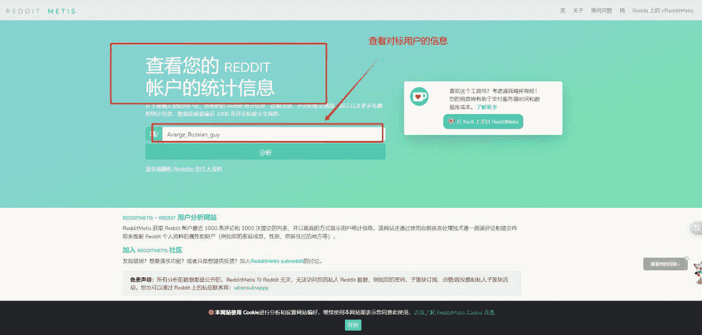


### 3.Postpone

**工具名称**： Postpone

**标签**： 社交媒体调度、内容管理、营销工具、自动化、定时发布

**地址**：https://www.postpone.app/scheduled

**简介**

Postpone 是一款 reddit 管理工具，专注于帮助用户通过定时功能在多个平台上发布内容。它特别适合营销人员、内容创作者和品牌，通过简化社交媒体调度流程来提高工作效率和内容覆盖范围。对你的账户数据进行分析，另外它还有一些小工具，比如标题生成。


### 4. Later for Reddit

**网站名称**： Later for Reddit

**网站标签**： Reddit 子版块分析、内容优化、发帖策略、最佳时间建议

**地址**：https://dashboard.laterforreddit.com/analysis

**主要作用**：

该工具是 Later for Reddit 的子版块分析功能，专注于分析 Reddit 特定子版块的发帖趋势和用户行为。用户可以输入子版块名称（例如 website），并查看该子版块的帖子活跃时间分布、点赞趋势、评论活跃度以及热门内容等数据。通过这些分析，用户可以找到最佳发帖时间，从而最大化帖子的曝光率和互动效果。

**优点：**

1.用户活跃时间分析：提供用户在一天或一周中最活跃时间的详细分布数据，帮助确定最佳发帖时间。

2.点赞与评论趋势：展示不同时间段内帖子点赞数和评论数的变化趋势，用于评估互动效果。

3.热帖分析：列出子版块中点赞最多的帖子，帮助识别用户喜好的内容和标题风格。

4.发帖策略建议：根据历史数据，推荐发帖时间和内容优化方向。


相似工具：

### 5. Delay for Reddit

**网站名称**： Delay for Reddit

**网站标签**： Reddit 定时发布、内容管理、自动化工具、时间优化

**地址**：https://www.delayforreddit.com/

**主要作用**：

Delay for Reddit 是一款专注于 Reddit 帖子定时发布的工具，允许用户提前安排帖子，并在指定的时间自动发布到目标子版块（subreddit）。它特别适合需要跨时区管理内容的团队、内容创作者和社区运营者，帮助优化内容发布时间，提高帖子的曝光率和用户参与度。


### 05.内容创作工具

### 1.Canva

**平台名称**： Canva

**标签**： 平面设计、在线工具、视觉内容创作、演示文稿、社交媒体设计

**地址**：https://www.canva.cn/

**简介**

Canva 是一款简单易用的在线图形设计工具，适用于个人用户、团队和企业。它为用户提供了广泛的设计模板和资源库，让没有设计经验的人也能轻松创建专业级的视觉内容。无论是社交媒体海报、简报、名片、视频、还是营销材料，Canva 都可以快速生成高质量的设计。发布 reddit 帖子，好看的图片更靓眼，闲鱼几元就能买到终身服务。


### 2. ShotEasy

**网站名称**： ShotEasy

**地址**：https://shoteasy.fun/

**网站标签**： 截图美化、在线工具、图像编辑、浏览器扩展

**网站主要作用**：

ShotEasy 是一款免费的在线截图美化工具，用户可以直接在浏览器中对截图进行编辑和美化。 它提供了添加背景、边框、阴影和水印等功能，使截图更具专业和视觉吸引力。 此外，ShotEasy 还支持裁剪、调整大小和添加注释，满足用户对图像编辑的多种需求。

使用场景：

1.内容创作：为博客、社交媒体或演示文稿创建精美的截图，提升内容质量和吸引力。

2.产品展示：在产品推广中使用美化后的截图，突出产品特点，增强视觉效果。

3.社交媒体分享：为社交媒体帖子创建引人注目的图片，增加互动率和关注度。


### 3. Reddit Preview

**网站名称**： Reddit Preview

**网站标签**： Reddit 预览工具、广告预览、内容优化、创意测试

**地址**：https://redditpreview.com/

**主要作用**：

Reddit Preview 是一个**帮助用户预览 Reddit 帖子、广告或内容排版效果的工具。**它允许用户在正式发布前模拟帖子显示效果，以确保内容的格式、设计和视觉效果符合 Reddit 的规范和用户体验。这对广告主、内容创作者和版主特别有用，可以减少因格式问题导致的用户体验下降。

**优点：**

帖子预览：用户可以在发布前查看帖子内容（包括标题、文本、图片或视频）的实际显示效果。

广告预览：模拟 Reddit 广告（如展示广告、文本广告）的展示效果，确保设计和信息传递符合预期。

Markdown 格式测试：支持 Markdown 格式预览，方便用户检查格式是否正确（如标题、加粗、超链接等）。


### 06.营销工具

### 1. GummySearch

**网站名称**：GummySearch

**网站标签**：Reddit 用户洞察、市场分析工具、目标受众研究、Reddit 营销优化

**地址**：https://go.gummysearch.com/audiences/

**主要作用**：

GummySearch 是一款基于 Reddit 的受众分析和市场研究工具，**专注于帮助用户发现目标受众的需求、痛点和热门话题。**它通过分析 Reddit 上的讨论数据，为产品开发、内容创作和营销策略提供深刻洞察。用户可以利用它轻松找到潜在客户群并制定针对性的运营计划。

**使用场景**：

1.受众分析与需求挖掘：出海开发者可以通过 GummySearch 发现 Reddit 上的潜在用户及其关心的问题，进一步调整产品设计和用户体验。

2.市场研究与热点追踪：营销团队利用工具追踪 Reddit 上的热门话题、关键词趋势，精准定位用户的兴趣点和需求。

3.社区选择与活动策划：帮助开发者筛选适合的 Reddit 社区（Subreddits），规划有效的推广活动，如 AMA（Ask Me Anything）或讨论帖发布。

4.内容创作灵感：内容创作者可以通过工具提取 Reddit 上用户的常见提问和话题，创作更有针对性和吸引力的内容。

5.竞品分析与策略优化：出海团队可通过 Reddit 数据分析了解竞争产品的受众分布及反馈，优化自身产品和市场策略。

**来源**：https://t.zsxq.com/FTjOB


### 2.Reddit Ads Dashboard

**网站名称**： Reddit Ads Dashboard

**网站标签**： Reddit 广告管理、广告投放平台、用户增长、社交媒体广告

**地址**：https://ads.reddit.com/account/g7day0x3eyfn/dashboard?landing=true

**主要作用**：

Reddit Ads Dashboard 是 Reddit 官方提供的广告管理平台，用户可以通过该工具创建、管理和优化广告活动，以接触 Reddit 的特定用户群体。广告主可以根据目标受众的兴趣、行为和所在的子版块（subreddit），精准投放广告，从而实现品牌宣传、流量增长和销售转化。

**优点：**

1.广告创建：提供简单直观的广告创建流程，包括文本广告、图片广告和视频广告等多种格式选择。可选广告目标（如品牌认知、流量、转化等）来优化广告表现。

2.精准受众定位：基于用户的兴趣、地理位置、设备类型等多维度精准定位目标受众。支持根据特定子版块选择广告受众，以确保广告内容与目标用户的兴趣匹配。

3.实时广告分析：提供详细的数据分析功能，包括广告点击率（CTR）、转化率（CVR）、展示次数和花费等指标。方便广告主实时调整广告投放策略，提升广告表现。


1.  汤姆 cc：Reddit工具指南

### 十二、参考资料附录

附录列表旨在为读者提供学习便利，所引用的原始资料版权归原作者所有。

非常感谢@do 小鱼 @老彭 @彩笺 @yangyi @汤姆cc@鲈鱼提供的内容支持，以及网络公开资料参考。

1.  do 小鱼：Reddit 出海指南：从 Build in Public 到社区驱动增长

1.  老彭：完全为第一次接触Reddit的新手小白准备的

1.  彩笺：如何“玩” reddit！

1.  Yangyi：生财有术航海家 AI 大会——Yangyi：出海营销第一站-如何做好 Reddit 营销

1.  汤姆 cc：Reddit工具指南

---

---

公众号懒人搜索，[懒人专属群](https://mp.weixin.qq.com/s/BiqLFrONgLXivo0PDG_8dA?click_id=3)分享