# 202602 版：Reddit 从零到一上手指南

> 来源：飞书文档（龙哥盟内部项目）

# Reddit 从零到一实操手册

> **版权与免责说明**
>
> 1. 本手册中的全部内容（文字、图表、引用链接与视频资料）均在“龙哥盟”项目框架下完成收集、筛选和系统整理，仅供内部学习、交流与参考使用。
> 2. 手册中引用的原始素材（帖子、外部链接、视频、文章等）的版权归原作者或原出处所有。
> 3. 对于外部链接及未经明确授权的内容，编制方仅出于学习便利进行整理和链接，不对其真实性、合法性或版权状态承担法律责任。


### 开篇导读

在 AI 出海和海外营销圈，Reddit 的重要性正快速上升。它既是不少团队的运营阵地，也藏着明显的流量红利。星球上相关讨论已经不少，但相对零散。为此，赚钱把星球内外的信息汇总成了一本完整手册，目标是带着大家从 0 到 1 系统认识 Reddit。

**手册主体分为两大部分：**

```
•**基础篇：** 解决最棘手的“风控与封号”问题，手把手教你注册、养号、积累 Karma（积分），建立账号安全感。

•**进阶篇：**           •详解如何通过 Reddit 挖掘真实痛点、不花钱实现冷启动、通过“借力打力”获取精准搜索流量。           • 汇总 20+ 款高效工具，涵盖账号分析、关键词监控与内容创作，提升运营效率。
```

整体来看，想玩转 Reddit，绕不开两个核心门槛：网络环境与真诚利他。

**硬门槛：** 平台风控极严，IP 和网络环境达不到要求，账号随时可能出问题；这一点需要圈友自行准备。

**软门槛：** Reddit 极其反感硬广。建议做好“前期耐心养号、中期提供价值”的心理准备，被封号对新人是常态。

手册内容更偏向科普，适合想了解 Reddit、做出海产品或品牌营销的圈友。关于私域引流、品牌营销等进阶话题，本书只作浅层介绍；有实操经验的圈友欢迎在星球继续分享，或到评论区交流。


### 基础篇：新手上路与运营要点

### 一、Reddit 到底是什么

Reddit 本质上是海外社交新闻与论坛的结合体，被称为“互联网首页”，也被誉为“全球最大的兴趣社区”。用户在站内可以发内容、参与投票、写评论，互动氛围相当浓厚。（网址：https://www.reddit.com/）不过访问前需要自行配置好网络环境。

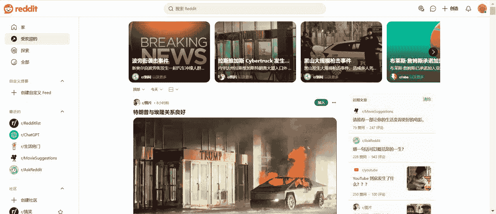

1. 核心定义：
1. 用户画像：
1. 流量地位：

站内内容以英文为主，语言不通的话，可以在电脑上装一个“沉浸式翻译插件”。

翻译插件安装步骤如下：

第一步：进入沉浸式翻译官网：https://immersivetranslate.com/zh-Hans/

第二步：根据自己使用的浏览器，下载对应插件

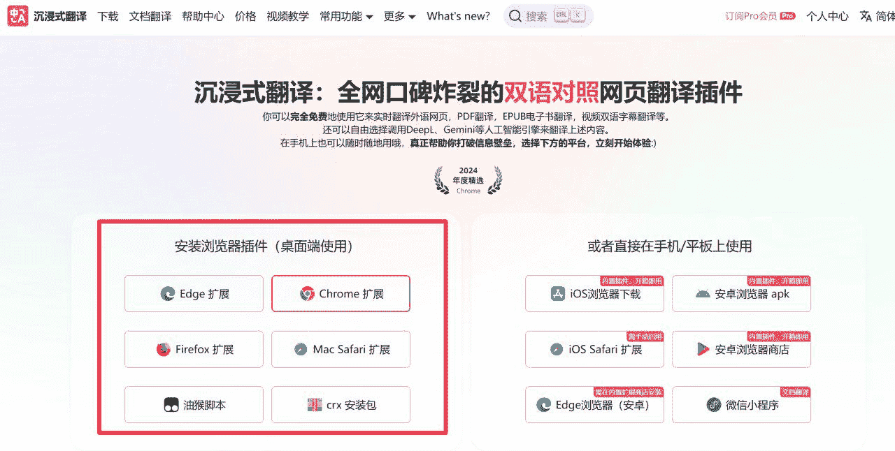

第三步：安装完成后，需要翻译时点击插件，出现绿色 √ 即代表可正常翻译

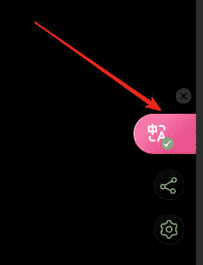

1. Yangyi：在龙哥盟航海家 AI 大会上的分享——出海营销第一站：如何做好 Reddit 营销

### 二、Reddit 为什么值得做

不少人做海外营销，会先盯上 TikTok 或 Facebook，毕竟这两个平台的泛用户规模高达几十亿。但这也让 Reddit 这样的“流量洼地”容易被忽视。下面几条是做 Reddit 的核心理由：

1. 与 Google 关系紧密，SEO 优势明显
1. 大模型时代绕不开的内容来源
1. 早期项目能低成本获取用户的流量洼地
1. 商业化红利：上市后的 Reddit 正在推进广告和 API 收费，越早进场越能搭上这班车。

再结合真实案例来看它的价值：

```
•案例 1：独立创客@do 小鱼
```

我开始对独立创客方向感兴趣后，陆续收集和研究了近百个案例，把它们的流量渠道、变现模式以及产品搭建过程都拆解了一遍。

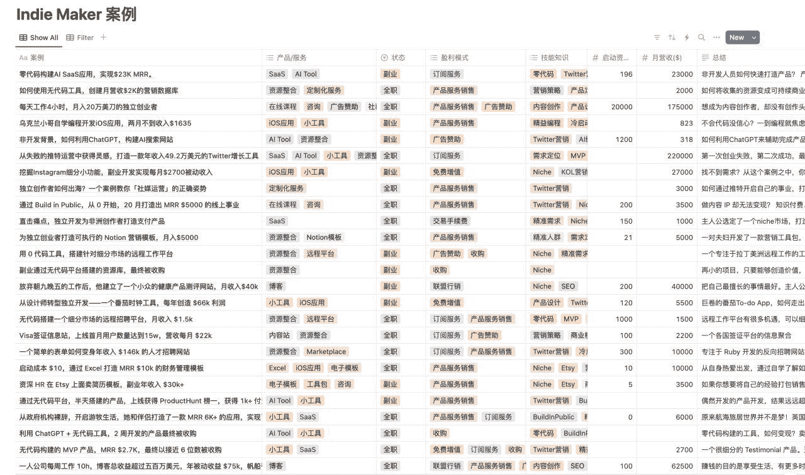

结果发现，不少成功产品都把 Reddit 当成起家之地——涵盖 SaaS 工具、Newsletter 简报、个人服务、数字数据库、社群等。分享几个典型例子 ⬇️

Loopcv 是自动化求职平台。团队先把一个没有任何功能的落地页发到 Reddit 上测试需求，注册用户到几百个后才开始开发；借助 Reddit 冷启动，现在月营收约 $15K。

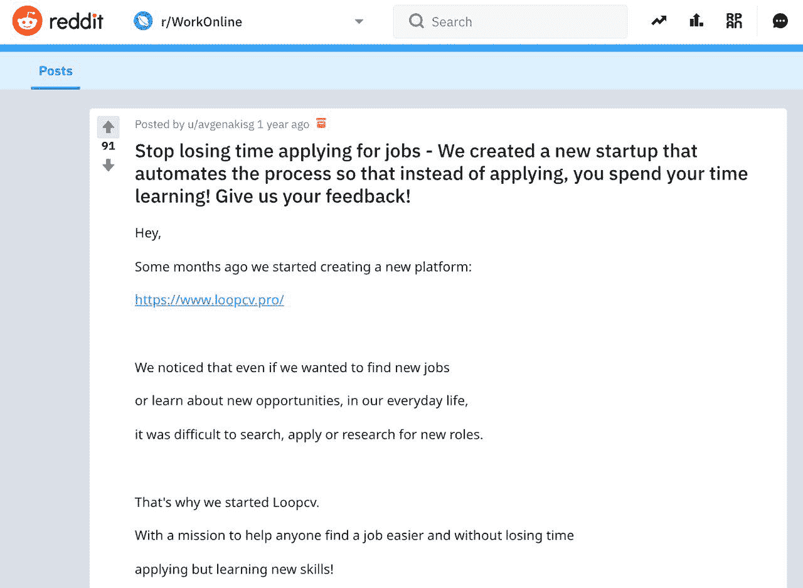

Stagetimer 是特别小众的远程遥控计时器。团队最初在细分社区里抛出产品概念，收到反馈并验证后才开始开发，之后又回到 Reddit 上正式发布，如今月营收约 $8K。

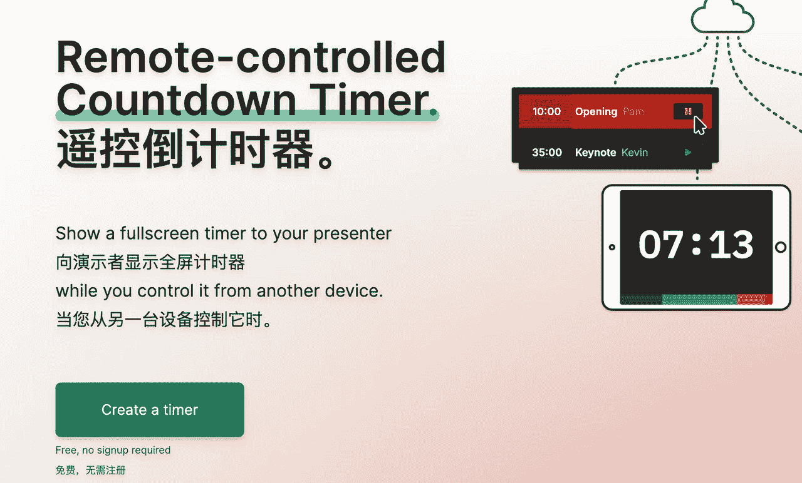

不只是 SaaS 工具，卖 Newsletter、卖模板、经营社群的创客同样在这里挖需求、找用户、寻建议、调方向。

例如 AI Tools 工具导航站的作者，最初把网站分享到 Reddit，有用户给出建议：不要只让用户加书签，要想办法把流量导回自己的网站，Newsletter 是很好的承接方式。之后他就做了 AI 主题的 Newsletter——World of AI，和产品互相导流，月收益达到 $6K 左右。

另一位连续创业者分享了自己多年积累的资源和工具，意外收获大量关注，最终他把这些知识库和经营经验做成标准化产品，月收入约 $2.25K。

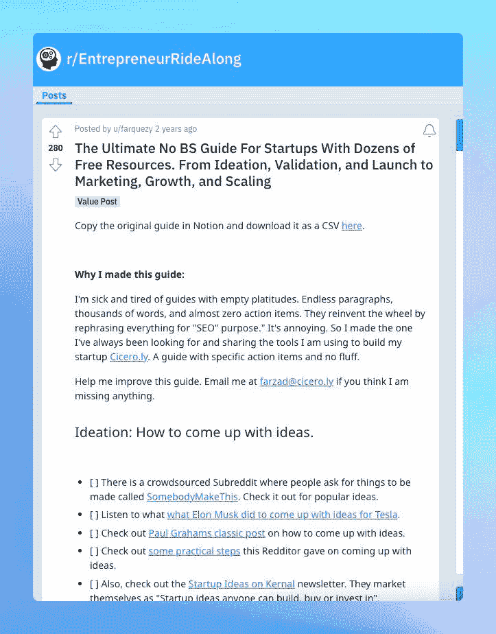

一个人成功或许是偶然，但这么多人都在同样路径上走通，已经说明这件事有普适性，值得大多数人尝试。

```
•案例 2：Starter Story 的创始人 Pat，就是靠在 r/SideProject 持续分享创业故事冷启动的。帖子一条条爆，上千点赞、几十条评论，直接把网站从 0 拉到几千在线。后来他干脆在首页放了个大绿按钮收邮箱，把 Reddit 的流量沉淀成私域。

•案例 3：圈友彩笺一开始封了 6 个账号，后来像个普通用户一样混社区，账号反而活了，活跃在各个社区 r/SideProject、r/InternetIsBeautiful、r/beermoney，不仅能给产品带来流量，还能挖到一手风向标线索。
```

1. Yangyi：在龙哥盟航海家 AI 大会上的分享——出海营销第一站：如何做好 Reddit 营销

### 三、Reddit 的变现方式

想在 Reddit 上获得收入，当前成熟路径主要有：

1. 通过 Google SEO 引流变现（最推荐）
1. 推广独立站/SaaS 产品
1. 做 Affiliate 联盟营销
1. 提供 SEO 服务或买卖账号
1. 沉淀私域流量

### 四、Reddit 版块介绍

熟悉 Reddit，先从板块结构开始。

### 01. Subreddit（子版块/社区）

Subreddit 是 Reddit 下的子版块，每个版块有各自的主题，命名格式为 r/xxxx。比如 r/ChatGPT 专门讨论 ChatGPT，r/SaaS 专门聊软件创业。

版主（Mod）和版规（Rules）是每个 Subreddit 的标配，而且不同社区差异很大。广告投放不是哪里都能做，有些社区见到外链就会直接封禁，所以入乡随俗很重要。

热门社区列表：https://www.reddit.com/best/communities/1/

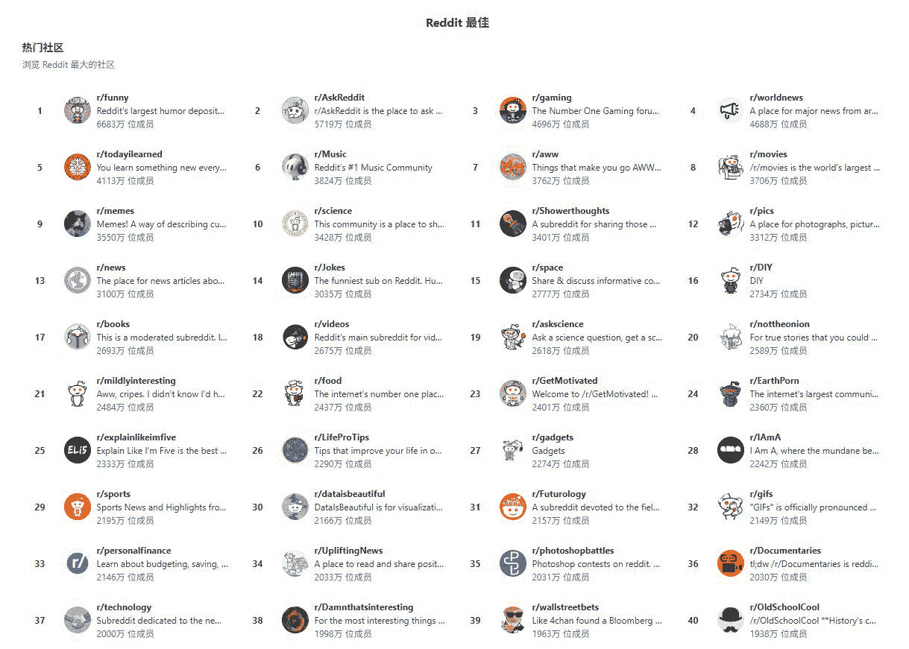

点进任意社区后，右侧栏通常有版规说明，先读完再参与，能减少误触规则的情况。比如 r/Music、r/aww，点进去就能看到相关规则；看不懂英文的话，可以把截图发给 AI（豆包、ChatGPT 等）帮忙解读。

想加入某个社区就点【加入】按钮。养号期间，可以优先加入几个规模大、热度高的社区。

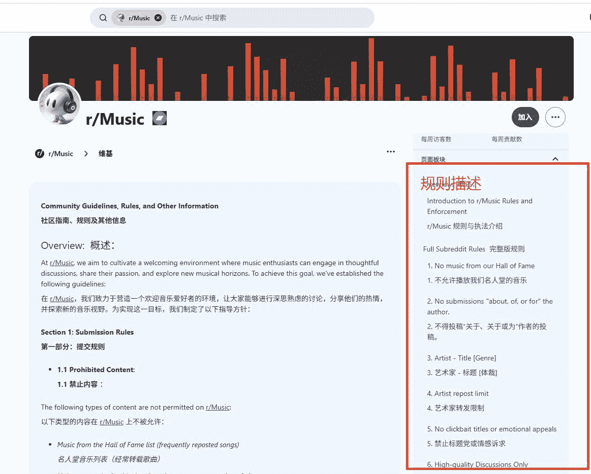

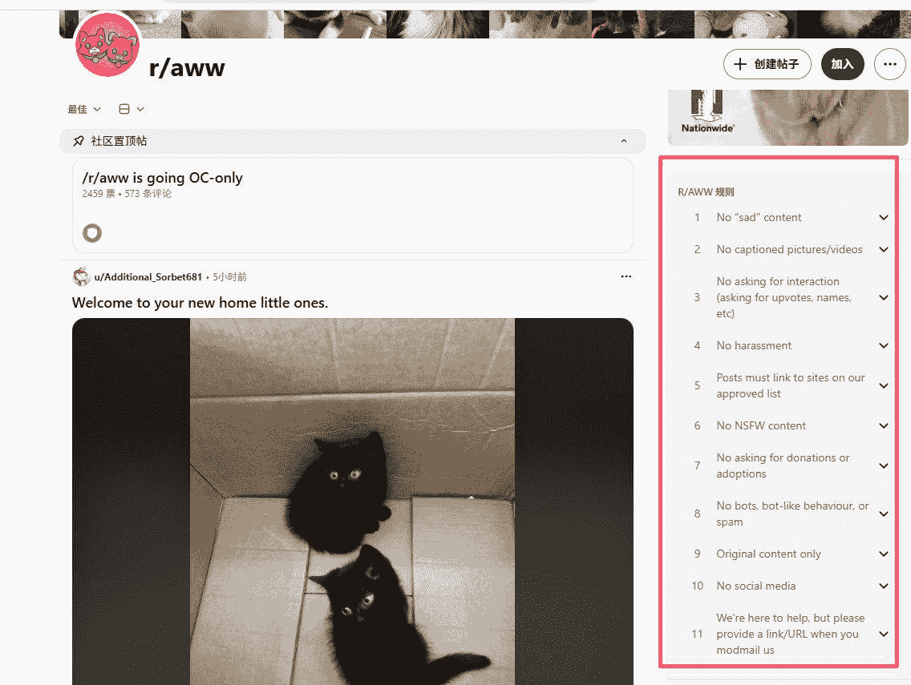

### 02. Karma（业力值/积分）

### 1. Karma 是什么

平台内部有套核心积分机制，即 Karma。它会随着用户发布帖子/评论，以及社区里点赞/点踩的行为而实时变化，并影响账号的可信度、权限以及内容被看到的范围。想把账号做成长线资产，Karma 的积累程度决定了它值不值钱。

Karma 有两个来源：

Post Karma（帖子 Karma）：自己的帖子被其他用户点赞（upvote）时增加；若被点踩（downvote）则会减少。

Comment Karma（评论 Karma）：自己的评论收到 upvote 时也会增加。

帖子热度 = upvote 数 - downvote 数。

有价值的内容会被用户顶上去；硬广内容则会被踩到折叠。

Karma 在哪里查看？主页右上角进入“查看个人资料”，就能看到相关数据。

你在站内的发帖与评论得分累计起来，就是总 Karma。

不同 Subreddit 内部也有各自的统计，不过一般不会对用户单独展示，除非管理员开了相关设置。

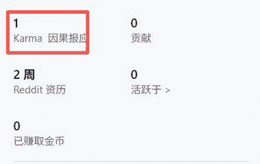

### 2. Karma 的作用

1. 提升信任度：总 Karma 越高，说明内容越受欢迎，账号也显得更可信。
1. 解锁权限：一些 Subreddit 要求达到一定 Karma 才能发帖或评论，以阻止新号发垃圾内容。
1. 运营优势：高 Karma 账号发帖更容易获得关注和互动，尤其在热门 Subreddit 里。

### 3. Karma 与账号权重的关系

严格说，Reddit 官方没有明确把它叫“权重系统”，但 Karma 确实会影响内容在社区的接受程度：

1. 信誉背书：
1. 点赞吸引力：
1. 专业领域优势：

### 4. 为什么高 Karma 账号值钱？

1. 引流能力：
1. 降低审核风险：
1. 账号交易价值：

### 5. 如何积累高 Karma？

1. 参与热门话题：
1. 发布高互动内容：
1. 避开雷区：
1. 保持稳定互动：

另外，平台内部还有个用来判断账号是否为垃圾号的评分口径，叫 CQS（贡献者质量分）。若 CQS 处于 Low 或 Lowest，发帖很容易被系统直接拦下。

1. 老彭：这份内容就是写给第一次接触 Reddit 的新手小白的

### 五、如何注册 Reddit

注册本身不复杂，但若想后续做营销，就得讲究方法。Reddit 在网络环境上卡得很严，只有网络环境安全，账号才可能顺利注册。网络配置的相关内容请自行了解，这里不做展开。

1. 注册入口：打开 Reddit 官网或 App，点“Sign Up”。（网址：https://www.reddit.com/）
1. 账号选择：
1. 用户名（Username）设置：
1. 环境隔离：
1. 注册完成后要验证邮箱。有些频道会对未验证账号做风控，影响发帖。

具体注册流程如下：

（1）Reddit 一般支持四种注册方式，用 Google 邮箱最省事；如果没有，也可以拿普通邮箱注册。

（2）如果想认真运营账号，用户名值得花心思。建议与你要推广的产品相关，或者起一个好记的 IP 名。需要注意的是，名字注册后不能改。输入密码后点 continue。有时页面会提示 “something went wrong”，这通常是网络问题，对应状态码 403。遇到这种情况，刷新页面后重新提交邮箱、昵称和密码，一般就能解决。

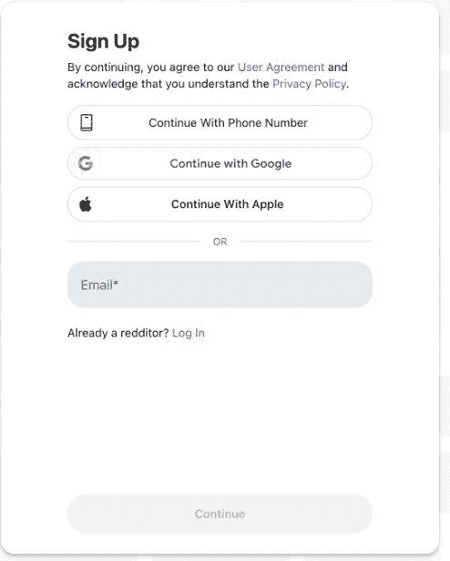

（3）选择性别身份。

（4）选择感兴趣的内容，就能完成注册。Reddit 会根据你的选择，默认推荐几个 subreddit，进入后就能看到相关内容。

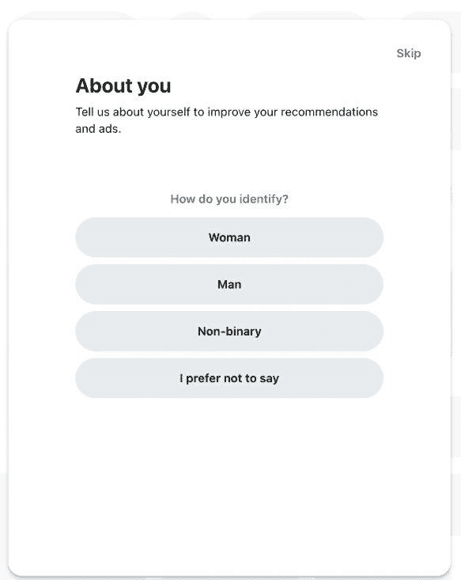

（5）最后一定要验证邮箱，原因如下：

有些 subreddit 会对未验证账号发帖和评论进行限制。

也方便后续找回账号。

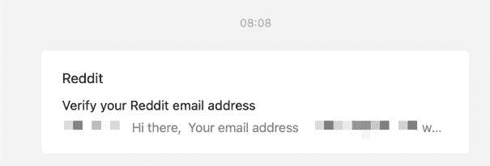

（6）验证完成后，就可以正常登录并进入个人主页了。

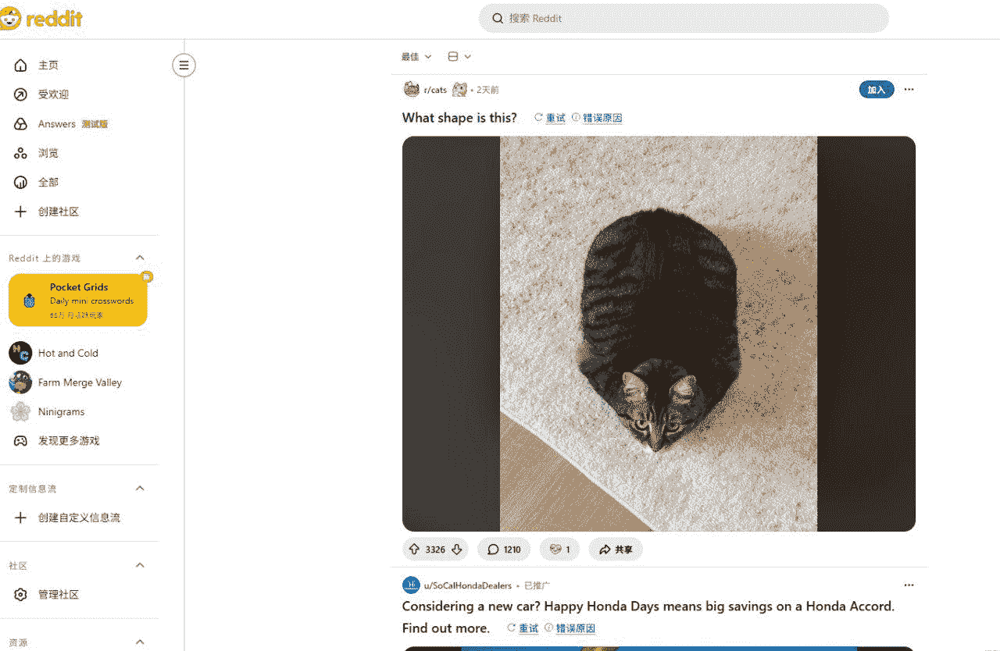

接着说说指纹浏览器。

指纹浏览器可以隔离网络环境和浏览器指纹，降低多账号被关联的可能性，是很多多账号玩家的基础工具。它主要有两个用途：

```
•隔离网络和浏览器环境，使账号之间不会关联，降低风险

•配合静态 IP 使用，确保每个环境独立，互不相关
```

指纹浏览器选择很多，这里列 3 款，大家根据价格和性能自行选择。

1. 比特浏览器：https://www.bitbrowser.cn/price/

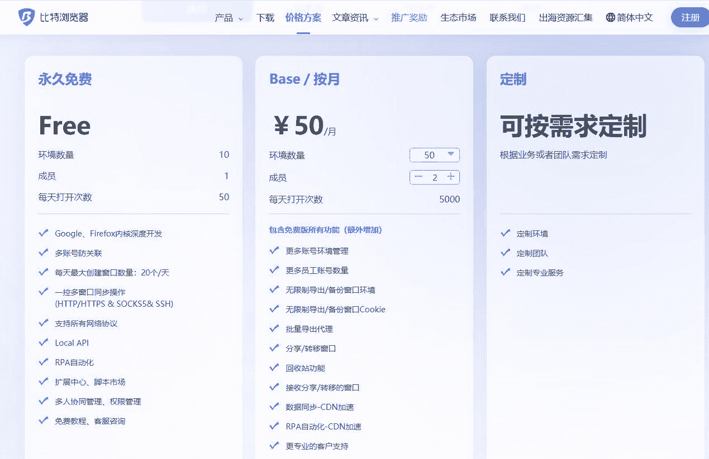

2. Hubstudio 浏览器：https://www.hubstudio.cn/pricing/index.html

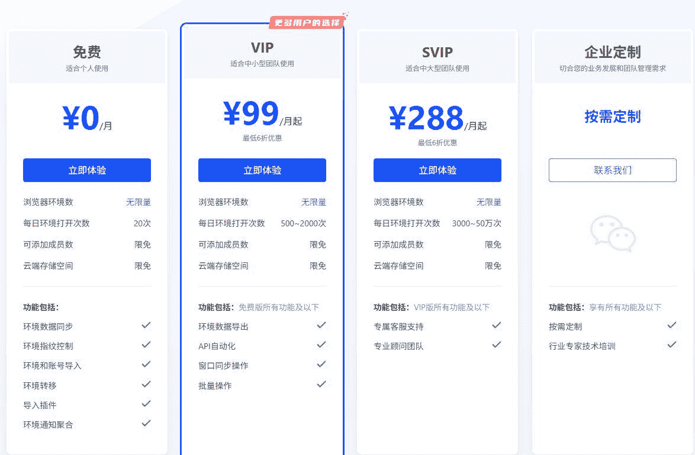

3. AdsPower 浏览器：https://www.adspower.net/

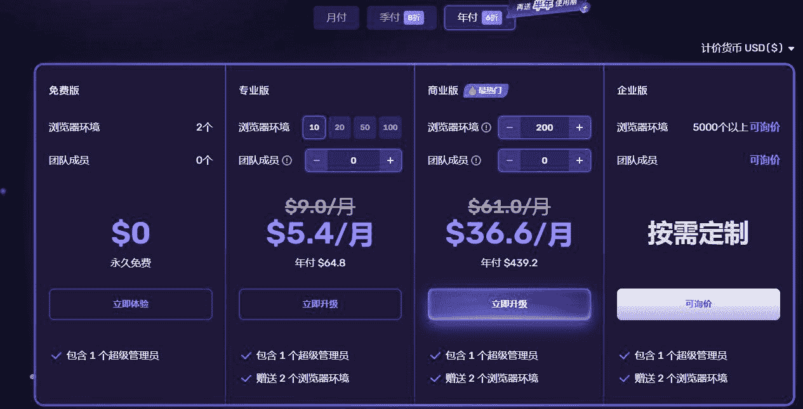

以 AdsPower 为例，可参考圈友@gary 的教程：AdsPower 浏览器基础使用教程

### 六、如何养号（关键）

Reddit 对刚注册的账号并不友好，直接发内容大概率被删或 Shadowban。所以要先熬过一个 7-30 天的养号期。

前提是有一个干净的网络环境。可以先阅读 Reddit 的新手指南：https://www.reddit.com/r/NewToReddit/wiki/ntr-guidetoreddit/

Reddit 站内也有大量教程，多参与几个 Subreddit 就能逐步熟悉。

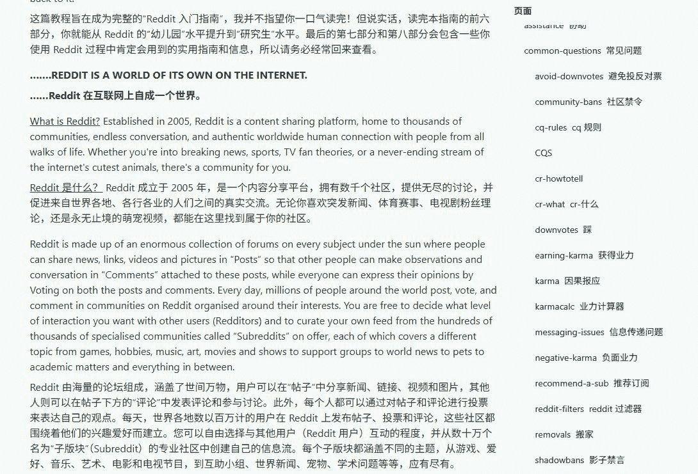

官方规则可查看：https://redditinc.com/policies/reddit-rules

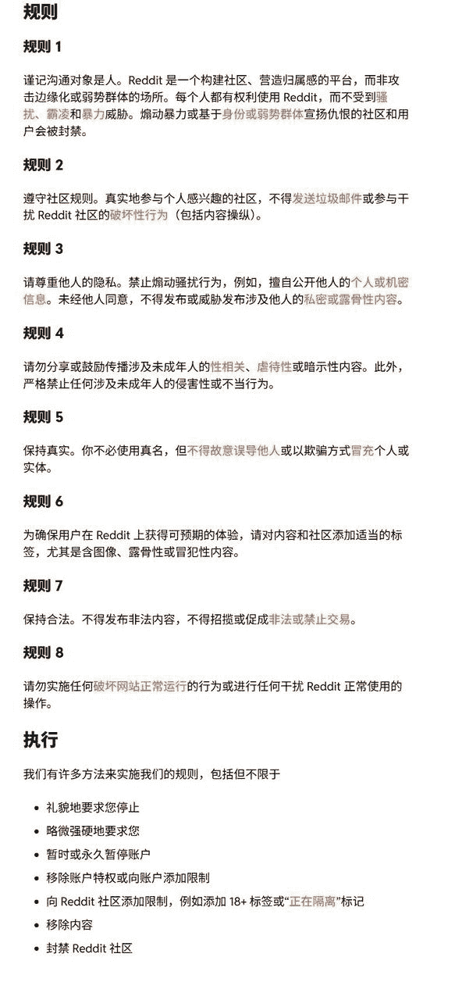

操作方法如下：

1. 心态准备：广撒网，优胜劣汰。
1. 第一周：先当“潜水员”，行为上像个普通人。

> 经过实战检验，下面这些社区很适合新手起步：

+ r/SideProject：独立开发者展示作品、询问建议的地方
+ r/CasualConversation：适合闲聊，也很好“水帖”
+ r/NoStupidQuestions：提问不设限，回答也友善
+ r/TodayILearned：分享新学到的知识，优质内容容易获赞
+ r/IndieGaming：独立游戏开发者聚集地，相关赛道可以试试
+ r/Awww：主打可爱宠物，氛围友好、互动率高，但别发 AI 生成的图片
+ r/mildlyinteresting：分享生活里的小发现，规则相对宽松、互动不错
+ r/FreeKarma4You：想涨 Karma 的人互相帮忙
+ r/explainlikeimfive（ELI5）：用大白话讲复杂概念，技术开发者答这类题能快速累计 Karma
+ r/AskReddit：专注回答问题，快速获得 Karma

1. 获取“徽章”来提高账号权重。
1. 怎样判断账号是不是已经被封？
1. do 小鱼：Reddit 出海指南——从 Build in Public 到社区驱动增长

### 七、发帖运营

### 01. 如何发帖

发帖前一定要先仔细研究目标社区的规则并真正理解，避免触发风控。尤其第一条帖子，一定要用心准备。正确顺序是：先评论、点赞，再发帖；最好等评论带来的 Karma 达到至少 10 后再动手发帖。如果新号一上来就发帖，没有任何互动积累，很容易被封。

Reddit 上有专门的版块会教基础发帖知识，可以进去看看。

# Reddit 实操指南：从发帖避坑到赚钱获客

想玩转 Reddit，先得知道在哪练手：建议去 r/LearnToReddit 熟悉发帖操作（https://www.reddit.com/r/LearnToReddit/）。新账号不知道去哪些板块发言？直接看 r/NewToReddit 的 wiki 推荐列表：https://www.reddit.com/r/NewToReddit/wiki/index/newusersubs/。帖子发出去之后，想确认它是否成功存活，可以刷新最新时间线，或者退出登录后再看一眼。

## （1）内容发布流程

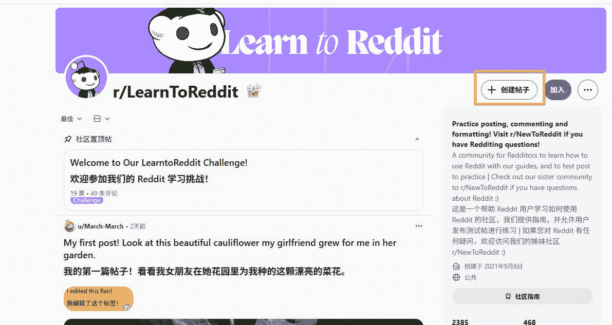

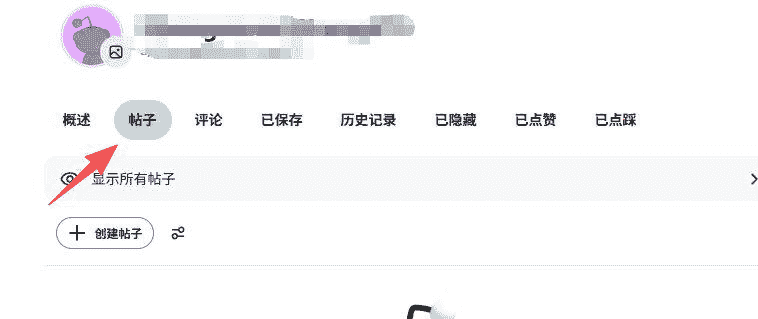

发布完成后，去个人资料页查看帖子状态，同时留意点赞、评论数据。Reddit 上有成千上万个主题社区，发图文还是纯文字，要看板块用户的偏好。想快速提升 karma，图片通常比纯文字更容易见效，但归根结底仍是内容质量决定一切——只有真正有价值的内容，才能持续获得互动。

## （2）发帖注意事项

1. 精读版规：这是最重要的一点，没有之一。每个 sub 都有自己的规则，不读就发帖，基本等于“裸奔”。
2. 可以做标题党，但必须真诚：标题要能抓住眼球，但不能虚假承诺、骗取点击。
3. 遵守 9:1 黄金法则：九分输出价值、一分自我推广，别让社区觉得你在刷存在感。
4. 选对内容形式：图文、视频、纯文字，要根据目标用户的喜好来决定。

### 02. 避免账号违规的关键

Reddit 对“真实”的要求非常苛刻，任何营销味太浓的帖子都会引来用户反感，甚至被管理员直接删除。很多品牌就栽在这里：你以为自己的推广很隐蔽，其实用户一眼就能看穿。

如何规避？注意下面这些做法。

```
•定期与社区用户互动，例如参与评论、回答问题。

•创建有趣或有价值的主题讨论，让用户主动参与。
```

Reddit 本身有一套严格的规则和审核机制，一旦违反，账号可能面临封禁（Ban）。怎么判断账号是否被 Ban？出现以下信号要当心：

- 无法登录：登录时看到“Your account has been permanently suspended”，或直接被系统拒绝登录。
- 发帖/评论受限：能登录，但一发内容就收到“Your account has been suspended from posting or commenting”的提示。
- 内容被自动删除：发出去的内容立刻消失，页面上显示“[removed]”或“[deleted]”，即使是正常互动也过不了审核。
- 收到官方通知：收件箱（Inbox）中出现来自 Reddit 或 Subreddit Mods 的封禁通知。
- 访问特定板块受限：进不了以前常逛的 sub，页面提示“you are banned from this subreddit”。

只要中了以上任意一条，账号多半已经被封或受限。注意，Reddit 的封禁不是“一刀切”，按轻重分为几种：

- 社区级封禁（Subreddit Ban）：只在某个特定 sub 被拉黑，其他板块不受影响。通常因为你违反该版版规，被版主手动移除。表现是收到私信通知，可以看但不能发帖评论。
- 临时封禁（Temporary Ban）：账号被官方“关小黑屋”几天，相当于冷静期。多因操作像机器人（如点赞太快、发帖过猛）或轻微违规。登录时看到“Temporarily suspended”，一般 3 天或 7 天自动解封。
- 永久封禁（Permanent Ban）：账号彻底凉凉，基本救不回来。通常由原则性错误导致，如诈骗、骚扰、发违禁品，或系统判定你是高风险“垃圾号”。登录直接显示“Permanently suspended”。
- 阴影封禁（Shadowban）：新手最常踩的“幽灵模式”，Reddit 不明确告诉你，你发的帖子别人其实看不到。常见原因是系统认为你是营销号，尤其是新号一上来就发链接。测试方法：退出登录或开无痕模式访问自己的主页，若显示 404 或“用户不存在”，就是中招了。
- IP 连带封禁（IP Ban）：相当于“连坐”制。问题不在账号，而在于你用的网络 IP 不干净，可能之前有人用它做过坏事，或同一 IP 下死号太多，Reddit 直接把这个 IP 拉黑了。表现是：无论换什么号都登录不上，新号也注册不了，只能换网络环境。
- 功能限制封禁（Feature Ban）：账号变成“只读模式”，没完全死，但功能被砍掉一半。可能是内容质量太低或轻微违规。可以登录、看帖，但无法发帖、点赞也没有反应。

账号被封后，有时会出现申诉入口，但根据目前经验，申诉成功率不高；如果申诉失败，基本只能换号重新开始。如果你有更好的解决办法，欢迎在评论区分享。

1. 彩笺：怎么“玩”转 Reddit！


## 进阶篇：Reddit 的进阶玩法

基础部分已经讲了板块、注册、养号、发帖这些事。接下来要解锁的是更高阶的用法：如何在 Reddit 上挖掘产品需求、跑 MVP、做营销。

### 八、需求挖掘与 MVP 验证

有了一个产品方向后，怎么判断它是不是“真需求”，值不值得投入开发？可以通过 Reddit 来挖掘需求和验证，还能提前接触潜在用户。核心是“看-问-验”三步法。

### 01. 看：从热门板块与评论区里找需求

先看社群规模。成员越多，机会越大。例如有产品专门针对 ADHD 群体做解决方案，在📕上的互动量很高，说明这个人群有很多困扰。


在 Reddit 直接搜索 ADHD 关键词，进入对应子社区。

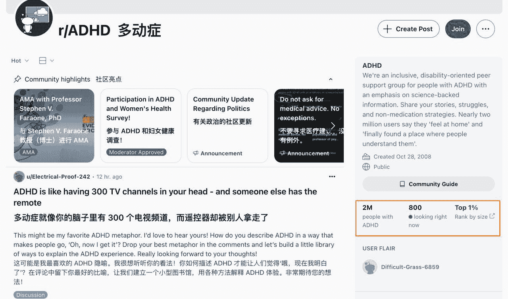

这个社区有 200 万用户，而且排进了全站前 1%，活跃度相当高。

接着筛选“Hot”热门帖，看看大家在聊什么。


关注那些点赞、评论都很多的话题，背后往往藏着群体共同的痛点。尤其要注意评论区里有没有大量“负面情绪”——用户频繁抱怨某个问题，就是真实的市场缺口，也是产品切入的机会。

手动看太多的话，可以借助 AI 帮忙。挑评论数多的帖子，让 AI 总结用户痛点、分析潜在功能点。

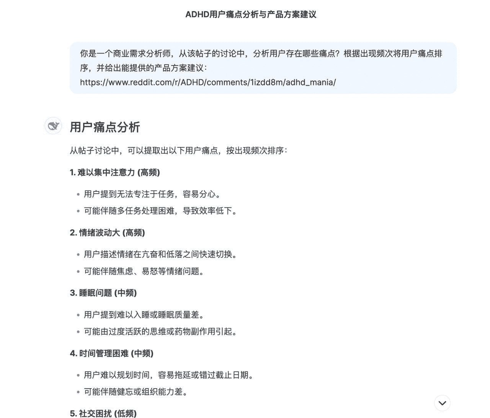

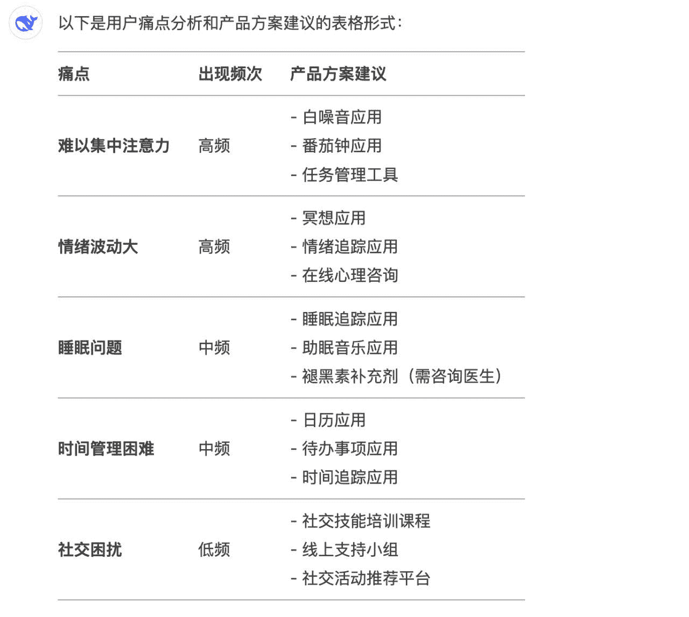

具体做法：让 AI 读热门帖中评论超过 50 条的前 20 个帖子，自动聚合高频痛点和需求，整理成表格，按痛点排序。再结合自身资源和情况，判断哪些问题你能解决。

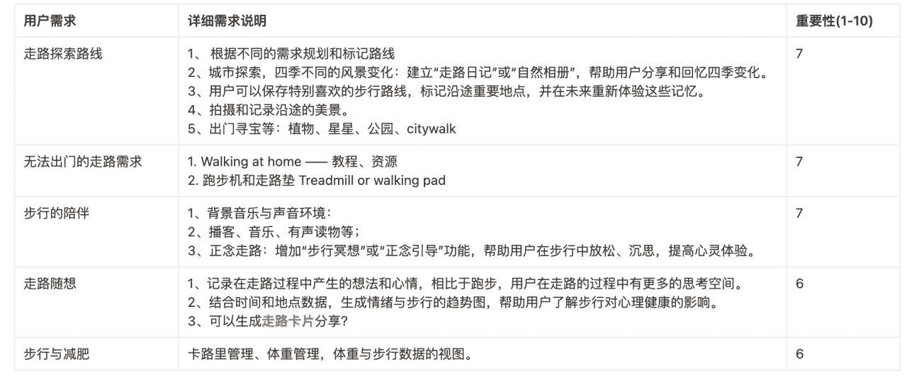

我此前曾用 Reddit 收集“走路”场景下的用户需求。优秀圈友四喜还做了 AI Agent，帮助挖掘和分析 Reddit 用户需求，链接是：scys.com/articleDetail/xq_topic/4848144281141488

### 02. 问：直接发帖，收集真实反馈

看了大量讨论后，你已经对用户画像有初步感知。这时可以带着初步想法，直接在社区提问。

提问时把自己代入目标人群，围绕你想提供的解决方案设定具体场景。可以参考这个公式：【用户画像】+【场景】+【困扰】+【寻求帮助】。比如：“我是 ADHD 患者，发现自己独处时很难集中注意力完成任务，有人有同样困扰吗？大家是怎么解决的？”

真实用户的回复能让你了解现有方案，尤其是他们给出的“有效解法”，对你的产品功能设计很有帮助。

### 03. 验：小成本验证产品假设

痛点有了，解决方案也有了，先别急着开发。可以发一篇主题帖，标题类似：“我创建了一个「XX产品」，帮我自己解决了「XX问题」”。

帖子里以真实用户身份分享自己如何用这款产品解决实际问题，展示设计 Demo，并请大家提功能建议。如果用户主动问“能不能分享”“能不能做成产品”，你就在帖子里放一个落地邮箱注册页，开始收集种子用户邮箱。

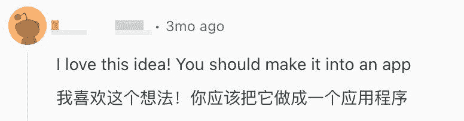

我把想法和原型发到相关子社区后，获得了很直接的正面反馈。

这一步做完，就形成了 MVP 验证闭环：需求挖掘 → 解决方案验证 → 种子用户邮箱收集。在目标群体高度相关的社区里做这件事，留下来的邮箱大概率是真正的有效用户，而不是泛流量，也不容易混进竞品或旁观者。

所以，在 Reddit 子社区“看-问-验”三步法，能快速跑通 MVP。之后可以规律地 Build in community，或通过邮件发布产品动态，收集反馈，避免闭门造车。

1. do 小鱼：Reddit 出海指南——从公开构建到社区驱动增长

### 九、产品冷启动与获客

产品做出来之后，Reddit 是很好的冷启动平台，可以帮你获得第一批用户。

### 01. 在相关社区直接发布产品

直接发帖带产品，简单高效，能快速吸引目标用户。但风险也大，必须遵守组规，且不能太硬广。建议只在正式发布时发，不要频繁发营销主题帖。如果你隔三差五发硬广，系统很容易判定为垃圾营销。

换个思路：与其想“营销别人”，不如想“为用户提供价值”。

### 02. 给提问者提供有价值的答案

你的产品和服务，本来就是为对的人提供价值的。很多用户在社区里寻找更合适的解决方案，有问题的地方就有需求。

怎么捕捉这些需求信号？我常用两个方法：

（1）谷歌搜索“产品人群场景”。搜索公式：【How to + 你的产品或服务的应用场景关键词 + Reddit】。

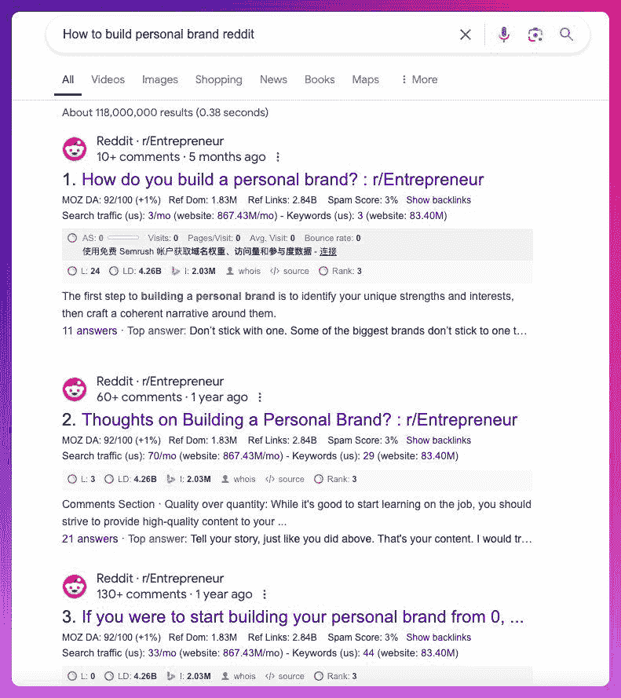

这样能直接定位到一系列相关痛点提问。在这些帖子下回复，顺带附上产品链接，既自然又精准，转化更好，也不容易被封号。

（2）主动监测关键词。免费工具 f5bot.com，输入要监测的关键词，一旦 Reddit 出现相关内容，就会邮件提醒你。

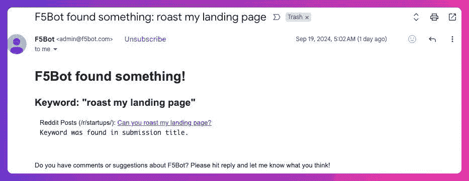

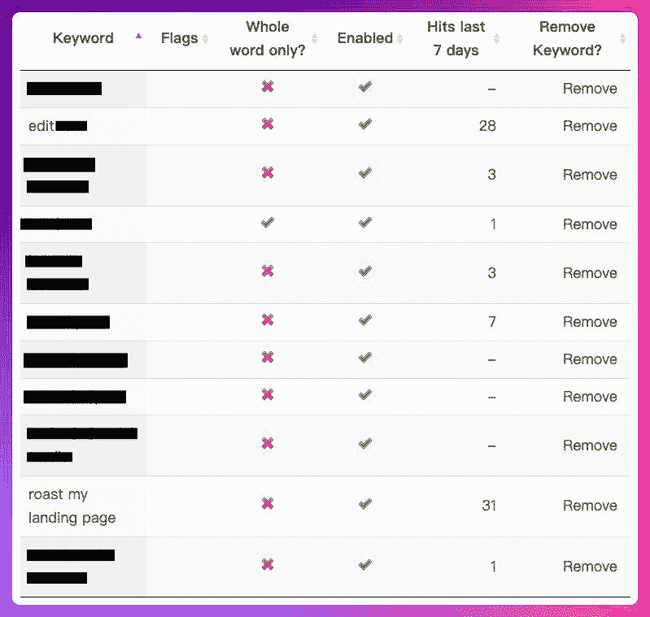

这个工具还会显示过去一周关键词出现次数，等于顺便做了关键词热度调研。

可以用它监测什么？

1. 竞品关键词：观察竞品在 Reddit 上怎么做营销，掌握对方的渠道玩法。
2. 潜在关键词：想主打 SEO 的词，看看讨论热度，如果出现频繁，说明值得做 SEO 优化。
3. 定位潜在用户：用关键词锁定目标用户，在评论区介绍产品，引流到落地页。
4. 监控自己的产品：看有没有用户讨论你，找到“铁粉”或“黑粉”。
5. 挖掘 SEO 博文话题：想写主题博文，先看有没有人在讨论，有的话写完可去评论区引流。

这个工具也有局限：关键词和需求并不总是一一对应，有的词会出现在无关场合，需要你过滤和筛选。

### 03. 如何将目标用户转化为客户？

我试过很多转化方式，有些帖子流量很大，但转化效果一般。最好用的还是精准定位目标人群，让他们主动对产品感兴趣。

**1. 自问自答型**

在相关社群中，用你的产品能解决的问题提问，比如：“作为 ADHD 患者，我很难专注，有没有好用的工具推荐？”公式是：【人群】+【痛点】+【寻求工具解决方案】。做 App 就问有没有好 App，做网站就问有没有好网页。

点进这个帖子的人，自然就是你的目标用户。然后在评论区用小号或以真实用户身份回答：“最近我发现一个不错的工具，解决了我这个问题，叫「XX」。”

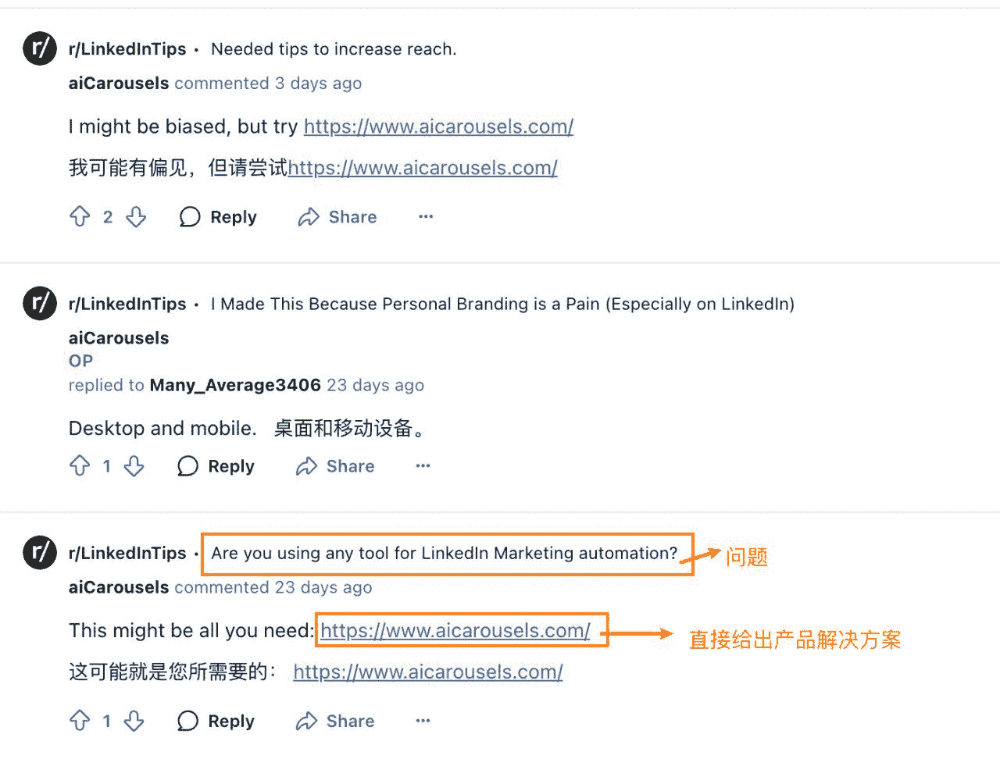

就像这个工具，用评论区回答引流到网站。

在 Reddit 帖子里留产品信息还有个额外好处：Reddit 网站权重高，用户通过谷歌搜索时，Reddit 帖子经常排前面，等于变相做了 SEO。

**2. 真诚利他型**

如果很难精准匹配场景，可以把昵称改成【产品/网站名称+解决方案】，在个人主页留下产品介绍，然后去目标用户发的帖子下面回答问题。回答不一定要和你的产品直接相关，但能吸引目标用户关注到你，他们会顺势进主页了解你的产品。

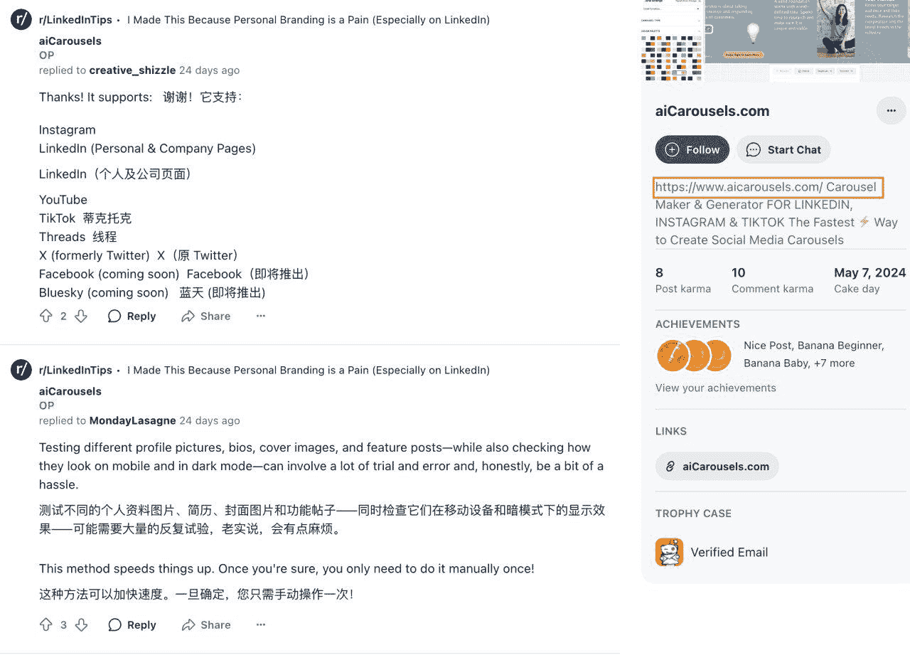

如果你做网站，还可以把 Reddit 上高赞的用户提问改写成 SEO 文章，发在原帖下面，引流到你的主站。

1. do 小鱼：Reddit 出海指南——从公开构建到社区驱动增长

### 十、在 Reddit 上做营销

在 Reddit 做营销，核心心法一句话：“提供价值，顺便卖货”。任何试图挑战社区智商的硬广，结局都是封号。以下是四套经过验证的高阶玩法：

1. 从 Build in Public（公开构建）升级为 Build in Community（社区共建）。
2. 账号矩阵运营。
3. 利用 Reddit 广告（付费玩法）。
4. 蹭热点（Newsjacking）。

### 十一、实用工具清单

Reddit 是全球巨大的流量洼地，但复杂的“部落文化”和成千上万的子版块经常让新手发懵。凭感觉乱撞不如用数据和工具。这里整理了一套覆盖全链路的工具清单，无论你是刚入门，还是资深操盘手，都能找到合适的武器。

🎯 新手入门：先找“地盘”。刚开始接触 Reddit，不知道该去哪，用这些工具帮你定位。

```
•**社区发现工具：** Reddit Best Communities、FindAReddit

•**价值：** 帮你快速定位与你产品或话题最匹配的精准社区，这是获得流量的第一步。
```

💡 创作者与产品人：找“灵感”与“美化”。苦于没有选题，或帖子不够吸睛，用这些工具。

```
•**灵感挖掘工具：** IdeaPicker、Product Hunt（找灵感）；**内容创作工具**：Canva、ShotEasy（做配图）

•**价值：** 看看市场上什么最火，用高质量的视觉内容提升点击率。
```

📊 运营与营销专家：看“数据”与“时机”。需要用数据指导运营、安排发布节奏，工具都在这里。

# Reddit 工具别贪多：挑一两款用透就够

想把转化做起来、又不想乱烧预算，精细化运营是绕不过去的一步。工具也一样，不必堆一桌子；按自己眼下所处阶段，选 1 到 2 款真正用熟，收益往往更高。老话说，刀磨好了，柴才好砍。愿你在 Reddit 逛得开心、挖得尽兴。访问下面这些站点前，记得先把网络条件准备好。

```
•**数据挖掘工具：** Subreddit Stats（看活跃度）、**营销工具**：GummySearch（挖痛点）、**研究与分析工具**：Later for Reddit（定时间）

•**价值：** 用数据说话，在用户最活跃的时间，把内容推给最需要的人。
```

### 01.社区发现工具

### 1.Reddit Best Communities

**工具名**：Reddit Best Communities

**关键词**：版块榜单、按主题浏览、内容灵感、新手向导

**入口**：https://www.reddit.com/best/communities/1/

**它能帮上什么忙**：这是 Reddit 官方整理的入口页，把人气高的 Subreddits 按主题和热度排了出来。刚上手的人可以少走弯路，老用户也能快速找到感兴趣的新版块。对想摸清目标人群聚集地、安排内容或观察流行风向的出海团队来说，它像一张现成地图。

**常拿来做什么**：找与自家产品、目标受众匹配的版块，为后续发布和推广铺路；从各版块讨论方向里捕捉选题；按社区体量和主题挑选广告位或 AMA 活动；反过来观察不同圈层的兴趣分布，调整产品或内容方向。

**来源**：https://t.zsxq.com/BhWzI

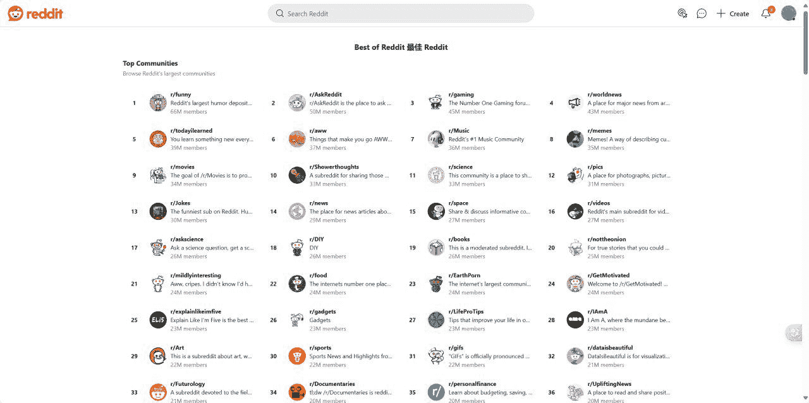

### 2.FindAReddit

**工具名**：FindAReddit

**关键词**：版块搜索、社区发现、分类导航、推广资源

**入口**：https://www.findareddit.com/

**它能帮上什么忙**：FindAReddit 把“找版块”这件事做得很直接：输入关键词，就能定位到主题相关的 Subreddits，还能顺带查看订阅规模、活跃程度和热门讨论。做产品推广、市场调研或用户互动时，它适合用来快速缩小范围。

**常拿来做什么**：按产品词找对口社区并展开互动；筛选适合发内容或投广告的版块；观察热门主题与活跃度，判断用户兴趣走向；找到竞品所在的版块，研究讨论与反馈，为优化自家产品或服务找依据。

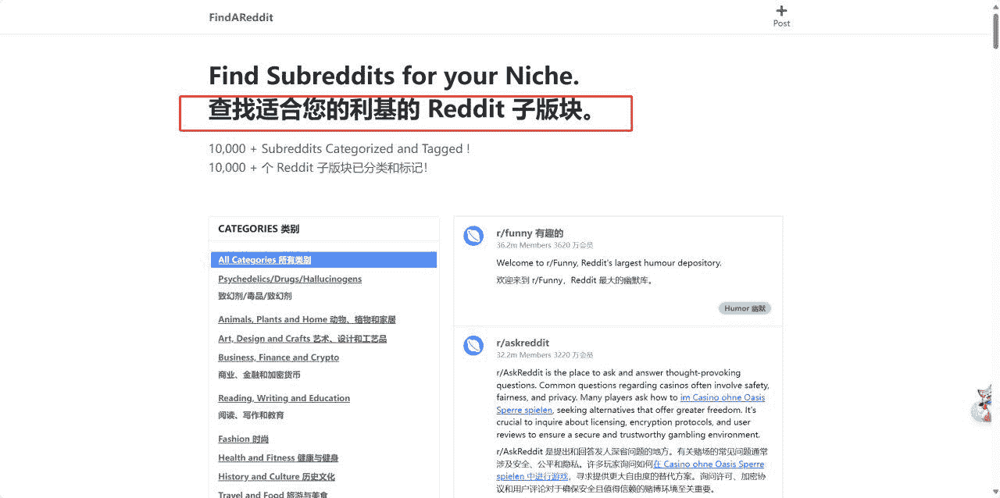

### 02.数据挖掘工具

### 1. Subreddit Stats

**工具名**：Subreddit Stats

**关键词**：数据分析、社区统计、受众洞察、热度追踪

**入口**：https://subredditstats.com/

**它能帮上什么忙**：Subreddit Stats 把 Reddit 各子版块的数据拆得比较细，活跃用户规模、发帖节奏、热门话题、投票走势都能看。团队可以据此判断社区热度、变化趋势和用户行为规律，再安排内容与推广节奏。

**常拿来做什么**：看目标社区的用户增长、发帖高峰，挑选发布时机和阵地；分析产品相关版块，挖需求与兴趣点；借热门帖子统计锁定受欢迎的主题；按活跃度与用户画像选投放社区和时间，提升广告回报；统计竞品社区，了解用户讨论焦点。

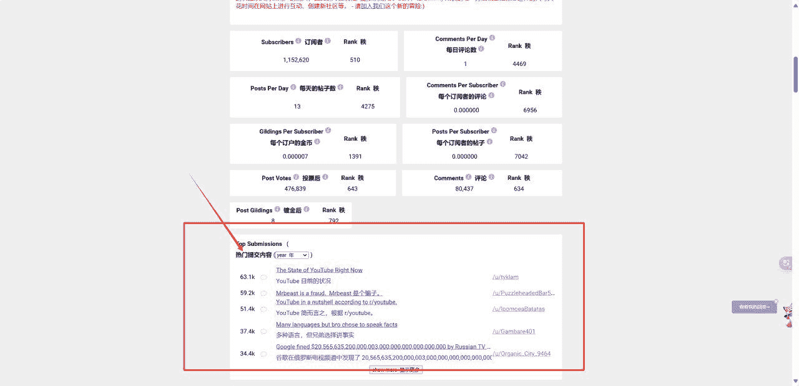

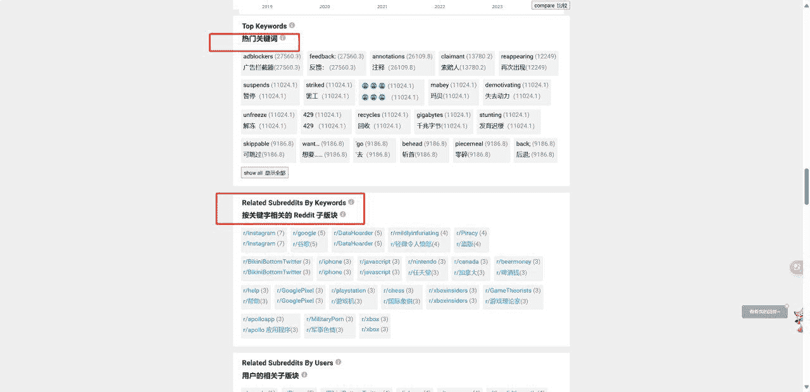

### 2.RedSim

**工具名**：RedSim

**关键词**：社区关系可视化、版块关联分析、社区探索、图形化数据

**入口**：https://anvaka.github.io/redsim/

**它能帮上什么忙**：RedSim 用图形把 Reddit 子版块之间的连接关系摊开给你看。输入一个感兴趣的版块，相关版块以及彼此关联的强弱会直观呈现，适合用来探索社区结构、发现新阵地。

**常拿来做什么**：从一个核心版块顺藤摸瓜，找内容分发或广告投放的潜在社区；梳理某个主题下的版块生态；从目标市场相关版块向外扩展受众；根据不同版块主题找创作切入口；查看竞品活跃在哪些版块，完善推广布局。

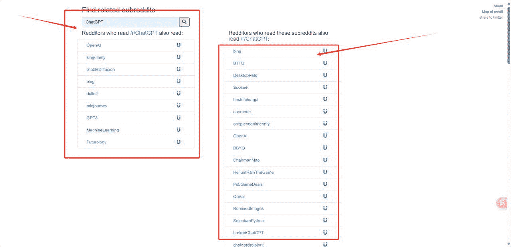

### 3.Keyworddit

**工具名**：Keyworddit

**关键词**：关键词研究、SEO 工具、内容创作、市场调研

**入口**：https://www.highervisibility.com/seo/tools/keyworddit/?utm_source=toolbaseio

**它能帮上什么忙**：Keyworddit 是 Reddit 推出的关键词生成工具，能给出搜索量数据和关键词灵感，帮助改善 SEO。操作不复杂：输入关键词，选好要查的 subreddit，就能拿到按月排名的关键词清单；点关键词旁的上下文，还能看 Google 结果页，了解 Reddit 内相关主题和帖子。清单支持导出。

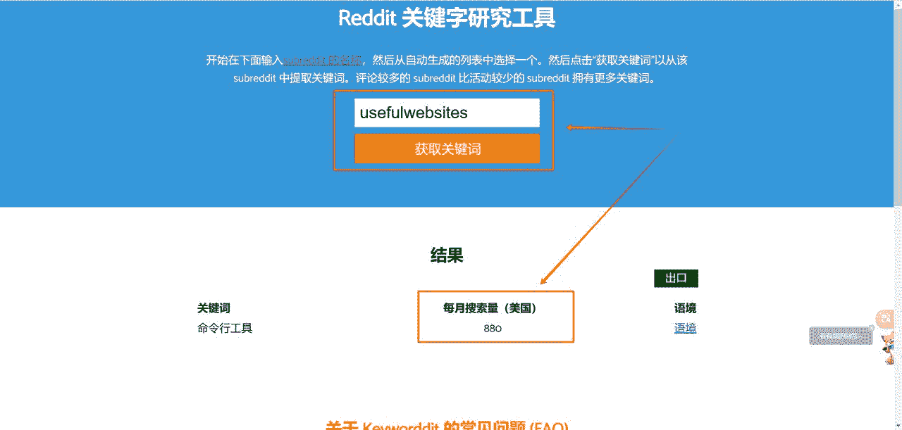

### **03.灵感挖掘工具**

### 1.There’s An AI For That

**工具名**：There’s An AI For That

**关键词**：AI 工具大全、人工智能资源、效率工具、技术创新、创意工具

**入口**：https://theresanaiforthat.com/

**它能帮上什么忙**：这个平台把全球新出的 AI 工具与解决方案收集、归类到一起。个人用户或企业团队都能按需求快速筛选，也能顺带观察行业风向。它的特点是工具库大、搜索体验直观。

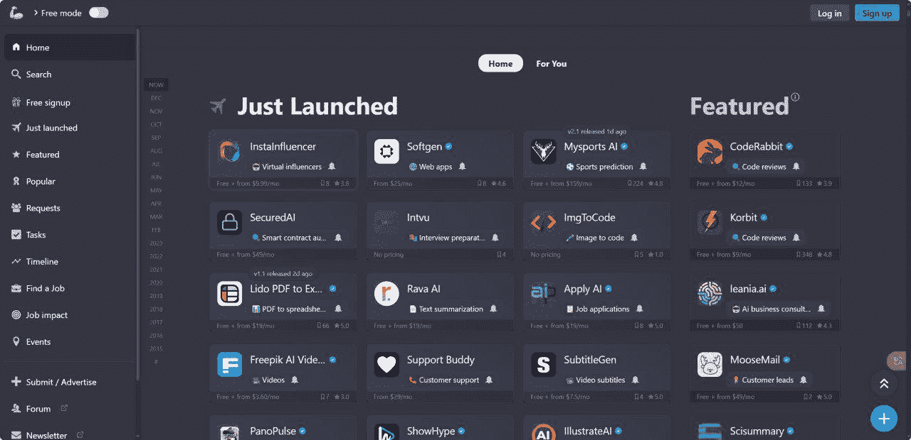

### 2. IdeaPicker

**工具名**：IdeaPicker

**关键词**：创业想法、创意筛选、市场验证、项目开发

**入口**：https://ideapicker.io/ideas

**它能帮上什么忙**：IdeaPicker 面向创业者和开发者，用来发现、筛选创业点子。平台有一套评分机制，再配合市场验证，帮人判断哪些创意更值得做。你可以提交想法，也能翻社区里现成的点子找灵感或验可行性。

**核心功能**：创意评分，按市场需求、可行性、盈利潜力等维度给想法打分；创意库，浏览和搜索已发布点子；市场验证，借社区投票和反馈做初步检验；筛选工具，按行业、受众、盈利潜力等条件快速过滤；社区互动，支持评论、点赞和改进建议。

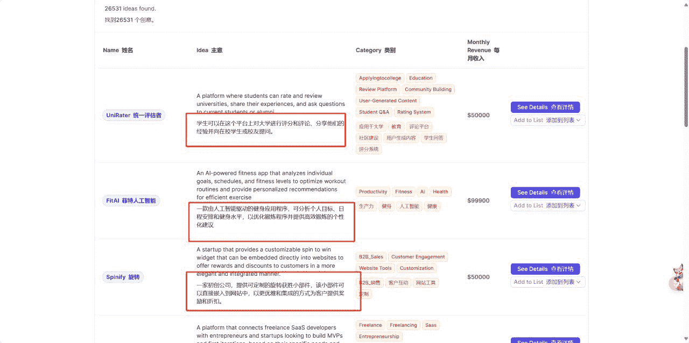

### 3.IndieIdeas

**工具名**：IndieIdeas

**关键词**：创业想法、创意分享、市场验证、产品开发、创业社区

**入口**：https://indieideas.io/

**它能帮上什么忙**：IndieIdeas 是一个面向创业者、开发者和创意人士的社区，大家在这里分享、发现和验证创业想法。平台想陪独立创业者走完从点子到落地的路，通过市场验证、用户反馈和资源共享，让想法更容易变成可行的产品或服务。

**核心功能**：提交创业点子并收获社区反馈；由成员投票或评论来评估需求与可行性；浏览他人想法，激发灵感或寻找合作；提供创业趋势与市场需求方面的洞察，帮助定位和发展创意。

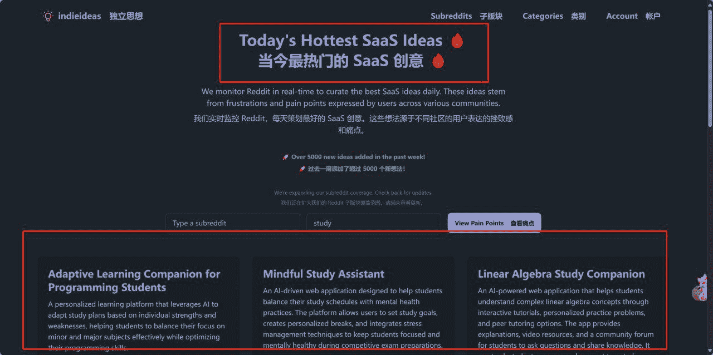

**下面几个找产品思路的站点来自刘小排老师的帖子，对想做产品的圈友应该有帮助，建议再把小排老师那篇帖子看一遍**：https://articles.zsxq.com/id_qerx7rre5z5x.html

### 4.Product Hunt

**工具名**：Product Hunt

**关键词**：产品发布、创业工具、技术趋势、用户社区、产品推广

**入口**：https://www.producthunt.com/

**它能帮上什么忙**：Product Hunt 是一个发现和推广新产品的在线社区，技术、软件、硬件、应用以及创业领域的新创意都能在这里露面。开发者、设计师、创业者和早期用户可以在其中展示、探索、互动，它也是产品发布和收集早期反馈的常用阵地。

**优势**：吸引对新技术感兴趣的人，积累早期用户；借社区反馈判断市场潜力和改进方向；聚集创业者、投资者、技术爱好者等群体；每日热门榜单能反映技术和市场动向，也能提供灵感。

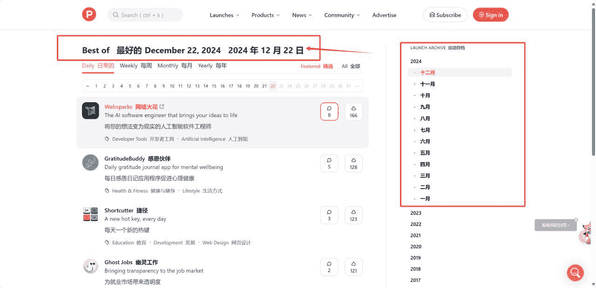

### 5.Hacker News

**工具名**：Hacker News - Show HN

**关键词**：创意展示、产品发布、技术社区、创业分享、开发者工具

**入口**：https://news.ycombinator.com/show

**它能帮上什么忙**：Show HN 是 Hacker News 里专门给开发者、创业者和创意人士展示项目的页面。正在开发的产品、新工具或点子都可以放上来，社区里聚集了不少对技术和创业感兴趣的人，容易收到早期反馈和讨论。

**优势**：社区里技术爱好者和潜在用户多，是零成本的曝光渠道；成员建议往往质量较高、贴近实际，有助于优化产品或解决技术问题；项目早期就能拿到真实反馈，帮助校准方向。

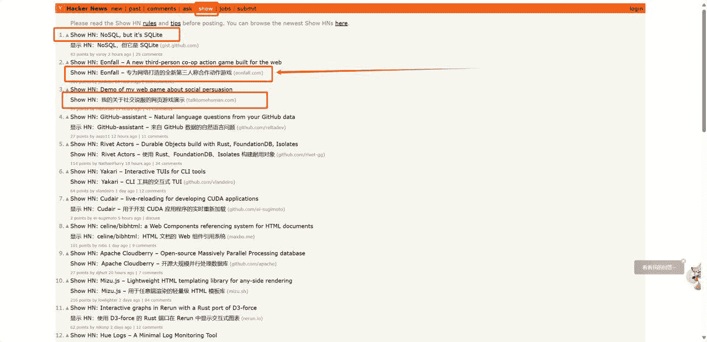

### 6.SEOBox

**工具名**：SEOBox

**关键词**：SEO 工具、域名数据、数字营销、网站优化

**入口**：https://seo.box/referring/

**它能帮上什么忙**：SEO Box 想做的是把 SEO 流程简化：帮你研究并追踪哪些域名指向自家网站，也就是“推荐域名”，再用这些数据调整优化策略。链接来源的质量、数量，以及对流量和权重的影响，都能看得更清楚。

**优势**：分析推荐域名数据，精准调整外链建设；发现竞品的外链资源，锁定值得争取的链接；识别低质量或有害域名，及时处理，降低被搜索引擎处罚的风险；了解哪些域名对目标内容感兴趣，据此优化内容，吸引更多外链。

**来源**：龙哥盟圈友、著名航海教练哥飞。这里收集的是通过 Stripe 平台收款、每月最赚钱的 Top 100 产品。

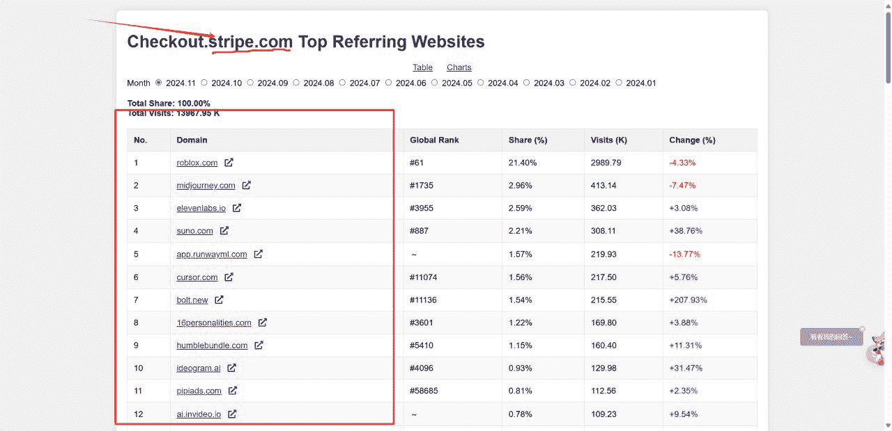

### 7. Toolify

**工具名**：Toolify

**关键词**：AI 工具平台、人工智能资源、效率工具、技术应用

**入口**：https://www.toolify.ai/zh/

**它能帮上什么忙**：Toolify 是一个 AI 工具集合平台，覆盖生产力提升、内容创作、编程辅助、图像处理等多个方向。用户可以在这里发现并使用较新的 AI 技术，提升效率、解决具体问题。

**来源**：龙哥盟知名大佬、超级产品经理阳光杉木。这也是全球第二大的 AI 产品导航网站。

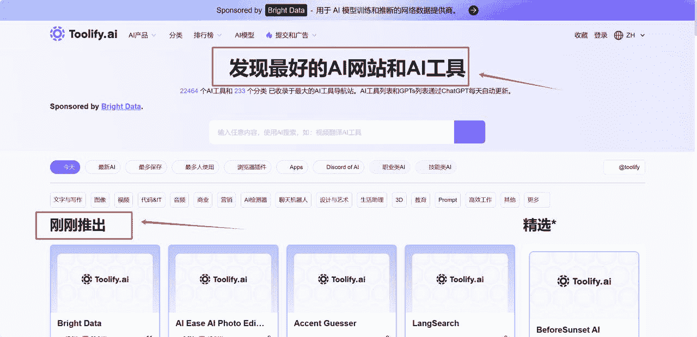

### 04.研究与分析工具

### 1.SnooSnoo

**工具名**：SnooSnoo

**关键词**：用户数据分析、行为洞察、社交媒体工具

**入口**：https://snoosnoop.com/

**它能帮上什么忙**：SnooSnoo 把分析落到 Reddit 用户层面，能帮你了解某个用户的行为模式、兴趣爱好和互动习惯。输入用户名，就能看到其发帖历史、评论数据、活跃时段、常去的子版块等信息，可用于用户研究、行为分析和内容优化。

**优势**：看活跃度，确定对方常在线的时间，便于安排互动或发布内容，也能帮品牌和创作者找到高效触达窗口；看兴趣图谱，了解对方关注什么，为精准推荐和投放提供依据；看内容偏好，判断其常讨论科技、娱乐还是政治等主题，据此调整创作策略。

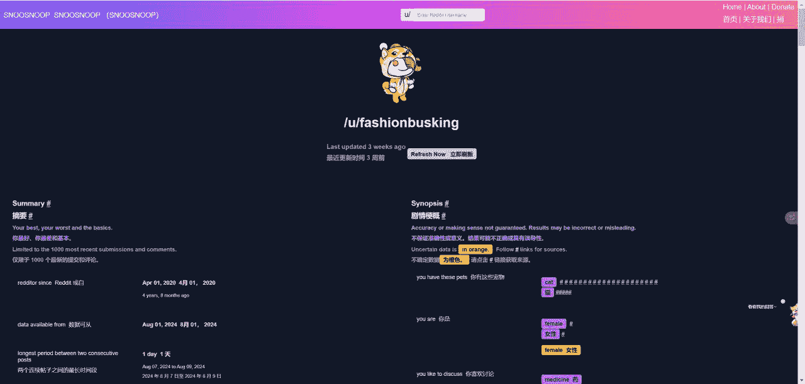

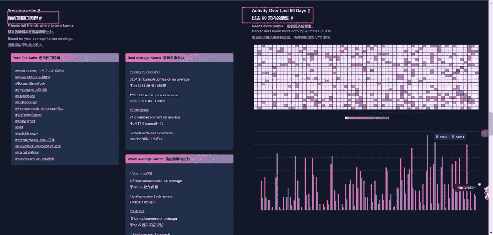

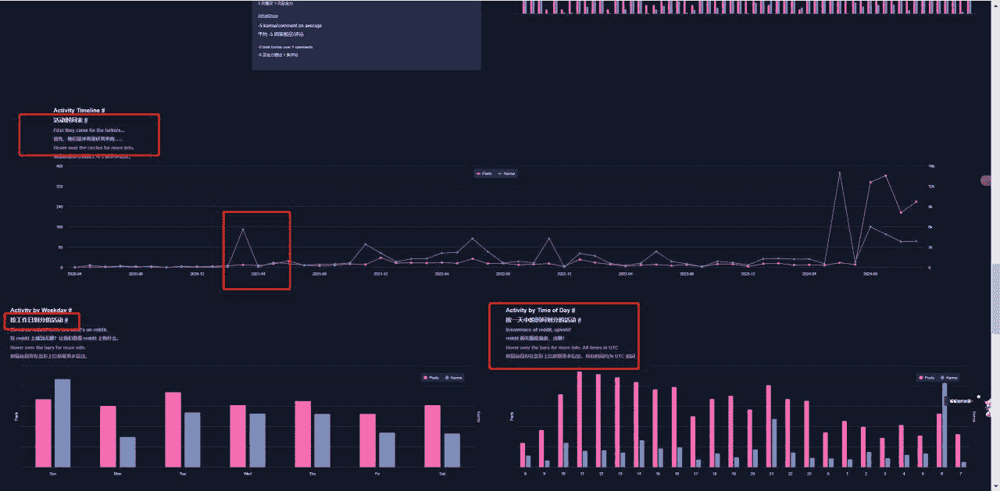

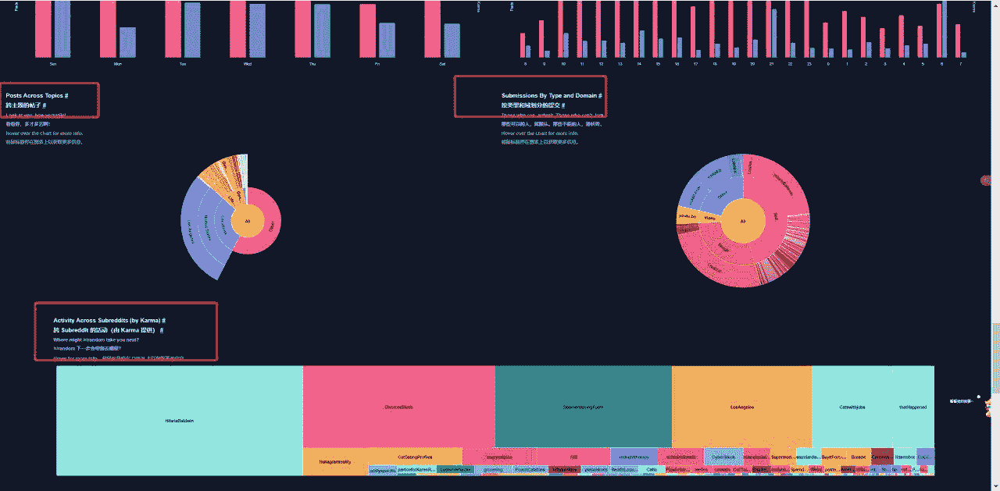

相似站点

### 2. Reddit Metis

**工具名**：Reddit Metis

**关键词**：数据分析、子版块研究、用户行为分析、内容优化工具

**入口**：https://redditmetis.com/

**它能帮上什么忙**：Reddit Metis 聚焦 Reddit 平台数据分析，能看子版块的内容趋势、用户活跃时间、互动数据，以及帖子和评论的表现。版主、营销人员、内容创作者和品牌推广人员都能用它优化发帖策略、提升社区参与度，并分析竞争对手。

**优势**：子版块数据方面，可查看目标版块发帖数量、用户活跃时间分布、互动频率等，帮助判断哪些话题更受欢迎；用户活跃时间方面，可按小时、按天或按周分析活跃时段，找出更适合发帖的窗口，争取更大曝光和参与度。

# Reddit 运营者实用工具合集：选工具、卡时间、做配图、投广告，一篇就够

在 Reddit 上做内容，光有好文案还不够，还得懂板块的节奏、掌握合适的发布时机，配图和广告投放也要跟得上。下面这份整理把能帮上忙的工具按场景列了出来，从社区数据分析到官方广告后台都有，方便大家对号入座。

不少板块分析工具会提供这些能力：

**3. 盯紧板块内的高赞内容：**
把 subreddit 中获赞最多的帖子捞出来，看它们靠的是图片、文字还是视频，再研究什么样的选题、什么样的标题更能留住用户的目光。

**4. 挖出高频词与热门议题：**
梳理板块里反复出现的用词和讨论焦点，能反映出用户真正关心什么，也能为后续内容选题和需求判断提供线索。

**5. 横向对比不同板块：**
将多个 subreddit 放在一起互相比对，活跃程度、内容调性、用户习惯的差异都能看得很清楚。

历史数据检索：
把目标板块过去的发帖记录和留言表现调出来，观察一段时间内的热度变化，方便判断长期趋势。

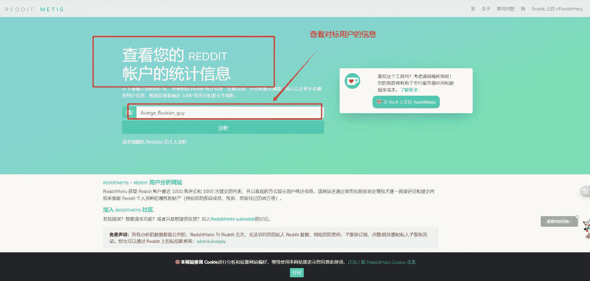


### 3. Postpone

Postpone 的入口：https://www.postpone.app/scheduled 。这是一款面向 Reddit 的排期工具，核心思路是把内容提前安排好，再按设定时间投放到多个渠道。特别适合做推广、做内容以及运营品牌的人，能省掉不少重复的点按操作，让内容触达范围更广。它也会分析账号的整体情况，顺带提供起标题之类的小功能。


### 4. Later for Reddit

入口：https://dashboard.laterforreddit.com/analysis 。这是 Later for Reddit 提供的一块板块分析功能，用来观察某个 subreddit 的发帖规律和用户习惯。输入板块的名字（例如 website），就能看到帖子的热闹时段、获赞走势、留言活跃度以及最受欢迎的内容。结合这些信息，可以找出更合适的发布窗口，让帖子获得更多曝光和互动。

几个比较实用的点：
- 活跃时段：按天或按周展示用户最常出没的时间，帮助确定最佳发布窗口。
- 数据趋势：不同时间段里帖子的获赞量和留言量有怎样的起伏，一目了然。
- 高人气帖：板块里数据最亮眼的帖子会被集中列出，方便研究用户偏好的题材和标题口味。
- 策略建议：把以往的数据当作参考，判断什么时间发更合适，内容从哪个方向去调整也会有数。


同类型还有：

### 5. Delay for Reddit

入口：https://www.delayforreddit.com/ 。Delay for Reddit 把预约发布这件事做得非常专一：先把帖子写好、把时间定好，到期后系统会自动将内容送到目标 subreddit。跨时区协作的团队、做内容的个人以及社区管理员，都能靠它把发帖节奏卡得更准，从而争取到更好的阅读数据和互动量。


### 05. 内容创作工具

### 1. Canva

入口：https://www.canva.cn/ 。Canva 属于那种上手很快的网页设计应用，个人、团队、企业都能用。它内置大量模板与素材，哪怕是设计新手，也能在很短时间内排出宣传海报、PPT、名片、短视频或活动物料。放到 Reddit 上，一张好看的配图会让帖子更有吸引力；在闲鱼花几块钱，甚至还能拿下终身版的账号。


### 2. ShotEasy

入口：https://shoteasy.fun/ 。ShotEasy 可以免费给截图做美化，全程在网页里完成。想加背景、边框、阴影、水印都可以，还支持裁剪、缩放、加注释，让一张普通截图变得更有专业感。

适合这么用：
- 内容配图：做博客、社媒或汇报材料时，给截图修饰一下，整体质感马上不一样。
- 产品展示：把产品界面处理得更醒目，卖点一眼就能看到。
- 社交分享：给帖子准备更吸引人的图片，互动自然也会变多。


### 3. Reddit Preview

入口：https://redditpreview.com/ 。它主要用来模拟 Reddit 帖子、广告或内容排版的最终显示效果。发布之前先跑一遍，标题、正文、图片、视频都会按真实页面呈现，能提前发现格式、设计或视觉上的问题。广告主、做内容的作者和板块管理员都比较需要它。

亮点：
- 帖子效果：未发布也能看到帖子在页面上的实际样子。
- 广告效果：展示广告、文字广告都能先模拟一遍，确认设计和要传达的信息都没问题。
- Markdown 检查：写好的加粗、标题和超链接，格式对不对，预览一下就知道了。


### 06. 营销工具

### 1. GummySearch

入口：https://go.gummysearch.com/audiences/ 。GummySearch 利用 Reddit 上的讨论数据做人群与市场研究，重点是把潜在用户的需求、痛点和热议话题挖出来，为产品开发、内容策划和推广策略提供依据。想圈定种子用户、制定更具体的运营方案，它能帮上不少忙。

常见用法：
1. 需求收集：面向海外市场的开发者可以看看 Reddit 上存在哪些潜在用户，大家关心什么问题，再据此改进产品设计和体验。
2. 热点追踪：市场团队能随时掌握热门话题与热门词汇的走向，把用户的兴趣摸得更透。
3. 社区筛选：判断哪些 subreddit 值得进入，并规划 AMA、讨论帖这类互动活动。
4. 选题参考：把社区里反复出现的提问整理出来，内容方向就有了素材。
5. 竞品观察：想了解竞品在 Reddit 上的口碑与受众构成，也能从这里入手。

出处：https://t.zsxq.com/FTjOB


### 2. Reddit Ads Dashboard

入口：https://ads.reddit.com/account/g7day0x3eyfn/dashboard?landing=true 。这是 Reddit 官方的广告投放后台，从创建推广项目、进行日常管理到效果优化，都能在同一处完成。广告主可以按照用户的兴趣方向、活跃习惯和所在 subreddit 来做定向，服务于品牌曝光、访客获取与成交转化。

几个值得说的点：
- 创建流程友好：图文类、视频类广告都能直接搭建，也可以选择“知名度”“访问量”“转化”等不同目标来引导投放。
- 定向维度丰富：兴趣、地域、机型等条件都可以自由组合，也能把某类 subreddit 单独圈出来作为投放范围。
- 数据展示直观：CTR、CVR、曝光量和预算消耗等指标都在看板里，方便随时调整。


### 十二、参考资料附录

下面列出本文的参考来源，所有原始资料的版权均归原作者所有。感谢 @do 小鱼、@老彭、@彩笺、@yangyi、@汤姆cc、@鲈鱼 在整理过程中提供的帮助，也参考了部分网络公开信息。

1. do 小鱼：Reddit 出海指南：从 Build in Public 到社区驱动增长
2. 老彭：完全为第一次接触Reddit的新手小白准备的
3. 彩笺：如何“玩” reddit！
4. Yangyi：龙哥盟航海家 AI 大会——Yangyi：出海营销第一站-如何做好 Reddit 营销
5. 汤姆 cc：Reddit工具指南

---

欢迎关注👸号“懒人搜索”，还可以加入[懒人专属群](https://mp.weixin.qq.com/s/BiqLFrONgLXivo0PDG_8dA?click_id=3)一起交流分享。