# 把成交做成流程：私域销冠实战手册

资料源：<https://my.feishu.cn/docx/N8AIddHNMon0kGxPbCCc6ongn5c>

同步入口：<https://my.feishu.cn/sync/Lj5sd8APisk896bxImEcYvjMnlF>

---

# 开场：先弄懂这门课该怎么学

## 开船第一课

### 新手怎样进入这个项目？

正式开始前，先把重点说清楚：这次 21 天航海安排了 6 场高手领航直播。只要时间排得开，直播一定要到，而且不是“有空听听”那种到。原因很简单——**看销售和听销售，是两种完全不同的学习方式**。

销售这门本事，光靠阅读很难真正掌握。你看文字，只能看到表达；你听别人讲，才能感受到语气、节奏、措辞背后的心理变化，获得的体感完全不一样。更关键的是，听完要马上下场实操，亲自做一遍，才会明白这个主题到底在讲什么、门道在哪里、哪些地方容易踩坑。

记住：直播尽量别缺席。下面进入手册正文。

## 一、列名单：先弄清东西要卖给谁

### 01、先写出你的第一张百人清单

现在给你一张纸，不许翻手机、不许查电脑，只凭印象写出 100 个人名，你能做到吗？

如果写不出来，说明你对身边的人名没有形成概念。连“可能卖给谁”都想不起来，又怎么判断产品该往哪里推？

#### （1）列名单到底为了什么

如今整理名单的工具很多，效率也高，但再方便的工具，也比不上亲手写一遍。列名单的意义，不只是统计“我认识多少人”。

你可以打开微信通讯录看看：里面躺着 5000 人，可真正叫得出名字、说得上话的有多少？通讯录人数和有效名单，根本是两回事。

所以，名单的真正作用在于**加深印象**。

一旦某个人在你脑子里留下清晰印象，你才会持续留意他：看他的日常动态、朋友圈、公众号内容。就像读书时面对喜欢或讨厌的人，你总会不自觉地多关注几眼。名单就是让你刻意关注某个人，再从细节里发现“他可能缺什么”，或者“我能创造什么需求”。

举个例子：你卖摄影课，某天看到一位好友发了给妻子拍的照片，但拍得不太理想。因为你一直在关注他，这正是一个自然打开话题的机会——可以顺势聊起拍照，再问问他有没有提升摄影的需求。

#### （2）怎么列这 100 人

最直接的办法：打开微信聊天页面，从最上面往下数，把前 100 个联系人写下来，群聊不算。这就是你人生第一张百人名单。

如果你觉得写 100 人并不难，也可以按自己的方式列，只要能写出 100 个名字就行。建议手写，因为手写会强化大脑记忆，也更容易和名单上的人建立心理连接与感知。

#### （3）操作时注意什么

第一阶段千万别挑、别筛。前 100 人是谁，就写谁；熟不熟、陌不陌生，都先不管。

有人一边写一边想：这个人应该不会买，不写；这个人不熟，估计不会买，不写；这个人以前跟我有过节，也不写……想法一多，名单反而列不完。

任何名单都可能从陌生变熟悉，亲戚家人也可以先写进去。先完成属于自己的百人名单，比反复判断更重要。

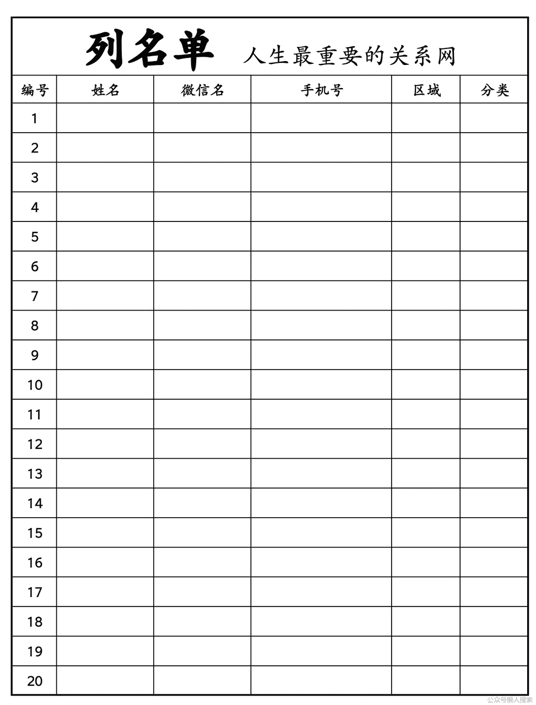

### 02、用抽屉思维给名单分层

#### （1）为什么名单必须分类

准备卖东西时，你大概率遇到过这种情况：有人很爽快就答应了，有人说“再考虑考虑”，还有人看到消息干脆不回。

差别不在话术，而在于你和每个人的**关系层次不同**。

如果手里有一份关系分类，清楚记录着认识多久、有没有买过、有没有一起经历过事情、是否同寝室过、是否一起旅行七天很开心、是否曾经得罪过对方……等到需要成交时，你就能迅速判断：该先找谁，谁还需要再聊几次。

很多人开口卖产品，朋友直接拒绝，自己立刻很受打击，觉得天要塌了。可问题未必是产品讲得差，而是**找错了人**。

名单分类越清楚，成交率越高，也越不容易对关系产生“失望”。你必须给名单一个清晰的定义。定义越明确，真正有需求时，你越知道该找谁。

很多销售工作都有特殊节点，比如季度佣金翻倍、产品即将停卖。这种时候正是集中发力的窗口。如果你手边已有清晰分类，就能在有限时间里优先联系意向更强的客户和朋友，成交效率自然更高。

#### （2）抽屉理论怎么用

成交最大的忌讳之一，就是把对的产品卖给错的人。

设想一下：你手里有个 16800 元的产品，对面坐着刚加好友的小王，还处在第一层抽屉。你一上来就说：“小王，我看你根骨奇佳，特别适合我这门一万多的课！”对方会怎么想？大概率觉得你有问题，或者怀疑你别有用心。

所以，抽屉理论是一把判断标尺，能帮你更准确地预估成交率，也能判断产品与客户阶段是否匹配。

再比如，小王已经买过你一万多元的产品，说明他已经在第六层抽屉。这时你再卖他一个 99 元引流课，合适吗？显然别扭。对这类高客单用户来说，99 元的产品更适合赠送，而不是继续收费。否则他心里会想：“我都已经买到这个级别了，还要我付 99 元？这种课不该直接送我吗？”

抽屉分类的核心目的，就是看清客户目前处在哪个阶段。

有个真实案例：一个人在线下见过两次，说对我的某门课程很感兴趣。回家后我做了个 8000 元的产品，问他要不要买。他聊了半个小时，聊天记录很多，看起来很有兴趣。放在过去，我会默认他应该买；他不买，我就会怀疑是自己哪里做错了。

但用抽屉理论复盘后我发现：他对产品的兴趣、我们之间的关系深度，都还没到 8000 元这个层级。所以我有心理准备，他大概率不会买。真正的问题，是我的名单分类出了偏差。

#### （3）名单可以怎么分层

下面是我针对销售场景做的分层示范：

- 第一层：刚加好友，不评估关系。标准是几乎没说过话，或对话不超过 10 句。
- 第二层：交流超过 30 分钟，说明彼此有一定了解。标准是最少聊满 30 分钟。
- 第三层：产生首次付费。标准是总付费金额不超过 1000 元。
- 第四层：产生多次付费。标准是累计付费在 1000～5000 元之间。
- 第五层：线下见过面，并有私交。比如一起出去玩过两天一夜以上，除了付费关系，还是不错的朋友，互相帮过忙。
- 第六层：支付过高客单价。前提是符合前五项，同时单次付过 5 位数以上的课程费用，也就是万元级产品。

这只是我的分类逻辑，你完全可以建立自己的版本。例如：第一层刚加好友完全陌生；第二层群发消息后对方回应“666”；第三层进了某个免费群并有互动……不同业务场景会有不同分法。

建议先按自己的逻辑分一遍，再参考别人的分类。先思考，再对照，效果最好。

名单分类没有绝对标准。产品逻辑不同，有人也会担心：用“是否付费”来分层，会不会太利益化？

我也问过 AI，它给出的思路是三个核心指标：

- 互动指标：认识多久？聊过几次？有没有深度共鸣，比如单次聊超过 30 分钟？
- 交易指标：付过费吗？付过几次？累计金额多少？
- 私交指标：线下见过吗？有没有共同经历，比如同寝、旅行？有没有互相帮过忙，比如寄特产、帮小忙？

再把名单由浅入深分成六个抽屉：

1. 第一层，弱关系：刚加好友。动作是不评估、不推销。
2. 第二层，有互动：产生过深度交流，有观点共鸣。动作是建立好感。
3. 第三层，轻度信任：产生首次小额付费。动作是交付价值，建立交易习惯。
4. 第四层，中度信任：多次复购，但总额不高。动作是挖掘深度需求。
5. 第五层，强信任或私交：线下见过，有私下互助。动作是情感维护。
6. 第六层，核心资产：支付过高客单价。动作是提供黑卡级尊享服务。

每一层都要有清晰结构：关系长度、清晰事件、必须发生的事件。比如认识一天、聊过五次；支付过 1000 元、一起相处三天两夜、一起租过房；必须付超过 5000 元、必须同居两周以上等。

只要定义足够明确，你的名单分类才能真正用于实战。

备注：每个人都可以有自己的名单分类“定义”。定义越清楚，你越知道某个人该放进哪一层。

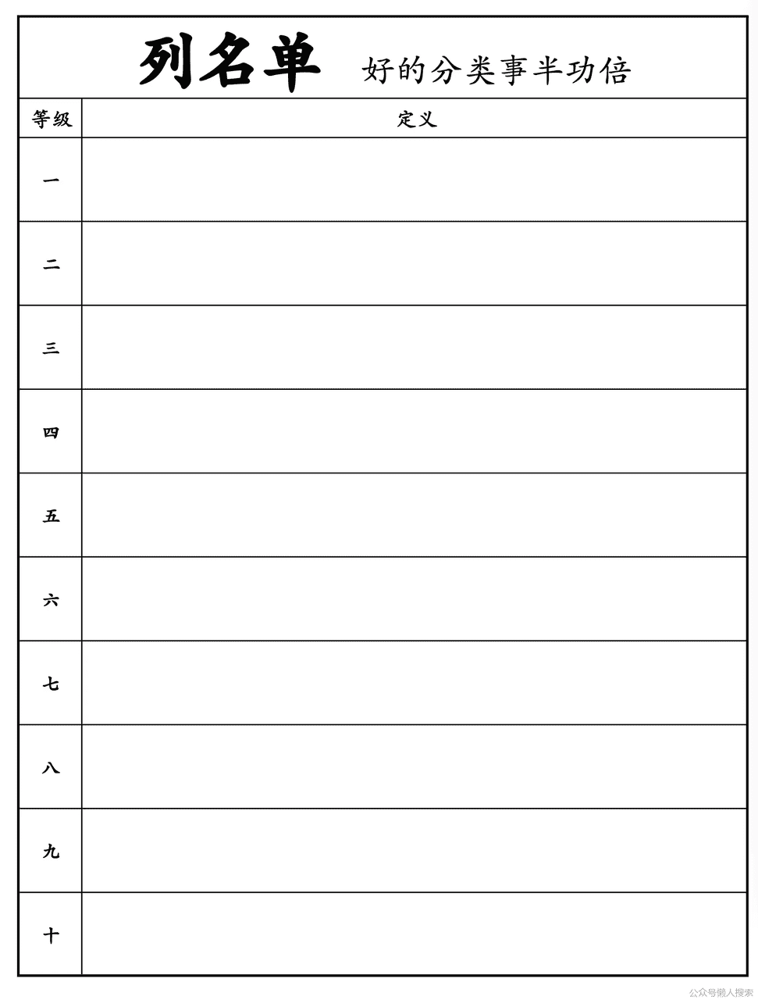

### 03、持续增加新名单客户

#### 1、线下增加新名单

抽屉总要不断放东西。新名单从哪来？靠好习惯：“固定时间，固定数量”。

第一周周二见三个客户，第二周觉得太累不跑了，第三周体力恢复又在周三周五见五个——这样也不是不行，毕竟最终都认识了新客户。但没有固定时间，肌肉就形不成记忆。就像你习惯早上 7 点起床打卡，时间一到，闹钟还没响，眼睛可能就自动睁开了。

任何销售都应该培养一套增加名单的习惯，好习惯会变成肌肉记忆。

为什么“固定”重要？因为固定能在身边好友中建立影响力。

我当年工作要求“一日三访”：每天不见三个人，就不回家。2018 年团队崩盘，我在杭州从零开始，没有任何人脉。老师当时只说了一句：做销售，你就得跑。

我开始参加各种线下活动，那时经济紧张，只能挑免费活动。每天固定参加一场，时间选在下午 1 点到 3 点。这个时段出现的人，要么没工作，要么是创业者，要么在找机会，成长意愿通常很高。我固定这个时间去认识新人，还给自己做了表格。一年下来，平均线下见 1000 多人。从 2018 年下半年到 2020 年，累计认识了 3000 多个线下见过面的好友。

我的固定安排是：周一到周五下午 13:00～15:00 见人，一周最少见 21 人。

#### 2、线上增加新名单

你有没有固定更新朋友圈、小红书、公众号、视频号、抖音等平台？

不管你做什么业务，都需要一个对外展示窗口，并且保持固定周期更新。日更、一周三次、一周一次都可以，关键是形成节奏。

同样遵循“固定时间、固定数量”：

- 每周一、三、五中午 12 点更新小红书，每次 2 篇，一周固定 6 篇。
- 公众号每天日更，一周写 7 篇。
- 每天上午 10 点在某个群里互动，每次至少 30 分钟。

无论平台和方式是什么，只要能让人注意到你，或者因为你的内容想加你好友，都算有效动作。

持续更新，内容会越来越好，看的人也会越来越多，新名单就会源源不断流入。初期数量少没关系，时间拉长后，你等于给自己建了一套名单的被动收入系统。

此外，混群、购买新课程、主动添加喜欢的文章下方的微信，也都是主动或被动增加新名单的方式。

每次作业原则：

- 区分基础作业和进阶作业。
- 进阶作业需要打印资料，共 15 页。
- 基础作业不需要手写，用电脑任意格式完成即可。
- 进阶作业需要手写，同时也要上传电脑，任意格式均可。
- 无论哪种作业，都需要拍照上传。

#### 3、第一个作业（表格 1.1～1.7）

作业规则：

基础作业（任意格式）：

- 20 个人名。
- 名单分类五个等级。

进阶作业：

- 打出 100 个人名。
- 手写 100 个人名。
- 手写名单分类五个以上等级。

提交形式：

1. 基础作业：截图上传到电脑或手机，任意格式。
2. 进阶作业：加上手写表格拍照上传。

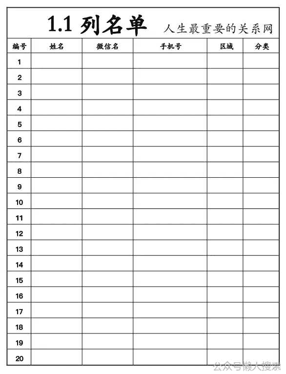

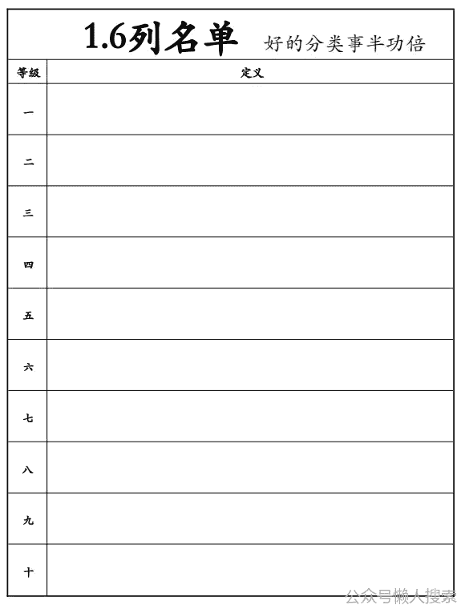

## 二、邀约：有人了，怎么开启聊天

### 01、邀约类型

邀约分两种：线下邀约和线上邀约。

#### 1、线下邀约：见到面

（1）线下邀约的原则

线下邀约的原则就是见到面。但“见到面”也有好坏之分：一种是好的见到面，一种是坏的见到面。

（2）最差的邀约：你想方设法去堵别人

最明确的底线定义是：邀约原则是我一定要见到他。最差的邀约，甚至会到家门口去堵。

2012 年我刚做直销时，真的跑到对方家附近堵人。我知道他住哪、几点上班，早上 7 点就带着早餐和咖啡过去。

这里有一个核心训练逻辑：所有邀约，都要从最差开始练。每个人都是这么走过来的。

（3）最好的邀约：别人想方设法要见你

最好的线下邀约，不是你“去见到他”，而是对方“想尽办法要见你”。

什么叫最好的邀约？对方会说：“根源老师，我希望您安排一天我们见个面，您说什么时间都行，我一定想办法配合。”这就是对方主动争取见面。

当然，你不可能每次都做到最好。有些新朋友还不认识你，你没法立刻让他对你有印象、有好感。但你可以尽量让“最好的邀约”次数变多。

（4）为什么要定义邀约

所有技能都能通过次数练习慢慢进步。最怕的是，你明明在进步，却给了自己错误的认知。

以前带销售时，小明很沮丧地跟我说：今天见到客户了，但讲不到三分钟，客户就说有事要走。

小明完全没做过销售，是纯小白。如果对邀约没有定义，我可能会骂他：你怎么只留住客户三分钟？就不能死缠烂打多聊几句吗？

可过去的小明根本没有邀约客户谈产品的经验，一次成功经验都没有。今天至少做到了“逮到客户三分钟”，虽然只是最差的邀约，但已经算邀约成功。接下来只需调整话术、优化见面表达，就能慢慢从最差邀约转向最好的邀约。

这需要过程。定义明确，才能判断自己到底有没有进步，用更客观的标准看当下结果，再决定下一步怎么走。

#### 2、线上邀约：让对方愿意回你信息

线上邀约的定义很单纯：核心不是聊得多深，而是先让对方愿意回你。

你一定经常收到类似消息：

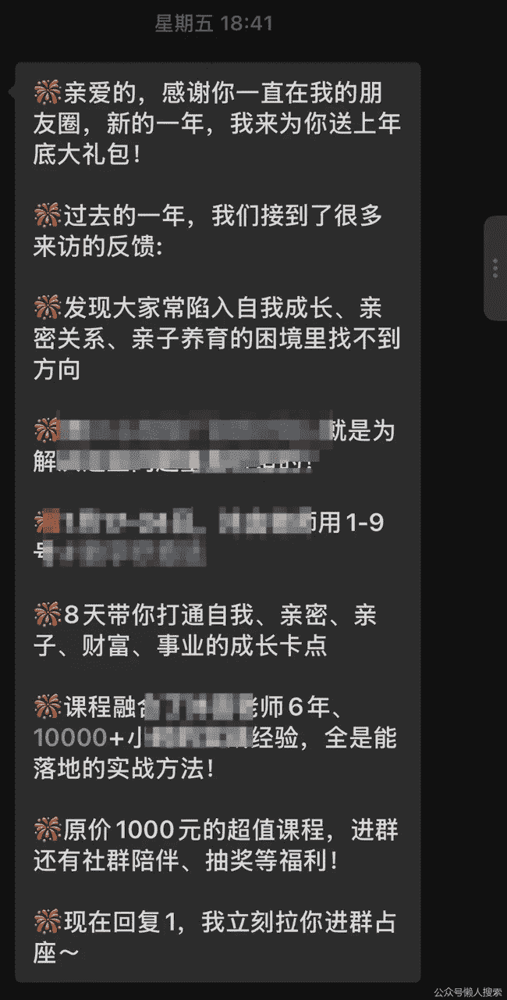

这是很常见的“群发式邀约”。这次主题是“个体私域成交心法”。一些体系完善的企业因为量太大，只能用群发方式筛选用户，这没有问题，也符合它们的业务场景。

先说结论：如果你以个体身份在做，这套打法别急着照搬。它不只是“做了没效果”这么简单，弄不好还会把现有人脉磨掉。

你可以代入一下：手机里突然跳出一条类似消息，你的第一反应是“这人挺用心，我想进他的群、看看他的产品”，还是直接划走、删好友、把对话折叠？线上邀约真正要解决的，不是把话发出去，而是让对方肯接话。你发的内容得让他产生好奇、有点兴趣，甚至冒出“我倒要看看你想做什么”的念头。

下面几种开场，如果来自一个不太熟的人，你会回一句，还是心里发毛？

“阿哲，你上周那篇推文我读完了，观点真挺扎实。”

顺手甩张截图，再补一句：你朋友圈那张照片构图很舒服。

“我刚留意到你的签名，那句话挺戳我。”

“头像是不是换了？气质和之前不太一样。”

“你昵称叫十六？我通讯录里好几个同名同姓的，缘分。”

共同点很明显：没提产品，也没露出成交意图，只是递了一个轻轻的话头，让对方有台阶接。邀约的重点从来不是卖什么，而是先让对方肯回你。

线上邀约开场白有两条底线：

• 你发的话，对方肯搭腔。
• 双方能来回十个回合以上。

第二条尤其关键。如果对方只丢一个“收到”，这就不算有效开场，因为他没有继续聊的意愿。十个来回，是很好用的分水岭。

## 3、邀约的持续动作：隔天再露面，把一次聊天拉成一条线

这一节把邀约看成持续露面的纪律：哪怕首日聊得一般，隔日也要再出现一次。

原因很直白：彼此不熟时，首日很难建立好印象和信任；隔日你一消失，对方很快就把你忘了，首日功夫等于白费。

关键词是：提高被看见的频率，说白了就是多出现几次。出现次数多，关系才熟；熟了才有私交；有私交，才谈得上后续推进。

## 4、第二个作业：表格 2.1

任务规则

基础任务（格式不限）：

• 写 3 种线上邀约开场话术。

进阶任务：

• 写 10 种线上邀约开场话术。
• 手写 10 种线上邀约开场话术。

提交形式：

1. 基础作业：电脑或手机截图，任意格式上传。
2. 进阶作业：在截图之外，加手写表格拍照上传。

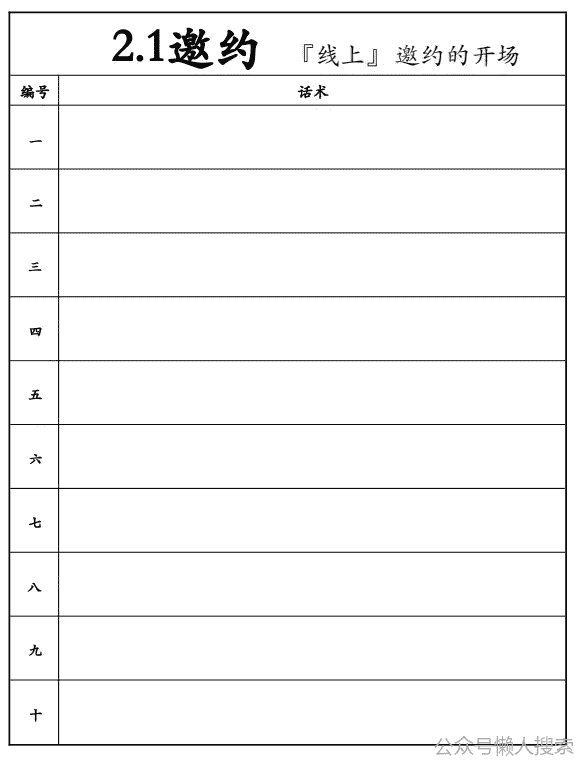

注意事项：

话术落笔后，马上换位：我是客户，看到这句会回吗？如果我都不想理，这句就废。句子别拖太长，场景要贴。比如“刚刷到你朋友圈那张图，拍得真好看！！！”这种轻轻一推，既不冒犯，又让人想知道你下一句要说什么。

## 三、商品展示：客户要的不是说明书

### 01、展示产品：用危机、梦想、趋势代替产品参数

在我的销售流程里，商品展示不是把产品说明念一遍，也不是把报价、流程、案例一次性倒完。

真正的定义是：围绕危机、梦想或未来趋势，告诉对方能得到什么结果、为什么找你、以及具体怎么走。

大原则是：先不碰产品本身，只从危机、梦想、趋势里挑一个切口。因为一开口就报产品，谁都会；那只是基本功，基本功好也不保证成交。

展示产品的核心不是产品，而是用三种视角让对方认真想：我为什么要选你？选你有什么好处？

如今客户会横向比较、反复评估，不像过去“你优秀就买单”。

最常见的两种做法是：客户一问就甩海报；或者马上推“你做小红书，这套能自动同步内容的工具很适合你”。

这两种不算错，但只是完成介绍动作。就像有的老师案例多、讲得活；有的老师把课本重念一遍，学生还不如自己看。

真正目的，是让客户听完心里冒出“我是不是该买”的念头。所以谈产品，重点在三件事：

• 危机
• 梦想
• 未来趋势

完整架构可以记成：

💡危机／梦想／未来趋势＝结果＋做法

1、危机展示

假设我帮人做课程海报。普通卖法是：先甩作品集，再报“一张 399”，附个人介绍和产品页，然后等对方说买不买。

更好的方式，是先问一句：“在讲之前我想确认一下，你怎么会想到找我？”

接着告诉对方：“海报做不做没那么要紧，自己也能改，不一定非外包。”

然后把不行动的代价讲透：“我第一次自己做海报，折腾了整整一个月；设计不熟，成品连我自己都嫌丑。光一张图耗掉十天，比录课还久。如果当时外包出去，至少省十天。”

换句话说：不找专业的人，省不下时间，拖慢效率，还可能错过机会。

把代价讲清楚，最容易推动决定。你让客户看见“不找你可能会损失什么”，他才会认真算这笔钱。

当客户心里的“我想要”和“我为什么需要”被放大，他才愿意听你讲产品。很多人其实只是随口问问，并没理清需求。

2、梦想展示

背景：如果我要卖 SCYS 年度会员，一年 3365 元，客单价不算低。

普通卖法：发一张详细介绍海报，或者甩一大段文字介绍。

更好的方式，是先聊未来：“如果一年只忙九个月，剩下三个月自由安排；或者比同龄人早十年退休；再或者生活品质比现在更舒展，你想不想要这种状态？”

然后接一句：“我这两年感觉被工作圈层卡住，想往外走一步，你要不要一起看看新领域，让明年比今年更好。”

只要对方有兴趣，再自然把 SCYS 带进去。

3、未来趋势展示

未来趋势是让对方看到：掌握这项能力，未来更吃香、更省力，也更值钱。比如我会讲：“赚钱和工作，拼的是效率。”

• 现在不会用 AI，聊天都插不上话，你留意过吗？
• 身边人下班后都有第二收入，我也想弄明白。
• 听说今年做海外市场更好赚，你了解过吗？
• 我有个朋友靠小红书，这个月多进账好几千。
…………

类似话题一旦聊上，就能顺势切进 SCYS。比如：“我最近进了一个付费社群，才发现 AI 还能这样落地，里面的人玩法真多。”先勾兴趣，再聊产品，对方才愿意听。

### 02、展示自己：把信任感拆成可执行动作

展示自己，本质是信任感的延伸：我怎样让对方相信我？

信任感可以量化，量化后就能变成步骤。四个阶段：

1、仪表

线下先看外在：穿着合不合场合、身上有没有异味、衬衫皱不皱、整体清爽不清爽。每次见客户前，我会拿检查表过一遍，状态对了再出门。

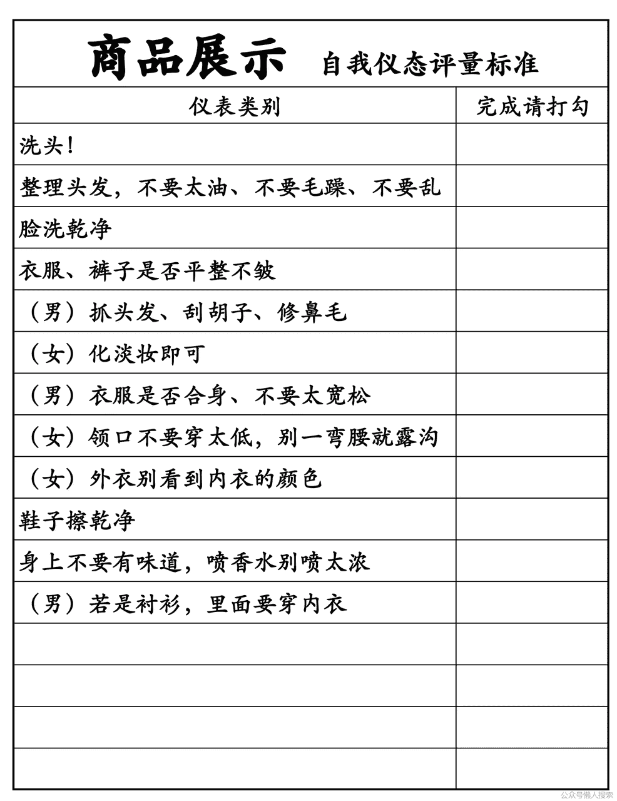

线上也同理：头像有没有记忆点？昵称顺不顺口、好不好记？朋友圈是全开还是只给三天？签名有没有用心写？拍一拍后缀有没有意思？视频号、小红书、公众号有没有稳定更新？

新朋友加你，点开头像一片空白，昵称还是个句号，你会怎么想？

2、专业度

客户抛出产品问题，你能否立刻接住？手边有没有能拿出的专业材料？先列一份“客户可能会问”清单，逐条自测，答不上就补课。

3、讨人喜欢

说话是否让人舒服？能不能接住对方情绪？聊天时对方愿不愿意继续听？饭桌上挑不挑？核心是“会说话”。比如先给对方一个真诚的肯定；等人家讲完再接话，不抢麦；去客户家吃饭主动搭把手，别把自己当贵客。

4、谈话的高度

见识越多，聊天越有内容，越能聊到点上。

## 5、第三个作业：表格 3.1～3.3

任务规则

基础任务（格式不限）：

• 完成 3.1 表格。
• 在小红书、淘宝或任意平台，分别找一张休闲搭配、一张正式搭配的照片，上传两张照片即可。

进阶任务：

• 完成 3.1～3.3 表格。
• 手写 3.1＋3.3 表格。
• 在小红书、淘宝或任意平台分别找一张休闲搭配、一张正式搭配的照片，然后照着找到的服装帮自己穿同款。可用 AI 直接换装。
• 休闲和正式挑一套即可。

提交形式：

1. 基础作业：电脑或手机截图，任意格式上传＋照片上传。
2. 进阶作业：加手写表格拍照上传＋照片上传。

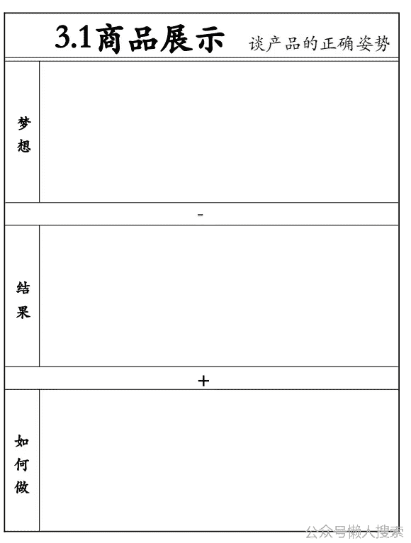

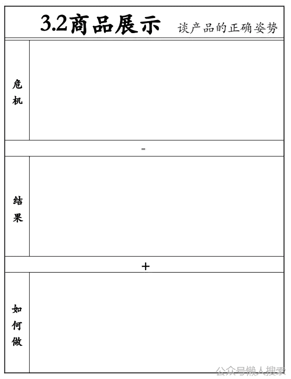

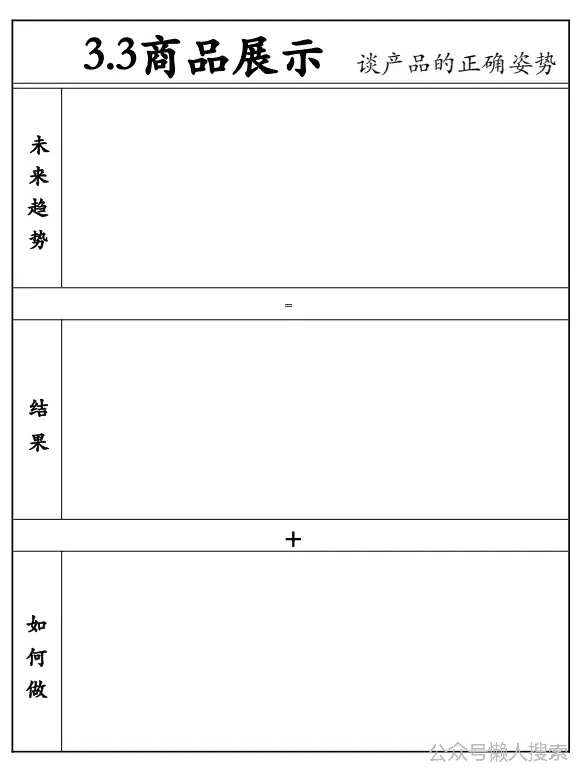

## 四、成交：把结果收回来

### 01、成交到底怎么做

1、“成交”的定义

成交不是突然袭击，中间要有个铺垫，我叫它“前情提要”。

有些销售上来就问“买不买”，或者复制一大段模板，或者直接甩图，甚至聊得正热突然切产品。客户不回复，有时不是没需求，而是被你架住了：好像你一开口，他就欠你一张订单。

卖东西之前，至少礼貌一点、尊重对方。

前情提要就是：讲产品前，先问对方是否愿意听。比如：

“刚聊到 SCYS，我感觉你兴趣不小。我副业在推这个社群，要不要花十分钟听我讲一下？”

先告知价格：“这是付费社群，价格不低，xxxx 元。每个人学习预算不同，我先把数字摆出来，你边听边判断。”

或者这样说：

“其实我有点冒昧。听到你有需求就急着介绍，怪不好意思的。要不这样：你先告诉我，这事你是不是确实需要？需要的话给我一点时间；如果不方便，或者你反感推销，直接说，我马上不打扰。”

客户最终买不买另说，但这样做更尊重人，对方心里也舒服。

2、成交的两个层次

我对成交的定义很直接：“成交就是收钱；所以成交就是怎么把款收回来。”

关键节点再强调一次：“没开口谈收钱，一切都有变数。”

成交第一步就是开口问：

• 你习惯支付宝还是微信？
• 今天能定下来吗？
• 如果没问题，我现在发收款码？

不开口，你永远不知道对方到底要不要。多数客户不会主动做决定，所以销售要当那个帮客户下决定的人，动作就是开口收钱。

收钱也分层次：“成交分两块，一块叫最差成交，一块叫最好成交。”

最差的成交：
对方付完钱来一句“行了，别再找我了”，这就是最差成交。我早年也遇到过，客户纯粹给面子，几百块买一两瓶，只求清静。钱是收到了，但关系没建立。销售初期出现这种单子很正常，经验不足，但至少款回来了。

最好的成交：
对方付完钱还说：“幸亏你提醒，不然我得白花多少冤枉钱……钱转了，你确认一下。”甚至主动留你吃饭：“今天一定得让我请你，要不是你，我还不知道过去花了那么多不该花的。”

所有成交，都是从最差慢慢变到最好。我们要做的，是让最好成交出现得更多。成交就是收钱，不管哪一种，只要款到了，这个环节就完成了。

3、成交的技巧

成交方式很多，只要能把钱收到，就算成交。哪怕是求对方给一次机会，也算。下面列一些实用技巧：

新手成交：

• 示弱求单法（适合低客单价产品，300 元内）：坦白说这单对业绩很重要，希望对方给次机会；卖不出去自己不好交代。理由要真实合理，别编得太离谱。
• 高频跟进法（适合低客单价产品，300 元内）：连续多日发消息，必要时打电话，让自己频繁出现。金额不高时，对方可能为了清净而支持一单，心里想的是“我买，你别再来了”。

老手成交：

• 二选一法：结合对方情况给 A、B 两个方案，再问：“刚才聊下来感觉你挺有意向，也更急，这两种你更倾向哪个？”
• 高低落差法：先谈高配，三千以上；对方说再想想，立刻给台阶：“这个确实不便宜，我们有个入门版 399，第一次合作先试试，试错成本低。”
• 限时优惠法：今天定有八折，过了今晚恢复原价。对方意向高时，拖一晚可能多花几百甚至几千，提前说也是帮他想清楚。
• 快售完法：今天不买明天没，或者目前只剩 3 套。
• 主动露短法：坦白讲，我们比 A 公司贵一成。你如果只看价格，我甚至建议选 A；但如果你在意服务和交付质量，欢迎考虑我们。
• 七天兜底法：先放心用，七天内不满意全额退；到期前我还会提醒你，避免错过。
• 订金锁单法：先交订金，三天内不满意订金全退。

## 4、第四个作业：表格 4.1～4.2

任务规则

基础任务（格式不限）：

• 破成交完成 2 个。
• 好成交完成。

进阶任务：

• 破成交完成 5 个。
• 手写破成交 5 个。
• 好成交完成 5 个。
• 手写好成交 5 个。

提交形式：

1. 基础作业：电脑或手机截图，任意格式上传。
2. 进阶作业：加手写表格拍照上传。

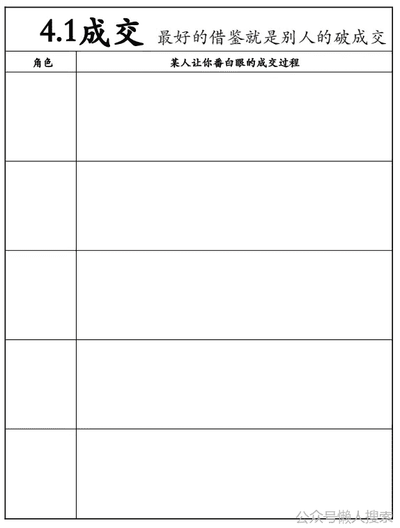

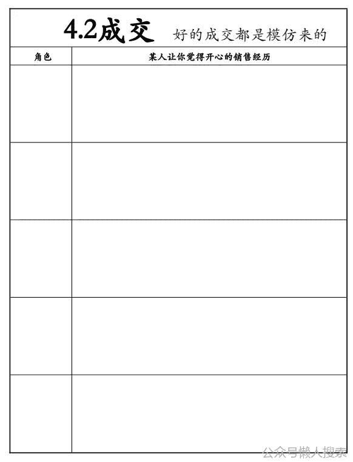

## 五、售后服务：产品之外才是真功夫

### 01、售后服务怎么做

定义：售后不是维护产品就完事，而是额外给出产品之外的价值。

产品该做的服务当然要做，但那只是底线；只围绕产品打转，最容易把客户服务跑。很多人以为自己很认真，客户却觉得无趣。你没做错，但他不想再买。

1、“只做本分”远远不够

我以前卖过保险。客户签单后，隔天认真讲条款，没问题；可第二回、第三回见面还只聊保单，对方就会犯嘀咕：“你除了这个没别的？”久而久之，他就不想约你了。

所以，把产品服务好只是底线。售后真正的关键是：“除了我卖的东西，我还能给出什么？”

2、售后服务最终拼的是什么

售后到最后拼的是：我会什么。你越有用，客户越愿意靠近你，约饭、喝茶，甚至把朋友推给你。

这时问题就回到自己身上：你有哪些技能，能拿得出手服务客户？可以列一张“技能树”，原则是：写得出来就算。

技能树举例：
早起、下厨、家务、收纳、懂猫、变魔术、打字快、整理资料、会用 AI、阅读速度快、笔记有条理、字漂亮、网感强、沾枕头就睡……

原则：能写多少写多少，最好超过五十项；熟不熟先不管，写出来就可行。

有回我去一个老客户家，书柜乱着，他正忙做饭。我顺口问：“要不我帮你把书柜理一下？”他说：“行啊，你随意。”我把书按高矮重新码齐。过几天再碰面，他又下了一笔几千元的单。我问他怎么突然加购，答案其实就在前面：客户续单，常常不是产品多神，而是你给了产品之外的额外价值。

# 真正拉开成交差距的，是售后服务

有位客户跟我讲：你跟别的销售不太一样，特别会收拾家。自从看过你整理过的书柜，我就觉得你这个人很靠谱。

这件事让我再次体会到，售后常常藏着意外之喜。那些看似不起眼的本事和习惯，说不准哪天就派上大用场。

**真实案例：一笔从999元走到25万元的成交，起因是爱情问题**

这位学员曾在其他平台买过我的课，结课三天后主动来找我。第一次通话聊了二十分钟，我已经判断他的预算在六位数以上，也借沟通摸到了大致区间。

连续聊了三天，氛围不错。按常规该推课了，但我发现他去听别人的时间管理课，对销售课暂时没兴趣。我的销售课四千多，而他的预算远不止这个数，所以我没急着开口。

转折出现在他后来买下25万元课程——因为我帮他处理了感情困扰。某天他发消息，我没及时回。第二天早上我向他致歉，并发了张电影截图解释：昨晚陪太太看电影，没看手机。他回：老师，我跟您朋友聊天，特别羡慕您和太太关系那么好。我说：你也可以。随后把经营亲密关系的方法分享给他。

聊了两天，他主动说：上次您提的那个产品，我想认真考虑，能详细讲讲吗？就这样，他从999元课程直接跃到二十多万的课程，中间没有过渡产品。原因正落在售后服务的定义上：提供产品之外的价值。

假设你是卖保险的，不能一见面就谈保单。售后时也不可能反复讲三天保单。去客户家做客，可以聊酒、聊八卦；我研究命理七年，能逗人开心；客户拿起一本书，你可以接一句“这本我读过”。

**3、售后服务做在前，麻烦就会少在后**

补一个常被忽视的点：收款前把流程说明白，售后麻烦会少很多。现在不少人在收钱环节太随意。要知道，掏钱并不轻松，辛辛苦苦挣来的钱交给别人，谁会不谨慎？所以我现在习惯在收款前多一步：

• 先确认对方是否真的需要
• 说明会占用多久（“借我2分钟”）
• 把费用和优惠讲清楚
• 把流程讲明白（付费、确认、拉群）
• 让对方感受到：你连收钱都这么严谨，更值得信任。

我以前收款很快，后面问题一堆；如今会放慢节奏，多解释几句、多说明几步。前面做细，后面售后要补的窟窿自然少很多。

**4、第五次作业：（表格 5.1）**

作业要求

基础任务（格式不限）：
• 列出20项自己掌握的技能

进阶任务：
• 列出40项自己掌握的技能
• 将40项技能手写完成

交作业方式：
1. 基础任务：将截图上传到电脑或手机，格式不限
2. 进阶任务：另附手写表格的照片上传

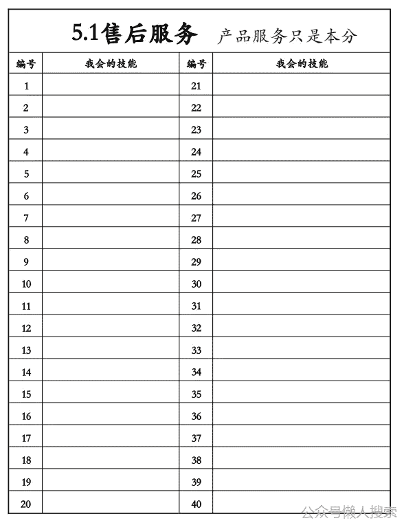

最后想说的是：

这是一种很稀缺的能力。一个掌握销售技巧的人，放到任何领域，都能很快成为最亮眼的那一个。

