# Agent Skills 炼术营 丨实战手册丨2026 年

> 来源：[https://hk57gvlx7u.feishu.cn/docx/AOkCdT1FGomppuxol9pcQ611nBb](https://hk57gvlx7u.feishu.cn/docx/AOkCdT1FGomppuxol9pcQ611nBb)

<https://my.feishu.cn/sync/Lj5sd8APisk896bxImEcYvjMnlF>

---

# 引言

## 关卡 0：开船第一课，完成开工准备

### 00. 本关任务卡

**🎯任务目标：**了解Skill，完成工具的安装准备

**🗒️任务描述：**

• 看懂本期航海要完成的作业交付。

• 确认必修与选修边界。

• 完成开工前准备。

**💡新手提醒：**别**在选工具上纠结太久。**

**能用 Codex 无脑用 Codex；无法解决网**络和账号问题，国内用 WorkBuddy

很多人卡在工具这一步，一直在纠结"我该用哪个"。

**但你在这条船上学的是怎么写 Skill、**怎么用 Skill，不是怎么用某个软件。

Skill 通常以SKILL.md文件为核心，也可以包含参考资料、程序脚本、图片等配套文件。

在支持相同 Skill 规范的工具之间通常可以迁移，但安装位置、脚本能力和权限要求可能需要适配。

今天你在 A 工具里写的，明天换到 **B 工具，一**般把文件夹拷过去就能接着用，格式是通用的。所以：

• 现在用哪个不重要，能跑起来就行

• 以后想换随时换，你写的 Skill 跟着你走

• 千万别为了用某个工具，一直折腾网络、折腾付费，那是给自己上难度


### 01. 本期航海介绍

1.这个项目是什么

过去，社区里很多人通过写精华帖，把自己的项目经验、踩坑记录和方法论分享出来。精华帖解决的是“让别人看懂你怎么做”。

但到了 AI 时代，更进一步的能力是：不仅让别人看懂，还要让 AI 能执行、别人能调用、经验能复用。

这就是 AI Skill 的价值。

一些人用 AI，还停留在一次次对话里：今天让 AI 写周报，明天让 AI 写销售话术，后天让 AI 做复盘。每次都要重新解释背景、标准、流程和注意事项。同样的经验反复讲，同样的 SOP 反复输入，看起来用了 AI，实际仍然没有把自己的经验沉淀下来。

Skill 要解决的，就是把你的业务经验、项目方法和工作 SOP，提炼成一份可复制、可调用、可共享的 AI 能力包。

比如，一个做小红书获客的人，可以把选题、封面、标题、正文、挂品和发布检查流程封装成 Skill；

一个销售，可以把客户判断、异议处理和成交话术封装成 Skill；

一个运营，可以把活动复盘、数据分析和下轮优化建议封装成 Skill。

以后你或别人需要做同类任务时，不必从零解释，直接调用 Skill，就能按照这套经验完成输出。

也可能有一部分人已经有了做 Skill 的意识，想做出一个 Skill ，却不知道怎么做、做什么、怎么判断效果好不好。

所以本期航海会带你从“先用起来”开始，先体验几个好用的 Skill，再跟着案例一步步搭建自己的第一个 Skill。随着案例不断升级，你会逐渐看懂 Skill 的结构和用法，最终完成一个能够解决自己真实问题的 Skill。

航海结束后，你带走的不只是一个 Skill 文件，而是一种把经验产品化的能力：把“我会做”，变成“AI 能按我的方法做”“别人也能调用我的方法做”。

如果你有余力，还可以继续优化调用说明、测试更多样例、补充模板和示例文件，参加 Skill 黑客松，把它打磨成一个能被别人看懂、愿意调用、甚至未来有机会出售的 Skill 作品。

1.  别人是如何用 Skill 的

**案例一：剪辑 Skill ，带货视频日产**从 6 条到 30 条，单条带来近千订单

生财圈友**@周行今天学习了吗？**用 Codex 将爆款视频拆解、素材匹配、生成配音字幕、生成剪映草稿等剪辑流程，封装成一套自动化 Skill。

618 期间，能跑量的素材中约**三分之一****来自这套流程，带货视频****日产从最多**6 条提升到 30 条；其中表现最好的一条视频，带来了近千单成交。

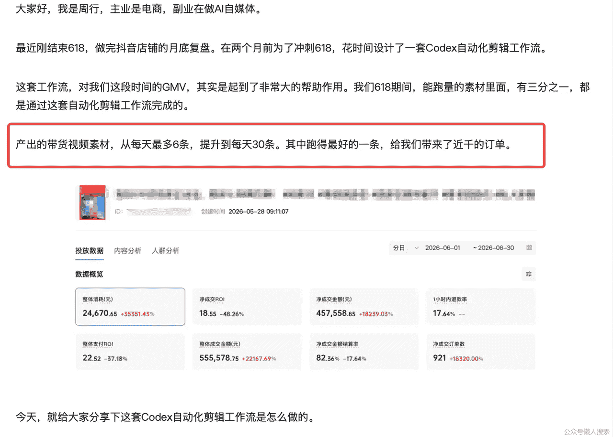

🔗原帖链接：📄 Codex自动化剪辑从0到1，如何让AI批量产出带货视频【万字长文】

**案例二：小红书自动发帖 Skill** ，每天 5 分钟，3 个月变现约 4W

生财圈友**@Dobby**把原本需要手动完成的小红书运营流程，封装成一个自动发帖 Skill：自动找选题、自动改写文案、自动发布、自动挂载商品。

**两个账号**运行约 3 **个月，总**变现约4 万元**；每天只需**花5 分钟检查结果。自动化发布的笔记最高获得90 万浏览、近 500 万曝光，账号累计涨粉2000+。

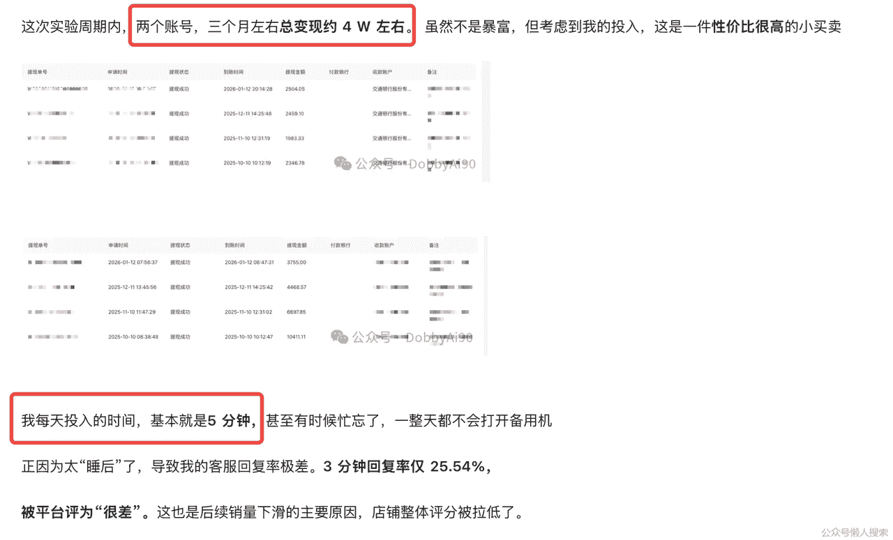

🔗原帖链接：📄 每天 5 分钟，不懂技术用 AI 实现睡后收入：小红书虚拟产品自动化复盘

**案例三：把经验做成 Skills** 上线市场，10 天变现 1500 美金

生财圈友**@August**把自己在 AI 教育、内容生产、写作、PPT、视觉设计等领域的经验，制作成可复用的 Skill，并发布到 YouMind Skill 市场。

第一个 Skill 上线后，10 天实现月收**入超过 1500 美金**；后来陆续制作了194 个 S**kil**l，5 月付费榜前 15 名中**有6 个来自他**的作品，月收入持续增长到2100 美金。

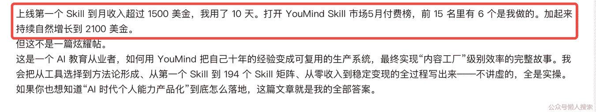

🔗原帖链接：📄 我为什么付费使用 YouMind：一个 AI 教育从业者的内容生产革命

🔼上**面的案例，展示的是 Skill 可以实现**的效果，以及未来持续迭代、放大的方向。

展示这些案例，不是要求你这一期航海就复刻他们的自动化流**程**、商业模式或变现结果，而是想让你看到：当你的业务经验、工作流程和判断标准沉淀成 Skill 后，它可以被反复调用、持续优化，也能服务更多场景和更多人。

这期航海，你只需要完成一条更具体、更适合新手的练手路径：

体验 Skill ➡️ 跟做简单 Skill ➡️ 做进阶复杂 Skill ➡️ 自主制作 Skill

后续再根据自己的业务场景不断优化、迭代，把 Skill 的能力和效果一步步放大。

1.  航海期间需要交付什么

**21 天内，你需要完成必修关卡 1-8 的所有作业，并最终提**交至少一个可复制、可调用的 Skill。

每一关的作业都会帮助你逐步完成最终成果，因此所有必修关卡的作业都很重要，需要完成。

**最终成果物**需要提交以下内容：

1.  **Skill 文件包**：其中必须包含**SKILL.md**；

1.  **安装方法和使用说明**：让别人知道如何安装、调用这个 Skill；

1.  **使用效果演示**：证明这个 Skill 能在真实场景中成功运行。

**具体提交的作业要求、模板和提交链**接，都可以在对应关卡开头的任务卡中查看。

1.  任务关卡地图

**十一关全貌与参考节奏：**

| 天数 | 对应关卡 | 做什么 | 产出物 |
| --- | --- | --- | --- |
| Day 1-2 | 关卡0 | 开船第一课，完成开工准备 | 完成工具准备 |
| Day 3 | 关卡1（必修） | 体验成品 Skill | 体验Skill的截图 |
| Day 4 | 关卡2（必修） | 跟做第一个 Skill | 第一个 Skill + 生成文章 |
| Day 5 | 关卡3（必修） | 升级你的第一个 Skill | 升级后的 Skill + 成品截图 |
| Day 6 | 关卡4（必修） | 看懂结构，拆解一个 Skill | Skill 结构拆解卡 |
| Day 7-8 | 关卡5（必修） | 让 Skill 学会参考资料 | 带资料夹的 Skill |
| Day 9-10 | 关卡6（必修） | 让 Skill 能处理固定任务 | 带脚本的 Skill |
| Day 11 | 关卡7（必修） | 做一个帮你做判断的 Skill | 你自己业务的 Skill |
| Day 12-14 | 关卡8（必修） | 学会迭代，让 Skill 越用越准 | 改前后对比 |
| Day 15-16 | 关卡9（选修） | 建立你的 Skill 能力库 | Skill 管理清单 + 改造优化记录 |
| Day 17-21 | 关卡10（选修） | 参加 Skill 创作活动 | 个人 Skill 作品 + 演示 / 复盘 |

以上仅为参考节奏，不必拘泥于每天的进度。

**根据自己的时间安排推进即可，可以快一点、**慢一点，也可以不完美，但一定要持续行动。

**在 21 天内，必须完成必修篇的关卡 1 **到关卡 8 ，做出一个自己的 Skill

选修篇的关卡 9 到关卡 10 ，用于提升使用 Skill 的技巧，打磨作品参与黑客松，适合学有余力的船员进行进阶提升。

1.  开工前准备

如果你已经有可以正常使用的 AI 编程工具（如 Codex、Claude Code、WorkBuddy、Trae Work等），可以直接进入下一关。

如果你还没有完成工具安装或环境配置，请先完成👇：

【开船前工具准备】Agent Skills 炼术营丨 2026 年 8 月航海

后续手册将统一以 WorkBuddy 作为演示工具。如果你使用的是 Codex 等其他工具，可能发现界面可能略有不同，以实际界面为准。**

但是手册涉及的所有流程和内容，并不依赖某一个工具。只要你的 AI 编程工具支持 Skill 功能，都可以跟着完成后续实操。

**💡 题外话：如果你对自己每天用了多少 Token 感兴**趣，欢迎加入生财 TokenRank～

我们发现最近很多圈友已经开始使用 Codex、Claude Code、Hermes、WorkBuddy 等工具做项目，但自己每天用了多少 Token、坚持了多久、做成了哪些作品，其实都没有系统记录下来。

像这期航海，大家在完成任务、制作 Skill 的过程中，也会持续消耗 Token。

**TokenRank**可以帮大家记录真实的 AI 使用过程，回顾自己的 AI 学习轨迹，也方便我们发现优秀作品和实战案例。

注意：Token 高不代表成果好。相比“用了多少”，我们更关注：你用 AI 完成了什么、解决了什么问题。

现在 TokenRank 已开放接入，大家可以跟着教程完成安装：https://scys.com/tokenrank/connect

如果接入过程中遇到问题，可以直接在航海群里反馈。


---

# 必修篇：从用起来到做出自己的 Skill

## 关卡 1：体验成品 Skill

### 00. 本关任务卡

**🎯任务目标：****装上 3 个别人做好**的 Skill，用它们处理你自己写过的一篇东西，走完“改文字 → 排版 → 发布前体检”一条链，交出前后对比截图。

**🗒️任务描述：**

• 跟着步骤装好 3 个 Skill：

◦wechat-writing-style（改掉 AI 腔）

◦gzh-design（排版成公众号样式）

◦content-risk-detector（发布前合规体检）

• 拿一篇你自己写过的稿子跑一遍（手头没有，可以用我们准备的样稿）

• 截三张图交作业：装好了、跑起来了、改完前后的对比

• 顺手学会一件事：看到别人推荐的 Skill，怎么 30 秒判断值不值得花时间

💡

**本关作业**：安装并使用 3 个成品 Skill 跑通一次“改文字 → 排版 → 发布前体检”，并提交前后对比截图

**⭕️提交模版**：

1.  Skill 安装成功截图（必填）

能看到 3 个 Skill 都已经装好，或 AI 回复能列出 3 个 Skill 名称

截图参考（WorkBuddy为例）：

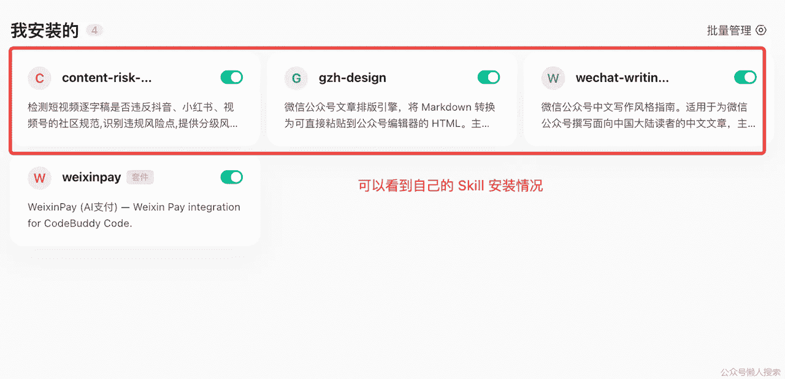

1.  前后效果对比截图（核心必填）

同一篇稿子改写前后、排版前后或同稿两平台检测结果对比，任意一个效果对比截图即可

截图参考：


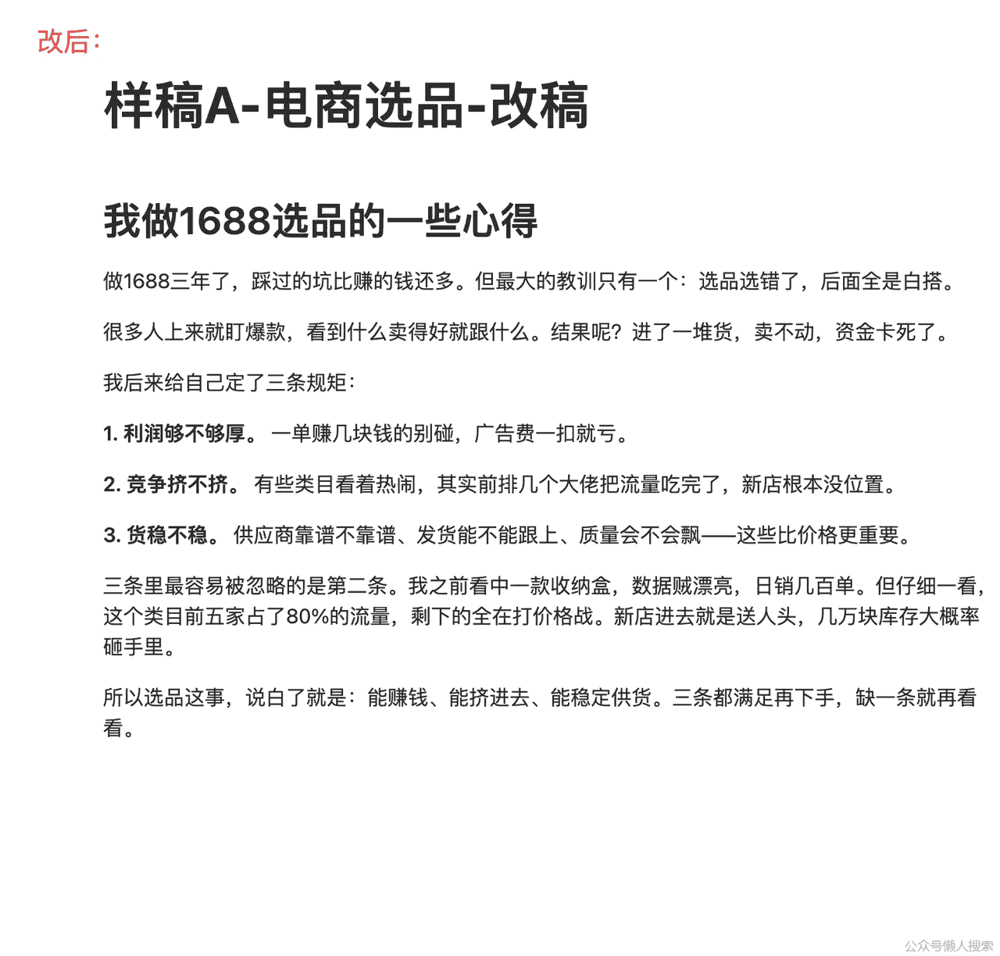

1.  分享一下这一关最大的收获（选填）

比如哪个 Skill 最有用、哪一步最出乎意料

1.  本关遇到的卡点或报错截图（选填）

对于卡点和报错有没有先问 AI ，让它进行解决？简单写清楚你卡在哪一步

**💡 新手提醒：**

这一关你不用写任何代码，也不用看懂 Skill 里面是怎么写的。

你只做一件事：装上Skill，用一次，看看有什么不一样。


### 01. 本关重点

你可能已经收藏一堆链接，或者装过一堆 Skill，觉得"我的 AI 变强了"。装完之后不知道哪个适合自己，也不知道怎么触发，更不知道有没有生效。

Skill 一多，很容易变成另一个收藏夹。

真正拉开差距的不是装了多少 skills，而是能不能把几个核心 Skills 组合成自己的工作流……

别贪多，先用熟 3-5 个比浅尝 50 个更有价值。

这一关关注的不是数量，而是体验，是带你亲手把一条 Skill 工作流完整跑通。

当你真正跑过一遍，你自然会知道每个 Skill 的作用、它们为什么要这样组合，以及以后该怎么迁移到自己的工作中。

我们提供给大家体验的 3 个 Skill，并不是随便挑的，它们能串成一条流程：

Plain Text

```
你写完一篇初稿
    ↓  wechat-writing-style    把书面腔、AI 腔改成人话
    ↓  gzh-design              排版成公众号样式，粘过去不掉格式
    ↓  content-risk-detector   发布前查一遍有没有违规风险
可以发了
```

走完这一遍流程，你手上会**有一篇改好、排好、查过的文章**。

**这套流程并不局限于写公众号，做小**红书、短视频、私域内容，也可以直接套用。

前后两步其实和平台无关：

第一步负责把文字改得更自然、更像人写的；第三步负责检查内容是否符合平台发布规范。

中间这一步虽然叫**“公众号排版”**，但不只是能给公众号使用。

它最终生成的是一个网页，用浏览器就能直接预览效果。你可以把它理解成“让内容变得更美观、更易读”

完成本关后，最终你可以看到：

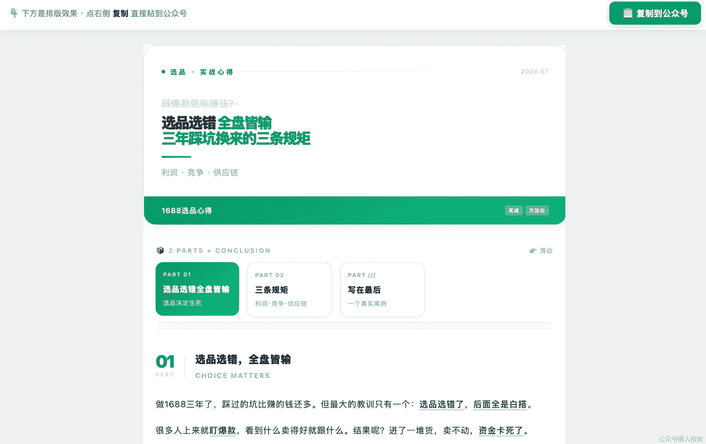


### 02. 安装这 3 个 Skill

1.为什么先装这 3 个 Skill

你可能已经刷到过很多“十大必装 Skill”“50 个 Skills 跑赢 90% 的人”之类的帖子。

但这一关，我们只准备了 3 个 Skill。

1.1**别急着跟着推荐帖安装**

网上关于 Skill 的笔记、帖子很多，动辄几千上万赞。

下面是其中一篇，5886 赞、8975 收藏（用户信息已打码）：

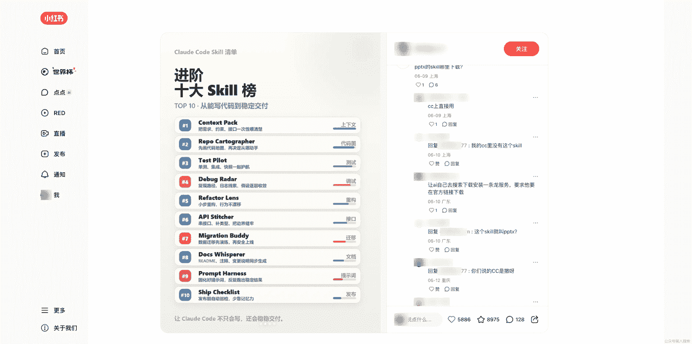

看着挺专业：彩色编号、排名、每个都配了一句功能说明。

但我们把榜单里的十个 Skill 都去核实了一遍，结果是：7 个完全找不到，剩下 3 个也只有零散来源，和榜单描述对不上，很可能是 AI 生成或后续有人照着名字创建的。

这就是让 AI 生成一份“十大高级技能榜”会出来的东西。

其实，就算这 10 个都是真的，“必装”这三个字也站不住。

Skill 是需要配合人和具体场景去选择使用的。

做电商、写代码、做运营，需求不同，需要的 Skill 都不一样，不存在“所有人都该装”的十个 Skill，就像不存在“所有人都该买”的十件衣服。

这一关让你安装这 3 个，不是因为它们“最好用”，而是因为它们刚好能组成一条完整的工作流。先把这条流程跑通，比装几十个 Skill 更重要。

1.2 如何检验一个 Skill 值不值得装

以后你在网上看到别人推荐，花 30 秒走一遍这五步，能省下大量时间。

你也可以直接把这个表格截图**给 AI**，让它直接帮你去判断这个 Skill 值不值得安装

| 第几步 | 做什么 | 不合格的信号 |
| --- | --- | --- |
| 1 | 搜的时候**带上 ** SKILL.md ，在 GitHub 搜 技能名 filename:SKILL.md | 完全搜不到 |
| 2 | 点进去看它的描述， 跟推荐里说的是不是同一个东西 | 名字一样但干的是别的事 |
| 3 | 看 star 数 和 最近提交时间 | 一年没动了 |
| 4 | 看有没有 License | 自己用不影响； 要拿它赚钱或者再分发，就得看清楚 |
| 5 | 打开 README 读第一行 | 写着 deprecated（已弃用）或 archived（已归档） |

1.3 为什么是这 3 个 Skill ？

不同的 AI 编程工具，背后接的模型各不相同，能力也参差不齐。

这 3 个 Skill 最适合第一次体验。

它们满足下面几个条件的：

• **装完就能用。**不需要接生图 API、绑定账号或充值。

• 几乎所有 AI 编程工具都能跑。不依赖生图、读图等特殊能力，只需要模型会生成文本即可。

• **环境要求低。**不需要安装一堆依赖，大多数人都能直接开始。（Windows 用户安装其中一个 Skill 时，需要提前安装一次 Python。不用担心，交给 AI 工具，它会帮你安装）

• **中文场景可用。**不只是把英文 Skill 翻译过来，而是真正能在中文环境里跑通。

市面上有不少热门 Skill，有的依赖复杂，有的配置繁琐，有的看起来很火，实际并不能稳定运行。

我们已经帮你筛选好了 3 个真正能跑通的 Skill。

下面，就跟着我们一起完成安装并开始体验。

2. 装上这 3 个 Skill

💬先**说一个约定：**

**本关开始，后面手册中凡是单独框起来、右上角能点复制的那种小框**，里面基本都是"你要发给 AI 说的话"

Plain Text

```
像这样的，直接复制粘贴到AI 对话框内
```

看到就复制它，粘进你的 AI 对话框，回车发出去。不用改写、不用加别的，原样发就行。

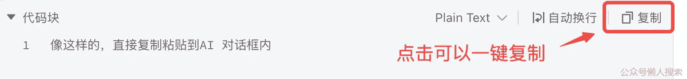

**2.1 安装前注意事项**

**大部分 Skill 要拷整个文件夹，不**是拷一个单独的 SKILL.md 文件。

非常容易踩坑的是：有些 Skill 就算装错了也不会报错，而是正常运行，却悄悄丢掉了关键能力。

这一关的 3 个 Skill 里，只有第一个是单文件安装，另外两个都必须整个目录装进去。

比如content-risk-detector，如果只复制SKILL.md，它依然会生成一份看起来正常的报告，但规则库其实一条都没加载。

所以，下面的安装命令直接复制即可，不要自己删减文件。

**2.2 安装方式与具体步骤**

方式一：给地址，让 AI 自行搜索安装 【最简单】

打开 Codex / WorkBuddy，把下面三段命令一键复制发给它，让它自动去安装。

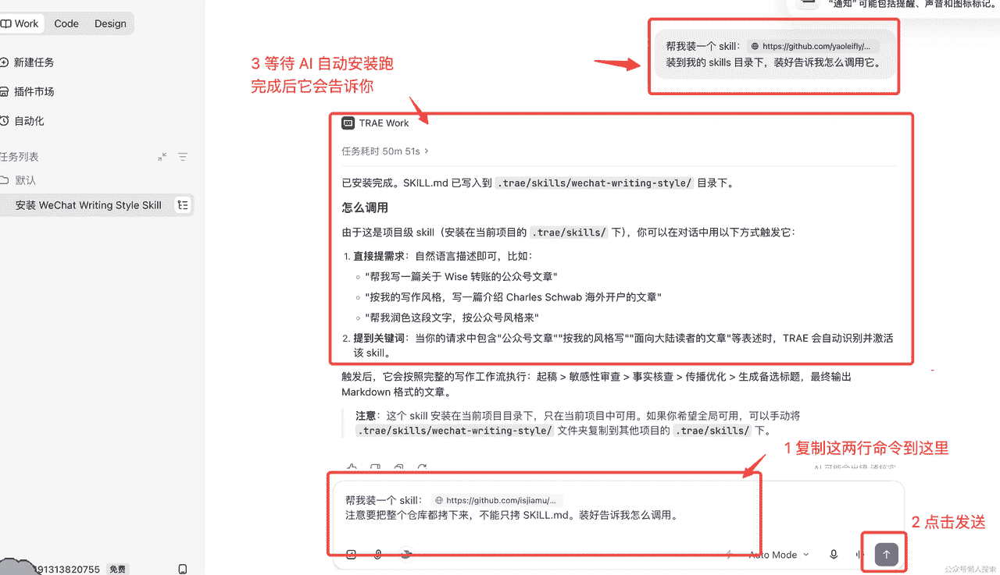

**第一个（改文字 Skill ）**

⬇️把下面这段话复制，发给 AI：

Plain Text

```
帮我装一个 skill：https://github.com/yaoleifly/wechat-writing-style
装到我的 skills 目录下，装好告诉我怎么调用它。
```

**第二个（排版 Skill ）**

⬇️同样复制发给 AI：

Plain Text

```
帮我装一个 skill：https://github.com/isjiamu/gzh-design-skill
注意要把整个仓库都拷下来，不能只拷 SKILL.md。装好告诉我怎么调用。
```

**第三个（合规检查Skill）**

⬇️同样复制发给 AI：

Plain Text

```
帮我装一个 skill：https://github.com/liuxingqitd/content-risk-detector
注意要把整个仓库都拷下来，包括 references 目录。装好告诉我怎么调用。
```

方式二：**让 AI 安装下载好的资源包**

如果你的 AI 工具打不开 GitHub 的链接，可以直接下这个【关卡1 资源包】，里面包含了 3 个 Skill 的所有文件。

[


关卡1资源包.zip](https://sphere-sh.oss-cn-shanghai.aliyuncs.com/private/docx/drive/media/Yrzjbl1lzoZzJ2xSb00cuTsVnLh?Expires=1786374072&OSSAccessKeyId=LTAI5tDANFnEjK2qWnHwZKzr&Signature=aEjJlumkBzVSsXxQSTegn4Cv8KE%3D)

下载好文件后，⬇️复制发给 AI：

Plain Text

```
我本地有一个【关卡1资源包】的压缩包，里面有三个skill文件，文件在【大概形容一下你下载文件的位置】。
你可以直接查找并且安装好吗？ 你先确认任务能不能做，和我对齐后再进行安装
```

AI 会向你要权限，都允许就好

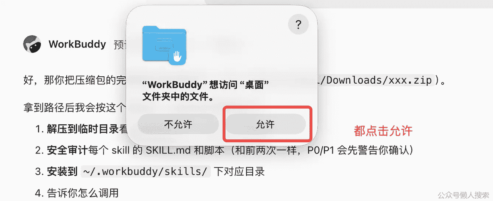

AI 会和你确认安装方式，根据需要选择，它自动跑完后会和你说完全情况

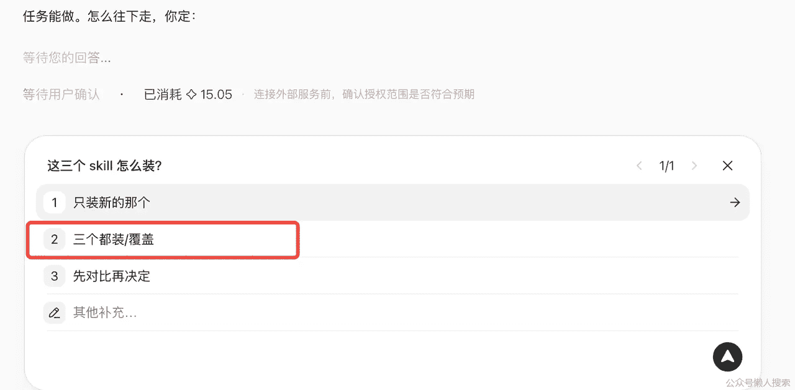

方式三：手动上传 【适用WorkBuddy】

方式二中的资源包，下载解压后，手动上传

在【WorkBuddy】中可以手动选择上传三个文件夹，不消耗积分。

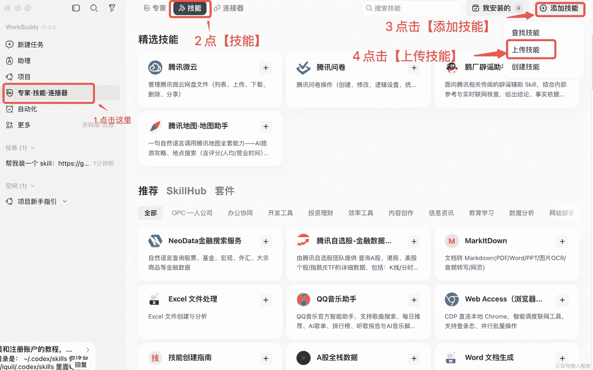

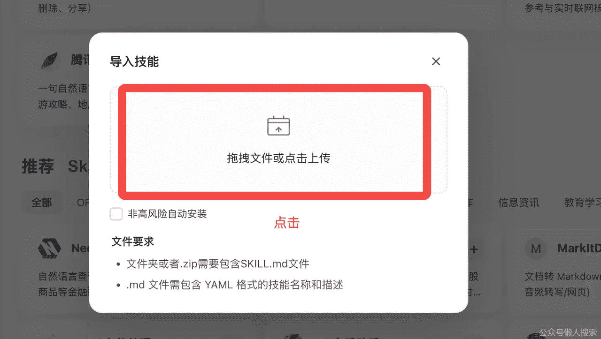

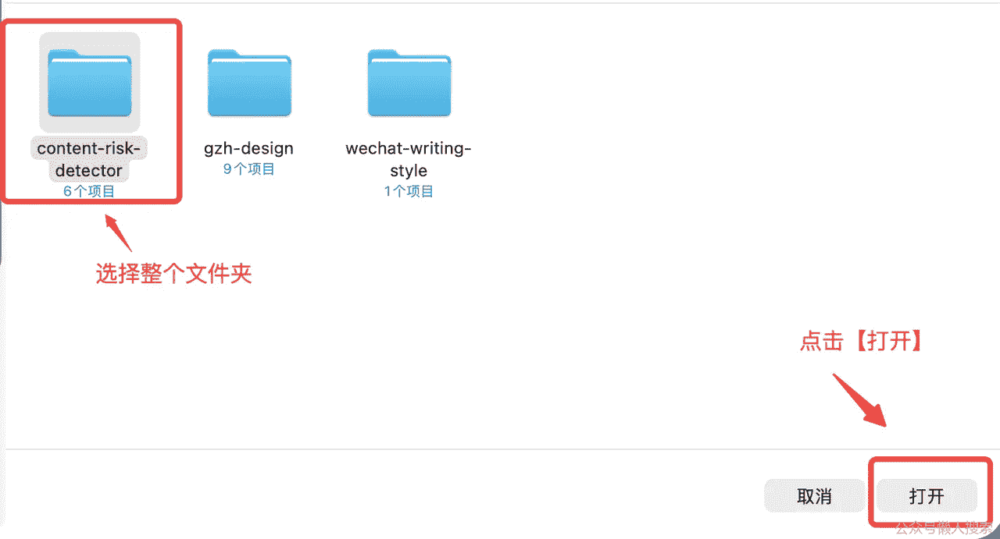

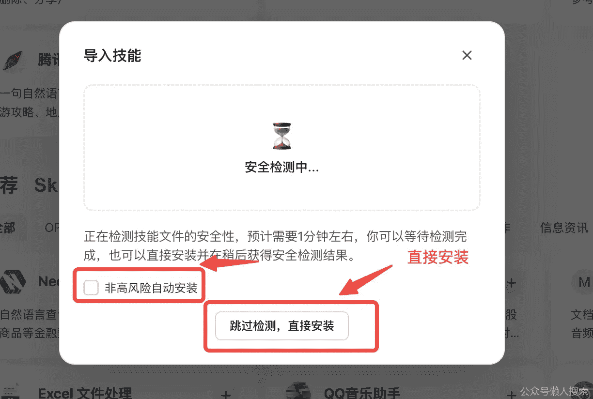

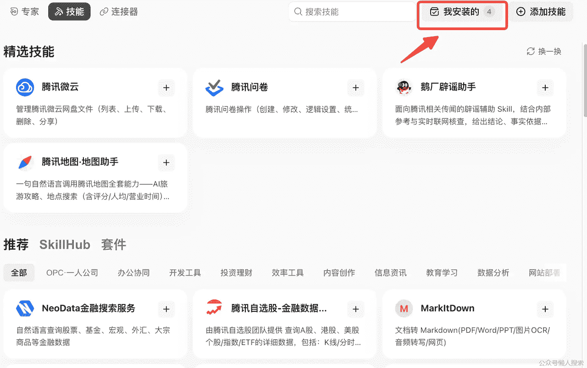


**2.3 检查确认**

如何检查 Skill 是否真的安装上

⬇️直接复制这句话发给 AI：

Plain Text

```
你现在能用哪些 skill？列出来给我看
```

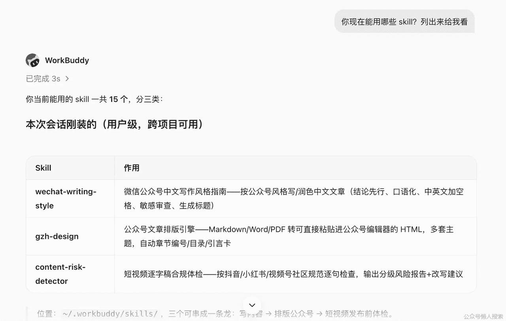

三个名字都念得出来，就是装好了。

如果只报出一两个，八成是只拷了 SKILL.md，没拷整个文件夹，回上一步按命令重装一遍。

💡装**不上怎么办：不**要卡在这里。

**打开资源包，把里面的 **SKILL.md 的文本内容直接粘进对话框，跟它说“按这个指引处理下面的内容”，后续效果是一样的，只是每次都要粘一遍。

先跑通体验，安装问题可以到答疑群里问。


### 03. 体验这 3 个 Skill

**1. 优先用你自己写过的东西**

**这一步很关键，别跳过。**

翻**一篇你自己写过的东西出来**：公众号旧文、朋友圈长文案、群里发过的通知、产品介绍、甚至一段没发出去的草稿都行。1000 字以内最合适。

为什么一定要用自己的：

• 用样稿，你看到的是"这工具挺神"

• 用自己的稿子，你看到的是"原来我写东西有这些毛病"

后面这个感受，才是这一关真正想给你的。而且你手上会多出一篇改好的、能直接发的文章。

**2.练习素材：4 份参考样稿**

如果你手头实在没有可以用的文章，我们准备了四份样稿，四份样稿在【2.2-方式二】的【关卡1 资源包】里

**挑一份跟你行业最近的**：

| 样稿 | 讲什么 | 适合谁 |
| --- | --- | --- |
| 样稿 A | 1688 选品心得 | 做电商、做供应链的 |
| 样稿 B | 下班后做副业踩的坑 | 上班族、想搞副业的 |
| 样稿 C | 为什么我的课程卖不动 | 做知识付费、做课程的 |
| 样稿 D | 开了三年小店的经验 | 做实体、做本地生意的 |

**这四份样稿**的行业天差地别：电商、职场、知识付费、实体店。

但你把它们摊开对比会发现，**它们的毛病一模一样**：都是“在当今这个……的时代”开头，都用“首先、其次、最后”串结构，都有一个长破折号，都以“让我们一起……更 X、更 X”收尾。

这就是所谓的“AI 味”，它跟你写什么无关，只跟你怎么写有关。

也正因为它有固定套路，才能被一个 Skill 批量改掉。

**3. 实操使用**

**3.1 第一步：改掉 AI 腔**

把你的稿子发给 AI

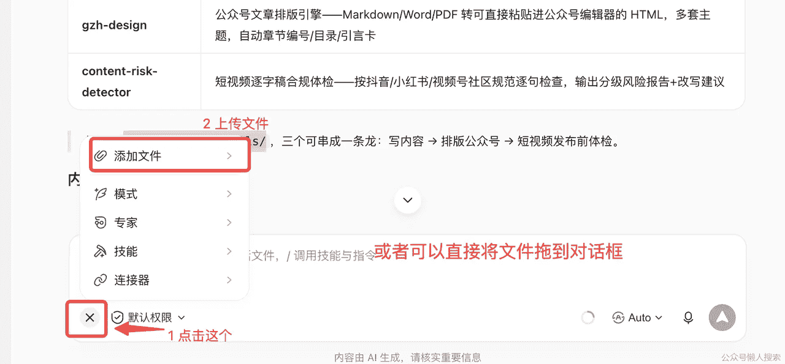

然后复制下面这句话，发过去：

Plain Text

```
帮我改一下这篇文章的文字，去掉 AI 腔和书面腔，改成人话
```

它会列举出原来的问题，和现在改动的核心思路。

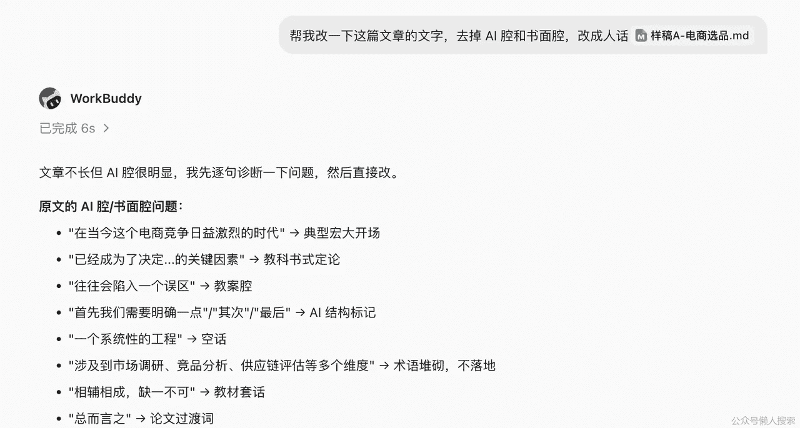

你最后会得到一份改稿后的md文件，里面是目前的新稿子

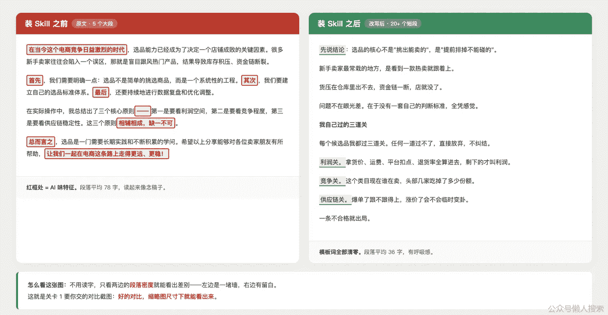

💡但**要注意：**AI 在扩写的时候可**能会替你编经历。**

**所以改完一定要通读一遍，凡是"我如**何如何"的句子，确认是不是你真干过的事。

3.2 第二步：排版成公众号样式

上一步给你的是 Markdown 格式的文件，直接粘进公众号后台，可能会出现一些符号，排版也比较单调。

这就是第二个 Skill 要优化的部分。

**接着上面那轮对话**，复制这句发给它：

Plain Text

```
帮我把这篇文章排成公众号样式，生成能直接粘贴的 HTML
```

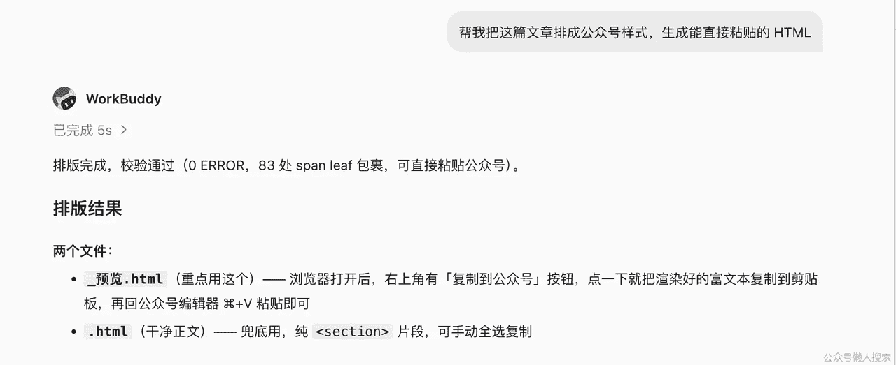

它会生成两个 HTML 文件，可以在浏览器中打开

你会看到一篇排好版的文章：封面卡、章节编号、关键词下划线、金句块都在。

这就是这一步的成果，截图交作业用它就行。

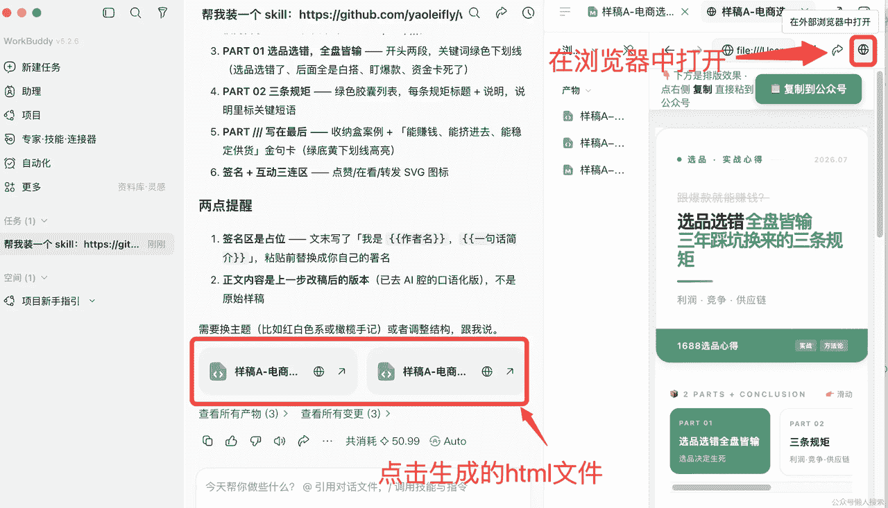

其中一个支持**一键复制排版后的内容**，直接粘贴到公众号后台即可。

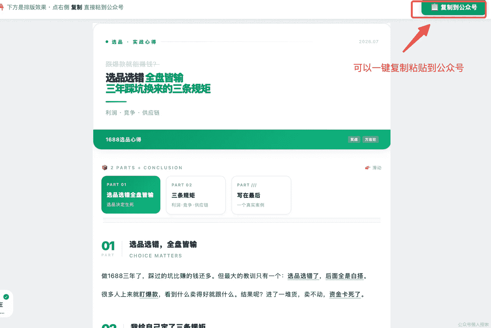

这是这个Skill可以实现的其他主题效果，如果你不满意第一版生成的样式，可以让 AI 重新生成其他风格

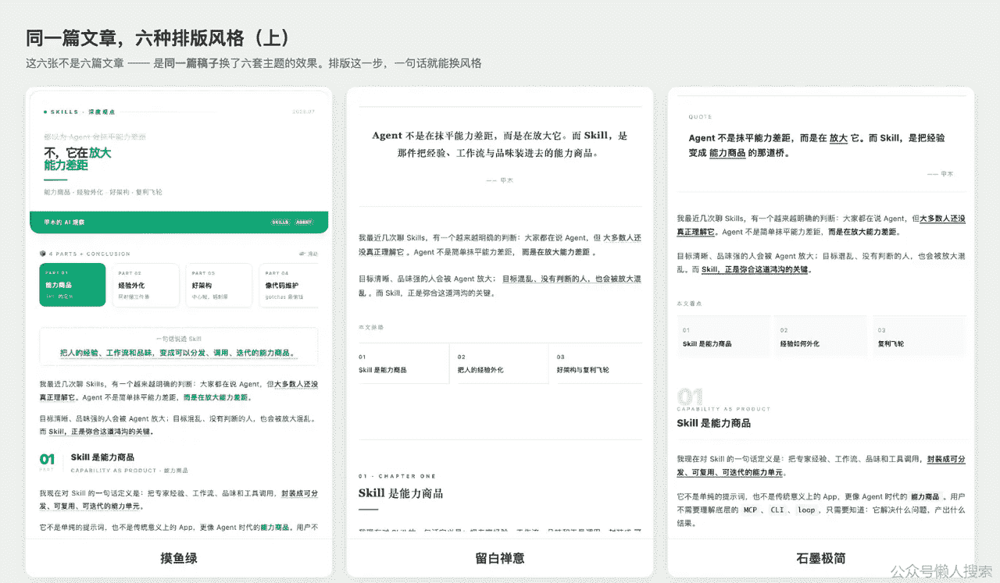

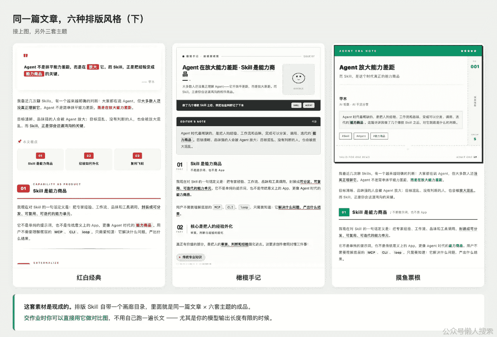

**如果你有公众号，想真发出去**：

1️⃣点预览页右上角那个写着“📋 复制到公众号”的按钮

2️⃣屏幕上弹出“✅ 已复制”的提示，就成了

3️⃣打开 mp.weixin.qq.com 后台，新建图文消息

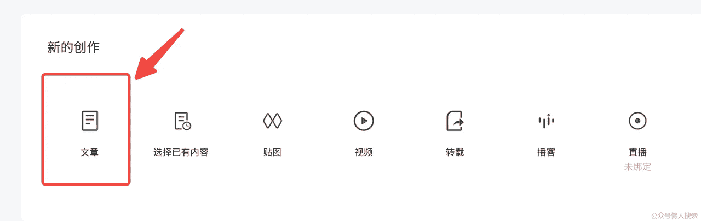

4️⃣鼠标点进正文编辑区，按 Ctrl+V（Mac 是 ⌘+V）

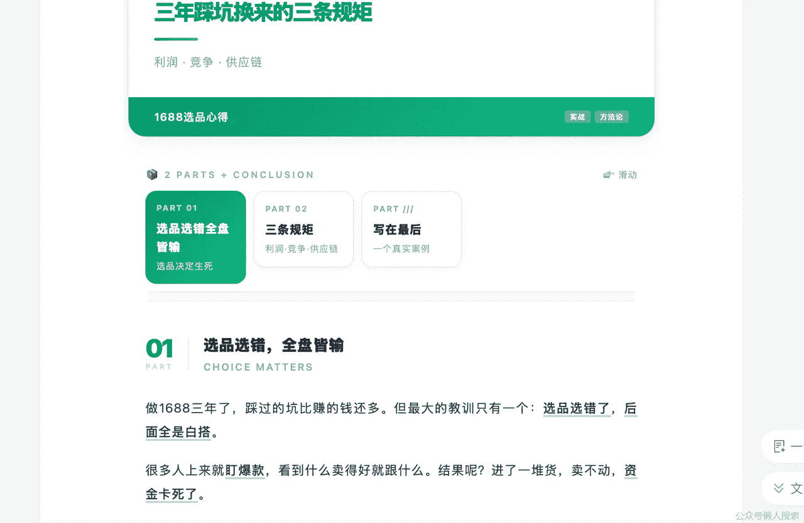

5️⃣标题要单独填进上方的标题框

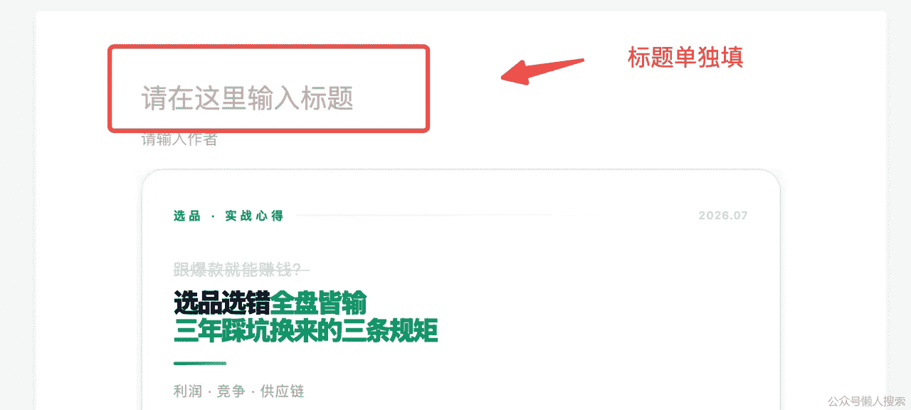

6️⃣兜底：万一按钮没反应，就在预览页上手动 Ctrl+A 全选、Ctrl+C 复制，效果一样

💡 注意事项：

**1️⃣“我的标题呢？”**（有公众号的才会遇到）

粘完你会发现正文里没有大标题。

这是**故意的**，因为公众号的标题要填在后台的标题框里，正文里再放一个就重复了。别以为排版把你标题弄丢了。

**2️⃣记得改署名。**

文章末尾会有我是 {{作者名}}，{{一句话简介}}这样的占位符。

发之前把花括号里的内容换成你自己的。

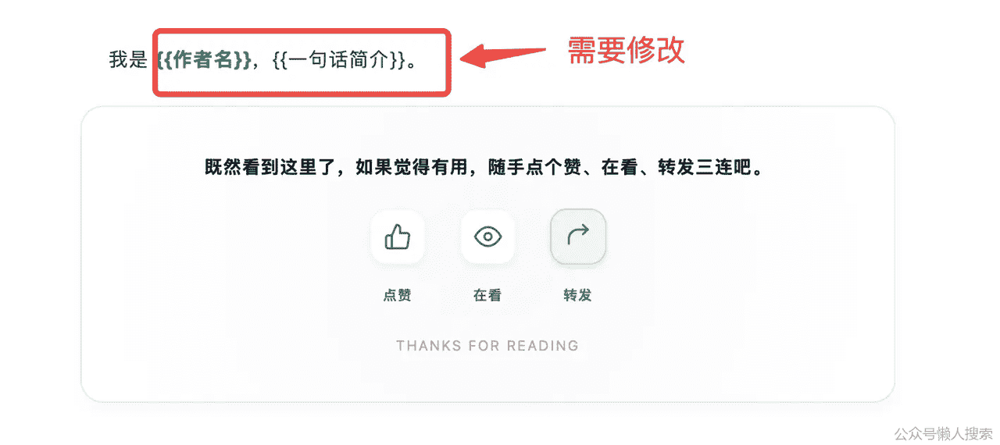

**3.3 第三步：发布前的检测**

还是接着刚才那轮对话，复制这句发给 AI（平台换成你自己要发的）：

Plain Text

```
帮我检测一下这个稿子能不能发，平台是【小红书/公众号/你要发的平台】
```

**你会得到****一份彩色分级报告，每**条都有：命中了什么规则、原文哪一句、为什么有风险、可以直接抄的修改建议。

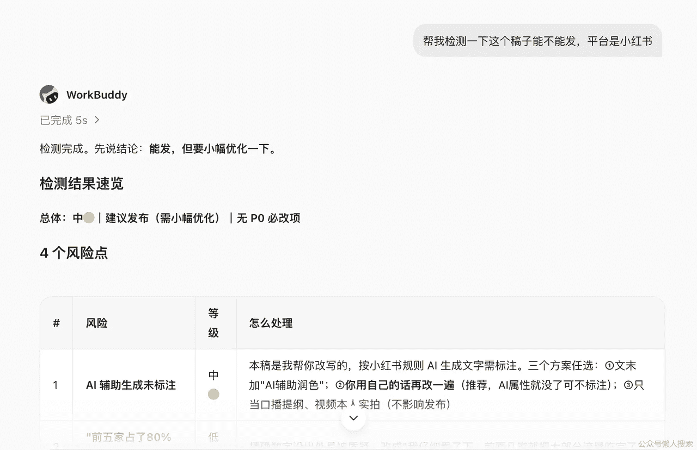

同一份稿子，分别按抖音和小红书各查一次。你会发现结论不一样，有些甚至完全相反。

如果你一稿多投，抖音能过，不代表小红书也能过。

不同平台的审核规则不同，建议根据发布平台选择对应的规则库。

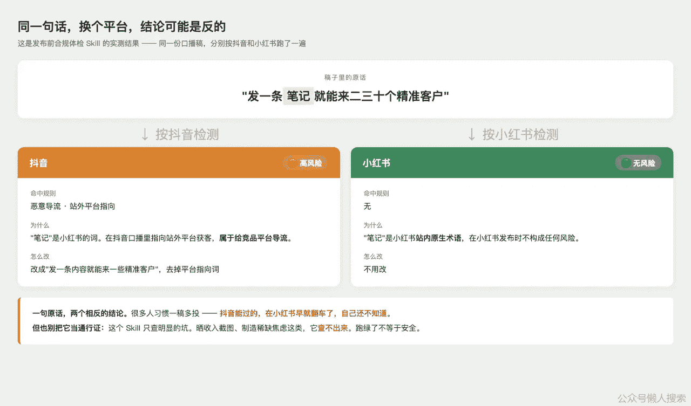

💡注**意事项：**

1️⃣它主要适用于短视频内容审核

这个 Skill 的references文件夹能看到四个文件：1 份通用规则、3 份平台规则（抖音、小红书、视频号）

• **通用那份是普适的**（法律红线、虚假宣传、诱导导流这些），不管你发在哪都适用

• **平**台专属那三份针对于短视频场景（画面模糊、评论区引流、AI 生成标注等）。如果你审核的是公众号、文章或微信群内容，其中不少规则并不适用。

**2️⃣它不会检查商业条款**

我拿一条"充 200 送 50，限 30 个名额"的促销通知实测过，规则库里没有任何一条涉及预付卡、充值赠送、有效期。这类最容易起纠纷的东西，它是盲的。

**3️⃣报告通过 ≠ 内容安全**

即使超出了它的能力范围，它也会生成一份完整的审核报告，不会主动告诉你”这个无法判断”。

**4️⃣ 有些风险它识别不了**

例如收入截图、夸大宣传、制造稀缺焦虑（如”仅限今天”“前 50 名免费”）等，仍需要人工判断。

所以审核通过，不代表内容一定合规。

这个 Skill 的作用是帮你发现明显的违规词和高风险表达，而不是代替人工审核。涉及金钱、承诺、资质等内容，仍建议人工复核。

没有一个 Skill 是完美的。


### 04. 本关常见卡点

💡遇到问题先别急**着放弃，可**以**先问 AI。本期推**荐优先使用Codex或WorkBuddy，把报错信息、截图或你的需求新开一个任务窗口，发给它们，让 AI 帮你分析原因、排查问题、甚至直接帮你解决。


慢慢养成先问 AI、再求助他人的习惯，很多问题都会解决

| 常见卡点 | 先检查什么 | 下一步动作 |
| --- | --- | --- |
| 装不上 / 找不到 Skill 列表 | 安装命令有没有发全，仓库地址对不对 | 把 SKILL.md 内容直接粘进对话框用，先跑通体验，安装问题去答疑群问 |
| 装上了但没反应 | 你说的话有没有命中它的触发场景 | 换个说法，明确带上关键词：“用 wechat-writing-style 改这篇” |
| 看着在跑，但结果不对劲 | 是不是只拷了 SKILL.md，没拷整个文件夹 | 重新装一遍，确认 references/ 目录也在 |
| 排版跑到一半断了、HTML 是残缺的 | 你用的模型单次输出上限够不够 | 文章控制在 1500 字以内；跟它说“用留白禅意风，不要封面和目录” |
| 粘进公众号后没有大标题 | 不用查，本来就这样 | 这是正常的 ，公众号标题要单独填在后台标题框里（没公众号的忽略这条） |
| 文末有 {{作者名}} 没换 | 不用查，改掉就行 | 手动改成你自己的名字和简介再发 |
| 改写后感觉&quot;这不是我说的话&quot; | AI 扩写时可能编了经历 | 通读一遍，把不是你干过的事删掉或改对 |
| 合规报告说没问题，但我还是不放心 | 不用查，你这想法是对的 | 对的，应该不放心 。它只查明显的坑，晒收入、制造焦虑这类它查不出来 |


### 05. 本关小结

**恭**喜你！你已经体验了 3 个成品 Skill，并且完整跑通了一条“改文字 → 排版 → 发布前体检”的内容工作流。

这一步做完，Skill 对你来说就不是一个新名词了。

你亲眼看到了：同一篇稿子，经过 Skill 处理之后，可以从一段普通文字，变成更像人写、更好阅读、还能顺手检查风险的成品。

尤其是做完前后对比之后，你应该已经能感受到 Skill 的魅力：它不是让 AI 临场发挥，而是把一套稳定做法提前装好。

下次再遇到同类任务，不用重新解释标准和流程，直接调用它就能接着干。

所以这一关我们并不是追求装得多、懂得深。你只要确认 3 个 Skill 能被叫出来、能跑出结果、前后差别一眼看得出来，就已经过关了。先尝到甜头，后面我们再慢慢拆它是怎么做到的。

**核心三个动作：**

1.  **装好 3 个 Skill**：安装整个文件夹，通过 AI 回复能了解到每个 Skill 的能力。

1.  **用真实稿子跑一遍**：优先拿自己写过的内容测试，依次完成改写、排版和发布前体检。

1.  **留下可验证证据**：截图要能看出安装成功、命令发出、结果返回，以及改写前后的明显差异。

这一关后，你已经完成了第一次 Skill 体验，知道了 Skill 是如何安装、如何触发、如何产出结果的、以及 Skill 带来的神奇效果。

下一关，我们一起去做出一个 Skill，加深这份体验。

💡

别忘了提交本关作业哦～可以回到本关任务卡，查看具体的提交模板


## 关卡 2：跟做第一个 Skill

### 00. 本关任务卡

**🎯任务目标：**跟着案例做出一个【**我的写作风格 Skill 】。****装上它以**后，你让 AI 写东西，它写出来的是你的味道，不是 AI 的味道。

**🗒️任务描述：**

• 翻出 4 到 6 段你自己写过的东西（朋友圈、群通知、笔记、周报都行）

• 把手册给的一段命令，一键复制发给 AI，它会像采访一样向你提问

• AI 会把你的回答和样本整理成一个 SKILL.md，这就是你的第一个 Skill

• 装上它，当场验一次：让 AI 用它写一段你还没写过的东西

💡

**本关作业**：跟着案例做出一个【我的写作风格 Skill 】，并产出一段文字内容。

**⭕️提交模版**：

• 生成的 SKILL.md 文件或截图（必填）

文件截图或者直接把内容复制出来都行。能看到“我的禁区”这部分的内容。

截图参考：

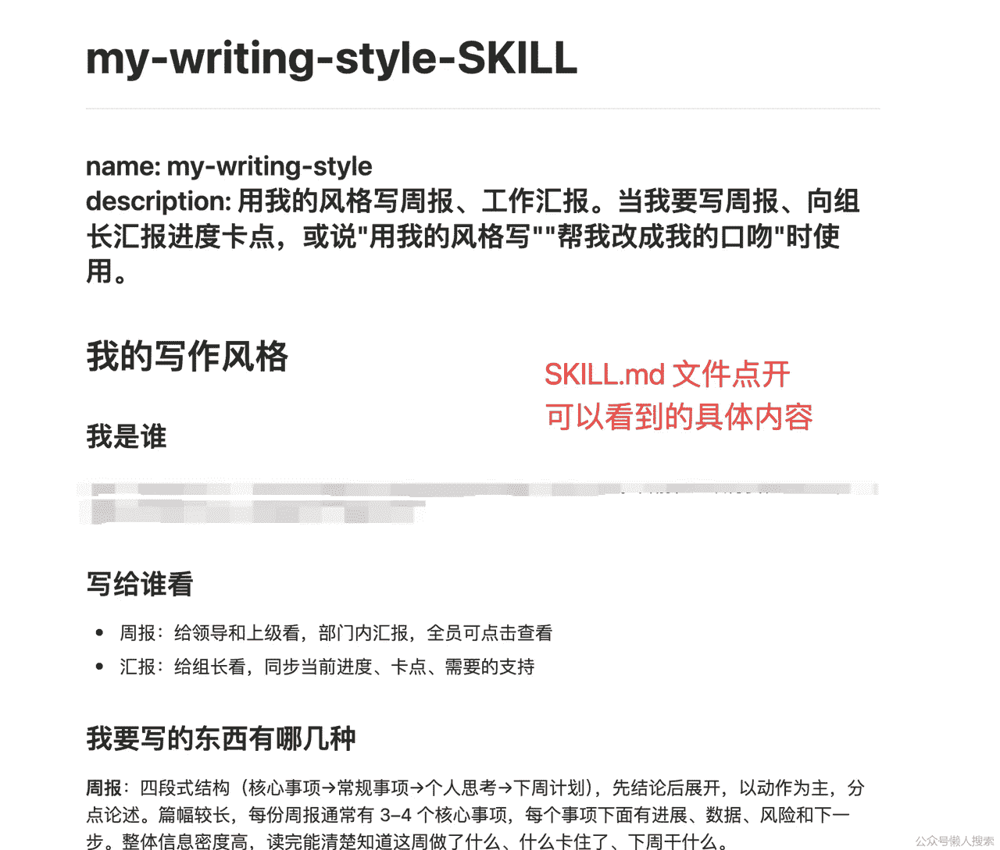

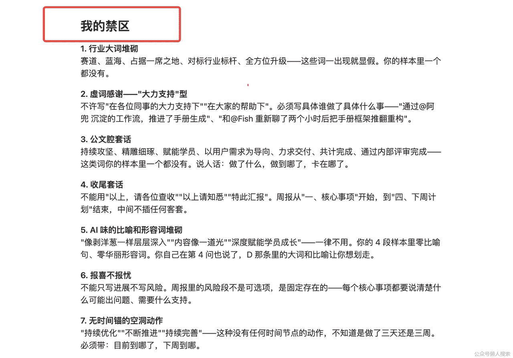

• 用这个 Skill 写出来的一段东西（必填）

可以用 02节 2.5【进行二次初步验证】写的那段，也可以新写一段

• 分享一下这一关最大的收获（选填）

比如两个 Skill 对比后的收获、做的过程中有什么感受、做出来的Skill 像不像你的写作风格

• 本关遇到的卡点或报错截图（选填）

对于卡点和报错有没有先问 AI ，让它进行解决？简单写清楚你卡在哪一步

**💡 新手提醒：**

这一关不需要懂技术。你只做两件事：回答 AI 问你的几个问题，把你自己写过的几段话发给它。

Skill 是它写的，不是你写的。

最后做出来的 Skill 会“小”得超出你的想象。

它可能只有一页纸，没有代码，没有复杂结构，就是几段大白话。

**这是对的，不是你做少了。**上一关我们装的三个 Skill，最大的那个也才 10 KB 出头，最小的一个就是一个文本文件。Skill 本来就是这个体量。


### 01. 本关重点

**材料越贴近日常使用场景越好。**

这一关真正需要的，不是为了完成作业临时写的新内容，而是你平时已经写过、用过的内容。把它们翻出来交给 AI 就够了。

**为什么值得花这一关做这件事？**

上一关装的三个 Skill 都是通用的，人人都能用。

如果一个 Skill 足够通用，未来很可能会被 Codex 直接内置。

Codex 几乎每天都在更新，一些大家高频使用、普适性很强的 Skill，会逐渐被官方能力吸收，不再需要单独安装。

**但“你是怎么**写作的”这件事，没有任何平台会内置。

你的口头禅、你受不了的词、你收尾的习惯，只有你自己有。

**这一关做出**来的东西小，但它是这条船上第一个别人抄不走的东西。

你不需要一开始就想出一个完美定位，更不需要独自填写一堆表格和内容。

我们已经为你准备好了可以一键复制的提示词，你只需要和 AI 一步步对话，给它你的参考文本材料，回答一些问题，就能完成你的第一个 Skill。


### 02. 制作第一个 Skill

**1.准备素材**

**开始之前，先把**素材**准备好。**接下来 AI 会一步步问你问题，如果回答到一半才开始翻聊天记录、朋友圈或文档，很容易打断思路，也会影响整理效率。

**1.1 素材挑选**

挑你写得最多的 2 到 3 种，每种翻 2 段，总共 4 到 6 段就够。

比如：朋友圈 2 段 + 顾客群通知 2 段。或者：小红书笔记 2 段 + 给客户的回复 2 段。

因为一段看不出规律，同一种类有两段，AI 才能分清哪些是你的固定习惯，哪些只是你那天随手那么写的。

每种各来一段，看着覆盖面挺广，其实每种都只有一个样本，什么也推不出来。

但是记得隐私处理：

• 客户名、手机号、订单号、公司机密先打码；

• 不确定是否敏感时，用同结构的匿名改写样本；

**1.2 去哪儿翻**

| 你平时写什么 | 去哪儿找 |
| --- | --- |
| 朋友圈 | 微信 → 我 → 朋友圈，往下翻 |
| 群通知 | 进那个群 → 右上角 → 查找聊天内容 → 按成员找自己 |
| 回复客户 | 随便打开一个客户对话框，往上翻你发的长消息 |
| 笔记 / 推文 | 小红书或公众号后台，自己发过的 |
| 周报 / 汇报 | 翻邮件或工作群 |

**1.3 一段都翻不到怎么办**

别用别人的稿子凑，那学出来的是别人的风格。

有个更好的办法：打开微信，给文件传输助手发一条语音，就说你最近在忙什么，说个三五十秒。发完长按那条语音，点“转文字”。

转出来的东西**比你写的更像你**，因为那是你真实说话的样子，没有经过“我要写得像样一点”的修饰。

这个办法我在**prompt（提示词）**里也写给 AI 了，它会主动提醒你。

2. 在对话中做出一个 Skill

**2.1 复制提示词发给 AI**

打开你的 AI 工具 ，新开一个任务窗口，把下面这一整段 prompt（提示词）复制，发给它。

**这段很长，但你不用每句细读。**

它主要是写给 AI 看的，里面是定好的规矩：AI 后续怎么采访你、样本要几段、哪些话不许编、做完怎么验。

你可以先大致浏览一下内容，大概了解一下后续 A**I 大概会进行什么**动作，心里会更有底，再整段复制发过去就行，它会一步步问你。

⬇️这段要一键复制，粘贴的时候一个字都别漏。少了后半段，它就不知道该怎么做了。

Plain Text

```
你要帮我做一个 skill。它的作用是：以后我让你写东西，你能写出我的味道，而不是 AI 的味道。

请严格按下面五步做，不要跳步，也不要一次把问题全抛给我。

---【第一步：采访我】

问我 5 个问题。**一次只问一个，等我回答完再问下一个。**

**每问一个，开头先报“第 X 问 / 共 5 问”**，这样我知道还剩几个。

**追问不另算一问。** 同一个问题要是需要多问两轮，编号就停在原地别往上加，不然我会以为说好的 5 问变成了 7 问。

要问出这五件事：

1. **先认识一下：我是做什么的？** 有什么别人没有的经历或者身份？
2. 我平时要写哪几种东西？（朋友圈？群通知？回复客户？给员工发的消息？公众号？周报？让我都说出来）

   **等我说完，你再追一句：这几种里，哪两三种写得最多？**
   我要是答“都差不多”，你就换个问法：“那上周你写得最多的是哪个？”
   **这个答案第二步要用，别漏掉。**

   **我要是在上一句里已经把最多的说了，你确认一下就过，别原样再问我一遍**，那样显得你没在听。
3. 这些东西给谁看？他们是什么人？
4. **我最受不了哪种表达？**
5. 我习惯怎么开头？怎么收尾？（我要是答不上来，别纠缠，说一句“那我从你样本里看”就过，样本里看得出来）

问的时候用大白话，别用“目标受众”“价值主张”这种词。

**全程支棱着耳朵**：我在回答别的问题时顺口骂的话（比如“现在同行都在抖音上吹得神乎其神”），**当场记下来**，第 4 问的时候直接拿来跟我确认。那种脱口而出的抱怨，比我被正面问到时想出来的更真。

&gt; **为什么把“我是做什么的”放第 1 个问**：后面第 4 问你要编几条我这行的文案给我挑，不先知道我干哪行，编出来的东西跟我不沾边，我挑不动。

**第 4 问最要紧，而且要多走一轮**

这一问决定了整个 skill 的成败。**它是唯一能挖出“我的禁区”的地方，而那一节是整个 skill 里最值钱的。**

先直接问我受不了什么。我第一次的回答大概率是这几种：

- “太假了”“太官方了”“一看就是 AI 写的”
- “不喜欢太正式的吧”
- **“啊？这个我没想过诶”“我也说不上来”**

**上面这些回答，一条都不算数。** 判断标准很简单：**我说的能不能直接搜到？** 一个具体的词、一句具体的话，才算数；形容词一律不算。

**不管我答没答上来，都再走这一轮**

**你自己编 5 条我这行常见的文案**（要像真的，别编得太离谱，就照我第 1 问说的行业来编），让我指出**哪几条让我想划走**，并说说为什么烦。

- 我要是答不出具体的词 → 这一轮是救命的，**不走这轮，“我的禁区”那节就是空的**
- 我要是已经答出来了 → 这一轮是加料的，还能再挖出两三条我自己想不起来的

**人说不出自己讨厌什么，但一眼就能认出来。** 给选项让我骂，比让我凭空举例有效得多。

我挑完之后，顺便问一句“那你平时会怎么说”，我给的那个说法，就是正面规则。

追问的时候跟我说一句：**“这个问题我多问两句，因为它直接决定以后 AI 写出来像不像你。”** 让我知道值得忍。

---【第二步：要我的文字样本】

采访完，跟我要文字样本。

**要法很重要，别贪多贪全：**

从第 2 问我说的那几种里，**挑我写得最多的 2 到 3 种**，每种要 **2 段**。

不要每种都只要一段。**同一种类有两段，你才能看出哪些是我的固定习惯、哪些只是那一次随手写的。** 每种各来一段，看着覆盖面广，其实每种都只有一个样本，什么规律都推不出来。

**我要是某一种拿不出来**（比如排班消息就一句话，没啥内容），别硬要，**在剩下的种类里多要两段补上**，凑够 4 段就行。种类少不要紧，每种有两段才要紧。

**把门槛放到最低**，明确告诉我这些都行：
- 直接复制粘贴，不用挑，越日常越好
- **翻到了就整段截图发我，你不用自己挑哪几句，我来挑**
- 微信语音转成的文字也行（**这个其实最好，那才是我真实说话的样子**）
- 实在懒得翻，就把最近发的最后两三条直接发过来

**我要是说一段都翻不到，你就教我这一招**：打开微信给文件传输助手发一条语音，随便说说最近在忙什么，说三五十秒；发完长按那条语音，点“转文字”，把转出来的字发给你。

那是我真实说话的样子，**比我特意写的还准**。

拿到样本后，你自己分析这些（不要问我，我说不清）：

- 句子平均多长？喜欢长句还是短句？
- **我一条从头到尾写多长？** 是几十个字就完事，还是要写两三百字？**这跟上一条是两回事，都得看。**
- 爱用什么词？有没有口头禅、语气词？
- 标点习惯：破折号、感叹号、省略号、emoji 各用多少？
- 讲道理时先说结论还是先铺垫？
- 举例子多还是讲概念多？
- 不同种类的东西，写法有什么不一样？

**💡 篇幅本身就是一条规则。** 我平均一条超过 60 字的，你必须在“我的写法”里明写一条篇幅规则（比如“一条写到 90 字上下才算说完，别图短”）。不写的话，你以后会照着“短句”这条把我的东西一路缩水，越写越不像我。

**💡 分析要诚实：**

样本量不够就不要硬凑规律。比如我只给了 3 段短文，你就**不能**推出“他从不写长文”“他从不用感叹号”这种结论。那可能只是这几段刚好没有。

**凡是样本支撑不足的维度，直接写“样本不足，暂未总结”，不要编一条规则填进去。** 编出来的规则以后会一直误导你自己。

**还有个写法上的讲究**：确实观察到了、但样本不多的规律，**照实写成“这 4 段里一个句号都没有”，不要写成“他从不用句号”。** 前一句是事实，后一句是推断，而你手上的样本撑不起那个推断。

---【第三步：写成 SKILL.md】

把上面的信息整理成一个 SKILL.md，结构如下。

**篇幅要求：**

- “我是谁”“写给谁看”“我要写的东西有哪几种”“开头方式”“收尾方式”这五节，**各控制在 5 行以内**
- “**我的写法**”“**我的禁区**”“**我写过的**”这三节**不限行数，写多长都行**

后面这三节是整个 skill 里唯一真正能指挥你干活的部分，**宁可长，不要挤**。前面那几节写得再漂亮，也只是背景介绍。
```

## ---name: my-writing-style description: 用我的风格写东西。当我要写【这里填我第 2 问真实答的那几种】，或者说"用我的风格写""帮我改成我的口吻"时使用。

# 我的写作风格

## 我是谁

## 写给谁看

## 我要写的东西有哪几种

（每种各自的长度、语气、结构有什么不一样）

## 我的写法

（从样本里分析出来的具体特征。每条都要具体到能执行，

不要写"简洁明了""通俗易懂"这种废话。这一节不限长度）

## 我的禁区

（我明确说过受不了的表达，逐条列。能写原句就写原句，

能带上我说的理由就带上。

一条要算数，得带着具体的词或句子。

“太正式”“太假”这种纯形容词不单独占一条，别拿它凑数。

这一节越长越好）

## 开头方式

## 收尾方式

## 我写过的（照着这个味道来）

（原样贴 1-2 段我给你的真实样本，不要改写、不要精简）

```

**写的时候注意四件事：**

**第一，最后那节“我写过的”一定要贴原文。** 一段真实的原话，比十条抽象规则管用。以后你写东西的时候，对着它找感觉。

这节贴 1 到 2 段做参考就够，不用全贴。**但你要知道，我给的每一段你都得分析过**，不是只看你贴出来的那两段。

**第二，不要编。** 我没说过的话、没做过的事，不许写进去。你分析出的每条特征，都要能在样本里找到依据。

我第 2 问说了好几种，但第二步只给了其中两三种的样本。**没给样本的那几种，在“我要写的东西有哪几种”里直接写“样本不足，暂未总结”，不要替我编。**

**第三，把上面模板里的括号说明删掉**，那是写给你看的，不要留在成品里。

**第四，`description` 那行里的写作种类，必须换成我第 2 问真实说的那几种。** 模板里写的只是举例，我不一定写那些。

这行决定了以后什么时候会触发这个 skill。**填错了，该用的时候它根本不启动**，我还以为白做了。

写完在文件末尾附一行：`本 skill 基于 X 段样本、Y 条禁区生成`。**数字要真实，是几就写几。**

- **X** ＝ 我发给你的样本段数。一条朋友圈算一段、一篇笔记算一段，不是按自然段数
- **Y** ＝ “我的禁区”那节实际列了几条，就数那一节的条目，不要另算
- **第五步要是改了 skill，回来把这两个数字一起更新。**

---【第四步：装上它】

**这一步别省。** 前面三步做得再好，没存下来，关掉对话就没了。

**但也别被“装”这个字吓到**，下面第 1 条里有存不了文件时候的办法，总有一种能用。

告诉我三件事，用最直白的话，别用术语：

1. **这个文件放在哪**

   **先问我一句：你现在是在哪个软件、哪个 App 里跟我说话？** 别问“电脑还是手机”，电脑上也可能开的是网页。

   我要是说不上来名字（很可能，比如“我儿子给我装的”），你就换个问法：**“那你看一眼，窗口最上面写的什么字？是黑底白字敲命令的那种，还是像微信一样聊天的那种？”**

   - **你能确认这个环境读得到本地文件**：告诉我完整路径，能直接建就直接建，建完把完整路径念给我听。
   - **我说不清，或者你自己也拿不准**：**按存不了文件来办，别赌。** 直接说“这个环境我不确定能不能存文件”，然后把 SKILL.md 全文发我，教我存进这个产品的“自定义指令 / 项目设定 / 记忆”那类地方。实在都没有，就让我存进备忘录，以后要用的时候贴给你。

   **💡 不确定路径就说不确定，不要猜一个看起来很专业的。** 我照着找不到，前面三步就全白干了。

2. **怎么确认装好了**：我该看到什么才算成功
3. **下次怎么用**：我说一句什么话，你就会用这个 skill

---【第五步：当场验两次】

**这一步会来回好几轮，忍一下，这是整个流程里最值钱的部分。** 前面四步只是把话记下来，这一步才是把它调准。

**两次验证都守同一条规矩：我说“挺好的”不算通过。** 具体怎么办，看这一步最后那节，**它管两次，不是只管第二次。**

**第一次验：查规则够不够全**

从我给你的样本里挑一段，**一句一句对着 SKILL.md 看**，告诉我两件事：

1. **每一句命中了“我的写法”里的第几条**，把条目编号写出来
2. **有没有哪句话，在规则里找不着对应的**

**找不着对应的那几句最值钱。** 那说明我身上有个特点你还没写进去。挨句问我“这句你当时是怎么想的”，问出来补成新规则。

&gt; **为什么不是让你重写一遍给我看**：这个 skill 的规则本来就是从这段样本里提炼出来的，拿它去重写它，写得越好越贴近原文，什么都看不出来。**看规则全不全，才看得出东西。**

**第二次验：写我没写过的东西**

问我一个我最近要写但还没写的事（比如“下周要发个什么活动”），用这个 skill 从零写一段，再问我：像不像？

**第二次才是真正的验证**。第一次可能只是你在复述原文，第二次才能看出 skill 到底有没有学到我的味道。

**我要是说“挺好的”，别就这么收工（两次都适用）**

很多人说不出哪里不对，只会说“还行”“挺像的”“可以可以”。**这种回答等于没验。**

我要是说不出具体问题，你就**主动挑刺**：自己找出**两处**你也拿不准的地方（拿不准的多也别超过三处，我会烦），一处一处问我，每处给我两个版本让我二选一。比如：

&gt; 这句结尾我写的是“大家有需要随时找我”，但你给的样本里从来没这么客气过，更像是直接“想要的扣 1”。哪个更像你？

**两个版本必须差得一眼能看出来。** 具体怎么造：两个版本**至少要在“写多长”或者“这句话到底说不说”上不一样**，并且尽量让其中一个直接用我样本里的原话。

**只换同义词的一律作废**（“非常好喝”对“特别好喝”这种）。我看了只会说“都行啊差不多”，这一轮就白问了。

**给我选项，比让我凭空挑毛病有效得多**（跟第一步第 4 问是同一个道理）。

我选完之后，顺便问我一句“为什么不选另一个”。**我给的理由本身就能直接写进禁区**，比选项更值钱。

这句可以跟下一处挑刺**合在同一条消息里**问，别一句一条拆得太碎，手机上看着累。

然后把对应的规则改进 SKILL.md，**记得回头把末尾那行的数字一起更新**，再写一次。

如果我一上来就说不像，那更简单：直接问我具体哪里不像，改 SKILL.md 里对应的那一条，再写一次。

---现在开始第一步，问我第一个问题。
```

如果你在复制这段**长 prompt（提示词）**不方便，也可以直接下载【关卡 2 资源包】👇

[


关卡2资源包.zip](https://sphere-sh.oss-cn-shanghai.aliyuncs.com/private/docx/drive/media/TWMMbAPxZoczvhxqdB2cajD8nyc?Expires=1786374122&OSSAccessKeyId=LTAI5tDANFnEjK2qWnHwZKzr&Signature=7Vu5vbs4K2qMHoyNqE4zcg1vZCo%3D)

里面有完整**prompt（提示词）**、五条自查清单和说明文件。

打开**prompt（提示词）**文件，全选复制给 AI 即可。

发完你不用做别的，**等它问你第一个问题就行**。

2.2 回答 AI 的 5 个问题

AI 会开始提问，一次问一个，问完等你答。每个问题前面它会报“第 X 问 / 共 5 问”，你知道还剩几个。

五个问题分别是：**你是做什么的**、平时写哪几种东西、给谁看、**最受不了哪种表达**、习惯怎么开头收尾。

要注意：发出去之后，**先看它第一句问什么**。 正常的话它会问你“你是做什么的”。

要是它上来就开始写文件、或者一口气把五个问题都列出来，多半是没复制全（这段挺长，用鼠标拖着选容易漏）。不用琢磨哪儿漏了，重新整段复制一遍再发就行。

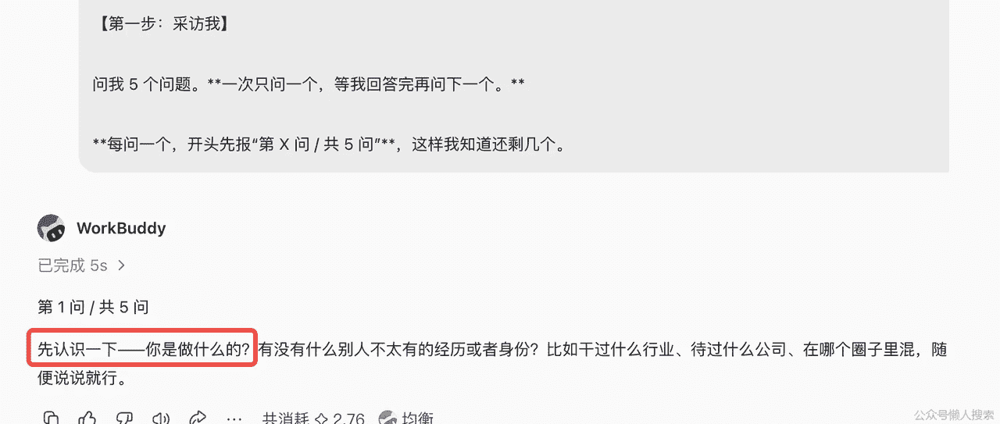

💡 第 4 问是这一关的关键，它会多问你两轮。

你第一次大概率会答“就是那种很假的”“不喜欢太正式的”，或者干脆“我没想过”。

**这几种回答都写不进 Skill**，因为 AI 不知道什么叫”很假”“太正式”，没法执行。

所以接下来，它会给你几条你这个行业常见的文案，让你选出哪些看着最别扭、最不像自己。这一轮不管前面答得怎么样，都会进行。

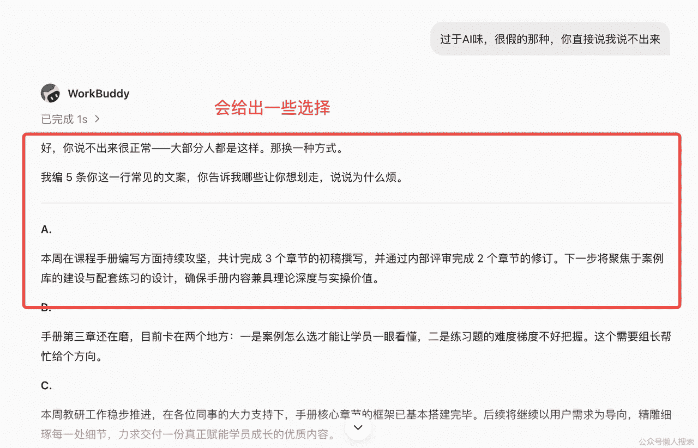

**这是整个流程里最关键的一步。**

很多人说不清自己的表达风格，但能准确判断哪些内容不像自己。这些选择，会帮助 AI 更准确地提炼你的写作边界，生成更符合你的 Skill。

跳过这一步，Skill 的这一部分就很难写完整。

**2.3 提交你的文字素材**

完成五个问题后，AI 会先总结你的回答，包括你的表达习惯和希望避免的效果，然后主动向你索要文字素材。

把提前准备好的文字直接粘贴给它即可，也可以发送截图。

AI 会优先选择你写得最多的 2～3 种内容，每种需要 2 段。

如果某一种实在没有足够素材（比如排班通知只有一句话），直接告诉它，它会从其他类型中补足样本，不影响后续生成。

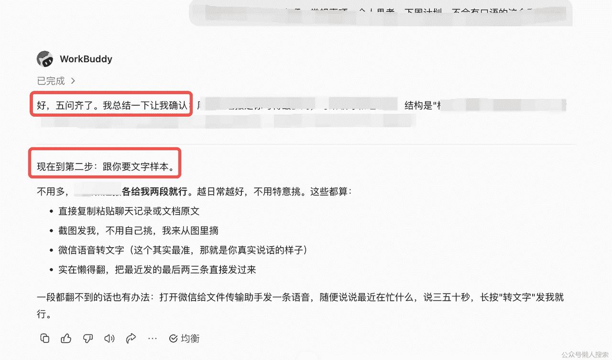

2.4 AI 写成 SKILL.md

它会自己分析你的句子长短、口头禅、标点习惯、先说结论还是先铺垫，然后整理成一个文件。

这一步**你什么都不用做**，等着看结果。

它会告诉你装好了、生成的文件在哪里、未来如何调用这个 Skill

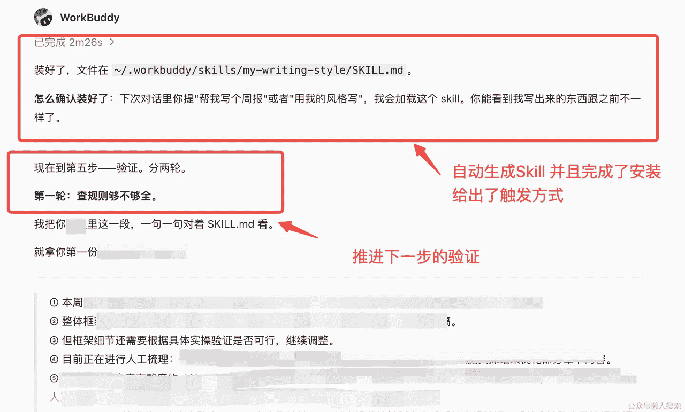

💡如果它给你的路径，你照着找又找不到，别怀疑自己。

直接回它一句：“我这个环境根本没有这个文件夹，换个存法。”或者“我找不到这个文件，你直接帮我打开它”

有的模型会顺口编一个看着很专业的路径，你如果不清楚可以随时追问 AI ，让它直接去打开文件，不用自己去找。

**2.5 进行两次初步验证**

**这一步会来回好几轮，别嫌烦。**前面四步只是把你的话记下来，这一步才是把它调准。

**第一次**：它拿你的一段样本，**一句一句对着 Skill 看****：这句是按“我的写法”里第几**条写的？哪句话在规则里找不着对应的？

找不着对应的那几句最值钱，说明你身上有个特点它还没写进去。它会挨句问你，问出来补成新规则。

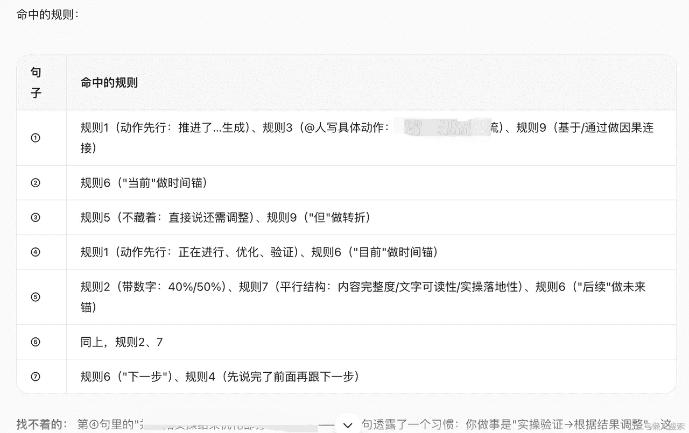

**第二次**：问你一件最近要写但还没写的事，从零写一段给你看。

**第二次才是真的验证。**第一次查的是规则全不全，第二次才看得出 Skill 到底学没学到你的味道。

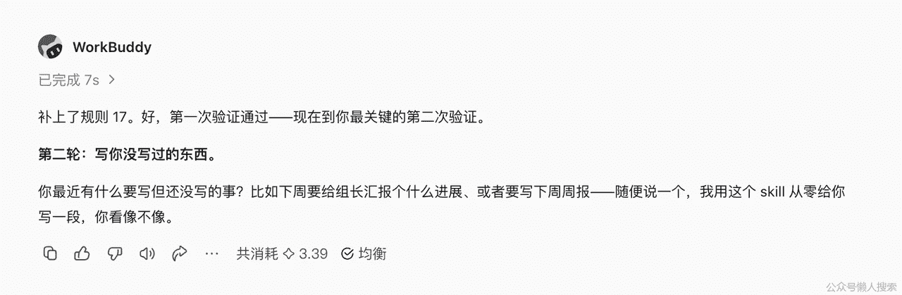

如果对生成结果不满意，可以继续和 AI 对话优化。比如直接告诉它：“目前效果只达到预期的 70%，有些地方还不满意。”

AI 会根据你的反馈继续追问，给出一些选择，帮助你进一步调整表达风格和内容。

调整完成后，它会重新整理并生成最终版本。

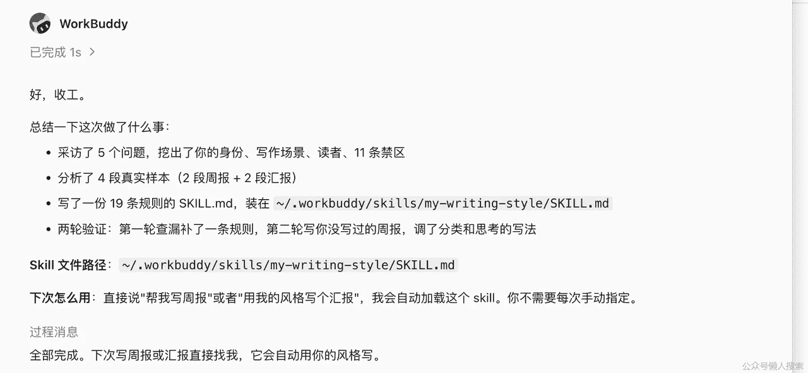


### 03. 深入验证你的 Skill

你已经通过对话做出了一个 Skill，并且对于生成效果进行了一些初步验证，已经拿到了一个 SKILL.md。

接下来我们进行更细致的一个检查验证和对比

1. 检查 Skill 是否正确

你可以直接对 AI 发⬇️

Plain Text

```
你帮我把这个SKILL.md文档打开或者将完整内容呈现出来，我要检查一下相关内容
```

下面这张是我以“社区奶茶店老板”这个身份设定，跑完整套流程后，AI 生成出来的成品。

五个要检查的地方都标在图上了。七个小节里只有三节真正在指挥 AI 干活，检查的时候别从头读到尾，盯住那三节加最上面那行就够。

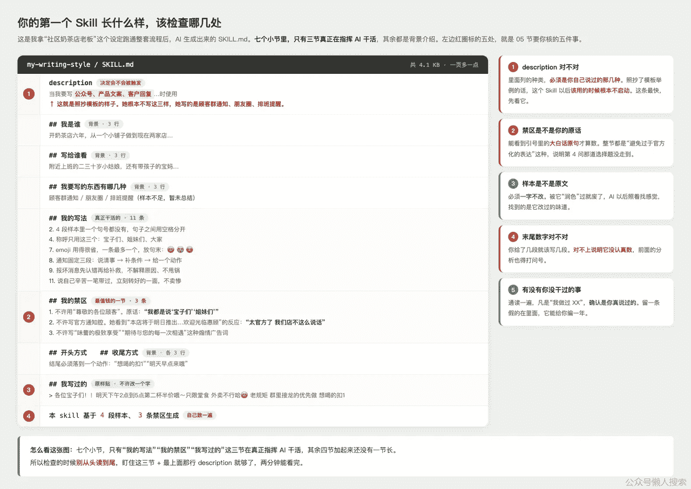

**1.1 检查**description**

**description：就是这个 Skill 的“使用**说明”，告诉 AI 什么情况下该调用它。

先检查最上面那行description，写的是不是你真写的东西

**这一条最快，也最要命，先看它。**

文件最上面有一行description，长这样：

Plain Text

```
description: 用我的风格写东西。当我要写顾客群通知、朋友圈、排班提醒，或者说&quot;用我的风格写&quot;时使用。
```

这行决定了以后什么时候会触发这个 Skill。里面列的种类，必须是你自己说过的那几种。

如果它写的是“公众号、产品文案、客户回复”，而你根本不写这些，那这个 Skill 以后该用的时候不会启动，你会以为白做了。

看到不对就说一句：“description 那行改成我真正会写的那几种。”

**1.2 检查“我的禁区”**

看看这部分内容是不是你的原话，这是整个 Skill 里最重要的一节，也最容易被 AI 糊弄过去。

| ❌ 它自己编的 | ✅ 从你嘴里挖出来的 |
| --- | --- |
| 避免使用过于官方化的表达 | 别写“尊敬的顾客”，我们店里都是叫“宝子们” |
| 语言应当简洁明了，避免冗余 | 不要“赋能”“闭环”“底层逻辑”这三个词，看到就想划走 |
| 保持真诚自然的语气 | 开头不许来“在当今快节奏的时代”，直接说事 |

左边那种话放进任何人的 Skill 里都成立，所以它等于什么都没说。右边那种才是属于你的独特的规则。

如果这一节整节都是左边那种，说明上一节的问答缺内容。

你可以回到对话跟 AI 说：“禁区这节太空了，你编几条我这行常见的文案，我来挑哪条我最不喜欢。”

**1.3 检查“我写过的”**

**检查这部分内容是不是一字没**改，这节应该原封不动地放着你的真实样本。

**如果它把你的**话“润色”了、精简了、改通顺了，这节就不对了。它以后照着这个找感觉，找到的是被它改过的味道，不是你的。

发现被改了就直接说：“我写过的那节要贴我的原文，不要改写。”

1.4 检查末尾那行数字，自己数一遍

SKILL.md 的最后应该有一行，长这样：

本 skill 基于 5 段样本、7 条禁区生成

**自己数一下对不对。**你给了几段就该写几段，禁区那节列了几条就该写几条。

对不上说明它没认真数，那前面的分析也得打个问号。

这一行就是用来帮助你快速核对生成结果的，因为数字非常直观好核对，可以看出 AI 有没有给你乱编。

**1.5 检查是否有虚构内容**

通读一遍文件内容，看有没有你没干过的事

**AI 会替你编经历。**上一关我们提到过：让它改写一篇选品文章，它自己加了一句“那两天的调研省了我几万块”，原作者根本没说过这话。

**Skill 里如果出现“**我做过 XX”“我一直坚持 YY”，确认一下是不是你真说过的。不是就删掉。

这个东西以后会一直影响 AI 写你的东西。

**2. 对比体验 Skill**

你现在手上有**两个**都能改文字的 Skill：

**• we**chat-writing-style：上一关装的，别人做的

• my-writing-style：这一关你自己做的

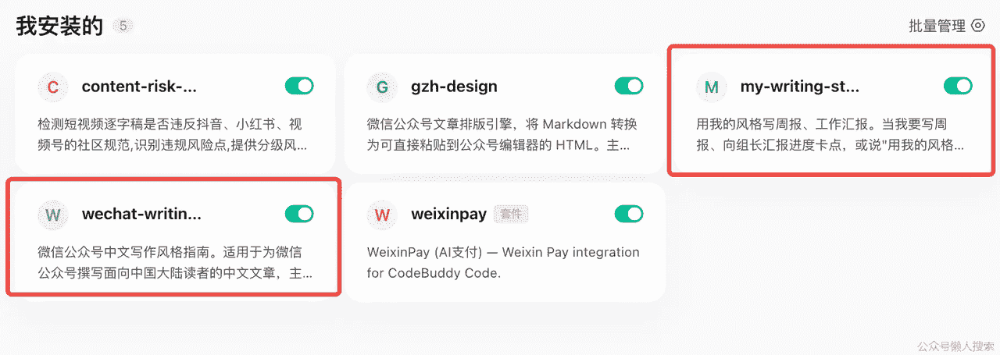

将本关你做出的 Skill 和上一关那个 Skill 比一比

拿同一段话，让它们各改一遍，你就更深地体会到同样都是修改同一个内容，两个 Skill 的区别。

**2.1 两版对比**

这两句都要点名 skill 的名字，别省。

**你现在手上有两个都**能改文字的 Skill，你要是只说“帮我改改这段”，AI 可能挑错一个。

wechat-writing-styl**e是一位公众号博主总结**的规则，改出来的是一种通用的公众号口语体。

**它能把书面腔、AI** 腔去掉，这没问题，但它改出来的东西放在谁身上都差不多。

my-writing-style里写着你的口头禅、你的称**呼习惯**、你受不了的那几个词。改出来的东西只像你。

**先用第一关的那个 Skill。**把下面这段复制发给 AI，把你的原文粘在下面：

Plain Text

```
用 wechat-writing-style 这个 skill 改一下这段话：

（把你的原文粘在这里）
```

再用本关你自己做的 Skill。接着上面那轮对话，复制这句发给它：

Plain Text

```
再用 my-writing-style 改一遍同一段话，两版放一起给我看
```

下面图中内容是拿一段很官方的通知，让两个 Skill 各改一遍的真实结果。

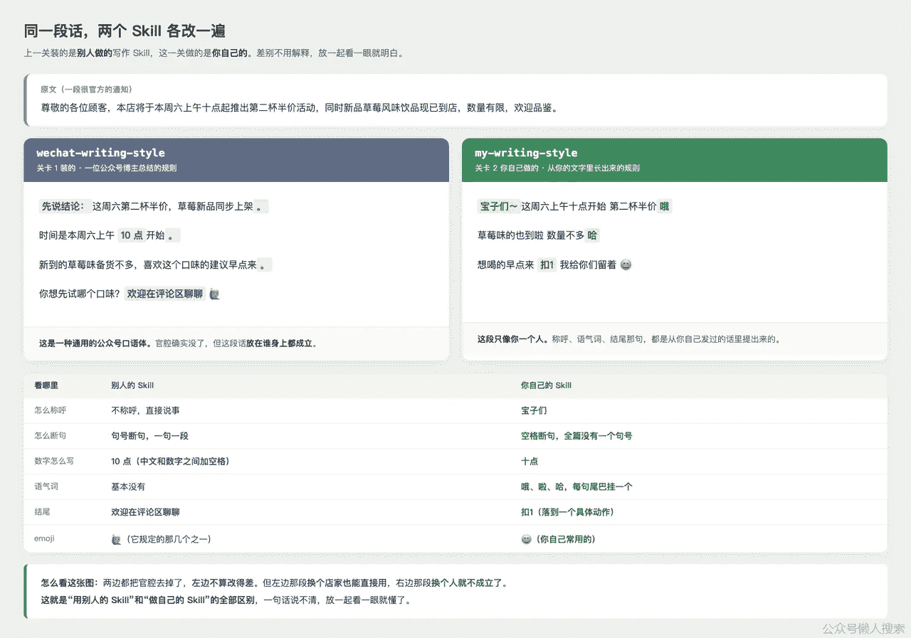

两边都把官腔去掉了，左边不算改得差，但左边那段换个店家也能直接用，右边那段换个人就不成立了。

这就是用别人的 Skill，和做自己的 Skill 的区别。

别人把自己的写作习惯做成 Skill ，你装上，写出来就像他。

这一关你自己做的 Skill ，规则是从你自己的文字里长出来的，就会最符合你的风格表达。

**2.2 如果两版差不多**

如果你感觉两版区别不大，**不代表你做失败了。**

如果你平时写东西本来就是公众号那种口语体，两个 Skill 的规则会撞车，改出来自然接近。

这种情况看细节：**称呼、语气词、结尾那句**。你自己的那版会带上你的习惯（比如"扣 1""早点来哦"），别人那版不会。

要是连细节都一样，多半是你的"我的禁区"那节太薄了。回 05 节第 2 条，让 AI 再给你出一道选择题。


### 04.本关常见卡点

遇到问题先别急着**放弃，可以**先**问 AI。本期推荐**优先使用Codex或WorkBuddy，把报错信息、截图或你的需求新开一个任务窗口，发给它们，让 AI 帮你分析原因、排查问题、甚至直接帮你解决。


慢慢养成先问 AI、再求助他人的习惯，很多问题都会解决的。

| 常见卡点 | 先检查什么 | 下一步动作 |
| --- | --- | --- |
| AI 一口气把 5 个问题全抛过来了 | 不是你的问题，有的模型就爱这样 | 回它一句“ 一次只问一个，我答完你再问下一个 ”，它就会改 |
| 第 4 问答不上来，卡住了 | 正常，绝大多数人都答不上来 | 等它给你出选择题就行；没出就说“ 你编 5 条我这行常见的文案，我来挑哪条烦 ” |
| 翻不到自己写过的东西 | 是真没有，还是觉得写得不好不想给 | 真没有就用语音转文字（02 节第 3 条）； 觉得不好看的那种恰恰最该给 |
| 它生成的 Skill 里有我没说过的话 | AI 编经历，很常见 | 直接说“ 这句我没说过，删掉 ”，让它重发一版 |
| “我的禁区”那节全是空话 | 第 4 问那道选择题没走 | 让它补出选择题给你挑（见 05 节第 2 条） |
| 它把我的样本改写了才贴进去 | 它以为在帮你润色 | 说“ 我写过的那节要贴原文，一个字都别改 ” |
| 装完之后 AI 说不认识这个 skill | 文件放对地方了吗？工具重启了吗？ | 问它“ 你现在能用哪些 skill ”，报不出来就让它检查路径 |
| 写出来还是不像我 | 你说得出哪里不像吗 | 说不出来就让它“ 给我两个版本，我选一个 ”，选着选着就说得清了 |
| 它给的两个版本我看不出区别 | 它造的选项太像了 | 回它“ 这俩差不多，重新给两个差别大的 ”，两个版本至少得在长短上不一样 |
| 它把我写的东西越改越短 | 你平时是不是写得比较长 | 跟它说“ 我一条通常写两三百字，篇幅也要当成一条规则写进去 ” |
| 它写的东西比我啰嗦 / 比我客气 | 多半是禁区那节太少 | 把你受不了的表达补进去，越具体越好，然后让它重写 |
| 它甩给我一串路径，我找不到那个文件夹 | 你是手机 / 网页版吗 | 回它“ 我这个环境没有这个文件夹，换个存法 ”，让它教你存进自定义指令或备忘录 |
| description 那行写的不是我会写的东西 | 它照抄了模板里的举例 | 说“ 改成我真正会写的那几种 ”。不改的话 Skill 以后不会自动触发 |
| 我说“帮我改改这段”，它用错了 Skill | 你手上有两个都能改文字的 | 直接点名 ：“用 my-writing-style 改”。含糊的说法它会挑错 |
| 上一关那个 Skill 老来抢活 | 两个 description 里的触发词撞了 | 把你自己那个的 description 写具体些，写上你真会写的场景（顾客群通知、朋友圈…），别只写“改写文案” |


### 05. 本关小结

**🎉恭喜你！你已经跟着案例做出了第一个属于自己的 Skill**，并且用它生成了一段更像你自己的文字。

这一关做完，Skill 对你来说就不只是别人做好的工具了。

你亲手经历了从准备素材、回答 AI 的采访问题、生成 SKILL.md、保存安装，到当场验证的完整过程。

尤其是看到“我的写法”“我的禁区”“我写过的”这些内容被写进文件里之后，你应该能感受到：Skill 不是把一句提示词写长一点，而是把你的习惯、偏好和判断标准，变成 AI 下次能直接调用的规则。

**这一步最重要的不是做出一个多复杂的 Skill**，而是做出一个真正属于你的 Skill。

它可以很小，可以只有几段大白话，但只要能让 AI 写出来的内容更像你，它就已经成立了。

先把自己的味道存下来，后面我们再继续给它加能力。

**核心三个动作：**

1.  **准备真实样本**：翻出你平时真的写过的 4 到 6 段内容，越日常、越随手，越能代表你的真实风格。

1.  跟着 AI 做出 SKILL.md：按提示词完成采访、样本分析、禁区挖掘和 Skill 生成，把你的写法沉淀成文件。

1.  **当场检查和验证**：重点看 description、我的禁区、我写过的和末尾数字，再用它写一段新内容，看像不像你。

这一关后，你已经完成了第一次“从零做 Skill”的体验，知道了 Skill 可以把你的表达习惯、写作禁区和真实样本保存下来，让 AI 下次写东西时有据可依。

**下一关，我们会在这个基础上继续升级：不只是让 Skill **记住你的风格，还要让它学会和别的 Skill 配合，完成更完整的一条工作流。

💡

别忘了提交作业哦～可以回到本关任务卡，查看具体的提交模板


## 关卡 3：升级你的第一个 Skill

### 00. 本关任务卡

**🎯任务目标：****给上一关做的那个 Skil**l 加一段话，让它写完之后自己去叫另外的 Skill接着干活。你只发一句命令，三个 Skill 接力。

**🗒️任务描述：**

• 打开上一关做的my-writing-style，在末尾加一段调用规则

• 发一句话让它写东西，看它写完之后自动叫上其他的 Skill 进行发布前体检+排版

• 学会一件事：怎么确认其他的 Skill 是真跑了，还是走了个过场

• 了解是否串联多个 Skill

💡

**本关作业**：**让 Skill 自动调用另外两个 Sk**ill，一句命令完成内容改写+检测+排版

**⭕️提交模版**：

• 一句话命令后，三个 Skill 都动了的截图（必填）

体检报告截图，要能看到开头那段“已加载规则库”

参考截图：

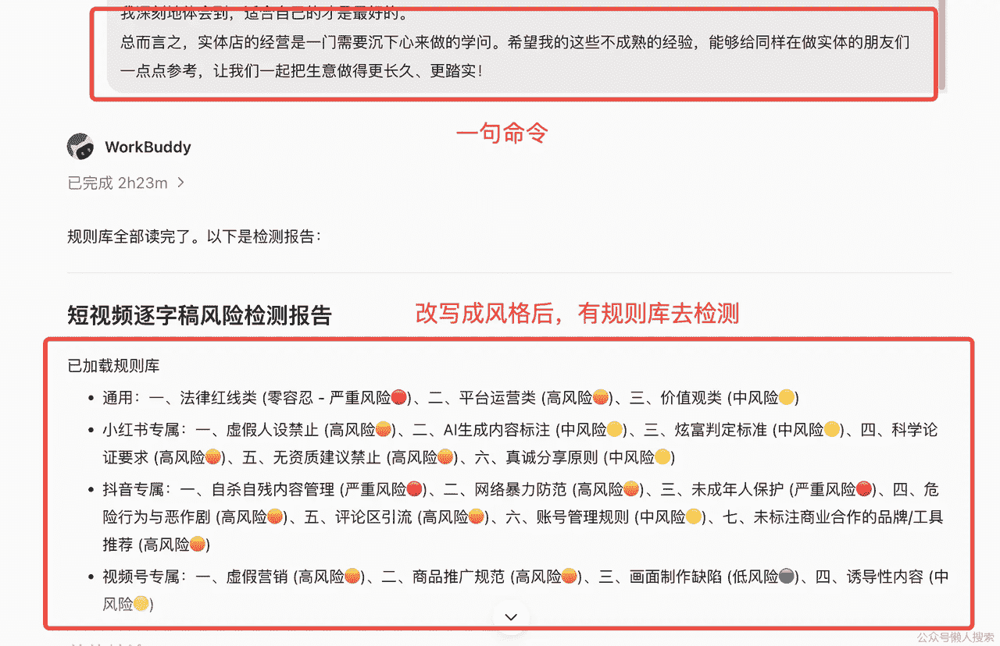

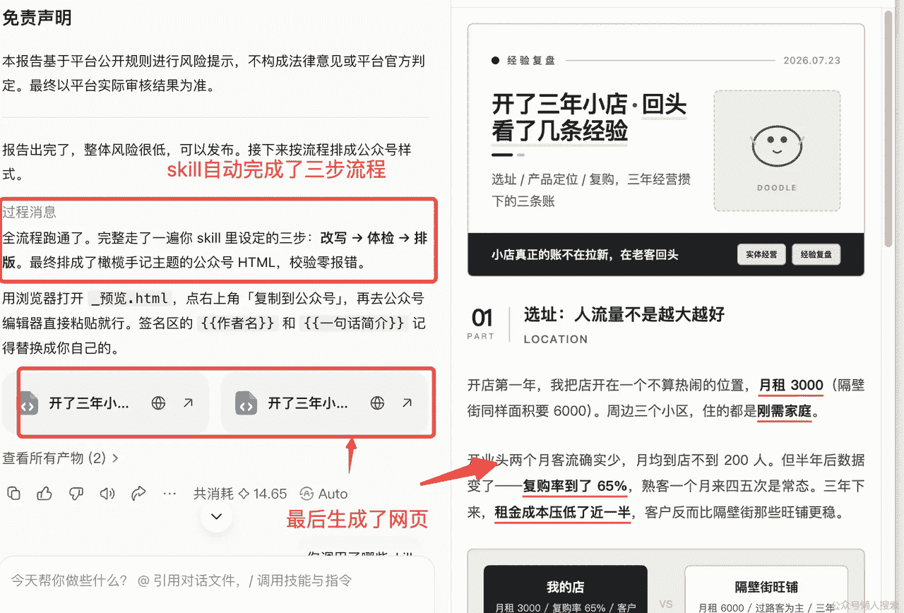

• 分享一下这一关最大的收获（选填）

比如做的过程中有什么感受、对于如何连接 Skill 有没有什么认识和思考？

• 本关遇到的卡点或报错截图（选填）

对于卡点和报错有没有先问 AI ，让它进行解决？简单写清楚你卡在哪一步

**💡 新手提醒：**

**这一关加的东西非常少**，可能就四五行字。别觉得"升级"就得大改。

Skill 的升级从来不是把它写得更长，是让它知道自己干完之后，该把活交给谁。这几行字的价值，比你再写五十条规则都大。


### 01. 本关重点

可能有人会以为，Skill 升级就是不断往里面加规则：禁区越写越多、写法越列越细。

但规则堆得越多，不仅自己很难维护，模型反而更抓不住重点。

真正的升级，不一定要把 Skill 写得越来越厚，而是可以让它和其他 Skill 串联起来，完成一个任务后，自动调用下一个 Skill，形成一条完整的工作流。

本关完成后和关卡 1 的效果差别：

|  | 每一步谁去叫下一个 | 你要发几次话 |
| --- | --- | --- |
| 关卡 1 | 你自己去叫 。改文字发一次，排版发一次，体检再发一次 | 3 次 |
| 关卡 3 | Skill 自己去叫 。它写完就知道该找谁接着干 | 1 次 |

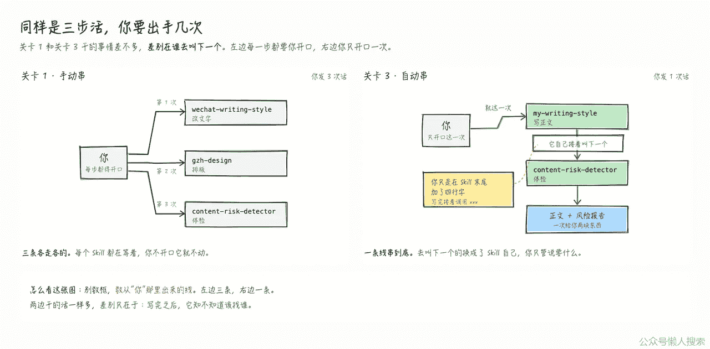

**左右两张图，**两边干的活一样多，差别只在于写完之后 Skill 知不知道下一步该找谁。

就像一个刚入职的新同事，完成手里的工作后，只会停在那里等别人继续安排；而一个熟悉业务的老同事，做完之后会主动找到下一位同事，把事情接着往下推进。

**这就是这一关会实现的：**你手上的 Skill 从一个"听话的工具"，变成了一个"知道下一步该干嘛的工具"。


### 02. 升级你的 Skill

1.给你的 Skill 加一段规则

**1.1 两种办法**

办法一：让 AI 帮你加（推荐，不用自己找文件）

⬇️把下面这段复制，直接发给 AI：

Plain Text

```
帮我改一下 my-writing-style 这个 skill：在文件末尾加一节，叫“写完之后：发出去之前先体检”，内容是让你写完正文之后，接着调用 content-risk-detector 这个 skill 做合规检测，然后把风险报告原样贴给我看，包括报告开头那段&quot;已加载规则库&quot;。正文和报告分开放，别混在一起。改完把新加的那节念给我听。
```

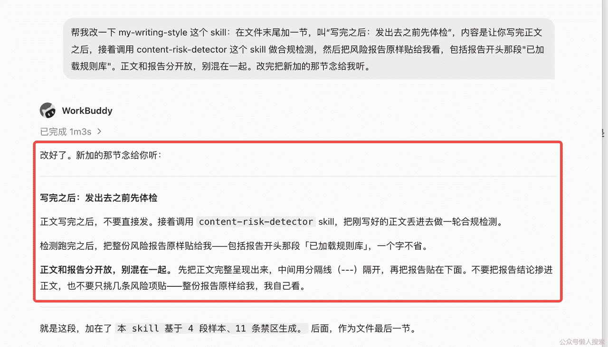

**办法二：自己动手粘**

打开my-writing-style文件夹里的SKILL.md，拉到最底下，把下面这段粘在最后：

Plain Text

```
## 写完之后：发出去之前先体检

**写完正文，不要就这么给我。** 接着调用 `content-risk-detector` 这个 skill，把刚写好的内容过一遍合规检测。

把它给出的风险报告原样贴给我看，包括报告开头那段“已加载规则库”。

正文和报告分开放，别混在一起。
```

**💡 粘完记得存盘。有**的工具改完要重启才认新内容，改完先问它一句“my-writing-style 现在末尾写的是什么”，能念出来就是生效了。

**1.2 这段规则的作用**

这一段规则不是随便写几句话，而是在SKILL.md中告诉 AI：要调用谁、要返回什么、结果要展示到什么程度。

以后如果你想引用其他 Skill，也可以按照这个结构来写。这几个部分齐全，AI 才更容易按照你的预期执行。

我们就用这个例子，看看这三个部分分别是怎么写的，以及为什么这样写：

| 这句话 | 作用 |
| --- | --- |
| 接着调用 content-risk-detector 这个 skill | 点名 。不点名它可能自己瞎判，或者干脆不查 |
| 把风险报告原样贴给我看 | 要产物 。不要产物它可能&quot;心里查了&quot;但不告诉你 |
| 包括报告开头那段&quot;已加载规则库&quot; | 要它露出来 。不写这句，它可能自己压缩成一句“检测通过，没问题”，证据你就看不见了 |

**这里要区分两件事：**

• content-risk-detector自己的规则**：负责让 AI 真正去读取规则并完成检测。

• **你现在添加的这段说明**：负责让my-writing-style调用content-risk-detector后，把完整检测结果展示出来，而不是自己默默检查完就结束。

**2. 跑一遍看看**

**接着上面那轮对话**，复制这句发给 AI（要写内容可以换成你自己的）⬇️：

Plain Text

```
用我的风格写一条【小红书笔记：这周六上午十点第二杯半价，新到草莓味限量五十杯】
```

注意这句话里没提"体检""检测""合规"一个字。你只让它写通知，体检是 Skill 自己接着去做的，这就是升级的效果。

你会看到它连着出两块东西：

**第一块，正文。**就是你的风格写出来的那段通知。

**第二块，风险报告。**开头一段"已加载规则库"，下面是分级的风险项。

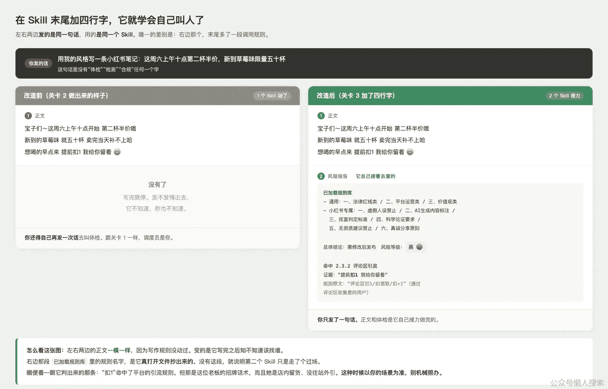

上面这张是同一句话、同一个 Skill 的真实结果。

**左边是你关卡 2 做出来的样子**，写完就停；右边只是本关你新增规则后，末尾多了那四行字，它自己就接着去查了。

注意右边它判出来的那条："扣1"被它当成了平台禁止的引流话术。

但那是这位老板的招牌话术，而且她是店内留货、没往站外引。

**这种时候以你的场景为准。**

**3. 确认规则真的生效**

链式调用最容易踩坑的地方是：第二个 Skill 根本没执行，但你很难发现。

模型完全可以直接生成一份格式漂亮、结构清晰、看起来很专业的报告，让你误以为已经完成了检测，实际上它可能压根没有调用对应的 Skill，更没有读取规则文件。

那怎么判断它到底有没有真正调用第二个 Skill？

**3.1 看报告开头**

真跑过的报告，开头长这样：

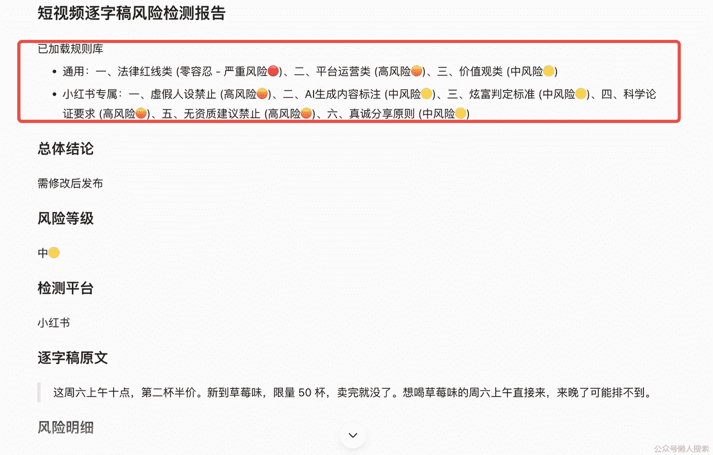

**关键在于那些名字。**

"法律红线类""A**I生成内容标注"这些是**content-risk-detector规则文件里的原话，不打开文件根本抄不出来。

这就说明 Skill 是真正完成了调用

| 你看到什么 | 说明什么 |
| --- | --- |
| 抄出了一串具体的规则名 | ✅ 它真读了 |
| 只写&quot;已加载规则库&quot;没有下文 | 💡 存疑，让它把名字列出来 |
| 压根没有这一段 | ❌ 它跳过了规则库，这份报告不作数 |

看到第三种，可以直接回它一句：

Plain Text

```
你没加载规则库，重新读一遍 references 目录里的四个文件再判一次
```

这个办法能用在任何 Skill 上。

以后你串联别的 Skill，都可以问自己一句：有没有一样东西，是它没有真正调用skill干活就交不出来的？

**数量不算数（数字可以编**，而且不同的数法结果不一样）。原话、名字、具体的引用才算数。

**3.2 能力边界**

别忘了，Skill 的链式调用只是把两个 Skill 串联起来，并不会改变content-risk-detector本身的能力。

被调用的 Skill 还是只能完成原来擅长的事情：帮助你发现明显的违规词和高风险表达，而不是代替人工审核。

因此，涉及金钱、承诺、资质等内容时，即使检测结果显示通过，也建议再进行人工复核。

**4. 串联更多 Skill**

**其实，Skill 不只能调用一个 Sk**ill，也可以连续调用多个 Skill。

就像一位员工做完自己的工作后，把结果继续交给下一位员工处理，一步步完成整条业务流程。

我们可以在刚才的基础上，再继续串联一个公众号排版 Skill，让文章检测完成后，自动完成排版

同样的办法，在那段调用规则里再加一句，让它体检完顺手排个版：

Plain Text

```
继续帮我改一下 my-writing-style 这个 skill：在体检通过之后，再调用 gzh-design 排成公众号样式，生成能直接粘贴的 HTML。
```

可以发一篇东西让它跑一遍全流程，测试一下效果。

Skill 也不是越串越多越好，而是根据业务场景按需调用。

不是所有内容都适合接这个 Skill。

如果只是几句话的通知、公告或短文，就没必要再做公众号排版；等内容是一篇完整文章时，再把它接到流程后面，才能真正发挥排版 Skill 的作用。


### 03. 本关常见卡点

遇到问题先别急着**放弃，可以**先**问 AI。本期推荐**优先使用Codex或WorkBuddy，把报错信息、截图或你的需求新开一个任务窗口，发给它们，让 AI 帮你分析原因、排查问题、甚至直接帮你解决。


慢慢养成先问 AI、再求助他人的习惯，很多问题都会解决

| 常见卡点 | 先检查什么 | 下一步动作 |
| --- | --- | --- |
| 它只写了正文，压根没去体检 | 改完的文件存盘了吗？工具重启了吗？ | 问它“ my-writing-style 现在末尾写的是什么 ”，念不出新加那段就是没生效 |
| 存盘也重启了，它还是不去叫 | 可能就是你的模型不擅长这个 ，不是你写错了 | 别较劲。 手动发一句“ 用 content-risk-detector 检测一下刚才那段 ”，效果一样，作业照样能交。换个模型再试也行 |
| 报告里没有“已加载规则库”那段 | 它跳过了规则库 | 回它“ 你没加载规则库，重新读一遍 references 目录里的四个文件再判 ” |
| 它把正文和报告混在一起了 | 调用规则里那句“分开放”漏了 | 补一句“ 正文和体检报告分成两块，别混着 ” |
| 它说找不到 content-risk-detector | 关卡 1 那个装好了吗 | 问它“ 你现在能用哪些 skill ”，报不出来就回去关卡 1 重装 |
| 它把你的口头禅判成违规了 | 是不是你自己样本里的原话 | 实测撞见过：“想喝的 扣1 ”字面命中了平台的“评论区引流”规则，但那是这位老板的招牌话术。 以你的场景为准 ，跟 AI 说“ 这条发在自己顾客群里，这个判定不适用 ”。Skill 是死的，场景是活的 |
| 它把报告写得很吓人，全是红的 | 看看是不是它管不了的事 | 对照 04 节第 2 条。 涉及钱和承诺的它查不了 ，别被吓住，也别全信 |
| 加了排版之后，出来的东西很怪 | 内容是不是太短了 | 三句话的通知就别排版了， 跳过 05 节 |

### 04. 本关小结

**🎉恭喜你！你已经把自己的第一个 Skill 升级了一次，并且让它**学会用一句命令接力完成“内容改写 → 发布前体检 → 公众号排版”的完整流程。

这一关做完，Skill 对你来说就不只是一个会写你风格的文件了。

你亲手经历了打开上一关的my-writing-style、在末尾加调用规则、用一句话测试它会不会自动接上content-risk-detector，以及继续串联公众号排版 Skill 的完整过程。

尤其是看到同一件事，关卡 1 要你自己一步步去叫，关卡 3 只需要发一次话，后面就能自动接上之后，你应该能感受到：Skill 的魅力不只在于单个工具更听话，还在于它们可以彼此配合，变成一条真正能交付结果的工作流。

这一步最重要的不是把 Skill 串得多复杂，而是确认它真的串上了。

它不能只假装输出一份报告，也不能只说“检测通过”。你要能看到“已加载规则库”、规则名、命中依据这些证据，才算第二个 Skill 真的动了。

Skill 也不是越串越多越好。内容很短，就先完成改写和体检；内容是一篇完整文章，再让它接着排版。能按场景选择，才是真正会用。

先让 Skill 学会自己把活交给下一个 Skill，后面我们再拆开它的结构，看懂这套规则到底是怎么指挥 AI 做事的。

**核心三个动作：**

1.  **给 Skill 加调用规则**：在my-writing-style末尾写清楚，正文写完后要接着调用content-risk-detector，适合长文时再继续调用公众号排版 Skill。

1.  **用一句话跑全流程**：只发写作任务，不主动提醒“体检”和“排版”，看它是不是能自己完成后面的接力。

1.  **看证据别看口头完成**：重点检查“已加载规则库”、具体规则名、风险依据，以及正文、报告、排版结果是不是分开放。

这一关后，你已经完成了第一次 Skill 串联体验，知道了 Skill 不只能单独工作，也可以把多个稳定动作接成一条更省心的内容生产流程。

下一关，我们会把你已经在用的三个 Skill 拆开看，里面到底由哪些部分组成，搞清楚它们为什么长得不一样

💡

别忘了提交作业哦～可以回到本关任务卡，查看具体的提交模板


## 关卡 4：看懂结构，拆解一个 Skill

### 00. 本关任务卡

**🎯任务目标：**把你已经在用的三个 Skill 拆开看一遍，搞清楚它们为什么长得不一样，学会一件事：打开一个 Skill，能看懂它为什么这么写。

前三关你光顾着用了。这一关告诉你，手上这些东西都叫什么、各管什么。

**说白了是为了下一关**：等你想让自己那个 Skill 记住更多东西（你的价格、老顾客常问什么、你写过的爆款），得先知道这些该往哪儿放。这一关就是去看看别人怎么放的。

不用装新东西，拆的就是关卡 1 你已经装好的那三个。

**🗒️任务描述：**

• 认识 Skill 的文件结构和三种能力

• 明白为什么有的 Skill 有很多文件，有的文件很少

• 了解一个复杂 Skill 如何保持稳定输出

• 拆解一个真实 Skill 的文件结构，生成 Skill 结构拆解卡

💡

**本关作业**：生成 Skill 结构拆解卡

**⭕️提交模版**：

• Skill 结构拆解卡（必填）

**AI 输出**的那张卡，截图或者复制文字都行，五条都得在。

• 一句话：你自己的 Skill 跟gzh-design比，差在哪（必填）

一句话就够。它占了三种能力里的哪几种？跟gzh-design比缺哪几种？缺的那几种，你现在的任务场景用得上吗？

• 分享一下这一关最大的收获（选填）

• 遇到的卡点（选填）

**💡 新手提醒：**

**这一关不用改任何文件**，就是将你用过的 Skill 打开看看结构。

但别跳过，了解 Skill 的结构很重要，后续关卡会接着结构去升级 Skill 。

本关要讲的每样东西，前三关你都碰过一遍了：

• references/资料夹，关卡 1 装的时候提醒过“不能只拷 SKILL.md”，说的就是不能漏拷它

• SKILL.md怎么写，关卡 2 你亲手写过一个

• 关卡 3 那种防偷懒的规矩（标题只能照抄、抄不出来就说明没读），你亲眼看它起过作用


### 01. Skill 的文件结构与三类核心能力

**在关**卡 0 中提到：Skill 通常以SKILL.md文件为核心，也可以包含参考资料、程序脚本、图片等配套文件。

一个 Skill 本质上是一组被组织好的能力文件。

**S**KILL.md 负责定义规则，其他配套文件则用于补充资料或扩展能力。不同文件结构，决定了 Skill 能完成什么任务。

1.Skill 文件中最核心的结构和能力

| 能力 | 在文件夹里长什么样 | 你在哪见过 | 哪一关教 |
| --- | --- | --- | --- |
| 把规矩写清楚 | SKILL.md ，就一个文件 | 关卡 2 你亲手写的 my-writing-style | 关卡 2 |
| 记住一大堆资料 | references/ 这样的资料夹 （还有个 assets/ ，用得少） | content-risk-detector 里那几份平台规则 | 关卡 5 |
| 让程序去算、去查 | scripts/ 里的脚本 | gzh-design 排完版自动跑的那个校验 | 关卡 6 |

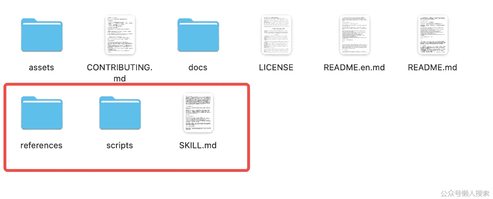

其中，SKILL.md 是每个 Skill 都必须具备的核心文件，负责定义 Skill 的规则和行为；references、scripts等配套文件则是可选的，只有当任务需要额外资料或程序能力时才会添加。

你可能会疑惑：我都在用 AI 了，为什么还要脚本，让 AI 直接去算、查不就行了？

脚本有 3 样优势：

• **结果固定**。脚本运行一百遍，结果一个样；AI 依靠模型推理，同一份文件让它数两遍规则，可能给出两个不同答案；

• **不花 AI 额度**。脚本可以反复运行，跑多少遍都不耗 AI 工具的额度。对于每天重复执行的任务，把固定步骤交给脚本，可以节省大量调用成本。

• **快**。gzh-design排完版那个检查，脚本一秒就出结果；让 AI 从头到尾看一遍再挑错，又慢又容易看漏

所以，一个好的 Skill 不是让 AI 包办所有事情，而是让 AI 负责理解、判断和调度，把不能出错、重复执行的固定步骤交给脚本去固定处理。

当然，不是所有 Skill 都需要其他的文件，不同工具对这些文件的支持情况也不同。

• 只需要写规则的 Skill，一个SKILL.md就够了，基本所有 AI 工具都可以使用

• 需要额外知识资料的 Skill，需要添加references/等文件，需要 AI 工具支持读取本地文件

• 需要执行计算、查询、校验等固定任务时，才会用到scripts/，需要 AI 工具支持运行脚本

具体哪些工具可以完成，关卡 6 会详细说明，即使无法运行脚本，也有对应替代方案，不影响完成关卡任务。

2. 为什么有的 Skill 只有一个文件，有的有几十个

这一关不用你去电脑上翻文件夹，可以让 AI 告诉你。

⬇️把下面这段复制，发给 AI：

Plain Text

```
把我装的这三个 skill 的文件结构列出来：wechat-writing-style、content-risk-detector、gzh-design。
每个都按这个格式说：文件夹里有几个文件、分别叫什么名字、分在哪几个子文件夹里。
只列你真看到的，没看到的就说没看到，别猜。
```

AI 一般会回复：


如果想更直观地理解，也可以打开关卡 1 资源包中的三个 Skill，解压查看它们的真实文件结构，再对照下面的表格理解不同 Skill 为什么会有不同组成。


将 AI 列出来的或你打开文件夹看到的，对着下面这张表看。

| Skill | 点开看到什么 | 它为什么长这样 |
| --- | --- | --- |
| wechat-writing-style | 孤零零一个 SKILL.md | 它只立规矩。 怎么改文字，一页纸写得下。没有要记的资料，也没有要算的活 |
| content-risk-detector | SKILL.md ，加 references/ 里四份规则文件 | 它要记东西。 一份通用规则，加抖音、小红书、视频号各一份。全塞进 SKILL.md 太挤，单独放，你的内容发哪个平台它读哪份 |
| gzh-design | SKILL.md ，加 references/ 里 11 份资料，再加 scripts/ 里 4 个脚本，还有 assets/ 、 docs/ 两个 | 它又要记又要算。 记的是六套排版主题的样式（标题长什么样、引用框长什么样，一套存一个文件），算的是排完之后自动查一遍，看合不合公众号的规矩。要记的进资料夹，要算的进脚本 |

💡 如果数出来跟表里对不上，不要紧，你没装错。

不管是**从 GitH**ub 装的还是用的资源包，文件夹里都会有README、LICENSE、CONTRIBUTING这类东西，那是代码仓库自带的，跟 Skill 干活没关系。这些通常不直接参与 Skill 的运行，但README管安装说明，LICENSE管你能否修改和分享，不能随便删。

**看结构，别数总数。**

对照上一节的表格可以看到：

• wechat-writing-style只具备“写清规则”这一种能力；

• content-risk-detector具备“写清规则 + 记住资料”两种能力；

• gzh-design三种能力都有（其中assets、docs也属于资料类文件）。

但文件数量的多少，并不能代表 Skill 的好坏。

一个 Skill 需要哪些文件，取决于它要完成什么任务：如果只需要明确规则，一个SKILL.md就够；如果需要查阅资料，就添加references/；如果需要执行固定计算、校验等任务，再加入scripts/。


你在关卡 2 做的my-writing-style就属于第一种：只需要一个SKILL.md文件，就能完成它的任务。

但如果未来 Skill 需要管理大量资料，还把所有内容都塞进SKILL.md里，就会变得难以维护，也容易让 AI 抓不住重点。

后面的关卡会带你学习如何拆分资料，让 Skill 的结构更清晰。

3. 一个复杂 Skill 如何保持稳定输出

三个里面gzh-design的任务最复杂：公**众号排版规则多，主题**有六套还不能混着用，可它很少把样式排错。

能稳定输出，关键就在于它在 SKILL.md 里提前写好了三类防错规则。

这些规则的写法，你自己的 Skill 也可以复用。

**可以自己打开那个文件看。**

.md就是个纯文本文件，Windows 上右键选“打开方式 → 记事本”，Mac 上用“文本编辑”。

**不过让 AI 念更省事**，这一关本来也不要求你动手改东西。

⬇️想自己看看原文的话，把这句复制发给 AI：

Plain Text

```
把 gzh-design 的 SKILL.md 开头那段说明念给我听，就是 name 和 description 下面、第一个小标题上面的那几行
```


3.1 写法一：资料只认一个说了算的地方

它开头那段说明里有句原话：“主题清单以references/theme-index.md为单一来源”。

意思是这件事只准写在这一个文件里，别处不许重复写。

六套主题的名字、颜色、适用场景，以t**heme-index.md这**一张表为准。别处跟它对不上，一律听它的。

为什么？同一件事写在两个地方，早晚有一天你改了这处忘了那处，两边对不上，AI 就不知道该听谁的。

**3.2 写法二：不许它凭记忆写**

还是那段说明里的，原话：“具体 HTML 代码一律从组件库取，不要凭记忆手写”。

**意思是排版要用的那些**代码，必须从存样式的文件里抄现成的，不许 AI 自己现编。因为 AI 干熟了就爱即兴发挥，编出来的看着像那么回事，粘进公众号样式就丢。

这句话你眼熟不眼熟？关卡 3 那个体检 Skill 的规矩是：大类标题只能照抄，不许自己概括。

一个道理：关键的东西，让 AI 抄现成的，别让 AI 自己编。

3.3 写法三：资料一大堆，干活只翻用得上的

这条得看它干活的顺序：references/里躺着 11 份资料，可排一篇 Markdown 文章它只读 3 份（换成 Word 或 PDF 稿会多读一份专管格式转换的）。

先读那张主题索引表挑主题，再读挑中那套的样式文件，最后加一份所有主题都要用的公共样式。剩下 8 份动都不动，等用到再说。

11 份要是一次全塞给 AI，真正要紧的规矩会被淹没，弱一点的模型直接就撑爆了。

所以资料多了，要在 SKILL.md 里写清“什么情况下读哪份”。

后续你也会亲手完成这一步。

**4. 让 AI 帮忙拆解结构**

前面我们带你拆解了几个真实 Skill。

现在轮到你自己实践：让 AI 帮你分析一个 Skill 的结构，并验证它是否真的读取了文件。

验证方法和关卡 3 一样：让 AI 提供只有真正查看文件后才能得到的信息。

⬇️把下面这段复制，发给 AI：

Plain Text

```
帮我拆解 gzh-design 这个 skill 的结构，只按下面五条填，别扩展：

1. 它是干什么的，一句话。
2. 文件夹里的文件分几类，每类各管什么。SKILL.md、references、scripts 分开说。
3. 这三种能力它占了哪几种：把规矩写清楚 / 记住一大堆资料 / 让程序去算、去查。每种给出证据，指出具体是哪个文件。
4. 它防止出错的写法，找两条，必须从文件里抄原话，注明抄自哪个文件。
5. 打开 references/theme-index.md，把“已注册主题”那张表**整张原样抄出来，一列都不能少**，包括最后那列很长的样式代码。一个字都不能改。

用“Skill 结构拆解卡”当标题输出。
```

**你会得到一张拆解卡：**


怎么判断 AI 是不是真的读了文件？

主要是看第 5 条输出的结构是不是只有打开文件才能得到。

检查这三点：

• 是不是一张五列表格，并且六个主题各占一行；

• 最后一列是不是包含完整的样式代码，而不是简单描述；

• 中间是否有一列记录对应文件名，并且以theme-开头、.md结尾。


三项都符合，基本可以确认 AI 确实读取了对应文件。

如果出现这些情况：

• 只列出了主题名称；

• 少了表格列；

• 把内容整理成一段文字；

说明它很可能没有真正读取文件，而是在根据已有信息生成答案。

可以把第 5 条单独重新向 AI 发送一次，并在开头补充：

不许凭记忆，打开文件抄，一列都不许少。

对着拆解卡第 3 条，回头看你自己的my-writing-style。

它占了三种能力里的哪几种？跟gzh-design比缺哪几种？缺的那几种，你现在的任务场景用得上吗？

想清楚，总结成一句话，后续关卡会用上。


### 02. 本关常见卡点

遇到问题先别急着**放弃，可以**先**问 AI。本期推荐**优先使用Codex或WorkBuddy，把报错信息、截图或你的需求新开一个任务窗口，发给它们，让 AI 帮你分析原因、排查问题、甚至直接帮你解决。


慢慢养成先问 AI、再求助他人的习惯，很多问题都会解决

| 常见卡点 | 先检查什么 | 下一步动作 |
| --- | --- | --- |
| 它说找不到 gzh-design | 关卡 1 装的还在不在 | 问它“ 你现在能用哪些 skill ”，报不出来就回关卡 1 重装 |
| 我压根没有 skills 文件夹，或者它说读不了本地文件 | 你的工具是不是关卡 2 就走的“存不了文件”那条路 | 用关卡 1 下的那个资源包 ，里面就有 gzh-design 文件夹。解压后用记事本打开 SKILL.md 和 references/theme-index.md ，把内容复制下来粘给 AI，再发拆解那段话。 注意这样第 5 条就验不出东西了（它抄的是你亲手粘的内容），作业里注明一句“我是粘给它的”，这条跳过就行（包也没有的话 ，去关卡 1 那节重新下一个） |
| 它抄的主题名对不上 | 它没读文件，在编 | 把第 5 条单独再发一遍，前面加“ 不许凭记忆，打开文件抄 ” |
| 拆解卡写成了小作文，全是术语 | 发的时候是不是把“只按五条填，别扩展”漏了 | 重发一遍，带上这句。还收不住就回它“ 第 3 条重写，只说占了哪几种、证据是哪个文件 ” |
| 我看到的文件跟手册说的对不上，多出好些没提过的 | 多出来的是不是 README 、 LICENSE 、 CONTRIBUTING 、 .github 、 archive 这几样 | 这几样都是代码仓库自带的杂物，跟干活没关系，不用管。 但 assets 、 docs 不是杂物 ： assets 放的是现成模板， docs 是它自己的说明书，都算它的家当。下一关会顺带提一句 assets |


### 03.本关小结

**🎉恭喜你！你已经看懂了一个 Skill 文件夹里都有什么，并且**完成了对自己 Skill 的结构拆解。

这一关做完，Skill 对你来说就不再只是一个”能直接调用的工具”了。

你已经拆开看过几个真实 Skill，也知道了为什么有的只有一个SKILL.md，有的会带上references/，有的还会使用scripts/。

Skill 不是文件越多越高级，而是根据任务需要，选择合适的结构。

只需要写规则，一个SKILL.md就够了；

需要记住大量资料，就增加references/；

需要完成计算、查询、校验等固定任务，再加入scripts/。

这一关最重要的，不是记住这些文件夹的名字，而是学会看懂一个 Skill 是怎么设计的。以后拿到一个新的 Skill，你能判断它为什么这么组织；等自己扩展 Skill 时，也知道哪些内容该写进SKILL.md，哪些应该拆到资料文件里，哪些适合交给脚本处理。

**先学会看懂别人怎么设计，下一关，你就会开始把**这些方法真正用到自己的 Skill 上。

**核心三个动作：**

1.  对比三个 Skill 的文件结构：看清单文件 Skill、带资料夹的 Skill、带脚本的 Skill 分别长什么样。

1.  认出 Skill 的三类核心能力：把规矩写清楚、记住一大堆资料、让程序去算和检查。

1.  **让 AI 拆解，再自己验证**：不要只听它说“我看过了”，要用具体文件、具体表格、具体证据确认它真的读了。

这一关后，你已经完成了第一次 Skill 结构拆解体验，知道了一个 Skill 不是凭感觉堆出来的，而是用文件、资料和脚本，把一套稳定做法拆开存好。

**下一关，**给你的 Skill 建个资料夹，让它记住比一页纸多得多的东西。

💡

别忘了提交作业哦～可以回到本关任务卡，查看具体的提交模板


## 关卡 5：让 Skill 学会参考资料

### 00. 本关任务卡

**🎯任务目标：**给 Skill 配一个references/（资料夹），写一份”我的真实情况”放进去，让 AI 在生成内容时能够参考你的真实资料，减少重复介绍自己的时间，也降低编造信息的概率。

**🗒️任务描述：**

• 先完成一次”改造前”测试，记录 AI 现在会编哪些信息

• 学会区分哪些内容放在**SKILL.md**，哪些放进**references/**

• 整理两份资料：一份真实案例，一份个人真实信息

• 在**SKILL.md**中写清引用规则，让 AI 按需读取对应资料

• 再完成一次验证，确认 AI 引用的是真实资料，而不是凭经验猜测

💡

本关作业：给 Skill 配置 references（资料夹）

**⭕️提交模版**：

• 改造后的文件结构截图（必填）

参考截图：


• 放资料前后，同一个任务的输出对比（必填）

**涉及价格、**进货渠道、详细工作内容这类隐私内容你不想公开的，可以打个码再交。

• 分享一下这一关最大的收获（选填）

• 遇到的卡点（选填）


### 01. 本关重点

关卡 4 最后，你总结了自己的 Skill 有哪几种能力，还缺什么能力。这一关我们就来补上“能记住一大堆资料”的这种能力。

关卡 1 的时候有提醒过你：改完一定要通读一遍，凡是出现”我如何如何”的句子，都要确认是不是自己真的做过。

为什么会这样？

因为 AI 并不知道你的真实经历、你的产品信息，或者你的业务规则。轮到需要写具体内容的时候，它手里没有资料，就只能根据上下文猜一个最合理的答案。

也许有人会想：

“那我就在SKILL.md里写一句：不许编。”

但这并不能完全解决问题。

因为 AI 不是故意骗你，而是**根本没有可以参考的资料**。**没有真实信息，它就只能继续猜。**

这一关要学的，就是把这些真实、稳定、需要长期记住的内容交给 Skill 保存，而不是每次都让 AI 临场发挥。


我们要给 AI 一份能查的东西。

你的产品叫什么、多少钱、真干过什么事，全写进一份文件，再在 SKILL.md 里加一句：写到这些，去查那份文件，不许自己想。

关卡 2 的时候，你只放了一两段样本进自己的 Skill ，作为 AI 的参考，这时候完全够用。

但以后，你可能会积累十几篇、几十篇案例，甚至产品资料、客户常见问题、品牌信息……这些内容如果都塞进SKILL.md，不仅难维护，也会越来越不好找。

所以，这一关要学的，就是**把这些长期积累的资料单独放到**references/**里**。以后有新的案例、新的经验，直接往里面补充就行，不用每次都修改SKILL.md。

更重要的是，这些资料不只是写文案时的素材。

它们其实是AI 应该知道，却不会自己知道的关于你和你的业务的信息。以后无论是写内容、回复客户，还是帮你做判断，都可以先查这份资料，再开始工作，而不是凭空猜。

后面的关卡里，你还会继续往这份资料库里添加内容。


### 02. 给 Skill 配上 references （资料夹 ）

1. 什么该留在 SKILL.md，什么该放进资料夹

先记住一个原则：

**SKILL.md**写的是“怎么干”，资料夹放的是“干活要用的资料”。**

拿关卡 2 的my-writing-style来看：

• 写作原则、流程、注意事项，属于”怎么干”，继续放在SKILL.md。

• 写作样本、品牌资料、产品信息、常见问答等，需要长期积累、不断增加的内容，更适合放到references/。

| SKILL.md 里的这几节 | 动不动 | 为什么 |
| --- | --- | --- |
| 我是谁 / 写给谁看 / 写哪几种东西 | 留下 | 三五行的事，而且每次写东西都用得着 |
| 我的写法 / 我的禁区 | 留下 | 这是干活的规矩 |
| 开头方式 / 收尾方式 | 留下 | 短，常用 |
| **我写过的 （那一两段样本） | 挪出去** | 会越攒越多，而且不是每次都要看 |
| 写完之后：发出去之前先体检 | 留下 | 关卡 3 你自己加的那节，它管的是流程，不能挪 |
| 最末尾那行 本 skill 基于… | 留下 | 它是这个 skill 的记录，别跟着样本一起搬走 |

**这样做的好处是：规则和资料各**放各的地方，后续**新增资料时，不用反复修改SK**ILL.md，Skill 也更容易维护。

挪完你会多一个文件夹、两份文件：

**• 文件夹叫refe**rences，就是“资料夹”的意思，两个词说的是同一样东西

**• 我写过的.md：样本全搬**进去。以后写出满意的，跟 AI 说一句“把这段加到我写过的那个文件里”就行

• 我的真实情况.md：**这份是新写的**，产品、价格、你真干过的事，一条条列清楚

💡文**件名用中文行不行？多**半行，AI 认得中文名。但**文件夹那个r**eferences得**是英文，****它去找资料时认的就是这个名字**。万一你的工具认不出中文文件名，让 AI 把两个文件改成samples.md和facts.md，一样用。

**判断**标准就三句，以后你自己的 skill 也可以这么看哪些内容应该放到references/**：

• **会经常变化的，放到**references/**。**比如价格、案例、产品信息，更新时只改资料，不用修改SKILL.md。

• **内容特别长的，放到**references/**。**几十上百行的资料都塞进SKILL.md，真正重要的规则反而容易被淹没。

• **不是每次都会用到的，放到**references/**。**比如只有介绍产品时才会查价格、只有回复售后时才会看的 FAQ，按需读取就够了，不必每次都一起加载。

反过来，流程、规则和判断留在 SKILL.md。它相当于 Skill 的操作说明，每次执行任务时，都需要让 AI 完整阅读。

💡顺**带认识一下a**ssets/**

上一关拆gzh-design这个Skill 的结构时，你可能注意到还有一个assets/文件夹。这一关暂时用不上它，知道有这个能力就够了。

它和references/的区别很简单：

• **references/**：放 AI 需要阅读和参考的资料，比如案例、产品信息、FAQ、你的真实经验等。

• **assets/**：放需要直接使用的资源，比如固定模板、图片、图标等。

举个例子，如果你有一套固定的朋友圈模板，或者公司 Logo、宣传图片这类素材，就可以放在assets/里。

等以后真的需要这类资源时，再创建assets/文件夹也不迟。现在先把references/学会就够了。

2. 把你的资料放进 references （资料夹 ）

动手之前，先花一分钟留一份“改造前”的结果。

打开你的 AI 工具，把下面这句复制发给它，并把回答截图保存下来：

Plain Text

```
用我的风格写一段东西，里面要带上我的具体信息，名字和数字都要说清楚
```

也可以根据自己的场景稍微改一下：

• 做生意、开店：推一下我的招牌，把名字和价格说清楚。

• 上班：写一段周报，把项目名和真实数字带上。

这时候，AI 手里还没有你的真实资料。

**先看看它会怎么写**，不用急着评价，把结果截图保存好，这就是“改造前”的结果。

等这一关做完再发一遍同样的话，两张截图一对比就知道这一关干了什么。

**2.1 想清楚你要写进去什么**

花五分钟想一件事：你让 AI 写东西的时候，哪些内容它其实不知道？

不知道的那些，就是要写进“我的真实情况”的。四个行当各举一例，找你对得上的那条看：

| 你是做什么的 | 它该知道、却一直不知道的（不只写文案，让它替你干活都用得上） |
| --- | --- |
| 做电商的 | 你店叫什么、主推哪几款、价格和活动价、发什么快递、几天到、支持不支持七天无理由、你真跑过的工厂或产地 |
| 开店的 | 店名、地址怎么描述（“地铁 X 号线出来两百米”）、营业时间、招牌是哪几样、多少钱、有没有停车位、老顾客常问的那几个问题 |
| 上班的 | 你在哪个部门、手上负责什么、常打交道的几个岗位、你做过的项目和真实数字（别写“提升很多”，写“从 3 天压到 1 天”） |
| 做知识付费的 | 课叫什么、多少节、卖多少钱、学员是哪类人、真实的学员反馈原话、你自己的经历（做过几年、带过多少人） |

不知道写什么的话，用这个笨办法：把你最近发的三条内容翻出来，凡是提到具体名字、数字、时间的地方，全抄进去。那些正是 AI 会编的地方。

2.2 让 AI 帮你建 references （资料夹 ）

不用自己新建文件夹。把下面这段复制，发给 AI ⬇️：

Plain Text

```
帮我给 my-writing-style 这个 skill 加一个 references 资料夹，建两个文件：

1. references/我写过的.md
   把 SKILL.md 里&quot;## 我写过的&quot;这个标题、以及它下面那几段样本，原样搬过去，一个字都不要改。
   搬完把 SKILL.md 里这部分删掉。
   注意：文件最末尾那行&quot;本 skill 基于 X 段样本、Y 条禁区生成&quot;不属于这一节，
   留在 SKILL.md 里别动它，也别搬走。

2. references/我的真实情况.md
   先别写内容，按下面几类列个空框架给我，我自己往里填：
   我是谁做什么的 / 我的产品或服务（名字、价格、卖点）/ 我真做过的事和真实数字 / 常被问到的问题和我的标准答案

两个文件都建好之后，把 SKILL.md 现在还剩哪几节念给我听，
最末尾那一行也原样念一遍，再把文件夹结构画给我看。
```

它做完，你看一眼这两样还在不在：

• SKILL.md 最末尾那行本 skill 基于 X 段样本、Y 条禁区生成，

• 关卡 3 加的那节“写完之后：发出去之前先体检”+“体检通过之后：排成公众号样式”

这两样如果被 AI 误挪走，少了就跟它说“把这行（这节）加回来”。


这一步走完，你的 skill 就从一个文件变成了这样：

Plain Text

```
my-writing-style/
├── SKILL.md              ← 怎么写（规矩、禁区、开头收尾）
└── references/
    ├── 我写过的.md        ← 写出好东西就往里加
    └── 我的真实情况.md     ← 你自己填，只填真的
```

**2.3 填“我的真实情况”**

AI 可以帮你整理、归纳，甚至从旧内容里提取初稿，但每一条信息都需要你确认是真实的。它负责搬运和整理，你负责判断。

不过，不用自己一个文件一个文件去复制，整理这件事可以交给 AI 就好。

先打开手机备忘录，或者微信文件传输助手，把你希望 Skill 长期记住的信息写下来。

不用写成长文章，一条一句即可。

下面给了几个常见场景的示例，找到和自己最接近的参考。

**卖货的参考：**

Plain Text

```
主推：XX 面膜，日常价 89 一盒，活动价 69
发货：广东仓，江浙沪次日达，偏远 3 天
七天无理由退，运费险有
2024 年 3 月去过一次工厂，看了原料仓和灌装线
卖了两年，复购的老客大概三成
```

**开店的参考：**

Plain Text

```
店名：巷子口奶茶，在实验小学东门斜对面
营业：早 9 点到晚 10 点，周末到 11 点
招牌：手打柠檬茶 12 块，芋泥啵啵 16 块，学生证减 2 块
常被问：能不能少糖（能，三档）、有没有热的（冬天有）
开了三年，熟客大多是附近上班的和学生家长
```

**上班的参考：**

Plain Text

```
岗位：XX 公司用户运营，带 2 个人
手上的活：会员体系和复购，天天盯月活、复购率
今年做的：3 月上线积分商城，复购率从 18% 提到 25%
常打交道的：产品、客服、数据组
写周报的规矩：只报数字，别写“大幅提升”，写“从 18% 到 25%”
```

**体制内的参考：**

Plain Text

```
单位：区里某科室，主任科员
手上的活：科室的信息报送、开会用的材料
今年做的：牵头写了 3 份调研报告，办了 2 次全区培训，到会 120 人
常打交道的：分管领导、办公室、下面几个街道
我的忌讳：数字得跟台账对得上，别替我拔高、别替我表态
```

💡要注意的是：这里放的是业务资料，不是保险箱。

references （资料夹）里只放完成这个 Skill 真正需要用到的信息即可，例如产品信息、业务规则、案例、常见问题等。

**不**要把账号密码、API Key、Cookie、身份证号、完整客户隐私、未公开合同、内部链接等敏感信息直接放进去。

如果用自己的真实案例做练习，建议先把姓名、手机号、价格等敏感信息打码或替换，再放进资料里。

写好之后，把下面的提示词连同你写的内容一起发给 AI：

Plain Text

```
把下面这些内容写进 my-writing-style 的 references/我的真实情况.md 里，
按&quot;我的产品或服务&quot;&quot;我真做过的事&quot;&quot;常被问到的问题&quot;分类整理好。
只整理，不要添油加醋，我没写的别替我编。

【把你想好的内容粘在这儿】
```

整理完成后，让 AI 再把整理结果逐条读一遍。

重点不是看顺序，而是检查**有没有出现你没写过、没做过的话**。如果只是调整了顺序、合并了相近内容，不用担心，那只是它在帮你归类。

第一次不用追求写得特别全。十条左右，就足够开始用了。

以后在使用过程中，如果发现 AI 又开始瞎猜、**编信息，往往不是它变笨了，而**是在提醒你：这份资料里还缺一条真实信息。补进去，下次它就知道了。

整个资料库只有一个要求：只写真实发生过的事，不要为了”看起来更厉害”补充自己没做过的内容。

因为这份资料的作用，就是让 AI 不再凭空编造。如果资料本身就是假的，后面所有判断和生成都会建立在错误信息上。

接下来，你可能还会有几个疑问：

| 你想问的 | 答案 |
| --- | --- |
| 我能自己开文件改吗 | 能。 .md 就是纯文本，Windows 右键选“打开方式 → 记事本”，Mac 用“文本编辑”。 存的时候别改后缀 ，还是 .md 。不过让 AI 改省事得多，往里加东西的时候尤其 |
| 这东西存在哪，安全吗 | 就是个普通文本文件，跟你电脑上的 Word 一样， 不会自动传给谁 。但你要是用云端工具，资料就存在人家服务器上，跟存网盘一个道理。 真敏感的东西（进货价、身份证、客户手机号）别往里写 ，这一关也用不着 |

3. 让 AI 按需读，而不是一次全读

资料准备好了，但还差最后一步。

**光把文件放进**references/**还不够，你还得在**SKILL.md**里告诉 AI：什么时候去读它。**

上一关拆解gzh-design时，你已经见过这种写法。

它虽然准备了 11 份资料，但每次排版并不会全部读取，而是根据当前任务，只读取其中需要的 3 份。

**这是因为SKILL.md已经**提前写好了规则：什么情况下，该读取哪份资料。

**所以，refer**ences/负责存资料，SKILL.md负责告诉 AI什么时候、读什么。两者配合，资料才能真正发挥作用。


⬇️把下面这段复制，发给 AI：

Plain Text

```
帮我改一下 my-writing-style 的 SKILL.md，加一节叫&quot;我的资料在哪儿&quot;。
位置放在&quot;# 我的写作风格&quot;这个大标题下面、&quot;## 我是谁&quot;前面。
最上面那几行 name 和 description 不要动，那是这个 skill 的名字和说明，挪了工具就认不出它了。
这一节的内容是：

- 要找我平时说话的感觉，读 references/我写过的.md
- **凡是要写到具体的产品名、价格、时间、数字、我的经历，必须先读 references/我的真实情况.md，按里面写的来。这份文件里没有的，就别写，或者直接问我。不许自己想一个。**
- 平时不用把两份都读，用得上哪份读哪份

改完把新加的这节念给我听。
```

这几句话里，**真正管用的是中间那条**，拆开看：

| 这句话 | 管什么 |
| --- | --- |
| 必须先读 | 不写这句，AI 可能会嫌麻烦就跳过去了 |
| 按里面写的来 | 读了不一定照办，得写明必须按它来 |
| 这份里没有的，就别写，或者直接问我 | 这句最要紧 。堵住 AI 的退路，不然 AI 查不到还是会编 |
| 不用两份都读 | 省着点用，AI 才不会每次都把整个文件夹倒出来 |

💡为什么不干脆让 AI 每次都全读？

现在你就两份文件，全读也不要紧。但攒到十几份的时候可能会出问题：AI 每次开工先把全部资料吞一遍，真正干活的规则会被淹在里面，模型差一点的 AI 可能会直接塞不下了。

4. 验证 AI 是真读了还是装的

**和前面几关一样，**这一步不是看它写得好**不好，而是**验证：它到底有没有去读references里的资料。

**4.1 再跑一次同样的话测试**

**重新开启一个新对话。**不要接着刚才那轮聊天，否则 AI 可能只是记住了聊天内容，分不清到底是读取了references，还是沿着上下文继续回答。

把开头你发给 AI 的那句话，原样在新对话内发一遍⬇️：

Plain Text

```
用我的风格写一段东西，里面要带上我的具体信息，名字和数字都要说清楚
```

这一次，它应该会主动读取**我的真实情况.md**。

重点检查三件事：

• **名字是否正确**：产品名、店名、项目名等，是不是来自你的资料。

• **数字是否正确**：价格、时间、成绩等，是不是你填写的真实数据。

• **有没有编造信息**：是否出现了资料里根本不存在的经历、数字或身份。

如果三项都符合，说明 AI 已经真正读取了references。

把这次结果截图，和最开的截图放一起对比，你会发现：

之前 AI 可能会自己补出”做了三年”“帮助上万人”“省了几万元”这类内容；

现在，它开始引用你资料里的真实名字、真实数字和真实经历。

**这就是**references最大的价值：让 AI 从”猜”变成”查”。

**4.2 AI 没去查怎么办**

先别急着改动 SKILL.md。把下面这句复制发给它⬇️：

Plain Text

```
你刚才写的价格是从哪儿来的？
```

如果它回答：

• “我是按照常见情况估计的。”

• “这是我推测的。”

• “没有参考具体资料。”

那就说明它没有真正读取references。

重新问AI ：“my-writing-style 开头那节写的是什么”。

AI 说得出来就是加上了；念不出来，多半是它没查到。

回一句：“文件里没有的别自己想，直接问我”，然后把那条补进文件

有的工具改完要重开一下才认新内容。

### 03. 本关常见卡点

遇到问题先别急着**放弃，可以**先**问 AI。本期推荐**优先使用Codex或WorkBuddy，把报错信息、截图或你的需求新开一个任务窗口，发给它们，让 AI 帮你分析原因、排查问题、甚至直接帮你解决。


慢慢养成先问 AI、再求助他人的习惯，很多问题都会解决

| 常见卡点 | 先检查什么 | 下一步动作 |
| --- | --- | --- |
| 它压根不去读那个文件 | 04 节那句真加进去了吗 | 问它“ my-writing-style 开头那节写的是什么 ”。念得出来就是加上了；念不出来，把 04 节那段重发一遍。 有的工具改完要重开一下才认新内容 |
| 它说找不到 references 文件夹 | 文件建在哪儿了 | 让它“ 把 my-writing-style 的文件夹结构画出来 ”，多半是建到别处去了 |
| 它读了，但还是编了个价格 | 你文件里那条写清楚了吗 | 多半是它没查到。 回一句“文件里没有的别自己想，直接问我” ，然后把那条补进文件 |
| 我不知道往“我的真实情况”里写什么 | 翻你最近发的三条内容 | 凡是提到具体名字、数字、时间的地方，全抄进去。 那些正是它会编的地方 |
| 我的工具存不了文件（网页版那类） | 你是不是关卡 2 走的那条路 | 照样能做完：资料和 SKILL.md 都存你自己备忘录里，每次开工两样一起粘进对话框，粘完加一句“ 写到具体信息按这份来，不许自己想 ”。04 节那几句也不用写进文件，跟在粘的内容后面说一遍。作业和过关检查里要文件夹的地方，拿备忘录截图交，一样算数 |
| 弄完感觉没什么变化 | 你那句话问得够不够具体 | 光说“ 写条朋友圈 ”看不出差别，得逼它说出具体信息：“ 把名字和价格说清楚 ”。 你那行有什么具体的就问什么 ，开店的问地址和营业时间，上班的问项目和数字 |


### 04. 本关小结

🎉恭喜你！你已经给自己的 Skill 配上了references/资料夹，并且让它开始引用真实资料，而不是凭经验瞎猜。

这一关做完，Skill 对你来说就不只是一个会照着规则干活的文件了。

你亲手经历了从“改造前”测试、发现 AI 会编具体信息，到整理我写过的.md和我的真实情况.md，再把引用规则写回SKILL.md的完整过程。

尤其是把同一句话前后各问一次之后，你应该能感受到：Skill 的魅力不只是让 AI 更听话，还在于它能把你的真实信息存下来，用到的时候再查，而不是每次都靠临场发挥。

**这一步最重要的不是资料写得多全，而是让 AI** 知道什么该查、去哪儿查、查不到就别编。

SKILL.md负责写清楚“怎么干”，references/负责保存“干活要用的资料”。规则和资料分开放，后面资料越攒越多，Skill 也不会乱成一团。

先让它学会引用真实资料，后面我们再给它装上更稳定的检查能力，把那些能机器判断的事交给脚本去做。

**核心三个动作：**

1.  **先留一份改造前结果**：用同一个任务逼 AI 写出具体名字和数字，看清它现在会在哪些地方编。

1.  **把真实资料放进**references/**：把写作样本、产品信息、真实经历、常见问答这类会变多的内容，从SKILL.md里挪出来。

1.  **写清按需读取规则**：告诉 AI 什么情况下读哪份资料，资料里没有的就别写，或者直接问你。

这一关后，你已经完成了第一次 Skill 资料库搭建，知道了 Skill 不是只能记一页规则，也可以长期保存你的真实情况、案例和素材，让 AI 下次写东西时有据可依。

**下一关（关卡 6）**：给这个 Skill 装上第三样本事：一段脚本。你在关卡 2 写的那几条禁区，里头有些是机器能直接查的（有没有出现某个词、字数够不够），这种活不该每次都让 AI 重想一遍。

💡

别忘了提交作业哦～可以回到本关任务卡，查看具体的提交模板


## 关卡 6：让 Skill 能处理固定任务

### 00. 本关任务卡

**🎯任务目标：****给你的**写作 Skill 装上第三个能力：scripts/（脚本），让它每次发东西之前，自动查一遍你自己定的禁区。

**🗒️任务描述：**

• 学会一个判断：哪一步该交给程序去算，哪一步该留给 AI 去想

• 翻出你在关卡 2 写的“我的禁区”，把里面机器能查的那几条挑出来

• 让 AI 把这几条写成一段脚本，装进 Skill

• **三十秒测一下**你的工具跑不跑得动它

💡

本关作业：给 Skill 配置 scripts （脚本）

**⭕️提交模版**：

• AI 写出来的脚本（必填）

可以是文件内容的截图或者问 AI 去展现的内容

截图参考：


• 你挑出来的那几条规则是什么为什么该交给脚本程序（必填）

简单说明一下理由

• 分享一下这一关最大的收获（选填）

• 遇到的卡点（选填）


### 01. 本关重点

回想前面五关，你可能会发现我们在反复解决同一个问题：

**AI 说得头头是道，但你不知道它**到底是真做了，还是猜出来的，要不断验证它

关卡 3，教你验证它有没有真的执行。

关卡 5，教你给它真实资料，减少它凭空编造。

这一关，我们再往前走一步：有些事情，干脆不要让 AI 去猜。

把 Prompt 写得越详细，AI 不一定越准确。

因为有些工作，本来就不是 AI 擅长的。

例如统计字数、计算数量、批量重命名、文件转换……

这些任务**只有一个正确答案**，更适合交给程序完成，而不是让 AI 推理。

这一关要学的，就是合理分工。

把这类“只有唯一正确答案”的工作交给脚本完成。

**AI 负责思考和判断，scripts（脚本程**序）负责准确执行。各自做自己最擅长的事。


### 02. 让 Skill 处理固定任务

**1.**什么是 scripts（脚本）**

关卡 1 装好的公众号排版 Skill，每次排完版后都会自己发一段：


那几行不是 AI 自己生成的，而是AI 调用了一个脚本，脚本计算后返回的结果。

关卡 4 拆解gzh-design时，你看到的scripts/文件夹，装的就是这些脚本程序。

区别就在这里：

• AI 说：“我检查过了，没有问题。” 这是它的判断，你很难验证它到底有没有认真检查。

• 脚本输出：“共检查 136 处。” 这是程序计算**出来的**结果，只要输入一样，运行一百遍都是136。

AI 会表达结果，脚本程序负责计算结果。

这一关，我们就给自己的 Skill 也装上这种能力。

你也可能在想，关卡 3 不是有加过一个“体检 Skill”吗？

不一样。

那次是在生成完成后，再调用content-risk-detector做一次内容检查，本质上还是调用另一个 Skill。

**这一关新增的是脚本程序能力**。

**把统**计、计算、格式转换这类需要稳定结果的工作交给脚本完成，而不是让 AI 去推理。

|  | 关卡 3 那个体检 | 这一关的脚本 |
| --- | --- | --- |
| 查谁定的规矩 | 平台的 （哪些词不让发） | 你自己的 （哪些话你不想说） |
| 谁在查 | AI 在读， 可能看漏 | 程序在数， 漏不了 |
| 结果稳不稳 | 同一篇查两遍，可能给两个说法 | 跑一百遍一个样 |

**2. 哪些内容适合交给脚本**

打开关卡 2 做好的my-writing-style，找到「我的禁区」。

现在不要急着脚本，先问自己同一个问题：

这条规则，不理解意思，只看字面，能不能判断？

如果能，它就适合交给脚本。

例如：

| 禁区（各行业的例子） | 谁来查 | 为什么 |
| --- | --- | --- |
| 不许出现“家人们”“宝子们”（ 卖货的 ） | 脚本程序 | 这几个字在不在，没有第二种答案 |
| 不许写“最好吃”“第一”（ 开店的 ，广告法不让） | 脚本程序 | 同上，字在不在而已 |
| 不许出现客户的真名（ 上班的 ） | 脚本程序 | 同上 |
| 不许承诺“包学会”“一定涨粉”（ 做知识付费的 ） | 脚本程序 | 同上 |
| 一段不超过三行 | 脚本程序 | 数得出来 |
| 不许连着打两个以上感叹号 | 脚本程序 | 同上 |
| 读着别太端着 | AI | “端着”没法拿字符去比 |
| 开头别太平淡 | AI | 同上 |
| 别替我编经历 | AI | 得对着资料看，关卡 5 那份文件管这事 |

**分界线就一句话：同样的东西进去，**必须永远给同样的答案，那就交给脚本程序。


你会发现，适合交给**脚本****的这些规则，本质上都有**一个共同点：它们都有唯一正确答案。

查”家人们”有没有出现，是统计关键词；

查一段有没有超过三行，是统计行数；

查有没有连续三个感叹号，是统计字符。

这些工作不需要理解意思，**只需要按规则检查**，所以特别适合交给脚本完成。

第一次不用把所有禁区都改成交给脚本。

先挑 2～3 条最重要、最容易判断的规则，让 Skill 先稳定跑起来，后面再慢慢补充。

如果你的”我的禁区”写得比较笼统，例如”不要 AI 味”“不要太官方”，一时挑不出适合交给脚本的规则，也没关系。

可以先把这些要求拆得更具体一些，例如：

• 不出现某几个口头禅；

• 一段不超过三行；

• 不连续使用三个以上感叹号。

规则越具体，越容易交给脚本自动检查。

**这一关虽然以写作 Skill 为例，但**学的是一种通用方法：凡是需要每次都稳定执行、不能靠 AI 临场判断的工作，都可以考虑交给脚本完成。

**3. 让 AI 把规则写到脚本**

⬇️把下面这段发给 AI，把方括号换成你自己挑出来的规则

Plain Text

```
帮我的 skill my-writing-style 写一段检查脚本，放在 scripts/check.py。

它要做的事：查一段文字，逐条对下面这几条规矩，犯了就报出来。
**这段文字可能是我直接贴给你的，也可能在一个 .md 文件里，两种都要接得住。**
【这里要替换成你挑的那几条规则，一行一条，比如：
 不许出现&quot;家人们&quot;&quot;宝子们&quot;
 一段不超过三行
 不许连着打两个以上感叹号】

输出格式要固定成这样，每条一行：
第 X 行 | 犯了哪条 | 原文那句
最后单起两行报：全文共 X 个字；扫完，共 N 处
（我直接贴文字给你的时候，行号就按贴进去那几行算）

一条都没查到就打印：扫完，没发现问题。

只写能用字面判断的，需要读懂意思才能判断的别写进去。
用 Python，不许装任何额外的库。

写完告诉我两件事：这个脚本查了哪几条，我该怎么让你跑它。
```

AI 会帮你完成两件事：

• 在scripts/下创建一个check.py

• 告诉你这个脚本负责检查哪些规则，以及以后怎么运行它

到这里，你的 Skill 结构会变成：

Plain Text

```
my-writing-style/
├── SKILL.md
├── references/          ← 关卡 5 放的资料
└── scripts/
    └── check.py         ← 这一关新加的，查禁区的脚本
```

这个check.py是干什么的？

**不用急着看懂**代码。你只需要知道，它负责把那些只有唯一答案的检查交给脚本完成。

例如：

• 有没有出现”家人们”

• 有没有连续三个感叹号

• 一段有没有超过三行

这些都不需要 AI 判断，而是脚本直接统计。

脚本内部大概就是这样：

Python

```
jinqu = [&quot;家人们&quot;, &quot;宝子们&quot;]        # 你挑的那几条禁区

for ci in jinqu:
    cishu = wenzhang.count(ci)      # 数这个词出现了几次
    if cishu &gt; 0:                   # 数出来了，就是犯了
        print(&quot;犯了：&quot;, ci)

print(&quot;全文共&quot;, len(wenzhang), &quot;个字&quot;)   # 顺手把字数也数了
```

看不懂没关系。你只需要知道：

• count就是在统计**出现次数**；

• len就是在统计**字数**。

怎么确认脚本写对了？

不用检查每一行代码。只需要确认 AI 回答了这两件事：

• 这个脚本会检查哪些规则

• 以后应该怎么运行它

如果和你刚才写的规则一致，就说明脚本已经建好了。


接下来，把下面这段发给 AI ⬇️

Plain Text

```
在我 skill `my-writing-style` 的 SKILL.md 里加一节，叫“发出去之前，先用脚本扫一遍”，
**加在“写完之后：发出去之前先体检”那一节前面**（关卡 3 加的那节别动它，这是新的一节）。
这一节里写清顺序：先跑脚本查我自己的禁区，我改完，再叫合规 skill 查平台规矩。
每次写完文章，先跑 scripts/check.py 检查一遍，把脚本的原始输出原样贴给我，
别转述、别自己判断。有问题的地方我改完，你再跑一遍确认。
改完把新加的这节念给我看。
```

这是在把脚本接进SKILL.md。

这样以后每次调用 Skill，都会先运行check.py，确认没有违反你自己的禁区，再继续调用后面的合规检查。

4. 验证你的工具是不是真的执行了脚本

Codex 和 WorkBuddy 桌面版都支持执行脚本。

但是如果你以后把这个 Skill 分享给别人，或者换到其他 AI 工具（尤其是网页版）使用，就不一定了。

有些 AI 工具无法直接执行脚本，但也不会明确告诉你，而是根据脚本内容推测一个”运行结果”，让你误以为脚本已经真的执行了。

所以我们也要学会判验证：AI 返回的是脚本真正运行的结果，还是它自己推测出来的。

准备一段故意违反你刚才设置规则的文字。

例如，如果你的脚本检查的规则是：

• 不允许出现”家人们”

• 不允许连续三个感叹号

就可以复制下面这段，发给 AI 进行测试：

**如果你的脚本检查**的是其他规则，就把这段文字改成故意违反这些规则的内容。

Plain Text

```
跑一下 scripts/check.py，检查这段文字：

今天真的太开心了！！！家人们谁懂啊，这个产品我用了三年，
从来没有哪一款能像它这样让我心甘情愿地反复回购，
无论是质地还是香味都无可挑剔，用过的人都说好。

把脚本的原始输出原样贴给我，不要修改，也不要补充自己的分析
```

如何判断 AI 真的执行了？

正常情况下，AI 会返回类似下面的结果：


可以重点看下面几种情况：

脚本只会检查**你提前写好的规则**。

它不会理解文章好不好，也不会主动给修改建议。

如果开始分析文风、语气、表达，那就是 AI 在发挥，而不是脚本在工作。


### 03. 本关常见卡点

遇到问题先别急着**放弃，可以**先**问 AI。本期推荐**优先使用Codex或WorkBuddy，把报错信息、截图或你的需求新开一个任务窗口，发给它们，让 AI 帮你分析原因、排查问题、甚至直接帮你解决。


慢慢养成先问 AI、再求助他人的习惯，很多问题都会解决

| 常见卡点 | 先检查什么 | 下一步动作 |
| --- | --- | --- |
| 我的禁区那节是空的，或者太笼统 | 关卡 2 采访的时候你是不是没说清 | 不用回去重做。现在想两三条具体的补上就行： 回它“把这几条加进我 skill 的‘我的禁区’那一节” |
| 它写的脚本报了一堆我看不懂的东西 | 是不是把“要读懂意思”的条目也写进去了 | 回它“ 把需要读懂意思才能判断的那几条从脚本里去掉，只留看字面就能查的 ” |
| 它说找不到 scripts/check.py | 脚本建在哪儿了 | 让它“ 把 my-writing-style 的文件夹结构画出来 ”，多半是建到别处去了 |
| 它说要装什么库才能跑 | 发过去那段里“不许装任何额外的库”丢了没 | 回它“ 别装库，只用 Python 自带的东西重写一遍 ” |
| 它跑出来的结果明显不对（没犯规的也报了） | 拿那段文字再跑一次给它看 | 回它“ 这几行其实没犯规，你自己看看脚本哪儿写错了，改完再跑一遍 ” |
| 它说自己不能跑代码 | 正常，很多工具都这样 | 05 节最后那条说了：脚本存着，判断力拿走，照样过关 |
| 我的工具存不了文件（网页版那类） | 你是不是关卡 2 走的那条路 | 脚本照样让它写出来， 存进记事本或者发给自己 ；“先用脚本扫一遍”那句记在你那份 SKILL.md 文本末尾。05 节自测跳过， 判断和脚本都在手上，照样过关 ，哪天换了桌面工具直接用 |


### 04. 本关小结

这一关做完，你的 Skill 已经不只是会写规则、会读资料，还多了一种新的能力：把不同类型的工作交给最合适的工具处理。

你应该已经发现，并不是所有事情都适合交给 AI。

像有没有出现某个词、字数够不够、格式对不对、有没有超过三行，这些规则固定、答案唯一的事情，更适合交给脚本完成；

而像怎么表达、语气像不像你、判断是否合理，这些需要理解上下文和场景的事情，仍然应该交给 AI。

这一步最重要的，不是写出一段多复杂的代码，而是建立一种新的思路：

能固定计算、固定检查的，交给脚本；需要理解、判断和创造的，交给 AI。

以后做更复杂的 Skill 时，你就不会什么都让 AI 临场发挥，而是知道什么内容该让 AI 思考，什么内容该写成脚本程序去执行。

**核心三个动作：**

1.  **挑出机器能查的规则**：从“我的禁区”里找那些标准明确、每次检查方法都一样的内容。

1.  **让 AI 写成脚本**：把规则变成一段能重复运行的程序，放进scripts/，让 Skill 知道什么时候调用它。

1.  **当场跑一次验证**：看脚本是不是真的执行了，输出是不是能指出具体问题，而不是只听 AI 说“我检查过了”。

这一关后，你已经完成了第一次 Skill 脚本能力搭建，知道了 Skill 不只能写规则、放资料，也可以调用程序去做稳定检查。

**下一关（关卡 7）**：我们会继续往前走，不再只是检查固定规则，而是把你平时做判断的标准挖出来，做一个能帮你判断事情的 Skill。

💡

别忘了提交作业哦～可以回到本关任务卡，查看具体的提交模板


## 关卡 7：做一个帮你做判断的 Skill

### 00. 本关任务卡

**🎯任务目标：**从零做一个判断类 Skill，把你过去靠经验做决定的标准沉淀下来，让 AI 能按照你的判断方式给出结论和理由。

**🗒️任务描述：**

• 找到一个你经常需要判断、但每次都要重新分析的真实场景。

• 通过 AI 的采访，一步步整理出自己的判断标准、边界条件和经验规则。

• 将判断标准、历史案例等内容整理成一个判断类 Skill；如果涉及固定计算，再补充脚本能力。

• 用一个真实案例验证 Skill，确认它是在按照你的标准判断，而不是凭经验猜测。

💡

本关作业：做出一个判断类 Skill

**⭕️提交模版**：

• 新做的判断 Skill 的截图（必填）

包含文件结构，以及SKILL.md内容截图（或复制文字均可）。重点展示”硬指标”和”我踩过的坑”等核心内容。

• **真实案例判断结果**（必填）

使用这个 Skill 对一个真实案例完成判断，提交 AI 给出的结论和理由。

• 分享一下这一关最大的收获（选填）

• 遇到的卡点（选填）

**💡 新手提醒：**

这一关不是填写一张规则表，而是通过不断对话，把你脑中的经验挖出来。

很多人的判断标准其实没有被写下来，只存在于过去一次次做决定的经验里。所以不要急着想“标准答案”，跟着 AI 的采访一步步回答即可。

回答得越具体，最终做出来的 Skill 越像一个真正懂你的助手。

中途暂停也没关系，后续继续对话即可。如果中断时间较长，也可以重新发送采访 Prompt（提示词），让 AI 继续帮你整理。

### 01. 本关重点

前面六关，你已经做出了一个真正能用的 Skill。

它**会按照你的**风格写内容、引用真实资料、自动检查固定规则。到这里，你已经学会了 Skill 最基础、也是最常见的一类应用：处理文字。

但如果 Skill 只能写内容，它能替你节省的，大多还是”动手”的时间。

真正更有价值的，是把你脑子里的经验也沉淀下来，帮你思考。

**因为很**多时候，你真正耗时间的不是写，而是判断：

• 今天要不要接这个客户？

• 这个选题值不值得做？

• 这批新品要不要上？

• 这个合作方案划不划算？

这些问题没有标准答案，却会反复出现，而且每次都要重新分析一遍。

所以这一关，我们来做一个 Skill ，解决“怎么判断”。

你会把自己的判断逻辑、历史案例和决策标准交给这个 Skill 。

以后遇到类似问题时，不需要重新从头分析，只需要提供情况，它会按照你的标准给出判断、解释理由，并提醒过去类似案例，最后由你做最终决策。

当然，一个 Skill 不可能一次就替代你的所有判断。

你在这个行业积累了很多经验、例外情况和临场判断，一个 Skill 很难全部装下。

所以，这一关不用追求做一个”万能助手”。

先挑一件你隔三差五就要拿一次主意、判错了容易吃亏的小事，把这一件做好。

越具体，越容易做出来，也越容易真正用起来。

比如卖货的人，隔几天就要判断一批新品值不值得上；

开店的人，经常要判断一个活动方案值不值得参加；

做内容的人，反复要判断一个选题值不值得做。

做成之后是什么样？

还是拿卖货举例：以后供应商再推新品，你只需要把品名、进价、起订量发给它，它就会按照你的标准给出判断和理由，还会提醒你过去在哪类产品上踩过类似的坑。

秤还是你那杆秤，只是不用每次都从头称一遍。


**写作风格，沉淀的是你怎么表达；判断类 S**kill，沉淀的是你过去积累的判断经验。

前者更多是在模仿你的表达方式；后者保存的是你一次次踩坑、总结、复盘后形成的判断标准。

所以，这一关建议尽量用真实案例去做，最后做出来的 Skill 才会真正有价值。

### 02. 做出一个判断 Skill

1.找一个值得交给 Skill 判断的事情

前面有提到，一个 Skill 很难装下你多年积累的所有经验、判断和例外情况

所以一开始，不要想着做一个什么都能判断的万能 Skill。

真正好用的判断类 Skill，往往只解决一件具体的小事。

标准只有三个：

• 会反复遇到；

• 每次都要重新分析；

• 判断错了容易吃亏。

满足这三条，就值得先做成一个 Skill。

不用是天天发生的大事。一个月碰上一两回，但每次都会犹豫半天的，反而最适合。

下面几个行业举例，找到和自己最接近的参考：

| 你是做什么的 | 可以挑这些 | 什么时候会用上 |
| --- | --- | --- |
| 卖货的 | 这个品要不要上 / 这个价怎么定 / 这个差评怎么回 | 供应商推了个新品、想调价、客户在评论区发难 |
| 开店的 | 这个新品上不上 / 这个活动值不值得做 / 这个兼职留不留 | 想加个新口味、平台来推团购、试用期的小工要不要留下 |
| 上班的 | 这个需求该不该接 / 这个活派给谁 / 这个汇报该说到什么份上 | 别的部门甩活过来、手上人不够、要跟老板过进度 |
| 做知识付费的 | 这个学员问题该不该单独做一节课 / 这个合作接不接 | 群里有人问了个问题、有人来谈分销 |

如果还是不知道挑什么，翻翻最近的聊天记录。

凡是你回复过：

“我想想”、“我再看看”、“我过两天回复你”或者当时回复犹豫的事情，大概率就是它。

因为你说”我想想”的时候，心里其实已经有一套判断标准，只是还没有把它说出来。这一关，就是把那套标准挖出来。

💡顺**便留意一件事。**

如果你挑的这件事里，还会涉及一些固定计算，例如利润、成本、天数、人数……先不用管。

后面我们会把这些固定计算交给脚本完成，让 AI 专注负责判断。

**2. 留一个真实案例来验证**

正式开始做 Skill 之前，先留一个真实案例。

因为后面 Skill 做好之后，我们需要验证：它到底是不是按照你的标准在判断。

如果现在就把自己的想法告诉 AI，后面再测试，它很可能只是顺着你的思路回答，就很难判断 Skill 有没有真正学会。

**所以现在先把答案留给自己。**

找一件你最近正在纠结，或者最近刚刚做过决定的事情，包含两部分内容即可：

**① 我在纠结什么？**

② 我目前倾向哪边？为什么还没有决定？

例如：

**开店的人可能会写：**

Plain Text

```
我在纠结什么：
巷子口那家健身房来谈合作，他们发卡我们送奶茶，一张卡送两杯，
他们说能给我带客流。要不要接？

我现在倾向哪边，为什么还没定：
倾向不接，感觉来的都是薅羊毛的。但又怕错过，
毕竟对面就是他们店，一年好几百个会员。
```

**卖货的人可能会写：**

Plain Text

```
我在纠结什么：
供应商推一个折叠置物架，进价 22，他说同行都卖 59，让我压 300 件。
要不要吃这一批？

我现在倾向哪边，为什么还没定：
倾向不进。这东西体积大，仓储费和运费都吃掉利润，
退回来一件我就白卖三件。但这个价确实比我现在卖的那款有得赚。
```

**上班的人可能会写：**

Plain Text

```
我在纠结什么：
运营部想把新号的内容也压给我们组，说就多两条短视频的量，
老板问我接不接。要不要接？

我现在倾向哪边，为什么还没定：
倾向不接，手上三个人已经连轴转了，加活不加人迟早出错。
但这个号做起来是看得见的成绩，推掉又怕显得我们组挑活。
```

**做知识付费的人可能会写：**

Plain Text

```
我在纠结什么：
有个渠道来谈分销，说他群里有八千个宝妈，抽成要四成，
还要我把课从 199 降到 99 配合他冲量。接不接？

我现在倾向哪边，为什么还没定：
倾向不接，抽完四成再降价，一单到手不到原来的三成。
但我自己的流量见顶了，不试这条路，下个月还是这个数。
```

**倾向哪边都可**以，拿不定主意也没关系。重点不是答案，而是把你为什么犹豫写下来。

如果最近没有正在纠结的事情，也没关系。找最近一件让你想了很久才做决定的事情，同样可以。

但尽量不要选那种一眼就知道答案的事情，否则后面很难验证 Skill 是否真的学会了你的判断方式。

写好之后，先保存起来。可以放在备忘录、微信文件传输助手，或者发给自己。

**暂时不要发给 AI。**

后面测试 Skill 时，我们会再拿出来和它的判断做对比。

3. 挖掘你的判断标准，封装成 Skill

前面两步，你已经找到了一个真实的判断场景，也留好了一份测试案例。

**接下来，要做这一关最重要的一**件事：把你脑子里的判断标准挖出来。

**3.1 为什么判断标准要挖掘？**

很多人会觉得：“我的判断标准我自己知道。”

其实未必。

如果现在直接问你：“你的判断标准是什么？”

你大概率只能回答：

• 要有利润；

• 要有需求；

• 风险不能太大。

这些都没有错，但几乎没法真正指导判断。

真正有用的判断标准，往往是在面对一个具体案例时，才会慢慢说出来。

就像关卡 2 做写作 Skill 一样，很多人一开始也说不清自己的写作风格，而是在 AI 一步步追问之后，才发现自己原来有这么多习惯。

这一关也是同样的方法。

下面这段 Prompt 不会直接让你总结，而是像采访一样，一次只问一个问题，把那些藏在经验里的判断标准一点点整理出来。


**3.2 在对话中挖掘标准**

**下面这段 Promp**t（提示词） 比较长，请完整复制，一次性发送。

跟关卡 2 制作写作 Skill 的过程类似，发出去之后，AI 会像采访一样，一次只问你一个问题。你回答完一个，它再继续问下一个，

⬇️把下面这段复制，在 AI 中新开任务窗口，发送：

Plain Text

```
我要做一个帮我做判断的 skill。你来采访我，一次只问一个问题，等我答完再问下一个，别一口气把问题都列出来。每问一个，开头先报“第 X 问”，追问不另算一问。

【第一步：先搞清楚我判断什么】

问我三件事，一次一个：
1. 你要判断的是什么事？（我可能答得很粗，比如“选品”，你追问到具体：是判断要不要进货，还是判断怎么定价？）
2. 一般什么时候会碰上这个判断？谁给你的信息？你手上能看到什么？
3. 判错了会怎么样？（这条很重要，判错的代价决定了标准该多严）

【第二步：编五个假案例给我判断】

这一步最要紧，别省。

**你自己编五个我这行真实会碰到的案例**，照我第一步说的场景来编，要像真的。**一个明显该拒的、一个明显该做的、三个模棱两可的**，正好五个。

一次给我一个，让我说“做还是不做”，然后追问一句“为什么”。

- 我要是只说“感觉不行”，你就追问：具体是哪一点让你不想做？
- 我要是给了个数（比如“一杯落不到 6 块钱不做”“压货超过 300 件不碰”），记下来，这是硬指标
- 我要是说“这个要看情况”，追问：看什么情况？什么情况下做，什么情况下不做？

**五个都答完，把我说过的理由整理成一张清单给我看**，问我：还有没有漏的？

【第三步：分出硬指标和软判断】

把我给的标准分成两堆：

- **能算的**：有数字、有明确界限的（能赚多少、多久回本、要占我几天）
- **得想的**：要结合情况看的（来的是不是我想要的客人、跟我现在做的搭不搭）

分完给我看，问我：分得对不对？有没有我以为要想、其实能算的？

【第四步：写成 SKILL.md】

按下面的结构写。
```

## ---name: 【按我判的事起个名，中文英文都行，比如 my-product-check 或者 选品把关】 description: 帮我判断【填我第一步答的那件事】。当我说【填两三句我平时真会说的话】这类话时使用。

# 【给这个 skill 起的中文名，比如“选品把关”】

## 我判的是什么

（一句话：什么场景下、判断什么）

## 判错的代价

（我第一步第 3 问答的，写在这儿提醒你判得严一点）

## 硬指标（这几条不过就是不行）

（第三步分出来的“能算的”，逐条列。有数字就写数字，没有就写“什么情况下肯定不做”）

## 软判断（要结合情况看的）

（第三步分出来的“得想的”，逐条列，每条写清楚看什么）

## 我踩过的坑

（我在第二步里提到的吃过亏的事，原样记下来）

## 怎么给我结论

每次判断按这个格式回我：

1.  结论：能做 / 不能做 / 拿不准

1.  理由：命中了哪几条标准，逐条对着说

1.  拿不准的时候，直接说拿不准，并且告诉我还缺什么信息
别打太极，也别因为怕我不高兴就往好里说。

```

**第一，硬指标要能对照，最好带数字。** 我说“得有赚头”，你要回头问我“一件落不到几块钱你就不做了”。**别用“利润率”这种词问我**，我多半算不出来，问我落多少钱、占几天、压多少货，这些我张口就能答。

**但我要是真答不上来数**（做服务的、开店的常常心里没这本账），别硬逼我编一个。**换个问法**：什么情况下你肯定不做？比如“忙季不接新活动”“出杯超过两分钟的不上”“要另进一种料的不上”。**这些也是硬指标，只是没有数字。**

**第二，别替我编标准。** 我没说过的话不许写进去。你觉得这行还该考虑什么，可以问我，但别自作主张加进去。

**第三，“我踩过的坑”那节要写具体的事**，别写成道理。写“去年那家谈异业合作的，说好给我导流，三个月来了 11 个人”，别写“合作方要考察履约能力”。

**第四，最后那节“怎么给我结论”原样保留**，那是逼你每次都说出理由的规矩，不能省。

**第五，`description` 那行里“我平时会说的话”，必须换成我真会说的那几句。** 模板里写的只是举例，我不一定那么说。**填错了，我要用的时候它根本不启动**，我还以为白做了。

【第五步：装上它】

写完先问我一句：我现在是在哪个软件里跟你说话？

- 我说得上名字 → 按那个软件的规矩装，装完告诉我怎么叫它
- **我说不清，或者你自己拿不准 → 别赌**：把 SKILL.md 全文发我，教我存进这个软件的自定义指令、项目设定、记忆那类地方。实在都没有，就让我存进备忘录，每次用之前粘一遍
- 不确定路径就直说不确定，**别猜一个看着很专业的**

现在开始第一步，问我第一个问题。
```

3.3 给 Skill 加上真实案例和固定规则

采访结束之后，你已经整理出了一套属于自己的判断标准。

不过，只有标准还不够。

现实里很多判断，不只是看规则，还会参考自己以前遇到过的类似情况。

所**以，这一步我们再给 S**kill 加上references （资料夹 ）和scripts（脚本）

• **SKILL.md 放规矩**（硬指标、软判断），这是你的标准

• **资料夹放具体的案例**：哪一年碰上什么、你当时怎么定的、后来怎么样

• **脚本放固定计算：**如果有数字，就交给脚本

标准是死的，判过的事是活的。

**以后每拿一次主意、每栽一次跟**头，都往资料夹里加一条，这个 Skill 就越用越准。

这样，它以后判断的时候，不只是照着规则，还会参考你的经验。

⬇️复制下面这段发给 AI ，实现新建资料夹：

Plain Text

```
给这个 skill 建一个 references 资料夹，建一个文件 references/我判过的案例.md。

把我刚才在采访里提到的那些具体的事写进去，一件一段：
当时是什么情况、我怎么定的、后来怎么样。
只写具体发生过的事，别写规矩。规矩留在 SKILL.md 里，这份只放事。

然后在 SKILL.md 里加一节，叫“我判过的案例在哪儿”，写清楚：
每次判断之前，必须先读 references/我判过的案例.md，看有没有判过类似的。
有类似的，按我当时那次的判断法来，并且在理由里说明这条参考了我哪一次。
文件里没有类似的，就直说没有先例，不许自己想一个。
```这几句话跟关卡 5 那句“必须先读”是一个道理：**光把文件建好没用，还得交代清楚三件事：什么时候读、读了要不要照办、查不到怎么办。**

有些判断，不只是靠经验，还会涉及一些固定计算。如果涉及固定数字或固定计算，就交给脚本。

例如：

• 利润有没有达到标准；

• 人数够不够；

• 成本有没有超预算；

• 时间有没有超过限制。

可以参考：

| 你是做什么的 | 带数字的硬指标长这样 | 怎么算 |
| --- | --- | --- |
| 卖货的 | 一件落不到 8 块不做 | 落多少 = 售价 − 进价 − 运费 |
| 开店的 | 活动摊到每个客人头上超过 3 块不做 | 摊多少 = 活动总花费 ÷ 预计来的客人数 |
| 上班的 | 要占我超过 3 天的活不接 | 占几天 = 拆成几件小事，每件几个钟头，加起来 |
| 做知识付费的 | 问的人不到 10 个不单独做课 | 数一数：群里问过这问题的有几个人 |

这些每次答案都唯一，不需要 AI 去猜。

如果你的判断里包含这类规则，就把它们交给脚本完成。

**如果没有，也完全没关系，可以直接跳过这一步。**

⬇️复制下面这段发给 AI

**【】括起来的那两行是填好的例子，需要换成你自己的标准内容：**

Plain Text

```text
帮我的 skill 写一段算账脚本，放在 scripts/suan.py。

把我硬指标里带数字的这几条，算法定死在脚本里：
【一件落不到 8 块不做（落多少 = 售价 − 进价 − 运费）】
【压货超过 300 件不碰（供应商要我压多少件，拿来直接比）】

我报数给它（进价、售价这些，我那几条用到什么就报什么），它每条算出来，一条一行：
哪一条 | 算出来的数 | 过了还是没过

用 Python，不许装任何额外的库。
写完在 SKILL.md 硬指标那节加一句：带数字的这几条必须跑 scripts/suan.py 算，不许自己估。
最后告诉我两件事：你在硬指标那节加的原话，还有我以后怎么用这个脚本。
```

到这里，你的新 Skill 就拥有了完整的三种能力：

Plain Text

```
【选品把关/】
├── SKILL.md             ← 你的判断标准（关卡 2）
├── references/
│   └── 我判过的案例.md    ← 你的真实案例（关卡 5）
└── scripts/
    └── suan.py          ← 你的固定计算（关卡 ）
```

这和关卡 4 拆解过的优秀 Skill，其实已经是同一套结构。

区别只是，现在里面装的是**你的经验**。


4. 用真实案例验证这个 Skill

Skill 做好了，先别急着结束。

真正重要的是验证一件事：

它是在按照你的标准判断，还是在凭 AI 自己的经验回答。

所以，把前面准备好的那个真实案例拿出来。

在测试之前，请新开一个对话，不要继续刚才采访的那一轮。

因为采访过程中，AI 已经记住了很多你刚刚说过的话。如果继续测试，它可能只是顺着聊天内容回答，并不能代表 Skill 真正学会了你的判断标准。

新开一个对话，才更接近以后真正使用 Skill 的场景。

**不要告诉 AI 你的倾向**，只把当时写好的**“我在纠结什么”**发给它。

⬇️复制下面这段，新开一个对话发送（记得替换【】里的内容）：

Plain Text

```
用【你新做的那个 skill 的名字】判一下这个，给结论和理由：

【把2中你提前准备好的“我在纠结什么”那几句粘在这儿】
```

**重点不是看结论，而是看理由**

这一关，不是看它最后判得对不对。

而是看它**为什么这么判断。**

回到你做 Skill 的对话窗口，让 AI 把你的SKILL.md调出来，对照下面三个部分：

• 硬指标

• 软判断

• 我踩过的坑

然后把 AI 给出的每一条理由，一条一条对应。

符合下面情况的，记 1 条：


如果能对应上**2 条以上**，说明这次 Skill 基本成功了。

它是在按照你的标准判断，而不是在临场发挥。

✅ 能在这三部分里找到对应标准（哪怕只是换了一种表达）

❌ 只是一些通用道理，例如”建议综合评估市场需求”“需要考虑投入产出比”

❌ 只是把你题目里的内容重新说了一遍

💡如果一条都没有对上，不用着急，说明生成 Skill 采访时，你给出的标准还不够具体，下一步会教你如何具体检查。

除了判断标准，还可以观察两点：

① 有没有说到你真正纠结的地方。

例如你真正担心的是：

“来的都是薅羊毛的客户。”

它有没有识别到这一点。

如果没有，可以继续补充标准，让 Skill 下次也能考虑这一类情况。

② 有没有提醒你一个自己没想到的角度。

如果有，说明这轮采访不仅整理了你的经验，还帮你把一些原本没有意识到的判断标准挖了出来。

这种案例很值得保存，也是这一关最有价值的收获。

5.**判断结果不理想的自查**

如果上一步验证时发现：

• AI 给出的理由，大部分都是一些”正确的废话”；

• 或者几乎没有引用你的判断标准；

不用着急，大多数情况都是下面两种原因。

5.1 这条标准，你根本没有告诉它

这是最常见的情况。

很多经验你已经习惯了，觉得”这还用说吗”，所以采访的时候根本没有提。

例如：

• 卖货的人，从来不碰带电产品；

• 开店的人，不做需要额外添置设备的新品；

• 做服务的人，不接临时改需求的客户。

这些规则在你脑子里已经是默认值，但 Skill 并不知道。

判断的方法也很简单，回头看看 AI 给出的理由。

如果从头到尾都没有提到这条标准，大概率就是你当时没有告诉它。

5.2 标准写进去了，但 AI 没有用

还有一种情况更容易被忽略。

打开你的SKILL.md，那条标准明明写在里面，但 AI 判断时就是没有引用。

想确认是不是这个原因，可以让 AI：

把”硬指标”这一节原样念一遍，再逐条说明当前案例是否满足每一条。

如果它连标准都没有完整念出来，或者直接跳过其中某一条，就说明它判断时没有真正使用这条规则。

不要直接问它：“你用了哪些标准？”

因为它很可能现场编几个听起来合理的答案，并不能证明它真的用了。

如果只是这一次判断，可以直接补一句：

Plain Text

```
你漏了一条标准：【你的标准】。请按照这条重新判断一次。
```

这样，它通常会重新分析，并把这条标准考虑进去。

**不过，这只是修改了当前这一次**对话，Skill 本身并没有改变。

下一次遇到类似问题，它还是可能漏掉这条规则。

**真正的解决办法放在下一关，**我们会学习如何安全地修改 Skill。

不是简单加一句话，而是：

• 修改标准；

• 保存版本；

• 再用同一个案例重新验证；

• 确认新增规则没有影响原来的判断。

这一关，先学会发现问题，就够了。


### 03. 本关常见卡点

遇到问题先别急着**放弃，可以**先**问 AI。本期推荐**优先使用Codex或WorkBuddy，把报错信息、截图或你的需求新开一个任务窗口，发给它们，让 AI 帮你分析原因、排查问题、甚至直接帮你解决。


慢慢养成先问 AI、再求助他人的习惯，很多问题都会解决

| 常见卡点 | 先检查什么 | 下一步动作 |
| --- | --- | --- |
| 我想不出挑哪件事 | 这几天有没有什么事让你犯嘀咕 | 照 02 节那个 💡 做：翻聊天记录，你回过“我想想”“再看看”的那些事就是它 |
| 采访的时候它一口气问了五六个问题 | 发过去的话里“一次只问一个”有没有丢 | 回它“ 一个一个问，我答完你再问下一个 ” |
| 它编的那五个假案例不像真的 | 它知不知道你这行是干什么的 | 回它“ 这几个不像我这行会碰到的，按我第一步说的场景重编五个 ”。编得不像就判断不出你的标准 |
| 我说不出为什么不做，就是感觉不行 | 你是不是在硬憋一个说得出口的理由 | 跟它说“ 你猜猜我为什么不做，给三个可能的理由，我挑 ”。认出来比说出来容易 |
| 它给的结论全是“建议谨慎评估” | SKILL.md 里“怎么给我结论”那节还在不在 | 那节被删了或者写漏了，补回去。要点是：必须给结论、必须逐条说理由、拿不准就直说拿不准 |
| 它回了一整段，我不知道该数几条 | SKILL.md 里“怎么给我结论”那节还在不在 | 回它“ 按我 skill 里说的格式重来：先给结论，再一条一条列理由，每条说清命中了我哪条标准 ” |
| 它的理由一条都对不上我说过的话 | 采访那轮你是不是答得太笼统 | 回 04 节，跟它说“ 我给的标准太虚了，再问我一遍，逼我说出具体的数和具体的情况 ” |
| 它说的听着有理，但都是大道理 | 它是不是在说套话 | 把它那段理由复制走，跟它说“ 我把这段话套到我另一件事上好像也成立，那你这是不是在说套话？重新按我 SKILL.md 里那几条标准逐条说 ” |
| 我的工具存不了文件（网页版那类） | 你是不是关卡 2 走的那条路 | 跟关卡 5 一样：SKILL.md 和案例都存备忘录，每次开工两样一起粘进对话框（ 采访那轮的对话别粘 ，粘了等于开卷）。04 节那段采访照样能用，作业里要截图的地方拿备忘录截图交，一样算数 |


### 04. 本关小结

🎉恭**喜你！你已经从零做出了一个判断类 Skill，并且用真实**案例验证了它是不是在按你的标准做判断。

这一关做完，你应该已经发现：Skill 不只能帮你完成任务，还能沉淀你的判断经验。

前面几关，你一直在教 Skill 怎么写、怎么查资料、怎么调用脚本；这一关开始，你把自己过去一次次判断、踩坑、复盘得到的经验，也变成了 Skill 的一部分。

以后遇到类似的问题，你不用再从头分析，而是可以让 Skill 先按照你的标准给出结论和理由，你再完成最后的决策。

这一关最重要的是学会一种方法：

挑一件具体的小事，把这一类问题的判断标准沉淀下来。

凡是那些反复遇到、每次都要重新分析、判断错了容易吃亏的事情，都值得慢慢做成 Skill。

真正验证 Skill 有没有做成功，也不是看它最后给出的结论和你是不是完全一样，而是看它给出的理由，是不是来自你的标准。

如果它引用的是你的硬指标、软判断和过去踩过的坑，而不是一堆放之四海皆准的道理，就说明你的经验已经真正沉淀进 Skill 了。

**核心三个动作：**

1.  **挑一个具体判断场景**：不要做万能助手，先选一件你反复遇到、总要重新想、判错会吃亏的小事。

1.  **把判断标准挖出来**：通过 AI 采访和五个案例，把硬指标、软判断、边界条件和踩过的坑整理成SKILL.md。

1.  **用真实案例验证**：新开对话，只给案例不说倾向，看它的理由能不能对应上你写进去的标准。

从现在开始，Skill 不只是帮你完成工作，还开始帮你保存经验、复用经验，并让经验不断积累。

**下一关**，我们继续学习另一项同样重要的能力：迭代。

当你发现 Skill 漏掉了一条标准，或者判断还不够准确时，不需要推倒重来，而是学会一次只修改一条规则，再用同一个案例重新验证，让 Skill 一点一点变得越来越好。

💡

别忘了提交作业哦～可以回到本关任务卡，查看具体的提交模板


## 关卡 8：学会迭代，让 Skill 越用越准

### 00. 本关任务卡

**🎯任务目标：**在关卡 7 做出的判断类 Skill 基础上，找到一个真实问题，一次只修改一条规则，再用同一个案例重新验证，完成第一次 Skill 迭代。

同时整理使用说明，将最终 Skill 发布到 SkillHub，完成本期成果提交。

**🗒️任务描述：**

• 用同一个真实案例重新测试，让 AI 列出本次判断使用了哪些标准。

• 判断问题属于五种情况的中的哪一种。

• 选择最影响判断的一处问题，保存旧版本后，只修改这一条。

• 再用同一个案例测试，对比修改前后，确认新规则已经生效，也没有影响原本正常的判断。

• 如果这件事已经做出决定，将它补充进案例资料，继续积累真实经验。

• 为 Skill 配置使用说明，检查文件结构和隐私内容，发布到 SkillHub。

💡

**本**关作业：完成一次 Skill 迭代，将整理后的最终 Skill 发布到 SkillHub，并回填作品链接。

**提交模版**（本章结束时要交的）：

• 生成的 Skill 使用说明（必填）

需包含 Skill 的用途、安装方法、使用示例、文件说明和隐私提醒。

• SkillHub 作品链接（必填）

发布写作 Skill 或判断类 Skill 均可，也可以是自由创作的 Skill

• **分享一下这关最大的收获（选填）**

• 本关遇到的卡点（选填）

**💡 新手提醒：**

关卡 7 做出了一个能用的判断类 Skill，但不代表它已经足够完善。

发现问题很正常，也**不要遇到一个问题就推倒重来**。

正确的做法是在原来的 Skill 上，一次只修改一条规则，再用同一个案例重新验证，确认这次修改真的生效，同时没有影响原本判断正确的地方。

**一次只改一条、一次只验证一件事，是后面持续迭代** Skill 最稳定、也是最推荐的方法。


### 01. 本关重点

前面几关，你一直在给 Skill 增加能力：

关卡 3，让它学会调用其他 Skill；

关卡 5，给它增加了资料；

关卡 6，又让它学会了运行脚本。

这些都是**往 Skill 里增加东西**。

这一关我们要开始修改一个已经能工作的 Skill。

因为上一关做完之后，你应该已经发现：Skill 不会一次就做到完美。

有些判断它没说到点子上，有些标准你后来才想起来，还有些经验，是用着用着才慢慢积累出来的。

所以，Skill 做出来不是结束，而是开始。它需要像你的工作经验一样，不断迭代。

不过，修改 Skill 最容易踩一个坑：看到哪里不满意，就全部一起改。

结果改完之后，新的问题解决了，原来判断正确的地方反而出了问题。

所以，这一关最重要的一条原则只有一句：

一次只修改一条规则，改完马上用同一个案例重新验证。

这样，你才能知道：

• 这次修改到底有没有生效；

• 有没有影响原来正确的判断。


你的业务可能一直在变化：产品会变，客户会变，市场会变，你自己的判断标准也会不断更新。

如果 Skill 做出来之后一直不改，它最准确的时候，反而就是做出来的那一天。

只有持续迭代，它才能一直跟着你的经验成长。

这一关结束之后，你会掌握一套修改 Skill 的固定流程：

发现问题 → 保存旧版本 → 修改一条规则 → 用同一个案例重新验证。

以后不管是补充新的判断标准、增加脚本，还是继续扩展 Skill，这都会是最常用的一套迭代方法。


### 02. 迭代你的第一个判断类 Skill

**1.重新测试，找到真正的问题**

先不要急着修改 Skill。

关卡 7 测试时，你可能已经感觉到它哪里说得不错、哪里没有说到点子上。但只凭印象，还不能确定问题究竟出在哪。我们需要让它把这次判断用到的标准全部列出来，再逐条检查。

**1.1 新开对话，重新测试**

新开一个对话，不要继续关卡 7 的采访窗口。

因为上一轮对话里，AI 还记得你刚刚说过的判断标准。继续在原对话里测试，可能只是依赖聊天记录回答，不能真实反映 Skill 本身的效果。

把关卡 7 保存的“我在纠结什么”的那个案例找出来，只发送事情本身，仍然不要告诉它你的倾向。

⬇️复制下面这段，把**【】**中的内容替换成自己的，在新的对话窗口中发送

Plain Text

```
用【你的 Skill 名字】判断下面这件事，给出结论和理由：

【粘贴：“我在纠结什么”】

判断完成后，把这个 Skill 中与本次判断有关的标准全部原样列出来，一条都不要遗漏。
“硬指标”“软判断”“我踩过的坑”三部分都要检查。
每列出一条，同时说明：
1.这次判断有没有使用这条标准；
2.如果使用了，具体是怎么使用的。
```

完成后，先保存两样内容：

• AI 这一次给出的判断结果，作为后续对比的“修改前”版本；

• AI 列出的相关标准及使用情况，作为排查问题的依据。

**1.2 判断属于哪一种问题**

接下来，不要凭感觉判断 Skill “好不好”，而是对照下面五种常见问题，找到最符合的一种。

判断时可以记住这几句话：

• **找不到这条标准**，就是“缺了”；

• **说用了，却只给出空泛理由**，就是“太虚”；

• **标准存在，但没有使用**，就是“摆设”；

• 标准使用了，但你发现标准本身不对，就是“定歪了”；

• **同样的数据算出不同结果**，就是“算不准”。

先判断问题属于哪一种，暂时不要修改。后面会根据不同问题，使用不同的方法处理。


后面修改时，需要引用标准原文，可以直接从这次 AI 列出的内容里复制，不必自己再打开SKILL.md查找。

如果这次没有发现明显问题，说明当前 Skill 在这个案例上运行得不错。可以换一个更接近边界、更加模棱两可的案例继续测试，不需要为了修改而强行找问题。

**2. 决定先改哪一个问题**

上一节，你可能已经找到了不止一个问题。

例如：

• 有一条标准根本没写进去；

• 有一条标准太笼统；

• 有一条标准写了却没有用；

• 还有一条数字已经不适合现在的情况。

**不要想着一次全部改掉。**

这一关，只改一个问题。

如果同时修改两三条规则，后面重新验证时，你就很难判断：

• 是哪一次修改真正起了作用；

• 又是哪一次修改，把原本正确的判断带偏了。

所以，我们先建立一个固定原则：

一次只修改一条规则，一次只验证一件事。

优先选择下面几种情况去改：

• **最影响判断结果的那一条。**大多数人都会先改”我最在意的那一点，它没有提到”。

• 最近真实使用时，新暴露出来的问题。如果这几天你又拿这个 Skill 判断过新的事情，也可以直接改那个问题。

其他问题先记下来，不用着急。以后继续按照这一关的方法，一次修改一条。

**如果暂时找不到问题怎么办？**

说明这个案例上，它已经表现得不错了。

这时候，你也可以主动给它出一道更难一点的题。

⬇️复制下面这段发给 AI，记得替换【】中的内容：

Plain Text

```
请根据我的行业，编一个真实会遇到、刚好卡在某条判断标准边界上的案例。例如：刚刚够标准，或者只差一点。
然后用我的修改 Skill【填写 Skill 名称】完成判断，并把本次判断用到的标准全部列出来。
```

这种”边界案例”最容易暴露 Skill 的问题。

如果用这类案例发现了新的问题，就把这一次的判断保存下来，作为后面修改前的测试案例。

后面的验证，也继续使用这一件事，不要中途换案例。

如果你不想再故意找问题，可以先继续使用这个 Skill。

真正的判断类 Skill，本来就是在不断使用中慢慢完善的。

等以后遇到新的判断场景，再回到这一关，按照“测试 → 修改一条 → 验证”的流程继续迭代即可。

**3.**修改这条规则**

**3.1 修改前先备份**

正式修改之前，先保存一份当前版本。

如果后面发现这次修改把原本正确的判断带偏了，你还能随时恢复回来。

保存的方法选择一种即可：

• **最简单：**直接让 AI 帮你复制一份，名称后加上“旧版”；

• **找到 Skill 文件夹，**复制整个 Skill 文件夹，在名称后加上“旧版”；

• 复制一份**Skill 的内容**，**保存到备忘录，**并在文件名加上当天日期。

**3.2 根据问题，修改对应规则**

不同的问题，修改的方法也不同。

找到上一环节判断出来的问题类型，对应复制下面那一段 Prompt 即可。

这一轮只修改这一条，不要顺手继续修改其他规则。

修改完成后，也不用急着判断有没有改好，下一步会统一验证。

3.2.1 缺了：把遗漏的标准补进去

如果你在意的这条标准，根本没有写进 Skill。

⬇️把下面这段发给 AI，注意【】内容替换：

Plain Text

```
有条标准我一直没告诉你：【把那条说出来】。
把它加进我的 skill【填 skill 的名字】里，写成能对照的条件，
别写成“要注意”“尽量”这种，那样它等于没写。
改完把你新加的这条单独念给我看，别的地方一个字都别动。
```

方括号里不用写得很正式，按照你平时判断这件事的说法填写即可。

例如，开店时担心合作方只发券、不能真正带来客流，可以写成：

“跟人搞活动，先看对方能不能把客人真带进店来，光发卡发券的不算数”。

3.2.2 太虚：把笼统标准问具体

如果你标准已经写进去了，但表达过于笼统，AI 不知道应该怎么执行。

⬇️把下面这段发给 AI，注意【】内容替换：

Plain Text

```
我的 skill【填 skill 的名字】里有条标准写得太虚、太笼统：【粘贴那条的原话】。
请先一次问我一个问题，通过 2～3 个问题弄清楚这条标准具体是什么意思。
问完之后，把它改写成可以直接对照判断的条件。
修改完成后，只把这一条念给我看。
```

例如：“要考虑客群是否合适”就比较笼统。

**改成：“我的客人主要是附近上**班的，中午十二点前后最忙，这个点要占人手的活动一概不做”

AI 才知道具体该看什么。

3.2.3 摆设：让这条标准真正参与判断

如果标准明明写在 Skill 里，但 AI 判断时没有使用。

⬇️把下面这段发给 AI，注意【】内容替换：

Plain Text

```
我的 skill【填 skill 的名字】里明明有这条：【粘贴标准原文】，可它刚才判断时没有使用。
请把它改写成可以直接对照的条件，并移到所在小节的最前面。
如果它属于“硬指标”，请在该小节前补充一句：“以下条件优先检查，任意一条不满足，就不能通过。”
如果它属于“软判断”，不需要增加一票否决规则。
修改完成后，只把这一条和它所在小节新增的说明念给我看，其他内容不要改动。
```

这里一定要粘贴SKILL.md中的原文，不要只凭记忆概括。

例如，原文是：合作方要看客流质量。

如果 AI 判断时完全没提，就说明这条虽然存在，却没有真正发挥作用。

**3.2.4 定歪了**：**调整数字或适用边界**

如果 AI 已经按照这条标准判断了，但你发现标准本身定得不合理。

⬇️把下面这段发给 AI，注意【】内容替换：

Plain Text

```
我的 skill【填 skill 的名字】里这条要改：【粘贴标准原文】。
改成【填写新的规则条件】。
如果这条标准只适用于特定情况，也请把适用条件一起写清楚。
修改完成后，只把修改后的这一条念给我看，其他内容不要改动。
```

例如：

• 原标准：一件落不到 8 元不做；

• 修改为：一件落不到 5 元不做。

这里改的不是 AI 的执行方式，而是你自己的判断边界。

**3.2.5 算不准**：**把固定计算交给脚本**

如果这条标准涉及明确计算，但 AI 每次算出的结果不一致。

确认这部分内容是否已经交给脚本。

⬇️把下面这段发给 AI，注意【】内容替换：

Plain Text

```
我的 Skill【填写 Skill 名称】里有一条需要计算的标准：【粘贴标准原文】。
这一步每次计算结果不稳定，请帮我检查计算方法是否在scripts/ 文件夹中。
如果不在，请你在 scripts/ 文件夹中增加一个脚本，把计算方法固定下来。
同时在 SKILL.md 对应标准后补充一句：“这一步必须运行脚本计算，不允许自行估算。”
请告诉我脚本需要哪些输入、会输出什么结果，以及以后该怎么运行。
修改完成后，只展示修改后的这一条和新增脚本。
```

例如：“一件落不到 8 元不做”

其中“落多少”需要按照固定算法去算：售价 − 进价 − 运费

这个结果只有一个正确答案，就应该交给脚本，而不是让 AI 临时估算。

写作 Skill 中，脚本可以检查禁区；判断类 Skill 中，脚本可以完成固定计算。原理是一样的：

需要理解和权衡的，交给 AI；答案必须稳定一致的，交给脚本。

**4. 验证修改是否生效**

规则修改完成后，还不能直接结束。

接下来，要用**同一个案例**再测试一次，确认两件事：

• 刚刚修改的那条规则，这次有没有真正参与判断；

• 原来正常使用的规则，有没有因为这次修改而被影响。

**请新开一个对话**，不要继续刚才修改 Skill 的那一轮。

因为上一轮对话里，AI 已经知道你改了哪一条。如果直接接着测试，它可能只是顺着刚才的内容回答，无法证明修改后的 Skill 已经真正生效。

新对话里，也不要先让它复述刚刚修改的规则。直接拿前面保存的同一个案例测试。

⬇️复制下面这段，把【】中的内容替换成自己的：

Plain Text

```
用【你的 Skill 名字】判断下面这件事，给出结论和理由：
【粘贴之前保存的“我在纠结什么”】

判断完成后，把这个 Skill 中与本次判断有关的标准全部原样列出来，一条都不要遗漏。
“硬指标”“软判断”“我踩过的坑”三部分都要检查。

每列出一条，同时说明：
这次判断有没有使用这条标准；
如果使用了，具体是怎么使用的。
```

完成后，把这次结果截图或者文本复制保存下来，作为“修改后”的版本。

把这次结果和修改前保存的版本放在一起，重点检查下面四点：

| 对比内容 | 怎么判断 |
| --- | --- |
| 刚刚修改的那条规则，这次有没有用上 | 如果已经参与判断，并且理由能对应这条规则，说明修改开始生效 |
| 原来已经正常使用的规则，这次是否仍然正常 | 如果原来“用上”的规则现在变成“没用上”，说明这次修改可能影响了其他内容 |
| 其他没有修改的标准是否发生变化 | 这次只改了一条，其他内容原则上不应该被顺手改动；如果变化明显，可以和备份版本对照 |
| 最终结论是否变化 | 结论变化不一定是坏事，关键是你能说明它因为哪条规则发生了变化 |

这里最重要的是第二项。

修好一个问题的同时，不要把原来正常的地方带偏。

如果两次回答的措辞不同，不代表 Skill 被改坏了。

AI 每次组织语言都会有变化，所以不要逐字比较它怎么说。重点看的是：

• 哪些标准被使用了；

• 哪些标准没有被使用；

• 修改前后的变化，能不能对应到你刚刚改的那一条。

如果修改后的规则生效，其他原本正常的标准也没有受到影响，这次迭代就完成了。

**5. 把新的经验沉淀下来**

**前面，我们已经完成了**这次修改，并重新拿关卡 7 那个案例又验证了一遍，完成了：

找到问题➡️修改规则➡️验证修改是否真的生效

最后还有一步，也是 Skill 和普通 Prompt 最大的区别：

**把这次真实经历留下来。**

关卡 7 提过一句话：

SKILL.md 放的是标准，references 放的是经历

标准决定它以后怎么判断，案例决定它以后有什么经验可以参考。

所以，每做完一次重要判断、每踩过一次坑，都值得往案例文件里补一条。

实用沉淀时间越长，这个 Skill 就越接近你真实的判断方式。

如果**关卡 7 这个案例**已经有了最终的判断和决定，把下面这段发给 AI⬇️：

Plain Text

```
把这件事记进 references/我判过的案例.md，一件事写一段，包括：
当时是什么情况
你当时怎么判断的
我最后怎么定的。
“后来怎么样”先留空，等以后有结果我再回来补。
只更新案例文件，不要修改 SKILL.md 里的判断标准。
```

如果你做到这里，关卡 7 那个案例其实还没有真正下决定和判断。

这种情况不用现在记录，等真正做出决定，再回来补这一条即可。

只要记住三个内容：

• 当时遇到了什么情况；

• 最后怎么决定；

• 后来的结果怎么样。

因为前面我们一直在拿这个案例去测试这个判断 Skill。

如果一开始就把它写进案例文件，AI 很可能直接照着案例回答，你就分不清：它到底是在按 Skill 判断，还是在照着刚写进去的案例复述。

所以，这一步一定放在验证之后。

### 03. 整理你的 Skill，准备分享

**1.**生成 Skill 使用说明**

上一节完成后，你已经完成了一次完整的 Skill 迭代。

现在，你的 Skill 已经不仅仅是自己对话里的几句话，而是一整个可以保存、可以分享、可以继续维护的文件夹。

所以这个 Skill 不只是你自己能用，也可以整理好，分享给别人使用。

不过，一个完整的 Skill，不只是一个SKILL.md。

别人第一次拿到你的 Skill，最想知道的是：

• 它是干什么的？

• 怎么安装？

• 怎么开始用？

• 里面每个文件有什么作用？

• 有没有需要提前注意的地方？

最后这一步，就是给你的 Skill 配一份说明书。

把下面这段复制发给 AI ⬇️

Plain Text

```
给我的 Skill【填 Skill 的名字】写一份使用说明，保存在这个 Skill 文件夹中，
文件名就叫：使用说明.md。

这份文档既要方便别人安装使用，也要方便后续发布到 SkillHub。

请使用大白话，按下面结构编写：

# 1. Skill 名称
建议使用中文名，简短、具体，让别人一眼知道它解决什么问题。

# 2. 版本号
默认填写：v1.0.0。

# 3. Skill 简介
300 字以内，说明：
- 适合谁使用；
- 能解决什么问题；
- 用户需要输入什么；
- 最终会输出什么；
不要写宣传语。

# 4. 如何安装
说明：
- 必须复制整个 Skill 文件夹，不要只复制 SKILL.md；
- 不同 AI 工具安装目录不同，可以提示：&quot;不知道放哪儿，可以直接问你的 AI 工具：Skill 文件夹应该放在哪里？&quot;

# 5. 如何使用
说明：
- 哪几类问题会自动调用这个 Skill（参考 SKILL.md 的 description）；
- 提供至少 3 条可以直接复制使用的示例指令。

# 6. 使用前需要准备什么
说明用户需要准备哪些资料、文件或输入内容。

# 7. 使用后可以得到什么
说明最终会输出哪些结果。

# 8. 文件结构说明
逐个介绍文件夹里的内容，例如：
- SKILL.md：Skill 的核心规则；
- references/：参考资料；
- scripts/：脚本工具（如果有）；
- 其他文件：分别说明用途。

# 9. 推荐标签
给出 3～5 个适合发布到 SkillHub 的标签。

# 10. 发布前安全检查
检查整个 Skill 是否包含以下内容：
- 私人信息；
- 客户信息；
- API Key、Token、账号密码；
- 本地文件路径；
- 公司内部资料；
- 不适合公开的业务数据。

如果发现，请列出来提醒我处理。

最后单独增加一节：

# 11. 这里面有我自己的东西

把整个 Skill 中涉及我的真实信息逐条列出来，包括但不限于：
- references/ 中的内容；
- SKILL.md 中的个人资料、业务数据、价格、利润等；
- 其他文件里的个人经验、案例或敏感信息。

最后提醒我：

&quot;如果准备分享给别人或发布到 SkillHub，请先确认这些内容是否需要删除、脱敏或替换。&quot;

完成后，请把整份 使用说明.md 发给我检查。
```

写好之后，先检查这份说明书是不是够完整。

重点看下面几项：

• **使用方式**有没有举出 2～3 个真实的使用示例，让别人知道什么时候会调用；

• **文件说明**是不是把SKILL.md、references/、scripts/分别负责什么写清楚了；

• **隐私提醒**有没有说明哪些内容包含你的真实资料，分享之前需要自行脱敏。

如果缺了其中任何一项，让 AI 补充完整。

弄完看一眼你现在的文件夹：

Plain Text

```
选品把关/
├── SKILL.md               ← 判断标准
├── 使用说明.md            ← 安装和使用说明
├── references/
│   └── 我判过的案例.md    ← 你的案例
└── scripts/
    └── suan.py            ← 固定计算脚本（有的话）
```

💡这里有一点建议：

不要只看说明，最好重新安装测试一次。

可以新开一个项目，或者找一个新的对话环境，按照说明重新安装一次，再用一个简单案例跑一遍。

如果不需要额外解释，就能顺利安装并正常使用，说明这份 Skill 已经整理完成，可以分享给别人了。

2.确认完整可分享的 Skill 文件夹

**经过前面的整理和检查，现在你**的可分享版Skill 内容已经基本确定了。

接下来，不需要你一个文件一个文件手动创建。

把最终确认好的可分享的 Skill** 方案交给 Code**x，它会帮你生成一个Skill 文件夹。

⬇️ 复制下面这段 Prompt 发给 AI （记得替换【】）：

Markdown

```
请帮我将 【你的SKill名称】帮我生成一个可分享的完整的 Skill 文件夹。

 生成完成后，请帮我检查：
   - 文件夹结构是否完整；
   - SKILL.md 是否能让 AI 理解怎么使用；
   - README.md 是否能让普通用户看懂；
   - 是否存在私人信息、本地路径、账号、密钥或客户数据；
   - 是否适合上传 Skill Hub。

给我给我三个指令示例
并且告诉我文件夹在电脑本地的路径的同时，直接帮我打开这个文件夹
```

AI 会给你创建好，并且告诉你 Skill 文件夹的结构以及不同文件的作用

如果你的 AI 没有给你说明清楚，你只需要继续追问它就好


你在本地也可以看到这个文件夹，这就是你后面要上传的文件


3.发布到生财SkillHub，完成本期成果提交

完成必修关卡1-8后，其实你已经有了两个 Skill：一个我的风格写作 Skill ，一个我的判断 Skill 。

还记得我们在最开始说到本次航海的最终目标吗：

**21 天内，你需要完成必修关卡 1-8 的所有作业，并最终提**交至少一个可复制、可调用的 Skill。

**最终成果物**需要提交以下内容：

1.  **Skill 文件包**：其中必须包含**SKILL.md**；

1.  **安装方法和使用说明**：让别人知道如何安装、调用这个 Skill；

1.  **使用效果演示**：证明这个 Skill 能在真实场景中成功运行。

**接下来，需要把 **Skill 发布到SkillHub。

3.1 生财SkillHub 上传教程

🎉从本期航海开始，我们正式上线了生财 SkillHub！

SkillHub 是生财有术全新的Skill 展示、分享和沉淀平台。

在这里，你可以把自己的 Skill 发布成一份长期保存的作品，不只是完成本期成果物，也方便后续持续更新、分享给其他圈友，记录自己的成长过程。

你可以把自己完成的 Skill 发布到 SkillHub，生成一个作品页面，后续也可以继续更新和迭代。

本期航海的最终成果物将通过 SkillHub 完成提交。

接下来，我们一起把刚完成的 Skill 上传到 SkillHub。

步骤如下：

**第一步：打开专属发布页**

点击链接，进入 Skills 炼术营专属的 Skill 发布页：https://scys.com/skillhub/publish?tagId=3


**第二步：选择 Skill 文件**

选择本地 Skill 文件夹或 ZIP 压缩包。文件夹最外层需要有SKILL.md。


**第三步：填写并检查**

填写 Skill 名称和示例指令，再检查待上传文件清单。确认不含账号密钥、个人信息等敏感内容后继续。


**第四步：上传并提交**

点击“上传并发布”，等待页面提示“已提交发布”。


第五步：查看自己发布的 Skill

可在 SkillHub 首页 和 “我的 Skill” 看到自己发布的 Skill。


第六步：查看别人发布的 Skill

可在 SkillHub 首页查看


**第七步：分享你的 Skill**

审核通过后，可以生成链接或者作品海报，分享你的 Skill


**3.2 发布前的提示**

在发布前，建议大家先检查一遍分享内容。

Skill 是可以分享的，但**正在使用的工作版本**建议保留一份，不要直接修改，可以先让 AI 复制一份作为分享版本，或者直接复制一份文件夹，例如：

Plain Text

```
my-writing-skill/             原来的工作版Skill文件包
my-writing-skill-share/       将要分享的Skill文件包
```

后面的所有修改，都在【分享版】这一份里面完成。

原来的 Skill 保留不动，继续作为自己的工作版本。

发布到 SkillHub 前，再检查【分享版】内是否包含以下内容：

• 账号密码、API Key、Token、Cookie 等登录信息；

• 手机号、身份证号、邮箱、地址等个人隐私；

• 客户名称、聊天记录、未公开合同、内部链接等业务资料；

• references 中涉及真实价格、利润、成本、客户案例等敏感信息；

• 图片中可能包含的定位、水印或其他隐私信息。


如果这些内容只是帮助你自己使用，可以保留在工作版本中；

对外分享时，建议删除、脱敏或替换为示例内容。

这样既不会影响别人体验你的 Skill，也能保护自己的真实业务信息。

发布完成后，请复制**SkillHub**的作品链接，回填到本关作业中，作为本期 Skill 航海的最终成果。

💡提**交哪个 Skill？**

如果前面完成了写作 Skill，也可以选择发布写作 Skill。

如果完成了判断 Skill，我们更推荐提交判断 Skill。因为它已经经历了完整的搭建、验证、迭代和整理流程，更能代表你这次航海的最终成果。

**当然，这并不是唯一的选择。**

如果你已经有了新的 Skill 想法，也可以先去完成一个真正属于自己的 Skill，再将它发布到 SkillHub，作为本期成果提交。

4. 想继续挑战？去做一个真正属于你的 Skill

经过前面几个关卡的练习，你已经掌握了 Skill 的基本搭建方法，也知道了如何从真实工作中拆流程、沉淀经验、不断迭代。

如果你听了高手领航三《把想法变成 Skill：从真实任务中寻找选题》这场直播，也许已经发现：

Skill 的灵感，并不只来自课程案例。

它更可能来自你的工作、生活和经验：

“这个工作是不是也能做成 Skill？”

“我还有一些经验，也想沉淀下来。”

“我自己的行业，是不是还能做一个更有意思的 Skill？”

那完全不用拘泥于前面做的写作 Skill 或判断 Skill 了。

真正有价值的 Skill，往往都来自你每天反复做的真实工作，以及那些只有你自己知道的经验和方法。

所以，我们也准备了一个更自由的创作舞台。

在**选修关卡 10**，我们准备了一场**Skill 创作活动**。

你可以：

• 从零创作一个全新的 Skill；

• 或继续完善、打磨现在这个 Skill，在 SkillHub 中进行迭代

完成后，同样可以发布到**SkillHub**，与更多人交流、展示你的作品。


### 04. 本关常见卡点

遇到问题先别急着**放弃，可以**先**问 AI。本期推荐**优先使用Codex或WorkBuddy，把报错信息、截图或你的需求新开一个任务窗口，发给它们，让 AI 帮你分析原因、排查问题、甚至直接帮你解决。


慢慢养成先问 AI、再求助他人的习惯，很多问题都会解决

| 常见卡点 | 先检查什么 | 下一步动作 |
| --- | --- | --- |
| 关卡 7 存的那两段找不到了 | 你交作业的地方还在不在 | 作业里就有，翻出来。实在丢了：拿你眼下正纠结的另一件事写两三句，一样能走完这一关 |
| 一个毛病都挑不出来 | 数理由的时候手松没松 | 复述你顾虑的不算、通用道理不算，按这个再数一遍。还真没有，就用 03 节末尾那招，让它编件卡在你标准线上的事试试 |
| 几样分不清 | 02 节那张底牌摊全没有 | 让它“ 把三节的标准全抄一遍，一条不漏，每条说清这次用上了没有 ”。底牌全了，照 02 节那五句对号入座 |
| 再问同一件事，它说得跟上回完全不一样 | 看它用的标准，别看说法 | 说法每回都不一样，正常。用的还是那几条标准，就是没变 |
| 改完原来对上的那条理由没了 | 是不是被新加的那条带偏了 | 按 04 节你存旧版那条路换回去，给新条加个限定（什么情况下才用它），再试 |
| 它说不认识我这个 skill | 是不是没装好 | 回关卡 7 采访最后那步“装上它”看看。新开对话不碍事，skill 装在工具里，不在哪一轮对话里 |
| 那件事我已经拿定主意了，再问它还有意义吗 | 你要验的是 Skill，不是那件事 | 有意义。验的不是它猜没猜中你，是它按不按你的标准想。问完顺手把结果记进那份案例 |
| 我的工具存不了文件（网页版那类） | 你是不是关卡 2 走的那条路 | 老规矩：SKILL.md 和案例存备忘录，每次开工先粘。 这一关多一个要命的坑 ：AI 是在对话里帮你改的，你存的那份还是老的， 改完必须让它把整份念一遍、替换掉你存的 ，不然下回粘的还是老版本，两轮考出来一模一样，你会以为白改了。存旧版就是把你那份多存一份、标上日期。08 节那份说明照样让它写，存你备忘录，“怎么装”让它写成“把 SKILL.md 和案例这两段粘进对话” |


### 05. 本关小结

🎉 恭喜你！你已经完成了 Skill 航海全部必修关卡👏

回头看看这段闯关历程，你收获的不只是两个 Skill。

一开始，你只是安装、体验别人做好的 Skill，感受 Skill 到底能解决什么问题；

后来，你开始拆解、修改 Skill，理解 SKILL.md、references、scripts 分别负责什么，从零做出了属于自己的写作 Skill ；

再后来，你还做出了自己的判断 Skill，学会让 AI 调用资料、运行脚本、保存经验，并不断测试、迭代和优化。

最后，你已经能够把一个 Skill 整理成可以安装、可以分享、可以持续维护的作品，并发布到 SkillHub，完成自己的第一个 Skill 成果。

更重要的是，你已经掌握了一套制作 Skill 的方法。

以后当你遇到一个新的工作场景时，你已经知道应该如何开始思考：

• 这件事情值不值得做成一个 Skill？

• 它需要哪些规则写进 SKILL.md？

• 哪些经验应该沉淀到 references？

• 哪些固定计算应该交给 scripts？

• 怎样测试、修改、持续迭代，让它越来越符合自己的工作方式？

真正有价值的，不是这两个案例，而是这套能力。

以后无论是写作、判断，还是其他工作场景，你都可以沿着同样的方法，把自己的经验不断沉淀成新的 Skill。

**这一路，你已经完成了这些事情：**

✅ 学会安装、体验和验证一个 Skill；

✅ 学会拆解 Skill 的结构，理解每个文件负责什么；

✅ 学会从零制作属于自己的 Skill；

✅ 学会给 Skill 添加资料、脚本和判断规则；

✅ 学会用真实案例测试、迭代和优化 Skill；

✅ 学会整理、发布和分享自己的 Skill。

到这里，必修篇已经结束了。

但真正的 Skill，不是在课程里做出来的，而是在你之后一次次真实工作中慢慢积累出来的。

以后，当你遇到那些反复出现、总要重新处理的问题时，不妨先问自己一句：这件事情，能不能沉淀成一个 Skill？

也许，它会成为你下一个能力资产。

如果你还想继续挑战自己，后面的选修关卡，会带你建立自己的 Skill 资产库，学习如何管理、改造优秀 Skill，邀请你来创作，真的把经验和想法落成一个好的 Skill 。

如果你已经迫不及待想把这些方法用回自己的工作，那就从今天开始。

**真正重要的，不是完成这门课程，而是让每一次新的**实践，都成为下一个 Skill 的开始。

💡

别忘了提交最终的成果物作业哦～可以回到本关任务卡，查看具体的提交模板


---

# 选修篇：跑通之后的 Skill 进阶玩法

## 关卡 9：建立你的 Skill 能力库

### 00. 本关任务卡

**🎯任务目标：**整理自己已经安装和制作的 Skill，学会根据真实需求寻找、筛选并验证外部 Skill，建立一份可以持续更新的个人 Skill 清单

**🗒️任务描述：**

• 盘点当前已经安装和制作的 Skill，整理成一张清单；

• 找到自己当前缺少的一项能力，而不是盲目追热门；

• 从工具市场、SkillHub 等渠道挑选一个外部 Skill；

• 结合前面学过的方法检查它是否可靠，并用真实任务完成一次验证；

• 记录它的来源、用途、触发方式和注意事项，更新自己的 Skill 清单。

💡新手提醒：

这一关是选修，不设置作业提交。大家可以根据自己的实际需求，挑选其中有用的任务，自行完成即可。


### 01. 本关重点

前面的关卡里，你从体验、拆解别人的 Skill，到做自己的写作 Skill、判断 Skill，再到不断迭代和优化，你已经拥有了属于自己的第一批 Skill。

但当未来你的 Skill 越来越多之后，会出现一个新的问题：

自己做过哪些 Skill？什么时候该用哪个？还缺什么能力？

如果没有整理，很容易出现这样的情况：

• 做过一个很好用的 Skill，过段时间就忘了；

• 遇到新问题，又重新做了一个功能差不多的 Skill；

• 明明外面已经有人做好了，却不知道去哪里找。

**所以，从这一关开始，我们不**再学习如何制作一个 Skill，而是学习如何管理一组 Skill。

就像电脑里的软件一样：

有些是自己做的，有些是别人分享的；有些天天都在用，有些只是偶尔派上用场。

真正重要的不是装得越多越好，而是知道：

• 自己现在有哪些 Skill；

• 每个 Skill 分别解决什么问题；

• 缺什么能力，再去补什么 Skill。

这一关，我们主要完成三件事：

1.  整理自己已经拥有的 Skill，建立一份属于自己的 Skill 清单；

1.  根据真实需求，从外部挑选一个值得安装的 Skill；

1.  用真实任务验证它，并更新自己的 Skill 库。

做到这里，你就不只是一个会做 Skill 的人，而是真正开始拥有一套不断成长、持续积累的 Skill 能力库。


### 02. Skill 的管理与改造

**1.**整理自己的 Skill 清单**

走到这里，你手上至少已经有两个自己做出的 Skill：一个帮你处理文字，一个帮你做判断。再加上前面安装和尝试过的 Skill，数量可能已经不少了。

但 Skill 不像手机 App，会整齐地显示在桌面上。它们通常分散在不同文件夹里，装得越多，越容易忘记：

• 自己已经有哪些 Skill；

• 每个 Skill 分别能做什么；

• 什么时候应该调用它；

• 哪些还在使用，哪些已经用不上了。

所以，先让 AI 帮你把现有 Skill 盘点成一张清单。

⬇️把下面这句复制，发给你装 Skill 的 AI：

Plain Text

```
把我现在装着的 Skill 都找出来，列成一张清单，一个一行，
每行写清楚：Skill 的名字，加一句话说它是干什么的。
```

整理完成后，你就能直观看到自己目前拥有哪些 Skill ，以及他们有什么能力。


如果发现几个 Skill 功能相似，先不要急着让 AI 合并。它们可能在触发方式、规则、资料和脚本上存在差异。

更稳妥的做法是分别试用，对比实际效果，确认长期只需要其中一个后，再删除不用的版本。

如果有些 Skill 已经很久没有使用，也可以在清单里做个标记。这里不是为了追求数量，而是让自己清楚：

哪些 Skill 真正在解决问题，哪些只是安装过但没有用起来。

如果你安装的 Skill 较多，还可以让 AI 把它们做成一张可反复更新的“能力地图”。

让 AI 去读取本地 Skill 文件，并生成本地网页文件。以后每次新增或删除 Skill，都可以让 AI 在原来的地图上更新，不必重新整理一遍。

⬇️把下面这段发给 AI：

Plain Text

```
帮我制作一张“我的 Skill 能力地图”，保存为本地网页文件 我的Skill地图.html。
先检查是否已经存在这个文件：
如果存在，在原文件基础上更新；新增的 Skill 补上，已经删除的移除，其他内容尽量保留；
如果不存在，就新建一个。
扫描我当前安装的所有 Skill，读取各自的 SKILL.md。每个 Skill 做成一张卡片，展示：
名称；
一句话用途；
常见触发方式，参考 description；
是否包含 references/；
是否包含 scripts/；
来源：自己制作或外部安装。
页面采用清晰的卡片式排版，手机和电脑都方便查看。顶部写“我的 Skill 能力地图”和更新日期。
完成后告诉我文件保存在哪里，以及以后安装新 Skill 后如何更新这张地图。
```

最后生成的网页大概长这样，非常清晰直观，一目了然


**2. 挑适合自己的 Skill**

前面的关卡，你已经学会了从零做一个 Skill，也开始尝试把自己的经验沉淀成 Skill。不过，从零搭建一个 Skill，仍然需要花不少时间去设计、调试和验证。

其实，并不是每个需求都值得重新做一遍。

很多常见场景，已经有人做好了成熟的 Skill。遇到这些情况，与其重复造轮子，不如直接安装、验证，然后开始使用。

我们继续来了解如何挑一个值得安装、真正适合自己的 Skill。

以后遇到新的需求，你可以先判断：

• 已经有人做好了，就直接安装使用；

• 没有人做，或者现有 Skill 满足不了需求，再自己从零制作。

这样，你做 Skill 的效率会越来越高，也能把更多时间花在真正值得自己沉淀的新能力上。

2.1 挑选 Skill 的方法

**第一步：先想清楚自己缺什么**

不存在一个所有人都必须安装的 Skill。

做电商的人、做设计的人、做运营的人，遇到的问题完全不同。

所以挑 Skill 之前，先问自己两个问题：

• 我现在最经常重复做的是什么？

• 哪件事最希望 AI 帮我节省时间？

需求明确之后，再去找对应的 Skill。

**第二步：用前面学过的方法判断**

参考关卡 1 学过的验证方法，让 AI 去分析这个 Skill：

Plain Text

```
有没有持续维护；
描述是不是和自己的需求一致；
有没有很多人在使用；
有没有明确标注已经停止维护（Archived、Deprecated）
看看它的 SKILL.md 是否说明清楚
```

如果这几项都不太理想，可以直接换下一个。

**2.2 Skill 的来源**

现在已经有很多地方可以获取 Skill，例如：

• AI 工具自带的 Skill / 技能市场；

• SkillHub 等 Skill 分享社区；

• GitHub 等开源社区。

如果刚开始接触 Skill，建议优先使用 AI 工具自带的市场或者 SkillHub，这类平台安装更简单，也更容易验证效果。

拿 WorkBuddy 举例：


如果已经比较熟悉 Skill，再尝试 GitHub 等开源社区，会有更多可选择的内容。

**2.3 使用并改造 Skill**

从你常用的 Skill 市场或 SkillHub 中，选择一个自己真正需要的 Skill。

安装之后，不要只看介绍，而是用一个真实任务跑一遍。

先验证它能不能解决你的问题，再思考：

• 哪些地方已经很好用了？

• 哪些地方不符合自己的习惯？

• 有没有自己的资料需要补进去？

• 有没有规则需要调整？

• 有没有重复检查可以交给脚本？

很多 Skill 第一次安装时，都只是一个”通用版”。

真正好用的 Skill，往往都是在一次次使用过程中，结合自己的工作场景不断调整出来的。

如果觉得它基本符合需求，可以继续改造，让它更适合自己。

通过和 AI 对话，让它在原来的 Skill 基础上进行改造，让它更符合你的工作习惯。例如：

• 修改description，让触发方式更符合自己的习惯；

• 补充references/，加入自己的资料和案例；

• 修改SKILL.md中的规则，让它更符合自己的工作流程；

• 增加scripts/，把固定、重复的检查交给脚本完成。

经过这些调整，它就不再只是别人分享的 Skill，而是真正属于你的 Skill。

💡 安装前，再确认一下是否适合自己的工具

有些 Skill 并不是不好，而是与你当前的工具不一定兼容。

例如：

• 需要额外配置 API Key；

• 需要安装额外环境或命令行工具；

• 需要能够访问本地文件；

• 需要支持图片理解、图片生成等模型能力。

这些都不是 Skill 本身的问题，只是意味着使用门槛会更高一些。

如果只是刚开始学习，可以优先选择安装简单、能够直接验证效果的 Skill。

**真正适合自己的 Skill，不一定是功能最多的，而是能在**你的工具里稳定运行，并真正解决你的问题。

3. 持续维护你的 Skill 资产库

以后，你的 Skill 会越来越多。

真正有价值的，不是做了多少个 Skill，而是这些 Skill 能不能持续积累、不断复用。

建议养成下面几个小习惯：

① 新增一个 Skill，先记录下来

无论是自己制作，还是从别人那里安装，建议都顺手让 AI 记录一下源信息：

• Skill 名称

• 主要用途

• 来源（自己制作 / SkillHub / 技能市场 / GitHub 等）

• 作者（如果有）

• 下载或创建时间

• 当前版本（如果有）

• 是否已经改造成自己的版本

如果页面注明了使用、修改或分享限制，也建议一起保存。

这样以后 Skill 更新、排查问题、分享给别人，或者想重新找到原作者时，都能快速确认自己使用的是哪个版本，以及是否允许修改和转发。

**② 真正用过，再决定是否保留**

不是每一个 Skill 都值得一直留着。

建议至少用真实任务跑一遍，再决定：

• 会长期使用，保留下来；

• 和其他 Skill 重复，可以合并；

• 已经不用了，就删除或归档。

让自己的 Skill 库保持简单，比一直堆积更重要。

**③ 每次迭代，都更新自己的版本**

Skill 不会一次就做到最好。

以后每遇到新的需求、新的经验，都可以继续优化：

• 补充新的 references；

• 增加新的 scripts；

• 修改提示词和判断规则；

• 修复使用过程中发现的问题。

不用重新做一个 Skill，而是在原来的基础上持续迭代。

这样，它会越来越符合自己的工作方式。

④ 遇到新需求，先找，再改，最后再自己做

以后碰到一个新的工作场景，不妨养成这样的习惯：

1.  先看看自己的 Skill 资产库有没有类似的；

1.  没有，再去 SkillHub 或其他 Skill 市场找；

1.  找到了，先改造成适合自己的版本；

1.  实在没有，再从零开始制作。

这样，你做 Skill 的效率会越来越高，也会把更多时间花在真正值得沉淀的新能力上。

Skill 资产库不是收藏夹，而是你的能力库。

里面留下来的每一个 Skill，都应该是真正帮助过你、能够持续复用、并且随着经验不断成长的能力资产。


### 03. 本关常见卡点

遇到问题先别急着**放弃，可以**先**问 AI。本期推荐**优先使用Codex或WorkBuddy，把报错信息、截图或你的需求新开一个任务窗口，发给它们，让 AI 帮你分析原因、排查问题、甚至直接帮你解决。


慢慢养成先问 AI、再求助他人的习惯，很多问题都会解决

| 常见卡点 | 先检查什么 | 下一步动作 |
| --- | --- | --- |
| AI 列不出、或只列出一两个 | 纯网页工具没文件夹，或者软件、模型够不着 skill 目录 | 去软件里“已安装 / 我的技能”那个列表看，或者自己回想着列 |
| 挑的 Skill 装上不吭声 | 是不是没拷整个文件夹、这软件认不认它 | 回关卡 4 看结构，或者换一个；客户端市场里点装的一般没这问题 |
| 打的包发过去是乱码 | 中文文件名没被对方的解压软件认出来 | 让对方换个解压软件重解（Bandizip、7-Zip 这类），或者走平台分享；别去改 skill 里的文件名，会读不到 |
| 不想公开，只想发给一个人 | 没什么好查的 | 微信把压缩包发给他就行，不用传平台 |
| 家底不知道该删哪些 | 翻使用说明.md“这里面有我自己的东西”那一节 | 那张单子就是清单，一条条看，不想给人看的删掉 |


### 04. 本关小结

🎉恭**喜**你！你已经从“会做一个 Skill”，走到了“会管理一组 Skill”，开始建立自己的 Skill 能力库。

这一关做完，你应该已经发现：Skill 越来越多以后，真正重要的就不只是会不会再做一个新的。

你亲手完成了一次盘点：把自己已经安装和制作过的 Skill 整理出来，看清每个 Skill 分别解决什么问题、什么时候该调用、哪些还在用、哪些可能已经重复或闲置。

尤其是当你开始用清单或能力地图来管理它们时，你应该能感受到：Skill 不再是一堆散落在文件夹里的工具，而是一套可以被持续更新、持续复用的能力资产。

这一步最重要的不是装更多 Skill，而是知道自己真正缺什么。

看到外面有很多现成 Skill，不需要一股脑全部收藏。先从自己的真实任务出发：哪件事最常重复，哪件事最希望 AI 帮你省时间，哪一类能力现在还缺口明显。

需求想清楚之后，再去 Skill 市场、SkillHub 或开源社区里挑；挑到之后，也不要只看介绍，而是用真实任务跑一遍，确认它真的适合你的工具、你的场景和你的工作习惯。

如果合适，就记录下来、继续使用；如果差一点，就把它改造成更适合自己的版本；如果实在没有现成的，再回到前面几关的方法，从零做一个。

**核心三个动作：**

1.  **盘点已有 Skill**：把已经安装、体验和自己制作过的 Skill 整理成清单，写清名称、用途、触发方式、来源，以及是否包含references/和scripts/。

1.  **按真实需求挑 Skill**：先判断自己缺什么能力，再去外部渠道寻找；重点看是否持续维护、描述是否匹配、是否适合当前工具，而不是盲目追热门。

1.  **用真实任务验证并改造**：安装后跑一次真实任务，看它能不能解决问题；如果需要，就调整description、补充资料、修改规则或增加脚本，让它慢慢变成自己的版本。

这一关虽然是选修，但它是在帮你把前面做出来的东西真正收进系统里。

从现在开始，你不只是拥有几个单独的 Skill，而是拥有一套可以不断扩展的 Skill 能力库：新增一个，记录一个；用过一次，判断一次；迭代一轮，更新一轮。

**下一关，我们会把这套能**力放到一个更自由的舞台上：Skill 创作大赛。

你可以从零创作一个全新的 Skill，也可以继续打磨现在已经做出来的 Skill，把它变成一个更完整、更值得展示和分享的作品。


## 关卡 10：Skill 创作活动

### 00. 本关任务卡

**🎯任务目标：运**用前面学到的方法，从真实场景或任何想法出发，创作一个真正属于自己的 Skill，并发布到生财 SkillHub，参与 Skill 创作大赛。

**🗒️任务描述**

• 从自己的工作、生活或兴趣中，找到一个值得创作成 Skill 的真实场景；

• 运用前面学过的方法，完成 Skill 的设计、制作和测试；

• 不断优化和迭代，让它真正解决一个实际问题；

• 发布到 SkillHub，参与本期 Skill 创作大赛，与更多人分享你的作品。

💡点击链接，进入 Skills 炼术营专属的 Skill 发布页：https://scys.com/skillhub/publish?tagId=3

**💡新手提醒**

这一关没有标准答案。

前面的写作 Skill、判断 Skill，更像是练习题。

这一关，希望你真正开始创造属于自己的 Skill。

不用追求复杂，也不用想着一步做到完美。

只要它解决了一个真实问题，哪怕很小，它就是一个有价值的 Skill。


### 01. Skill 创作活动

**1.**Skill，比你想象中更有趣**

前面的案例，我们一直围绕工作场景展开：写作、判断、资料、脚本

因为这样最容易让大家理解 Skill 是怎么工作的。

但实际上，Skill 能做的远远不止这些。

很多有意思的 Skill，都是从一个生活中的一些有趣的小想法开始的。

例如：

**🍳 食谱 Skill**

看到一个做菜视频，不想自己暂停抄步骤，于是做了一个 Skill

一句话：根据这个视频，整理成一份可以直接照着做的菜谱。

Skill 自动生成：食材、用量、步骤、时间


**❓Grill Skill**

很多人做产品的时候，最大的问题不是不会做。

而是：想法根本没想清楚。

Grill Skill 不会帮你直接写，但它会不停追问：为什么做？用户是谁？为什么现在做？有没有别的方法？

有人甚至被它连续追问了几百个问题，最后把一个模糊想法，慢慢问成了一个真正能落地的产品。


**✈️ 旅行地图 Skill**

旅行前最烦的不是没想法，是收藏太多不知道怎么排。

旅行地图 Skill 可以把截图、愿望清单、酒店位置和口味偏好整理成顺路行程，生成一张到了当地就能打开的手机地图页。


**2.**灵感从哪里来**

你可能在工作和生活中冒出过很多不错的想法，但真正开始做的时候，却不知道该从哪个 Skill 做起。

如果暂时没有灵感，不妨从下面三个方向开始寻找：

**2.1 工作里反复出现的事情**

那些你已经重复做过很多次、每次都要重新来一遍的工作，都很适合做成 Skill。

例如：

• 每周整理会议纪要、周报；

• 每次写公众号、小红书、邮件；

• 每次分析数据、做复盘；

• 每次整理资料、归类文件；

• 每次做选题、策划活动、写方案；

• 每次回复客户、处理售后、整理 FAQ。

如果一件事情，你已经做过三次以上，就值得思考：

它能不能以后交给 Skill 帮我完成一部分？

**2.2 已经形成自己经验的方法**

有些事情别人也会做，但你已经慢慢形成了自己的标准，就像必修关卡做的：自己的写作风格、自己的判断标准等等，除此以外还会有：

• 自己整理知识的方法；

• 面试、销售、客服的话术；

• 选品、运营、管理团队的经验；

• 自己总结的一套工作流程。

这些经验，原本都在你的脑子里。

做成 Skill 之后，它们就变成了可以反复调用、不断完善的能力资产。

2.3 生活中那些”要是有人帮我就好了”的小事

Skill 不一定只能解决工作问题，很多有趣的 Skill，都来自生活。

例如：

• 看到做菜视频，自动整理成菜谱；

• 帮自己规划旅行路线；

• 根据家里的食材推荐今天吃什么；

• 帮自己制定健身计划；

• 阅读一本书后自动整理重点；

• 玩游戏时整理攻略、记录任务。

很多优秀的 Skill，最开始只是一个很简单的念头：

“如果有人能帮我做这件事就好了。”

后来，它就变成了一个真正能帮助自己的 Skill。

你可以从自己的工作、生活或兴趣出发，把真正想沉淀的经验、真正想解决的问题，做成属于自己的 Skill。

**一个好 Skill，往往不是凭空想**出来的，而是从生活和真实需求里长出来的。

3.请尽情创作你的 Skill 吧

**分享你的经验，让更多人复用。**

你发布的第一个 Skill，不必一开始就很完整。它可以只是一个已经帮你解决过问题的方法，也可能还没有被很多人使用。

但这没有关系。

Skill 不是发布一次就结束的作品，而是在真实使用中不断变好的经验。

你可以持续补充内容、优化提示词、增加工具和脚本，让它越来越好。SkillHub 想做的，就是让这些原本留在个人电脑、对话记录或工作流程里的经验，被整理出来、被更多人发现和复用。

如果你已经将各种有趣的想法、积累的经验，沉淀创作成了 Skill，就点击炼术营专属的 Skill 发布页，把它分享出来吧：

https://scys.com/skillhub/publish?tagId=3


上传流程之前在关卡8 中已经走过一遍了，如果你忘记了，可以回到关卡8中重新看一遍教程跟做

未来，SkillHub 也会逐步完善这些能力：

• **评论与反馈**：让使用过的人留下建议，帮助创作者持续优化；

• **版本迭代**：记录 Skill 的每一次更新，沉淀它变好的过程；

• **安装与使用数据**：让创作者了解自己的 Skill 被多少人发现和使用；

• **推荐与精选**：让更多优质 Skill 被看见，也让大家更容易找到适合自己的经验。

我们希望每一个 Skill 都能在真实使用中不断成长，让一次次实践积累下来，最终成为更多人都能复用的能力。


### 02. 本关小结

🎉 恭喜你，完成了本次 Skill 航海的全部关卡！

回头看，你完成的不只是一个 Skill。

你从体验别人做好的 Skill 开始，学会了怎么安装、触发、验证效果；后来，你开始拆结构、写SKILL.md、补references/、加scripts/，把自己的写作风格、判断标准、真实案例和固定流程，一步步沉淀成可以被 AI 反复调用的能力。

再往后，你学会了测试、迭代、整理说明、发布到 SkillHub，也开始建立自己的 Skill 能力库。

一路走下来，你会发现，真正的变化并不是学会了几个工具，而是开始拥有了一种新的工作方式。

遇到一个真实任务，你会先去想：

• 这件事是不是反复出现？

• 里面有没有稳定的流程、标准或判断经验？

• 哪些内容应该写进SKILL.md？

• 哪些资料和案例应该放进references/？

• 哪些不能出错的计算或检查，应该交给scripts/？

• 它能不能先做成一个边界清楚、结果可验证的小 Skill，再慢慢迭代？

这也是本次 Skill 航海最核心的能力。

Skill 不是一句更长的提示词，也不是一个一次性的工具收藏。

它是把你的经验、偏好、资料、流程和判断标准，整理成一套可以持续复用、持续更新的工作资产。

所以，不要急着做一个无所不能的 Skill。

先做好一个真正解决问题的小 Skill：它可以只服务一个场景，只处理一种任务，只保存一类经验。只要它能在真实工作或真实生活里帮你省下一点时间、少犯一次错、少重复解释一遍，它就已经有价值。

之后，再用前面学过的方法继续测试、继续补资料、继续加脚本、继续迭代，让它一点点变得更像你、更懂你的场景，也更值得分享给别人。

回头看看，这 21 天，你可能从第一次知道 Skill 是什么开始，一步步完成了体验、拆解、制作、验证、迭代、整理、发布和管理，也拥有了属于自己的第一批 Skill。

更重要的是，你带走的不只是这几个作品，而是一套把真实经验沉淀下来、交给 AI、不断优化迭代的方法。

从今天开始，当你遇到重复、标准明确、可以验证的事情时，想到的不再只是“我再做一遍”，而是会多问一句：

这件事，能不能沉淀成一个 Skill？

希望本次 21 天做出的 Skill，只是一个开始。

未来，你在实践中会逐渐拥有一整个属于自己的 Skill 能力库。

期待在 SkillHub 看见你创造出更多的作品。

恭喜圆满靠岸，也祝你一路创造 🚀

