# 2026 Agent Skills 实战手册丨跟着做就能出成果


<https://my.feishu.cn/sync/Lj5sd8APisk896bxImEcYvjMnlF>

---

# 引言部分

## 关卡 0：启程之前，先把基础打牢

### 00. 关卡任务说明

**🎯目标：**搞清楚 Skill 是什么，把工具环节一次性搞定

**🗒️任务清单：**

• 明确这趟旅程最终要交什么作业

• 弄清楚哪些必须完成、哪些可以自己选择

• 把开始前的准备工作做到位

**💡新手提示：**不要在工具选择上反复纠结，那是浪费时间。

**Codex 能用就直接用 Codex；遇到网络或账号方面的阻碍，国内用户选 WorkBuddy**

太多人卡在“选哪个工具”这一步出不来，一直在对比、犹豫。

**但这次训练营的重点是学会写 Skill、用 Skill，而不是研究某款软件怎么操作。**

Skill 的载体一般是 SKILL.md 文件，也可以附带参考文档、脚本、图片等相关文件。

不同工具如果遵循同一种 Skill 规范，基本可以互相迁移，不过安装路径、脚本能力和权限设置可能需要做些调整。

今天你在 A 工具中做的 Skill，明天换到 **B 工具**，通常直接把文件夹拷贝过去就能用了，格式是共通的。因此：

• 当前用哪个不是关键，能顺利跑起来就够了

• 之后再换也来得及，你的 Skill 会一直跟着你

• 别为了用某个工具去折腾网络、折腾付费，那纯粹是给自己添堵


### 01. 本期训练营介绍

1. 这个项目的初衷

以前，社区里很多人通过写精华帖来沉淀经验，把项目心得、踩过的坑和做事方法分享出来。精华帖能做到的是“让别人看懂你怎么做”。

但在 AI 时代，能力要求升级了：除了让人看懂，还要让 AI 能够执行、让他人能够直接调用、让经验能够被反复复用。

这正是 AI Skill 的核心价值。

现在不少人的 AI 用法还停留在零散对话：今天让 AI 写周报，明天让 AI 写销售话术，后天让 AI 做复盘。每次都要重新说明背景、标准、流程和注意事项。同样的经验反复解释，同样的 SOP 反复输入，表面上在“用 AI”，实际上经验并没有被真正沉淀下来。

Skill 的意义，在于把你积累的业务经验、项目方法和工作 SOP，变成一个可复制、可调用、可共享的 AI 能力包。

举个例子：做📕获客的人，可以把选题、封面、标题、正文、挂品和发布检查流程打包成 Skill；

做销售的人，可以把客户判断、异议处理和成交话术打包成 Skill；

做运营的人，可以把活动复盘、数据分析和下轮优化建议打包成 Skill。

以后自己或别人再遇到同类任务，不需要从零开始解释，直接调用 Skill，就能按照这套经验完成输出。

也有一部分人已经有了做 Skill 的想法，但卡在不知道做什么、怎么下手、如何判断效果好不好。

所以这期训练营会带你从“先用起来”入手，先体验几个现成的 Skill，再跟着案例逐步做出自己的第一个 Skill。随着案例难度递进，你会越来越理解 Skill 的结构和使用逻辑，最终做一个能解决自己实际问题的 Skill。

训练营结束时，你带走的不仅是一个 Skill 文件，更是一种把经验产品化的思维：从“我懂怎么做”，变成“AI 能按我的方法做”“别人也能用我的方法做”。

如果精力允许，你还可以继续完善调用说明、测试更多样例、补充模板和示例文件，参加 Skill 黑客松，把它打磨成一个能被别人理解、愿意调用、甚至以后有机会出售的 Skill 作品。

1. 别人怎么用 Skill 做出成绩的

**案例一：剪辑 Skill，让带货视频从日产 6 条涨到 30 条，单条视频带来近千订单**

赚钱圈友 **@周行今天学习了吗？** 用 Codex 把爆款视频拆解、素材匹配、生成配音字幕、生成剪映草稿等剪辑步骤，整合成一套自动化 Skill。

618 大促期间，约 **三分之一** 跑量素材出自这套流程，**带货视频日产从最多 6 条提升到 30 条**；其中表现最好的一条视频，带来近千单成交。

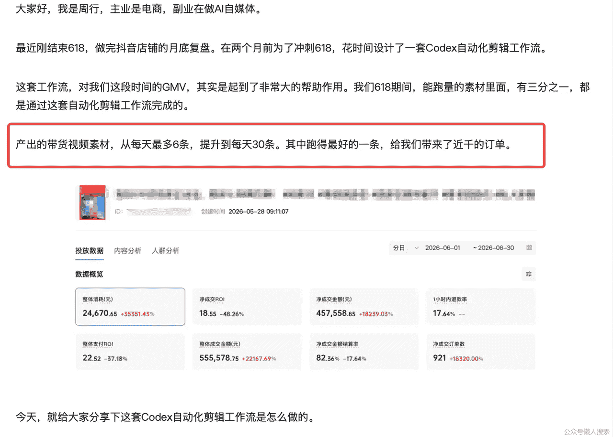

🔗原帖链接：📄 Codex自动化剪辑从0到1，如何让AI批量产出带货视频【万字长文】

**案例二：📕自动发帖 Skill，每天只需 5 分钟，3 个月变现约 4W**

赚钱圈友 **@Dobby** 把原本靠手动完成的📕运营流程，做成一个自动发帖 Skill：自动找选题、自动改写文案、自动发布、自动挂载商品。

**两个账号**运行约 3 **个月，总**变现约 4 万元；每天只需 **花 5 分钟**检查结果。自动化发布的笔记最高获得 90 万浏览、近 500 万曝光，账号累计涨粉 2000+。

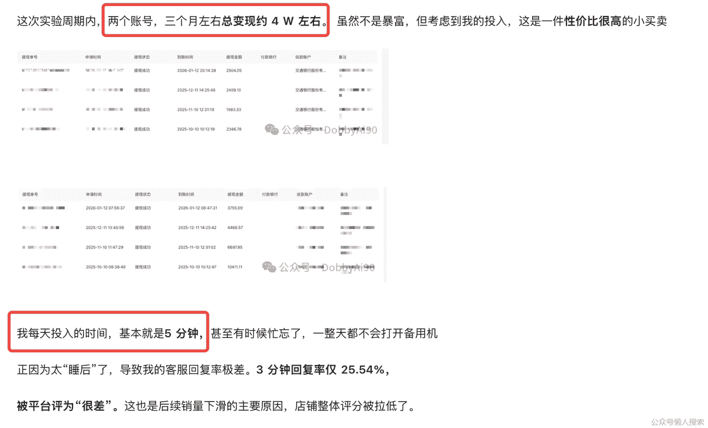

🔗原帖链接：📄 每天 5 分钟，不懂技术用 AI 实现睡后收入：📕虚拟产品自动化复盘

**案例三：把经验做成 Skills 上架市场，10 天变现 1500 美金**

赚钱圈友 **@August** 把自己在 AI 教育、内容生产、写作、PPT、视觉设计等领域的经验，做成可复用的 Skill，并上架到 YouMind Skill 市场。

第一个 Skill 上线后，10 天实现月收**入超过 1500 美金**；后来陆续制作了 194 个 S**kil**l，5 月付费榜前 15 名中**有 6 个来自他**的作品，月收入持续增长到 2100 美金。

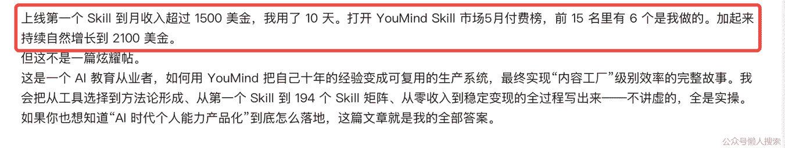

🔗原帖链接：📄 我为什么付费使用 YouMind：一个 AI 教育从业者的内容生产革命

🔼上面这些案例，呈现的是 Skill 能做到的效果，也是后续持续迭代、不断放大的方向。

展示这些案例并不是要求你在这一期就复制他们的自动化流程、商业模式或变现结果，而是想让你看到：当你的业务经验、工作流程和判断标准沉淀成 Skill 后，它可以被反复调用、持续优化，也能服务更多场景和更多人。

这期训练营，你只需要走一条更聚焦、更适合新手的练手路径：

体验 Skill ➡️ 跟做简单 Skill ➡️ 做进阶复杂 Skill ➡️ 自主制作 Skill

之后再结合自己的业务场景不断优化、迭代，把 Skill 的能力和效果一步步放大。

1. 训练营期间要交付什么

**21 天内，你需要完成必修关卡 1-8 的所有作业，并最终提**交至少一个可复制、可调用的 Skill。

每一关的作业都会帮你一步步靠近最终成果，所以所有必修关卡的作业都很重要，需要完成。

**最终成果物**需要提交以下内容：

1.  **Skill 文件包**：其中必须包含 **SKILL.md**；

1.  **安装方法和使用说明**：让别人知道如何安装、调用这个 Skill；

1.  **使用效果演示**：证明这个 Skill 能在真实场景中成功运行。

**具体提交的作业要求、模板和提交链**接，都可以在对应关卡开头的任务卡中查看。

1. 任务关卡地图

**十一关全貌与参考节奏：**

| 天数 | 对应关卡 | 做什么 | 产出物 |
| --- | --- | --- | --- |
| Day 1-2 | 关卡0 | 出发前备好工具 | 完成工具准备 |
| Day 3 | 关卡1（必修） | 体验现成 Skill | 体验 Skill 的截图 |
| Day 4 | 关卡2（必修） | 跟做第一个 Skill | 第一个 Skill + 生成文章 |
| Day 5 | 关卡3（必修） | 升级第一个 Skill | 升级后的 Skill + 成品截图 |
| Day 6 | 关卡4（必修） | 看懂结构，拆解一个 Skill | Skill 结构拆解卡 |
| Day 7-8 | 关卡5（必修） | 让 Skill 学会参考资料 | 带资料夹的 Skill |
| Day 9-10 | 关卡6（必修） | 让 Skill 能处理固定任务 | 带脚本的 Skill |
| Day 11 | 关卡7（必修） | 做一个帮你做判断的 Skill | 你自己业务的 Skill |
| Day 12-14 | 关卡8（必修） | 学会迭代，让 Skill 越用越准 | 改前后对比 |
| Day 15-16 | 关卡9（选修） | 建立你的 Skill 能力库 | Skill 管理清单 + 改造优化记录 |
| Day 17-21 | 关卡10（选修） | 参加 Skill 创作活动 | 个人 Skill 作品 + 演示 / 复盘 |

以上只是参考节奏，不用严格按照每天的进度走。

**按照自己的时间安排推进即可，可以快一点、**慢一点，也可以不完美，但一定要持续行动。

**在 21 天内，必须完成必修篇的关卡 1 **到关卡 8 ，做出一个自己的 Skill

选修篇的关卡 9 到关卡 10 ，用于提升使用 Skill 的技巧，打磨作品参与黑客松，适合学有余力的船员进行进阶提升。

1. 出发前准备

如果你已经有可以正常使用的 AI 编程工具（如 Codex、Claude Code、WorkBuddy、Trae Work 等），可以直接进入下一关。

如果你还没有完成工具安装或环境配置，请先完成👇：

【开船前工具准备】Agent Skills 炼术营丨 2026 年 8 月航海

后续手册将统一以 WorkBuddy 作为演示工具。如果你使用的是 Codex 等其他工具，可能发现界面可能略有不同，以实际界面为准。**

但是手册涉及的所有流程和内容，并不依赖某一个工具。只要你的 AI 编程工具支持 Skill 功能，都可以跟着完成后续实操。

**💡 题外话：如果你对自己每天用了多少 Token 感兴**趣，欢迎加入赚钱 TokenRank～

我们发现最近很多圈友已经开始使用 Codex、Claude Code、Hermes、WorkBuddy 等工具做项目，但自己每天用了多少 Token、坚持了多久、做成了哪些作品，其实都没有系统记录下来。

像这期训练营，大家在完成任务、制作 Skill 的过程中，也会持续消耗 Token。

**TokenRank**可以帮大家记录真实的 AI 使用过程，回顾自己的 AI 学习轨迹，也方便我们发现优秀作品和实战案例。

注意：Token 高不代表成果好。相比“用了多少”，我们更关注：你用 AI 完成了什么、解决了什么问题。

现在 TokenRank 已开放接入，大家可以跟着教程完成安装：https://scys.com/tokenrank/connect

如果接入过程中遇到问题，可以直接在训练营群里反馈。


---

# 必修篇：从用起来到做出自己的 Skill

## 关卡 1：先跑通一套现成能力包

### 00. 本关任务卡

**🎯 任务目标：**装上 3 个别人做好**的 Skill，用它们处理你自己写过的一篇东西，走完“改文字 → 排版 → 发布前体检”一条链，交出前后对比截图。

**🗒️ 任务描述：**

• 跟着步骤装好 3 个 Skill：

◦wechat-writing-style（改掉 AI 腔）

◦gzh-design（排版成👸号样式）

◦content-risk-detector（发布前合规体检）

• 拿一篇你自己写过的稿子跑一遍（手头没有，可以用我们准备的样稿）

• 截三张图交作业：装好了、跑起来了、改完前后的对比

• 顺手学会一件事：看到别人推荐的 Skill，怎么 30 秒判断值不值得花时间

💡

**本关作业**：安装并使用 3 个成品 Skill 跑通一次“改文字 → 排版 → 发布前体检”，并提交前后对比截图

**⭕️ 提交模版**：

1.  Skill 安装成功截图（必填）

能看到 3 个 Skill 都已经装好，或 AI 回复能列出 3 个 Skill 名称

截图参考（WorkBuddy为例）：


1.  前后效果对比截图（核心必填）

同一篇稿子改写前后、排版前后或同稿两平台检测结果对比，任意一个效果对比截图即可

截图参考：


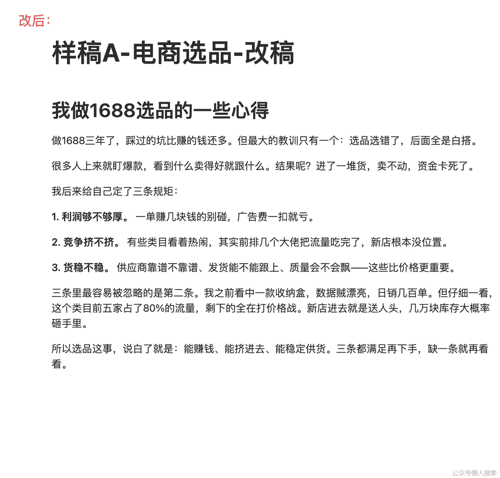

1.  分享一下这一关最大的收获（选填）

比如哪个 Skill 最有用、哪一步最出乎意料

1.  本关遇到的卡点或报错截图（选填）

对于卡点和报错有没有先问 AI ，让它进行解决？简单写清楚你卡在哪一步

**💡 新手提醒：**

这一关你不用写任何代码，也不用看懂 Skill 里面是怎么写的。

你只做一件事：装上 Skill，用一次，看看有什么不一样。


### 01. 本关重点

你可能已经收藏一堆链接，或者装过一堆 Skill，觉得“我的 AI 变强了”。装完之后不知道哪个适合自己，也不知道怎么触发，更不知道有没有生效。

Skill 一多，很容易变成另一个收藏夹。

真正拉开差距的不是装了多少 skills，而是能不能把几个核心 Skills 组合成自己的工作流……

别贪多，先用熟 3-5 个比浅尝 50 个更有价值。

这一关关注的不是数量，而是体验，是带你亲手把一条 Skill 工作流完整跑通。

当你真正跑过一遍，你自然会知道每个 Skill 的作用、它们为什么要这样组合，以及以后该怎么迁移到自己的工作中。

我们提供给大家体验的 3 个 Skill，并不是随便挑的，它们能串成一条流程：

Plain Text

```
你写完一篇初稿
    ↓  wechat-writing-style    把书面腔、AI 腔改成人话
    ↓  gzh-design              排版成公众号样式，粘过去不掉格式
    ↓  content-risk-detector   发布前查一遍有没有违规风险
可以发了
```

走完这一遍流程，你手上会**有一篇改好、排好、查过的文章**。

**这套流程并不局限于写👸号，做小**红书、短视频、私域内容，也可以直接套用。

前后两步其实和平台无关：

第一步负责把文字改得更自然、更像人写的；第三步负责检查内容是否符合平台发布规范。

中间这一步虽然叫**“👸号排版”**，但不只是能给👸号使用。

它最终生成的是一个网页，用浏览器就能直接预览效果。你可以把它理解成“让内容变得更美观、更易读”

完成本关后，最终你可以看到：

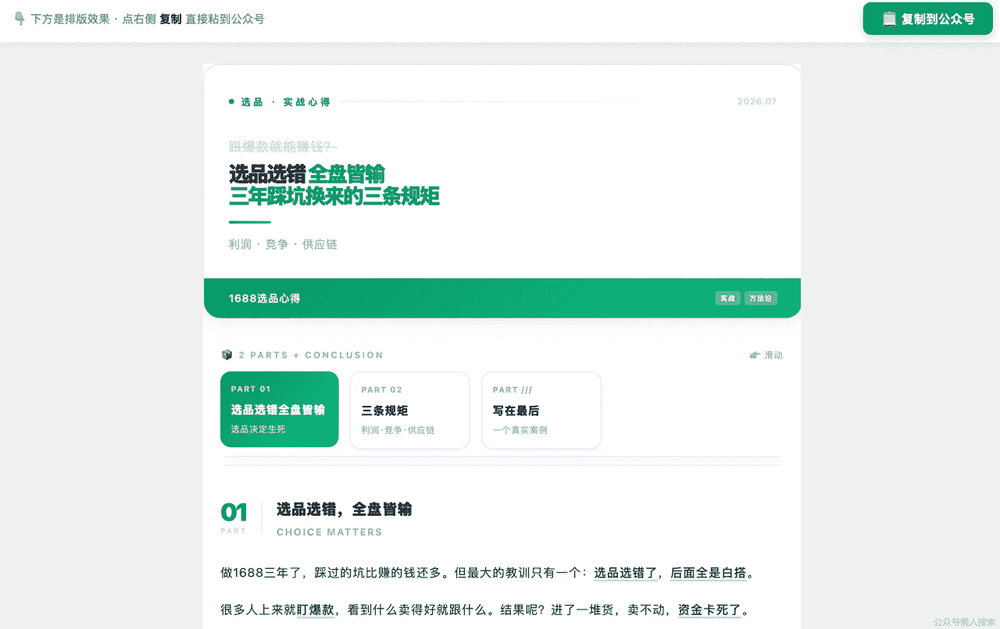


### 02. 安装这 3 个 Skill

1.为什么先装这 3 个 Skill

你可能已经刷到过很多“十大必装 Skill”“50 个 Skills 跑赢 90% 的人”之类的帖子。

但这一关，我们只准备了 3 个 Skill。

1.1**别急着跟着推荐帖安装**

网上关于 Skill 的笔记、帖子很多，动辄几千上万赞。

下面是其中一篇，5886 赞、8975 收藏（用户信息已打码）：

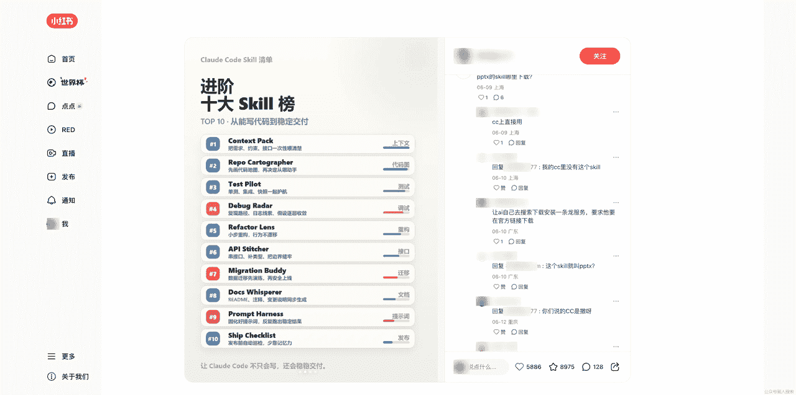

看着挺专业：彩色编号、排名、每个都配了一句功能说明。

但我们把榜单里的十个 Skill 都去核实了一遍，结果是：7 个完全找不到，剩下 3 个也只有零散来源，和榜单描述对不上，很可能是 AI 生成或后续有人照着名字创建的。

这就是让 AI 生成一份“十大高级技能榜”会出来的东西。

其实，就算这 10 个都是真的，“必装”这三个字也站不住。

Skill 是需要配合人和具体场景去选择使用的。

做电商、写代码、做运营，需求不同，需要的 Skill 都不一样，不存在“所有人都该装”的十个 Skill，就像不存在“所有人都该买”的十件衣服。

这一关让你安装这 3 个，不是因为它们“最好用”，而是因为它们刚好能组成一条完整的工作流。先把这条流程跑通，比装几十个 Skill 更重要。

1.2 如何检验一个 Skill 值不值得装

以后你在网上看到别人推荐，花 30 秒走一遍这五步，能省下大量时间。

你也可以直接把这个表格截图**给 AI**，让它直接帮你去判断这个 Skill 值不值得安装

| 第几步 | 做什么 | 不合格的信号 |
| --- | --- | --- |
| 1 | 搜的时候**带上 ** SKILL.md ，在 GitHub 搜 技能名 filename:SKILL.md | 完全搜不到 |
| 2 | 点进去看它的描述， 跟推荐里说的是不是同一个东西 | 名字一样但干的是别的事 |
| 3 | 看 star 数 和 最近提交时间 | 一年没动了 |
| 4 | 看有没有 License | 自己用不影响； 要拿它赚钱或者再分发，就得看清楚 |
| 5 | 打开 README 读第一行 | 写着 deprecated（已弃用）或 archived（已归档） |

1.3 为什么是这 3 个 Skill ？

不同的 AI 编程工具，背后接的模型各不相同，能力也参差不齐。

这 3 个 Skill 最适合第一次体验。

它们满足下面几个条件的：

• **装完就能用。**不需要接生图 API、绑定账号或充值。

• 几乎所有 AI 编程工具都能跑。不依赖生图、读图等特殊能力，只需要模型会生成文本即可。

• **环境要求低。**不需要安装一堆依赖，大多数人都能直接开始。（Windows 用户安装其中一个 Skill 时，需要提前安装一次 Python。不用担心，交给 AI 工具，它会帮你安装）

• **中文场景可用。**不只是把英文 Skill 翻译过来，而是真正能在中文环境里跑通。

市面上有不少热门 Skill，有的依赖复杂，有的配置繁琐，有的看起来很火，实际并不能稳定运行。

我们已经帮你筛选好了 3 个真正能跑通的 Skill。

# 2. 三个 Skill，一次装齐

装好之后怎么用、怎么验，这一节带你从头到尾走一遍。

## 2.1 动手前的一条约定

💬先把规矩讲在前头：

从这一关起，你会在手册里看到不少独立的小方框，右上角带一个复制按钮——那里头装的，基本上就是“该跟 AI 说的话”。

Plain Text

```
像这样的，直接复制粘贴到AI 对话框内
```

碰到这种框，别改词、别加料，直接复制、粘进对话框、回车发出去就好。


**还有一个最容易翻车的点：绝大多数 Skill 必须整目录搬，光拎一个 SKILL.md 是没用的。**

麻烦在于，有些 Skill 就算装残了也不抛错——它照常出结果，可关键能力已经在无声中掉了一大块。

本次要装的三样里，头一个单文件即可，剩下两个都得连文件夹一起放进去。

拿 content-risk-detector 举例：只留 SKILL.md，报告照样能出一份、看上去还挺像样，但背后那套规则一条都没被读进来。

所以后面的命令请原样取用，别手痒去删文件。

## 2.2 三种装法，任选其一

### 路径一：丢个地址，让它自己去装【最省心】

在 Codex 或 WorkBuddy 里，把下面三段依次贴过去，剩下的交给它自动完成。

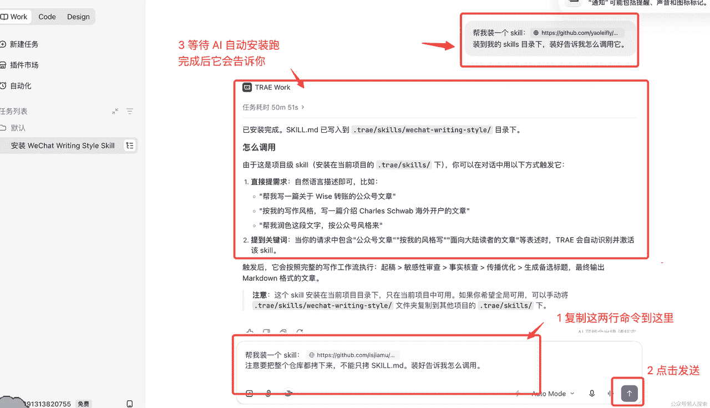

**第一段（改写类 Skill）**

⬇️把这段贴过去：

Plain Text

```
帮我装一个 skill：https://github.com/yaoleifly/wechat-writing-style
装到我的 skills 目录下，装好告诉我怎么调用它。
```

**第二段（排版类 Skill）**

⬇️同样照做：

Plain Text

```
帮我装一个 skill：https://github.com/isjiamu/gzh-design-skill
注意要把整个仓库都拷下来，不能只拷 SKILL.md。装好告诉我怎么调用。
```

**第三段（合规检查类 Skill）**

⬇️还是照做：

Plain Text

```
帮我装一个 skill：https://github.com/liuxingqitd/content-risk-detector
注意要把整个仓库都拷下来，包括 references 目录。装好告诉我怎么调用。
```

### 路径二：让它装你下好的资源包

万一你手上的工具打不开 GitHub，那就直接拿【关卡1 资源包】，三个 Skill 的全套文件都在里头。


资源包下载：https://sphere-sh.oss-cn-shanghai.aliyuncs.com/private/docx/drive/media/Yrzjbl1lzoZzJ2xSb00cuTsVnLh?Expires=1786374072&OSSAccessKeyId=LTAI5tDANFnEjK2qWnHwZKzr&Signature=aEjJlumkBzVSsXxQSTegn4Cv8KE%3D

下好之后，⬇️把下面这句贴过去：

Plain Text

```
我本地有一个【关卡1资源包】的压缩包，里面有三个skill文件，文件在【大概形容一下你下载文件的位置】。
你可以直接查找并且安装好吗？ 你先确认任务能不能做，和我对齐后再进行安装
```

它会向你申请权限，一律放行即可。

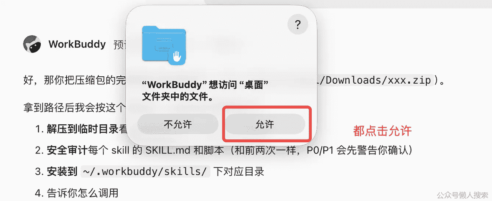

接着它会确认安装方式，按你的需要选；自动跑完，会回来告诉你结果如何。

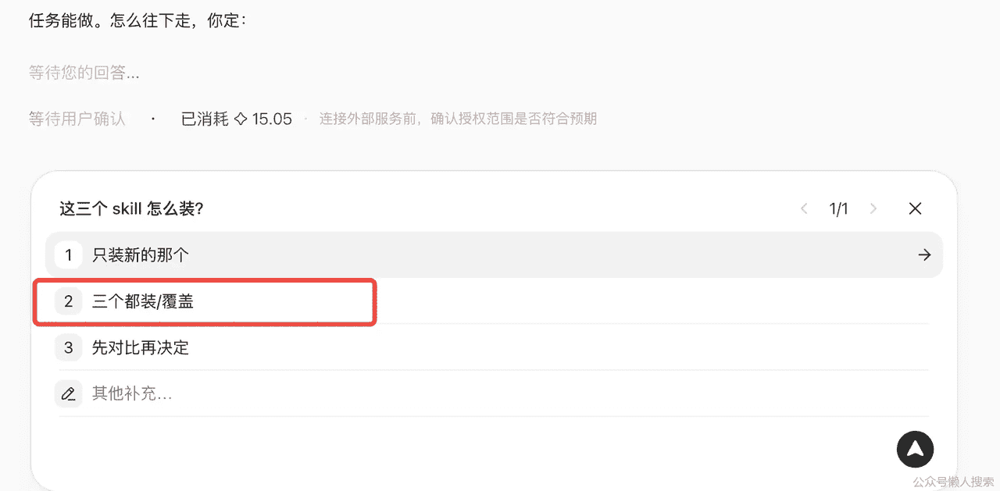

### 路径三：手动上传【WorkBuddy 适用】

把路径二里的压缩包下下来解压，再手动传上去。

在【WorkBuddy】中可以手动挑选那三个文件夹上传，这个过程不扣积分。

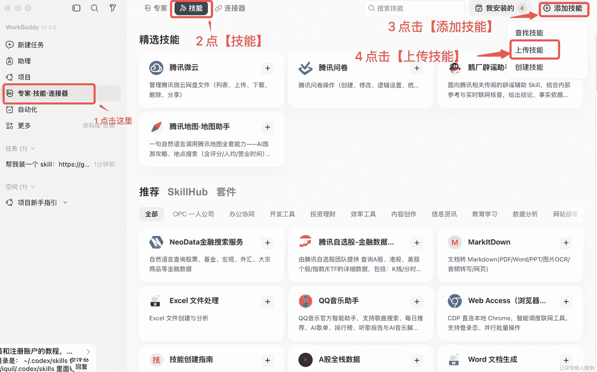

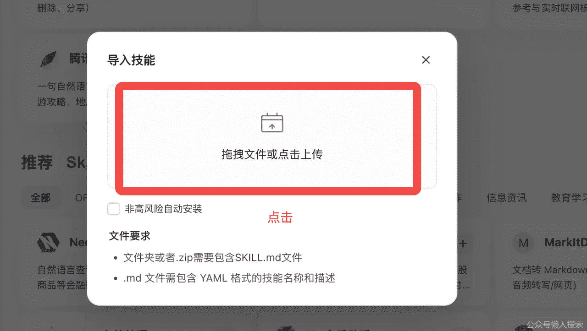

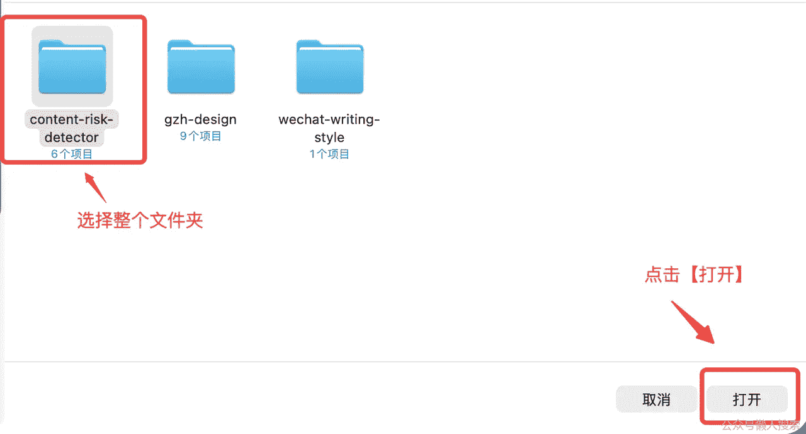

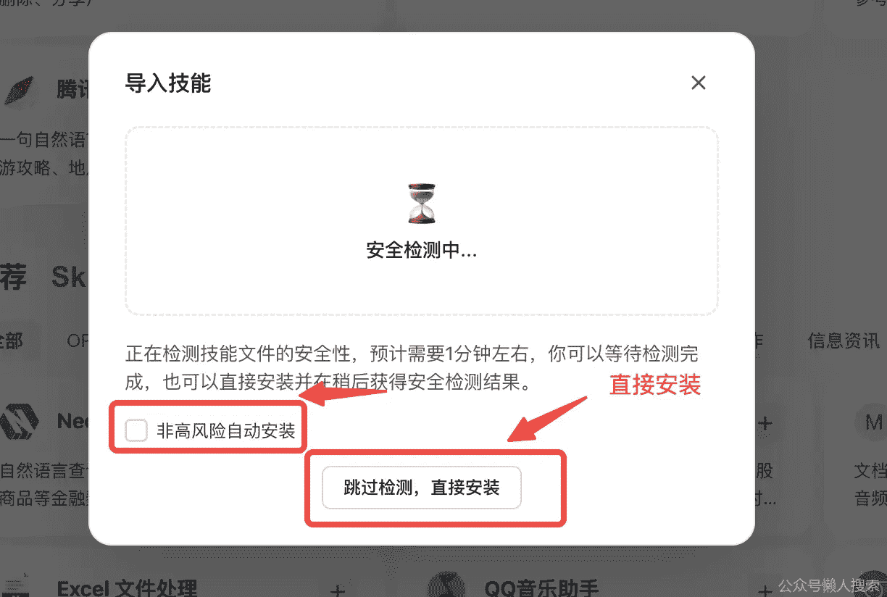

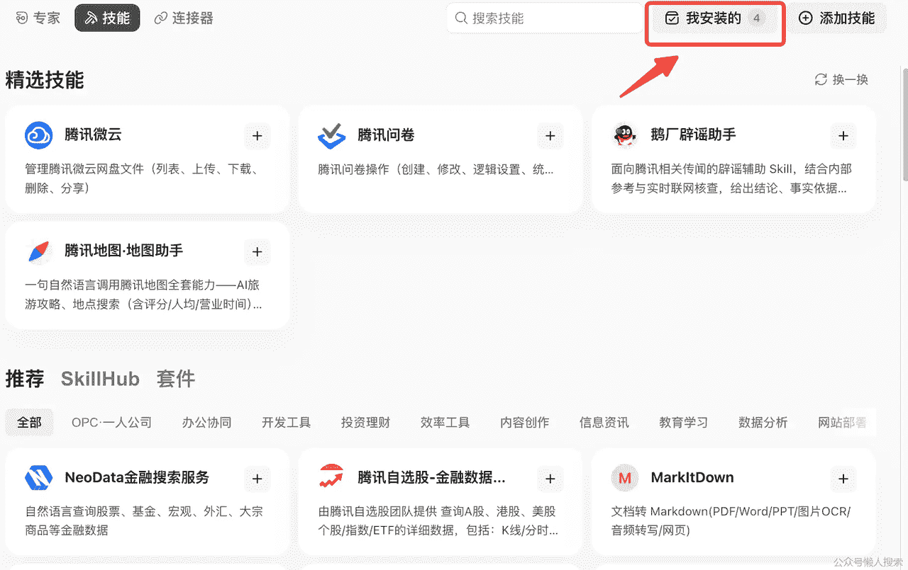

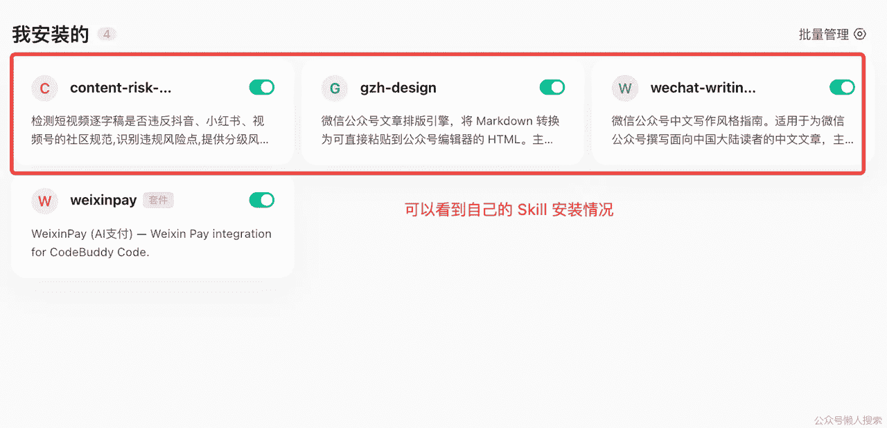

## 2.3 验一验是否装好

怎么确认真的装上了？

⬇️把下面这句原样贴过去：

Plain Text

```
你现在能用哪些 skill？列出来给我看
```

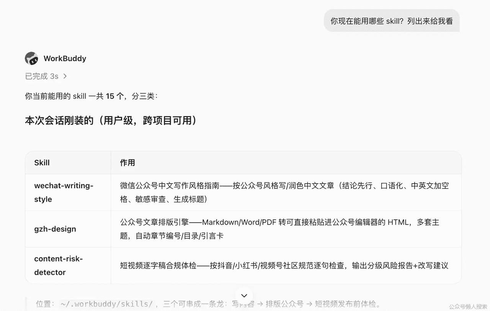

三个名称它都能念出来，就算到位了。

若只答上一两个，大概率是漏了整个目录、只放了 SKILL.md；退回上一步照命令补装一次。

💡实在装不上？别在这耗着。

解压资源包，把 SKILL.md 里的文字整段贴进对话窗，再补一句“照这份说明处理下面的内容”，效果不打折，无非每次都得重贴一遍。

先把流程跑顺，装不上的问题留着去答疑群里问。


### 03. 三个都跑一遍

### 1. 手头有稿子，就用自己的

这步别省。

翻一篇自己从前写过的东西出来——👸号旧文、朋友圈长文案、群里发过的通知、产品介绍，甚至一段没发出去的草稿都算。字数压在一千以内最合适。

为什么非得用自己的？

• 拿样稿试，你感受到的只是“这工具挺神”
• 拿自己的稿子试，你才会看见“原来我落笔有这些毛病”

后面那份体感，才是这一关真正想塞给你的东西。顺带，你手上还会多出一篇改好的、拿起来就能发的文章。

### 2. 没稿子？四份样本随便挑

手头实在翻不出可用文字的话，我们备了四份样稿，全在【2.2-路径二】的【关卡1 资源包】里。

挑一份跟你所做行当最贴的：

| 样稿 | 主题 | 对口人群 |
| --- | --- | --- |
| 样稿 A | 1688 选品心得 | 电商、供应链从业者 |
| 样稿 B | 业余搞副业，我掉过的坑 | 上班族、想搞副业的人 |
| 样稿 C | 课程为什么卖不出去 | 知识付费、做课程的人 |
| 样稿 D | 小店铺三年经营复盘 | 实体生意、本地买卖 |

四份样本横跨电商、职场、知识付费与实体经营，行业相去甚远。

可一旦并排细看，问题出奇地一致：开场白都写着“在当今这个……的时代”，骨架全靠“首先、其次、最后”撑着，中间必插一个长破折号，收尾落在“让我们一起……更 X、更 X”上。

所谓“AI 味”就是这么来的——与你写什么题材无关，只看你怎么落笔。

套路一旦固定，才有可能被某个 Skill 成批地拧过来。

### 3. 三步实操

### 3.1 第一步：洗掉 AI 味

把稿子交给它。

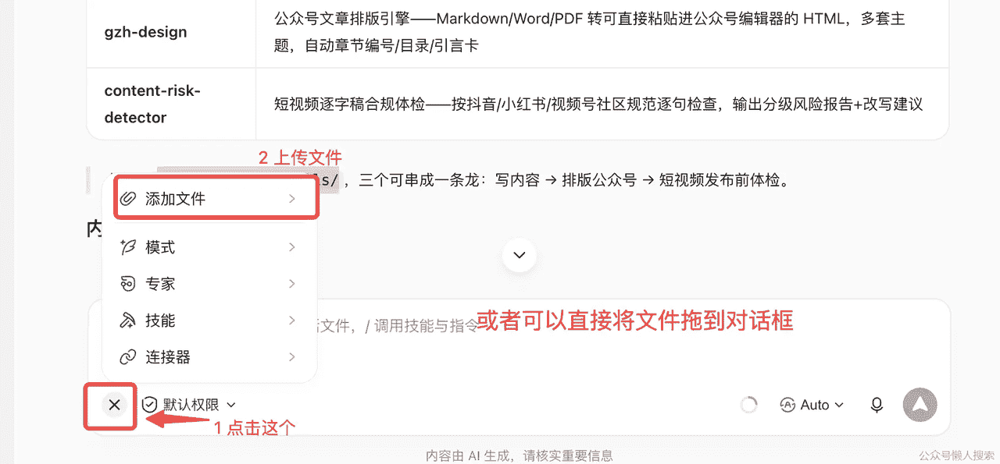

再把下面这句贴过去：

Plain Text

```
帮我改一下这篇文章的文字，去掉 AI 腔和书面腔，改成人话
```

它会先点出原文的毛病，再说明这轮动了哪些地方、为什么这么动。

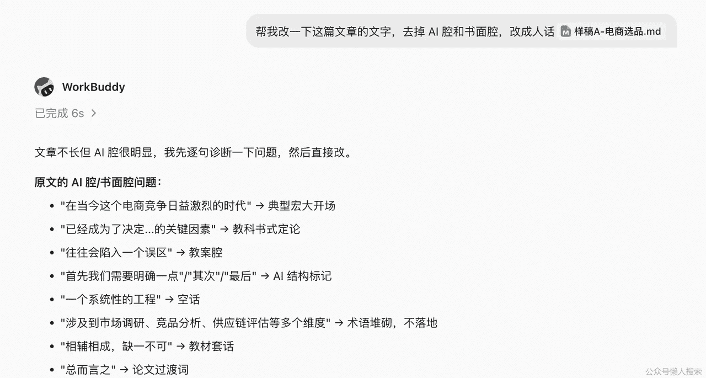

最终你手上会多出一个 md 文件，里头装的正是改完的新版本。

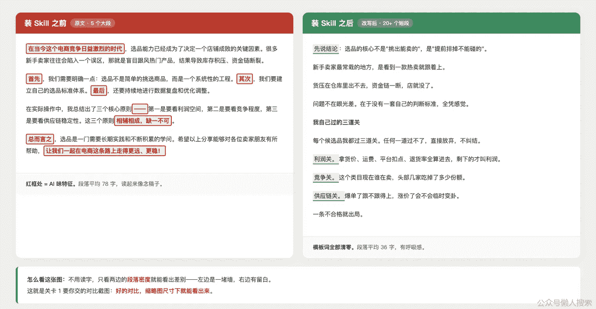

💡提醒一句：扩写环节它可能凭空替你添经历。

所以定稿前务必从头到尾读一遍，凡是带“我”的自述，都回头核一核是不是真发生过。

### 3.2 第二步：排成👸号版式

上一步的产物是 Markdown 文件，硬贴进👸号编辑器会冒出杂七杂八的符号，观感也偏素。

这活恰好是第二个 Skill 的强项。

不必另起对话，在同一轮里接着贴这句：

Plain Text

```
帮我把这篇文章排成公众号样式，生成能直接粘贴的 HTML
```

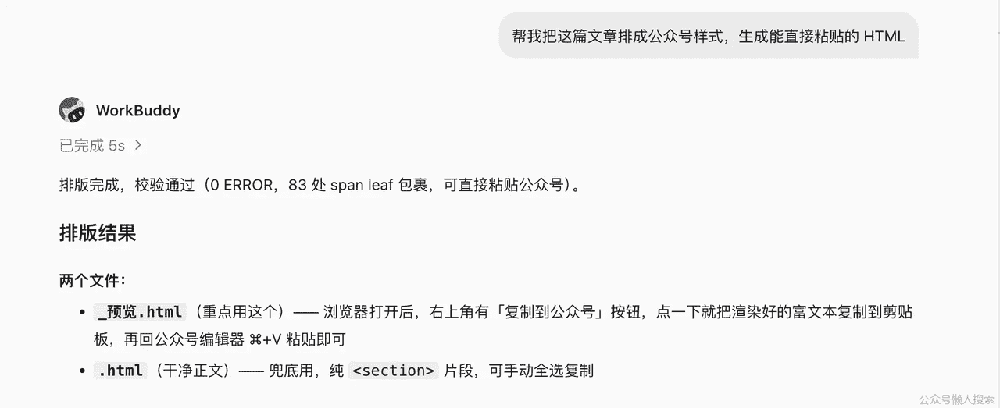

它会吐两个网页文件，双击就能用浏览器打开。

呈现出来的是一篇已经排好版的稿子：封面卡片、章节序号、重点词下划线、金句色块，一样不缺。

这版就是本步的交付物，截图交作业直接用它。

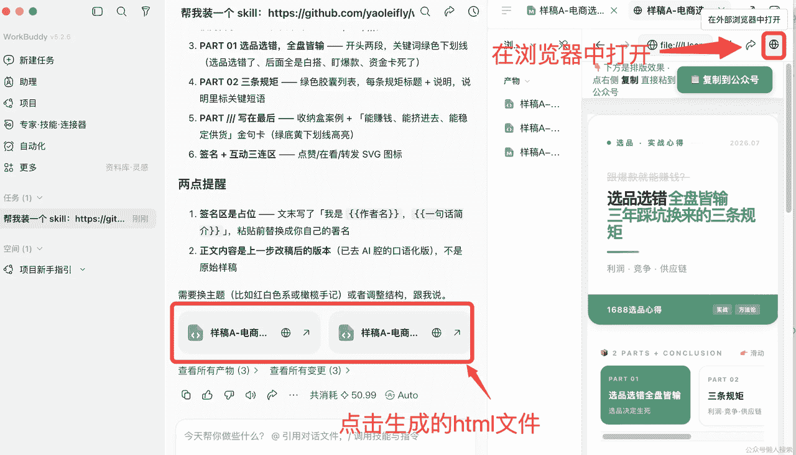

两个文件里有一个带“一键复制”的能力，复制完贴进👸号后台即可。

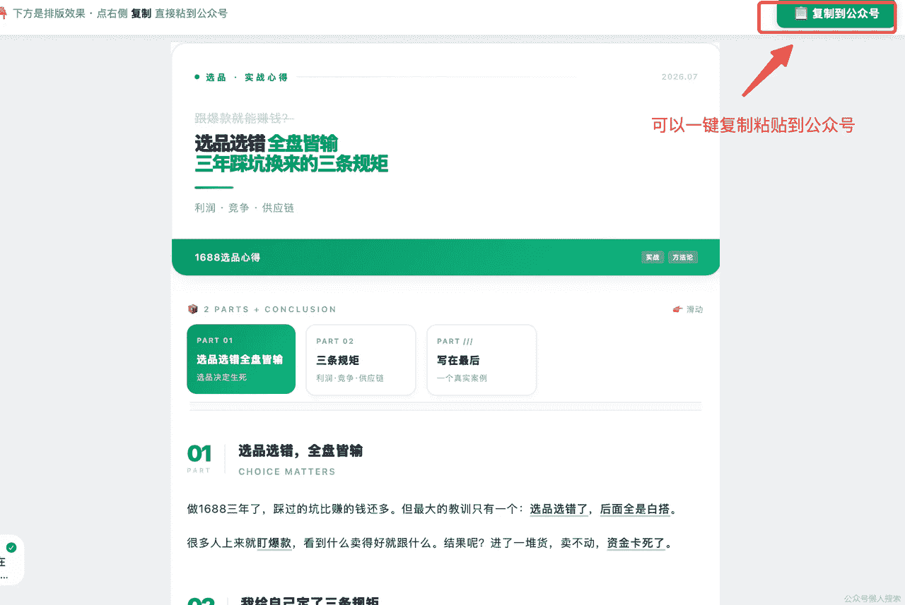

下面几张，是同一个 Skill 能给出的其他视觉主题；头一版不合心意，就让它换风格再出一版。

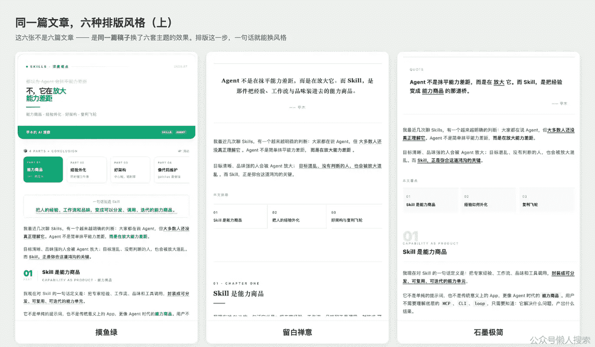

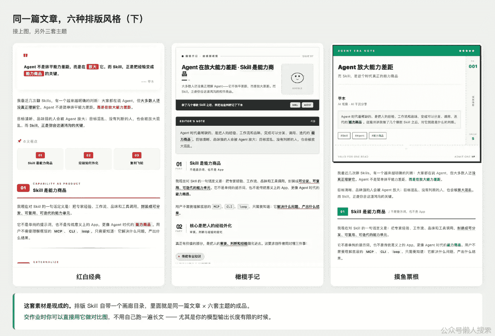

**如果你有👸号，想真的推出去：**

1️⃣在预览页右上角找到“📋 复制到👸号”按钮，点它
2️⃣跳出“✅ 已复制”字样，说明成了
3️⃣登录 mp.weixin.qq.com，新建一条图文

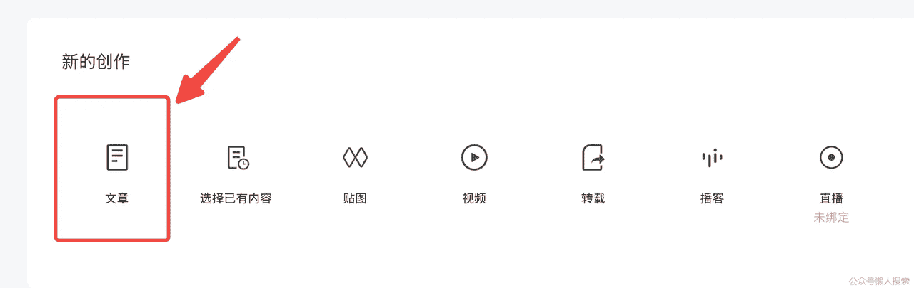

4️⃣光标落进正文区，按 Ctrl+V（Mac 用 ⌘+V）
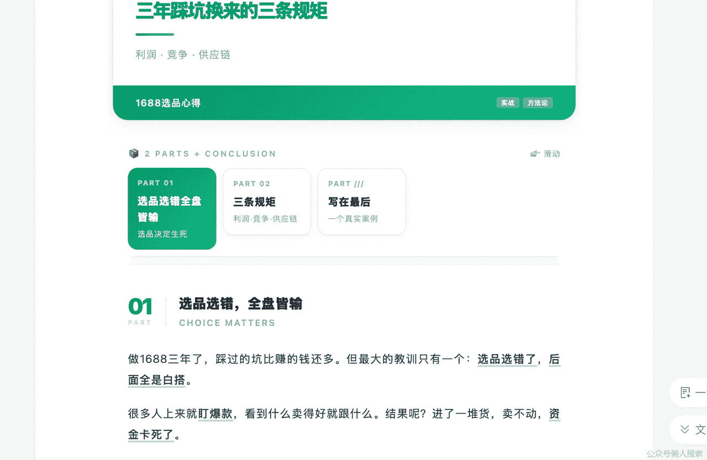

5️⃣大标题另外填到顶部的标题栏
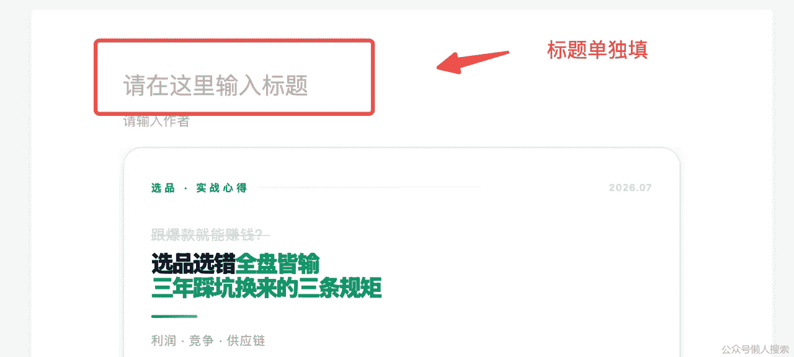

6️⃣救急方案：按钮万一失灵，就在预览页 Ctrl+A 全选、Ctrl+C 复制，效果一样

💡几点提醒：

**1️⃣“我的标题呢？”**（有账号的才会遇上）

贴完你会发现正文里找不到大标题。

这是刻意为之：👸号的题目归后台标题栏管，正文再放一遍就重了。别误会成排版把标题吃掉了。

**2️⃣署名别忘改。**

结尾处会留着“我是 {{作者名}}，{{一句话简介}}”这样的坑位。

发布前，把大括号里的内容替换成你自己的信息。

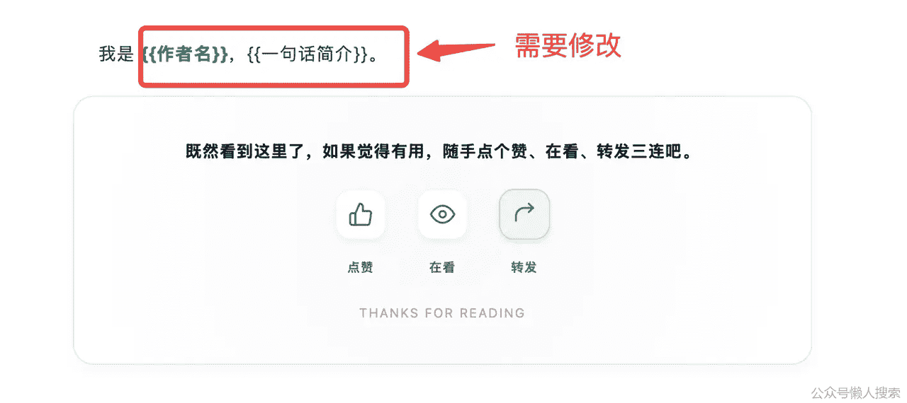

### 3.3 第三步：发前自检

仍在同一轮对话里，贴这句给它（平台换成你实际要投的那个）：

Plain Text

```
帮我检测一下这个稿子能不能发，平台是【小红书/公众号/你要发的平台】
```

你会拿到一份按风险着色的报告，逐条写清：踩了哪条规则、对应原文哪句、风险点在哪、以及能直接照抄的改法。

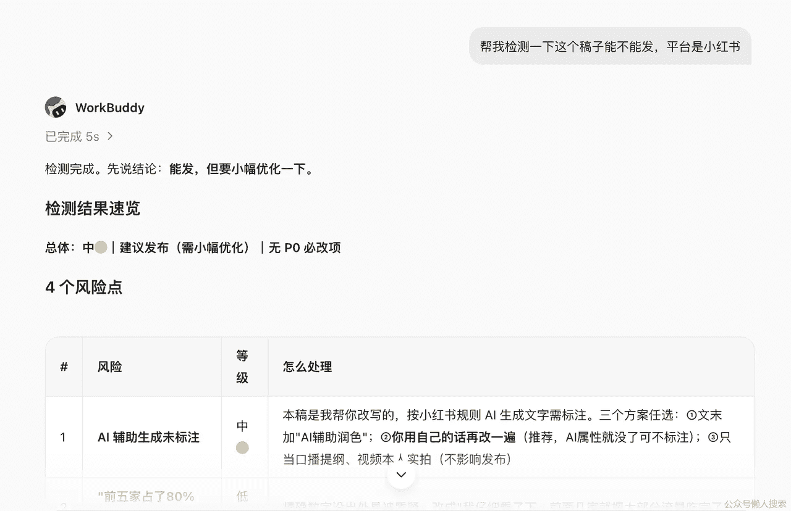

同一篇文字，用抖音规则查一遍、再用📕规则查一遍，结果会打架，个别条目甚至反着来。

一稿多平台投的话，抖音放行，不等于📕也放行。

各家尺度不一，投哪里就调哪一套规则库。

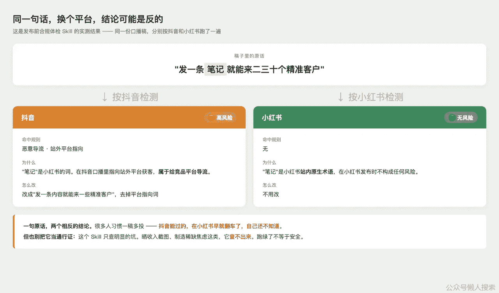

💡几点提醒：

**1️⃣它的主战场是短视频**

打开 references 目录，里面躺着四份文件：一份通用、三份按平台划分（抖音、📕、视频号）。

• **通用那份放之四海皆准**（法律红线、夸大宣传、诱导导流一类），发哪儿都该守
• **平台那三份是冲着短视频去的**（画面糊、评论区导流、AI 生成标识等）。若你审的是图文、长文或社群消息，其中相当一部分条款用不上

**2️⃣商业条款不在它的射程内**

我拿一条“充 200 送 50、限 30 个名额”的活动通知试过水，规则库里翻不出一条涉及预付卡、充值返赠、有效期限的内容。最容易闹纠纷的那块，恰是它的盲区。

**3️⃣报告过关 ≠ 内容安全**

哪怕触到它能力的天花板，它照样能给你一份完整的报告，不会主动说“这一项我判断不了”。

**4️⃣有些坑它看不见**

比如晒收益截图、过分吹嘘、人为制造稀缺（“仅限今天”“前 50 名免费”之类），都还得人来把关。

所以查完没事，不代表内容一定合规。

它做的是筛查显眼的违规词与危险表达，顶不了人工。涉及钱、承诺、资质的部分，最好再过一遍人眼。

没有哪个 Skill 是万能的。


### 04. 高频卡点速查

💡碰上问题先别喊放弃，先问它。这一期建议用 Codex 或 WorkBuddy，把报错、截图或你的诉求另开一个任务窗丢进去，让它替你定位、排查，甚至直接动手修。


养成“先问 AI，再找人”的惯性，大半问题自己就没了。

| 现象 | 先看哪里 | 接着怎么做 |
| --- | --- | --- |
| 装不上，或列表里没有 Skill | 命令是否发全、仓库地址是否正确 | 把 SKILL.md 内容整段贴进对话先用起来；体验先跑通，安装问题丢到答疑群 |
| 装好了却毫无动静 | 你的表达是否落在它的触发范围内 | 换种说法，把关键词点明：“用 wechat-writing-style 改这篇” |
| 明明在跑，产出却不对味 | 是否只放了 SKILL.md，漏了整目录 | 重装一次，确认 references/ 也在 |
| 排版中途断了，网页残缺 | 模型的单次输出上限够不够 | 篇幅压到 1500 字内；并嘱咐“用留白禅意风，不要封面和目录” |
| 贴进后台后缺大标题 | 无需排查，设计如此 | 正常现象，题目要单独填进后台标题栏（没有账号的跳过） |
| 结尾 {{作者名}} 忘了替换 | 无需排查，直接改 | 手动换成你的名字与简介再发 |
| 改完读着不像自己说的 | 扩写环节可能加了戏 | 从头读一遍，把没做过的事删掉或改正 |
| 报告说没事，心里仍不踏实 | 无需排查，你的直觉没错 | 确实该不踏实。它只抓显眼的坑，晒收益、制造焦虑这类抓不到 |


### 05. 本关收个尾

到这儿，三个现成 Skill 你都摸过了，“改写 → 排版 → 发前自检”这条内容流水线，也算完整走了一遭。

走完这步，Skill 三个字对你来说就不再是生词。

你亲眼见着了：同一篇稿子经过它们的手，能从一段平平无奇的文字，变成更有人味、更好读、还能顺手把风险过一遍的成品。

尤其是前后对照做完，那份变化你应该已经尝到了——它靠的不是让模型临场发挥，而是把一套稳定打法提前备好。

往后同类活儿再来，你不必重新交代标准与流程，喊它一声就能接着干。

所以这一关，我们没打算让你装得多、懂得深。三个 Skill 能叫得应、能出结果、前后差别一眼可辨，就算过关。先尝着甜头，怎么做到的，后面慢慢拆。

**三个关键动作：**

1. **先把 3 个 Skill 装齐**：整目录安装，再从它的回复里弄明白各自能干什么。

2. **拿真稿子实跑一轮**：用自己的旧作当样本，依次过改写、排版、发前自检。

3. **留好可查的证据**：截图得体现装好了、指令发出去了、结果回来了，以及改前改后差别明显。

至此，你完成了第一次 Skill 试跑：它怎么装、怎么被唤起、怎么出结果，以及能带来什么变化，心里都有数了。

下一关，我们动手造一个自己的 Skill，把这感觉再往下推一层。

💡

作业记得交～模板在本关任务卡里能找到。


## 关卡 2：动手做个自己的 Skill

### 00. 本关任务卡

**🎯目标：**照案例做出一个【**我的写作风格 Skill**】。装好之后，你让它代笔，落笔是你本人的腔调，而不是机器的腔调。

**🗒️要做的事：**

• 翻出 4 到 6 段自己从前写过的文字（朋友圈、群通知、随笔、周报都算）

• 把手册里那段指令原样抛给它，它会像记者一样逐条向你发问

• 你的回答连同那些样本，会被它收拢成一份 SKILL.md——这就是你的开山之作

• 装上后立刻试：让它用这套风格写一段你从没写过的题材

💡

**本关作业**：照案例产出一个【我的写作风格 Skill】，并附上一段由它写出的文字。

**⭕️交作业的格式**：

• SKILL.md 文件或截图（必交）

截图，或者把正文复制出来都可以，但要能看见“我的禁区”那一段。

截图参考：

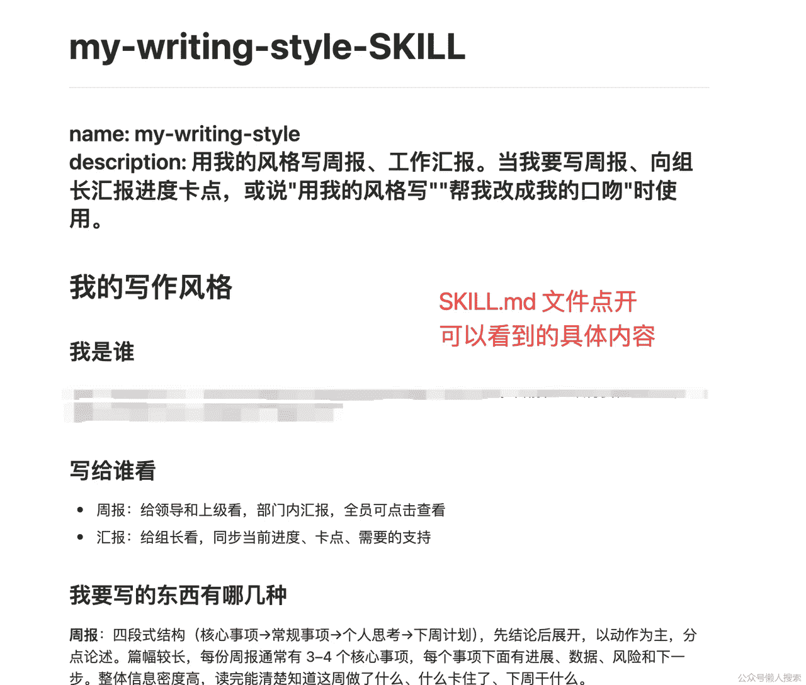

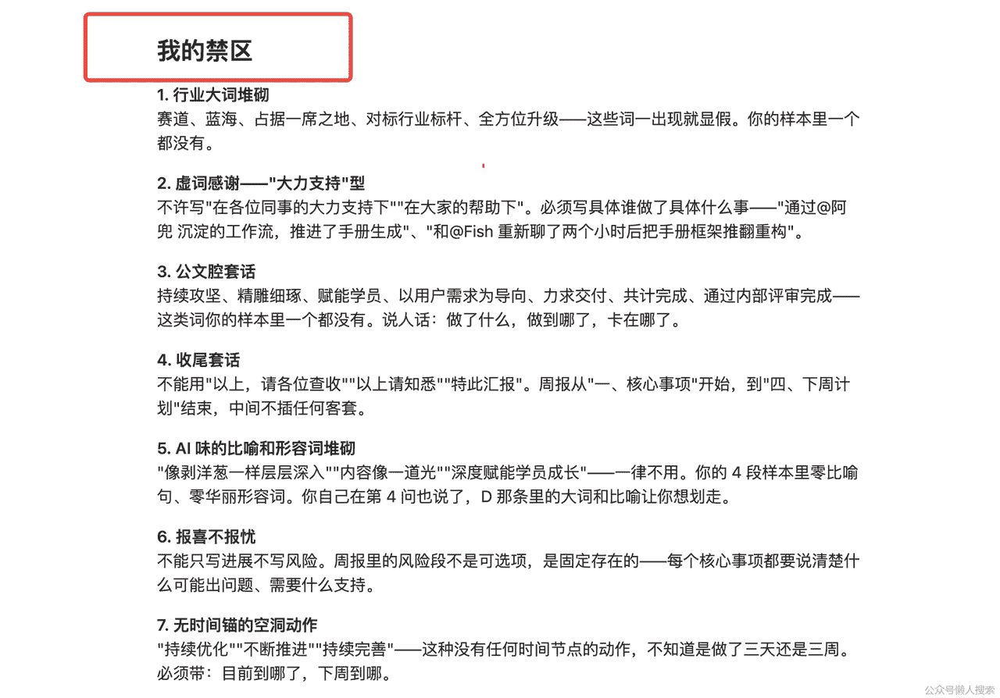

• 用它写出来的一段文字（必交）

02 节 2.5【进行二次初步验证】里那段也行，另起一段也行。

• 聊聊这关最大的收获（可交可不交）

比如两个 Skill 摆在一起比出来的心得、动手时的体感、成品到底像不像你本人。

• 卡点或报错截图（可不交）

卡住时有没有先丢给 AI？写清楚你停在哪一步即可。

**💡给新手的提醒：**

这关不吃技术。你只干两件事：回答它提的几个问题，再把几段自己的旧文递过去。

Skill 由它落笔，不用你写。

做出来那玩意儿，会小到你不敢信。

不必想得太玄乎。做完之后，成品很可能就一页纸的篇幅——不含代码，也没有繁复的层级，通篇口语，像跟人聊天。

**这样做完全没问题，绝对不是偷懒少做了。**前一个关卡里装好的那三件 Skill，体量最大的也就十几 KB，体量最小的干脆就是一份纯文本。Skill 天生就是这个规模。


### 01. 越贴近日常，越管用

**素材和你平日的使用场景越贴合，价值就越高。**

这一关真正要的，并不是你为交差赶出来的新文字，而是过去确实写过、确实用过的那些东西。把它们翻出来，交给 AI 就够了。

**这一关花时间，值在哪儿？**

前面装好的那三件 Skill 属于通用款，任何人都能装。

而通用度一旦足够高，将来大概率会被 Codex 收编进官方能力。

Codex 的迭代频率几乎以天计，那些被大量人反复调用、适用面又广的能力，迟早会并入官方体系，用不着你另外再装一份。

可“你个人的落笔习惯”这一项，没有任何一家平台会替你内置。

你挂在嘴边的措辞、你看到就皱眉的字眼、你惯用的收尾节奏，只长在你自己身上。

这一关的成品个头不大，却是整条船上头一件旁人复制不走的东西。

起步阶段不必强求一个完美定位，也不必单枪匹马去填一堆表单。

一键复制的提示词已经替你备好：你只要同 AI 一问一答地聊，把参考文本交给它，再回应几个提问，首个 Skill 就成型了。


### 02. 动手，做出你的首个 Skill

**1. 先把材料凑齐**

动手前，材料得先到位。往后 AI 会逐个提问，要是聊到中途才回头去扒聊天记录、翻社交动态和旧文档，思路一断，整理起来也拖沓。

**1.1 选哪些材料**

挑出你产量最高的两三类文字，每类各找两段，凑成四到六段足矣。

举例来说，两条社交动态配两条顾客群公告；或者两条📕笔记搭配两条给客户的答复。

只给一段，规律无从显现；同类凑上两段，AI 才分辨得出哪些属于你长期稳定的习惯，哪些只是当天兴起之作。每类各交一段，表面看涉猎广泛，实则每类仅单一样本，推不出任何结论。

另外别忘了隐私处理：

• 客户姓名、电话、订单编号以及公司机密，请先行遮蔽；

• 拿不准是否涉及敏感信息，就用结构一致、内容匿名的改写样本顶上；

**1.2 从哪儿翻出来**

| 日常写的类型 | 对应的查找位置 |
| --- | --- |
| 社交动态 | 🛰️ → 我 → 朋友圈页面，一路下滑 |
| 群公告 | 进入对应群聊 → 点右上角 → 查找聊天内容 → 按成员筛选出自己 |
| 给客户的答复 | 任选一个客户的聊天窗口 → 向上滚动，找你发出的长段落 |
| 笔记 / 推文 | 📕或👸号后台，翻自己发布过的内容 |
| 周报 / 汇报 | 翻邮件箱或者工作群聊 |

**1.3 实在一段都找不着，怎么办**

千万别拿旁人的稿子来凑数——那样学到的只会是旁人的腔调。

换个更聪明的做法：在🛰️里给文件传输助手录一段话，聊聊近来手头上的事，说上三十到五十秒。录完长按语音条，选择“转文字”。

转写出来的文字反而更贴近真实的你——它是你开口讲话的原貌，未经“得写得体面些”的自我加工。

这招我也已经交代给 prompt 里的 AI，它会主动把这条路指给你。

**2. 在对话里把 Skill 做出来**

**2.1 把提示词交给 AI**

进入你常用的 AI 产品，另开一个会话，将下面这段完整的 prompt 整份复制过去。

篇幅是有点长，无需逐字读完。它其实是给 AI 的说明书，写清了规则：接下来它如何访谈你、样本取多少、哪些内容严禁杜撰、完工后又如何校验。

可以先粗略扫一眼，摸清后续它大致会做哪些动作，心里有数之后再整段发出去，它会按顺序逐个提问。

⬇️请整段一键复制，粘贴时一个字都别落下。后半截一旦缺失，它便无从下手。

Plain Text

```
你要帮我做一个 skill。它的作用是：以后我让你写东西，你能写出我的味道，而不是 AI 的味道。

请严格按下面五步做，不要跳步，也不要一次把问题全抛给我。

---【第一步：采访我】

问我 5 个问题。**一次只问一个，等我回答完再问下一个。**

**每问一个，开头先报“第 X 问 / 共 5 问”**，这样我知道还剩几个。

**追问不另算一问。** 同一个问题要是需要多问两轮，编号就停在原地别往上加，不然我会以为说好的 5 问变成了 7 问。

要问出这五件事：

1. **先认识一下：我是做什么的？** 有什么别人没有的经历或者身份？
2. 我平时要写哪几种东西？（朋友圈？群通知？回复客户？给员工发的消息？公众号？周报？让我都说出来）

   **等我说完，你再追一句：这几种里，哪两三种写得最多？**
   我要是答“都差不多”，你就换个问法：“那上周你写得最多的是哪个？”
   **这个答案第二步要用，别漏掉。**

   **我要是在上一句里已经把最多的说了，你确认一下就过，别原样再问我一遍**，那样显得你没在听。
3. 这些东西给谁看？他们是什么人？
4. **我最受不了哪种表达？**
5. 我习惯怎么开头？怎么收尾？（我要是答不上来，别纠缠，说一句“那我从你样本里看”就过，样本里看得出来）

问的时候用大白话，别用“目标受众”“价值主张”这种词。

**全程支棱着耳朵**：我在回答别的问题时顺口骂的话（比如“现在同行都在抖音上吹得神乎其神”），**当场记下来**，第 4 问的时候直接拿来跟我确认。那种脱口而出的抱怨，比我被正面问到时想出来的更真。

&gt; **为什么把“我是做什么的”放第 1 个问**：后面第 4 问你要编几条我这行的文案给我挑，不先知道我干哪行，编出来的东西跟我不沾边，我挑不动。

**第 4 问最要紧，而且要多走一轮**

这一问决定了整个 skill 的成败。**它是唯一能挖出“我的禁区”的地方，而那一节是整个 skill 里最值钱的。**

先直接问我受不了什么。我第一次的回答大概率是这几种：

- “太假了”“太官方了”“一看就是 AI 写的”
- “不喜欢太正式的吧”
- **“啊？这个我没想过诶”“我也说不上来”**

**上面这些回答，一条都不算数。** 判断标准很简单：**我说的能不能直接搜到？** 一个具体的词、一句具体的话，才算数；形容词一律不算。

**不管我答没答上来，都再走这一轮**

**你自己编 5 条我这行常见的文案**（要像真的，别编得太离谱，就照我第 1 问说的行业来编），让我指出**哪几条让我想划走**，并说说为什么烦。

- 我要是答不出具体的词 → 这一轮是救命的，**不走这轮，“我的禁区”那节就是空的**
- 我要是已经答出来了 → 这一轮是加料的，还能再挖出两三条我自己想不起来的

**人说不出自己讨厌什么，但一眼就能认出来。** 给选项让我骂，比让我凭空举例有效得多。

我挑完之后，顺便问一句“那你平时会怎么说”，我给的那个说法，就是正面规则。

追问的时候跟我说一句：**“这个问题我多问两句，因为它直接决定以后 AI 写出来像不像你。”** 让我知道值得忍。

---【第二步：要我的文字样本】

采访完，跟我要文字样本。

**要法很重要，别贪多贪全：**

从第 2 问我说的那几种里，**挑我写得最多的 2 到 3 种**，每种要 **2 段**。

不要每种都只要一段。**同一种类有两段，你才能看出哪些是我的固定习惯、哪些只是那一次随手写的。** 每种各来一段，看着覆盖面广，其实每种都只有一个样本，什么规律都推不出来。

**我要是某一种拿不出来**（比如排班消息就一句话，没啥内容），别硬要，**在剩下的种类里多要两段补上**，凑够 4 段就行。种类少不要紧，每种有两段才要紧。

**把门槛放到最低**，明确告诉我这些都行：
- 直接复制粘贴，不用挑，越日常越好
- **翻到了就整段截图发我，你不用自己挑哪几句，我来挑**
- 微信语音转成的文字也行（**这个其实最好，那才是我真实说话的样子**）
- 实在懒得翻，就把最近发的最后两三条直接发过来

**我要是说一段都翻不到，你就教我这一招**：打开微信给文件传输助手发一条语音，随便说说最近在忙什么，说三五十秒；发完长按那条语音，点“转文字”，把转出来的字发给你。

那是我真实说话的样子，**比我特意写的还准**。

拿到样本后，你自己分析这些（不要问我，我说不清）：

- 句子平均多长？喜欢长句还是短句？
- **我一条从头到尾写多长？** 是几十个字就完事，还是要写两三百字？**这跟上一条是两回事，都得看。**
- 爱用什么词？有没有口头禅、语气词？
- 标点习惯：破折号、感叹号、省略号、emoji 各用多少？
- 讲道理时先说结论还是先铺垫？
- 举例子多还是讲概念多？
- 不同种类的东西，写法有什么不一样？

**💡 篇幅本身就是一条规则。** 我平均一条超过 60 字的，你必须在“我的写法”里明写一条篇幅规则（比如“一条写到 90 字上下才算说完，别图短”）。不写的话，你以后会照着“短句”这条把我的东西一路缩水，越写越不像我。

**💡 分析要诚实：**

样本量不够就不要硬凑规律。比如我只给了 3 段短文，你就**不能**推出“他从不写长文”“他从不用感叹号”这种结论。那可能只是这几段刚好没有。

**凡是样本支撑不足的维度，直接写“样本不足，暂未总结”，不要编一条规则填进去。** 编出来的规则以后会一直误导你自己。

**还有个写法上的讲究**：确实观察到了、但样本不多的规律，**照实写成“这 4 段里一个句号都没有”，不要写成“他从不用句号”。** 前一句是事实，后一句是推断，而你手上的样本撑不起那个推断。

---【第三步：写成 SKILL.md】

把上面的信息整理成一个 SKILL.md，结构如下。

**篇幅要求：**

- “我是谁”“写给谁看”“我要写的东西有哪几种”“开头方式”“收尾方式”这五节，**各控制在 5 行以内**
- “**我的写法**”“**我的禁区**”“**我写过的**”这三节**不限行数，写多长都行**

后面这三节是整个 skill 里唯一真正能指挥你干活的部分，**宁可长，不要挤**。前面那几节写得再漂亮，也只是背景介绍。
```

## ---name: my-writing-style description: 用我的风格写东西。当我要写【这里填我第 2 问真实答的那几种】，或者说"用我的风格写""帮我改成我的口吻"时使用。

# 我的写作风格

## 我是谁

## 写给谁看

## 我要写的东西有哪几种

（每种各自的长度、语气、结构有什么不一样）

## 我的写法

（从样本里分析出来的具体特征。每条都要具体到能执行，

不要写"简洁明了""通俗易懂"这种废话。这一节不限长度）

## 我的禁区

（我明确说过受不了的表达，逐条列。能写原句就写原句，

能带上我说的理由就带上。

一条要算数，得带着具体的词或句子。

“太正式”“太假”这种纯形容词不单独占一条，别拿它凑数。

这一节越长越好）

## 开头方式

## 收尾方式

## 我写过的（照着这个味道来）

（原样贴 1-2 段我给你的真实样本，不要改写、不要精简）

```

**写的时候注意四件事：**

**第一，最后那节“我写过的”一定要贴原文。** 一段真实的原话，比十条抽象规则管用。以后你写东西的时候，对着它找感觉。

这节贴 1 到 2 段做参考就够，不用全贴。**但你要知道，我给的每一段你都得分析过**，不是只看你贴出来的那两段。

**第二，不要编。** 我没说过的话、没做过的事，不许写进去。你分析出的每条特征，都要能在样本里找到依据。

我第 2 问说了好几种，但第二步只给了其中两三种的样本。**没给样本的那几种，在“我要写的东西有哪几种”里直接写“样本不足，暂未总结”，不要替我编。**

**第三，把上面模板里的括号说明删掉**，那是写给你看的，不要留在成品里。

**第四，`description` 那行里的写作种类，必须换成我第 2 问真实说的那几种。** 模板里写的只是举例，我不一定写那些。

这行决定了以后什么时候会触发这个 skill。**填错了，该用的时候它根本不启动**，我还以为白做了。

写完在文件末尾附一行：`本 skill 基于 X 段样本、Y 条禁区生成`。**数字要真实，是几就写几。**

- **X** ＝ 我发给你的样本段数。一条朋友圈算一段、一篇笔记算一段，不是按自然段数
- **Y** ＝ “我的禁区”那节实际列了几条，就数那一节的条目，不要另算
- **第五步要是改了 skill，回来把这两个数字一起更新。**

---【第四步：装上它】

**这一步别省。** 前面三步做得再好，没存下来，关掉对话就没了。

**但也别被“装”这个字吓到**，下面第 1 条里有存不了文件时候的办法，总有一种能用。

告诉我三件事，用最直白的话，别用术语：

1. **这个文件放在哪**

   **先问我一句：你现在是在哪个软件、哪个 App 里跟我说话？** 别问“电脑还是手机”，电脑上也可能开的是网页。

   我要是说不上来名字（很可能，比如“我儿子给我装的”），你就换个问法：**“那你看一眼，窗口最上面写的什么字？是黑底白字敲命令的那种，还是像微信一样聊天的那种？”**

   - **你能确认这个环境读得到本地文件**：告诉我完整路径，能直接建就直接建，建完把完整路径念给我听。
   - **我说不清，或者你自己也拿不准**：**按存不了文件来办，别赌。** 直接说“这个环境我不确定能不能存文件”，然后把 SKILL.md 全文发我，教我存进这个产品的“自定义指令 / 项目设定 / 记忆”那类地方。实在都没有，就让我存进备忘录，以后要用的时候贴给你。

   **💡 不确定路径就说不确定，不要猜一个看起来很专业的。** 我照着找不到，前面三步就全白干了。

2. **怎么确认装好了**：我该看到什么才算成功
3. **下次怎么用**：我说一句什么话，你就会用这个 skill

---【第五步：当场验两次】

**这一步会来回好几轮，忍一下，这是整个流程里最值钱的部分。** 前面四步只是把话记下来，这一步才是把它调准。

**两次验证都守同一条规矩：我说“挺好的”不算通过。** 具体怎么办，看这一步最后那节，**它管两次，不是只管第二次。**

**第一次验：查规则够不够全**

从我给你的样本里挑一段，**一句一句对着 SKILL.md 看**，告诉我两件事：

1. **每一句命中了“我的写法”里的第几条**，把条目编号写出来
2. **有没有哪句话，在规则里找不着对应的**

**找不着对应的那几句最值钱。** 那说明我身上有个特点你还没写进去。挨句问我“这句你当时是怎么想的”，问出来补成新规则。

&gt; **为什么不是让你重写一遍给我看**：这个 skill 的规则本来就是从这段样本里提炼出来的，拿它去重写它，写得越好越贴近原文，什么都看不出来。**看规则全不全，才看得出东西。**

**第二次验：写我没写过的东西**

问我一个我最近要写但还没写的事（比如“下周要发个什么活动”），用这个 skill 从零写一段，再问我：像不像？

**第二次才是真正的验证**。第一次可能只是你在复述原文，第二次才能看出 skill 到底有没有学到我的味道。

**我要是说“挺好的”，别就这么收工（两次都适用）**

很多人说不出哪里不对，只会说“还行”“挺像的”“可以可以”。**这种回答等于没验。**

我要是说不出具体问题，你就**主动挑刺**：自己找出**两处**你也拿不准的地方（拿不准的多也别超过三处，我会烦），一处一处问我，每处给我两个版本让我二选一。比如：

&gt; 这句结尾我写的是“大家有需要随时找我”，但你给的样本里从来没这么客气过，更像是直接“想要的扣 1”。哪个更像你？

**两个版本必须差得一眼能看出来。** 具体怎么造：两个版本**至少要在“写多长”或者“这句话到底说不说”上不一样**，并且尽量让其中一个直接用我样本里的原话。

**只换同义词的一律作废**（“非常好喝”对“特别好喝”这种）。我看了只会说“都行啊差不多”，这一轮就白问了。

**给我选项，比让我凭空挑毛病有效得多**（跟第一步第 4 问是同一个道理）。

我选完之后，顺便问我一句“为什么不选另一个”。**我给的理由本身就能直接写进禁区**，比选项更值钱。

这句可以跟下一处挑刺**合在同一条消息里**问，别一句一条拆得太碎，手机上看着累。

然后把对应的规则改进 SKILL.md，**记得回头把末尾那行的数字一起更新**，再写一次。

如果我一上来就说不像，那更简单：直接问我具体哪里不像，改 SKILL.md 里对应的那一条，再写一次。

---现在开始第一步，问我第一个问题。
```

要是整段长 prompt 复制起来太麻烦，直接取用【关卡 2 资源包】也行 👇

[

关卡2资源包.zip](https://sphere-sh.oss-cn-shanghai.aliyuncs.com/private/docx/drive/media/TWMMbAPxZoczvhxqdB2cajD8nyc?Expires=1786374122&OSSAccessKeyId=LTAI5tDANFnEjK2qWnHwZKzr&Signature=7Vu5vbs4K2qMHoyNqE4zcg1vZCo%3D)

压缩包里放着完整 prompt、五条自查清单，外加一份说明文档。

把 prompt 文件点开，全选之后丢给 AI 就行。

发送完毕无需额外操作，静候它抛出第一个问题。

**2.2 应对 AI 的五次提问**

它会逐个发问，一次只抛一个，等你答完再继续。每题开头都会标注“第 X 问 / 共 5 问”，进度一目了然。

这五问依次是：从事什么职业、日常产出哪几类文字、读者是谁、最反感哪类说法、开头与结尾通常怎么写。

需要留意：发送后先观察它首次开口的内容。按常理，它应该先问“你是做什么的”。

倘若它一上来就埋头生成文件，抑或将五道题一次性全抛出来，那八成是粘贴时漏了内容（这段确实不短，拖鼠标全选时容易丢字）。不必去追究漏在哪一行，整段重新复制、再发一次即可。

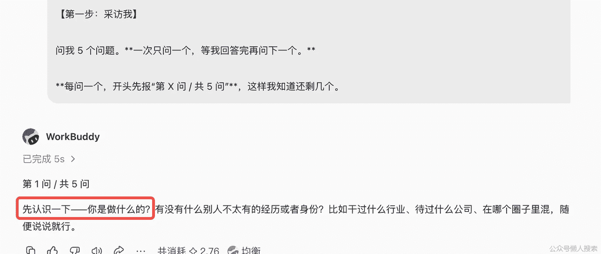

💡 第四问才是本关的胜负手，在这个问题上，它会多追问两轮。

初次作答，你多半会冒出“就是很假那种”“受不了太官腔的”，又或者干脆一句“没想过”。

这类说法一律落不进 Skill 里——所谓“假”、所谓“正式”，对 AI 来说都是含义模糊的标签，它无法照着执行。

接下来，系统会准备若干条与你所在领域相关的范例文案，请从中挑出读起来最扎眼、最不像你手笔的那几条。无论此前答题表现如何，这一环节照常进行。

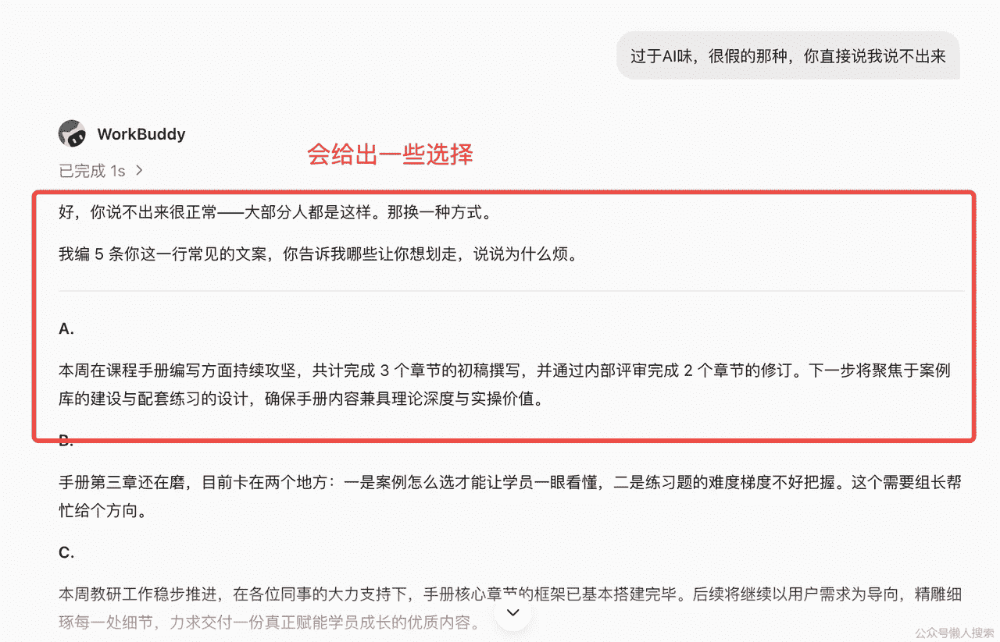

**整条链路中，分量最重的就是此处。**

让多数人描摹自己的文风，往往词穷；可一旦看到成稿，谁都能立刻指出哪句“不是我的口气”。正是这些取舍，让模型得以更精准地勾勒出你的文字疆界，最终产出的 Skill 也更贴合你本人。

若把这一环略过，Skill 中相应的模块便难以补齐。

**2.3 上传你的写作样本**

五道题答完之后，模型会先把你的答复梳理一遍——你惯用的表达方式、你想绕开的行文效果，都会列入其中——随后它会主动开口，向你讨要真实的文字材料。

事先备好的段落，直接黏贴过去就行；发图片同样可以。

模型会优先锁定你产出量最高的两三类体裁，每类各取两段。

万一某类确实攒不够材料（譬如排班通知拢共就一行字），如实说明就好，它会用别的体裁把样本凑齐，后续流程照常推进。

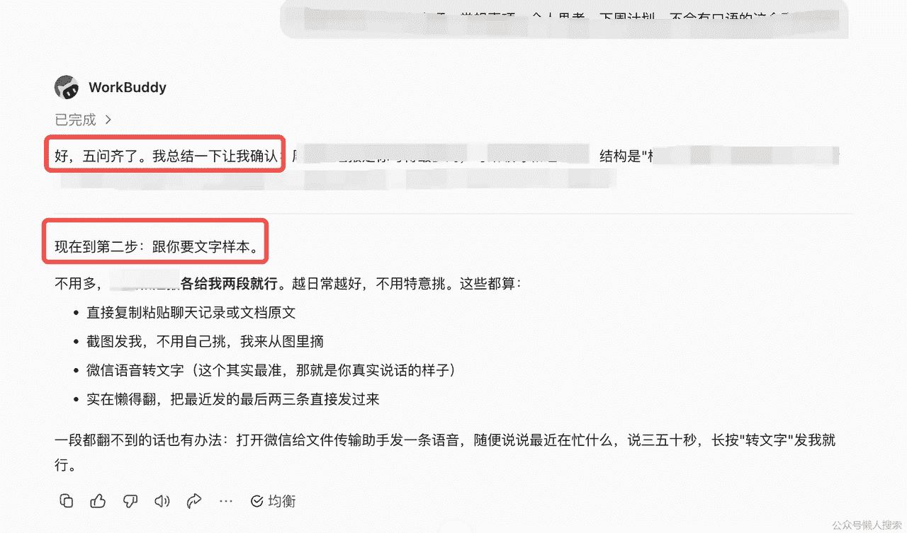

2.4 由模型写出 SKILL.md

句子的长短节奏、惯用的口头语、标点的使用偏好、落笔先抛结论还是先做铺垫——这些它都会自行拆解，再汇总成一份文档。

这个环节**你完全不必插手**，坐等成品即可。

收尾时它会交代清楚：Skill 已经就位，文件落在哪个目录，日后该怎么唤起它。

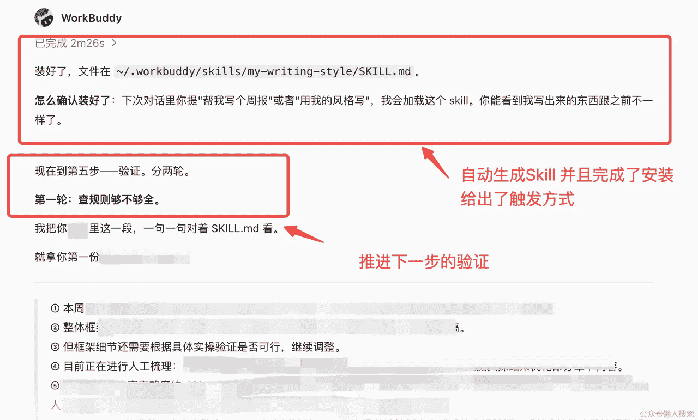

💡 假如它报出的位置，你按图索骥却扑了个空，先别急着怪自己。

回它两句话就行：“我这边压根没有这个目录，换个方式存。”或者“文件我翻不着，你替我打开。”

某些模型张口就来，能编出一条煞有介事的地址。你若拿不准，尽管追问，让它亲自去开文件，省得你满世界翻。

**2.5 做两轮初步校验**

**这一环会反复拉扯数轮，别急躁。**此前四步不过是在记录你的说法，到这儿才真正开始校准。

**头一回**，它抽你的一段样稿，**逐句与 Skill 比对**：这一句对应“我的写法”中的第几条？哪几句在规则里压根找不到出处？

恰恰是那些对不上号的句子最金贵——它们意味着你身上还有某种特质没被收进规则。它会一句句追问，问明白后就补成新的条目。

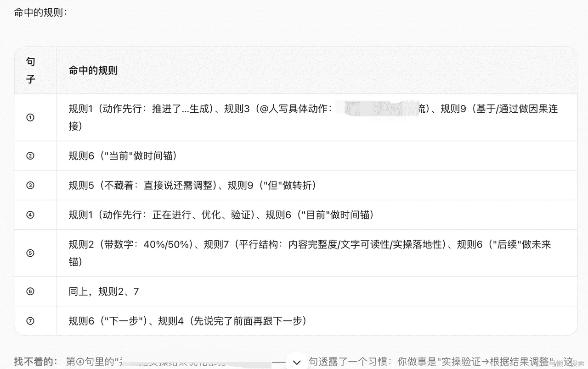

**第二回**，它挑一件你近期要动笔、却还没落笔的事，从零起稿写上一段给你过目。

**真正算验收的，是第二回。**头一回看的是规则齐不齐，第二回才见分晓：它究竟摸没摸到你的腔调。

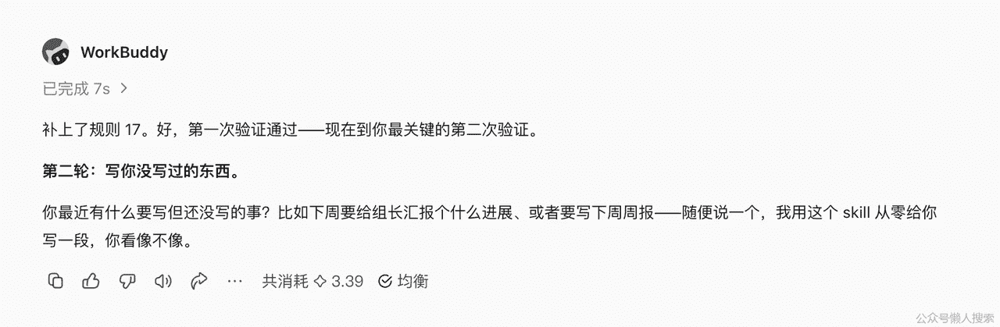

若成品不合心意，不妨继续对话打磨。可以这样开门见山：“眼下只做到了预期的七成，有几处仍不顺眼。”

模型会顺着你的意见往下追问，抛出若干备选，帮你把语言风格和内容再往细里调。

改完之后，它会重新归拢，产出定稿。

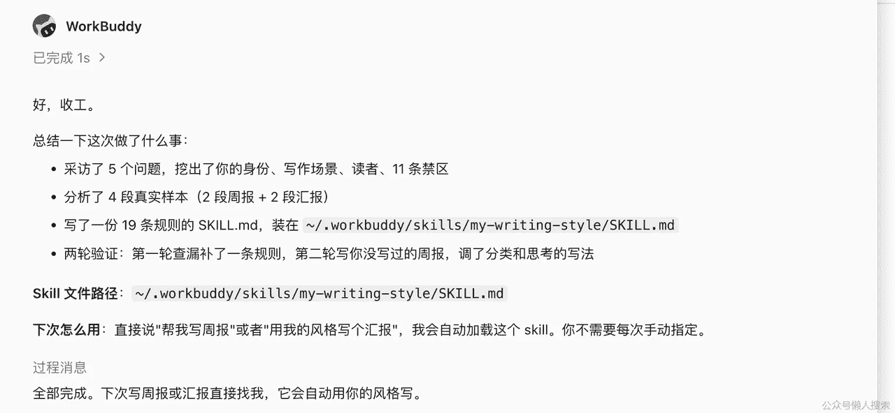


### 03. 把 Skill 验得更透

对话走到这里，你手上已经有了一个亲手做出的 Skill，也初步试过它的成色，一份 SKILL.md 也已到手。

下面进入更细一层的核查、检验与横向对照。

1. 核对 Skill 是否合格

可以直接把这句丢给模型⬇️

纯文本

```
你帮我把这个SKILL.md文档打开或者将完整内容呈现出来，我要检查一下相关内容
```

下图是我以“社区奶茶店老板娘”的身份设定走完全流程后，模型吐出来的成品。

五处该查的位置都已在图上圈出。整份文件七个小节，真正在“发号施令”的只有三节；核对时不必逐字扫到底，锁定这三节再加顶部那一行足矣。

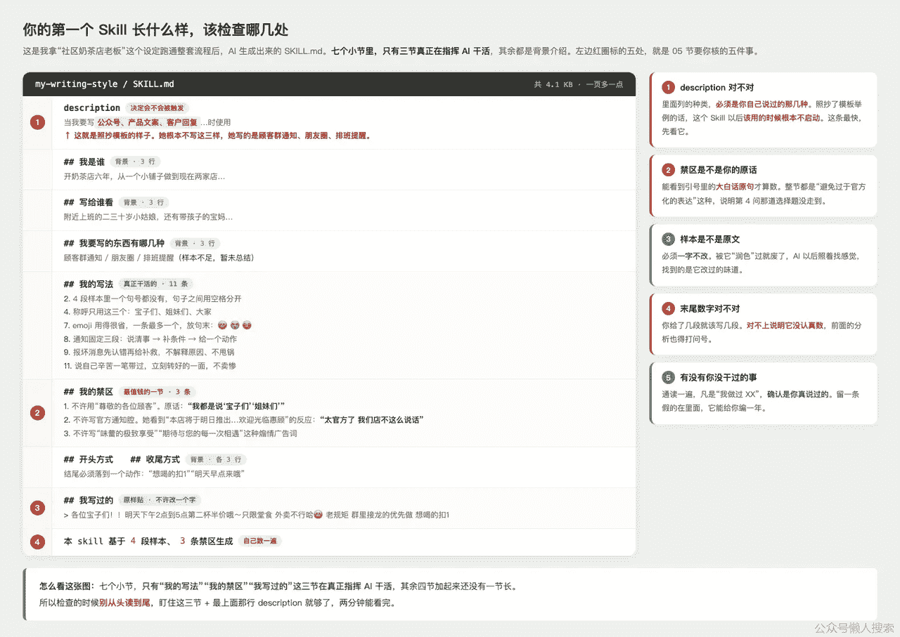

**1.1 先查 description**

**description 相当于这个 Skill 的“启用**说明书”，它规定模型在何种情形下应当唤出它。

先瞄一眼最顶端那行 description，确认写的到底是不是你真正会碰的题材。

**这处查起来最省事，比重却最大，务必放在最前。**

文件开头会有一行 description，形如：

纯文本

```
description: 用我的风格写东西。当我要写顾客群通知、朋友圈、排班提醒，或者说&quot;用我的风格写&quot;时使用。
```

这一行关乎 Skill 日后在何时被唤醒。其中列举的品类，必须出自你口中亲口承认的那几类。

倘若上面写着“👸号、产品文案、客户回复”，而这些你压根不沾，那么到了该启用的时候它偏偏纹丝不动，你还当自己白忙一场。

发现不对，甩一句过去：“description 那行换掉，写我真正会写的类型。”

**1.2 翻翻“我的禁区”**

核一核这一节是不是你的原汁原味。它是整份 Skill 中最要紧的部分，也最容易被模型蒙混过去。

| ❌ 模型自个儿编的 | ✅ 从你口中掏出来的 |
| --- | --- |
| 规避过度官方的措辞 | 别来“尊敬的顾客”，我们店里一律喊“宝子们” |
| 行文力求简练，杜绝赘余 | “赋能”“闭环”“底层逻辑”这三个词一个都别用，瞅见就想划走 |
| 语气需真诚自然 | 开篇禁止“在当今快节奏的时代”这种起手式，开门见山说事 |

左栏那类说辞套进谁的 Skill 都成立，因而说了等于白说；右栏这些才真正打上你的烙印。

要是整节清一色都是左栏货色，那多半是上一轮的问答没掏够料。

回到对话框里讲：“禁区这节太虚了，你按我这行拟几条常见文案，我来指哪条最招我烦。”

**1.3 核对“我写过的”**

**看看这段有没有被改动过哪怕一**个字。此处理应原样摆着你的真实样本。

**一旦它给你的文字做了“美**容”、砍了篇幅、捋顺了句子，这节就算废了。日后它照着这份样本找感觉，摸到的是被加工过的腔调，而非你的原味。

察觉到被动过手脚，就直接点破：“我写过的那节必须贴我原稿，一个字都别改。”

1.4 末尾那串数字，亲手点一遍

文件收尾处应当有一行，格式大致如下：

本 skill 基于 5 段样本、7 条禁区生成

**亲口数一遍，看是否对得上。**你交了几段就该记几段，禁区列了几条就该报几条。

数目不符，说明它压根没用心清点，前头的分析也得画个问号。

这行数字就是给你快速验货用的——数字一目了然，最容易比对，也能一眼看穿模型有没有胡编。

**1.5 排查凭空捏造的桥段**

从头到尾捋一遍，找找有没有你根本没做过的事被安在你头上。

**模型爱替你编履历。**上一关就说过：让它重写一篇选品稿，它自作主张添了句“那两天的调研替我省下几万块”，可原作者压根没提过这茬。

**文件里若冒出“我做过某某”“我向来坚持某某”这类表述，先确认是不是你亲口讲过。**不是你讲的，删。

这类内容日后会持续干扰模型替你代笔时的判断。

**2. 上手对比两个 Skill**

此刻你手里攥着**两个**都能改文字的 Skill：

**• wechat-writing-style**：上一关装的，出自他人之手

• my-writing-style：本关你亲手做的

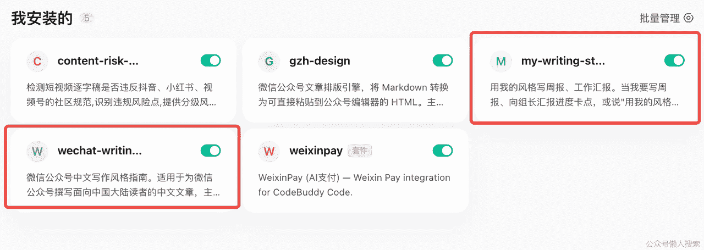

拿本关的成果与上一关那个过过招。

同一段文字分别交给它们改一次，你就能更直观地感受：改的是同一个东西，两个 Skill 的差别究竟在哪。

**2.1 两版结果摆一起看**

这两句指令都得把 skill 的名字喊出来，偷懒不得。

**你手里那两个 Skill 都能动**文字，若只丢一句“帮我改改这段”，模型很可能点错将。

wechat-writing-style 出自一位👸号博主之手，是一套成型的规则，改出来的文字带着浓厚的👸号口语味儿。

**去书面气、去机器味，它确实做得到**，这一点没得挑；可它改完的成品，搁谁名下都说得通，缺少辨识度。

my-writing-style 里收着你的口头语、你的称谓习惯、还有那几个你一看见就皱眉的词。它改出来的东西，只认你这一个人。

**先请出第一关那位。**把下面这段复制给模型，再将你的原稿贴在后面：

纯文本

```
用 wechat-writing-style 这个 skill 改一下这段话：

（把你的原文粘在这里）
```

接着换本关你亲手做的这个。在同一轮对话里，把下面这句发过去：

纯文本

```
再用 my-writing-style 改一遍同一段话，两版放一起给我看
```

下图记录的是实测结果：同一段官腔十足的通知，分别交给两个 Skill 改写。

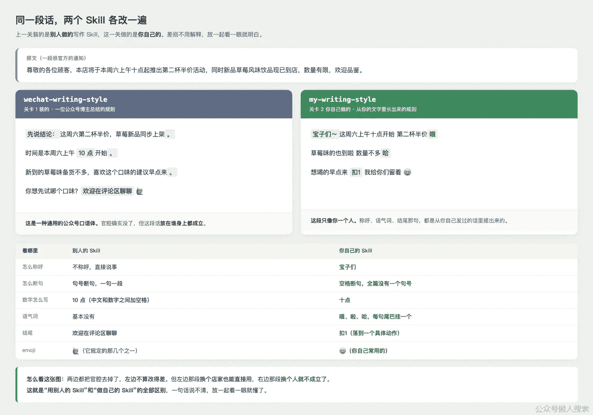

双方都把官腔剥了个干净。左边那版谈不上差，可随便换家店照样能拿去用；右边那版一旦换个人，立刻就站不住脚。

借用他人现成的 Skill，与亲手打造一个自己的 Skill，分野正在于此。

旁人把自己的下笔习惯封进 Skill，你装上去，写出来的自然像他。

而本关你亲手做的这个，规矩是从你自己的字里行间长出来的，写出来才最贴你的表达习惯。

**2.2 万一两版看着差不多**

要是你觉得两版几乎没差，**这不等于你搞砸了。**

假如你平日下笔本就是👸号那路口语调调，两套规则自然会打架、走向趋同，改出来也就难分彼此。

这种时候往细处瞧：**怎么称呼、爱用哪些语气词、收尾那句怎么落**。你自家那版会泄出你的小习惯（像“扣 1”“早点来哦”），旁人那版则不会。

若连细枝末节都分不出高下，多半是你“我的禁区”那节填得太单薄。翻回 05 节第 2 条，让模型再出一道选择题给你。


### 04. 本关容易卡壳的地方

碰上麻烦先别打退堂鼓，**先向 AI 开口**。本期建议**首选 Codex 或 WorkBuddy**，另开一个任务窗口，把报错内容、截图或者你的诉求丢进去，让它们帮你剖析缘由、定位故障，甚至直接替你摆平。


把“先问 AI、再找人”当成习惯慢慢养起来，大多数难题自会迎刃而解。

| 典型卡点 | 先看哪一处 | 接下来怎么做 |
| --- | --- | --- |
| 模型一口气把五道题全砸过来 | 这怪不得你，某些模型天生这毛病 | 回它：“一次只问一道，我答完再问下一题”，它就会收敛 |
| 卡在第 4 问，答不下去 | 再正常不过，十有八九都卡这儿 | 等它抛选择题；若不抛就说“你按我这行拟 5 条常见文案，我来挑哪条最烦” |
| 找不着自己写过的旧稿 | 是真缺，还是嫌写得糙不肯交 | 真没有就语音转文字（02 节第 3 条）；嫌难看的那类反倒最该拿出来 |
| 生成的 Skill 里掺了没说过的话 | 模型编履历是家常便饭 | 直接讲“这句我没讲过，删掉”，让它重出一版 |
| “我的禁区”整节空话连篇 | 第 4 问的选择题被跳过了 | 让它补一道选择题供你挑（见 05 节第 2 条） |
| 样本被它改写后才塞进去 | 它自以为在替你润色 | 说“我写过的那节贴原文，一个字都别动” |
| 装好后模型说不认得这个 skill | 文件放对位了吗？工具重开过没？ | 问它“你现在能调哪些 skill”，答不上来就让它查路径 |
| 写出来仍不像我 | 你说得清哪里不对劲吗 | 说不上来就让它“给两个版本，我挑一个”，挑着挑着就说明白了 |
| 两版摆在眼前我愣是看不出差异 | 它造的选项太雷同 | 回它“这俩太像，重给两个反差大的”，差异至少得体现在篇幅上 |
| 我的东西被它越改越短 | 你平时下笔是不是偏长 | 告诉它“我一条通常两三百字，篇幅也得写成一条规则” |
| 它写得比我啰嗦／比我客套 | 多半是禁区那节太单薄 | 把你受不了的表达补进去，越具体越好，再让它重写 |
| 它给了一串路径，我却找不到那个目录 | 你用的是手机／网页版吧 | 回它“我这边没这个文件夹，换个存法”，让它教你存进自定义指令或备忘录 |
| description 那行写的不是我真正会碰的题材 | 它是照抄了模板里的范例 | 说“换成我真正会写的类型”。不改的话，Skill 往后不会自行启动 |
| 我只说“帮我改改这段”，它就认错了 Skill | 你手上有两个都能改文字的 | 把名字点明：“用 my-writing-style 改”。含糊其辞它就挑错 |
| 上一关那位老抢我的活 | 两个 description 的触发词撞了 | 把你那个的 description 写细，列上你真正会碰的场景（顾客群通知、朋友圈…），别只写“改写文案” |


### 05. 收个尾

**🎉恭喜！跟着案例一路走下来，你已经做出了第一个真正属于自己的 Skill**，还用它写出一段更像你本人的文字。

走完这一关，Skill 于你而言，便不再是别人递过来的现成工具。

从备料、应对模型的“采访”、生成 SKILL.md、保存安装，到当场检验，这一整条链路你都亲身走了一遍。

特别是在“我的写法”“我的禁区”“我写过的”这些字眼落进文件之后，你应当能咂摸出来：Skill 绝非把一句提示词拉长那么简单，它是把你的习惯、偏好与取舍尺度，凝成模型下次能直接查阅的条文。

**此处的关键不在于把 Skill 做得多繁复**，而在于它是不是真的归你所有。

哪怕它小得可怜，哪怕通篇只是几句大实话——只要能让模型落笔时更像你，它便立得住。

先把你这口味道腌进去，往后再慢慢给它添本事。

**三个核心动作：**

1. **备好真实样本**：翻出你平日真写过的四到六段东西，越是随手日常，越能反映你的本来面目。

1. 顺着模型的引导做出 SKILL.md：照提示走完采访、拆样本、挖禁区、生成 Skill 这几步，把你的笔法固化进文件。

1. **即时核对与检验**：盯紧 description、我的禁区、我写过的以及末尾那串数字，再让它新写一段，看像不像你。

到此为止，你已经完整体验了一回“从零造 Skill”，也明白了它能把你的表达习惯、写作雷区与真实样本一并存住，好让模型下次落笔时有章可循。

**下一关，我们会接着往上叠：不只让 Skill** 记住你的风格，还要教它与其他 Skill 搭伙，串成一条更完整的工作流。

💡

记得交作业～回到本关任务卡，就能看到提交模板。


## 关卡 3：给第一个 Skill 装上接力能力

### 00. 本关任务卡

**🎯任务目标：给上一关做的那个 Skill** 末尾添一段话，让它写完就主动去唤别的 Skill 接手。你只消发一条命令，三个 Skill 便依次接棒。

**🗒️任务清单：**

• 打开上一关做的 my-writing-style，在尾部补一段调用规则

• 发一句话让它动笔，观察它写完是否会自己叫上其余 Skill 去做发布前体检＋排版

• 掌握一件事：如何分辨别的 Skill 是真跑了，还是只做了个样子

• 弄明白多个 Skill 到底能不能串成一条链

💡

**本关作业：一句话让 Skill 自动喊上另外两个** Skill，把改写、检测、排版一并干完

**⭕️提交模板**：

• 一条命令之后，三个 Skill 全都动起来的截图（必填）

体检报告的截图，需拍到开头“已加载规则库”那一段

参考图示：

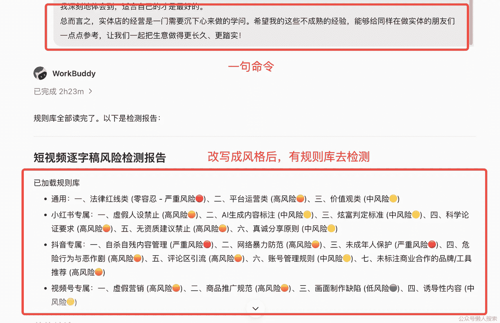

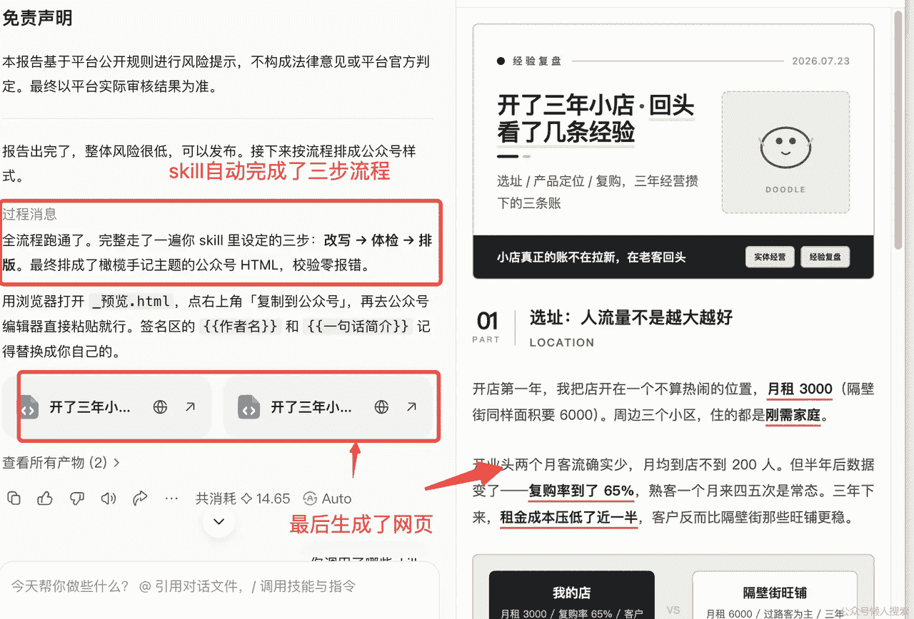

• 聊聊本关最大的收获（选填）

比如动手时有什么感触，对“怎么把 Skill 串起来”有没有新的认识或思考？

• 本关碰到的卡点或报错截图（选填）

遇到卡点和报错时，有没有先去问 AI 解决？简单写清你栽在哪一步

💡

**新手提示：**

**本关要加的东西少得可怜**，拢共也就四五行。别一听“升级”就以为得大动干戈。

Skill 的迭代从不在篇幅上加码，而在于让它明白：活儿干完，下一棒该递给谁。这几行字的分量，胜过你再堆五十条规矩。


### 01. 本关要抓的要点

也许有人觉得，所谓升级就是不停往 Skill 里塞规则：禁区越写越厚，写法越列越碎。

可条目一旦垒得太高，不光你日后维护吃力，模型反倒更摸不着要害。

真正的进阶，未必是把 Skill 越写越臃肿；更聪明的做法，是让它与其他 Skill 咬合起来，一件事办完便自动触发下一个，串成一条闭合的工作流。

做完本关，与关卡 1 的差别如下：

|  | 每一棒由谁去喊下一个 | 你得发几回话 |
| --- | --- | --- |
| 关卡 1 | 全靠你亲自去喊：改文字发一次，排版发一次，体检再来一次 | 3 次 |
| 关卡 3 | 由 Skill 自己喊人：它收笔时便清楚该找谁接棒 | 1 次 |

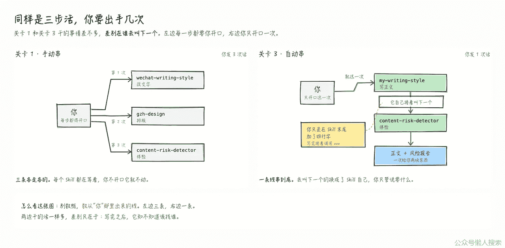

**左右两幅图，**干的活儿分量相当，唯一的不同在于收笔之后，Skill 心里有没有数：下一步该找谁。

好比一个刚报到的职场新人，手头的事一了便杵在原地，等着旁人派活；而一位业务娴熟的老手，收尾时会自己找上下一位同事，把接力棒顺势传过去。

**这正是本关要达成的变化：**你手里的 Skill 会从一只“叫它才动”的工具，蜕变成一件“自己清楚下一步该干什么”的利器。


### 02. 动手给 Skill 加装接力

1. 给 Skill 补一段规则

**1.1 两条路径**

路径一：交给模型代劳（推荐，省得自己翻文件）

⬇️将下面这段复制，直接丢给模型：

纯文本

```
帮我改一下 my-writing-style 这个 skill：在文件末尾加一节，叫“写完之后：发出去之前先体检”，内容是让你写完正文之后，接着调用 content-risk-detector 这个 skill 做合规检测，然后把风险报告原样贴给我看，包括报告开头那段&quot;已加载规则库&quot;。正文和报告分开放，别混在一起。改完把新加的那节念给我听。
```

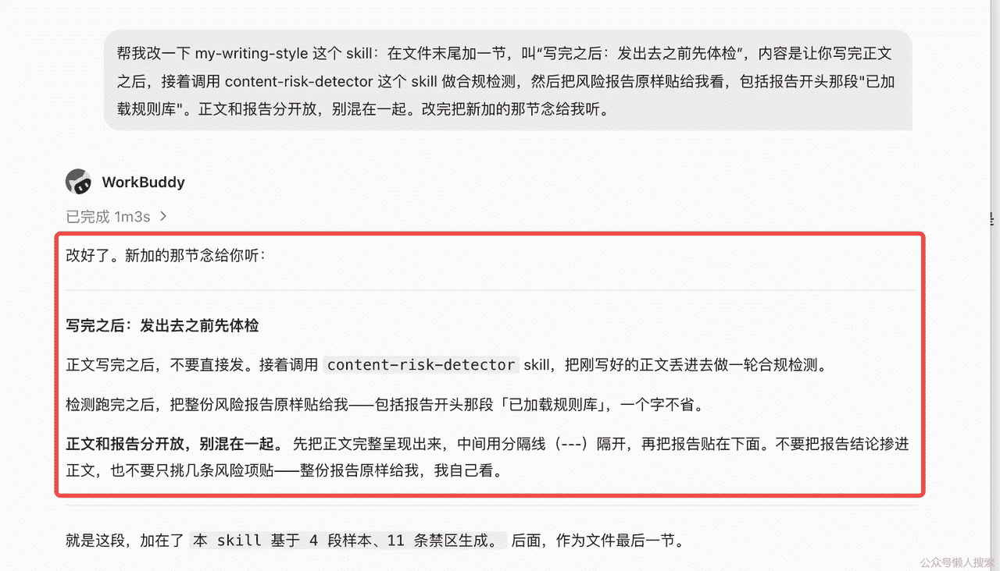

## 方案二：手动拼接配置

先把概念对齐：本文说的“技能包”，就是原文里的 Skill。

打开 my-writing-style 对应的文件夹，找到主文件 SKILL.md，翻到文件尾部，把下面的内容粘贴进去：

```
## 写完之后：发出去之前先体检

**写完正文，不要就这么给我。** 接着调用 `content-risk-detector` 这个 skill，把刚写好的内容过一遍合规检测。

把它给出的风险报告原样贴给我看，包括报告开头那段“已加载规则库”。

正文和报告分开放，别混在一起。
```

💡 粘好后务必执行保存。部分工具在配置更新后需要重启才会重新加载。保存完可以追问一句：“my-writing-style 最后一段的内容是什么？” 如果它能背出来，说明配置已被识别。

### 1.2 这段配置为何存在

这里加的内容，不是几句随手的提示词，而是在 SKILL.md 里做了三件事的约定：告诉 AI 应该启动哪个模块、期望拿到什么结果、结果要以多少细节呈现出来。

以后再接入别的 Skill，这个结构可以直接复用。三个要素都齐了，AI 才能在预期的轨道上执行。

用这个例子逐条看：

| 句子 | 它起的作用 |
| --- | --- |
| 接着调用 content-risk-detector | 指定对象。没有指明，它可能自行猜测，甚至跳过检测 |
| 把风险报告原样贴给我看 | 要求产出。没有这条，它可能“心里做了”但不提供任何输出 |
| 包括报告开头那段“已加载规则库” | 要求可见的证据。少了这句，它会压缩成一句“没问题”，你看不到判断依据 |

还要分清两个不同的职责：

• content-risk-detector 自带的规则：迫使 AI 真正读取规则内容、执行检查动作。

• 你现在写入的这段说明：确保 my-writing-style 在调用检测模块后，把完整的检测结果展示出来，而不是暗地里检查完就收工。

**2. 实测一轮**

**继续同一个对话**，把下面这句话发给 AI（要写的内容可以自己换）⬇️：

```
用我的风格写一条【小红书笔记：这周六上午十点第二杯半价，新到草莓味限量五十杯】
```

这句指令里完全没提“体检”“检测”“合规”这些词。你只是让它写通知，而体检动作是 Skill 自行去完成的——这就是升级的效果。

发出去后，屏幕上会出现两块内容：

**第一块，通知正文。**按你的风格输出的成品。

**第二块，检测报告。**开头是“已加载规则库”，后面是分级列出的风险项。

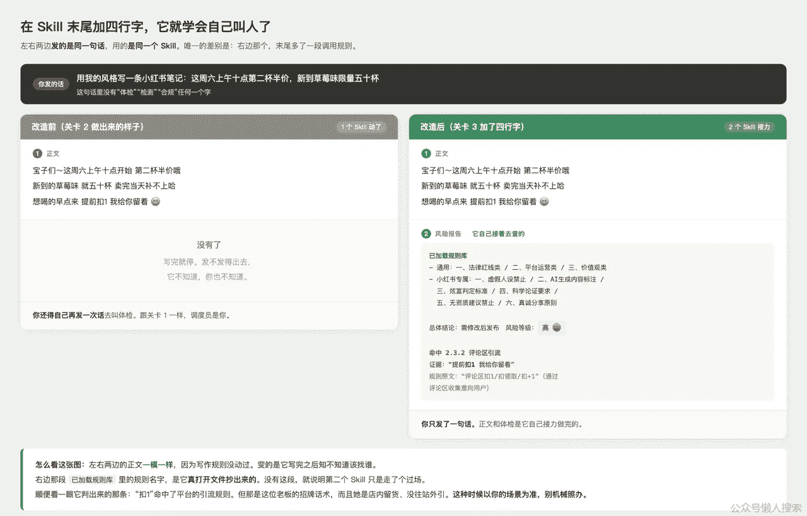

上图是同一句话、同一个 Skill 的真实输出。

**左侧是关卡 2 的行为**：写完正文就停下；右侧是加了新规则之后，末尾多了那几行触发代码，它便自动接上了检测。

注意右侧那条判定：“扣1”被识别为平台禁止的引流话术。

但这句话是老板的惯用表达，而且她是让顾客在店里留货，并没有导流到站外。

**这时应该以你的业务场景为准。**

**3. 验证规则真正生效**

链式调用最容易出的问题：第二个 Skill 其实没有被执行，但表面上很难看出来。

模型可以轻松生成一份排版美观、层次分明、看起来极为专业的报告，让你觉得检测已经顺利跑完——实际上它可能从未调用过任何 Skill，也没打开过任何规则文件。

那用什么方法确认第二个 Skill 确实被触发？

**3.1 看报告开头**

真正执行过检测的报告，开头长这样：

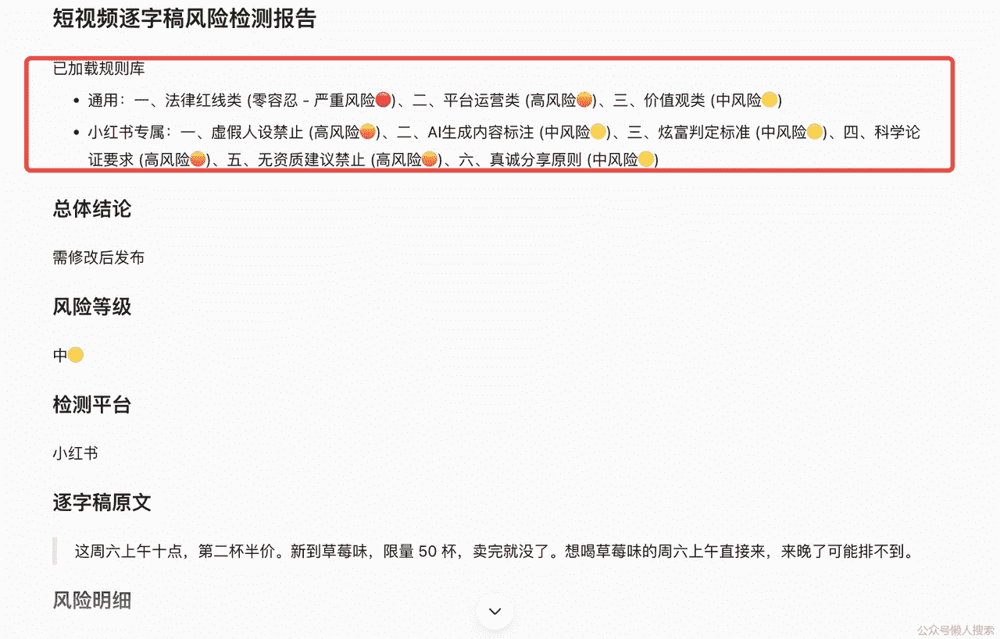

**重点在那些名称上。**

“法律红线类”“A**I生成内容标注”这些表述，是 content-risk-detector 规则文件里的原始字眼；不打开文件根本写不出来。

这就是 Skill 执行过的铁证。

| 报告里的情况 | 对应结论 |
| --- | --- |
| 出现了一串具体的规则名 | ✅ 确实读过文件 |
| 只有“已加载规则库”，后文空白 | 💡 先打问号，请它列出规则名 |
| 这段开头整个缺失 | ❌ 它跳过了规则库，报告无效 |

碰到第三种情况，直接回它：

```
你没加载规则库，重新读一遍 references 目录里的四个文件再判一次
```

这套方法任何 Skill 都适用。

以后串联别的 Skill，也可以想一下：有没有哪样输出，是它没有真实调用就无法生成的？

数字不足为凭（数字可以编造，且统计方式不同会导致结果不同）。原始表述、规则名称、具体引用，才是可靠的凭证。

**3.2 能力边界要清楚**

Skill 的链式调用只是把两个 Skill 接起来，并不会增强 content-risk-detector 自身的能力。

被调用的 Skill 依然只做它原本能做的事：帮你找出明显的违规词和高风险表达，但无法替代人工审核。

因此，凡涉及金额、承诺、资质等内容，就算检测显示通过，也建议再做一轮人工确认。

**4. 多 Skill 串联**

**其实 Skill 的调用可以是多级的，不限于单个。**

可以理解为一条流水线：一个员工干完手头的活，把结果传给下一个员工，依次接力直到整个流程结束。

在之前的基础上，还能继续接一个👸号排版 Skill：内容检测完毕后，自动进入排版环节。

操作方式一样，在调用规则里补一句，让它检测完顺手排个版：

```
继续帮我改一下 my-writing-style 这个 skill：在体检通过之后，再调用 gzh-design 排成公众号样式，生成能直接粘贴的 HTML。
```

之后可以发一篇文章，把完整链路跑一遍，看效果。

Skill 不是接得越多越好，要看业务需求来决定。

如果只是几句话的通知、公告或短文案，没必要挂载排版模块；只有当内容是完整的长文时，才适合把排版 Skill 接在流程末尾，让它发挥作用。


### 03. 本关常见卡点

碰到问题先别急着放弃，第一步可以求助 AI。本期优先推荐 Codex 或 WorkBuddy：把报错信息、界面截图或你的需求，新开一个任务窗口发过去，让 AI 帮你分析原因、排查问题，甚至直接给出修复方案。


慢慢养成“先问 AI、再麻烦人”的习惯，很多困扰就能自行解开。

| 卡点表现 | 优先排查 | 后续操作 |
| --- | --- | --- |
| 只出正文，没有检测动作 | 文件保存了吗？工具重启了吗？ | 问它“ my-writing-style 现在末尾写的是什么 ”，背不出新增内容说明没生效 |
| 存盘重启都做了，仍然不调用 | 可能是模型本身不擅长，不一定是配置错误 | 不用硬碰。手动发一句“ 用 content-risk-detector 检测一下刚才那段 ”，效果相同，作业不受影响。换个模型试试也行 |
| 报告里没有“已加载规则库” | 可能跳过了规则库 | 回复“ 你没加载规则库，重新读一遍 references 目录里的四个文件再判断 ” |
| 正文和报告糊在一起 | 调用规则里“分开放”那句丢了 | 补上“ 正文和检测报告分成两块，别混着 ” |
| 提示找不到 content-risk-detector | 关卡 1 是否装好 | 问“ 你现在能用哪些 skill ”，如果答不上来，回关卡 1 重新安装 |
| 口头禅被判违规 | 看看是不是样本里的原话 | 实测遇到过：“想喝的 扣1 ”字面命中“评论区引流”规则，但那是老板的招牌话术，她只做店内留货，不涉及站外导流。以你的场景为准，告诉 AI“ 这条发在自己顾客群里，这个判定不适用 ”。Skill 是死的，场景是活的 |
| 报告全红一片，看起来很吓人 | 检查是否超出了它的能力范围 | 对照 04 节第 2 条。钱和承诺相关它查不了，别被吓到，也别全盘相信 |
| 接上排版之后结果很怪 | 内容是否太短 | 几句话的通知不需要排版，跳过 05 节 |

### 04. 本关小结

🎉恭喜！你完成了对自己第一个 Skill 的一次升级，让它能够通过一条指令完成“内容改写 → 发布前检测 → 👸号排版”的整条链路。

这一关结束之后，Skill 在你眼中就不再只是一个会模仿你文风的文件了。

你已经亲手走完这些步骤：打开上一关生成好的 my-writing-style、在文件末尾追加调用规则、用一句普通指令测试它能否自动接上 content-risk-detector、再接入👸号排版 Skill。

尤其是当你亲眼见到同一件事——关卡 1 需要你一步步手动触发，关卡 3 只需发一次话就能自动执行——你会真切体会到：Skill 的价值不仅在于单个模块更听话，更在于它们能彼此衔接，组成一条真正能产出成果的工作流。

这一关真正的重点，不是链路串得多复杂，而是确认它确实被接上了。

它不能只是形式化地交一份报告，也不能停留在“检测通过”这几个字上。你必须看到“已加载规则库”、具体的规则名称、命中的依据，才有理由相信第二个 Skill 真的执行了。

Skill 也不是串得越多越优秀。内容很短，只做改写和检测即可；内容完整，才需要加上排版。能按实际情况灵活选择，才是真正的掌握。

先让 Skill 学会自己把活交接给下一个 Skill；下一关再拆开它的内部结构，把这套规则是怎么指挥 AI 的弄明白。

**三个核心动作：**

1. 给 Skill 追加调用规则：在 my-writing-style 末尾写清楚，正文完成后要接着调用 content-risk-detector；遇到长文，再继续调用👸号排版 Skill。
2. 用一句话跑完链路：只下发写作任务，不主动提“检测”和“排版”，看它能否自动接力。
3. 认证据，不信口头保证：重点查看“已加载规则库”、具体规则名称、风险命中依据，以及正文、报告、排版结果有没有分开呈现。

过完这一关，你已完成第一次 Skill 串联体验，也明白了 Skill 可以既独立工作、又能组合成更轻松的内容生产流程。

下一关，我们把你目前在用的三个 Skill 逐一拆开，看看它们的构成，弄清楚不同结构背后的原因。

💡

别忘了交作业～ 回到本关任务卡，可以看到具体提交模板。


## 关卡 4：拆开 Skill，看清内部结构

### 00. 本关任务卡

🎯任务目标：把你已经用起来的三个 Skill 逐个拆开，弄明白它们为什么形态不同，并且学会一件事：拿到任何一个 Skill，都能读懂它为什么这么设计。

前三关你一直在“用”，没停下来“看”。这一关就是带你把手中的东西认清楚：每个文件叫什么、各管哪一块。

直白地说，这是为下一关铺路：等你想让自己的 Skill 装载更多内容——比如你的报价、老客户常问的问题、你写过的爆款——你得先搞清楚这些内容该放在哪里。这一关正好看看别人是怎么放的。

不用安装任何新东西，拆的就是关卡 1 已经装好的那三个。

🗒️任务描述：

• 认识 Skill 的文件结构和三种能力

• 弄明白为什么有些 Skill 文件多、有些文件少

• 了解复杂的 Skill 如何维持稳定输出

• 拆解一个真实 Skill 的文件结构，生成 Skill 结构拆解卡

💡

**本关作业**：生成 Skill 结构拆解卡

**⭕️提交模版**：

• Skill 结构拆解卡（必填）

AI 输出的那张卡，截图或复制文字均可，五个条目都要完整。

• 一句话：你自己的 Skill 跟 gzh-design 比，差在哪（必填）

一句话即可。它占了几种能力？比 gzh-design 少了哪几种？少的那些，你现在的任务场景里用得上吗？

• 分享这关最大的收获（选填）

• 聊一聊遇到的卡点（选填）

**💡 新手提醒：**

这一关不需要改动任何文件，只是把用过的 Skill 打开来观察结构。

但别略过这关。理解 Skill 的结构很重要，后面的关卡会接着往上做升级。

这关要讲的每样东西，你前三关都已经实际碰过：

• references/ 参考目录，关卡 1 安装时就提醒过“不能只拷 SKILL.md”，说的就是不能漏掉它。

• SKILL.md 怎么写，关卡 2 你亲手实操过。

• 关卡 3 里那种防糊弄的设计（标题只能照抄、背不出来就等于没读过），你也亲眼看它发挥过作用。


### 01. Skill 的文件构成与三类核心能力

关卡 0 提到过：Skill 通常以 SKILL.md 作为核心文件，也可以附上参考文档、脚本、图片等配套资源。

所谓 Skill，本质上就是把一组能力文件按规则组织起来。

SKILL.md 的职责是定义行为规范，其他配套文件则负责补充知识或扩展功能。不同的文件组合方式，决定了 Skill 能执行什么任务。

1. Skill 最核心的结构与能力

| 能力 | 文件夹中的形态 | 你此前在哪见过 | 哪一关教过 |
| --- | --- | --- | --- |
| 定义规则 | 单独一个 SKILL.md | 关卡 2 你亲手写的 my-writing-style | 关卡 2 |
| 装载资料 | references/ 这类资料目录（还有 assets/ ，较少用） | content-risk-detector 里那几份平台规则 | 关卡 5 |
| 执行计算 | scripts/ 下的脚本 | gzh-design 排版完自动执行的校验脚本 | 关卡 6 |

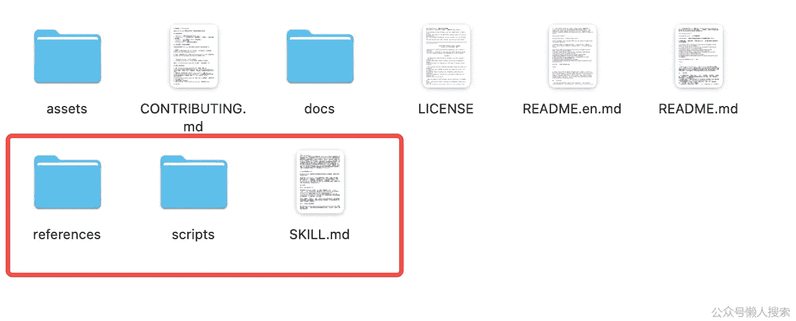

其中 SKILL.md 是每个 Skill 必备的核心文件，负责规定 Skill 的规则与行为；references、scripts 等配套文件则是按需添加的，只有当任务需要额外知识或计算能力时才存在。

你可能会想：都有 AI 了，为什么还要脚本？让 AI 直接去算、去查不就行了？

脚本有 3 个不可替代的优点：

• **结果可复现**。脚本跑一百次，输出完全一致；AI 靠模型推理，同一份文件让它数两遍规则，可能给出两个不同版本。

• **不占 AI 额度**。脚本反复执行也不会消耗 AI 工具的配额。对于每天重复的固定任务，把可标准化的步骤交给脚本，能省下大量成本。

• **速度更快**。gzh-design 排版后的校验，脚本一秒钟出结果；让 AI 逐段读一遍再找问题，又慢又容易遗漏。

结论是：好的 Skill 不是让 AI 包揽所有事，而是让 AI 专注于理解、判断和调度，把不能出错、可以重复的固定动作交给脚本去保障。

当然，不是每个 Skill 都需要附加文件，不同 AI 工具对这些文件的支持程度也不一样。

• 只需要写规则的 Skill，一个 SKILL.md 就足够，几乎所有 AI 工具都能直接使用。

• 需要额外知识资料的 Skill，就要有 references/ 等文件，前提是 AI 工具支持读取本地文件。

• 需要计算、查询、校验等固定任务的 Skill，才会用到 scripts/，这要求 AI 工具具备运行脚本的能力。

具体哪些工具能满足要求，关卡 6 会展开讲；即使工具不支持脚本，也有替代方案，不会影响通关。

2. 为什么有的 Skill 只有几个文件，有的却有几十个

这一关不用你亲自去电脑里翻目录，可以让 AI 来帮你。

⬇️把下面这段复制发给 AI：

```
把我装的这三个 skill 的文件结构列出来：wechat-writing-style、content-risk-detector、gzh-design。
每个都按这个格式说：文件夹里有几个文件、分别叫什么名字、分在哪几个子文件夹里。
只列你真看到的，没看到的就说没看到，别猜。
```

AI 一般会这样回应：

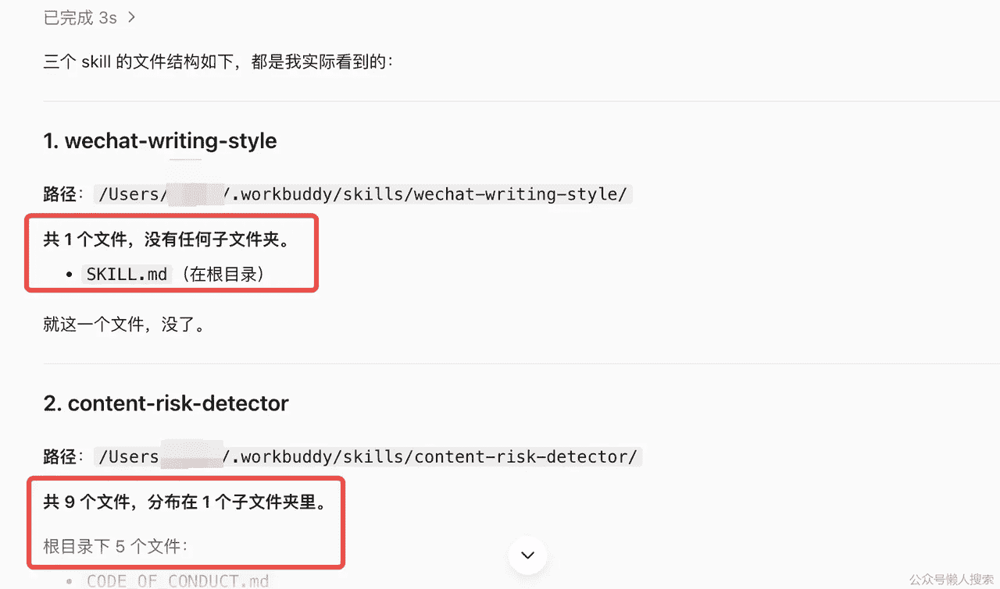

如果你想要更直观的感受，也可以打开关卡 1 资源包中的三个 Skill，解压后查看它们的实际文件结构，再对照下表的说明。


把 AI 列出的内容或者你亲眼看到的文件，对应到这张表上：

| Skill | 打开后看见什么 | 为什么长这样 |
| --- | --- | --- |
| wechat-writing-style | 孤零零一个 SKILL.md | 它只立规矩。文字风格怎么调整，一页纸就能说清。没有额外资料要记，没有运算要做 |
| content-risk-detector | SKILL.md + references/ 里四份规则文件 | 它需要存储资料。一份通用规则，再加上抖音、📕、视频号各一份。全塞进 SKILL.md 会太拥挤，分开放更方便——内容发到哪个平台它就读取哪份 |
| gzh-design | SKILL.md + references/ 里 11 份资料 + scripts/ 里 4 个脚本，另有 assets/、docs/ 两个目录 | 它既要存资料，也要跑计算。存的是六套排版主题的样式（标题长怎么样、引用框长什么样，每套一个文件）；算的是排版结束后自动做一轮合规检查。资料进 references，脚本进 scripts，互不干扰 |

💡 如果数出来的数量和表里不一致，不用慌，不一定是装错了。

**判断 Skill，先看骨架别看件数**

无论你的 Skill 来自 GitHub 仓库，还是别人打好的现成包，翻看目录时总会遇到 README、LICENSE、CONTRIBUTING 这几样东西。它们属于代码仓库的标配零件，跟 Skill 日常干活没有直接关联。但请手下留情，不要顺手清除：安装步骤写在 README 里，而 LICENSE 管的是你有哪些权限去改动、分发这套东西。

重点是在结构，而非统计条目多少。

拿之前聊过的三个 Skill 作个对照，就能看出门道：

• wechat-writing-style 的本事只有一种——把规则交代明白；

• content-risk-detector 会两样——既写规则，又能储存资料；

• gzh-design 三样全占，其中 assets、docs 同样归入资料类。

可条目多寡与实力强弱之间，划不上等号。

该配几个文件，是由任务本身说了算：若目标只是把规则讲清楚，单靠一份 SKILL.md 足矣；要应付资料查阅，就补上 references/；若还要跑固定计算、做校验，那就得加 scripts/。


关卡 2 你亲手搭的 my-writing-style 正是头一类——单独一份 SKILL.md 便够交差。

倘若将来 Skill 要照看海量资料，还硬往 SKILL.md 里堆，维护起来会愈发吃力，AI 也容易迷失重点。

往后的关卡会演示怎么把资料拆开存放，让整体结构更明朗。

3. 复杂 Skill 靠什么稳住输出

三者之中，gzh-design 的活儿最棘手：🛰️👸号排版规矩繁多，六套主题严禁交叉挪用，偏偏差错极少。

它之所以能稳住质量，秘诀在于 SKILL.md 中预先埋下了三道防错关卡。

这套路数，你在自家 Skill 里照样能借用。

当然，你可以亲手翻开那份文件。.md 本质就是纯文本，Windows 下右键点“打开方式 → 记事本”，Mac 则用“文本编辑”即可。

嫌麻烦的话，交给 AI 念一遍最省心，况且本关也没非要你动手改动。

⬇️想亲眼核对原话，把这句复制粘贴给 AI 即可：

Plain Text

```
把 gzh-design 的 SKILL.md 开头那段说明念给我听，就是 name 和 description 下面、第一个小标题上面的那几行
```


3.1 第一招：资料只认一个权威出处

开篇那段说明里白纸黑字写着：“主题清单以references/theme-index.md为单一来源”。

翻译一下：此事只许落笔在这一个文件，其他位置不得再抄一遍。

六套主题的命名、配色、适用场合，全凭 theme-index.md 这张表做主。别处若与它相抵触，一切以它为尊。

道理何在？同样的事情落在两处，迟早改这头忘那头，前后打架，AI 自然不晓得该服从谁。

3.2 第二招：斩断“凭记忆”的念头

依旧是那段说明的原话：“具体 HTML 代码一律从组件库取，不要凭记忆手写”。

言下之意，排版所涉的代码得从样式库中原样搬来，绝不允许 AI 自行杜撰。毕竟 AI 一旦干顺手就爱自由发挥，炮制出的玩意儿乍看挺像，往👸号里一贴便现了原形。

这话听着耳熟吧？关卡 3 里那个体检 Skill 立过规矩：大类标题只准照搬，严禁自行归纳。

异曲同工——要害之处，逼 AI 去誊抄原件，莫放任它自由创作。

3.3 第三招：资料成千上万，只拈当下所需

这招得从它作业的次序说起：references/ 里躺着 11 份资料，偏偏排一篇 Markdown 文章只动 3 份；遇上 Word 或 PDF 稿件，才多翻一份管格式转换的。

步骤是这样的：先翻主题索引表挑定主题，接着读该主题对应的样式文件，末了再添一份全体主题共用的公共样式。余下 8 份纹丝不动，待到用时再取。

若将 11 份一股脑推给 AI，紧要的条条框框反被淹没，稍弱的模型当场就得崩。

由此可见，资料一多，就得在 SKILL.md 中明确“何种情形翻哪份”。

往后这一步你也会亲自操刀。

4. 借 AI 之手拆骨架，再验真伪

前文已陪你拆过好几个真实 Skill。

此刻该你上场：请 AI 剖析某个 Skill 的构造，并查证它究竟有没有把文件读进去。

查证手法跟关卡 3 如出一辙：逼 AI 交出只有亲眼翻过文件才拿得出的信息。

⬇️把下面这段拷给 AI：

Plain Text

```
帮我拆解 gzh-design 这个 skill 的结构，只按下面五条填，别扩展：

1. 它是干什么的，一句话。
2. 文件夹里的文件分几类，每类各管什么。SKILL.md、references、scripts 分开说。
3. 这三种能力它占了哪几种：把规矩写清楚 / 记住一大堆资料 / 让程序去算、去查。每种给出证据，指出具体是哪个文件。
4. 它防止出错的写法，找两条，必须从文件里抄原话，注明抄自哪个文件。
5. 打开 references/theme-index.md，把“已注册主题”那张表**整张原样抄出来，一列都不能少**，包括最后那列很长的样式代码。一个字都不能改。

用“Skill 结构拆解卡”当标题输出。
```

届时你会收到一张拆解卡：


怎样辨别 AI 是实打实读了文件，还是装模作样？

重点盯第 5 条给出的结构——那种玩意儿不打开文件根本编不出来。

请核查下列三处：

• 是否呈现为五列表格，且六个主题各据一行；

• 末尾一列是否嵌着完整的样式代码，而非寥寥几句概述；

• 中间是否有一列载明对应文件名，且以 theme- 打头、.md 收尾。


三处皆中，大体能断定 AI 当真翻过那份文件。

若撞见下列状况：

• 光罗列主题名称；

• 表格缺列少项；

• 把内容揉成一整段文字；

那多半意味着它没真正开卷，而是靠着已有印象硬凑答案。

不妨将第 5 条单独拎出来再发一次，并在前头附上一句：

不许凭记忆，打开文件抄，一列都不许少。

对照拆解卡的第 3 条，回过身审视你自己的 my-writing-style。

三类本领里它占了几样？相较于 gzh-design 又缺哪几样？所缺的那几样，眼下的任务场景真用得上吗？

琢磨透了，凝练成一句话，后面的关卡要拿它派用场。


### 02. 本关易踩的坑

碰上难题先别急着撂挑子，不妨先向 AI 求援。本期建议优先启用 Codex 或 WorkBuddy，另开一个任务窗口，把报错、截图或你的诉求丢进去，让 AI 替你找病根、趟雷区，甚至直接替你摆平。

日积月累，养成“先问 AI 再寻人”的习惯，大半麻烦都能迎刃而解。


| 卡壳现象 | 先查哪一环 | 随后怎么办 |
| --- | --- | --- |
| AI 声称寻不着 gzh-design | 关卡 1 装的那份是否还健在 | 反问它“你现在能用哪些 skill”，若答不上来便回关卡 1 重装 |
| 本机压根没有 skills 文件夹，抑或 AI 直言读不了本地文件 | 你手头的工具是否在关卡 2 就选了“存不了文件”那条道 | 取关卡 1 下的资源包，里头自带 gzh-design 文件夹。解压后用记事本打开 SKILL.md 与 references/theme-index.md，把内容誊下粘给 AI，再发拆解那段指令。提醒一句：如此一来第 5 条便验不出真假了（它抄的正是你亲手粘的东西），作业里写明“我是粘给它的”，此条可跳过。若连包都没有，回关卡 1 那节重新下一份 |
| AI 报出的主题名对不上号 | 它没开卷，正在杜撰 | 把第 5 条单独重发一遍，顶上添一句“不许凭记忆，打开文件抄” |
| 拆解卡沦为长篇大论、术语满天飞 | 发送时是否漏了“只按五条填，别扩展” | 重发一次，补上那句。仍刹不住车就怼它“第 3 条重写，只说占了哪几种、证据是哪个文件” |
| 眼前文件比手册记载的还多，冒出没提过的条目 | 多出来的可是 README、LICENSE、CONTRIBUTING、.github、archive 这几位 | 它们乃代码仓库附赠的零碎，跟本职工作无涉，大可置之不理。不过 assets、docs 不算零碎：assets 搁现成模板，docs 是它自家的说明书，皆属身家。下一关会捎带提一嘴 assets |


### 03. 本关回顾

🎉贺喜你！此刻你已摸透一个 Skill 文件夹里藏了些什么，也亲手完成对自家 Skill 的骨架剖析。

走完本关，Skill 在你眼里不再只是一件“随取随用的工具”。

你已亲手拆过若干真实 Skill，也弄明白了为何有的只揣一份 SKILL.md，有的附带 references/，有的还动用 scripts/。

Skill 的高级感不靠堆文件，端看任务需要，挑一套恰当的骨架。

光写规则，一份 SKILL.md 便足矣；要存海量资料，就添 references/；若还得跑计算、查询、校验这类固定活计，再引入 scripts/。

本关真正的价值，不在于背下那些文件夹的称谓，而在于练就看穿 Skill 设计门道的眼力。他日拿到一个陌生 Skill，你能咂摸出它为何如此布局；待到亲手拓展 Skill 时，也拎得清哪些内容该塞进 SKILL.md、哪些该分流到资料文件、哪些宜托付给脚本打理。

先习得看懂他人设计的本事，下一关，你便要把这套打法用到自家 Skill 上。

要诀有三步：

1. 比照三个 Skill 的架构：瞧瞧单文件型、带资料夹型、带脚本型各是何种模样。

2. 辨明 Skill 的三类看家本领：把规矩写明白、存住成堆资料、交予程序去运算与核验。

3. 让 AI 拆解，再亲自验伪：别信它口头一句“我看过了”，得拿具体文件、具体表格、具体凭据坐实它当真读过。

本关过后，你已初尝 Skill 骨架拆解的滋味，也懂得了 Skill 绝非凭感觉胡堆一气，而是借文件、资料、脚本，将一套稳当做法分门别类安放妥当。

下一关，为你的 Skill 辟一间资料室，让它记下的东西远多于一页纸的容量。

💡交作业这茬别撂下～回本关任务卡瞧瞧具体提交模板即可。


## 关卡 5：教 Skill 学会翻资料

### 00. 任务清单

🎯任务目标：为 Skill 搭一个 references/（资料夹），撰写一份“我的真实情况”搁进去，好让 AI 在产出内容时能对照你的真实资料，既省去翻来覆去自我介绍的口舌，也压一压凭空捏造的概率。

🗒️任务描述：

• 先做一回“改造前”测试，记下 AI 眼下会瞎编哪些信息

• 弄懂哪些内容归 SKILL.md，哪些该入 references/

• 收拾两份材料：一份真实案例，一份个人真实底细

• 在 SKILL.md 中载明引用规则，令 AI 按需取阅对应资料

• 再做一轮核验，坐实 AI 引的是真材实料，而非凭经验瞎猜

💡本关作业：为 Skill 配置 references（资料夹）

⭕️提交模板：

• 改造后文件架构的截图（必填）

参考样图：


• 放资料前后同一任务产出的对照（必填）

里头若夹着价格、进货渠道、详细业务内容这类不便示人的私密信息，打上马赛克再交即可。

• 聊聊本关最大的心得（选填）

• 说说撞上的难点（选填）


### 01. 本关要旨

关卡 4 收尾时，你已摸清自家的 Skill 握着哪几种本领、还差些什么。本关就来替它补上“装得下成堆资料”这门功夫。

犹记关卡 1 曾叮嘱过：改罢务必从头通读，一旦撞见“我怎样怎样”的句子，都得核实是否真有其事。

缘何至此？

盖因 AI 并不知晓你的真实履历、产品底细或业务准则。真到要落笔具体内容时，它手头无料，唯有顺着上下文揣度出一个最讲得通的答案。

兴许有人动念：

“那我索性在 SKILL.md 里加一行：不许编。”

可惜此举治标不治本。

AI 并非存心诓你，实乃压根拿不出可资参考的底稿。缺了真材实料，它也只能硬着头皮往下猜。

本关的功课，便是将这些真实、稳固、须长期牢记的内容托付给 Skill 存管，而非回回都让 AI 临场瞎凑。


当务之急，是给 AI 备一份可供查证的东西。

你的产品名号、售价几何、真刀真枪干过哪些事，统统录进一份文件，再在 SKILL.md 里补上一句：碰到这些，去翻那份文件，不许自作主张。

回想关卡 2，你只往自家 Skill 里塞了一两段样本供 AI 参照，那会儿尚算够用。

可往后，你兴许会攒下十几乃至几十篇案例，还有产品资料、客户常见问题、品牌信息……若全往 SKILL.md 里堆，不光维护吃力，寻起来也愈发费劲。

故本关要修的，正是把这些日积月累的资料单独安置到 references/ 中。日后遇上新案例、新心得，径直往里添即可，免去回回动 SKILL.md 的麻烦。

更要紧的是，这些资料绝非写文案时的临时佐料。

它们实为 AI 理应知晓、却无从自知的、关乎你与你的生意的底牌。往后无论是码内容、回客户，还是替你拿主意，都该先翻这份底稿再动工，而非凭空捏造。

往后的关卡中，你还将不断向这座资料库添砖加瓦。


### 02. 给 Skill 装上 references（资料夹）

1. 哪些内容留守 SKILL.md，哪些移入资料夹

先立一条铁律：

SKILL.md 管的是“怎么干”，资料夹盛的是“干活所需的底料”。

不妨以关卡 2 的 my-writing-style 举例：

• 写作准绳、流程、注意事项，归在“怎么干”旗下，仍旧留守 SKILL.md。

• 写作样本、品牌资料、产品信息、常见问答之类需长期累积、持续增补的内容，则更宜移驾 references/。

| SKILL.md 中的这几节 | 留或移 | 缘由 |
| --- | --- | --- |
| 我是谁 / 写给谁看 / 写哪几种东西 | 留守 | 三五行的篇幅，且回回动笔都得用 |
| 我的写法 / 我的禁区 | 留守 | 这是干活的铁律 |
| 开头方式 / 收尾方式 | 留守 | 简短、高频 |
| 我写过的（那一两段样本） | 迁出 | 越积越厚，且并非每次都翻 |
| 写完之后：发出去之前先体检 | 留守 | 关卡 3 你亲手添的那节，它管流程，动不得 |
| 最末尾那行“本 skill 基于…” | 留守 | 此乃这个 skill 的身世记录，别随样本一道卷走 |

此举妙处在于：规矩与资料各归各处，往后添资料时，无需一遍遍返工 SKILL.md，Skill 也更好打理。

挪腾完毕，你会多出一个文件夹和两份文件：

• 文件夹唤作 references，意即“资料夹”，两个称谓本是一回事

• 我写过的.md：样本尽数迁入。日后写出称心之作，向 AI 吩咐一句“把这段加到我写过的那个文件里”即可

• 我的真实情况.md：此乃新拟，产品、价位、你实打实做过的事，逐条罗列清楚

💡文件名取中文可好？多半没问题，AI 识得中文名。唯独文件夹那个 references 非英文不可——它寻资料时认的正是这串字符。倘若你的工具不买中文文件名的账，命 AI 将两个文件改成 samples.md 与 facts.md，照常使唤。

判别标尺只消三句话，他日打理自家 skill 也照此掂量哪些内容该迁入 references/：

• 频繁变动的，迁入 references/。诸如价位、案例、产品信息，更新时只管改动资料，无需惊动 SKILL.md。

• 篇幅冗长的，迁入 references/。几十上百行的资料若硬塞进 SKILL.md，真正要紧的规则反遭掩埋。

• 并非次次用到的，迁入 references/。譬如仅在产品介绍时才查价位、只在售后回复时才瞧的 FAQ，按需翻阅足矣，不必回回一股脑载入。

反过来讲，流程、规则与判断继续留守 SKILL.md。它好比 Skill 的操作手册，每次执行任务都得让 AI 从头到尾通读。

💡捎带认识一下 assets/

上一关拆解 gzh-design 时，你兴许留意到还有个 assets/ 文件夹。本关暂且用不着它，知晓有这门本事便罢。

它与 references/ 的分野一望便知：

• references/：收纳 AI 需研读、参照的资料，诸如案例、产品信息、FAQ、你的实战心得等。

• assets/：盛放可直接取用的资源，比如固定模板、图片、图标之类。

打个比方，倘若你手握一套固定的朋友圈模板，或公司 Logo、宣传图这般素材，尽管搁进 assets/。

待日后真个用得上这类资源，再新建 assets/ 文件夹也不晚。眼下把 references/ 练熟便够。

2. 把资料送进 references（资料夹）

开干之前，先匀出一分钟留个“改造前”的存档。

打开你的 AI 家伙什，把下面这句拷给它，并将它的答复截图留存：

Plain Text

```
用我的风格写一段东西，里面要带上我的具体信息，名字和数字都要说清楚
```

亦可依自身处境稍作变通：

• 经商开店：吆喝一下我的招牌，把名号和价码报明白。

• 上班打工：拟一段周报，项目名与真实数字一并带上。

此刻，AI 手上尚无你的真实底稿。

且瞧瞧它如何落笔，不必急着评头论足，把结果截图存妥，这便是“改造前”的原始面貌。

# 让 AI 少编一点：给它建个真实资料库

这一关收尾时，把最初那条要求原样再说一遍，两张截屏并排一摆，这一关到底做了什么，一眼便知。

**2.1 动手之前，先盘清底料**

给自己五分钟，回答一个问题：当你把笔交给 AI 时，有哪些事它压根没掌握？

凡是它空白的部分，都该由“我的真实情况”来补。下面按四类身份各给一例，对号入座即可：

| 身份 | 它理应掌握、却始终缺席的信息（写稿之外，日常派活同样用得上） |
| --- | --- |
| 电商卖家 | 店铺名、主推款、原价与活动价、走哪家快递、几天到货、能否七天无理由、实际跑过的货源与产地 |
| 实体店主 | 招牌叫什么、地址怎么讲（“某号线出来走两百米”）、营业时段、镇店的是哪几样、客单价、有无车位、熟客反复追问的那几个问题 |
| 上班族 | 所在部门、手头职责、日常对接的岗位、参与过的项目与真实数值（别含糊说“提升明显”，要写“从 3 天缩到 1 天”） |
| 知识付费从业者 | 课程名称、共几节、定价、学员画像、学员原话反馈、个人履历（从业几年、带过多少学员） |

实在没头绪，就用笨办法：翻出近期发布的三条内容，凡是出现专有名称、数值、日期之处，整句摘出来。这些位置，恰恰是 AI 最爱自由发挥的地方。

2.2 交给 AI 去搭 references（资料夹）

无需手动创建目录，把下面这段话原样发给它即可⬇️：

```
帮我给 my-writing-style 这个 skill 加一个 references 资料夹，建两个文件：

1. references/我写过的.md
   把 SKILL.md 里&quot;## 我写过的&quot;这个标题、以及它下面那几段样本，原样搬过去，一个字都不要改。
   搬完把 SKILL.md 里这部分删掉。
   注意：文件最末尾那行&quot;本 skill 基于 X 段样本、Y 条禁区生成&quot;不属于这一节，
   留在 SKILL.md 里别动它，也别搬走。

2. references/我的真实情况.md
   先别写内容，按下面几类列个空框架给我，我自己往里填：
   我是谁做什么的 / 我的产品或服务（名字、价格、卖点）/ 我真做过的事和真实数字 / 常被问到的问题和我的标准答案

两个文件都建好之后，把 SKILL.md 现在还剩哪几节念给我听，
最末尾那一行也原样念一遍，再把文件夹结构画给我看。
```

完成后，回头核对两处是否安然无恙：

• SKILL.md 末尾那句“本 skill 基于 X 段样本、Y 条禁区生成”；

• 关卡 3 补入的两小节：“写完之后：发出去之前先体检”与“体检通过之后：排成👸号样式”。

万一被误删或挪位，直接要求它“把这行（这节）补回去”就行。


到这一步，你的 skill 会由单文件长成下面这副模样：

```
my-writing-style/
├── SKILL.md              ← 怎么写（规矩、禁区、开头收尾）
└── references/
    ├── 我写过的.md        ← 写出好东西就往里加
    └── 我的真实情况.md     ← 你自己填，只填真的
```

**2.3 把“我的真实情况”填实**

归纳、提炼、从旧稿里拉出草稿，这些都能托付给 AI；但每条内容是否属实，必须由你拍板。它管搬运，你管真假。

也不必逐个文件复制粘贴，整理环节一并交给它即可。

打开手机备忘录，或🛰️里的文件传输助手，列出你希望 Skill 长久记住的内容。不必成篇，一行一条足够。

以下几个场景示例，挑最贴近自己的那份参考。

**卖货场景：**

```
主推：XX 面膜，日常价 89 一盒，活动价 69
发货：广东仓，江浙沪次日达，偏远 3 天
七天无理由退，运费险有
2024 年 3 月去过一次工厂，看了原料仓和灌装线
卖了两年，复购的老客大概三成
```

**开店场景：**

```
店名：巷子口奶茶，在实验小学东门斜对面
营业：早 9 点到晚 10 点，周末到 11 点
招牌：手打柠檬茶 12 块，芋泥啵啵 16 块，学生证减 2 块
常被问：能不能少糖（能，三档）、有没有热的（冬天有）
开了三年，熟客大多是附近上班的和学生家长
```

**上班族场景：**

```
岗位：XX 公司用户运营，带 2 个人
手上的活：会员体系和复购，天天盯月活、复购率
今年做的：3 月上线积分商城，复购率从 18% 提到 25%
常打交道的：产品、客服、数据组
写周报的规矩：只报数字，别写“大幅提升”，写“从 18% 到 25%”
```

**体制内场景：**

```
单位：区里某科室，主任科员
手上的活：科室的信息报送、开会用的材料
今年做的：牵头写了 3 份调研报告，办了 2 次全区培训，到会 120 人
常打交道的：分管领导、办公室、下面几个街道
我的忌讳：数字得跟台账对得上，别替我拔高、别替我表态
```

💡提醒一句：这里存的是业务资料，不是保险柜。

references（资料夹）只放完成这个 Skill 真正必需的资料，比如产品参数、业务规则、案例、常见问答之类。

账号密码、API Key、Cookie、身份证号、完整客户隐私、未公开合同、内部链接这类内容，一律不要直接写入。

若拿真实案例练手，先把姓名、手机号、价格等信息打码或替换，再收进资料。

写完后，把下面这段提示词连同你整理的内容一并发给它：

```
把下面这些内容写进 my-writing-style 的 references/我的真实情况.md 里，
按&quot;我的产品或服务&quot;&quot;我真做过的事&quot;&quot;常被问到的问题&quot;分类整理好。
只整理，不要添油加醋，我没写的别替我编。

【把你想好的内容粘在这儿】
```

整理完毕，请它把结果一条条念出来。重点不在排列次序，而在于**是否冒出了你从未写过、从未做过的表述**。若只是调换位置或归并了同类项，那是它在替你分类，不必多虑。

初次上手不必求全，十条上下就足以开跑。

日后再遇到它胡乱猜测、**凭空编造的情形，多半并非能力退化，而**是提示你：资料里还少了一条真实条目。补上，下一回它就懂了。

整个资料库只有一条铁律：只记录真实发生过的内容，别为“显得更厉害”去虚构没做过的事。

这份资料存在的意义，正是杜绝 AI 凭空捏造；一旦资料本身掺假，后续所有判断与产出都会踩在错误的地基上。

下面几个疑问，或许你也会有：

| 疑问 | 解答 |
| --- | --- |
| 可以自己打开文件改吗 | 当然可以。.md 本质是纯文本，Windows 上右键“打开方式 → 记事本”，Mac 用“文本编辑”即可。保存时别动后缀，保持 .md。只是让 AI 来改会省心不少，尤其往里面添内容时 |
| 文件放在哪里，安全吗 | 它就是个普通文本文件，和你硬盘里的 Word 无异，不会自己往外发送。但若使用云端工具，资料便存放在对方服务器上，道理同网盘。真正敏感的内容（进货价、身份证、客户手机号）别写进去，这一关也用不上 |

3 按需调取，而非全量通读

资料备齐，还差临门一脚。

**文件只是摆进了**references/，仍不够；真正要让**SKILL.md**明确告诉它：**何时该去翻哪一份。**

上一关拆 gzh-design 时，这种写法已经露过面。

它手里有 11 份材料，排版时却不会一股脑全读，而是按当下任务挑出必需的 3 份。

**原因在于 SKILL.md 早已**定好规矩：何种情形下，该调取哪一份。

**因此，refer**ences/ 是仓库，SKILL.md 是调度令——何时取、取哪件，都由后者说了算。二者配合，资料才真正派上用场。


⬇️把下面这段原样发过去：

```
帮我改一下 my-writing-style 的 SKILL.md，加一节叫&quot;我的资料在哪儿&quot;。
位置放在&quot;# 我的写作风格&quot;这个大标题下面、&quot;## 我是谁&quot;前面。
最上面那几行 name 和 description 不要动，那是这个 skill 的名字和说明，挪了工具就认不出它了。
这一节的内容是：

- 要找我平时说话的感觉，读 references/我写过的.md
- **凡是要写到具体的产品名、价格、时间、数字、我的经历，必须先读 references/我的真实情况.md，按里面写的来。这份文件里没有的，就别写，或者直接问我。不许自己想一个。**
- 平时不用把两份都读，用得上哪份读哪份

改完把新加的这节念给我听。
```

其中**最关键的是中间那句**，逐条拆解：

| 语句 | 作用 |
| --- | --- |
| 必须先读 | 缺了这句，它可能图省事直接跳过 |
| 按里面写的来 | 读过不等于照做，必须写明强制遵从 |
| 这份里没有的，就别写，或者直接问我 | 这是全篇的命门。封死它的退路，否则查无依据时照样会编 |
| 不用两份都读 | 爱惜算力，免得它每次把整个文件夹兜底翻一遍 |

💡索性每次全读不行吗？

眼下只有两份，全读无碍。可一旦累积到十几份，麻烦就来了：每次开工先囫囵吞下全部材料，真正指导干活的规则会被淹没其中，能力弱一些的模型甚至直接装不下。

4 辨真伪：它究竟读没读

**与前几关同理，**此刻关注的不是文笔**优劣，而是**核验：references 里的内容，它到底动没动过。

**4.1 换个新对话，重跑原题**

**务必另开一个对话。**别在原来那轮里追问，否则它可能只是记住了聊天记录，说不清究竟是翻了 references，还是顺着上下文顺下来。

把开头那句要求，一字不改地在新窗口再发一次⬇️：

```
用我的风格写一段东西，里面要带上我的具体信息，名字和数字都要说清楚
```

这一回，它理应主动去翻**我的真实情况.md**。

盯紧三处：

• **名称准不准**：产品名、店名、项目名，是否出自你提供的资料。

• **数值对不对**：价格、时长、成果，是否与你填入的真实数据一致。

• **有无杜撰**：有没有蹦出资料中根本不存在的履历、数字或身份。

三项全中，说明它确实读进去了。

这次的截图与最初那张并排一比，差别立现：

从前它会自行脑补“干了三年”“服务过上万人”“省下几万元”之类；

如今它引用的，是你资料里的真名、真数和真经历。

**references 的核心价值正在于此：让 AI 由“猜”转“查”。**

**4.2 它没去查，怎么破**

先别动 SKILL.md，把这句话发给它⬇️：

```
你刚才写的价格是从哪儿来的？
```

若它的答复是：

• “我按常见情况估的。”

• “这是我推断的。”

• “没有参照具体资料。”

基本可以断定，它并没有真去翻。

换个问法：“my-writing-style 开头那节讲的是什么？”

答得出，说明规则已生效；答不出，多半是没找着。

回它一句：“文件里没有的别自己编，直接问我。”随后把缺的那条补进去。

部分工具改完需重启一次，才会认新内容。

### 03. 本关高频卡点

卡住时别急着**放弃，不妨**先**求助 AI。本期建议**优先用 Codex 或 WorkBuddy，另开一个任务窗口，把报错、截图或需求丢过去，让它替你查原因、排故障，甚至直接动手解决。


养成“先问 AI、再找人”的习惯，多数麻烦都能自行化解。

| 卡点 | 自查 | 应对 |
| --- | --- | --- |
| 它死活不碰那个文件 | 04 节那句是否真的写进去了 | 问它“my-writing-style 开头那节写的是什么”。答得上就说明已生效；答不上，把 04 节那段再发一次。部分工具需重启后才认新内容 |
| 它反馈找不到 references 文件夹 | 文件究竟建在哪 | 让它“把 my-writing-style 的目录结构画出来”，多半是建错了位置 |
| 读了，价格却仍是编的 | 文件里那条是否写得够明确 | 多半是没查到。回一句“文件里没有的别自己编，直接问我”，再把该条补进文件 |
| 不清楚“我的真实情况”该写啥 | 翻近期发布的三条内容 | 凡出现专有名称、数值、日期之处，整句摘入。那些正是它爱发挥的地方 |
| 我的工具存不了文件（网页版那类） | 你是不是关卡 2 走的那条路 | 同样做得完：资料与 SKILL.md 都存在自己的备忘录里，每次开工把两样一起粘进对话框，末尾补一句“写到具体信息按这份来，不许自己想”。04 节那几句也不必写进文件，粘完口头说一遍即可。作业和过关检查要求交文件夹的地方，拿备忘录截图交，一样计分 |
| 弄完感觉没什么变化 | 你那句话是不是问得太泛 | 光说“写条朋友圈”看不出差别，得逼它落到具体：“把名字和价格说清楚”。你所在行业有什么具体项就问什么——开店的问地址和营业时段，上班的问项目与数据 |


### 04. 本关收束

🎉恭喜！你的 Skill 如今已挂载 references/ 资料夹，开始依据真实材料作答，而非凭感觉乱猜。

经此一关，Skill 不再只是死守规则干活的配置文件。

你完整走了一遍流程：先做“改造前”测试，撞见它会编具体信息；接着整理“我写过的 .md”与“我的真实情况 .md”；最后把调取规则写回 SKILL.md。

特别是同一句话前后各问一遍，感受尤深：Skill 的妙处不限于让模型更听话，更在于它把你的真实信息留档，用时去查，而非次次临场硬凑。

**这一关的要义不在资料多齐全，而在于让它**明白：该查什么、到哪儿查、查不到就别硬编。

SKILL.md 交代“怎么干”，references/ 存放“干活所需的材料”。二者分置，日后材料越堆越多，Skill 也不至于乱作一团。

先让它学会引用真实材料；再往后，我们会为它添上更可靠的校验手段，把可交由机器判定的事项交给脚本。

**三个关键动作：**

1. **先存一份改造前的结果**：用同一任务逼它吐出具体名称与数值，看清它眼下容易在哪儿露馅。

2. **把真实材料搬进 references/**：写作样本、产品资料、亲身经历、常见问答这类会持续增长的内容，从 SKILL.md 中迁出。

3. **写清按需调取的规矩**：说明什么场景该读哪份，资料里没写的就不许编，或者直接来问你。

至此，你完成了首次 Skill 资料库搭建，也明白了 Skill 并非只能承载一页规则，它还能长期存下你的真实情况、案例与素材，让下次动笔有据可查。

**下一关（关卡 6）**：为这个 Skill 添上第三项本领——一段脚本。你在关卡 2 定下的禁区里，有些条目机器一眼可判（是否出现某词、字数是否达标），这类活没必要每回都让模型重推一遍。

💡

记得交作业～回本关任务卡可查看提交模板


## 关卡 6：让 Skill 搞定固定任务

### 00. 本关任务清单

**🎯目标：****为你的**写作 Skill 增加第三项能力：scripts/（脚本），使它在每次发布前，自动扫一遍你设定的禁区。

**🗒️任务说明：**

• 掌握一条判断：哪些环节交给程序运算，哪些环节留给模型思考

• 找出关卡 2 里写下的“我的禁区”，挑出其中机器可验证的条目

• 请 AI 把这些条目写成脚本，嵌入 Skill

• **花三十秒**试试你的工具能否跑通它

💡

本关作业：为 Skill 配置 scripts（脚本）

⭕️提交模板：

• AI 生成的脚本（必填）

截图文件内容，或让它直接展示均可。

截图示例：


• 你选中的规则有哪些、为何适合交给脚本处理（必填）

简要说明理由即可。

• 分享本关最大收获（选填）

• 遇到的卡点（选填）


### 01. 本关要点

回望前五关，会发现我们一直在跟同一个难题较劲：

**它讲得头头是道，你却无法判断**是真做了还是蒙出来的，只能一遍遍去核实。

关卡 3 教你核实它是否真的执行。

关卡 5 教你喂它真实材料，减少无据编造。

这一关再进一步：有些事，索性不让它猜。

提示词写得再细，模型也未必更准。

因为有些活，天生不在它擅长的范围内。

比如数字数、算总量、批量改名、格式转换……

这类任务**答案唯一**，交给程序比交给模型推理更合适。

本关要练的，正是如何分工。

把这种“答案唯一”的活计交给脚本执行。

**模型负责思考与判断，scripts（脚**本）负责精确执行，各司其职。


### 02. 让 Skill 承担固定任务

**1. scripts（脚本）是什么**

关卡 1 装好的👸号排版 Skill，每次排版结束都会自动输出一段：


# 能用程序算的，就别让模型猜

有些结论并不是模型当场琢磨出来的。它只是在背后唤起了一段早有准备的小工具，等程序把活儿干完，再原样转述给你。还记得上一关解析 gzh-design 时翻到的 scripts/ 目录吗？里面躺着的正是这类程序。

两者的分别，说得直白一点：

- 模型张口就是“我核过了，妥了”——这只是它表个态，你没法查证它到底看没看。
- 工具吐出来的是一串数目：命中 136 处。同样的输入喂进去，重复百次，答案都不会飘。

模型负责把结论说出口，程序负责把结论算出来。这一关要做的，就是给自己的 Skill 也长出这门本事，让它在关键处不再含糊。

看到这里，可能有人会想起关卡 3 塞过的那个“体检 Skill”。两码事，别混了：

那一次，是内容写完以后再拉 content-risk-detector 过一遍筛，说到底仍属于“再叫另一个 Skill 干活”。

**而这一关补上的，是让 Skill 自己会跑程序**：凡是统计、计数、格式搬运这类容不得含糊的活，别再让模型凭感觉推，直接交出去算。

把两种做法摞在一起看：

|  | 关卡 3 那套体检 | 本关的程序 |
| --- | --- | --- |
| 规矩打哪儿来 | 平台立的，比如哪些字眼犯忌 | 你自己立的，比如哪些话你不愿碰 |
| 动手的是谁 | 模型逐字读，难免走眼 | 程序逐条数，一个不漏 |
| 结论飘不飘 | 同一篇过两遍，说法可能打架 | 跑多少趟都同一个数 |

**2. 哪些规矩够格写进程序**

打开关卡 2 攒下的 my-writing-style，翻到「我的禁区」。

别急着动代码，先自问一句：这条规矩，撇开含义、光看字面，能不能下判断？能，它就够格。

举例这么看：

- 带货的人规定“家人们”“宝子们”不许冒头——这几个字在与不在，只有一种答案，程序来。
- 开店的受广告法约束，“最好吃”“第一”不能提——字面一比就有分晓，程序来。
- 坐办公室的，客户真名不能露出——同上。
- 卖课的，不许许诺“包学会”“一定涨粉”——还是字面的活。
- 每段行数压在三条以内——数一数便知。
- 连续两个以上感叹号不许出现——数一数便知。
- 至于“读着别太端着”，什么叫端着？字面上比不了，留给模型。
- “开头别太平淡”——同样无从比对，留给模型。
- “别替我编经历”——要对着资料核，关卡 5 那份文件负责，留给模型。

一句话的界线：同一份东西递进去，必须永远吐同一个答案，那就该程序出手。


再细看一层，这些规矩之所以适合程序，是因为它们背后都只站着一个唯一解。

查“家人们”有没有冒出来，是数关键词；查一段有没有过三行，是数行数；查有没有连打三个感叹号，是数字符。用不着领会意思，照着规则逐条比就行，天生是程序的活。

头一回动手，不必把禁区一股脑搬进去。先拣两三条最要紧、最好判的，让 Skill 先稳当跑起来，往后有空再添。

要是「我的禁区」写得虚，例如“不要 AI 味”“不要太官方”，一时半会儿找不出能落成程序的条目，也无妨。把要求往细里拆：

- 某几个口头禅不出现；
- 每段行数压在三条以内；
- 感叹号不许连排三个。

要求拆得越细，程序越好接。

这一关虽然拿写作 Skill 打样，教的其实是一套通用手法：凡是要求回回照做、不许模型即兴拍脑袋的活，都可以考虑写成程序。

**3. 请 AI 把规矩落成程序**

把下面这段话丢给 AI，方括号内换成你自己挑好的条目：

Plain Text

```
帮我的 skill my-writing-style 写一段检查脚本，放在 scripts/check.py。

它要做的事：查一段文字，逐条对下面这几条规矩，犯了就报出来。
**这段文字可能是我直接贴给你的，也可能在一个 .md 文件里，两种都要接得住。**
【这里要替换成你挑的那几条规则，一行一条，比如：
 不许出现&quot;家人们&quot;&quot;宝子们&quot;
 一段不超过三行
 不许连着打两个以上感叹号】

输出格式要固定成这样，每条一行：
第 X 行 | 犯了哪条 | 原文那句
最后单起两行报：全文共 X 个字；扫完，共 N 处
（我直接贴文字给你的时候，行号就按贴进去那几行算）

一条都没查到就打印：扫完，没发现问题。

只写能用字面判断的，需要读懂意思才能判断的别写进去。
用 Python，不许装任何额外的库。

写完告诉我两件事：这个脚本查了哪几条，我该怎么让你跑它。
```

AI 会替你办妥两桩事：

- 在 scripts/ 下生成 check.py；
- 交代清楚这个程序管哪几条规则，往后怎么跑。

这时 Skill 的骨架长这样：

Plain Text

```
my-writing-style/
├── SKILL.md
├── references/          ← 关卡 5 放的资料
└── scripts/
    └── check.py         ← 这一关新加的，查禁区的脚本
```

check.py 到底管什么？

**不必急着读代码**。你只需明白，它接手的是那些只认唯一答案的核查，比如“家人们”冒没冒出来、感叹号有没有三连、段落过没过三行——模型不做判断，程序直接数。

里头大致的写法：

Python

```
jinqu = [&quot;家人们&quot;, &quot;宝子们&quot;]        # 你挑的那几条禁区

for ci in jinqu:
    cishu = wenzhang.count(ci)      # 数这个词出现了几次
    if cishu &gt; 0:                   # 数出来了，就是犯了
        print(&quot;犯了：&quot;, ci)

print(&quot;全文共&quot;, len(wenzhang), &quot;个字&quot;)   # 顺手把字数也数了
```

读不懂也无妨，抓住两个词：count 管的是出现几次，len 管的是字数几何。

怎么确认它写对了？不用逐行审。核对两件事就够：

- 这程序负责哪几条规则；
- 以后怎样启动它。

如果和你先前列的能对上，这程序就算立住了。


接着把下面这段丢给 AI ⬇️

Plain Text

```
在我 skill `my-writing-style` 的 SKILL.md 里加一节，叫“发出去之前，先用脚本扫一遍”，
**加在“写完之后：发出去之前先体检”那一节前面**（关卡 3 加的那节别动它，这是新的一节）。
这一节里写清顺序：先跑脚本查我自己的禁区，我改完，再叫合规 skill 查平台规矩。
每次写完文章，先跑 scripts/check.py 检查一遍，把脚本的原始输出原样贴给我，
别转述、别自己判断。有问题的地方我改完，你再跑一遍确认。
改完把新加的这节念给我看。
```

这一步是把程序挂进 SKILL.md。从此每回调用 Skill，check.py 会先跑一遍，确认没踩你自己的红线，再往下走合规那道关。

**4. 验证工具到底真跑了没有**

Codex 和 WorkBuddy 的桌面端是真会执行程序的。

可一旦 Skill 分享给别人，或者挪到别的工具上（网页版尤其如此），就未必了。

有些工具执行不了程序，又不肯明说，反倒照着你代码的路子臆造一个“运行结果”，让你误以为它真跑过。

所以得学会验货：AI 递回来的是程序实打实算出的东西，还是它自己脑补的？

做法很简单：故意写一段踩线的文字。

假定你的程序查的是“不许出现‘家人们’”和“不许连续三个感叹号”，就把下面这段粘给 AI 试：

**要是你的程序查的是别的条目，把这段改成故意犯规的内容。**

Plain Text

```
跑一下 scripts/check.py，检查这段文字：

今天真的太开心了！！！家人们谁懂啊，这个产品我用了三年，
从来没有哪一款能像它这样让我心甘情愿地反复回购，
无论是质地还是香味都无可挑剔，用过的人都说好。

把脚本的原始输出原样贴给我，不要修改，也不要补充自己的分析
```

怎么判它真跑了？

不出意外的话，返回的样子类似下面：


重点看这几处：

程序只认你事先定死的规则。它不懂文章好坏，也不会主动提修改意见。一旦它开始点评文风、语气、表达，那就是模型在自由发挥了，程序压根没上工。


### 03. 本关常见的坑

出了问题先别慌，最省事的路子是问 AI。这一期更推荐 Codex 或 WorkBuddy，把报错、截图、你的诉求新开一个对话窗口丢过去，让它帮你理清因果、定位毛病，甚至直接改掉。


久而久之，“遇事先问 AI，再找人”会变成习惯，多半问题自己就化了。

- 禁区那节空着，或者写得太笼统 → 先回想关卡 2 采访时是不是没交底 → 不用推倒重来，现在补两三条具体的就成：“把这几条加进我 skill 的‘我的禁区’那一节”
- 程序报了一堆看不懂的错 → 先查是不是把“要靠理解”的条目也塞进去了 → 回它：“把需要读懂意思才能判断的那几条从脚本里去掉，只留看字面就能查的”
- 它说找不到 scripts/check.py → 先看程序建到哪儿去了 → 让它“把 my-writing-style 的文件夹结构画出来”，十有八九建错地方了
- 它说要装库才能跑 → 检查那句“不许装任何额外的库”是不是丢了 → 回它：“别装库，只用 Python 自带的东西重写一遍”
- 结果明显跑偏，没犯规也报错 → 把那段文字再喂一遍 → 回它：“这几行其实没犯规，你自己看看脚本哪儿写错了，改完再跑一遍”
- 它说自己跑不了代码 → 正常，不少工具如此 → 05 节末尾那条讲过：程序留着，判断力带走，照样过关
- 工具存不下文件（网页版那类） → 先看关卡 2 你走的是哪条路 → 照旧让它把程序写出来，塞进记事本或发给自己；把“先用脚本扫一遍”这句记在 SKILL.md 文本末尾。05 节自测可以跳过，判断标准和程序都在手上，照样过关；哪天换了桌面工具，直接拿来用


### 04. 本关小结

到这儿，Skill 已经不只懂得写规则、读资料，还多了一样新本事：按活儿性质，把任务分派给最合适的那一方。

你大概也看出来了，并非所有事都该塞给模型。

某个词在不在、字数够不够、格式对不对、段落过没过三行——这些框死了、只有一种答案的事，程序做起来更稳；而怎么措辞、语气像不像你、判断合不合理——这些得通盘看上下文与场景的事，仍归模型。

这一步真正值钱的，不是敲出一段多花哨的代码，而是养成一种分工的直觉：能固定算、固定查的，让程序包圆；需要理解、判断与创造的，让模型扛住。

往后做更复杂的 Skill，你就不会一味放任模型临场发挥，而是清楚哪部分该让它想，哪部分该写成程序去跑。

**三步关键动作：**

1. **挑出机器能查的规则**：从「我的禁区」里找那些标准清晰、每次查法都一致的条目。
2. **让 AI 写成脚本**：把规则转成一段可反复运行的程序，放进 scripts/，让 Skill 知道何时调用。
3. **当场跑一次验证**：看程序是否真的执行、输出能否点出具体问题，而不是只听到一句“我查过了”。

这一关之后，你完成了第一次 Skill 脚本能力的搭建，也看清了：Skill 不单能写规则、存资料，还能借程序做稳定核查。

**下一关（关卡 7）**：继续往前，跳出固定规则，把你平日做判断的尺子挖出来，做成一个能替你拿主意的 Skill。

💡

别忘了交作业～可以回到本关任务卡，看看具体的提交模板。


## 关卡 7：让 Skill 学会你的判断

### 00. 本关任务卡

**🎯任务目标：**从零搭一个判断型 Skill，把你这些年靠经验拍板的标准攒下来，让 AI 照你的路子给结论、讲理由。

**🗒️任务描述：**

- 找一个你时常要定夺、却每次都从头捋一遍的真实场景。
- 让 AI 来采访你，一点点撬出你的判断标准、边界条件和经验法则。
- 把这些标准、历史案例归拢成一个判断型 Skill；若涉及固定计算，再补上程序能力。
- 用一桩真事跑一遍，确认它依的是你的尺子，而非凭感觉瞎猜。

💡

本关作业：做出一个判断型 Skill

**⭕️提交模板：**

- 新做的判断 Skill 的截图（必填）：含文件结构，以及 SKILL.md 内容截图（或直接贴文字）。重点亮出“硬指标”“我踩过的坑”这类核心部分。
- 真实案例判断结果（必填）：用这个 Skill 判一件真事，提交 AI 给出的结论与理由。
- 说说这一关你最大的收获（选填）
- 卡在哪儿了（选填）

**💡 新手提醒：**

这一关不是照着一张规则表填空，而是靠一轮又一轮对话，把脑子里的经验刨出来。

很多人的判断标准从没落过纸，只活在过往一次次拍板的直觉里。所以别急着找“标准答案”，跟着 AI 的提问一步步答就好。

答得越具体，最终做出来的 Skill 越像一位真懂你的助手。

中途停下也无妨，回头接着聊就行。间隔太久，把采访用的 Prompt 再发一遍，它还能续上。

### 01. 本关重点

前面六关走下来，你手上已经有一个能上场的 Skill：照你的风格写字、引用真材实料、自动核固定规则。走到这里，你已经摸过 Skill 最基础也最常见的一类用法：处理文字。

但倘若 Skill 只会写字，它替你省下的，多半还是“动手”的工夫。

更值钱的是把脑中的经验也沉进去，替你思索。

因为很多时候，真正耗人的不是写，是判断：

- 今天这位客户，接不接？
- 这个选题，做不做？
- 这批新品，上不上？
- 这个合作方案，划不划算？

这些问题没有标准解，却一遍遍冒出来，每回都得从头推演。

所以这一关，咱们做一个 Skill，专治“怎么判断”。

你要把自己的判断逻辑、历史案例、决策标尺，统统交给它。

以后碰上类似局面，不必重新起炉灶，只要把眼前情况递给它，它就照你的标准下判断、讲理由，顺带提醒你过去哪些案例相似，最后拍板的还是你。

当然，一个 Skill 吞不下你全部的判断。

行业里攒下的经验、例外情形和临场反应太多，一个 Skill 装不完。

这一关，就别冲着“万能助手”去了。

先挑一件隔三差五就要拿主意、判错了要吃亏的小事，把这一件磨透。

越具体，越好做，也越容易被真正用起来。

比如卖货的，隔几天就要掂量一批新品上不上架；开店的，常要琢磨一个活动值不值得参加；做内容的，总在反复权衡一个选题做不做。

做成了什么样？还拿卖货举例：

往后供应商再推新品，你把品名、进价、起订量发过去，它就按你的标准给判断、给理由，还会提醒你过去在哪类货上栽过跟头。

秤还是那杆秤，只是不必每回都从头校准。


写作风格型 Skill 沉的是你怎么表达；判断型 Skill 沉的是你积年的判断经验。前者学你的说话模样；后者存的是你一次次踩坑、复盘后凝成的标尺。

所以这一关，尽量拿真事来练，做出来的 Skill 才真有价值。

### 02. 动手做一个判断型 Skill

**1. 挑一件配得上交给 Skill 判断的事**

前面提过，一个 Skill 装不下你多年攒的经验、判断与例外。

一上来别想着造个无所不能的判断机器。

真正好用的判断型 Skill，往往只死磕一件具体的小事。

挑事的标准就三条：

- 会反复碰上；
- 每回都得重新分析；
- 判错了要吃亏。

三条全占，就值得先做一个 Skill。

不必是天天发生的大事。一个月来个一两回、回回让你犹豫半天的，反倒最合适。

看下面几个行当，找最贴自己的参考：

| 你的行当 | 可以挑这些 | 什么时候派上用场 |
| --- | --- | --- |
| 卖货 | 这个品上不上 / 这个价怎么定 / 这条差评怎么回 | 供应商拿了新货来、想调价格、客户在评论区发难 |
| 开店 | 新品上不上 / 这个活动值不值得做 / 这个兼职留不留 | 菜单想加一道、平台来推团购、试用期的小工去留 |
| 坐班 | 这个需求接不接 / 这活派给谁 / 汇报讲到什么份上 | 别的部门甩活过来、手上人不够、跟老板对进度 |
| 卖课 | 学员问题该不该单独开一节 / 这个合作接不接 | 群里有人提问、有人来谈分销 |

要是还挑不出，就去翻最近的聊天记录。

凡是你回复过“我想想”“我再看看”“我过两天答复你”，或者当时犹豫了半天没接话的，多半就是它。

# 把“再想想”变成技能

当你说“我再想想”，通常不是没答案，而是脑内那套筛选逻辑还没被说清。本轮要做的，就是把这套逻辑翻出来、整理好。

💡 先记一件事：你选的事情如果夹着利润、成本、天数、人数这类固定算术，先放一边。后面会把这些运算交给脚本，让 AI 只管判断。

## 2. 给技能留一份对照样本

动手做 Skill 前，先存一个真实案例。原因很直接：技能完成后要检查它是否真的按你的准绳走。若提前把你的想法讲给 AI，测试时它很可能顺着你的话回答，你就看不出它有没有学会。因此，答案先攥在自己手里。

挑一件最近让你反复权衡、或刚拍板的事，写清两块：
① 眼下卡住我的是什么？
② 我目前偏向哪侧？为什么还下不了决心？

示例如下：

开店的人可以这样写：

```plaintext
```
我在纠结什么：
巷子口那家健身房来谈合作，他们发卡我们送奶茶，一张卡送两杯，
他们说能给我带客流。要不要接？

我现在倾向哪边，为什么还没定：
倾向不接，感觉来的都是薅羊毛的。但又怕错过，
毕竟对面就是他们店，一年好几百个会员。
```
```

卖货的人可以这样写：

```plaintext
```
我在纠结什么：
供应商推一个折叠置物架，进价 22，他说同行都卖 59，让我压 300 件。
要不要吃这一批？

我现在倾向哪边，为什么还没定：
倾向不进。这东西体积大，仓储费和运费都吃掉利润，
退回来一件我就白卖三件。但这个价确实比我现在卖的那款有得赚。
```
```

上班的人可以这样写：

```plaintext
```
我在纠结什么：
运营部想把新号的内容也压给我们组，说就多两条短视频的量，
老板问我接不接。要不要接？

我现在倾向哪边，为什么还没定：
倾向不接，手上三个人已经连轴转了，加活不加人迟早出错。
但这个号做起来是看得见的成绩，推掉又怕显得我们组挑活。
```
```

做知识付费的人可以这样写：

```plaintext
```
我在纠结什么：
有个渠道来谈分销，说他群里有八千个宝妈，抽成要四成，
还要我把课从 199 降到 99 配合他冲量。接不接？

我现在倾向哪边，为什么还没定：
倾向不接，抽完四成再降价，一单到手不到原来的三成。
但我自己的流量见顶了，不试这条路，下个月还是这个数。
```
```

偏向哪侧都行，没拿定主意也无妨。关键不在立场，而在把犹豫的原因记下来。最近没有纠结的事，就退一步，找一件当初想了很久才决定的事。尽量别挑一眼就有答案的，否则后面很难检验它是否学到了你的判断方式。

写完先收好，放备忘录、文件传输助手或发给自己。先别交给 AI，等测试时再拿出来对照。

## 3. 挖出你的准则，封装成技能

前两步，你已经有了真实场景和一份测试样本。现在进入本轮最核心的部分：把脑中那套准绳挖出来。

### 3.1 准则为什么需要挖掘？

很多人会想：“我的准则我当然清楚。”可真被问“你的准则是什么”，多半只能说出要有利润、要有需求、风险别太大。这些都没错，却几乎没法指导具体判断。真正有用的准绳，常常是在面对具体案例时，被一问一追问出来的。上一关做写作技能也一样，不少人起初说不清自己的文风，经过 AI 层层追问，才发现自己藏着不少习惯。本轮走同一条路。下面这段 Prompt 不让你直接总结，而像专访一样每轮只抛一个问题，把经验里的准则慢慢带出来。

### 3.2 用访谈式对话引出准则

下面这段 Prompt 比较长，请完整复制，一次性发出。流程和上一关做写作技能类似：发送后，AI 会像采访者，逐题提问。你答完一题，它再继续下一题。

⬇️ 复制下面内容，在 AI 里另起任务窗口发送：

```plaintext
```
我要做一个帮我做判断的 skill。你来采访我，一次只问一个问题，等我答完再问下一个，别一口气把问题都列出来。每问一个，开头先报“第 X 问”，追问不另算一问。

【第一步：先搞清楚我判断什么】

问我三件事，一次一个：
1. 你要判断的是什么事？（我可能答得很粗，比如“选品”，你追问到具体：是判断要不要进货，还是判断怎么定价？）
2. 一般什么时候会碰上这个判断？谁给你的信息？你手上能看到什么？
3. 判错了会怎么样？（这条很重要，判错的代价决定了标准该多严）

【第二步：编五个假案例给我判断】

这一步最要紧，别省。

**你自己编五个我这行真实会碰到的案例**，照我第一步说的场景来编，要像真的。**一个明显该拒的、一个明显该做的、三个模棱两可的**，正好五个。

一次给我一个，让我说“做还是不做”，然后追问一句“为什么”。

- 我要是只说“感觉不行”，你就追问：具体是哪一点让你不想做？
- 我要是给了个数（比如“一杯落不到 6 块钱不做”“压货超过 300 件不碰”），记下来，这是硬指标
- 我要是说“这个要看情况”，追问：看什么情况？什么情况下做，什么情况下不做？

**五个都答完，把我说过的理由整理成一张清单给我看**，问我：还有没有漏的？

【第三步：分出硬指标和软判断】

把我给的标准分成两堆：

- **能算的**：有数字、有明确界限的（能赚多少、多久回本、要占我几天）
- **得想的**：要结合情况看的（来的是不是我想要的客人、跟我现在做的搭不搭）

分完给我看，问我：分得对不对？有没有我以为要想、其实能算的？

【第四步：写成 SKILL.md】

按下面的结构写。
```
## ---name: 【按我判的事起个名，中文英文都行，比如 my-product-check 或者 选品把关】
description: 帮我判断【填我第一步答的那件事】。当我说【填两三句我平时真会说的话】这类话时使用。

# 【给这个 skill 起的中文名，比如“选品把关”】

## 我判的是什么
（一句话：什么场景下、判断什么）

## 判错的代价
（我第一步第 3 问答的，写在这儿提醒你判得严一点）

## 硬指标（这几条不过就是不行）
（第三步分出来的“能算的”，逐条列。有数字就写数字，没有就写“什么情况下肯定不做”）

## 软判断（要结合情况看的）
（第三步分出来的“得想的”，逐条列，每条写清楚看什么）

## 我踩过的坑
（我在第二步里提到的吃过亏的事，原样记下来）

## 怎么给我结论
每次判断按这个格式回我：
1. 结论：能做 / 不能做 / 拿不准
2. 理由：命中了哪几条标准，逐条对着说
3. 拿不准的时候，直接说拿不准，并且告诉我还缺什么信息

别打太极，也别因为怕我不高兴就往好里说。
```

**第一，硬指标要能对照，最好带数字。** 我说“得有赚头”，你要回头问我“一件落不到几块钱你就不做了”。**别用“利润率”这种词问我**，我多半算不出来，问我落多少钱、占几天、压多少货，这些我张口就能答。

**但我要是真答不上来数**（做服务的、开店的常常心里没这本账），别硬逼我编一个。**换个问法**：什么情况下你肯定不做？比如“忙季不接新活动”“出杯超过两分钟的不上”“要另进一种料的不上”。**这些也是硬指标，只是没有数字。**

**第二，别替我编标准。** 我没说过的话不许写进去。你觉得这行还该考虑什么，可以问我，但别自作主张加进去。

**第三，“我踩过的坑”那节要写具体的事**，别写成道理。写“去年那家谈异业合作的，说好给我导流，三个月来了 11 个人”，别写“合作方要考察履约能力”。

**第四，最后那节“怎么给我结论”原样保留**，那是逼你每次都说出理由的规矩，不能省。

**第五，`description` 那行里“我平时会说的话”，必须换成我真会说的那几句。** 模板里写的只是举例，我不一定那么说。**填错了，我要用的时候它根本不启动**，我还以为白做了。

【第五步：装上它】

写完先问我一句：我现在是在哪个软件里跟你说话？

- 我说得上名字 → 按那个软件的规矩装，装完告诉我怎么叫它
- **我说不清，或者你自己拿不准 → 别赌**：把 SKILL.md 全文发我，教我存进这个软件的自定义指令、项目设定、记忆那类地方。实在都没有，就让我存进备忘录，每次用之前粘一遍
- 不确定路径就直说不确定，**别猜一个看着很专业的**

现在开始第一步，问我第一个问题。
```
```

### 3.3 补上案例与固定运算

访谈结束，你手里有了一套自己的准绳。但光有准绳还不够。现实判断时，人常会翻出过去类似经历做参照。所以这一步，给技能补上 references（案例文件夹）和 scripts（计算脚本）。

- SKILL.md 放规矩：硬性门槛和软性权衡，这是你的底盘。
- 案例文件夹放具体经历：哪一年遇到什么、当时怎么定、后来结果如何。
- 计算脚本接固定运算：凡有数字和固定算法的，都交给它。

规矩是死的，经历是活的。以后每做一次决定、每吃一次亏，就往案例库里加一条，这个技能会越来越贴合你。往后它判断时，不只看规则，也会参考你的经历。

⬇️ 复制下面内容发给 AI，让它新建案例文件夹：

```plaintext
```
给这个 skill 建一个 references 资料夹，建一个文件 references/我判过的案例.md。

把我刚才在采访里提到的那些具体的事写进去，一件一段：
当时是什么情况、我怎么定的、后来怎么样。
只写具体发生过的事，别写规矩。规矩留在 SKILL.md 里，这份只放事。

然后在 SKILL.md 里加一节，叫“我判过的案例在哪儿”，写清楚：
每次判断之前，必须先读 references/我判过的案例.md，看有没有判过类似的。
有类似的，按我当时那次的判断法来，并且在理由里说明这条参考了我哪一次。
文件里没有类似的，就直说没有先例，不许自己想一个。
```
```

这几句与关卡 5 那句“必须先读”同理：光建文件不够，还要交代三件事——何时读、读了是否照办、查不到怎么办。

有些判断会涉及固定运算。若里面有固定数字或算法，就交给计算脚本。比如：
- 利润是否达标；
- 人数是否足够；
- 成本是否超预算；
- 时间是否超限。

不同身份可以这样设：
- 卖货的：单件赚不到 8 块不做。算法：落袋 = 售价 − 进价 − 运费。
- 开店的：活动摊到每位客人超过 3 块不做。算法：人均 = 活动总花费 ÷ 预计来的客人数。
- 上班的：要占我超过 3 天的活不接。算法：把活拆成几件小事，每件估几个钟头，再加总。
- 做知识付费的：问的人不到 10 个不单独做课。算法：数一数群里问过这问题的人数。

这些运算每次答案唯一，不需要 AI 去猜。如果你的判断里也有这类规则，就交给计算脚本；没有的话，跳过这步完全没问题。

⬇️ 复制下面内容发给 AI。注意【】里那两行是填好的例子，记得换成你自己的准则：

```plaintext
```text
帮我的 skill 写一段算账脚本，放在 scripts/suan.py。

把我硬指标里带数字的这几条，算法定死在脚本里：
【一件落不到 8 块不做（落多少 = 售价 − 进价 − 运费）】
【压货超过 300 件不碰（供应商要我压多少件，拿来直接比）】

我报数给它（进价、售价这些，我那几条用到什么就报什么），它每条算出来，一条一行：
哪一条 | 算出来的数 | 过了还是没过

用 Python，不许装任何额外的库。
写完在 SKILL.md 硬指标那节加一句：带数字的这几条必须跑 scripts/suan.py 算，不许自己估。
最后告诉我两件事：你在硬指标那节加的原话，还有我以后怎么用这个脚本。
```
```

到这里，你的新技能就集齐了三种能力：

```plaintext
```
【选品把关/】
├── SKILL.md             ← 你的判断标准（关卡 2）
├── references/
│   └── 我判过的案例.md    ← 你的真实案例（关卡 5）
└── scripts/
    └── suan.py          ← 你的固定计算（关卡 ）
```
```

这和关卡 4 拆过的那套优秀技能，结构其实是同一套。差别只在于，里面现在装的是你的经验。

## 4. 拿真实案例回测技能

技能做好，别急着收尾。真正要紧的是确认：它按你的准绳判断，还是凭 AI 自身经验在答。把前面备好的真实案例拿出来。

测试前另起会话，不要接着刚才的访谈窗口。访谈时 AI 已经记住了你讲的不少内容；继续测，它很可能顺着聊天内容回应，这证明不了技能学会了你的准绳。另起会话，才更接近以后真实使用的场景。

不要告诉 AI 你的偏向，只把当时写好的“我卡在哪件事上”发过去。

⬇️ 复制下面内容，另起会话发送（记得替换【】里的内容）：

```plaintext
```
用【你新做的那个 skill 的名字】判一下这个，给结论和理由：

【把2中你提前准备好的“我在纠结什么”那几句粘在这儿】
```
```

本轮盯的不是结论，而是理由。回到做技能的那个窗口，让 AI 打开 SKILL.md，对准硬性门槛、软性权衡、踩坑记录三块，再把 AI 给出的每条理由逐条往上对。符合下面情况的，记 1 条：

✅ 能在这三块里找到对应准则，哪怕换了说法
❌ 只是泛泛的套话，比如“建议全面衡量市场”“要权衡投入产出”
❌ 只是把你题目里的内容复述一遍

如果一条都没对上，先别慌，多半说明访谈时你给出的准则还不够具体。下一步会教你细查。

除了准则，还可以多观察两点：
① 它有没有点到你真正卡住的地方。比如你真正担心的是“来的都是想占便宜的客户”，它有没有识别出来。如果没有，可以继续补充准则，让技能下次也能照顾到这类情况。
② 它有没有提醒一个你还没想到的角度。如果有，说明这轮访谈不只整理了你的经验，还帮你挖出了原本没意识到的判断维度。这种案例很值得留下，也是本轮最有价值的收获。

## 5. 结果不理想时怎么排查

如果上一步回测发现：
- AI 给出的理由，大多是“看似正确却没用的套话”；
- 或者几乎不引用你的准则。

先别急，多数情况逃不出下面两种原因。

### 5.1 你压根没把这条准则说出来

这是最常见的一种。很多经验你早就习惯了，觉得“这还用说”，访谈时就没提。例如：
- 卖货的人，从来不碰带电产品；
- 开店的人，不做需要额外添置设备的新品；
- 做服务的人，不接临时改需求的客户。

这些规矩在你脑中已是默认值，AI 却不知道。确认方法很简单：回头翻 AI 给出的理由。如果从头到尾没出现这条准则，大概率就是你当时没讲。

### 5.2 准则写进去了，AI 却没用

另一种情况更容易被忽略。打开 SKILL.md，那条准则明明白纸黑字写在里面，AI 判断时却就是不引用。想确认，可以让 AI 把“硬指标”这一节原样念一遍，再逐条说明当前案例是否满足每一条。要是它连准则都没念完整，或者直接跳过某一条，那就说明它判断时并没有真正使用这条规则。

别直接问“你用了哪些准则”——它很可能现场编几个听起来像样的答案，证明不了它真用了。

如果只是这一次判断出了问题，可以补一句：

```plaintext
```
你漏了一条标准：【你的标准】。请按照这条重新判断一次。
```
```

这样，它通常会重新分析，把这条准则纳入考虑。不过，这只是改了当前这一轮会话，技能本身并没有变。下次遇到类似问题，它还是可能漏掉。

真正的解法放到下一关：我们会学如何安全地修改技能。不是随手加一句话，而是修改准则、保存版本、用同一个案例重新回测、确认新增规则没有影响原来的判断。本轮先把问题找出来，就够了。

### 03. 本关常见卡点

真卡住了，别急着放弃，可以先向 AI 求助。本期推荐优先用 Codex、WorkBuddy，把报错信息、截图或你的需求另起任务窗口发给它，让 AI 帮你分析原因、排查问题，甚至直接帮你解决。

慢慢养成“先问 AI、再问人”的习惯，很多问题自己就化了。

| 常见卡点 | 先检查什么 | 下一步动作 |
| --- | --- | --- |
| 想不出选哪件事 | 哪件事最近让你反复犹豫 | 按第 2 节那个 💡 做：去聊天记录里找，你回“我想想”“再看看”的就是它 |
| 访谈时它连抛好几个问题 | 发出去的话里“逐题提问”有没有丢 | 回它“逐题来，我答一题你再抛下一题” |

判断型 Skill 用着不对劲，可又说不清哪里不对？先别急着否定自己。多数情况下，问题不在“这个 Skill 没法用”，而在“没找到病灶”。下面把最常见的七种异常按“现象—根因—对策”拆开讲，一次说清。

**1. 它编的案例一眼假，不像行业里会发生的事**
根因：AI 并不真正了解你这行每天都在处理什么。
对策：直接回——“这几个案例不像我们这行会碰到的，按我第一次描述的场景重新编五条。”案例失真，你的标准就得不到真正检验。

**2. 你直觉上不想做，却说不出理由**
根因：AI 正在硬凑一个“听起来合理的解释”。
对策：让它“猜三条我不做的可能原因，我来挑”。认出一个対的理由，往往比凭空组织一个理由容易得多。

**3. 它给的结论千篇一律：建议谨慎评估**
根因：SKILL.md 里“怎么给结论”那一节被删了或没写全。
对策：把那节补回去，要点就三条：必须表态、必须逐条给依据、没把握就明确说没把握。

**4. 它回了一大段，你数不清到底几条**
根因：还是“怎么给结论”那节没落实。
对策：要求它“按我 Skill 里定的格式重出：先亮结论，接着分条列理由，每条说明对上我的哪项标准”。

**5. 它的理由跟你之前讲过的话全对不上**
根因：采访那一轮你答得太宽泛，它没抓住具体尺度。
对策：回到 04 节，对它说“我给的判断标准太虚了，重新采访我一遍，逼我把具体数字和具体情境说清楚”。

**6. 它说得头头是道，其实全是放之四海皆准的空话**
根因：它在说套话。
对策：把那段理由复制出来，反问：“这段话挪到别的事上照样成立，那你是不是在讲套话？请照着 SKILL.md 里的标准逐条重新说。”

**7. 你的工具存不了文件，比如网页版**
根因：你走的是关卡 2 那条路。
对策：照关卡 5 的办法——SKILL.md 和案例都放进备忘录，每次开工把两样一起粘进对话框。注意别把采访那轮的对话粘进去，粘了等于开卷。04 节那段采访流程照常能用；作业中要截图的位置，直接截备忘录提交，同样有效。


### 04. 本关盘点

🎉走到这一步，你已经从零搭起了一个判断类 Skill，还拿真实案例验证过它是否按你的标准做判断。

做完这一关，你多半会发现：Skill 能替你完成任务，更能沉淀你的判断经验。前几关你教它怎么写、怎么查资料、怎么调脚本；这一关起，你把自己一次次判断、踩坑、复盘攒下的经验，也变成了 Skill 的一部分。以后再遇到同类问题，不必从头梳理，可以让它先按你的标准给结论和依据，由你做最后拍板。

这一关最值得带走的方法：

挑一件具体的小事，把这一类问题的判断标准沉淀下来。

凡是反复出现、每次都要重新分析、判断错了容易吃亏的事，都值得慢慢做成 Skill。

Skill 是否成功，不看它给的结论和你是否完全一致，而看它给出的理由是来自你的标准。如果它引用的是你的硬指标、软判断和踩过的坑，而不是通用道理，说明你的经验已经真正沉淀进去了。

**核心三个动作：**

1. 选一个具体的判断场景：不做万能助手，先挑一件你反复遇到、总要重新琢磨、判错会吃亏的小事。
2. 把判断标准挖出来：靠 AI 采访和五个案例，把硬指标、软判断、边界条件和踩过的坑整理成 SKILL.md。
3. 用真实案例验证：新开窗口，只给案例不说倾向，看它的理由能不能对应上你写进的标准。

从这一刻起，Skill 不只是你的工具，还是你经验的存档点：保存经验、复用经验，让经验不断累积。

**下一关**，继续学另一项同样重要的能力：迭代。当你发现 Skill 漏了一条标准，或者判断还不够准，不必推倒重来，而是学会一次只改一条规则，再用同一个案例重新验证，让它一点点变得更好。

💡 记得交作业～回到本关任务卡就能看到提交模板。


## 关卡 8：一次改一处，Skill 越用越准

### 00. 本关待办

**🎯任务目标：**在关卡 7 做好的判断类 Skill 之上，找个真实问题，一次只改一条规则，再用同一桩案例复测，完成第一次迭代。同时把使用说明整理好，把最终 Skill 发到 SkillHub，完成本期成果提交。

**🗒️任务描述：**

- 用同一个真实案例再测一次，让 AI 把本次判断用到的标准逐条列出来。
- 判断问题属于五种情况里的哪一种。
- 挑对判断影响最大的一处，存好旧版本后只改这一条。
- 再用同一个案例测一遍，对比前后，确认新规则生效，也没影响原本正常的判断。
- 如果这件事已经定了，补进案例资料里，继续积累真实经验。
- 为 Skill 配上使用说明，检查文件结构和隐私内容，发布到 SkillHub。

💡 **本关作业：**完成一次 Skill 迭代，把整理好的最终 Skill 发布到 SkillHub，并回填作品链接。

**提交模板：**

- Skill 使用说明（必填）——需包含用途、安装方法、使用示例、文件说明和隐私提醒。
- SkillHub 作品链接（必填）——发布写作类、判断类或自由创作的 Skill 都可以。
- 这关最大的收获（选填）
- 这关遇到的卡点（选填）

**💡 新手提醒：**关卡 7 做出的 Skill 能用，不代表它已经完善。发现问题是常态，但别一遇到问题就推倒重来。正确的路子是：在原有 Skill 上每次只改一条，用同一个案例重新验证，确认这次修改确实生效，同时没把原本正确的地方带偏。

**每次只动一条、每次只验一件事，是长期迭代 Skill 最稳、也最推荐的办法。**


### 01. 本关主线

前面几关，你一直在给 Skill 做加法：关卡 3 让它学会调用别的 Skill；关卡 5 给它补了资料；关卡 6 让它能跑脚本。全是在往里添东西。

这一关不同，我们要动手改一个已经能工作的 Skill。上一关做完，你应该已经有感觉：Skill 不太可能一次就完美。有的判断没到点子上，有的标准你后来才想起来，还有些经验是边用边攒出来的。

所以 Skill 做出来不是终点，而是起点。它得像你的工作经验一样，不断被翻新。

不过改 Skill 最容易踩的坑是：看着哪里不顺，就整批一起改。结果新问题解决了，原来判断正确的部分反而坏了。

所以这一关最重要的一条原则只有一句：

一次只改一条规则，改完立刻用同一个案例重新验证。

这样你才能看清：这次改动到底有没有生效？原来正确的判断有没有被殃及？


业务本身总在流动：产品会换、客户会换、市场会换，你自己的判断尺度也在更新。如果 Skill 做完就放着不动，它最准的时候反而是诞生那天。唯有一轮轮迭代，它才能持续跟上你的经验。

这关走完之后，你会拿到一套固定的迭代动作：找出问题 → 保存旧版 → 改动单条规则 → 用同一案例复测。以后无论是补标准、加脚本，还是继续扩展 Skill 的边界，这套动作都适用。


### 02. 让判断类 Skill 完成第一次迭代

**1. 重新测一遍，定位真正的问题**

先别急着开改。关卡 7 测试时你可能已经隐约觉得：这里说得不错，那里没到点子上。但只靠印象，定位不准。需要让它把这次判断用到的标准全部摊开，一条一条核对。

**1.1 另起会话，重新测试**

新开一个会话，别接着关卡 7 的采访窗口聊。上一轮里 AI 还记着你刚说过的标准，原地再测，它可能只是顺着聊天记录作答，反映不出 Skill 本身的实力。

把关卡 7 里“我在纠结什么”那桩案例找出来，只发事情本身，仍然不提你的倾向。把【】里的内容换成自己的，在新窗口发送：

```
用【你的 Skill 名字】判断下面这件事，给出结论和理由：

【粘贴：“我在纠结什么”】

判断完成后，把这个 Skill 中与本次判断有关的标准全部原样列出来，一条都不要遗漏。
“硬指标”“软判断”“我踩过的坑”三部分都要检查。
每列出一条，同时说明：
1.这次判断有没有使用这条标准；
2.如果使用了，具体是怎么使用的。
```

完成后，先收好两样东西：

- AI 这一次给出的判断结果，当“修改前”的对照版本。
- AI 列出的相关标准及使用情况，作为排查依据。

**1.2 判断问题归属**

接下来别凭感觉评价 Skill“行还是不行”，对照下面五种常见毛病，找最贴近的那类。

判断时记住这几句：

- 找遍全篇都寻不到这条标准 → “缺了”；
- 嘴上说用了，理由却全是空话 → “太虚”；
- 标准明明在，判断时却没用 → “摆设”；
- 标准被使用了，但你发现标准本身定得不合理 → “定歪了”；
- 同样的数据每次算出不同答案 → “算不准”。

先把类型认准，暂时不要动手。后面会按不同类型给处理办法。


后面修改要用到标准原文时，可以直接从这次 AI 列出的内容里复制，不用再翻 SKILL.md。

如果这次没发现明显问题，说明当前 Skill 在这桩案例上跑得可以。可以换个更贴近边界、更模糊的案例继续测，不必为了改而改。

**2. 先从哪个问题下手**

上一节你可能攒了一堆问题，比如：

- 有一条标准根本没写进去；
- 有一条太笼统；
- 有一条写了却没用上；
- 还有一条数字已经配不上现在的情况。

不要指望一次全部摆平。本关只动一处。

同时改两三条，回测时你就没法判断：是哪一次修改真正起了作用？又是哪一次修改把原本对的判断带偏了？

所以先把规矩立住：一次只改一条规则，一次只验证一件事。

优先挑这两类去改：

- **最影响判断结果的那条。**大多数人都会先改“我最在意的那一点，它没提到”。
- 最近真实使用中新暴露的。如果你这几天又拿它判过新事，可以直接修那处。

其余问题先记下来，不急。以后按这关的方法，一轮处理一条。

**万一找不到问题呢？**

说明在这桩案例上它表现已经不错。

你还可以主动加难度。

⬇️把下面这段发给 AI，记得替换【】里的内容：

```
请根据我的行业，编一个真实会遇到、刚好卡在某条判断标准边界上的案例。例如：刚刚够标准，或者只差一点。
然后用我的修改 Skill【填写 Skill 名称】完成判断，并把本次判断用到的标准全部列出来。
```

这种“边界案例”最容易照出 Skill 的软肋。

如果试出了新问题，就把这次的判断存下来，作为修改前的测试样本。之后的验证，继续用这一件事，别中途换案例。

如果你不想特意找茬，也可以先正常用着。判断类 Skill 本就是靠真实使用慢慢打磨的。等以后撞上新的判断场景，再回到这关，按“测试 → 改一条 → 验证”的流程继续迭代即可。

**3. 动手改这条规则**

**3.1 开工前先备份**

正式动手前，先留一份当前版本。万一后面发现改动把原本正确的判断带偏了，你还能随时退回。

备份方式任选其一：

- **最省事：**叫 AI 复制一份，名称后面加“旧版”；
- **找到 Skill 文件夹，**整体复制一份，名称加“旧版”；
- 复制一份 **Skill 内容**，**存到备忘录里，**文件名带上当天日期。

**3.2 按问题类型，改对应规则**

毛病不同，修法也不同。

先对上类型，再复制下面对应的那一段 Prompt。这一轮只改这一条，别顺手改别的。改完先不用急着看效果，下一步统一回测。

**3.2.1 缺了：把漏掉的标准补进去**

你在意的标准，从头到尾没写进 Skill。

⬇️把下面这段发给 AI，注意替换【】：

```
有条标准我一直没告诉你：【把那条说出来】。
把它加进我的 skill【填 skill 的名字】里，写成能对照的条件，
别写成“要注意”“尽量”这种，那样它等于没写。
改完把你新加的这条单独念给我看，别的地方一个字都别动。
```

【】里的表述不用太正式，按你平时判断这件事怎么说就怎么写。

比如开店时担心合作方只发券、带不来实际客流，可以写成：

“跟人谈合作，先看对方能不能把客人真带进店里来，光发卡发券的不算数”。

**3.2.2 太虚：把泛泛的标准问具体**

标准写进去，但说得太笼统，AI 不知道该怎么执行。

⬇️把下面这段发给 AI，注意替换【】：

```
我的 skill【填 skill 的名字】里有条标准写得太虚、太笼统：【粘贴那条的原话】。
请先一次问我一个问题，通过 2～3 个问题弄清楚这条标准具体是什么意思。
问完之后，把它改写成可以直接对照判断的条件。
修改完成后，只把这一条念给我看。
```

比如“要考虑客群是否匹配”就太泛。

**改成：“我的客人主要是附近上班族，中午十二点前后最忙，凡是这个点要占人手的活动，一概不做”**

AI 才知道盯哪里。

**3.2.3 摆设：让这条标准真正参与判断**

标准写在 Skill 里，AI 判断时却不提。

⬇️把下面这段发给 AI，注意替换【】：

```
我的 skill【填 skill 的名字】里明明有这条：【粘贴标准原文】，可它刚才判断时没有使用。
请把它改写成可以直接对照的条件，并移到所在小节的最前面。
如果它属于“硬指标”，请在该小节前补充一句：“以下条件优先检查，任意一条不满足，就不能通过。”
如果它属于“软判断”，不需要增加一票否决规则。
修改完成后，只把这一条和它所在小节新增的说明念给我看，其他内容不要改动。
```

这里务必粘贴 SKILL.md 的原文，别凭记忆概括。

例如原文是：合作方要看客流质量。

如果 AI 判断时从头到尾没提，就说明这条规则被晾着了。

**3.2.4 定歪了：调整数字或适用边界**

AI 按这条标准判断了，但你发现标准本身定得不合理。

⬇️把下面这段发给 AI，注意替换【】：

```
我的 skill【填 skill 的名字】里这条要改：【粘贴标准原文】。
改成【填写新的规则条件】。
如果这条标准只适用于特定情况，也请把适用条件一起写清楚。
修改完成后，只把修改后的这一条念给我看，其他内容不要改动。
```

例如：

- 原标准：一件落不到 8 元不做；
- 修改为：一件落不到 5 元不做。

这里动的是你自己的判断边界，不是 AI 的执行方式。

**3.2.5 算不准：固定计算交给脚本**

标准涉及明确计算，但 AI 每次算出来都对不上。

先确认这块计算是否已经交给脚本。

⬇️把下面这段发给 AI，注意替换【】：

```
我的 Skill【填写 Skill 名称】里有一条需要计算的标准：【粘贴标准原文】。
这一步每次计算结果不稳定，请帮我检查计算方法是否在scripts/ 文件夹中。
如果不在，请你在 scripts/ 文件夹中增加一个脚本，把计算方法固定下来。
同时在 SKILL.md 对应标准后补充一句：“这一步必须运行脚本计算，不允许自行估算。”
请告诉我脚本需要哪些输入、会输出什么结果，以及以后该怎么运行。
修改完成后，只展示修改后的这一条和新增脚本。
```

例如“一件落不到 8 元不做”，其中“落多少”要用固定算法：售价 − 进价 − 运费。

这种只有唯一正确答案的数字，就该交给脚本，别让 AI 临时心算。

写作 Skill 里，脚本用来查禁区；判断类 Skill 里，脚本用来跑固定计算。原理相通：需要理解和权衡的，交给 AI；答案必须稳定的，交给脚本。

**4. 回测：改动到底有没有落地**

规则改完，还差最后一步。

拿**同一个案例**再测一遍，盯住两件事：

- 刚改的那条规则，这次有没有真正参与判断；
- 原本正常的规则，有没有被这次改动连累。

**务必另开新会话**，别留在刚才修改 Skill 的那一轮里。上一轮你已经告诉过 AI 改了哪里，原地测试它很可能只是顺着旧对话答，证明不了改完的效果。

新会话里也别先叫它复述刚改的规则。直接把之前存档的同一个案例丢过去：

⬇️复制下面这段，把【】换成自己的：

```
用【你的 Skill 名字】判断下面这件事，给出结论和理由：
【粘贴之前保存的“我在纠结什么”】

判断完成后，把这个 Skill 中与本次判断有关的标准全部原样列出来，一条都不要遗漏。
“硬指标”“软判断”“我踩过的坑”三部分都要检查。

每列出一条，同时说明：
这次判断有没有使用这条标准；
如果使用了，具体是怎么使用的。
```

测完，把结果截图或复制保存，作为“修改后”版本。

把它和“修改前”的版本放一起，重点核对这些项：

| 核对内容 | 怎么判断 |
| --- | --- |
| 刚改的那条这次有没有用上 | 若出现在判断理由里且对得上，说明改动开始生效 |
| 原本正常的规则是否仍然正常 | 若原来“在用”的规则这次“没用”，小心这次改动带来连带影响 |

改动完成之后，若要确认结果是否理想，可以对照这张表：

| 没有触碰过的其余条目是否照旧成立 | 这次只改了一条，其他内容原则上不应被顺手变动；若差异明显，可以拿之前备份的副本做比对 |
| 最终定论是否发生变化 | 结论出现变化不一定是坏事，关键是你能不能说清它是由哪条规则的变化引起的 |

其中第二点尤其重要。

解决一个缺陷的同时，别让原本完好的部分被误伤。
两次回答措辞不一致，并不代表 Skill 坏了。
AI 每次输出时语言都会有随机波动，逐字去对比它怎么说没有意义。真正值得关注的是：

- 哪些规范被实际调用；
- 哪些规范没有被调用；
- 修改前后出现的差异，能不能回溯到你刚刚改动的那一条。

如果新条款实际生效，其他原有规范也没有受到波及，这一次循环就可以收尾了。

**5. 把新经验留存下来**

完成前面的步骤后，我们已经把该改的地方改掉了，又用第7关里的案例重新检验了一遍，顺序是：

找出问题 → 调整规则 → 确认改动确实发挥作用

但还差最后一步，这一步也是 Skill 能区别于普通 Prompt 的关键之处：

**把真实发生过的事保留下来。**

第7关里提过一句话：SKILL.md 承载规范，references 承载经验。
标准决定它以后怎么做判断，案例决定它能从过往中借鉴什么。

所以，每当做出一个关键判断，或者栽过一次跟头，都值得在案例库中追加一条记录。
沉淀越厚，Skill 就越贴近你真正的判断习惯。

倘若第7关的实例已经有了明确结果，就把下面这段发送给 AI：

```text
```
把这件事记进 references/我判过的案例.md，一件事写一段，包括：
当时是什么情况
你当时怎么判断的
我最后怎么定的。
“后来怎么样”先留空，等以后有结果我再回来补。
只更新案例文件，不要修改 SKILL.md 里的判断标准。
```
```

若你走到这里时，第7关的实例还处于未决状态，那不必马上写入，待结论尘埃落定后再补上。

要记住的只有三点：遇到了什么情况；做了什么决定；后来怎样了。

之所以这么做，是因为我们一直用这个实例来检验判断 Skill。假如最开始就把它存进案例库，AI 可能直接套用案例内容来回复，你将很难判断它究竟在按 Skill 推理，还是在背诵刚录入的案例。因此，这步操作必须排在验证之后。

### 03. 整理 Skill，准备对外共享

**1. 编写 Skill 操作指南**

上一节完成后，你的 Skill 已经历过一次完整迭代。
此时，技能不再等于聊天中的几条指令，而是变成了可存储、能共享、方便继续维护的完整目录。

所以，它既能在你手里发挥作用，也能被整理出来交予他人。

然而，完备的 Skill 绝对不止于一个 SKILL.md。
他人初次接触你的 Skill 时，最想弄清楚的是：

- 它能做什么？
- 如何安装？
- 怎么开始用？
- 各文件分别负责什么？
- 有没有需要提前留意的地方？

这一步要做的事情，是替 Skill 补一份操作指南。
把下面这段复制并发送给 AI：

```text
```
给我的 Skill【填 Skill 的名字】写一份使用说明，保存在这个 Skill 文件夹中，
文件名就叫：使用说明.md。

这份文档既要方便别人安装使用，也要方便后续发布到 SkillHub。

请使用大白话，按下面结构编写：

# 1. Skill 名称
建议使用中文名，简短、具体，让别人一眼知道它解决什么问题。

# 2. 版本号
默认填写：v1.0.0。

# 3. Skill 简介
300 字以内，说明：
- 适合谁使用；
- 能解决什么问题；
- 用户需要输入什么；
- 最终会输出什么；
不要写宣传语。

# 4. 如何安装
说明：
- 必须复制整个 Skill 文件夹，不要只复制 SKILL.md；
- 不同 AI 工具安装目录不同，可以提示：&quot;不知道放哪儿，可以直接问你的 AI 工具：Skill 文件夹应该放在哪里？&quot;

# 5. 如何使用
说明：
- 哪几类问题会自动调用这个 Skill（参考 SKILL.md 的 description）；
- 提供至少 3 条可以直接复制使用的示例指令。

# 6. 使用前需要准备什么
说明用户需要准备哪些资料、文件或输入内容。

# 7. 使用后可以得到什么
说明最终会输出哪些结果。

# 8. 文件结构说明
逐个介绍文件夹里的内容，例如：
- SKILL.md：Skill 的核心规则；
- references/：参考资料；
- scripts/：脚本工具（如果有）；
- 其他文件：分别说明用途。

# 9. 推荐标签
给出 3～5 个适合发布到 SkillHub 的标签。

# 10. 发布前安全检查
检查整个 Skill 是否包含以下内容：
- 私人信息；
- 客户信息；
- API Key、Token、账号密码；
- 本地文件路径；
- 公司内部资料；
- 不适合公开的业务数据。

如果发现，请列出来提醒我处理。

最后单独增加一节：

# 11. 这里面有我自己的东西

把整个 Skill 中涉及我的真实信息逐条列出来，包括但不限于：
- references/ 中的内容；
- SKILL.md 中的个人资料、业务数据、价格、利润等；
- 其他文件里的个人经验、案例或敏感信息。

最后提醒我：

&quot;如果准备分享给别人或发布到 SkillHub，请先确认这些内容是否需要删除、脱敏或替换。&quot;

完成后，请把整份 使用说明.md 发给我检查。
```
```

写完后，先检查指南是否完备，尤其要看以下几方面：

- **调用方法**：是否给出 2～3 个实际使用样例，让别人明白什么场景会触发它；
- **文件结构**：是否写清了 SKILL.md、references/、scripts/ 各自的职责；
- **隐私提示**：是否列明哪些数据属于真实信息，分享前需要自行清理。

缺失任何一项，就让 AI 补充完整。

全部完成后再看一眼目录：

```text
```
选品把关/
├── SKILL.md               ← 判断标准
├── 使用说明.md            ← 安装和使用说明
├── references/
│   └── 我判过的案例.md    ← 你的案例
└── scripts/
    └── suan.py            ← 固定计算脚本（有的话）
```
```

建议别停留在阅读层面，最好真实重装一遍。另起一个新项目，或在全新的对话环境中按指南部署，并用一个简单案例测试。
如果整个流程不需额外说明就能走通，证明该 Skill 已整理到位，可以交付他人。

**2. 确认 Skill 目录已经可对外交付**

前面几轮检查和整理之后，你用于对外分享的 Skill 内容已基本成型。
接下来的文件不需要手写，把最终方案交给 Codex，让它生成整个 Skill 目录。

复制下面这段提示词发送给 AI（记得把【】里的内容替换掉）：

```markdown
```
请帮我将 【你的SKill名称】帮我生成一个可分享的完整的 Skill 文件夹。

 生成完成后，请帮我检查：
   - 文件夹结构是否完整；
   - SKILL.md 是否能让 AI 理解怎么使用；
   - README.md 是否能让普通用户看懂；
   - 是否存在私人信息、本地路径、账号、密钥或客户数据；
   - 是否适合上传 Skill Hub。

给我给我三个指令示例
并且告诉我文件夹在电脑本地的路径的同时，直接帮我打开这个文件夹
```
```

AI 会创建目录，同时解释其结构及各文件的作用。
若它讲得不够细，接着问即可。


这个目录在本地也会出现，后续需要上传的就是它。


**3. 把成果提交到赚钱 SkillHub**

完成必修关1～8之后，你其实已经握有两项技能：一项是“我的风格写作 Skill”，另一项是“我的判断 Skill”。

还记得本期航海最初的目标吗？
**21天里，你要交齐必修关1～8的所有任务，并且至少提交一个能复制、能调用的 Skill。**

最终需要交付的内容有三项：

1. **Skill 文件压缩包**：里面必须有 SKILL.md；
2. **部署方法与操作说明**：让人知道怎么安装和调用；
3. **运行效果展示**：用来证明该 Skill 在真实场景中可以跑通。

随后，将 Skill 上传至 SkillHub 即可。

**3.1 赚钱 SkillHub 提交指南**

🎉 赚钱 SkillHub 从这一期航海起正式启用！
它是龙哥盟专为 Skill 建立的展示、共享与沉淀阵地。

把 Skill 放在这里，相当于为自己存下一份长期有效的作品：既能满足本期成果提交，也便于之后不断更新、向圈友分发，并留下成长轨迹。

你可以在 SkillHub 上发布已完成的 Skill，生成专属作品页，以后再继续迭代。
本期航海要交的最终成果，同样经由 SkillHub 提交。

下面一起走一遍上传流程：

**第1步：进入专属发布页面**

打开下面的链接，跳转到 Skills 炼术营专门页面：https://scys.com/skillhub/publish?tagId=3


**第2步：选择 Skill 内容**

从本地挑一个 Skill 目录或 ZIP 包，注意最外层要能看到 SKILL.md。


**第3步：填写并复核**

先填好 Skill 名称和示例命令，再检查将要上传的文件列表。确保不包含账号密钥、个人隐私等敏感信息，然后继续。


**第4步：上传与提交**

按下“上传并发布”，等页面出现“已提交发布”的提示。


**第5步：查看自己的作品**

前往 SkillHub 主页，或在“我的 Skill”栏目中，都能找到刚上传的作品。


**第6步：浏览其他人的 Skill**

直接在 SkillHub 主页上浏览即可。


**第7步：把 Skill 分享出去**

通过审核之后，你可以生成链接或分享海报，把这个 Skill 转发给他人。


**3.2 发布前的重要提醒**

对外公开之前，最好先检查一遍准备分享的东西。
Skill 当然可以传给他人，但你日常使用的工作版请先留好，不要在原件上直接改。可以请 AI 复制一份作为分享版，或者手动复制整个目录，例如：

```text
```
my-writing-skill/             原来的工作版Skill文件包
my-writing-skill-share/       将要分享的Skill文件包
```
```

往后的修改全部放在【分享版】里执行；原来的 Skill 原封不动，继续作为你的工作版。

提交到 SkillHub 前，再查一遍【分享版】是否含有以下内容：

- 账号密码、API Key、Token、Cookie 等登录凭据；
- 手机号、身份证号、邮箱、地址等个人隐私；
- 客户名称、聊天记录、未公开合同、内部链接等业务资料；
- references 里涉及真实价格、利润、成本、客户案例的敏感资料；
- 图片里可能附带的定位、水印等隐私痕迹。


若这些资料只服务于你个人使用，留在工作版里没有关系；需要对外分享时，就应删除、脱敏或换成样例数据。
这样既不影响别人完整体验 Skill，也能防止真实业务信息外泄。

发布结束后，把 SkillHub 上的作品地址复制下来，填入本关作业，作为本期 Skill 航海的最终成果。

💡 **到底交哪个？**
若你之前完成了写作 Skill，选择发布它也行。
如果判断 Skill 也已完成，则更建议提交它，因为这套流程更加完整，最能代表你本次航海的产出。

当然，这不是唯一的选项。
如果你另有创意，也可以先做一个完全属于自己的 Skill，再把它交到 SkillHub，作为本期成果。

**4. 想继续挑战？去做一个真正属于你的 Skill**

经过前面几关的锻炼，你已经熟悉了 Skill 的搭建套路，也知道怎么从实际工作中拆出流程、积累经验、持续改进。

只要听过高手领航三《把想法变成 Skill：从真实任务中寻找选题》，你就会发现：Skill 的灵感远不止课程案例。
更多时候，它来自你的日常工作、生活积累和个人心得。

“眼前的活儿能不能也做成 Skill？”
“我还有些经验，想把它沉淀下来。”
“我所在的行业，是不是还能做出更好玩的 Skill？”

一旦冒出这些想法，你大可不必把自己限定在之前的写作 Skill 或判断 Skill 里。
有分量的 Skill，通常长在你日复一日的真实工作里，也长在只有你才知道的经验和方法中。

为了接住这些想法，我们准备了一个更开放的创作平台。
**选修关卡 10** 中设有 **Skill 创作活动**，你可以：

- 从 0 到 1 做一个全新 Skill；
- 或继续迭代手头 Skill，在 SkillHub 上更新完善。

完成之后，你同样能把它发布到 SkillHub，与更多人交流和展示。


### 04. 本关常见问题

遇到拦路虎别马上放弃，先问 AI。这一期建议优先打开 Codex 或 WorkBuddy，把报错信息、截图或诉求单独放进一个新任务窗口，让 AI 替你定位、排查，甚至直接动手处理。


逐步建立“先问 AI、后问人”的习惯，大部分问题都能化解。

| 卡点表现 | 优先排查 | 处理方法 |
| --- | --- | --- |
| 第7关保存的那两段内容找不到了 | 你提交作业的地方是否还在 | 作业记录里就有，翻出来即可。实在找不到，就拿你当前纠结的另一件事写两三句，同样可以完成本关要求 |
| 一个毛病都挑不出来 | 列举理由时手松没松 | 复述你的顾虑不算，讲通用道理也不算，按这一口径重新数一遍。如果确实没有，就用 03 节最后的方法，让 AI 编一件卡在你标准线上的事来试 |
| 几种情况区分不开 | 你手中是否握齐了 02 节提到的完整依据 | 请 AI 把三节涉及的标准逐条列全，并注明每条是否在本轮被用到；依据齐全后，再用 02 节的五句话逐一对应 |
| 同一件事再问一遍，结果和上次完全不同 | 看它动用了哪些标准，别管措辞 | 措辞每次都变是常态；如果沿用的仍是那几条标准，就说明没有问题 |
| 调整之后，原本匹配的理由消失了 | 是否被新增条款干扰 | 参照 04 节留存旧版本的做法回退，并给新条款补充适用条件，然后再测一次 |
| AI 说不认识这个 Skill | 是否尚未完成部署 | 回到第7关采访结尾的“安装”环节查看。新开会话没有影响，Skill 挂载在工具上，而不是某一轮对话里 |
| 对于那件事我已拿定主意，还有必要再问吗 | 你真正要检验的是 Skill，而非那件事 | 有必要。检验重点不是它有没有猜中你，而是它有没有按你的准则来想。问完后顺手把结果存进案例 |
| 工具不支持保存文件（如网页版） | 你走的是不是第2关的路径 | 沿用老办法：把 SKILL.md 和案例存进备忘录，每次开始前贴进去。这一关还有一个很容易踩的坑：AI 是在对话里帮你修改，但你存下的仍是旧内容，因此修改结束后要让 AI 把完整内容念一遍并替换你保存的版本，否则下次贴出的还是旧文件，两轮测试结果完全一致，你会误以为改动没生效。保存旧版则是在现有内容之外多存一份并标注日期。08 节的操作说明也照旧让 AI 写进备忘录，至于“如何安装”，让它写作“把 SKILL.md 和案例这两段粘贴到对话里” |


### 05. 本关收尾

🎉 恭喜！你已经通过 Skill 航海的所有必修关👏
回头看看这段旅程，你的收获远远不止两项 Skill。
最开始，你只是在安装和试用现成的 Skill，体会它能解决什么；到了现在，你已经能亲手搭起、验证并不断积累自己的 Skill。

# 案例会过时，方法能复用

从拆开现成技能包、动手调整开始，你逐渐摸清了三类文件的分工：主说明文件（SKILL.md）负责规则，references 存放素材，scripts 承接可自动执行的步骤；随后你独立搭出一个服务写作的 Skill。

接着，判断类任务也被你封装成技能包：让模型会查资料、能执行脚本、把经验留存下来，并在多轮试跑里修正。

最终，你能把作品收拾成可安装、可转交、可长期维护的形态，上传到 SkillHub，完成第一次公开发布。

比具体样例更重要的，是你手上多了一套可复用的做法。

新任务出现时，你会先做几项判断：这个场景是否适合封装？规则该写进主说明的哪一段？旧经验放到参考目录的什么位置？哪些确定性运算适合交给脚本？上线后如何通过试验、修正、再试验，让它逐步贴近个人习惯？

两个样例只是载体，背后那套能力才可迁移。

往后无论写稿、做判断，还是进入陌生业务，你都能沿用同一路径，把个人经验逐步固化成新的技能包。

**回头盘点，这段路你已经做到：**

✅ 装得上，也验得出它是否可靠；
✅ 打开结构看明白各部分分工；
✅ 独立完成一个从无到有的技能包；
✅ 会给技能包补素材、接脚本、设判断条件；
✅ 能用真实任务反复试跑并修正；
✅ 能归档、发布并转交自己的成果。

走到这里，必修部分告一段落。

好用的技能包很少在课堂里一次成型；它们更像在真实项目的反复使用中长出来。

下次碰到反复冒头、每次都要从头处理的麻烦，可以先自问：它有没有可能被封装成一个技能包？说不定，这就是你下一项可积累的能力资产。

想继续进阶，后续选修将陪你经营个人技能资产库，练习挑选、管理和改造优秀 Skill，也会邀请你动手创作，把想法落成可用的作品。

如果已经急着把方法搬回工作，那就今天动手。

**最要紧的，不是把课程刷完，而是让每一次新实践，都成为下一件作品的起点。**

💡 记得提交最终成果物；具体模板回到本关任务卡查看。


---

# 选修篇：跑通之后，把 Skill 玩得更深

## 关卡 9：搭建你的 Skill 资产库

### 00. 任务卡速览

**🎯 目标：** 盘点手头装过与做过的技能包，再按真实缺口去外部筛选、试用，最终形成一份随时能补记的个人技能清单。

**🗒️ 要做的事：**

• 清点现有技能包，形成条目；
• 找出自己当下最短缺的一项能力，不跟风；
• 从工具市场、SkillHub 等渠道选一个外部技能包；
• 用已学方法核查可靠性，再拿真实任务跑一次；
• 记下来源、用途、触发条件与注意事项，回填清单。

💡 新手提醒：这是选修关，不强制交作业；按实际需要挑任务做即可。


### 01. 本关重点在哪里

前面几关，你先是试用别人的作品、拆开看结构，再亲手做出写作类与判断类技能包，并经历多轮打磨。此刻，你手里已经有一批可用的 Skill。

但数量一多，新麻烦会出现：做过哪些？什么任务该叫谁？哪块能力仍是空白？

若不做整理，常见后果是：曾经好用的技能包被遗忘；遇到相似问题又重复造一个；外部已有成熟方案却不知道去哪找。

因此，从本关起，重点从“做一个技能包”转向“管一组技能包”。

可以类比电脑里的软件：来源不同，使用频率不同；自制、他人分享、常开、偶尔用，都有。

关键不在囤积数量，而在三件事：手头有什么、各自解决哪类问题、缺口在哪就补哪。

本关会完成三项动作：

1. 盘点已有技能包，列出个人清单；
2. 按真实需求从外部选一个值得装的；
3. 用任务验证后回填技能库。

做完这一步，你不再只是会制作单个作品，而是开始拥有一套能生长、能复用的技能资产。


### 02. 管理技能包，也改造技能包

**1. 先盘出一张个人技能清单**

走到当前阶段，至少有两件自制作品：一件处理文字，一件辅助判断；若把此前装过、试过的也算上，数量往往超出记忆。

技能包不会像手机 App 那样在桌面排好队，它们常散落在不同目录；装得越多，越容易忘记：已有哪些、各自能做什么、何时该叫它、哪些仍在使用、哪些已经闲置。

因此，先请 AI 把现有技能包盘点成一张表。

⬇️ 复制这句，转给你当前使用 Skill 的 AI：

Plain Text

```
把我现在装着的 Skill 都找出来，列成一张清单，一个一行，
每行写清楚：Skill 的名字，加一句话说它是干什么的。
```

表格出来后，手头有哪些技能包、各自能干什么，会一目了然。


若看到几个技能包能力接近，别马上让模型合并；触发条件、规则、素材与脚本层可能各不相同。

更稳的方式是逐个试跑，比较结果；确认长期只留一个后，再清理多余版本。

太久没碰的条目，不妨加个备注。目的不是凑数量，而是分清：哪些在真实任务里发挥了作用，哪些只是装过却没用起来。

若安装数量较多，可让 AI 生成一张能持续维护的“能力地图”：读取本地技能文件，输出本地网页。以后新增或删除条目，只让它在旧图上修订，不必从头再做。

⬇️ 再把这段指令交给 AI：

Plain Text

```
帮我制作一张“我的 Skill 能力地图”，保存为本地网页文件 我的Skill地图.html。
先检查是否已经存在这个文件：
如果存在，在原文件基础上更新；新增的 Skill 补上，已经删除的移除，其他内容尽量保留；
如果不存在，就新建一个。
扫描我当前安装的所有 Skill，读取各自的 SKILL.md。每个 Skill 做成一张卡片，展示：
名称；
一句话用途；
常见触发方式，参考 description；
是否包含 references/；
是否包含 scripts/；
来源：自己制作或外部安装。
页面采用清晰的卡片式排版，手机和电脑都方便查看。顶部写“我的 Skill 能力地图”和更新日期。
完成后告诉我文件保存在哪里，以及以后安装新 Skill 后如何更新这张地图。
```

生成后的页面大致如下，分类和用途一眼能看清。


**2. 选一个合手的技能包**

此前你已掌握从无到有制作技能包，也尝试把经验固化进去；但纯手工搭建仍要投入不少时间做设计、调试与验收。

并非每个需求都值得从头开做。

不少高频场景已有成熟作品。碰到这类问题，先装来试用比重新发明轮子更划算。

接着看：怎样挑到值得装、又贴合自己的技能包。

未来出现新需求，先分两种情况：

• 外部已有可用成品，就安装上手；
• 没人做或现有方案不够用，再自行从零搭建。

如此，制作效率会提升，你也能把精力留给更值得积累的新能力。

2.1 筛选技能包的思路

**第一步：先确认缺口**

没有哪款技能包适合所有人；电商、设计、运营面对的任务差别很大。

挑选前，先自问：日常哪类工作重复最多？哪件事最想让 AI 代劳以节省时间？

缺口清楚后，再按需寻找对应技能包。

**第二步：沿用此前那套核验法**

按关卡 1 的思路，把候选技能包交给 AI 做分析：

Plain Text

```
有没有持续维护；
描述是不是和自己的需求一致；
有没有很多人在使用；
有没有明确标注已经停止维护（Archived、Deprecated）
看看它的 SKILL.md 是否说明清楚
```

若关键项都不达标，果断看下一个。

2.2 技能包从哪里找

可获取技能包的渠道已经很多，例如：

• 所用 AI 软件内置的技能商店；
• SkillHub 一类分享社区；
• GitHub 等开源平台。

新手阶段，优先看软件内置商店与 SkillHub；安装门槛低，验证也方便。

以 WorkBuddy 为例：


等操作熟练后，再逛 GitHub 等开源社区，可挑选的范围更广。

2.3 先上手，再按需改造

从你常逛的商店或 SkillHub 里，挑一个确实能补缺口的作品。

装完后不要停在说明页，直接拿真实任务试跑。

先看它是否解决你的问题，再评估：哪些环节顺手？哪些不符合个人习惯？是否需要补充自有素材？规则要不要改？重复校验能否交给脚本？

多数技能包初装时只是通用模板；趁手的版本，通常是在反复使用中围绕自己的业务逐步调校出来的。

若基本对路，就继续改造，让它更贴你的流程。

与 AI 对话，让它在原作品上动刀：调整 description，使触发更合手；向 references/ 补充自有材料与案例；修订 SKILL.md 里的规则，对齐个人流程；新增 scripts/，把固定且重复的校验自动化。

改完这一轮，它便从他人的分享品，变成贴合你工作方式的私有版本。

💡 装之前，再核对工具兼容性

有些作品并非质量差，只是与手头软件不匹配：可能要求单独填 API Key；可能要先装运行环境或命令行工具；也可能依赖本地文件访问，或需要模型具备图像理解、图像生成能力。

这通常不是技能包自身的缺陷，而是使用门槛偏高。刚入门时，尽量选安装轻、能立即试出效果的。

**合手的技能包，不必功能最全；它应当在你的软件里跑得稳，并能切实解决手头问题。**

3. 让技能资产库持续生长

往后，手头的技能包只会增加。数量不是核心，能否沉淀下来、反复调用才关键。

不妨养成几项小习惯：

① 每新增一项，顺手登记

无论自制还是外部安装，都让 AI 顺手记录出处：称呼、核心用途、来源渠道（自制 / SkillHub / 技能商店 / GitHub 等）、作者（若有）、取得或创建日期、当前版本（若有）、是否已改成个人版。

若页面标注使用、修改、转发的限制，也一并存档。

日后更新、排错、转交或追溯原作者时，就能迅速确认手头版本及授权边界。

② 试过真实任务，再决定去留

并非每个技能包都值得永久保留。

至少用真实任务跑一轮，再分三种处理：长期要用，留下；与别的作品重复，考虑合并；已经闲置，删除或归档。

让技能库保持清爽，比不断堆积更重要。

③ 每轮打磨后，更新版本记录

技能包很难一步到位。后续遇到新需求或新心得，都可继续完善：补充参考资料、增加脚本、修订提示词与判断规则、修复使用中暴露的问题。

无需重起炉灶，在原作品上持续演进即可。

久而久之，它会越来越贴合你的做法。

④ 新需求来了：先检索，再改造，最后自建

遇到陌生任务时，可按这个顺序：

1. 先翻个人技能库有无相近作品；
2. 没有，再去 SkillHub 或其他商店检索；
3. 找到后，先改成合手版本；
4. 确实找不到，才从零搭建。

这样效率会提升，也能把时间留给更值得积累的新本事。

技能资产库不是收藏夹，而是能力仓库。留在其中的每一项，都应当真正帮过你、可反复调用，并随经验继续增值。


### 03. 可能卡住的地方

卡住时先别泄气，先找 AI。当前建议优先试 Codex 或 WorkBuddy：新建一个任务窗口，把错误提示、截图或需求描述丢进去，请它定位原因、排查故障，必要时直接给出修复方案。

先问模型、再找人，这个习惯能解决大部分障碍。


| 容易卡住的情形 | 先核对 | 接着处理 |
| --- | --- | --- |
| 清单只出现一两条 | 网页端没有本地文件夹；或软件、模型访问不到技能目录 | 查看软件内“已安装 / 我的技能”页，或凭记忆手动补录 |
| 装完没反应 | 是否只拷了部分文件、该软件是否识别此格式 | 回关卡 4 对照目录结构，或换候选；从客户端商店点击安装通常不会出此问题 |
| 压缩包到对方手里成乱码 | 中文文件名未被对方解压工具正确识别 | 请对方换 Bandizip、7-Zip 等工具重试，或改走平台分享；不要重命名技能包内部文件，否则可能读取失败 |
| 只想私下转给某人 | 无需特别排查 | 直接🛰️发压缩包，不必上传平台 |
| 不清楚哪些该清理 | 翻看 使用说明.md 中“这里面有我自己的东西”一节 | 该节列出的就是明细，逐条检查，不愿外露的内容删去 |


### 04. 收个尾

🎉 恭喜！你的关注点已经从“做出单个技能包”升级为“经营一组技能包”，个人技能资产库开始成形。

做完本关，你大概能体会到：作品变多后，会不停新增并不是唯一重点。

你实际清点了一遍：装过与做过的条目逐一列出，明确各自用途、调用时机、活跃状态，以及重复或闲置情况。

当清单或能力地图开始运转，你会发现它们已从散落各处的文件，变成可更新、可复用的能力资产。

关键不在继续囤作品，而在看清自己真正短哪块。

外部现成作品再多，也不必全收。先回到手头任务：哪类工作重复最频繁？哪一步最想让 AI 代劳？哪项能力缺口最明显？

需求明确后，再到技能商店、SkillHub 或开源社区筛选；选中后不要只看宣传，拿真实任务试跑，确认它匹配你的软件、场景与操作习惯。

合用就登记并持续使用；稍有差距就改成个人版；确实找不到现成方案，再按前面几关的方法自建。

**本关三个关键动作：**

1. **清点现有作品**：把安装、试用、自制过的技能包汇总成表，记录称呼、用途、触发条件、出处，以及是否带参考资料与脚本目录。
2. **按缺口筛选**：先定位能力短板，再去外部找；重点核查维护频率、说明是否对路、与当前软件是否兼容，别只看热度。
3. **真任务验收再改造**：装完立刻跑一个实际任务，确认能否解决问题；有差距就改触发说明、补素材、调规则或加脚本，逐步变成个人版本。

本关虽为选修，却能把前面做出的成果真正纳入个人体系。

此后，你拥有的不再只是零散作品，而是一套可扩张的技能资产库：每加一项就登记，每用一次就评估，每改一轮就更新。

**下一关，这套能力将进入更开放的场景：Skill 创作活动。**

你可以从无到有做一个新作品，也能继续打磨现有成果，让它更完整、更适合展示与转交。


## 关卡 10：Skill 创作实践

### 00. 任务卡

**🎯 本关目标：把经验变成作品**

现在，把前面练过的东西真正使出来：从你熟悉的真实场景，或脑子里任意一个念头出发，做出一个属于自己的 Skill，再把它挂到赚钱 SkillHub，报名这一期创作大赛。

**🗒️ 具体做什么**

- 在工作、日子或爱好里，挑一个值得做成 Skill 的真实场景；
- 用学过的思路，走完构思、搭建、试跑；
- 边用边改，让它真能替你解决某个麻烦；
- 把成品发布到 SkillHub，参加本期大赛，让旁人也能拿去用。

点击链接，进入 Skills 炼术营的发布通道：https://scys.com/skillhub/publish?tagId=3

**💡 给刚上手的你**

这一关不收标准答卷。先前做的写作类、判断类练习，更像热身。到了这里，该轮到你亲手做一个属于自己的工具了。别一上来就求大求全，也别指望第一次就无懈可击。只要它真能搞定一个实际问题，哪怕场面很小，也值得做。


### 01. 从灵感到作品

**1.** 它比你以为的更好玩

前面举的例子多发生在办公场景：写东西、做判断、查资料、跑脚本。这样安排，是为了先让大家看懂它的运行逻辑。可它的用武之地，远不限于办公室。不少好玩的点子，最初只是生活里冒出来的一句话：要是能这样就好了。

比如：

**🍳 食谱 Skill**

刷到烹饪视频，懒得来回暂停记笔记，就有人做了个小工具。丢给它一句：看着这条视频，帮我理出一份能边看边做的菜单。它会直接列出买什么、放多少、先做哪步、花多久。


**❓Grill Skill**

做产品时，最要命的往往不是动手能力，而是脑子里的念头还糊着。Grill Skill 不代笔，它像个不嫌烦的教练，一路追问：这事非做不可吗？谁会用？为何偏偏是现在？换条路行不行？据说有人被它盘问了几百轮，原本一团雾的想法，竟被逼成了能开工的方案。


**✈️ 旅行地图 Skill**

出门玩之前，真正让人抓狂的常常不是没目的地，而是收藏夹塞爆、路线串不起来。这个工具会把散落的截图、想去清单、住处位置、吃喝偏好揉成一条顺路的安排，最后给出一张落地就能点开的手机地图。


**2.** 点子去哪儿找

平时脑子里闪过不少好主意，真要动手却容易犯选择困难：先做哪一个？没头绪时，可以往这三个方向翻一翻。

**2.1** 日常中总在重复的活儿

同一类事如果干过好多回，且每回都得从零启动，就特别适合交给它。比如：

- 每周汇总会议记录、写周报；
- 每次运营👸号、📕、回邮件；
- 每次看数据、写复盘；
- 每次归档资料、整理文件；
- 每次想选题、排活动、出方案；
- 每次答客户、跟售后、维护常见问题库。

一件事重复到第三遍，就该问自己：下次能不能拆一块出来，让 Skill 接手？

**2.2** 你已经做出个人手感的事

有些活别人也能干，但你心里有一套自己的尺子，比如行文口味、判断准则——这些在必修关已经练过。再往外扩，还包括：

- 你归纳知识的路径；
- 招聘面谈、推销、答疑的说话套路；
- 选品、运营、带队伍的心得；
- 你反复验证过的做事顺序。

它们原先只存在你脑中，一旦做成 Skill，就成了随时能调出来、还能越磨越亮的资产。

**2.3** 生活里那些“有人搭把手就好了”的瞬间

它不必只围着工作转。很多好玩的工具，恰恰来自过日子：

- 看烹饪视频顺手转成菜谱；
- 替自己排旅行线路；
- 翻翻冰箱现有材料，给出今天能做的菜；
- 按身体情况列训练安排；
- 读完一本书自动提炼要点；
- 打游戏时汇总攻略、记下任务。

不少作品最初只有一句朴素的盼头：“这事要有人替我干就好了。”后来，它真成了自己的好帮手。所以，从你熟悉的领域出发——工作、日子或爱好都行，把想留下来的心得、想搞定的麻烦，做成你自己的工具。好用的东西很少靠拍脑袋硬编，多半是从实际需求和日常缝隙里长出来的。

**3.** 放手做出你的作品

把你的经验摊开，让别人也能直接拿去用。首次发布，不必等到万事俱备。它也许只是某个已经奏效的土办法，用的人还不多——都不要紧。它不是发布一次就封箱的展品，而是在真实场景里被使用、被修正，慢慢变顺手的经验。内容可以添，提示词可以改，工具和脚本也能继续加，让它一天比一天趁手。SkillHub 想搭的，就是这样一座桥：把散落在个人电脑、聊天记录、业务流里的做法收拢、展示，再交给更多人重复使用。如果你已经把点子或经验做成了作品，就进炼术营的发布入口，把它放上去：

https://scys.com/skillhub/publish?tagId=3


上传的走法在第八关已经演过一遍；记不清的话，回去翻翻当时的教程，照着做即可。往后，SkillHub 还会补上这些能力：

- **评论与反馈**：用过的人能提意见，作者据此继续打磨；
- **版本迭代**：每次改动都有迹可循，成长轨迹看得见；
- **安装与使用数据**：作者能知道作品被多少双眼睛看到、被多少双手启用；
- **推荐与精选**：好作品获得更多曝光，想找经验的人也更容易撞见合口味的。

愿每个作品都在使用中长大，让一次次实践攒成旁人也能拿走的公共能力。


### 02. 走到这里，回头看

🎉 恭喜，这趟 Skill 航程的最后一关也走完了。

回头望，你交出的不只是一件作品。最初，你试用他人做好的工具，弄懂了装、唤起、看效果；接着开始拆骨架、写 SKILL.md、补 references/、添 scripts/，把个人行文偏好、判断尺度、真实案例与固定步骤，一层层变成 AI 可反复取用的本事。后来，试跑、修改、写说明、上架 SkillHub 这些环节也逐一走通，自己的作品库有了雏形。

走完整程才明白，最大的变化不是多会几样工具，而是手上多了一套新的做事方式。碰到一件实际差事，你会先盘算：

- 它会不会反复找上门？
- 其中有没有靠得住的步骤、尺度或经验判断？
- 哪些东西该落到 SKILL.md？
- 哪些材料和例子适合塞进 references/？
- 哪些一错就麻烦的核算或校验，最好交给 scripts/？
- 能不能先圈出一个小范围，做出一件事、能验收的小工具，然后再扩？

这，才是这趟航程真正要练的功夫。它并非把提示词拉长，也不是往收藏夹里塞一个用完就丢的小玩意。它更像一套整理术：把经验、口味、素材、步骤与判断尺度归拢起来，变成能反复取用、不断升级的工作资产。

因此，别急着造一个包打天下的神器。先老老实实做一个小而管用的作品：只盯一个场景，只接一种活，只存一类经验。只要它能在现实里替你省几分钟、挡一次错、少解释一轮，就已经值回票价。接下来，按前面练过的路子接着试、接着补素材、接着加脚本、接着改，让它越来越贴你的习惯、越来越懂你的场景，也越来越拿得出手。

回看这 21 天，你可能从“Skill 是啥”都不太清楚起步，一步步走过了试用、拆解、搭建、校验、修改、成文、上架与维护，手里终于有了自己的首批作品。比作品更重要的，是你带走了一套办法：把真实经验收拢、交给 AI、再持续改进。从今往后，碰到重复、有明确标准、结果可检验的活儿，别只条件反射地“再干一遍”，不妨多问一句：这能不能做成一个 Skill？

愿这 21 天留下的作品，只是序章。往后的实践里，你会慢慢攒出整套属于自己的 Skill 武器库。盼着在 SkillHub 见到你更多新东西。恭喜顺利抵岸，也祝你在创造路上一路顺风 🚀

