# 游戏关键词站出海实战手册（八月航海）

> 原始出处：[https://hk57gvlx7u.feishu.cn/docx/PopBdWeMwoKSsYxgnnXc65ean5c](https://hk57gvlx7u.feishu.cn/docx/PopBdWeMwoKSsYxgnnXc65ean5c)
>
> 同步链接：<https://my.feishu.cn/sync/Lj5sd8APisk896bxImEcYvjMnlF>

---

# 引言

## 关卡 0：先摸清全貌，再备齐出发装备

### 00. 本关任务卡

**本关目的**：把出海游戏关键词站的完整路线装进脑子，提前把工具与账号备好，明白后面每一关需要交出什么。

**要做的事**：

- 弄懂海外 AI 建站的两种打法，理解手册为何把“游戏关键词站”定为主线；
- 看清八个关卡的推进图与 21 天参考节奏，记住每关的产出；
- 按出发前清单把工具装好。

**交作业要求**：本关无需提交。

**新手提示**：不必第一遍就抠完所有细节。先建立全局感，把装备备齐，知道下一关从哪开始；具体动手会在后续关卡逐步展开。

### 01. 启航第一讲

**1. 出海做站，先分清两种打法**

面向海外做 AI 网站，大体有两条路子。

**打法一：抓正在上涨的搜索词，吃搜索流量**

发现某个搜索词往上走 → 尽快做一个页面接住这批搜索 → 用广告变现。用户想了解某个新东西，你比其他人更早把完整答案摆出来。你满足的是当下真实的信息需求，但这类需求有时效，词冷下来，搜索量也会退。

好处是轻：不用登录系统，不必接支付，也不依赖数据库。单个 HTML 文件就能上线，数日即可跑完一轮，正反馈来得快。

例子：cursor-ide.com（围绕 Cursor 做的单页落地页，月访问 455K）、nanobanana.ai（借 nano banana 热度，两个月冲到千万访问，后来已迁移）。

**打法二：盯长期痛点，赚用户付费**

找到长期存在的用户难题，做成工具或产品持续解决，让用户订阅。用户始终有“批量处理图片”“用 AI 生成视频”这类需求，不会跟着热词跑；只要痛点还在，生意就能持续。靠 SEO 起量偏慢，通常要 3-6 个月；一旦跑通，收入更稳。

代价是登录、支付、数据库、多语言都要做，门槛更高。

例子：Pollo.ai（阿彪团队的 AI 视频品牌站，月访问 620 万）。

**手册主线选的是打法一。** 对新手更友好：词本身带着搜索流量，不必从零找用户；反馈链条短——找词、建站、发布、看数据，几天到几周就能走完一圈。打法二若你已有产品经验、技术底子或海外市场认知，也值得走；但纯新手一上来就碰登录、支付和数据库，难度会明显更大。

**2. 游戏关键词站到底是什么**

打法一里有个特别适合新手的切口：游戏关键词站。逻辑不绕：玩家已经在 Google 搜某个游戏问题，你做一个小站，把答案接住。你不开发游戏，不做 App，也不写长篇评测；你只做更轻的一层——围绕一款正在升温的海外游戏，把玩家最常搜的问题整理成页面。Google 给流量，你靠广告收钱。

先看已经跑出结果的案例。

Genshin Builds：角色攻略站

genshin-builds.com 服务原神玩家：角色怎么养、武器怎么选、队伍怎么配、材料去哪刷。站点栏目很清楚——角色、Builds、Teams、Tierlist、Wiki、材料、武器、圣遗物、计算器。

这类站的价值不在新闻，而在玩家会反复回来查的资料页。养角色、换配队、刷材料，每次都要再查。Semrush 数据显示，2026 年 5 月它约有 59.7 万访问量。

Pro Game Guides 的 codes 页面：兑换码站

还有更轻的起步方式：玩家不想读长文，只想马上拿到能用的兑换码。

Pro Game Guides 是覆盖 Roblox、Fortnite、Minecraft 等大量游戏的大站。我们不必照搬它的体量，只拆它一个动作：把玩家高频搜的 codes 整理成页面，并持续更新。新手不用一上来做大站，先选一款具体游戏，做出“最新兑换码 + 兑换方法 + 失效码 + 常见问题”这几类页面，就已经是很清晰的起点。

（上图为兑换码页面示例）

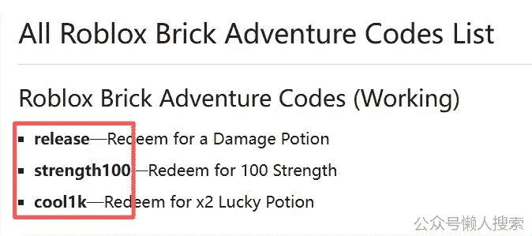

**游戏关键词站怎么变现？**

主要靠**广告（AdSense）**：Google 自动在你的站点匹配广告，有人浏览或点击就有收益。

其他可选：游戏相关联盟项目（Humble Bundle Partner、Nexus.gg 等，推荐游戏拿佣金）。

**本期预期**：广告不会立刻进账，得先有流量。日访问几百时，AdSense 一天可能只有几毛到几块。这一期的第一目标不是赚钱，而是把“找词—建站—上线—拿到数据”整条链路跑通。

**跑通之后往哪走？**

走完这一期，你拿到的不仅是一个游戏攻略站，而是一整套可复用的热词站方法：

- 怎么发现一个正在被搜索的词；
- 怎么判断它值不值得做；
- 怎么快速把站建起来并发布；
- 怎么让 Google 收录；
- 怎么根据数据做下一步决定。

这套方法不限于游戏。新工具词、新概念词、新事件词，底层逻辑相通。

跑通后有三条路：

1. **继续做热词站**：换游戏、换品类，用同一套流程做第二个、第三个，每次都会更快。
2. **批量放大**：把建站流程模板化，一个模板同时跑多个站（见选修篇）。
3. **用已有流量养品牌工具站**：当你发现某类搜索背后有长期需求、用户愿意持续使用并付费，就可以转向打法二。

现在不用想太远。先把一个游戏攻略站完整跑通，后面的路自然会显现。

**5. 关卡推进图**

**提醒**：手册按熟手实操顺序编写，关卡 1 直接放了买域名步骤，因为抢热词要快；但纯新手建议先跳过买域名，先学建站、弄清操作，等热词挖掘完成后再按“先买域名、后建站”的顺序实操。

| 篇章 | 关卡 | 阶段 | 本关产出 | 参考时间 |
| --- | --- | --- | --- | --- |
| 引言 | 关卡 0 | 启航第一讲 | 摸清游戏关键词站路线，备好工具和账号 | 第 1 天 |
| 必修篇 | 关卡 1 | 选游戏热词（关键） | 确定 1 个主词或练手词，并完成域名购买 | 第 2-6 天 |
| 必修篇 | 关卡 2 | 规划页面结构（关键） | 找出 10 个以上长尾词，安排首页与内页 | 第 7-9 天 |
| 必修篇 | 关卡 3 | 搜集素材 | 每个页面找到 1-2 个可信来源，整理成能交给 AI 的材料 | 第 10-11 天 |
| 必修篇 | 关卡 4 | 生成内容并建站（关键） | 用素材产出页面，搭好首页、导航页和内页 | 第 12-14 天 |
| 必修篇 | 关卡 5 | 上线部署 | 网站发布，接入 GSC 和 GA，开始收集搜索数据 | 第 15-16 天 |
| 必修篇 | 关卡 6 | 数据回看 | 按 GSC 数据补 2-3 个页面，判断继续、换词或升级 | 第 17-21 天 |
| 选修篇 | 进阶 关卡 7-8 | 规模复制 | 做出多个有流量收益的游戏关键词站，并把流程复制到海外文章站、工具站等方向 | 跑通后按需推进 |

**6. 出发前准备**

先算成本，给大家交个底：

① 域名：大约 10 元一个
② 模型：新手可用 ChatGPT Plus（一百多元），也可用国内模型（我自己用 GLM）
③ SimilarWeb：约 30 元一个月

除此之外，暂时没有其他开销。

再讲一个真实教训：之前航海时，不少同学不是卡在“不会建站”，而是卡在“工具没装好、账号没备齐、网络打不开”——出发好几天还在配环境，整条船都动不了。所以这一节请在报名前就完成。装好大约要 2-3 小时，不占正式航海时间。上船第一天就能直接开干。

国内访问提醒：

- 做海外站，GitHub、Cloudflare、Google、ChatGPT 是日常工具。
- 如果你的电脑打不开或很慢，需要先自行解决网络配置——这是做海外站绕不过去的前提。
- 如果 Codex 不好用，就用国产 GLM 顶上，别在这里卡死。

需要安装的（按顺序）：

【出发前工具清单】海外 AI · 游戏关键词站 · 2026 年 8 月航海

1. **AI 编程工具（二选一，主力）**
   - Codex：这条船的主线工具，建站、写代码、改内容都靠它。去官网下载安装，登录即可使用。
   - 国产备选 GLM：国内访问 Codex 不顺畅时，可用智谱的 GLM 编程模型替代，体验接近。
2. **GitHub 账号（存放代码）**：去 github.com 注册，后续代码都放这里。
3. **Cloudflare 账号（免费部署）**：去 cloudflare.com 注册，网站最终部署在它上面。
4. **Spaceship 账号**：去 spaceship.com 注册，用于购买域名，支持支付宝。
5. **Node.js（本地开发运行时）**：方法一：官网下载 LTS 长期支持版安装，装完在终端输入 node -v 能看到版本号即成功。方法二：问 GPT 怎么装，它会详细指导；或让 Codex/GLM 帮忙安装，直接说“帮我安装 Node.js”。
6. **VS Code（代码编辑器）**：官网下载安装，打开就能写代码。
7. **Git**：Git 是代码版本管理工具，相当于给代码做历史记录和备份，改完能回看旧版、恢复。【我用的是这个】GitHub Desktop 是 Git 的图形化客户端，把命令变成按钮，更适合纯新手。也可以直接让大模型用命令行装 Git。
8. **SimilarWeb**：可查关键词难度（KD），也能看游戏有哪些细分关键词，方便后续做内页。

全部装好，再开始第 1 关。磨刀不误砍柴工。

**7. 几句实话**

- 大多数站不会长期赚钱。游戏热度会退潮，新竞争者会不断进入。
- 赚钱的站通常只占少数。做很多站，才有一小部分跑出流量，这很正常。
- 表现好的站，生命周期可能只有 1-3 个月。
- 这本手册带你完整走一遍流程——跑通它，然后做第二个、第三个，每次都比上次快。

**题外话：如果你想了解自己每天用了多少 Token**，欢迎加入生财 TokenRank～

最近不少圈友已经在用 Codex、Claude Code、Hermes、WorkBuddy 等工具做项目，但自己用了多少、坚持了多久、做成了什么，没有被记录下来。

TokenRank 可以记录真实的 AI 使用过程，也方便我们发现优秀作品和实战案例。

注意：Token 高不代表成果好。比“用了多少”更重要的，是你用 AI 产出了什么、解决了什么问题。

TokenRank 已开放接入，按教程安装即可：https://scys.com/tokenrank/connect

接入遇到问题，可直接在航海群反馈。


---

# 必修篇

## 关卡 1：挑出一个值得做的游戏词，判断可行后再买域名

### 00. 本关任务卡

**本关目的**：从 3 个候选游戏词里选出 1 个值得继续的主词，并完成一次游戏词判断练习。

**要做的事**：

1. 先找 3-5 个候选游戏词，来源可以是趋势榜、社媒讨论、游戏社区、竞品站或工具推荐。
2. 至少对 3 个候选词做基础判断：搜索趋势如何、竞争难不难、信息源够不够、能否规划出细分内容。
3. 纯新手把 3 个候选词判断表填完整，重点练“怎么判断一个词能不能做”。
4. 有余力的同学可以进一步选出 1 个主词，并写清楚为什么它值得继续做。
5. 购买域名属于进阶动作。纯新手可以先跳过，用练手词把后续建站流程跑通。

**本关要交的作业**：

- 3 个候选游戏词判断表截图（必填）。参考本关判断表格式，至少填游戏名、Trends 趋势、KD 难度、细分关键词数量、首页竞争难度、做/不做判断。
- 分享本关最大收获，或遇到的卡点及解决办法（必填）。

PS：这一关真正重要的是学会判断游戏词。不要求你一定找到完美主词，也不强制纯新手立刻买域名；但 3 个候选词判断表必须完成。

**判断表（作业示范模板）**

|  | 候选词 1 | 候选词 2 | 候选词 3 |
| --- | --- | --- | --- |
| 游戏名 |  |  |  |
| Trends 趋势（涨/平/跌） |  |  |  |
| KD 难度 |  |  |  |
| 细分关键词数量 |  |  |  |
| 首页竞争难度 |  |  |  |
| 做/不做 |  |  |  |

### 01. 具体步骤

游戏站成败，先看选词。词选错了——没人搜、竞争过强、信息拿不到——后面建站和外链都会吃力。新手最容易踩的两个坑：一是“想到一个词就直接建站”，二是“分不清社媒火还是 Google 搜火”。

核心原则：以 Google 搜索热度为准。社媒热闹不等于 Google 有人搜——TikTok、X、YouTube、Discord 上再热，也不能直接当成搜索需求。

整体思路很朴素：先收集，再验证。先从 Steam、社区里捞 3-5 个候选词，再判断哪个值得做，最后用最小成本确认判断对不对。别找到一个就停，也别凭“我觉得能火”就开干。

**1. 第一步：找出 3-5 个候选游戏词**

很多新手卡在这里：打开 Google 不知道搜什么，因为根本不知道最近有哪些新游戏。解决办法是先到榜单里捞，那里全是正在升温的游戏，你只需要挑。

**来源一：Steam 等平台的新品榜/热销榜**

Steam 商店自带“新品榜”“热销榜”。想更早发现刚上架、还没爆的游戏，就盯这里。挑选标准：新上线，且玩家人数持续上涨。

https://steamdb.info

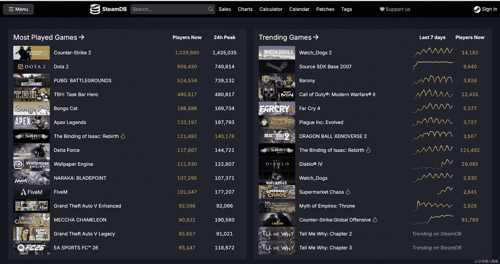

https://www.igdb.com

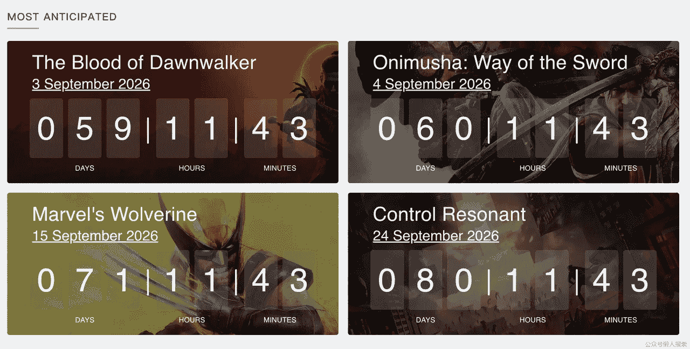

**来源二：YouTube 上的游戏预售视频**

在 YouTube 搜：gameplay trailer

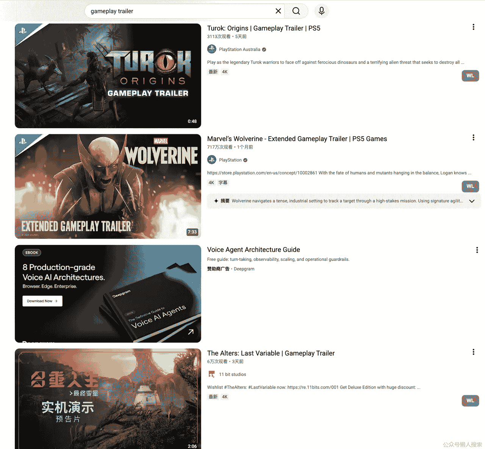

**2. 第二步：逐个判断候选词能不能做**

**（1）用 Google Trends 验证**

从榜单找到几个游戏名后，用 Google Trends 看它热不热、还在不在涨。但它有个限制：只显示 0-100 的相对热度，不直接给真实搜索量。所以**不能只看曲线高低**，还要找一个已知大致搜索量的词做参照，这里可以用 GPTs 当对比词。

如果 GPTs 一天大约有 **3000-5000 搜索量**，拿游戏词和它比，就能估算游戏词一天大概多少搜索量。比如：游戏词约是 GPTs 的 1/3，说明有一定搜索量但不算大；接近 GPTs，说明热度已经不错；超过 GPTs 很多，说明可能是强趋势词，值得重点关注。

重点记住：**Google Trends 不能直接告诉你真实搜索量，要通过对比词估算热度。**

打开老版 Google Trends：https://trends.google.com/trends/explore?hl=zh-CN （新版也可：https://trends.google.com/explore?geo=Worldwide&date=today%201-m），选择全球、最近 30 天，搜你从榜单捞到的游戏名。

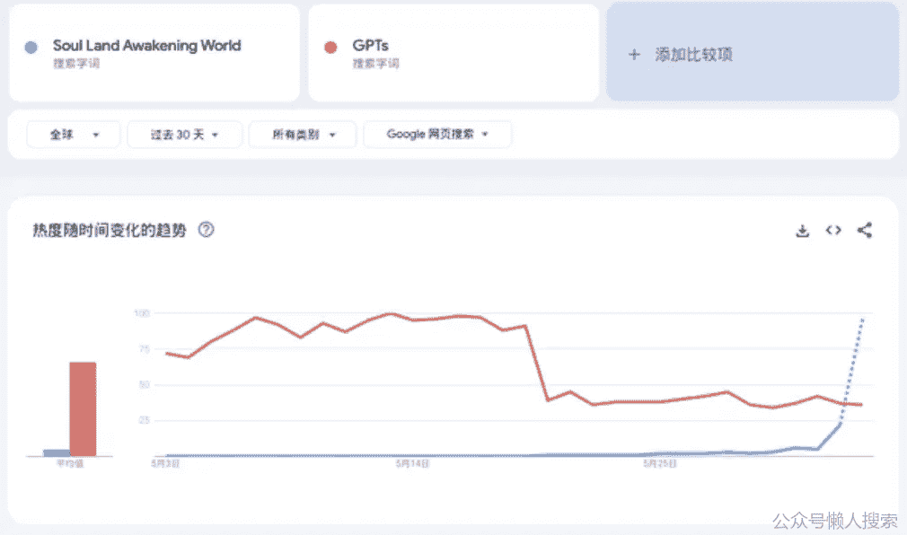

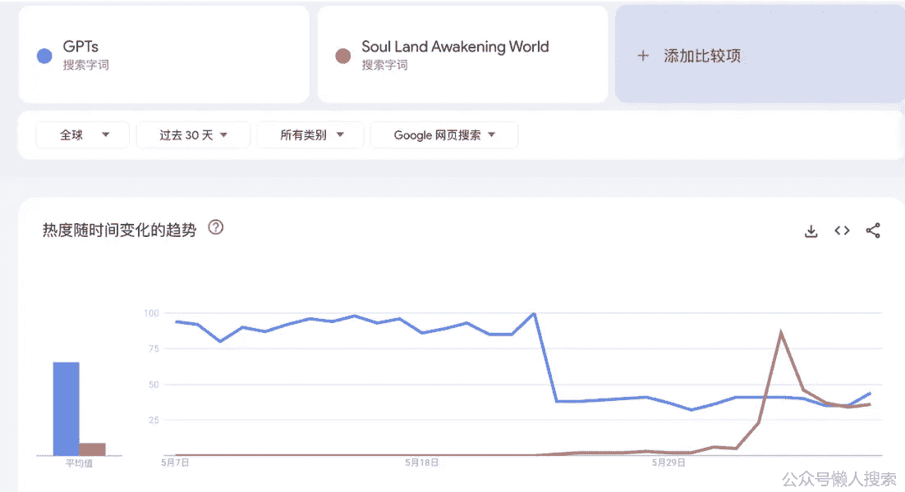

如上图，这个游戏在预售期热度陡升，但过了一两天没人持续玩，搜索热度就掉下来，回到 GPTs 水平，属于“陷阱词”。

看趋势线判断：线往上走 → 有戏，记下来；线平或往下 → 搜的人越来越少，换一个；线像一座山（突然暴涨 → 很可能快速暴跌）→ 陷阱词。

一个经验：**一周内陡升的算新词，越新越好。** 新词的搜索结果页还很“稀疏”——没有大站占满前 10 名，新手反而有机会排上去。

**（2）用 SimilarWeb 查关键词难度，顺带看细分需求**

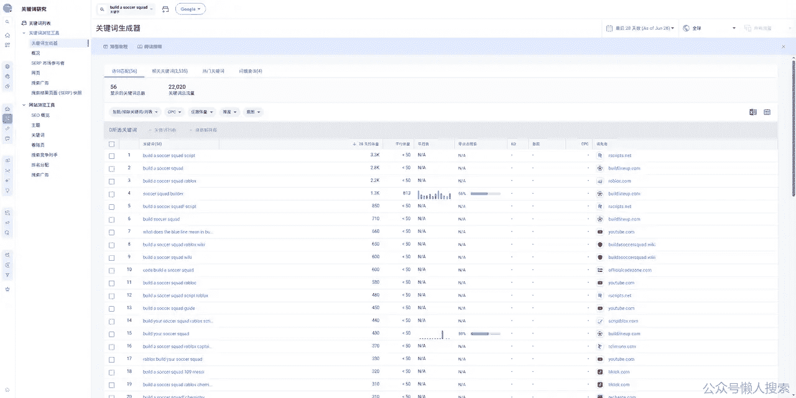

去 similarweb.com 搜这个游戏相关词。

1）先看关键词难度（KD，0-100，数字越大越难）。数值越低越好做，新手适合 0-30；如果超过 40，建议直接放弃，因为大站已经挡在前面，新手很难切进去。2）再看细分关键词有多少，评估是否有长尾词可以抢流量。

**（3）看 Google 搜索首页竞争**

看完趋势和 KD，还要看 Google 搜索首页。因为最终有没有流量、流量多大，关键取决于：**你的网站能不能排进 Google 首页**（主词和细分词都算）。

**首页重点看什么**

搜索游戏词后，注意排在前面的网站类型。重点识别这几类：

1. Fandom / Wiki 类大站。全球最大的粉丝百科平台，几乎所有游戏都有 wiki，由玩家共同编辑。你搜“游戏名 + wiki”，结果里几乎一定有它。辨认方法：域名带 fandom.com。

**选词到上线：游戏攻略站实操路径**

打开搜索结果，最先挡路的通常是大块头 Wiki——Fandom 一类的站点。这类站域名权重极高，词条拆得极细，角色、道具、关卡各自单开页面，属于结果页里常见的“巨无霸”，主关键词正面硬拼几乎没戏。你搜 “Blox Fruits wiki” 或 “VV Ultimatum wiki”，占据前排的多数就是它们。

**2，游戏官方 Wiki**

由开发商或发行商亲自搭建的资料库。并非所有游戏都配有，但体量大的作品、网游、沙盒类产品往往会维护一份。辨别方式：看域名是否落在官网或其子域之下，这类内容权威度高、更新也跟得上。它的定位更像“官方档案室”，攻略、兑换码之类的实用内容不一定铺全——缺口往往就藏在这里。

**3，大型综合游戏媒体**

IGN、GameSpot、Polygon、Kotaku 这些什么游戏都写的综合媒体。辨别方式很简单：你耳熟能详的几个大域名就是。它们权重够高，可内容以新闻和评测为主，落到某一款游戏的细分需求上，常常只有一两篇泛泛而谈的稿子，深度有限。

**4，成熟垂直攻略站**

Pro Game Guides、Game8、Pocket Tactics 这类专注攻略的垂直站，一个站覆盖大量游戏，重点做 codes、tier list、流程攻略，更新勤、钻得深。辨别方式：站名里常带 guide / wiki / game，全站只做攻略，URL 里多能看到 /games/游戏名。它们既是你的对手，也是最好的模板——想知道该做哪些页面，直接翻它们的目录就行。

**5，大平台里的单游戏页**

指的是大平台内部“某款游戏的那一页”，例如 Steam 商店页、IGN 的某篇评测、PC Gamer 的某条新闻。辨别方式：域名是你熟悉的大平台，点进去却只是它海量页面中普普通通的一页，并非专为这款游戏深耕的内容站。

**这套判断怎么用？**

若首页被 Fandom、成熟攻略站这类“专业做攻略”的强站占满，说明主关键词门槛不低，新手很难挤到前面。

反过来，如果前排蹲着的是大站的普通内页——内容单薄、无人维护、甚至已经过时——意味着这个搜索需求尚未被认真对待，你还有下手的机会。

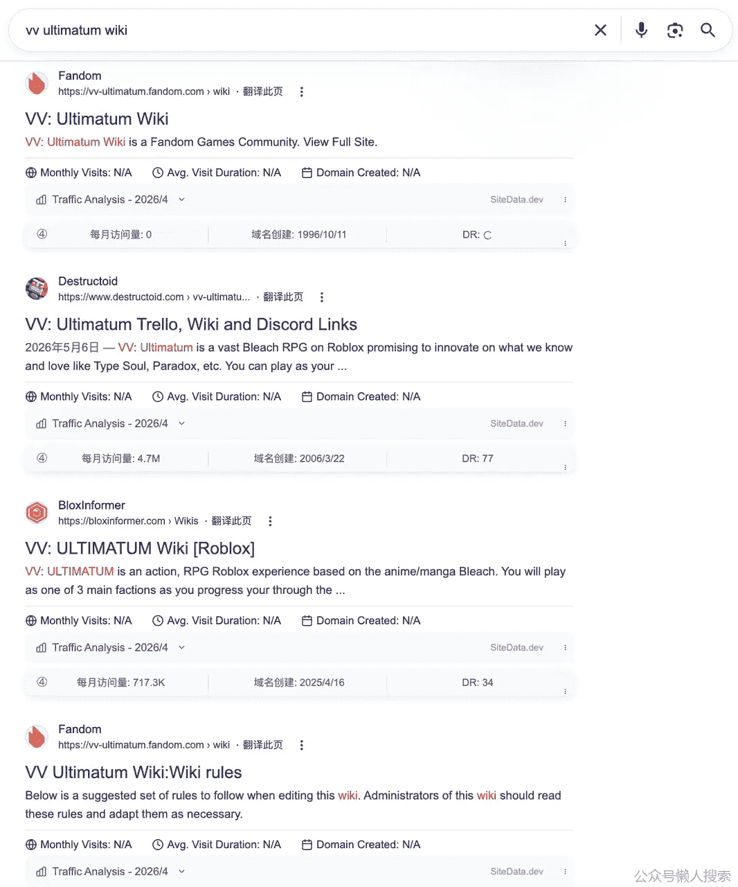

推荐安装 **SiteData** 插件：

插件下载地址：https://chromewebstore.google.com/detail/sitedata-traffic-checkera/emeakbgdecgmdjgegnejpppcnkcnoaen?utm_source=item-share-cb

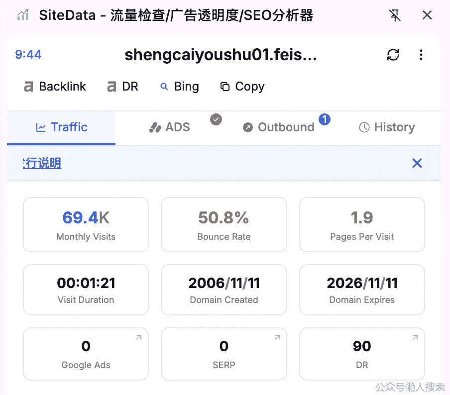

装好之后，搜索结果页下方会直接显示：月访问量、域名注册时间、DR 等指标。

**候选词对照表（一行一行填）**

|  | 候选词 1 | 候选词 2 | 候选词 3 | 候选词 4 | 候选词 5 |
| --- | --- | --- | --- | --- | --- |
| 游戏名 |  |  |  |  |  |
| Trends 趋势（上行/持平/下行） |  |  |  |  |  |
| KD 难度 |  |  |  |  |  |
| 细分关键词数量 |  |  |  |  |  |
| 首页竞争强度 |  |  |  |  |  |
| 做/不做 |  |  |  |  |  |

三项检查跑完，把表格横着看一遍：优先锁定谷歌趋势向上（曲线贴近甚至压过 GPTS）、KD 低于 30、并且 Google 首页竞争偏弱的新词。

**第三步：敲定 1 个主词，顺手准备备选域名**

能做再买，别提前囤。挑域名的原则：

- 通用后缀就够用了，首选 .wiki；若已被注册，再考虑 .com、.org、.net、.online、.site 这些，没必要迷信特殊后缀。
- 别因为“感觉会火”就先囤一批域名。

**第四步：到 spaceship.com 下单域名**

新手可以先跳过这步，把建站技术练熟再说。该平台支持支付宝。购买时要避开 .cc、.xyz 之类被灰产用烂的后缀——在搜索引擎眼里，它们都是减分项。

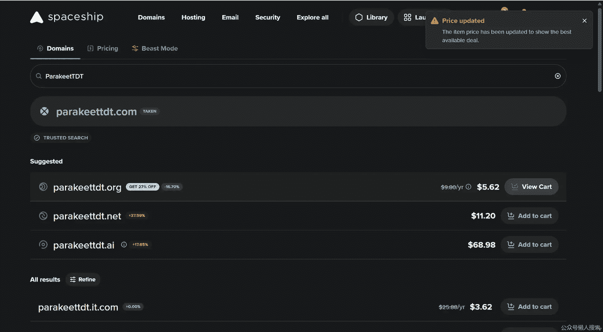

**第五步：把域名接入 cloudflare.com**

同样，新手可先跳过，先练建站。访问 https://dash.cloudflare.com/ ，在页面上点 Add。

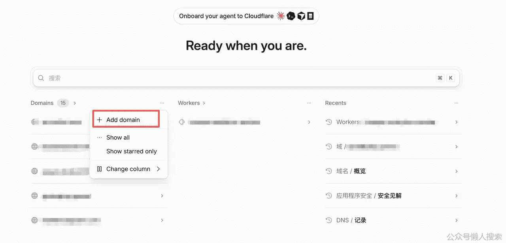

这里的选项是接入一个已有域名。

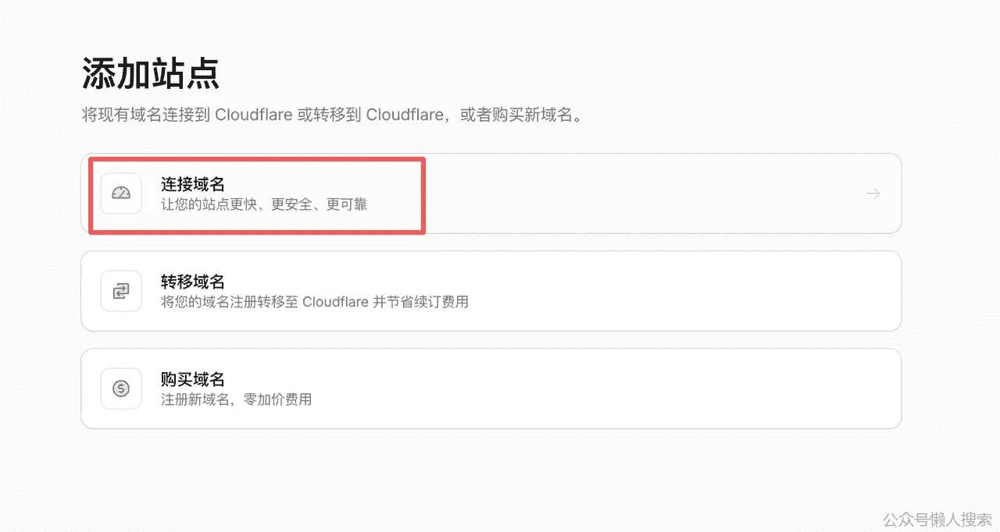

输入你的域名。

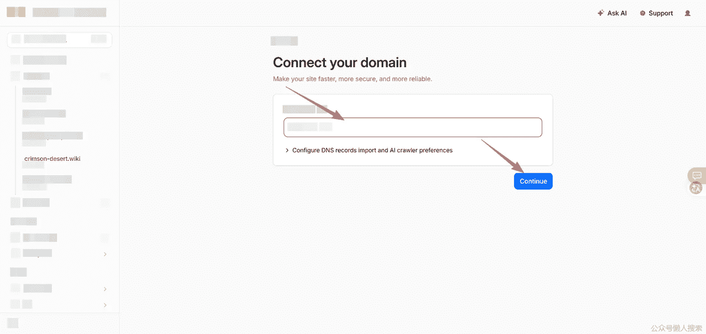

套餐选 Free Plan。

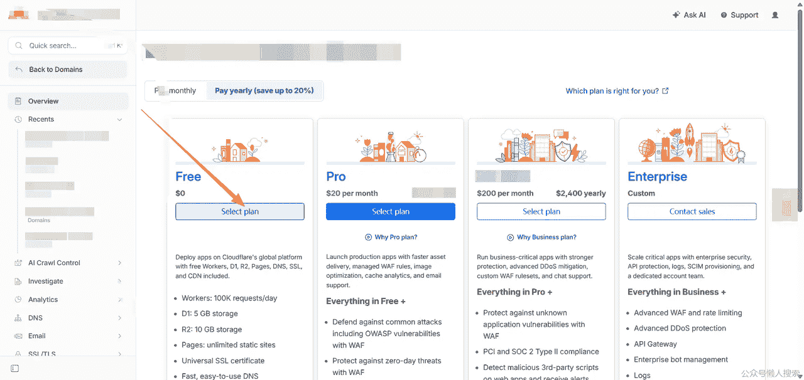

清掉系统自带的 A 记录与 CNAME 记录（没有就跳过），点 Continue to activation。

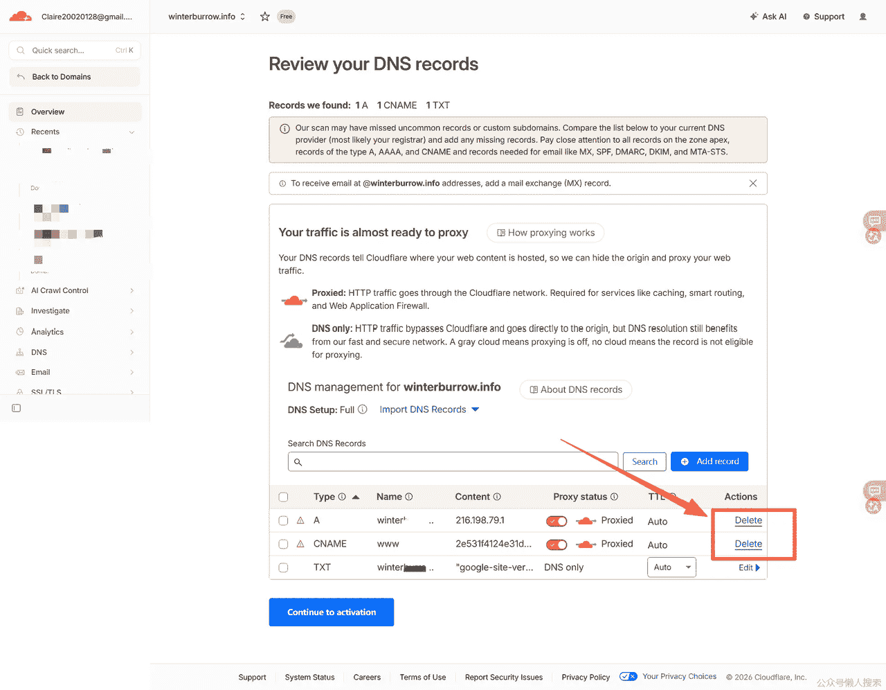

新页面会出现两个 nameserver，先复制下来放着（稍后要填回 Spaceship）。

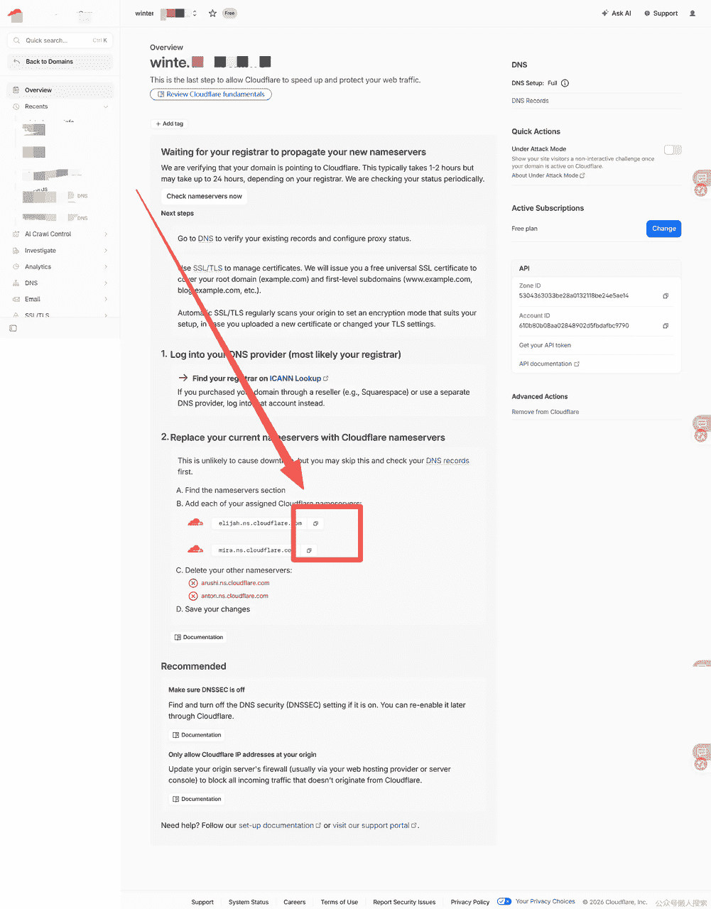

打开 https://www.spaceship.com/zh/application/domain-list-application/ ，定位你买下的域名，点进 nameserver & DNS。

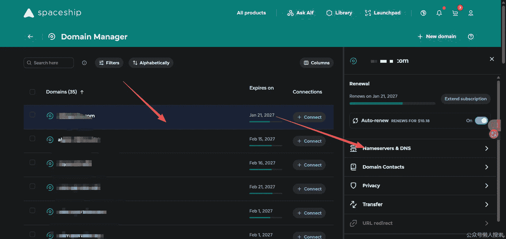

点 change。

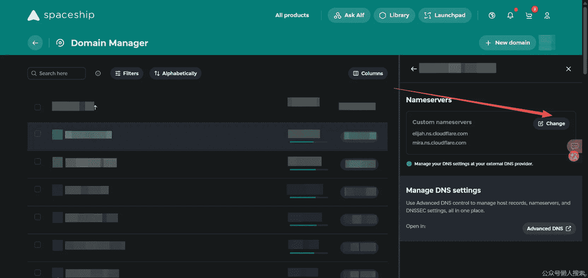

把原来的两个 nameserver 删掉，换上刚才复制的两个。

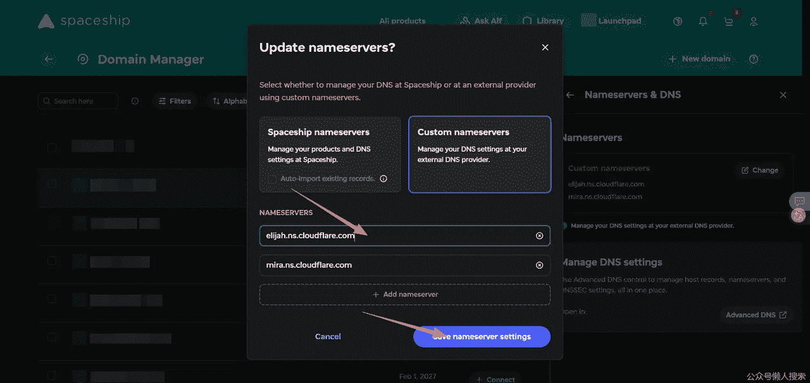

改完回到 DNS settings。

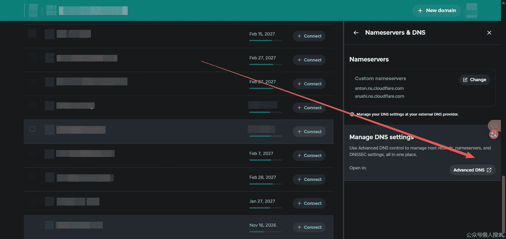

进入 Advanced DNS，确认 DNS Records 显示为 0（一般都是 0）。

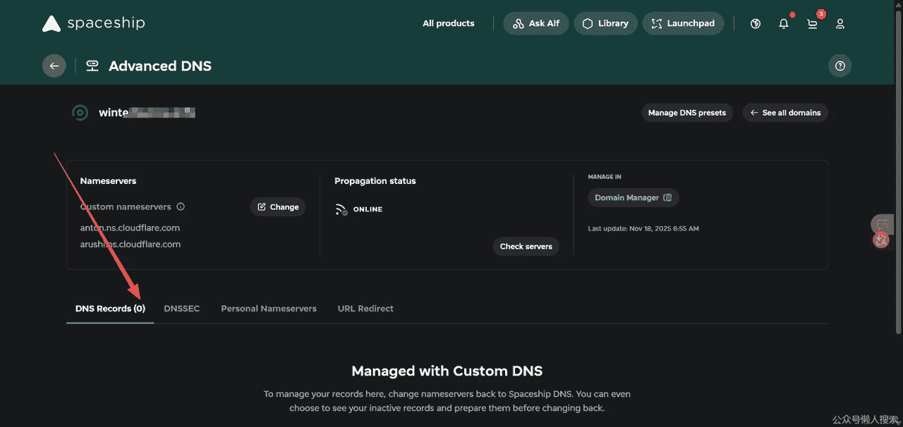

回 Cloudflare，点 check nameservers now（同步通常要十分钟左右）。

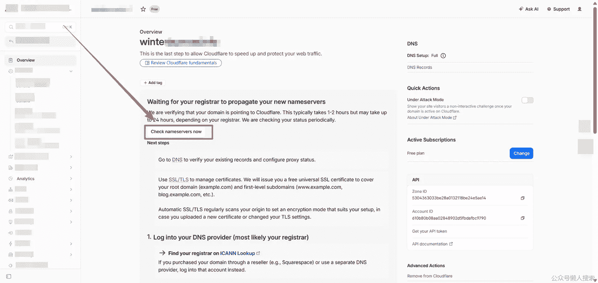

此时是等待状态。

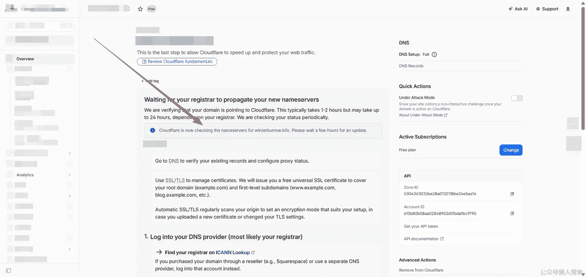

稍等片刻，出现绿色对勾，说明 nameserver 替换完成。

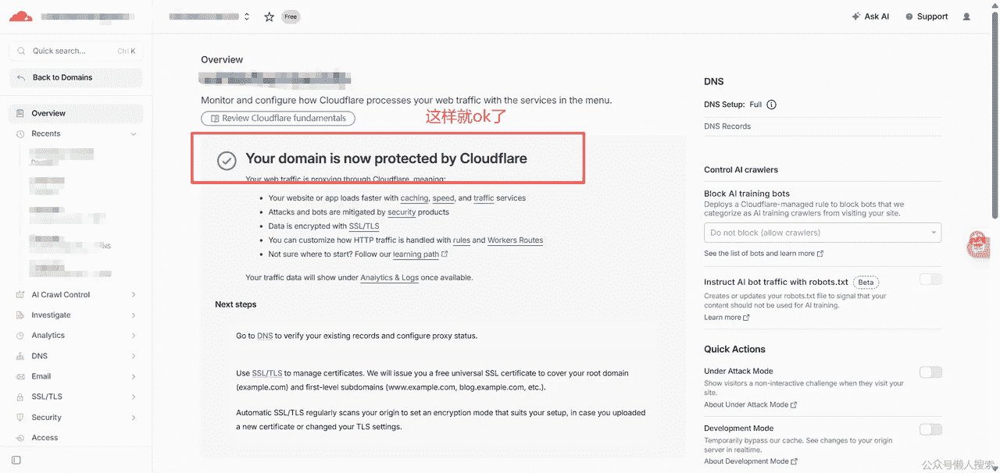

## 关卡 2：挖出真实搜索需求，排好内页矩阵

### 00. 本章任务卡

**任务目标**：围绕选定的游戏词，把具体的搜索诉求挖出来，并规划第一批页面矩阵。

**任务描述：**

- 以主词或练习词为中心，找出玩家真正常搜的问题与细分关键词。
- 细分关键词至少整理 10 个，别只盯着大词，尽量落到具体问题上。
- 将这些词分成通用需求和个性需求，判断哪些交给首页、哪些分给内页。
- 排出第一版页面矩阵：每个页面承接哪个词、解决什么疑问。
- 画一张简单的站点结构图，理清首页、导航页与内页之间如何互链。

**本关需提交作业：**

- 关键词清单截图或文档（必填）：至少 10 个细分关键词，并标注通用 / 个性需求。
- 页面矩阵规划表截图（必填）：标明每个页面对应的关键词、用户问题与页面类型（首页、导航页、攻略页、角色页、物品页等）。
- 写一写这关最大的收获，或卡在哪里、怎么破的（必填）。

PS：页面不是越多越好。先把第一批最值得做、最能接住搜索需求的页面想明白。

### 01. 具体步骤

选定游戏词之后，新手最容易犯的错，是把首页搭好就干等流量。可玩家搜的其实是非常具体的东西——codes、tier list、某个角色怎么拿到。不同的搜索，要靠不同的页面去接。

页面存在的唯一理由是有搜索需求，而不是“看起来完整”。没人搜的页面，不做。

**1. 需求从三个口子挖**

| 来源 | 能挖到什么 | 怎么用 |
| --- | --- | --- |
| Google 下拉词 | 用户真实敲进去的表达 | 在 Google 输入游戏名，看自动补全列表 |
| Google Trends 相关词 | 一般 10-20 个关联词 | 在 trends.google.com 搜游戏名，看“相关查询” |
| SimilarWeb | 该游戏的搜索词历史数据 | 数据大约滞后 3 天，别把它当成唯一实时依据 |

**1.1 Google 下拉词**

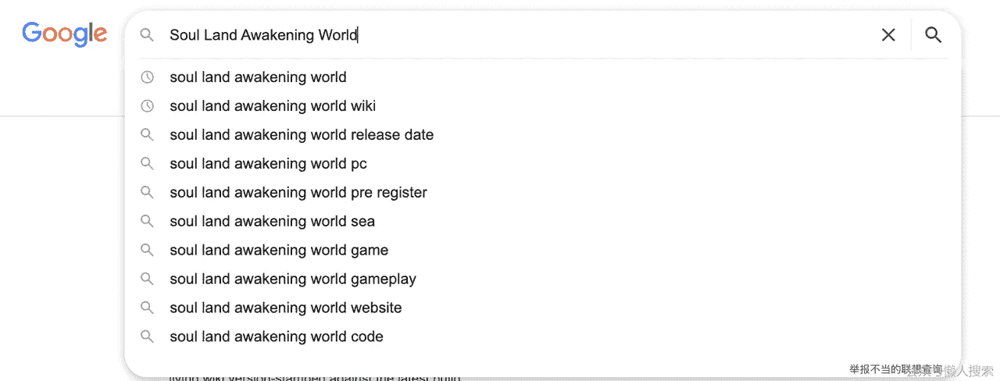

**1.2 Google Trends 相关词**

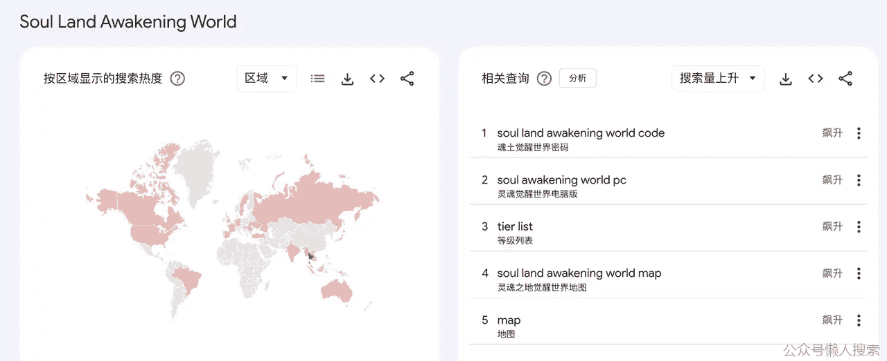

**1.3 SimilarWeb**

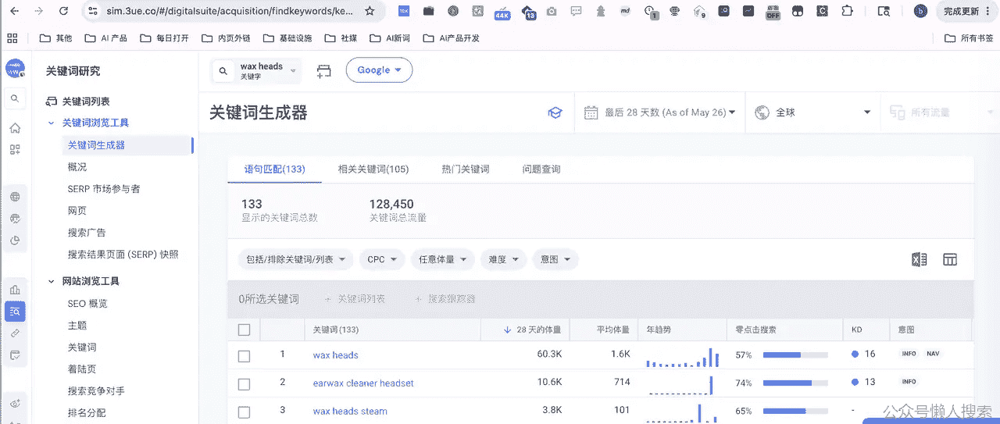

**页面设计原则：**

- 首页扛主游戏词，回答“这是什么游戏、怎么玩、核心内容有哪些”。
- 内页专攻具体长尾词。
- 角色、道具数量多时，用一个统一导航页批量罗列，不必逐个手搓独立页。
- 页面由搜索需求反推，没人搜的一律不做。
- 第一版只保留最核心的页面，别一口气铺满所有可能。

**新手站最小配置**：1 个首页 + 10-20 个攻略型长尾问答页（包含 Guide，也就是“指南攻略”类页面）。

**【案例】拿 Decaying Winter 走一遍：**

**Google 下拉词**：在谷歌浏览器直接搜 “Decaying Winter”。

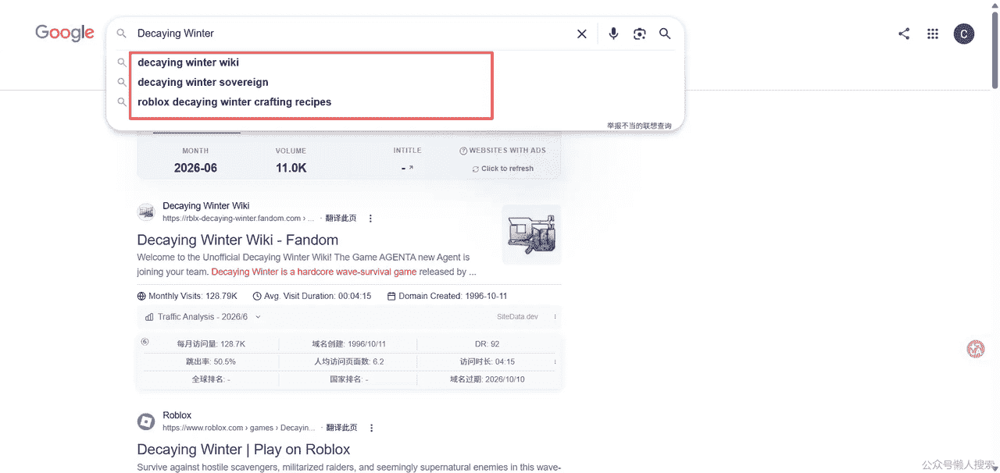

**Google Trends 相关词**

地址：https://trends.google.com/trends/explore?date=today%201-m&q=gpts&hl=zh-CN

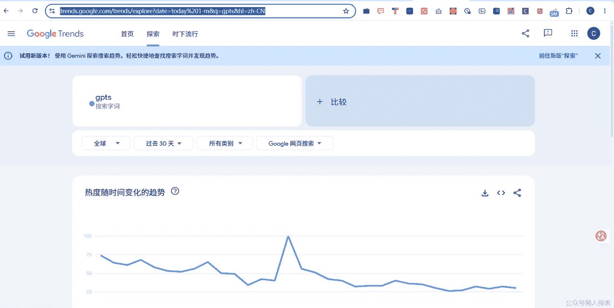

右侧输入框里填 “Decaying Winter”，先看到第 1-5 个“相关查询词”，复制下来。

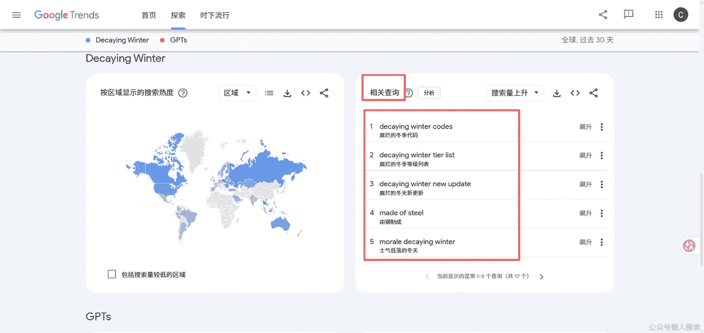

往后翻，第 6-10 个复制下来。

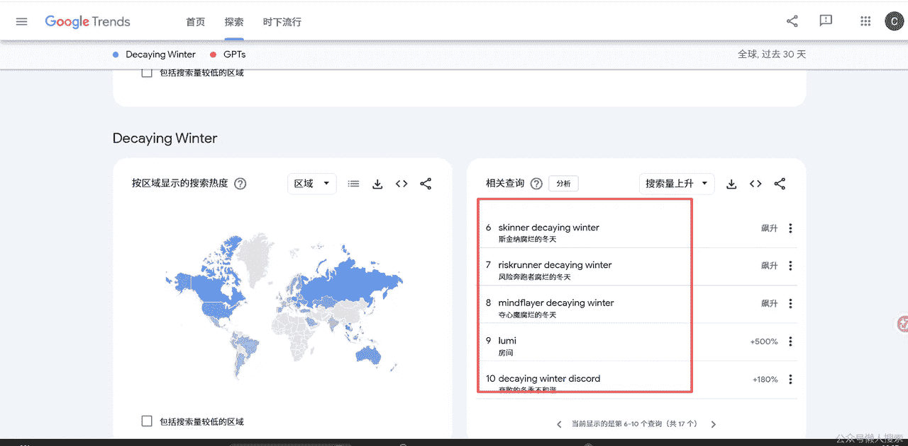

再翻，第 11-15 个复制下来。

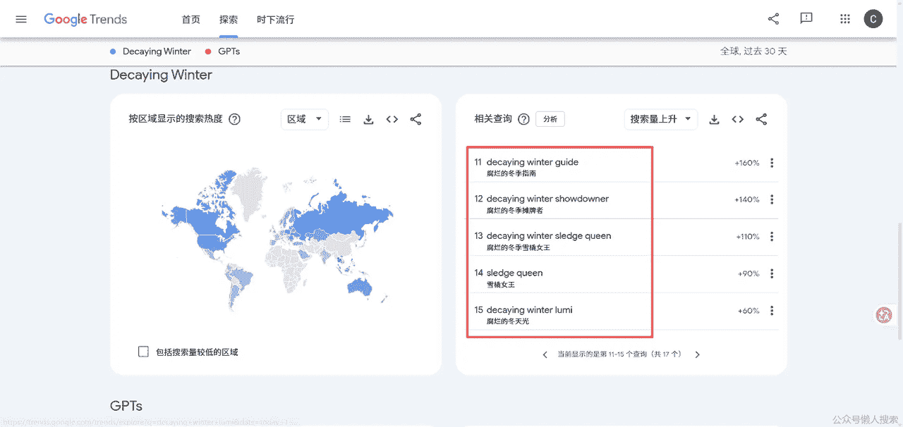

继续翻，第 16-17 个复制下来。

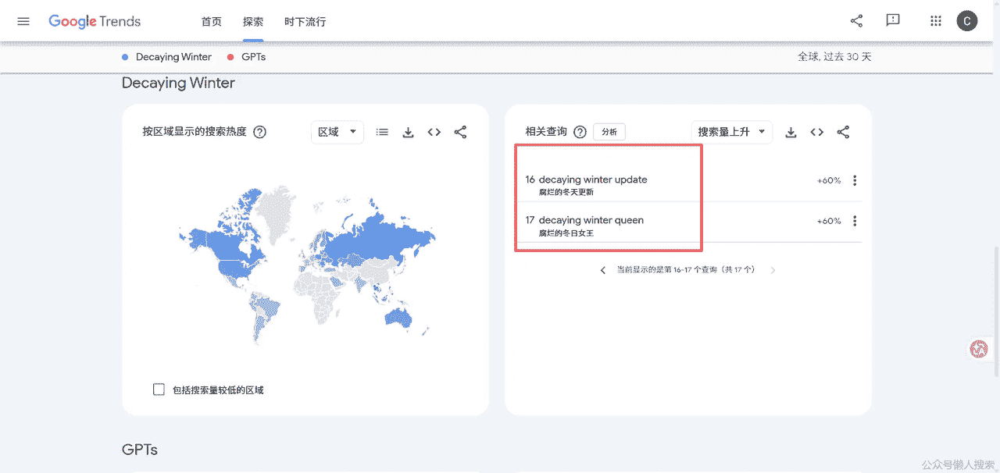

**SimilarWeb**

这是一款常用 SEO 工具，放到游戏词内页矩阵这一环，主要用途是提供长尾词。它的查询功能要付费，可以到🍑或🐟自行买会员（具体渠道以你买的为准，这里不挂链接）。

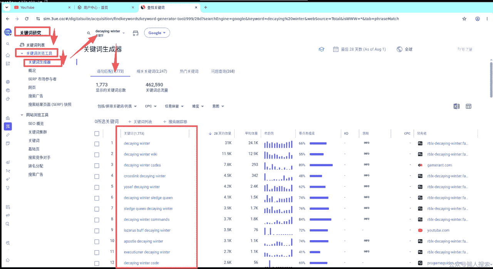

进入“关键词研究”→“关键词生成器”，把第 1 页第一列的“关键词”用 Ctrl+C 复制下来。

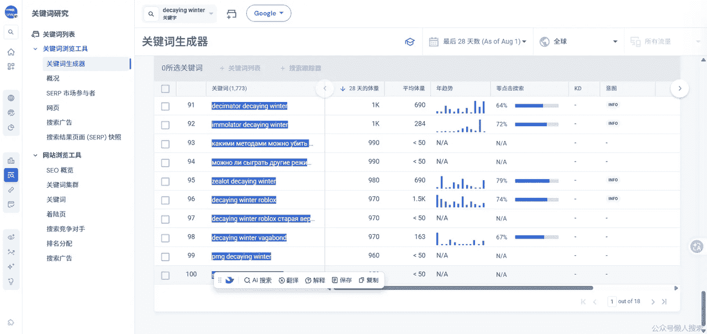

在游戏项目文件夹中新建“关键词.md”，把三轮收集到的长尾词统统粘进去。随后在同一目录下给大模型下提示词：JSON

```
基于关键词.md，新建一个关键词分类文档：keywords.json。
对【所有关键词】分类，必须有的分类：guide，要求最终关键词总数 10-20 个。
分类禁止大空，例如gameplay、general。
假设有Codes分类: 其分类下只能有一个关键词。
关键词中核心主词和非本主题词过滤掉。
同义词要合并（合并后的关键词必须是搜索量最大、大众习惯搜索那个）。
并给出同义词合并后，还有多少，即还能做多少&quot;一个词一个内页&quot;的精品内容。
分类1：xxx
关键词1
关键词2
…严禁缺少任何一个关键词（游戏词本身和非该游戏主题词除外）。
关键词优化：
1、不允许存在非英文（需翻译成英文）
2、可修改某单词拼写错误，但禁止扩写
3、主题词统一，**关键词命名统一成 游戏主题名 xxx**。
除此之外，禁止做其他修改。
注意事项：
**Mutually Exclusive（相互独立）**：
1、不同分类下，不要存在包含关系，例如Guides和Beginner Guides
2、一个分类下,不能出现同义关键词（例如只是单复数区别）
Collectively Exhaustive（完全穷尽）：一个分类下所有有效关键词要覆盖这个分类可能的所有需求，且具备一定逻辑关系（顺序或包含）
还有一些是YouTube视频标题，也请分析高流量视频，提取关键词。
手动写,禁止使用脚本处理。
每个分类下,重要(流量大的)关键词排在前面。

输出格式必须是（禁止增加无用信息）：
{&quot;categories&quot;: [
{&quot;category&quot;: &quot;100 Waves Later&quot;,
      &quot;keywords&quot;: [&quot;100 waves later tier list&quot;, &quot;100 wave later code&quot;]
},{
      &quot;category&quot;: &quot;Anime Card Collection&quot;,
      &quot;keywords&quot;: [&quot;anime card collection codes&quot;, &quot;anime card collection guide&quot;]
}]
}
```

模型给出的结果大致长这样（仅作过程演示）：**keywords.json**

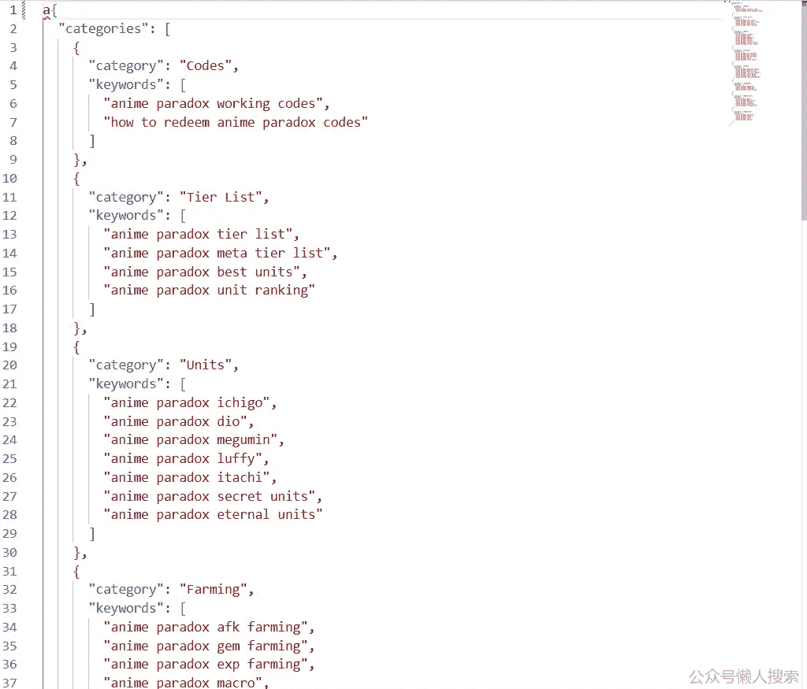

这份 keywords.json 先收好，后面要用。

## 关卡 3：调研游戏信息，收集素材

### 00. 本章任务卡

**任务目标**：为关卡 2 规划好的页面找到可靠信息源，整理成能交给 AI 使用的素材。

**任务描述：**

- 对着关卡 2 的页面矩阵，逐个页面补充参考资料。
- 每个规划页面至少配 1-2 个可靠来源，例如官网、Wiki、YouTube 视频、玩家社区、攻略文章。
- 别只丢链接，要一句话说明这个来源能提供什么。
- 把素材整理成 AI 读得懂的形式，方便下一关生成内容。
- 某个页面实在找不到可靠信息，先标出来，之后再考虑替换或搁置。

**本关需提交作业：**

- 页面素材来源记录表截图或文档（必填）：每个页面至少 1-2 个信息源，并说明可用于写什么。
- 写一写这关最大的收获，或卡在哪里、怎么破的（必填）。

PS：这一关是在给 AI 备料。素材越真，下一关产出的内容就越不容易空、假、泛。

### 01. 具体步骤

攻略站的内容必须站得住脚。若让 AI 凭空写，它会把几款游戏的信息搅在一起，甚至编出根本没有的角色、兑换码和关卡。Google 一旦判定内容失实，排名自然不给。

本关原则只有一句：AI 负责筛选与整理，不负责凭空创造。事实要来自真实的信息源。

**1. 首页：网站的入口**

首页围绕游戏主词展开，适合承载游戏整体介绍与核心关键词模块。

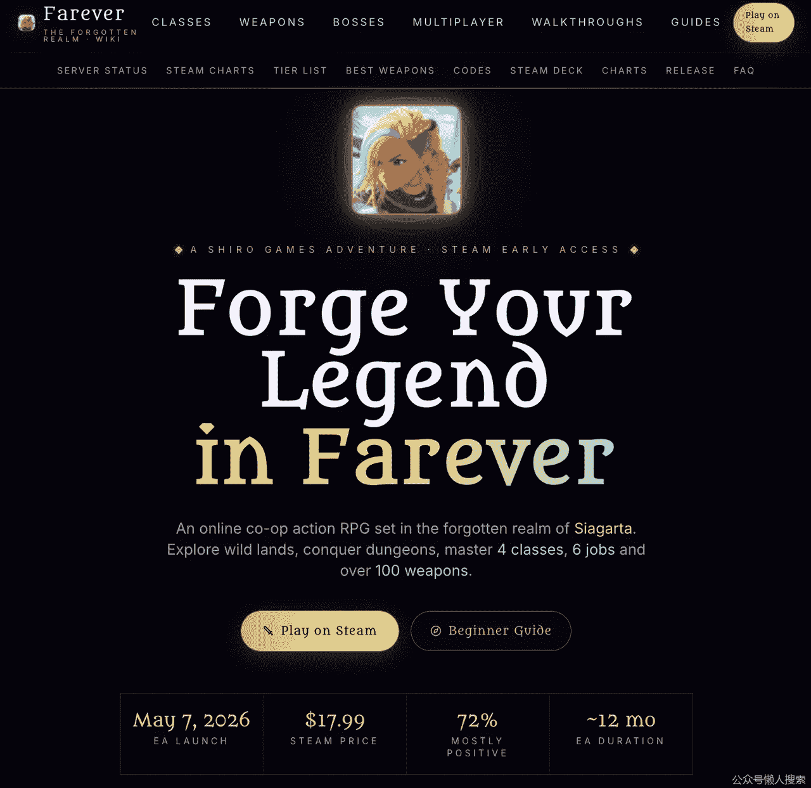

推荐数据来源：ChatGPT 网页端，开启联网搜索。

目标：把建站需要的基础信息一次性拿齐——官方链接、SEO 元数据、主题色、多语言优先级。

**SEO 元数据**

它是写给 Google 看的“后台说明”，决定站点能否被搜到、以及在结果页里长什么样。主要有三样：title（结果里那条蓝色大标题）、description（标题下方的灰色小字）、keywords（相关词集合，权重不高但写上无妨）。提前填好，用户搜相关词时才更容易发现并点进你的站。

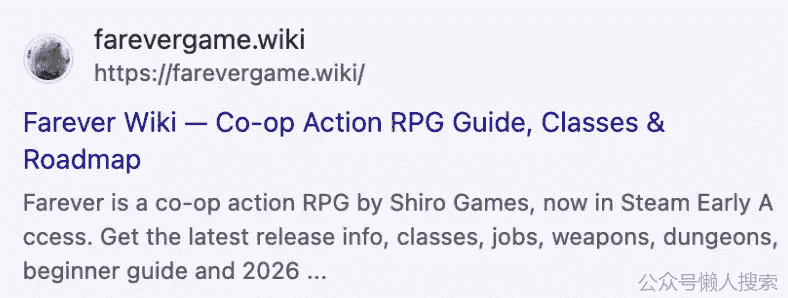

**官方链接**

即游戏的官方 / 权威入口：官网、Discord、YouTube、Reddit、平台页（Roblox / Steam）等。首页上“开始游戏”“加入 Discord”按钮跳转的就是这些地址。提示词里要交代清楚：只收官方与正规社群，别放打不开的 404。

**主题色**

站点的主色调（导航栏、按钮、强调色），视觉上向游戏靠拢，别用千篇一律的蓝白。恐怖游戏走暗红深紫，童话游戏用粉蓝暖黄，玩家一进来就觉得“对味”。提示词 ##3 让 ChatGPT 参照官网或宣传图给出 HSL 值。

**多语言优先级**

游戏玩家遍布全球，可以同步做多语言版本（英语 / 西语 / 日语等），让不同语种的玩家都能搜到你。“优先级”指的是先做哪一门、后做哪一门。提示词 ##4 按各地区热度排序，最多 4 门且必须含英语；新手先把英语做扎实，再往上加。

除上述四项基础信息，提示词那份 JSON 里还有首页自上而下要填的内容字段，一并说明：

**hero（首屏主区）**：进站第一眼看到的大块区域。title 放大标题（游戏名），eyebrow 是上方小标语，description 写一两句玩法简介，stats 放首屏核心数据，三个 Cta 是行动按钮，videoLabel 是官方视频的标签文字。

**start（新手引导区）**：即 “Start Here” 区，cards 是四张新手引导卡片：第一张固定为新手入门，另外三张从玩家开局两小时内最常搜的内容里挑，类型互不重叠。

# 游戏站实操：从素材到页面

一个典型的游戏内容站，通常会由几个固定模块组合而成。把这些模块弄清楚，后续动手会顺利很多。

aboutGame 区块承担着回答“What is 游戏名？”这类基础问题的任务。它里面包含两部分：paragraphs 用两三句话讲清玩法核心；stats 则是一张数据表，把开发商、平台、类型、访问量等字段以 label 配 value 的方式逐行列出来。

finalCta 放在页面底部，负责引导访客继续行动。它只需要三样东西：一个号召标题 title，以及 primary、secondary 两个按钮。

footer 是每个页面最下方的信息区，将站点简介、官方社群入口、法律页面等内容收拢到一起。

下面进入动手阶段。这段 Python 代码可以直接交给 ChatGPT：

```
游戏词：{TOPIC}

请按以下结构提供完整的网站开发信息：
【特别注意：1.注意不要附上我的竞对的网站（官网除外）2.禁止输出任何一个404/打不开的链接】

## 1、主题基础信息
（1）给出官方网站（禁止输出任何一个404/打不开的链接）和常用社群（如Discord、reddit等）和官方 trailer youtube链接（如果没有随便选一个爆款youtube视频）。

（2）搜索给出这4组用户关心的数据和SEO元数据，严格按照以下格式返回：（注意：4组用户关心的数据一定要最贴近玩家直觉，具体内容不限制，不要死板只查找Active Codes、Daily Updates、Total Visits、Units Available这4项，Players Online、 Peak CCU&quot;、User Reviews、Release Date·····都可以。注意：1.某项数据为0就不要写，比如：禁止写Active Codes：0 2.value的值后面不要写任何括号）

{&quot;home&quot;: {
      &quot;meta&quot;: {
        &quot;title&quot;: &quot;游戏名 Wiki — 核心关键词1, 核心关键词2&quot;,
        &quot;description&quot;: &quot;SEO description（140-160字符）&quot;
},&quot;hero&quot;: {
        &quot;eyebrow&quot;: &quot;Fan-Made Community Wiki（或类似标语）&quot;,
        &quot;title&quot;: &quot;游戏名&quot;,
        &quot;description&quot;: &quot;游戏核心玩法介绍，2-3句，吸引玩家点击&quot;,
        &quot;stats&quot;: [&quot;发布日期（如 Launched Jun 2025）&quot;, &quot;最近更新日期&quot;, &quot;核心数据1（如 3 Races）&quot;, &quot;核心数据2（如 Lv100 Cap）&quot;, &quot;核心数据3（如 130+ Skills）&quot;],
        &quot;primaryCta&quot;: &quot;Start Beginner Guide（或类似首要行动按钮）&quot;,
        &quot;secondaryCta&quot;: &quot;Compare Races（或类似次要行动）&quot;,
        &quot;tertiaryCta&quot;: &quot;Check Active Codes（或类似第三行动）&quot;,
        &quot;videoLabel&quot;: &quot;Official media&quot;
},&quot;start&quot;: {
        &quot;eyebrow&quot;: &quot;Start Here&quot;,
        &quot;title&quot;: &quot;Your 游戏名 Journey&quot;,
        &quot;cards&quot;: [
          {&quot;number&quot;: &quot;1&quot;, &quot;title&quot;: &quot;Beginner Guide（固定：新手入门）&quot;, &quot;description&quot;: &quot;新手入门的完整攻略介绍。&quot;},
          {&quot;number&quot;: &quot;2&quot;, &quot;title&quot;: &quot;升级/刷资源/职业/Boss 等（根据游戏特点选择）&quot;, &quot;description&quot;: &quot;该游戏前2小时玩家最常搜的内容。&quot;},
          {&quot;number&quot;: &quot;3&quot;, &quot;title&quot;: &quot;与卡片2不同类型&quot;, &quot;description&quot;: &quot;该游戏核心玩法的教学。&quot;},
          {&quot;number&quot;: &quot;4&quot;, &quot;title&quot;: &quot;与卡片2/3不同类型&quot;, &quot;description&quot;: &quot;游戏特色机制或进阶内容。&quot;}
]},
      &quot;aboutGame&quot;: {
        &quot;title&quot;: &quot;What is 游戏名?&quot;,
        &quot;paragraphs&quot;: [
          &quot;游戏类型和核心玩法的2-3句介绍（如：游戏名 是一个 Roblox 上受 XX 启发的格斗 RPG...）&quot;,
          &quot;进一步说明游戏特色的2-3句（如：无论是解锁第一个 XX、进化系统、还是...）&quot;
],&quot;stats&quot;: [
          {&quot;label&quot;: &quot;Developer&quot;, &quot;value&quot;: &quot;开发工作室名&quot;},
          {&quot;label&quot;: &quot;Platform&quot;, &quot;value&quot;: &quot;Roblox / Steam / PS5 等&quot;},
          {&quot;label&quot;: &quot;Genre&quot;, &quot;value&quot;: &quot;Fighting RPG 等&quot;},
          {&quot;label&quot;: &quot;Visits&quot;, &quot;value&quot;: &quot;12.6M+&quot;},
          {&quot;label&quot;: &quot;Favorites&quot;, &quot;value&quot;: &quot;243K+&quot;},
          {&quot;label&quot;: &quot;核心内容数&quot;, &quot;value&quot;: &quot;130+ Skills 等&quot;},
          {&quot;label&quot;: &quot;等级上限&quot;, &quot;value&quot;: &quot;100 等&quot;}
],&quot;cta&quot;: &quot;Explore All Guides&quot;

},&quot;finalCta&quot;: {
        &quot;title&quot;: &quot;Ready to Master 游戏名?&quot;,
        &quot;description&quot;: &quot;号召性文案（如：From your first steps in XX to endgame boss fights, our community wiki has you covered...）&quot;,
        &quot;primary&quot;: &quot;Read the Beginner Guide&quot;,
        &quot;secondary&quot;: &quot;Play on Roblox（或对应平台）&quot;
}},
    &quot;footer&quot;: {
      &quot;aboutTitle&quot;: &quot;游戏名 Wiki&quot;,
      &quot;about&quot;: &quot;Wiki 的简要介绍（如：游戏名 Wiki 是一个独立的粉丝攻略站，覆盖...）&quot;,
      &quot;description&quot;: &quot;一句话描述游戏（如：Free XX-inspired fighting RPG on Roblox. 3 races, 130+ skills, Lv100 cap.）&quot;,
      &quot;playGame&quot;: &quot;Play 游戏名（或对应平台按钮文字）&quot;,
      &quot;officialDiscord&quot;: &quot;Official Discord&quot;,
      &quot;officialYoutube&quot;: &quot;Official YouTube&quot;,
      &quot;communityTool&quot;: &quot;社区工具名称和链接（如有，如 Skill Planner）&quot;,
      &quot;privacyPolicy&quot;: &quot;Privacy Policy&quot;,
      &quot;termsOfService&quot;: &quot;Terms of Service&quot;
},&quot;metadata&quot;: {
      &quot;title&quot;: &quot;游戏名 Wiki — 核心关键词1, 核心关键词2（≤60字符）&quot;,
      &quot;description&quot;: &quot;简洁描述网站提供的内容和价值（140-160字符）&quot;,
      &quot;keywords&quot;: &quot;游戏名, 平台, 核心关键词列表（≤100字符）&quot;
}}

  完成后自查：
- home.meta.title 字符数是否 ≤ 60？
- metadata.title 字符数是否 ≤ 60？
- metadata.description 字符数是否在 140-160 之间？
- metadata.keywords 字符数是否 ≤ 100？
- home.hero.stats 数组是否为纯字符串（不含对象）？
- home.start.cards 是否有 4 个对象？
- home.aboutGame.stats 是否有 label+value 对？
- footer.about 是否有 2-3 句介绍？
- sidebarCodes 是否有 2 条兑换码？（如果没有兑换码则填&quot;暂无&quot;）

## 3、网站主题色应该什么颜色？默认颜色应该选择深色还是亮色

按照这种格式给我：
/* 导航页主题色 - 亮色主题 */
 --nav-theme: 152 60% 48%;  /* green-500 (原来的 #43b176) */
 --nav-theme-light: 152 60% 58%;  /* 更浅的绿色 */
 /* 导航页主题色 - 暗色主题 */
 --nav-theme: 152 60% 48%;  /* green-500 */
 --nav-theme-light: 152 60% 58%;  /* 更浅的绿色 */

## 4、多语言

根据热度，分析应该支持哪几门语言（并搜索对应本地化主题名），按流量排优先级
先说结论，按优先级排列, 最多4门语言（必须有一个是英语，中文除外）
请以清晰的 Markdown 格式返回所有信息。
```

## 2. 制作网站图标（Favorite Icon）

Favorite Icon 也就是常说的“网站图标”或“收藏夹图标”，会出现在浏览器标签栏、收藏夹和历史记录中。这类小图标规格通常很小，常见尺寸为 16×16 或 32×32 像素，文件格式多为 .ico。

### 2.1 把图标描述写清楚

用 Plain Text 把画面描述写出来，发给模型时直接拿它当依据。

```
游戏词：{TOPIC}
直接适合该网站的favicon logo英文绘画提示词，目标格式为：512*512 png
```

### 2.2 生成图标

制作途径有两种：一是把上一步写好的描述内容交给 ChatGPT，让它直接出图；二是调用专门的 AI 绘图模型来完成。

### 2.3 转成多种文件格式

图标完成后，去 https://favicon.io/favicon-converter 做免费转换。下载的压缩包里会包含多个尺寸、适配桌面端与移动端的 PNG 文件，交给编程工具部署到对应位置：

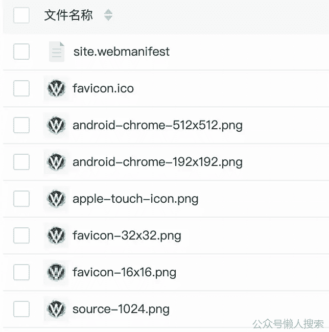

## 3. 内页：承接长尾搜索流量

所谓内页，就是站点下的具体子页面，主要用来承接某个游戏细分词条的搜索需求。以 https://farevergame.wiki/classes 为例，用户想找 classes 时，直接进入该页面即可。

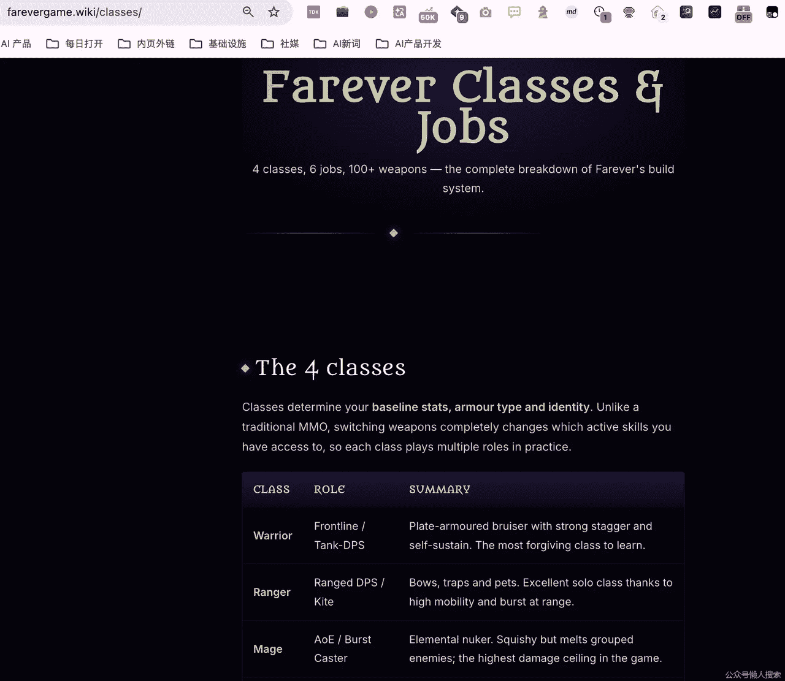

### 去哪里找内页资料？

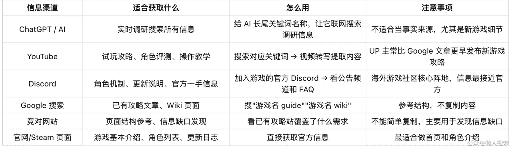

### 素材要跨渠道收集

不要把所有希望押在同一处信源上，任何一条信息都尽量找两处以上做交叉印证。先建一个共享文档（可以就用本地 md 文件），把收到的内容统一放进去。

前面已经拿到 keywords.json，这一环节要做的是为其中 10-20 个目标词分别补充更翔实的素材。做法是在站点项目目录里建一个名为“关键词素材.md”的文档，接下来收集到的所有内容都会汇入其中。

下面以 farever classes 为例，演示具体操作。

### 3.1 先到 Google 查一轮

去 Google 检索时，先确认这个内页词有没有已经写好的攻略文章或 Wiki 词条。

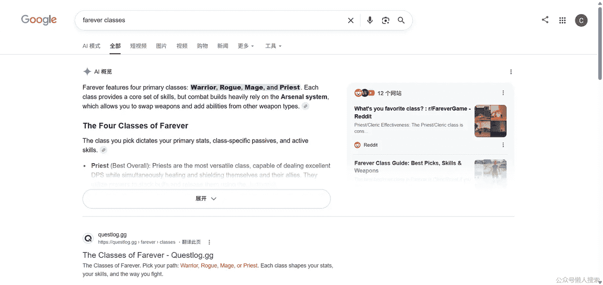

把检索词锁定在 farever classes，然后打开结果中排在前两位的页面。

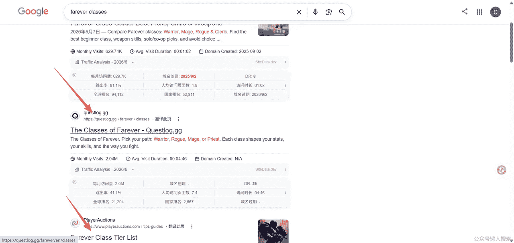

第一个页面的正文内容，可以整段抓取下来。

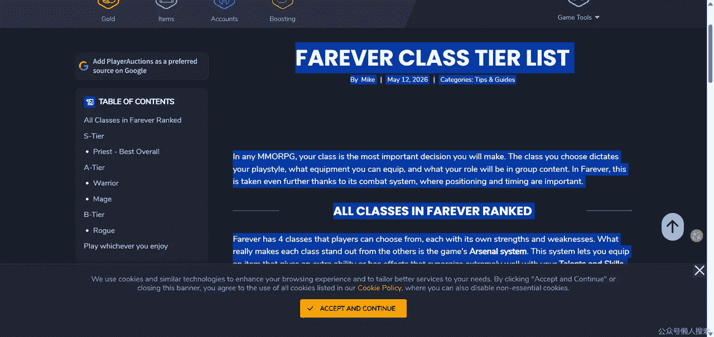

第二个页面则从中挑出四个核心板块，分块保存。

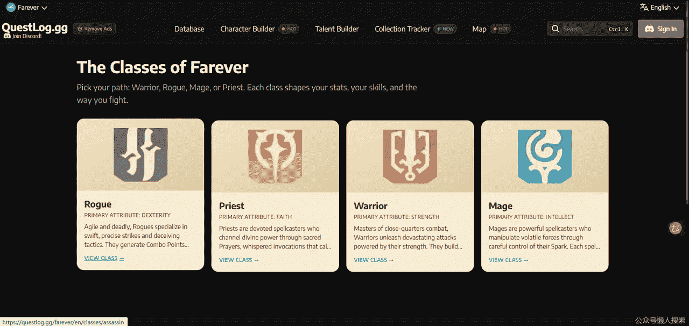

两个页面获得的资料，最后都统一收进以 farever classes 命名的文档里。

### 3.2 再去 YouTube 提取字幕

做法是借助插件把视频字幕导出来，再交给 GPT 这类大模型提炼要点。

先安装 YouTube TranscriptGenerator 插件，地址在这里：

https://chromewebstore.google.com/detail/olhmdeioemochcmndjfcgfnpmhkckgif?utm_source=item-share-cb

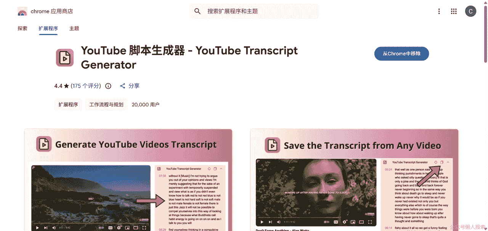

插件装好后，到 YouTube 里查找 farever classes，选两个发布时间较近、播放量靠前的视频进入播放页。此时插件会自动运行，点击中间的 Pro Transcription，字幕抽取随即开始。字幕生成完毕后，把语言切为简体中文，再点左侧 export 复制全文。

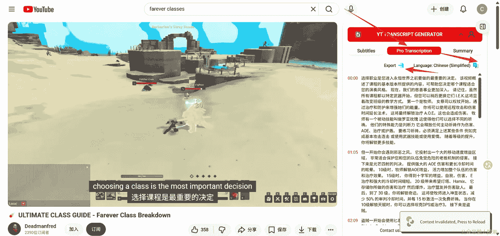

把这份字幕内容也放进 farever classes 文档。到这里，文档里已经同时具备来自 Google 搜索和 YouTube 视频的两类材料。

### 3.3 到官网或 Steam 页面补齐官方信息

在搜索框输入 farever，从结果中点开 Steam 商店里的官方页面。

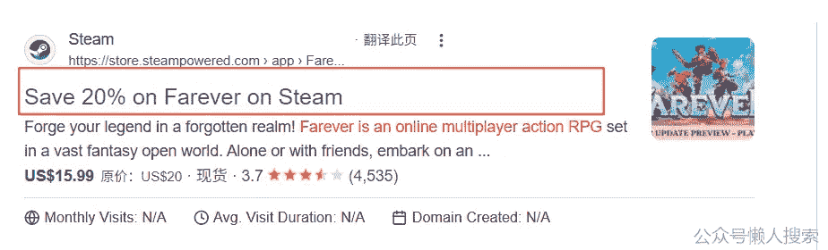

浏览页面时，把其中涉及 classes 的段落单独找出来；凡是有价值的细节，就一并收入 farever classes 文档。

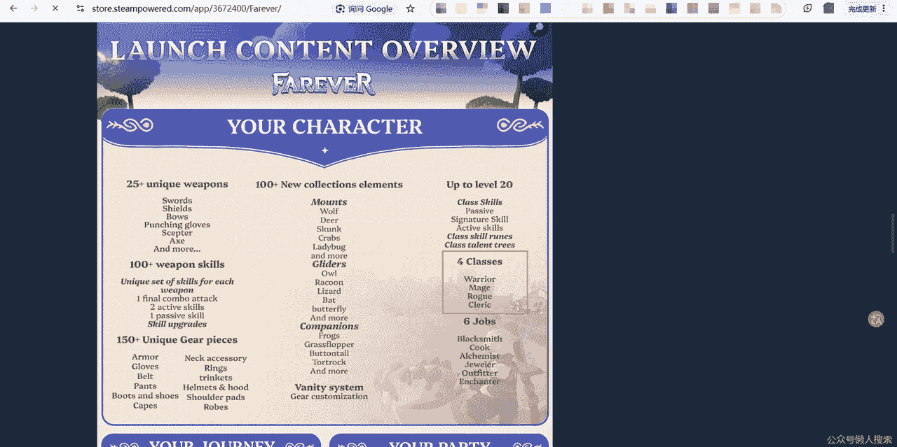

假如页面上只有“4 classes”这几个字，没有更多展开说明，就无需保留，略过即可。

最终“关键词素材.md”的内容会呈现类似下面的结构（仅作演示）：

**来自 Google 的资料**

来源链接：
内容要点：

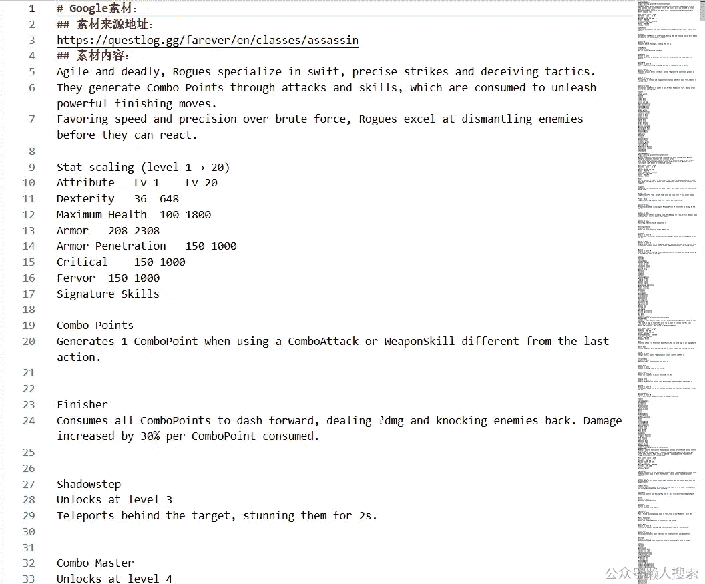

**来自 YouTube 的视频材料**

来源链接：
内容要点：


**来自官方站点的材料**

来源链接：
内容要点：


## 关卡 4：生成页面内容并搭出网站

### 00. 任务概览

**目标**：使用调研阶段拿到的素材产出页面内容，并搭出一个能在本机运行的网站版本。

**需要完成的事项**：

1. 把建站所需账号与工具准备妥当，同时整理好第 2、3 关产出的目标词、页面矩阵和素材来源。
2. 选定一个参考网站，看清它的整体架构、导航设计和页面信息排布方式。
3. 让 AI 产出主页、导航页和头几批内页的内容。
4. 完成本地站点搭建，保证浏览器能正常打开主页、导航页和内页。

# 先让网站跑起来，再让数据说话

动工前，先用 AITDK 之类的工具给站点做个基础 SEO 体检：title、description 是否齐全，H1/H2 是否按层级排好；接着分别用电脑和手机打开页面，看有没有白屏、排版错乱、文字溢出等问题。

**这一环节的过关标准：**

- 站点能在本地正常部署运行。
- 用 AITDK 扩展打开 overview 面板，能看到 title、description，并且 H1/H2 层级正确。

1）打开 AITDK，点进 overview，核对 title 和 description。


2）确认页面有且仅有 1 个 H1，H2、H3 等层级依次递进。


- 网站层级要清楚：首页—导航页—内页；首页具备导航栏、hero 区、tab 按钮和内容板块。


**这一关要提交的作业：**

- 代码托管仓库截图（必填）：只要能看见项目文件结构或关键代码文件即可。
- 本地浏览器可访问的网站截图（必填）：至少包含首页、导航页、内页，能证明网站已经搭好、可以正常浏览。
- 写一下本关最大的收获，或者遇到的卡点、怎么解决的（必填）。

PS：这一关的重点是先把网站做出来，不要求一上来就完美。首页、导航页、内页齐了，再进入部署和数据验证。

### 01. 落地步骤

手里有素材才好开工。这一关要把第 4 关调研出的成果，变成真实可打开的页面。

建站有个重要原则：**前端不要从零搭**。新手从空白项目开始写前端，费时费 token，做出来的 SEO 和页面结构也容易不专业。

更推荐的做法是：**找一个同类型的竞品游戏攻略站 → 参考它的前端效果和页面结构 → 调整成自己的模板。**

**动手前先记住：先上线，再打磨**

与其闭门两周追求一个“完美站”，不如两天先把能访问的版本放出去抢窗口——前者往往拿不到后者能拿到的流量。

新词的竞争窗口很短。越早发布，越容易占住优势。首版再粗糙，只要能打开就是胜利。上线之后，真实用户会告诉你缺什么，而不是靠猜。

**1. 第一步：准备账号和工具（对应教程）**

- AI 编程工具：Codex 为主线；国内访问不畅就用国产 GLM 顶上（报名前装好）。
- 域名账号 → spaceship.com 注册。
- GitHub 账号（存代码）→ github.com 注册。
- Vercel 账号（部署网站）→ vercel.com 注册。
- Cloudflare 账号（DNS 解析）→ cloudflare.com 注册。

**2. 第二步：找参考对象并模仿**

2.1 找参考对象

如果找不到对标怎么办？你选的词很新，搜出来还没人做攻略站，别慌，有两种办法：

1. 借鉴同类游戏的优秀站点：虽然没人在做“你这个游戏”，但大量抽卡类、角色养成类游戏的 wiki 站已经跑通了。挑一个你觉得好看的，参照它的页面结构和排版，套到自己的游戏内容上。

参考对象优先挑：**新站、DR=0（或 DR 很低，接近 0）、排名靠前**。DR 接近 0 说明它没怎么发外链，是单靠网页结构把排名顶上去的。

下面就是一个 DR 等于 0 的网站：


怎么判断 DR=0？下载 SiteData 插件，再用 Chrome 搜关键词，结果里的网站会自带 DR。如果不显示，先检查插件是否已登录，再换个浏览器看看；还不行就在弹窗里联系开发者处理。

sitedata 插件地址：https://chromewebstore.google.com/detail/hhfkpjffbhledfpkhhcoidplcebgdgbk?utm_source=item-share-cb


安装后，每个网站下面都会多出这样一个小框：


怎么找参考对象？问 ChatGPT：

Plain Text

```
最近一个月steam 、roblox 上新了什么游戏
```

如图：


把 ChatGPT 给的这个月游戏词拿去谷歌搜“游戏词+wiki”，挑一个 DR 接近 0 的新游戏站。


点进去看页面结构设计，遇到功能和美观度都不错的就收藏网址。（优秀网站的共性：导航栏、hero 区、tab 按钮、大标题都有，UI 好看，首页板块能承接高搜索量需求。）


同样再搜第 2 个游戏词……


参考优秀对象的页面结构、UI 布局等：


可以多看几个站，收集 5—10 个参考对象，再挑出最值得复刻的那个。

这里列举几个“值得借鉴的站”：

https://vvultimatum.net

https://farevergame.wiki

https://gamblewithyourfriends.net

https://miniwars.art

复刻时要注意哪些能抄、哪些要改：

- 能参照的：页面结构（首页放哪几块）、导航方式、内容组织、配色风格。
- 必须改的：所有文字内容、游戏名、具体数据——必须来自你自己调研的真实内容，绝不能直接复制别人的。
- 一句话：抄结构，不抄内容。

2.2 模仿

找到对标站后，有两种复刻方式，选你顺手的：

**2.2.1 方式一：用 Codex 复刻（主线，最简单）**

把对标站 URL + 下面的复刻提示词发给 Codex（参考新手复刻提示词，降维版）：

Markdown

```
复刻这个游戏站：[对标站首页 URL]，至少实现三个页面——
首页：[URL]、列表 / 导航页：[URL，如 /classes]、文章详情页：[URL，如 /classes/xxx]。
UI 布局完全参照目标站复刻，不要自行设计。
技术栈用 Next.js + 多语言 + MDX 写内容。
```

**可选增强：**

给 Codex 装个免费的 superpowers 插件。同样的复刻提示词，Codex 会自动走系统化流程——拆解设计 → 拆成小任务 → 逐任务执行 + 每步自检，比单句提示词更稳、少返工。Codex（App / CLI）和 Claude Code 都能装。

**装法（任选一种）：**

- Codex：在 Codex 插件市场搜 superpowers 安装（App 在 Plugins 里找；CLI 输入 /plugins → 搜 superpowers → Install Plugin）。
- Claude Code：/plugin marketplace add obra/superpowers-marketplace → /plugin install superpowers@superpowers-marketplace → /reload-plugins。

装好后，把上面的【复刻提示词】发给它，superpowers 会自动接手：先问 1—2 个问题确认复刻范围 → 写实现计划 → 你确认后逐任务执行 + 自检。新手可以先用一句提示词跑通，跑顺了再装 superpowers 提升稳定性。

**2.2.2 方式二：用 same.new 把对标站直接克隆成代码**

same.new 是 AI 网站克隆工具，给它对标站 URL，它能把页面结构、配色、布局“抄”成可用的前端代码（React / Tailwind），省掉 AI 参照着从零写的环节。

费用：开通 25 美元（支持支付宝），够用 2—3 个站，模型选择 GPT 5.5 即可。


**怎么用：**

1. 打开 same.new，把对标站首页 URL + 复刻要求（参考上面的【复刻提示词】）一起提交——别只给 URL，否则克隆出来的代码目录结构、多语言、SEO 都不对，后面改造很麻烦。
2. same.new 会产出一个克隆好的前端项目。
3. 把这个项目交给 Codex，前端不一致的地方再进行修修补补。

**两种复刻方式怎么选：**

- 想最简单、不装额外工具 → 方式一 Codex + 复刻提示词（装了 superpowers 会更稳）。
- 想最快拿到对标站结构 → 方式二 same.new 克隆，方便但多次使用可能需要付费。

**2.3 第三步：把第 3 关调研的信息填进去**

复刻出网站骨架后，分两步填信息：

1）首页用【信息填充提示词】一次填好；

2）每个内页（classes / codes / tier list / 长尾问题页），用【内页信息填充提示词】逐个填，输入是这个内页对应的关键词 + 你为它收集的信息。

**首页填充：**

Markdown

```
把第 3 关用 ChatGPT 调研出的首页信息，填进复刻好的网站：
1. 全站旧游戏名 → 替换成我的游戏名（首页、页脚、侧边栏、法律页都要换，无残留）

2. 首页各模块（Hero / 新手引导 / 游戏介绍 / 兑换码 / 底部号召）用调研的真实文案
3. 官方链接（官网 / Discord / YouTube）、SEO title / description / keywords、主题色（HSL）、多语言，按调研结果配置
4. 侧边栏兑换码用调研的真实码；没有就写&quot;暂无&quot;，绝不编造
所有内容只写第 4 关调研的真实信息，不确定的标&quot;待确认&quot;，不要编造数值和兑换码。
```

**内页填充（一个关键词一个内页：输入是单关键词 + 为它收集的信息）：**

Markdown

```
针对内页关键词，把收集到的信息过滤无效信息，整合收集的多源数据，然后填进各个内页。
一个关键词填一个内页，输入如下：
- 游戏关键词：keywords.json
- 为这个关键词收集到的真实信息（第 4 关调研的素材，贴在这里）：关键词素材.md
要求：
1. 页面 title 含这个关键词，40-60字符；meta description 含关键词、140-160 字符
2. 开头直接回答玩家的搜索问题，不绕弯
3. 全文1200字左右；分 H2 小节，每段 3-4 句，适合扫读；
4. 只写上面收集到的真实信息，不确定的标&quot;待确认&quot;
5. 不要编造数值、角色名、兑换码；
```

**2.4 第四步：提交到 GitHub**

代码在本地跑通后，提交到 GitHub（下一关部署要用）：

**2.4.1 去 GitHub 网页新建仓库：** github.com → New repository，起个仓库名，不要勾选自动生成 README。默认设置为 private，外人不可见。


点击 code 栏目，找到该仓库地址并复制备用。


**2.4.2 把下面的提示词发给 Codex（填好自己的用户名和仓库名）：**

**【GitHub 提交提示词】**

**我的信息：上述仓库名。**

帮我把当前项目推到 GitHub，依次执行：

1. git init → git add . → git commit -m "first version"

2. git remote add origin https://github.com/<我的用户名>/<仓库名>.git

3. git push -u origin main

如果远程仓库还没建：先暂停，告诉我去 github.com → New repository 建一个空仓库（不要勾自动生成 README），建好再继续。

**2.5 第五步：最终确认**

本地浏览器打开所有页面：都能访问、内容能看、链接能点；

GitHub 仓库刷新一下，能看到刚推送的代码。


## 关卡 5：让网站上线并开始收数

### 00. 任务卡

**任务目标：**把已经写好的网站部署到公网，并接入 GSC 和 GA，开始收集真实搜索数据。

**任务描述：**

1. 把 GitHub 项目部署到 Vercel，让网站有一个公网可访问链接。
2. 如果已经购买域名，完成 Cloudflare DNS 绑定；纯新手可先用 Vercel 默认域名完成上线练习。
3. 接入 Google Search Console，并提交 sitemap。
4. 接入 Google Analytics，确认能看到基础访问数据。
5. 用电脑和手机都打开一次网站，确认页面能正常加载和浏览。
6. 做一轮 SEO 基础检查，避免 title、description、sitemap、移动端访问这类低级问题。

**本关需提交作业：**

- 网站线上链接（必填）：提交 Vercel 链接或你绑定好的正式域名，确保别人打开可以访问。
- GSC 验证成功截图（必填）：截图里能看到该网站已经完成验证，或 sitemap 已提交。
- GA 截图（必填）：截图里能看到网站已接入 GA，能开始记录访问数据。
- 分享一下这关最大的收获，或者你遇到的卡点、怎么解决的（必填）。

PS：这一关的核心是让网站上线并开始收集数据。域名是更完整的上线动作，但纯新手可以先用 Vercel 默认域名练习完整流程。

### 01. 上线步骤

上线不是终点，而是开始验证搜索流量的节点。

只有上线了，才会有收录、数据和反馈。第一个版本不用完美，先让它能被访问。

我们需要先在代码里加上这 2 个流量数据监控，上线后方便及时查看数据反馈。

1）Google Search Console（GSC）监控

这是让谷歌知道你的网站存在的工具，可以帮助你的网站在谷歌搜索中被找到。

https://search.google.com/search-console/about

GSC 可以帮你查看网站的搜索排名、点击量、展示量，以及出现的问题（例如移动端可用性问题、爬虫抓取错误等）。

2）Google Analytics 监控

https://marketingplatform.google.com/about/analytics

这是帮你查看有多少人访问了你的网站，以及他们在网站上做了什么的工具。

通过 GA（或其他分析工具）了解网站每日访问量、用户停留时长、跳出率等指标，找到用户最喜欢的页面。

如果你看到某些分类点击率极高，就可以针对这些分类持续丰富内容。

若有一些页面跳出率很高，需要检查页面加载速度或页面本身的吸引力。

定期更新与版本迭代：玩家对游戏的兴趣变化速度很快，若网站长时间不更新，就难以吸引回访用户。

建立每周、每月更新计划，持续添加新游戏，或者对热门游戏页面做更多延伸内容，确保网站整体活跃度与吸引力。

**温馨提示：**

做这两个步骤的前提是：大家要有一个 Gmail 账户，可以自行注册也可以购买。

这个账号非常重要，所以密码一定要修改并牢记。

备注：

① Gmail 账号推荐自己注册，需要手机号。国内手机号也可以试试，如果不行就需要国外手机号（京东买）。

② 海鲜市场或者账号星球上（浏览器搜账号星球）看看有没有成品号。

前面所讲的域名注册平台和网站托管平台都统一为 Gmail 邮箱比较方便，当然你用其他邮箱也是可以的。

这里我用一个新的、未注册过 GSC 和 GA 的账号来演示步骤截图：

1. GSC 接入

首先谷歌搜索 Google Search Console，此处为 GSC 截图 1：


进入 GSC 首页，此处为 GSC 截图 2：


点击开始，再点击下一步，这里大家提前登录好 Gmail 账号就可以进入后台了，此处为 GSC 截图 3：


现在我们进入的就是还未添加过网站的 GSC 后台了，你可以在这里输入域名，此处为 GSC 截图 4：


如果我们已经添加过网站，就需要点击左上角的网站，然后点击添加资源，此处为 GSC 截图 5 和 GSC 截图 6：


一样的在左半部分新增域名就可以了，然后就会跳转要求验证，此为 GSC 后台截图 7：


复制粘贴完域名后点击继续，如果你手打键盘注意字母不要敲错，此为 GSC 后台截图 8：


此处是跳出来验证界面，如果你前面是跟着我的步骤走的，那么域名就已经放在 Cloudflare.com 上面了，所以只需要点击下一步开始验证即可，此为 GSC 后台截图 9：


等待跳转出来的新页面加载完成，截图 10。这样基本就完成了。

# 游戏站从上线到变现：一套能落地的操作清单


页面加载完毕后，直接点「授权」。这里有个小提醒：Cloudflare 得先保持登录态；最省事的方案是几处平台共用同一个邮箱注册，授权时系统会自动跳转，对照图 11 看。


授权一过，新弹出的页面会自动合上，画面切回搜索控制台，对应图 12。


到这一步，域名的所有权验证就算走完了。点进对应条目，就能看到该站点的数据面板，如图 13。


刚进来时，各项指标都是空白的。我个人的习惯是：把域名输进顶部的检索框，敲回车先让它抓一遍索引，参考图 14。


域名粘进去后按回车，下方会弹出一列搜索建议，如图 15。


眼下的这个地址早已进入索引；不过绝大多数刚注册的域名还查不到影子，碰到这种情况，先点右上角的「测试」按钮，对应图 16。


图 17 是测试启动的界面。


图 18 表示测试跑通了。


图 19 里点「请求索引」。


图 20 显示请求已经发出。


图 21 里索引完成。

这一整套到此结束。这 21 张图建议归档存好，当作为每个新站上线时逐项打勾的检查清单。


图 22：提交 sitemap.xml 让搜索引擎抓取——把该域名对应的 sitemap.xml 路径填进去；动手前最好先在浏览器里打开链接，确认文件已经就位。

**2. 接入 Google Analytics**

它跟上文那个搜索控制台不是同一个平台，所以还是从网址直接进：

https://analytics.google.com/analytics/web/

图 1：链接点开就进入 GA 界面，按「开始」。


图 2：新账号先得定个名字，随你填，不影响后面。


图 3：名字定好，展开下拉并点下一步，熟悉的添加网站页面就浮现了。


图 4：像我这种用旧账号书签直达的，会跳过起名这一环，直接落到此页。你也可以在加了几个域名之后，把这个页面重新存成书签。


图 5：填入域名，继续下一步。


图 6：这一步我一般挑第一档。它问的是公司体量，独立开发者选最靠前的选项就对了，跟流量毫无关联。


图 7：接着点下一步。


图 8：业务目标栏我选最末一项「Other business objectives」，意思是既不卖货、也不拉新的那类目标。


图 9：咱们做的是 Web，所以答案就是第一项 Web。


首次使用，还得点一下接受服务条款。


图 10：把所有域名逐个放进去。


图 11：右上角继续。


图 12：GA 的追踪代码就展示在这一屏。怎么埋进站里？我的做法是开工那会儿就把代码复制给 Claude，让它直接写进项目，全程只剩复制粘贴。更靠谱的方式是走环境配置，在 env.local 里声明：

NEXT_PUBLIC_GA_ID="G-·······"


图 13：代码埋好、站点也能正常访问后，点右上角那个检测键，看看页面里能不能被识别到 GA 标签。


图 14：还没埋代码时是这样的——识别结果一栏是空白，旁边配个黄色感叹号。


图 15：埋好代码、稍等片刻再看，状态就变了。从写入到线上生效要几分钟，之后检测会亮成绿色。


**3. 用 Vercel 部署上线**

这里以 Vercel 为例，刚上手的话也建议从它开始。先建一个 team，进去之后点 Add New，选 Project。


前提是代码仓库已经建好、项目也推送成功了。接着把 GitHub 账号接过来，import 那个项目。这一步可能弹出授权，提前勾上「All repositories / 所有仓库」能省不少事。


Project Name 自己定一个，技术栈平台会自动读取。再把前面那个环境配置补进去——填 GA 的 ID，也就是等号后面那一串。其余保持默认，点部署，几分钟后就能看到上线的结果。

提醒：要是这次漏了环境配置，事后也能去 Settings 的 Environmental Variables 里补，补完记得重新部署一次。

**4. 回到 Cloudflare 配 DNS**

（1）先拿到 Vercel 那边的 CNAME 与 A 记录：

选中刚部署的项目。


依次点 Settings → Domains → Learn More → Add Domain，把域名填好并 Save。域名务必核对清楚，一个字母写错就得重来。保存后会列出两条记录：一条裸域，一条 www 域。把它们逐个展开，截下各自的 DNS Records（Type、Name、Value 这些字段都在），再把 Value 一项项复制出来，留待去 Cloudflare 填写。


（2）再到 Cloudflare 落地这些记录。


进入 Cloudflare，在顶部的域名下拉里选中目标站点，切到 DNS 页，点 Add Records。

第一条，类型选 A，Name 填 @，Value 处粘贴 Vercel 那个 A 记录对应的 IP。

第二条，类型选 CNAME，Name 填 www，Value 处粘贴 Vercel 给出的 CNAME 值。

两个注意点：
1）@ 或 www 名下若已存在别的 A/CNAME，先删或先改，留着会跟新记录打架。
2）碰到 AAAA（IPv6）记录建议直接清除，Vercel 常因为这类记录报异常。


**5. 上线后的第一轮 SEO 自查**

三处技术细节值得过一遍（走 Cloudflare 的话多半已经默认配好）：

• canonical URL：向 Google 声明哪一个地址才是「正身」。
• 301 重定向：让 www 域与非 www 域二选一，另一个用跳转指过来，全站只保留一个版本。
• HTTPS：Cloudflare 自动搞定，看一眼浏览器地址栏有没有小锁即可。

**6. 一个高频踩坑点**

拿现成模板复制出第二个站，最容易出的事故是旧站 URL 没清干净，最后变成内容重复。把 A 站的代码整包搬去 B 站时，robots.txt、sitemap.xml 以及各种配置里，往往还躺着 A 站的游戏名、域名和页面路径；一旦上线，B 站域名下就会出现和 A 站雷同的内容，Google 会按重复或抄袭处理，收录与排序都受牵连。所以每次复用模板开新站，上线前都要把 robots.txt 与 sitemap.xml 翻一遍，凡是旧站地址一律替换成新站；同时确认游戏名、页面文案、各项配置也都换成了新站自己的东西，不留半点旧痕迹。

## 关卡 6：用数据做判断——补内容、试变现、定去留

### 00. 这一关要做的事

**目标**：拿 GSC 的第一批数据做复盘，据此补 2~3 个新页面，并给站点定方向：接着做、换个词重来，还是往工具站升级。

**具体动作：**

1. 进入 GSC 后台，把展现次数、点击次数、查询词和落地页表现过一遍。
2. 从已经冒出来的查询词里读信号，弄清楚访客还有哪些疑问没被解决。
3. 列 2~3 条可执行的补页清单，别用「继续优化」四个字糊弄过去。
4. 结合眼下数据做出选择：加内容、换词重启，或者评估升级成工具站的可行性。
5. 若变现条件初步具备，先去摸清 AdSense 与 Adsterra 的申请通道。
6. 认真填一次复盘表，把后续每个动作落到纸面。

这是必修阶段的收官一关。21 天内本船的达标线为：GSC/GA 都已接通、数据开始积累、并且留下第一份复盘记录。

当后台已有真实查询词时再动手补页；若一条数据都没有，就只做技术层面的排查，同时把上线后第 7 天、第 14 天设成两个复查节点。数据没出来之前，不必逼着自己判断要不要换词或升级。

**作业：**

• 复盘表的截图或文档截图（必交）。

里面要有站点地址、GSC 的展现与点击数字、新冒出的查询词、你的结论、判断依据以及下一步动作。21 天内实在没有这些内容，可以不写。

PS：有真实查询词才补页；没数据就只查技术项，并约好第 7 天、第 14 天各复查一次。不要让人在数据空白期去抉择换词还是升级。

**复盘表模板：**

Plain Text

```
【必须提交】
我的站：[网站链接]
GSC 总展示：[数字]  总点击：[数字]

【以下内容在21天内没有可不提交】
出现了哪些新搜索词：
下一步判断：继续补 / 换词 / 考虑升级工具站
理由：
具体动作：
```

• 补页计划 2~3 条（选填）

每一条都要写明：补哪个页面、它对应哪类搜索意图或用户困惑。

• 说说这一关你最大的收获，或者被卡住的地方和你的解决办法（必交）。

PS：这一关的意义不在于证明站点已经跑通，而是练会用数据拍板。数据再少，也值得走一遍复盘与决策的流程。

### 01. 从读数到拍板的完整路径

游戏站从来不是一稿定终身的。访客真实搜什么，会一点点把新需求顶出来；GSC 里新冒出的查询词，往往就是下一篇该写的标题。另外要认清一件事：多数游戏站撑不起长期收益，该靠数据判断「接着干还是换赛道」，别凭一股劲儿死磕。

**1. 读 GSC 的五个关键指标**

打开后台，视线先落在下面五项上：

• **展现次数**：你的链接在结果页被露出的总次数。它往上走，说明这个词的需求在升温。
• **点击次数**：真正从结果页走进站里的人数。
• **平均位次**：链接通常落在第几名。挤进前十才算拿到门票，掉到三页开外基本无人问津。
• **点击率均值**：跟位次强相关，越靠前，愿意点的人越多。
• **查询词报表**：访客用什么词撞见了你。这一项价值最高，常能挖出你压根没想到的角度。


读完数就动手：

**2. 缺什么补什么，别急着另起炉灶**

数据摆在面前时，只要这个词还有需求，先问「站里还差哪一页」，而不是「我是不是该再开一个站」。

• 某个新词在 GSC 里量不小，你却压根没做对应内容 → 补页
• 某几篇表现突出 → 顺着它铺开更多关联选题
• 页面迟迟不进索引 → 排查、调整、重新提交（也可能这个词本身搜索量就小）

内容是一轮轮长出来的，不是一口气码完的：

• 冒出「xxx how to get character X」→ 加一篇角色获取攻略
• 冒出「xxx best build for Y」→ 加一篇配装推荐
• 冒出「xxx codes 2026」→ 把兑换码页翻新，年份写进标题

**3. 认识 AdSense 这条变现路**

申请细节可以参考往期《AI 应用丨游戏站》那期航海。

它的原理不复杂：在站内挂上广告位，Google 自动挑广告投放，访客看了或点了，收益就进账。

**什么时候动手**：等流量有点底子再接。生财里有人提到日访问破 500 后效果比较理想；没到这个量也能开，只是进账寥寥——一天几毛到几块都算正常。

**接入流程**：

1. 到 adsense.google.com 注册。
2. 拿到广告代码，嵌进页面。
3. 等 Google 走审核，快的几天，慢的要几周。
4. 过审之后广告才会正式跑起来。

**常见的被拒理由**：篇幅太单薄、内容质量不过关、缺隐私政策页。别拿一个孤零零的单页去碰运气，至少首页、/about、/contact 加上若干内容页都得有，让审核员看到的像是一个正常运营的站，而不是赶工出来的临时页面。被驳回几次很正常，补足内容再交一次即可。

**结算方式**：

• 电汇回国内银行卡：固定手续费偏高，适合金额大的情况。
• 虚拟币结算：手续费约 2%，小额中额更合适。

AdSense 之外，还有个门槛更低的选项：Adsterra。

新站初期流量薄、AdSense 审核又严，过审并不容易。Adsterra 属于另一家广告联盟，准入门槛低于 AdSense，走审也快，可以先用它赚到第一笔美金，等流量养起来再切回 AdSense，或者两套并行。

**4. Adsterra 的上手步骤**

**4.1** 打开 adsterra.com 免费注册。

选择 Publisher 类型账号，完成邮箱验证。

4.2 创建广告位并挑形式。新手可以选「Native Banner」（原生横幅，观感温和）或「Banner」（配置最简单）。Popunder 弹窗先放一边，太打扰访客。


4.3 提交等待审核。

它家审核速度很快，通常 1~3 分钟就有结果。通过之后，你就能给这个域名继续添加更多广告单元。

4.4 拿到广告 Key。

Banner 形式：


Native Banner 形式：


每建好一个单元，平台会给你一串 32 位十六进制的唯一 Key，用来拼出广告加载地址。让大模型在代码里挂上对应脚本，appkey 建议通过环境变量注入。

4.5 广告跑起来，有人浏览或点击就产生收益。

两家的取舍：

• AdSense：单价更高、做得久更吃香，但审核门槛高，站内内容得够厚够正规，适合流量成型后再上；审核周期大概 1~2 个月。
• Adsterra：门槛低、批得快、新站立刻能挂，单价略逊，适合早期先跑通「能赚钱」这件事。

推荐路线：

新站先用 Adsterra 打底 → 日访问过千、AdSense 也能过审了，再切到 AdSense（或两者并用：主广告位交给 AdSense，次要位置由 Adsterra 补量）。

**5. 定下一步**

把前几关的数据汇总，干脆地做一个决定：

**接着养这个站**：数据向好、有展现有点击，甚至已经有广告收益。

• 继续加页面，把关键词面铺得更广
• 把 AdSense 排上日程
• 把这套流程沉淀成自己的模板，下一个站能快不少

**换一个游戏词重开**：有数据但位次上不去——有展现没点击，折腾几周还是每天个位数的访客。

• 这套模板和流程经验留着继续用
• 同样的打法换个题材，第二遍速度会翻倍
• 回头看看内容有没有真的答到用户的问题上
• 别觉得丢脸，绝大多数站最终都不赚钱

1. 复盘表（照着填）

|  | 记录 |
| --- | --- |
| 统计时间范围 |  |
| 展现总数 |  |
| 点击总数 |  |
| 位次均值 |  |

| 搜索排名前 5 的关键词 | 1. 2. 3. 4. 5. |
| 有需求但你尚未建页的词 |  |
| 尚未被收录的页面 |  |
| 下一轮优先补充的 2-3 个页面 | 1. 2. 3. |

---

# 选修篇：让首个站变成可复制模板

## 关卡 7：把建站流程做成模板（进阶）

### 00. 本关任务卡

**任务目标：** 将已经跑通的首个游戏站，沉淀为一套可反复套用的站点模板。

**任务描述：**

1. 把首个游戏站重新审视一遍，拆成框架、配置、内容三块。
2. 单独建立站点配置文件，把游戏名、主色、导航、官网入口、SEO 标题描述等收拢进去。
3. 让页面不再写死内容和导航；后续增删条目时，站点能自动同步。
4. 核对 SEO 信息、sitemap 等基础项能否随配置或内容自动更新。
5. 另取一个游戏名做替换演练，确认哪些地方只动配置、哪些代码保持不动。

PS：本关属选修内容，默认无需交作业；如果你已跑通第一个站并准备复制第二个站，可以继续实践。

### 01. 从一个站到十个站：复制逻辑

首个攻略站一旦靠手工跑顺，就该被提炼成可复用的底版。未来开新站时，开发工作只剩更换配置与内容，前端架构和代码都不必重来。这个动作决定你能否从单站运营跨入批量运营，也正好对应路线 A 的“批量放大”。

**模板化的核心：三层各归其位**

一套框架往往要承接多个游戏，而各游戏的内容分类、主色、官网入口、文章体系并不相同。假如混作一团，每次换游戏都要通读代码，效率低且容易漏改。

因此，把一个站拆成三层，各司其职：

1. **框架层**：负责整体布局、页面结构、组件、技术栈，以及 SEO 和多语言的生成逻辑。它只需精心打磨一次，之后所有站共用，相当于共同地基。
2. **配置层**：存放游戏名称、主色、官方入口、导航分类、SEO 标题描述、语言支持等会随游戏变化的信息，统一收在配置文件里。
3. **内容层**：内页文章、首页模块文案数据、各语言翻译。各站完全独立替换，可手写，也可借助下一节的方法让 AI 批量产出。

三层分开后，规则很清晰：改文章不用碰程序，改配置不用重做框架；开新站时只动后两层，框架层保持原样。

**模板化之后，能做什么**

- 新站上线提速：配置和内容替换完毕，骨架即可使用，无需重搭前端。
- 内页批量生产（见下一节）：一份提示词可产出多篇内容，填入模板后自动成页。
- 导航、路由与 sitemap 自动联动：新增分类或文章后，菜单、链接和 sitemap 会自动刷新，不必人工同步。
- SEO 由代码自动生成：标题标签、结构化数据、多语言链接、sitemap 等由框架产出，你只需维护内容与配置。
- 更远一步的自动化——YouTube、官方信息、关键词抓取，多站统一管理，数据日报——技术门槛较高，新手暂缓。

**把首个站打磨成模板的具体动作**

- 抽出首页里与游戏强相关的字段：名称、主色、官网入口及各处文案，统一迁入配置文件（如 en.json）。代码只负责读取，不再硬编码；换游戏时改配置即可，无需全项目搜索。
- 文章与导航改为动态读取：增删文章后前端自动同步，列表不再手工维护。
- 主色统一由变量控制，避免代码中散落硬编码颜色；换皮肤时只改一处，不会漏改。
- SEO 信息和 sitemap 改为按内容自动生成，不再维护固定文件。
- **验证方式：** 换一个游戏名，确认是否只调整配置和固定提示词就能整站切换；若可以，模板即成立。

## 关卡 8：批量生产内页（进阶）

### 01. 本关任务卡

**任务目标：** 基于关键词清单和内容模板，批量产出真实、有用、有差异的游戏内页。

**任务描述：**

1. 先列出不少于 10 个内页选题，每个选题绑定一个具体搜索词或玩家疑问。
2. 沉淀一份可反复使用的内页生成提示词，把页面结构、资料出处、输出格式、禁止杜撰这几项写清楚。
3. 先生成一批内页，再人工抽查不少于 5 篇。
4. 每篇上线内容都要有真实资料支撑，不能只做同义词替换。
5. 在本地或线上预览，核对标题、正文结构、内链、导航和 SEO 信息。
6. 结合审核情况，确定下一批需要补哪些页面。

PS：本关属选修内容，默认无需交作业；如果你已有站点基础、想继续放大长尾流量，可以继续实践。

### 01. 如何让站点迅速扩出大量内页

游戏攻略站如果只经营首页，搜索流量通常很有限；真正扛流量的是数量可观的内页：每个 boss 配一篇打法解析，每个角色配一篇档案，tier list 做成榜单页，再补兑换码页和入门指南页。

几十乃至上百个内页并不稀奇，每个内页只服务一个搜索词（来自第 3 关），汇总起来才是站点流量的主力。

可内页一多，逐篇手写显然不现实。本节解决的就是批量产出问题。

**内页批量生成的前提：模板已经就位**

- 站点完成模板化后，框架是稳定的。每新增一个内页，本质上只是往内容目录放一份 mdx 文件。
- 框架会把它渲染成完整页面，导航、SEO 标题与描述、面包屑、多语言链接、sitemap 一并自动生成，不需要改代码。
- 所以批量做内页，核心在于批量写出对应的文字内容。

Bash

```
content/
├── en/gelum.mdx          → /gelum
├── en/beginner.mdx       → /beginner
├── ja/gelum.mdx          → /ja/gelum（日文版）
└── ru/beginner.mdx       → /ru/beginner（俄文版）
```

**怎么做：三步就能动手**

第一步：先把内页清单列清楚

- 从第 3 关的关键词清单倒推：一种搜索意图对应一个内页。玩家搜“XX game gelum boss 怎么打”，就建“gelum boss 攻略”页；搜“XX game codes”，就建兑换码页。
- 产出是一张内页清单表，写清页面名、目标搜索词、要解决的问题。后续批量生产就照这张表执行。

第二步：提前固定内页生成提示词

- 不要每篇临时发挥。先把内页结构和写作要求固定成提示词，之后同类页面都套同一套标准，质量与格式更稳定。
- 提示词里要有结构信息：游戏关键词、第四关调研资料、核心内容（boss 页写技能与打法，角色页写属性与定位，codes 页写真实兑换码及使用说明）。
- 还要有红线：必须符合游戏真实设定，数值、技能、打法不能编；不确定的标注“待确认”，再到官方、wiki、社区核实后补；输出格式遵循框架规范，标题层级和字段名照样例来。
- 把提示词保存好，它就是你的内页生产线。

第三步：分批生成，逐批审核入库

- 把清单中的页面按同类分组交给 AI，例如“按这套结构写 gelum、vael、nyx 三个 boss 的攻略”，用同一份提示词产出多篇。每次不要塞太多，同类几个一批即可，过量会拉低质量。
- 每批结果都要人工检查：事实是否正确、有无杜撰、格式是否合规；修改后再放进内容目录，框架会自动渲染。
- 本地打开确认页面正常，这篇内页才算完成。按类别逐步铺开，几十上百个内页几天内就能上线。

**必须警惕：批量生产不等于内容注水**

- 批量的目的，是用成熟结构加真实内容减少重复劳动，而不是换个名字复制粘贴。每一页都得有真实、有差异、能解决玩家问题的信息。
- 若只替换关键词、正文千篇一律，老玩家很容易看出是低质站，Google 也可能判定为批量低质内容并降权；这样批量反而不如不批量。
- 前提是你对游戏足够熟悉，能判断 AI 输出是否准确、是否编造。若做不到，先别批量，把单篇内容打磨扎实。

**动手前先自问**

- 你能否稳定写出一篇真实、有用、玩家愿意看的单页？能，再把同一套提示词复制到同类页面；不能，就先集中把单页做透，别用批量掩盖内容短板。
- 说到底，批量是能力放大器：它放大的是“单篇已经能做好”的能力；单篇做不好，批量只会制造更多垃圾。

**想再提速：手动流程跑顺后再考虑脚本**

- 上面三步是手动批量的常规路径。等你把一个站的内页手动铺顺、每个环节都清楚后，若还想提速，可把重复环节脚本化：自动从游戏资料站、YouTube 等平台抓取 boss/角色数据，省去手抄；让 AI 自动生成内容并写入对应 /content 目录；再批量校验格式。
- 脚本属于进阶技能，需要自己懂点代码，或让 AI（Codex、Claude）协助编写，门槛高于手动。新手不要一开始就折腾脚本：调脚本的时间可能够手动铺好几个站。
- 正确顺序是先把人工流程跑通，确认每篇内页都能做出高质量，再考虑用脚本加速。脚本只能加速你已经会做的事，救不了还不会做的事。

