# AI 产品（国内-微信小程序）丨实战手册丨 8 月航海

> 来源：[https://hk57gvlx7u.feishu.cn/docx/IQfjdWu2Io6gzVxb3IqcixY1nRg](https://hk57gvlx7u.feishu.cn/docx/IQfjdWu2Io6gzVxb3IqcixY1nRg)

---

<https://my.feishu.cn/sync/Lj5sd8APisk896bxImEcYvjMnlF>

# 引言

## 关卡 0：开船第一课：看懂全貌并完成开工前准备

### 00. 本章任务卡

**任务目标**：看懂这条航海会带你做什么、最终交付什么，并完成进入第一关前的工具和账号准备。

**任务描述**：

• 看懂 AI 小程序项目的完整链路和最小通关路径

• 了解真实案例，建立对结果和风险的合理预期

• 准备后续会用到的工具、账号和时间安排

**提交模板：**本关不需要提交作业**

---

### 01. 开船第一课

1.  这个项目是什么

**一句话**：从真实小需求切入，用微信小程序完成 AI 产品从 0 到 1，涵盖找需求、做产品、上线、拿反馈、尝试变现全流程。

**机会点：**当前微信正在推进小程序 AI 生态，配套的 AI 资源扶持、开发者工具支持等降低了试错成本

| 你做的是什么产品 | 微信小程序 |
| --- | --- |
| 变现方式 | 1.（广告流量变现）轻工具先接流量主广告，靠使用量拿分成，使用人数越多你的流量主收益就越多； 2.（订阅变现）需求更强的产品，可以做付费功能、会员订阅。 |
| 需要什么技能 | 需求挖掘与判断、AI 编程技能、推广运营技能 |
| 起步成本 | 认证费：30 元（个人）/300 元（个体户/企业）、AI 编程工具订阅费用 |
| 月入参考 | 几十～几千（起步阶段） |

1.  别人跑出了什么结果

真实案例：西昂 · 15 个小程序月入 2 万+

做了什么：不会写代码的运营，用 AI 批量做工具小程序。微信搜索找需求 → AI 开发 → 上线 → 流量主变现。

结果数据：15 个小程序，7 个稳定产出，月入 2 万+。停更半年收入还在跑。试错成本从"几千到几万+几个月"变成"30 块+一两天"。

真实案例：暮子风 · 英语启蒙小程序，一篇笔记 650+ 用户

做了什么：用 Codex 从零做了「口语小场景」小程序，80 个场景、480 个单词。先在小红书发验证帖，再根据评论反馈做开发。

结果数据：一篇小红书笔记，一周 650+ 用户、108 个种子用户。接通微信支付后，有陌生用户真实付费。

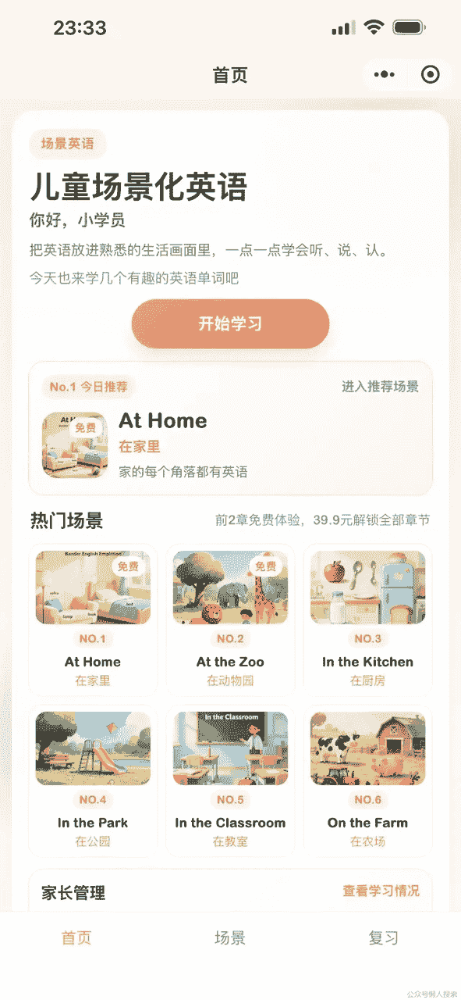

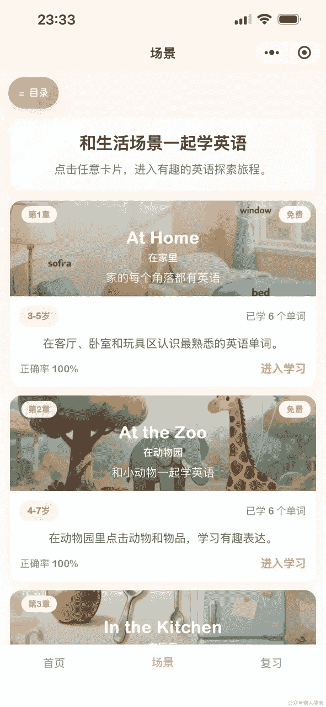

上面两个案例听完了——你可能在想："具体是怎么操作的？我能不能也做？"

下面拆一个真实小程序，看看它们从想法到上线到底经历了什么。

拆解一：暮子风的「口语小场景」— 从一篇小红书笔记开始

**他怎么找到方向的**：

暮子风发现很多家长在小红书搜"幼儿英语启蒙""口语怎么练"，评论区反复出现"有没有工具可以跟读打分"。他判断：这个需求是真的，而且不是他一个人的猜想——是用户在主动问。

**他做了什么事**：

1.  先在脑子里想清楚产品——不用设计软件，就用纸笔画出大概：首页选场景 → 点进场景听原声 → 自己跟读录音 → AI 比对打分 → 看到反馈。想的差不多后，把想法更具体地告诉 Codex，让 AI 帮忙整理成产品需求文档。

1.  AI 整理出来后，他自己从头到尾读了一遍，确认"这个描述确实是我要做的东西"，再让 AI 写小程序代码。

1.  关键操作：他让 AI 一次只做一个功能。先做场景选择页，跑通了再做跟读功能，再做打分。不一次性要全部。

1.  发了一篇小红书笔记："给娃做英语启蒙，自己做了一个跟读打分的小程序"，有人问"怎么用""在哪下载"。

1.  一周 650+ 用户，108 个加了微信。有人问"能不能付费解锁更多场景"——这时候他才接支付。

**他能做成，你也行的原因**：他不是先开发完再推广。他是先有了方向、发了笔记看反馈、确认有人要了再开发。需求不是猜的，是用户用行动告诉他的。

1.  最终交付什么

跑完整本手册后，你至少会拿到一个已经完成基础设置、可体验、可提交审核，并有第一批用户反馈路径的微信小程序。更理想的结果是：你能基于真实需求完成一次从找方向、验证、开发、上线、推广、反馈到变现的完整闭环。

1.  任务关卡地图

正文分两篇。必修篇带你从账号准备走到小程序发布，选修篇从启动推广到、变现和进阶放大。

| 篇章 | 关卡 | 阶段 | 本关结果物 | 参考时间 |
| --- | --- | --- | --- | --- |
| 引言 | 关卡 0 | 开船第一课 | 看懂项目全貌，完成开工前准备 | 第 1 天 |
| 必修篇 | 关卡 1-2 | 账号准备 + 判断需求 | 完成小程序账号注册，找到一个值得验证的需求信号 | 第 1-4 天 |
| 必修篇 | 关卡 3 | 基础设置 | 完成小程序信息、类目、备案与认证 | 第 5-14 天 |
| 必修篇 | 关卡 4 | 开发实战 | 用 AI 做出第一个可体验小程序 | 第 6-14 天，可与备案等待并行 |
| 必修篇 | 关卡 5 | 上线发布 | 提交审核并正式发布小程序 | 第 15-21 天 |
| 选修篇 | 关卡 6-8 | 推广、变现 | 让第一批用户用到小程序，并按需做反馈决策和变现闭环 | 按需推进 |

备案是整条链路里等待最久的环节。关卡 1 注册完账号，关卡 2 方向验证通过后立刻去备案，开发的同时等备案通过。不要等代码写完再备案。

💡当前航线图按照 实际做小程序这个项目的业务逻辑排布

如果你是纯新手，且对AI体验也不深刻，想要先拿到一点AI产品速成的体感，建议按照关卡1-关卡4-关卡3-关卡5-关卡2的顺序完成； 关卡4也可以直接用提供的案例做出来提交。

【关卡4的案例其实有一点难度，想要更简单的练手，也可以参考往期16年3月微信小程序航海的案例，制作电子木鱼，如果觉得关卡4的案例展示的不够详细，但想要尝试这个难度的，也可以直接参考往期的，制作消灭拖延症任务拆解小程序；】

本期主要在挖掘需求、推广启动这两大难点内容有比较大更新，小程序制作这块做了缩略，因为做出小程序难度基本不算太大。当然，我们也会有对应直播信息量弥补，咱们的高手领航直播二主要聚焦小程序制作，会对一些后端、ui等知识和操作做补充，敬请期待。

**其余学员**建议直接按照实际做小程序项目的业务逻辑推进，真实做出属于自己的小程序；相应的关卡4就直接提交自己的小程序即可。

1.  关键选择的理由

**适合谁**：

• 用 AI 做过东西，但卡在不知道做什么能赚钱的人

• 有产品想法或已有产品，但不确定需求是否成立的人

• 零基础但愿意每天投入 2-3 小时，跟着手册一步步实操的圈友

• 想先做出一个微信小程序，跑通 AI 产品从 0 到 1 闭环的圈友

**不适合谁**：

• 期待航海直接保证变现结果的人

• 只想埋头做产品，不想和用户打交道的人

• 想一夜暴富，无法接受第一个项目结果不确定的圈友

大部分第一个小程序不会赚大钱。西昂做了 15 个才有 7 个稳定赚钱

新手建议默认选流量主——试错成本最低，个人主体就能开

第一个项目的真正价值不是赚多少，是跑通完整闭环。跑通了，第二个第三个只会更快

敢于放弃是能力。do 小鱼做了 3 个方向才找到对的路，Wee 放弃了 3 个方向才在第 4 个方向上跑通

1.  开船前准备

• **AI 编程工具**：Codex（推荐），备选 Workbuddy（工具配置文档）

• **微信开发者工具**：安装微信开发者工具

• **小程序账号**：mp.weixin.qq.com注册（个人主体，注册免费）

• **时间**：每天 2-3 小时

关卡 1 会带你完成小程序账号注册，关卡 4会带你装工具开始开发。

• 每关开头有本章任务——快速扫一眼就知道这关要做的具体动作

• 每关末尾通常有常见卡点——会给你下一步具体动作

**插个题外话：如果你对自己每日 Token 用量感兴**趣， 欢迎加入生财 TokenRank～

我们发现最近不少圈友已经在用 Codex、Claude Code、Hermes、WorkBuddy 等工具做项目，但自己用了多少、坚持了多久、做成了什么，没有被记录下来。

TokenRank 可以帮大家记录真实的 AI 使用过程，也方便我们发现优秀作品和实战案例。

注意：Token 高不代表成果好。相比“用了多少”，我们更关注：你用 AI 完成了什么、解决了什么问题。

现在 TokenRank 已开放接入，大家可以跟着教程完成安 装：https://scys.com/tokenrank/connect

接入过程中遇到问题，可以直接在航海群里反馈。

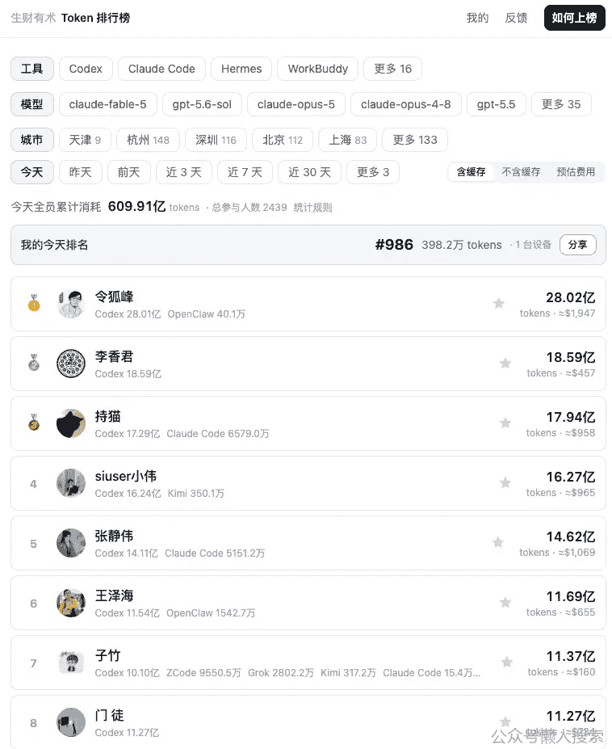

---

# 必修篇

## 关卡 1：准备起跑：完成小程序账号注册与主体选择

### 00. 本章任务

**任务目标**：注册一个小程序账号，拿到 AppID。

**任务描述**：

1.  完成微信小程序账号注册，能进入微信公众平台后台。

1.  确认自己选择的是个人、个体户还是企业主体，并知道为什么这样选。

1.  找到小程序 AppID 页面，知道后续开发会用到它。

1.  暂时不要急着完善名称、类目、备案、认证，这些会在关卡 3 统一处理。

**本关需提交作业：**

• 后台小程序 AppID 页面截图（必填）

• 参考关卡 1 本章任务截图示范案例：mp.weixin.qq.com后台 → 开发管理 → AppID。截图里能看到小程序 AppID 即可，注意不要泄露 AppSecret。

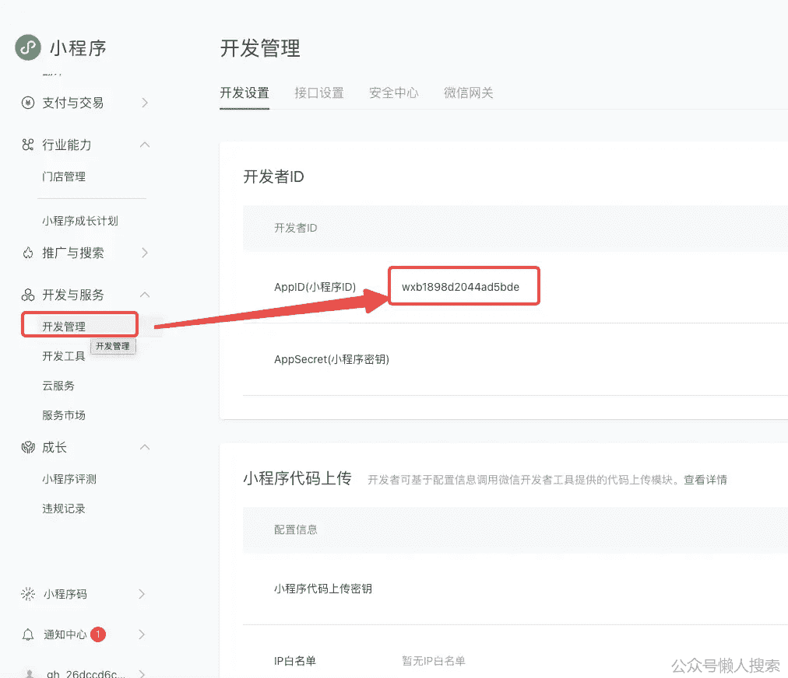

• 分享一下这关最大的收获，或者你遇到的卡点、怎么解决的（必填）

---

### 01. 具体步骤

1.  先看懂：注册账号 ≠ 小程序能上线

注册小程序账号只是第一步。完整链路是这样的：

注册账号 →关卡 2 找到方向 → 关卡 3 填小程序信息、选类目、提交备案、做认证 → 关卡 4 开发 → 关卡5上传审核、发布

你本关要做的是：拿到注册小程序后的 AppID。

小程序信息、名称、类目、备案、认证——这些等关卡 2 方向确认后，关卡 3带你正式处理。

为什么不等方向定了再注册？因为注册完全免费，可以先注册完熟悉后台。一个身份证最多注册 5 个小程序。

1.  两种赚钱方式，现在就看懂

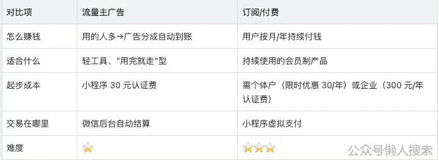

新手建议：优先选流量主。试错成本最低，个人主体就能开。跑通后想加付费，再把个人号升级为个体户/企业号。关卡 8会展开每种变现方式的具体操作。

1.  注册前先想清楚主体：个人、个体户还是企业

注册时就要选主体类型。

先看这张表，判断你现在该选哪个：

| 对比项 | 个人主体 | 个体户/企业主体 |
| --- | --- | --- |
| 准备材料 | 身份证 + 实名验证 | 营业执照 + 法人身份信息 |
| 支付能力 | 通常不支持微信支付 | 更适合支付、交易、电商 |
| 类目范围 | 较少，更适合轻工具 | 更灵活 |
| 适合谁 | 第一次跑通流程、轻工具 | 一开始就要交易、复杂服务 |
| 认证费 | 30 元/年 | 个体户限时优惠 30 元/年，企业常见 300 元/年 |

怎么判断：

• 你只是做一个计算器、BMI 工**具、单位换算、随**机抽签、本地文案工具 →个人主体可以先跑

• 你一开始就想做支付、电商、会员付费、多人共享、复杂教育服务 →提前确认主体和类目支持，不要等代码写完才发现不支持

• 不确定？那就先个人主体，目的是快速跑通一遍流程。后面真需要升级，再去办个体户执照。有开发者就是这么做的——先个人主体快速上线，目的是先通关一遍流程，才有了后来的经验

一个身份证最多注册 5 个小程序，注册完全免费。30 元是后面的微信认证费，备案通过后才需要付。

1.  注册小程序账号

**第 1 步：打开注册页面**

1.  打开浏览器，访问mp.weixin.qq.com（微信公众平台）

1.  点击右上角"立即注册"

1.  选择账号类型为"小程序"

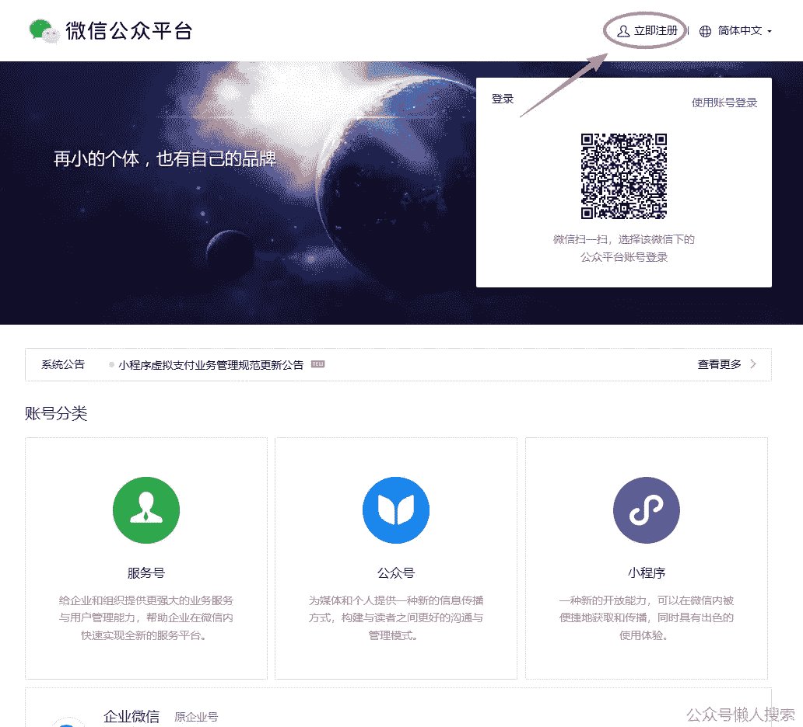

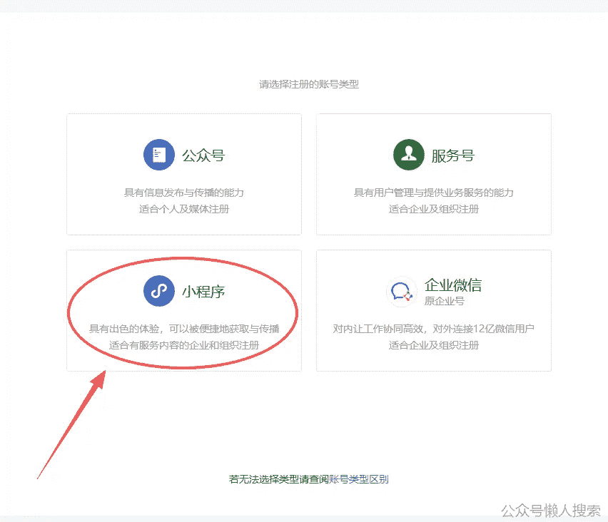

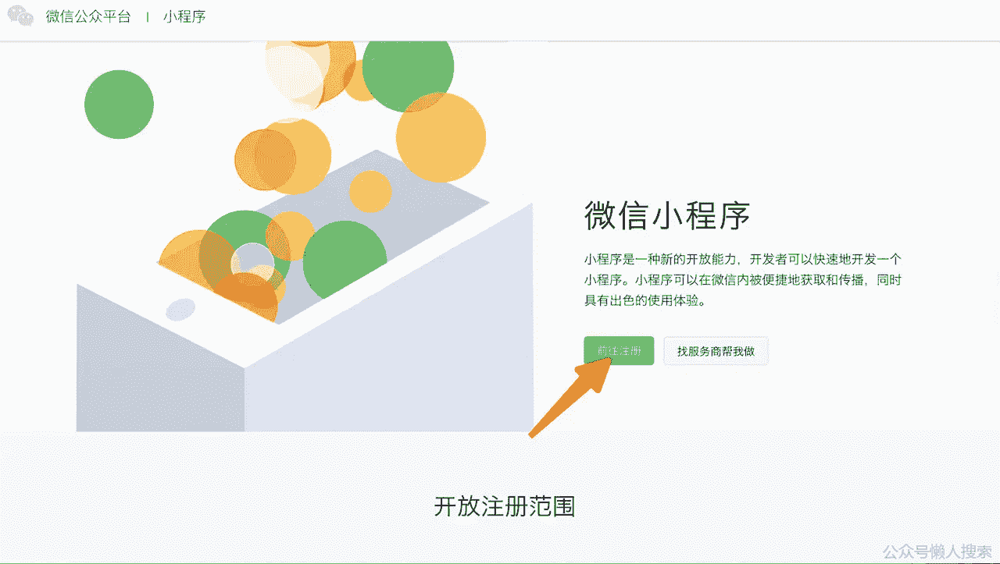

**第 2 步：填写邮箱和密码**

这一步有一个坑，很多人第一次就卡在这。

有开发者第一次注册的时候，随手填了个常用邮箱，结果提示"该邮箱已绑定其他平台账号"。

**注意：**

• 你需要准备**一个全新的邮箱**，这个邮箱不能注册过任何微信公众平台账号（包括订阅号、服务号、企业微信等）。如果你常用的 QQ 邮箱或 163 邮箱已经注册过公众号了，就重新申请一个新邮箱。当然如果你要做的小程序很多的话，这里推荐一个无限生成邮箱号的网站：https://www.2925.com/login/

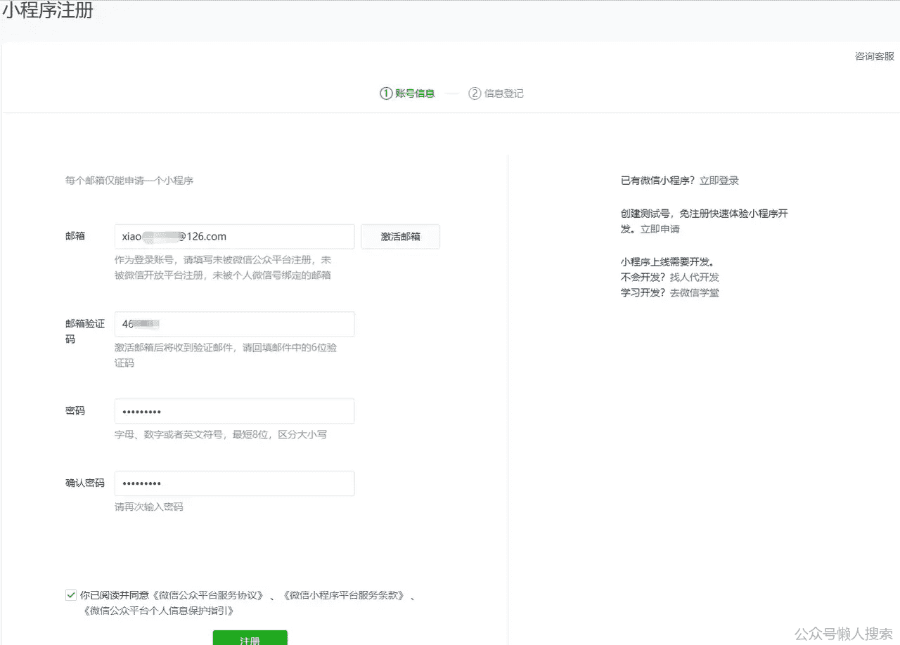

第 3 步：选择小程序类目和主体类型

1.  小程序类型选“其他”；主体类型选择"个人"（或企业，根据你前面的判断）

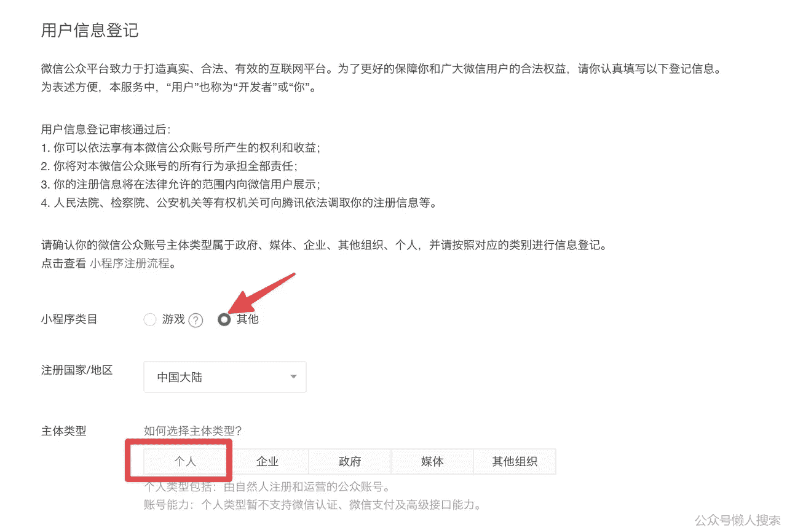

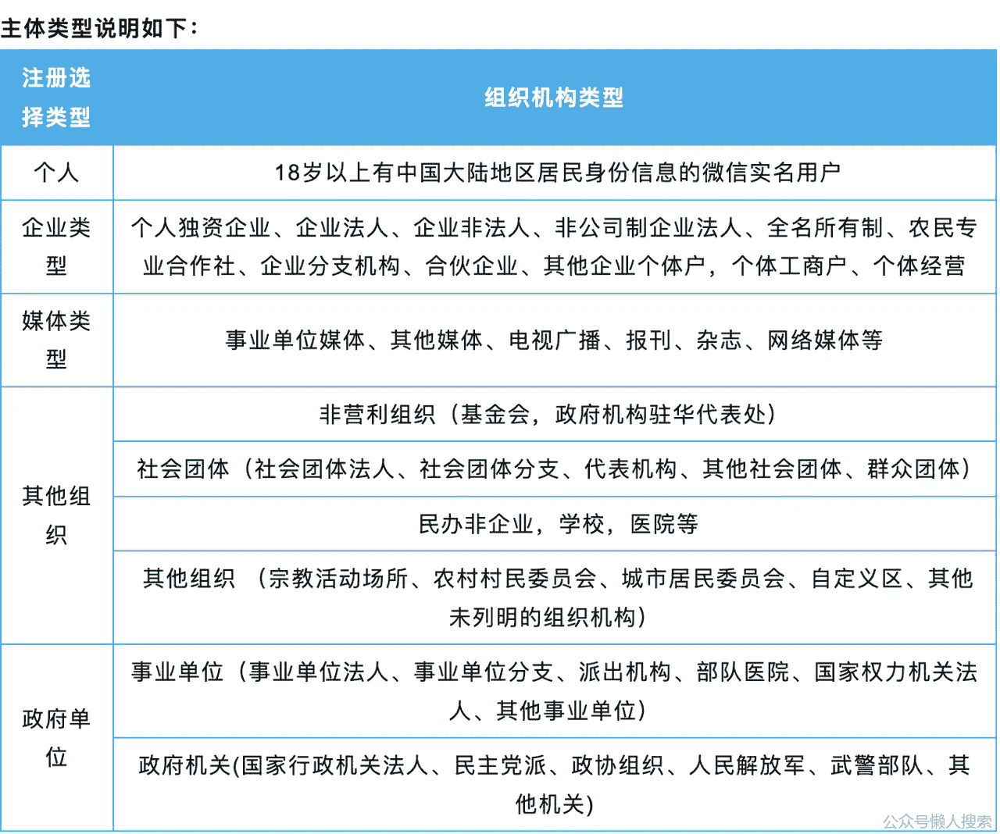

**如果你是个体户/企业**

企业/个体户（操作比个人会多几步）

选「企业」或「个体工商户」 -> 填企业名称 + 营业执照号 -> 上传营业执照彩色件 -> 填法定代表人姓名 + 身份证号 -> 管理员扫码（可以是法人本人，也可以是授权的运营者） -> 选验证方式并完成即可。

**验证方式有 2 种，你挑：**

• 对公打款验证。适合有对公账户的企业，微信会给对公户打几分钱，回填金额完成验证就行（免费的）。

• 微信认证。适合个体户/想快点/要做支付的，交 30 块，通常 1-3 天审核完，必须走这个才能开支付。

**建议：**只要你需要支付能力，直接选微信认证，一步到位。对公打款只能证明"主体是真的"，但支付接口还是得再认证一次，等于多操作一次。

• 输入姓名、身份证号、手机号，接收验证码

• 用此身份证实名的微信扫描二维码完成验证

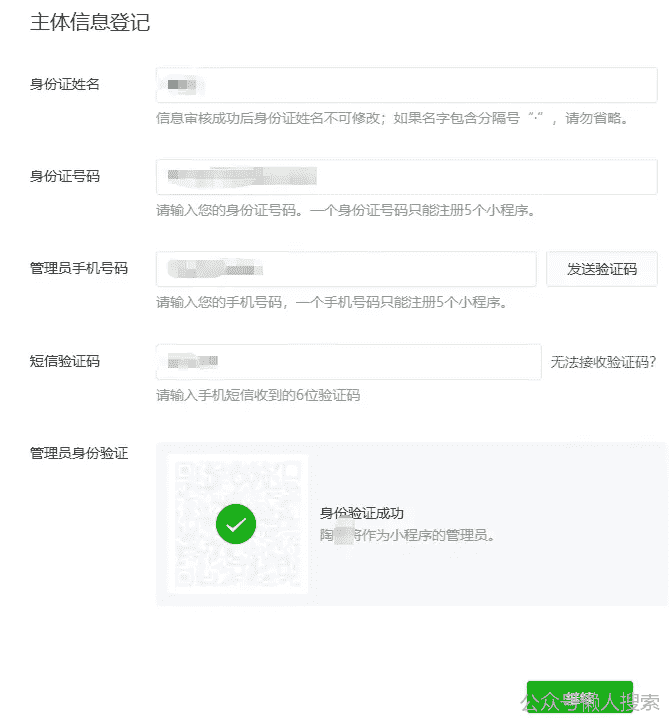

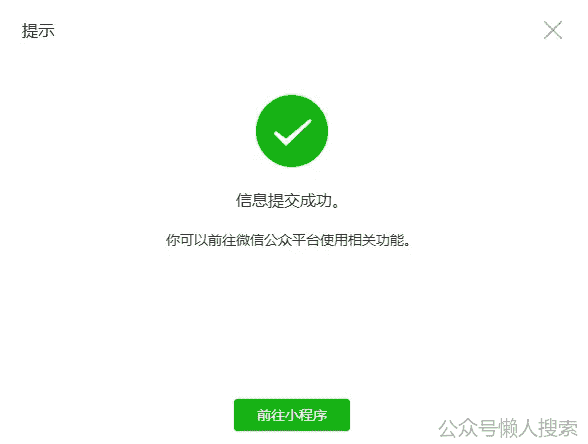

⚠️ 注意事项：

• 一个身份证最多注册 5 个小程序

• 注册完全免费。30 元是后面的微信认证费，备案通过后才需要付

1.  注册完先别急着填完所有信息，等方向确认后去关卡 3

注**册完成，你拿**到了后台入口和 AppID。现在后台里能看到"小程序信息""小程序类目""小程序备案""微信认证"这些选项——先别急着填。


原因是：你在关卡 1还没确定自己要做什么。小程序信息：名字、简介、类目这些东西，填了后面可能要改，改了还要重新审核，浪费时间。

关卡 2 找到方向后，关卡 3 会专门带你正式填小程序信息，并提交备案和认证。你现在先熟悉后台，看看每个选项在哪个位置就行。

关于备案节奏：小程序备案需要等待时间，顺利的话 3-5 个工作日，不顺利可能更久。但别担心——备案认证的过程不会影响小程序开发，你可以一边开发一边等备案。关卡 3 提交备案后，关卡 4写代码的同时备案在后台跑，代码写完时备案大概率已经过了。

1.  常见卡点

| 常见卡点 | 先检查什么 | 下一步动作 |
| --- | --- | --- |
| &quot;不知道选哪种主体&quot; | 先确认具体场景和前一步是否完成 | 轻工具/第一次跑流程 → 个人。涉及交易/支付/社交 → 提前确认主体和类目。不确定就先个人，后面可以升级 |
| &quot;不知道选哪种变现方式&quot; | 先确认具体场景和前一步是否完成 | 新手默认选流量主，试错成本最低。 关卡 8 会展开每种方式的具体操作 |

---

## 关卡 2：找需求：找到一个值得做的需求方向

### 00. 本章任务

**任务目标**：找到 1 个值得继续做的小程序需求方向，并说明它为什么不是纯靠“我觉得”。

**任务描述**：

1.  先选一种你最顺手的找需求方式：看评论/差评、搜微信小程序和微信指数、或者从自己和身边人的真实痛点出发。

1.  找到一个具体需求方向，不要只写大品类，比如不要只写“英语学习”，而是写清楚“谁在什么场景下，需要解决什么问题”。

1.  收集至少 1 个真实信号，比如用户评论、搜索结果、微信指数、同类产品使用量、付费案例等。

1.  初步判断这个方向更可能靠什么变现：流量主、订阅、付费功能、商品/服务，或者先不变现只验证。

1.  用 AI 帮你追问和反向挑毛病，确认这个方向是不是值得进入下一关。

**本关需提交作业：**

• 你要做的 1 个需求方向、选择理由和初步变现判断（必填）

请写清楚：你想做什么小程序？面向谁？解决什么场景里的什么问题？为什么选择它？更可能走流量主、订阅、付费功能、商品/服务，还是先不变现继续验证？

• 1-2 张需求信号证据截图（必填）

可以是评论截图、微信搜索截图、微信指数截图、同类小程序使用量截图、付费商品/服务销量截图等。

• 分享一下这关最大的收获，或者你遇到的卡点、怎么解决的（必填）

PS：这一关不要求三个找需求方法都做完，选一个能走通的方式即可。重点是交出真实信号，而不是只交一个想法。

---

### 01. 找需求实操方法

先选一个场景。选你最顺手的——不用三个都做。

• 习惯逛社群、刷小红书等社交媒体 → 方法一

• 平时刷微信、搜小程序多 →**方法二**

**• 有**自己或身边人反复抱怨的事 →方法三

选完走到底。觉得不够再回来试另一个。

1.  方法一：在讨论/评论区里掘金

**概览**：泡在目标用户出没的地方（小红书、App Store、微信群等）→ 翻评论和讨论→ 从用户的差评和反馈里提炼产品卖点。

平时刷小红书、逛微信群的时候，多留意大家在讨论什么。很多时候别人提出的问题就是他的卡点。做产品本质上就是挖到别人卡在哪，通过产品帮他们实现目标。所以要多泡不同的兴趣社群，看大家关注什么、对什么感兴趣。

看评论能帮你更清晰地找到产品特色和卖点——无论是挖掘蓝海市场还是找到差异化，都可以直接从用户反馈里提炼。

**1.1 看**已有产品的差评**

想做某类工具，可以跨平台去安卓或苹果 App Store 搜相关产品，看低分评价里用户在抱怨什么。把这些抱怨收集起来，就是你的卖点。

比如在苹果商店搜"证件照"，点进 App 的评分页筛选最低评价，能看到不少刚需：

• 用户想要免费 P 图软件 → 你就可以主打"永久免费"

• 用户说导出质量不达标 → 你就在导出质量上下功夫

营销时直接讲：很多 P 图软件动不动收费，但我们的小程序永久免费，还能导出高质量证件照。把用户的抱怨变成产品卖点。

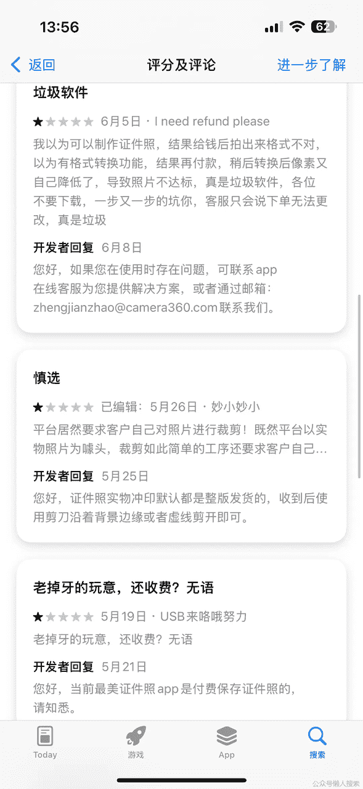

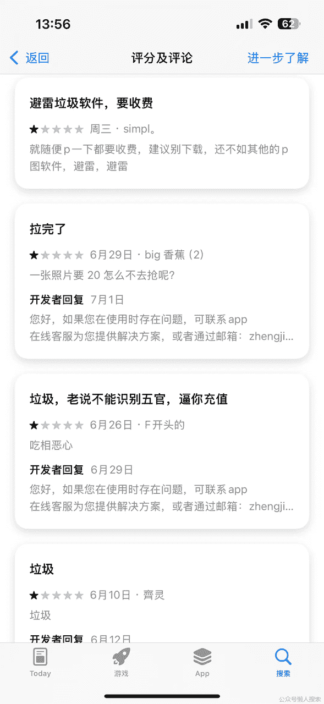

**1.2**看**社交媒体帖子下的评论**

还是证件照的例子。在小红书搜"证件照"，点进"证件照免费生成"相关帖子，出来的第一个帖子下面，就是教大家如何用一个 APP 生成证件照的。翻评论能看到大量痛点：打开是糊的、保存不上、尺寸不对。这些就是用户在使用同类产品时的明确卡点。

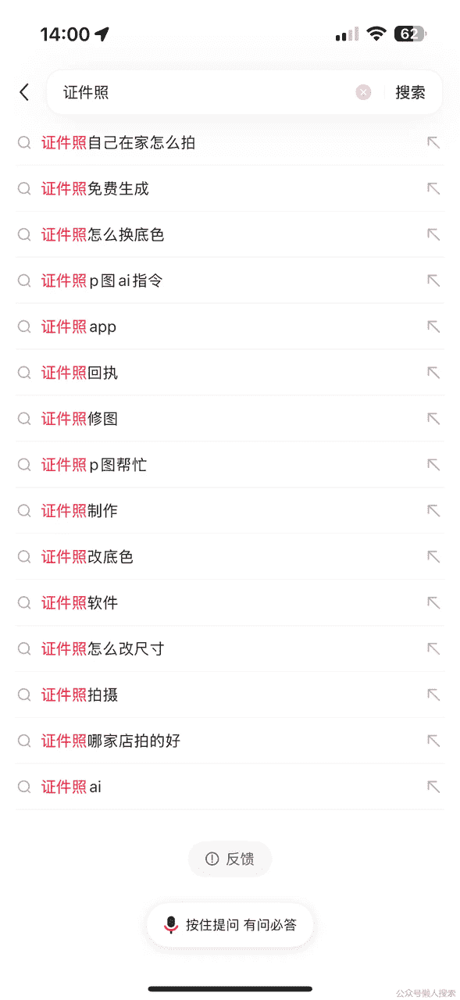

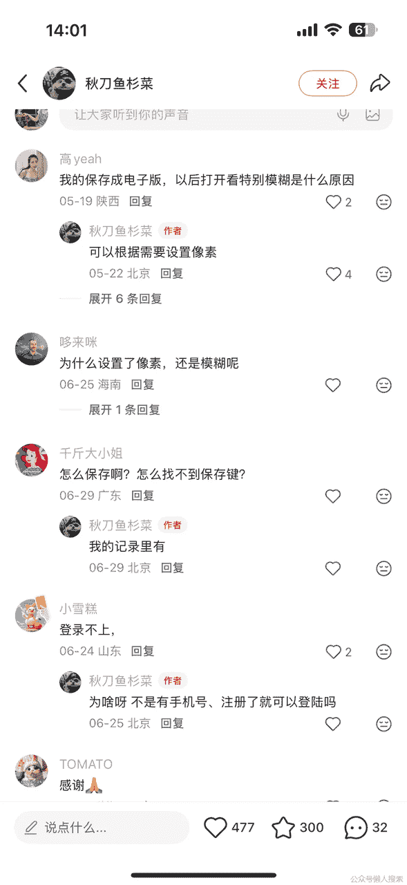

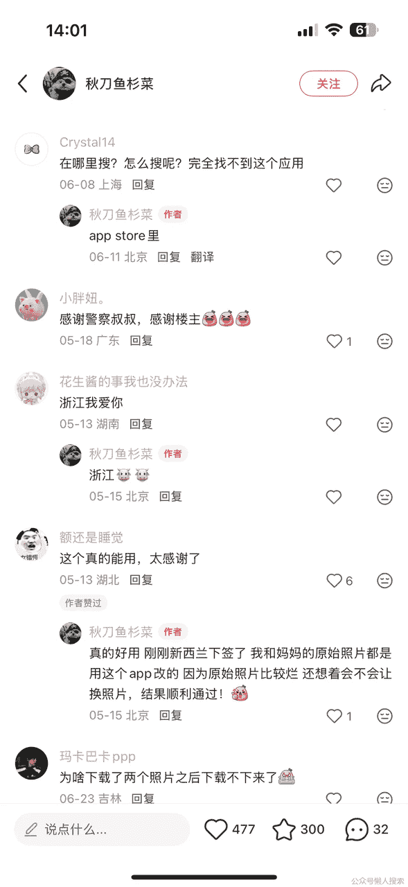

设计产品时就围绕这些点做。后续推广时，直接把用户的卡点变成你的解决方案。前期多收集这类帖子，等产品做出来了，甚至可以直接在留言里回复有卡点的用户："用这个工具可以导出高质量，而且免费"——这转化就很自然。

在调研的时候，发现相关关键词排名靠前的帖子里面，有直接在小红书上开店售卖的商品，销量还不错，那就更好了，这说明这是一个用户愿意付费的需求。

如果发现相关关键词下排名靠前的帖子里有直接开店售卖的，且销量不错，说明这是用户愿意付费的需求

比如说在这个关键词下有帖子是直接在卖货，卖证件照的精修，5 块钱一单，已经卖了两万多单了。那你是不是就可以做证件照精修小程序，主打免费 + 高质量？

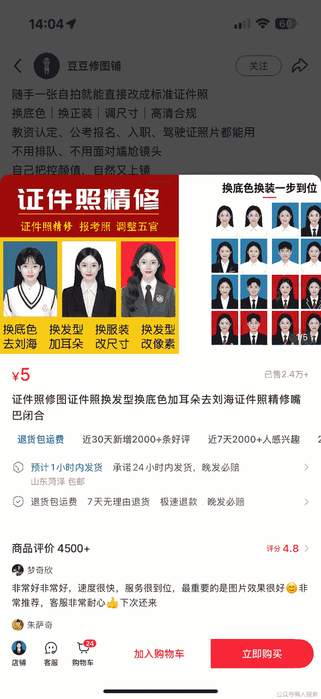

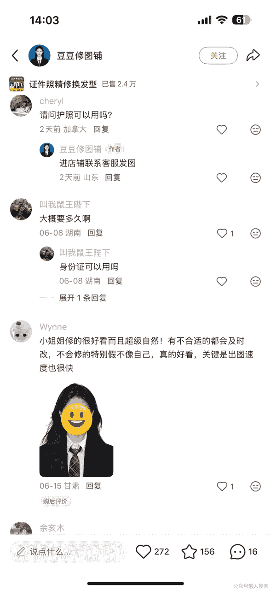

继续翻这个评论区，还能看到更细分的场景——护照、证件照精修等。越垂直，竞争者越少。也就是说，你可以通过评论挖掘看到用户更垂直、更细分的需求。这些需求越垂直越好，代表着竞争者越少。如果你能找到一个很小的蓝海，并用你的产品占有一席之地，就可以死死地把这部分用户圈住。

1.  方法二：在微信生态里找

**核心逻辑**：微信里已经有人在做的小程序，说明需求已经被验证过了。你要做的不是发明新需求，而是找到那些需求成立、但产品做得不好的方向，做一个体验更好的版本。

2.1从哪儿发现方向

2.1.1 入口一：小程序分类浏览

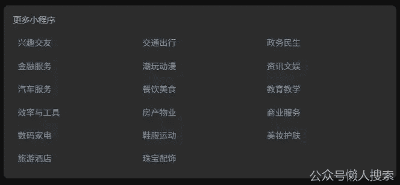

微信 → 发现 → 小程序 → 滑到最下面「更多小程序」→ 右上角「展开」，按类目浏览（工具、生活服务、教育、健康等）。花半小时每个分类翻一遍，看看有没有你感兴趣的工具。

PS：如果发现页没有小程序入口，「我」→「设置」→「其他功能」→「发现页管理」→「小程序」→ 打开「在发现页中显示该功能」。

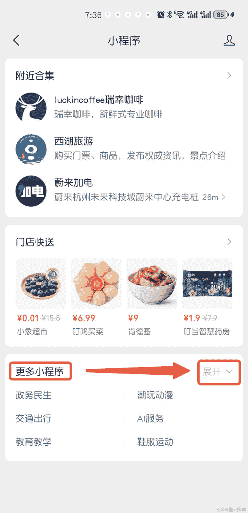

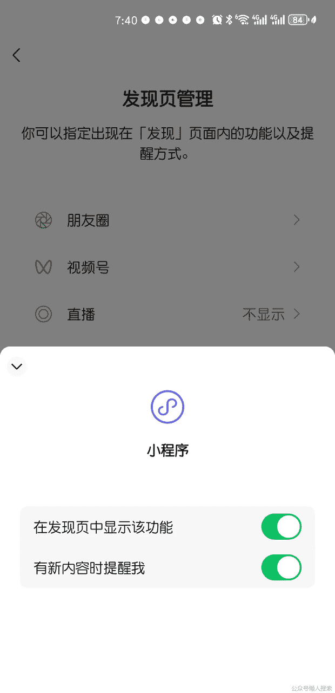

**2.1.2 入口二：搜关键词**

这是最高效的方式。直接在微信搜索框里搜用户可能会搜的关键词，比如打卡/接龙——这些都是工具类小程序的高频搜索词。

微信搜索底部有一个页面设置开关，如果搜索中没有小程序选项，在搜索页底部点「页面设置」→「搜索指定内容」→ 打开「小程序」。

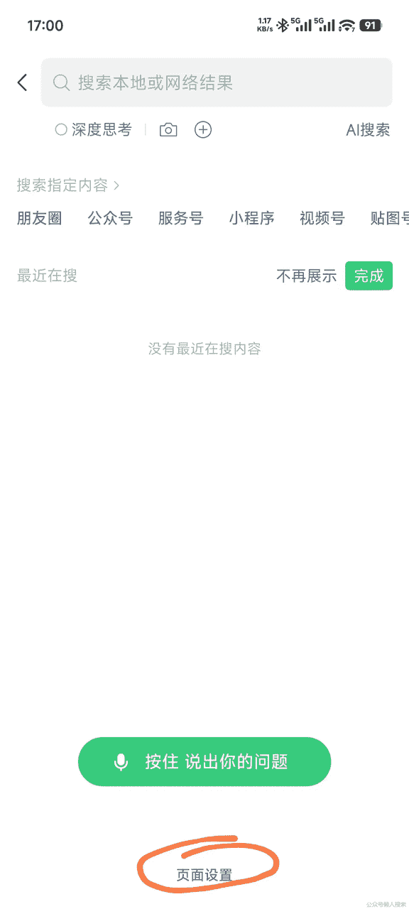

搜索指定内容。回到搜索页中点击搜索框下方出现的「小程序」蓝色字体，可以打开小程序指定搜索

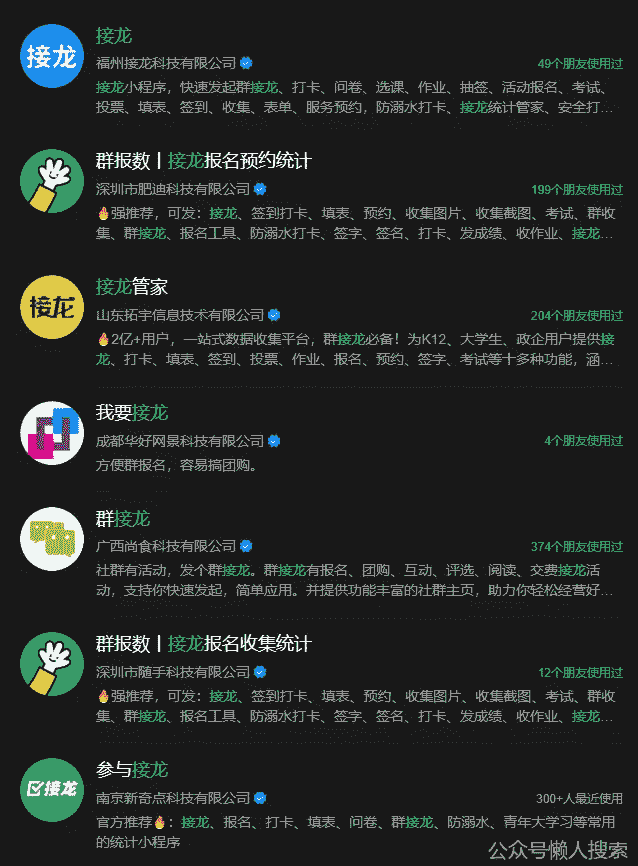

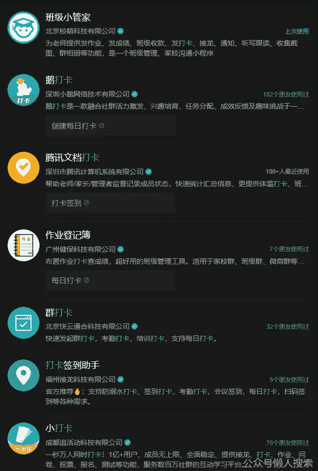

**2.1.3 入口三：**微信指数**

有大致方向了，搜索“微信指数”小程序，看搜索趋势。如果常年搜索量在 1000 万以上，说明是通用刚需。

点进某一个关键词进入以后，你还可以通过搜索下拉词看到更多的细分需求。

通过添加关键词对比，对这些细分的关键词需求进行比较，优先关注可以做成工具的细分词。

比如在下拉词里看到「粤语翻译器」——说明有人需要把普通话翻译成粤语。搜索量可能很小，但需求非常具体。当用户搜这个词时，你的小程序能解决，他就会自然点进来。

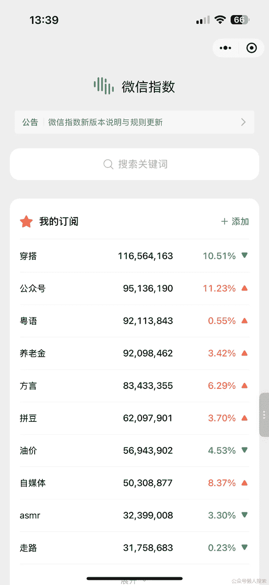

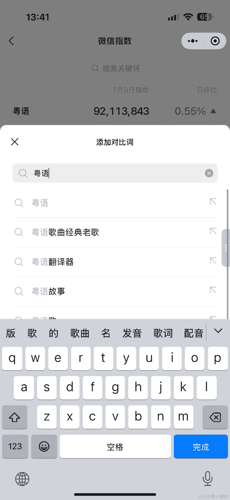

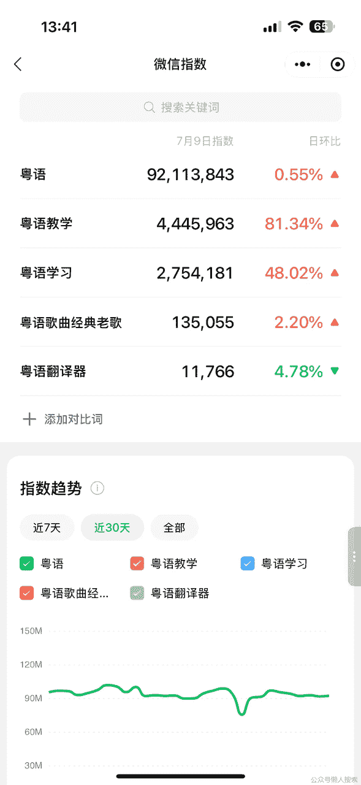

**2.2**怎么做验证？**

不管从哪个入口看到的方向，用同一套标准判断值不值得做。

**2.2.1 一看需求真不真**

**搜一下有**没有相关小程序。有 → 需求存在。然后再看里面有没有个人资质（非企业）的开发者——企业能做的量级不代表个人也能做到。

找到个人开发者后，看他们的「最近使用人数」：代表该类目的人有多少，天花板有多少

没有个人开发者或用户量太低 → 这个方向可能不适合个人入场。

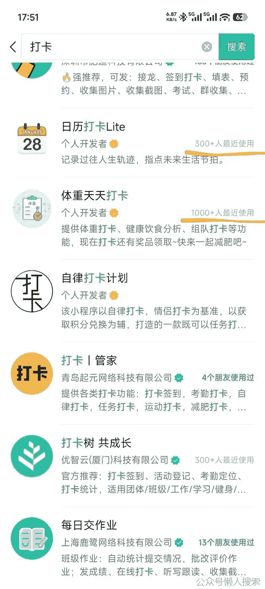

**2.2.2 二看竞争能不能打**

点进使用量靠前的产品，从数量和体验两个角度判断：

• **数量**：搜出来的小程序寥寥无几 → 竞争小，机会大。一搜一大片 → 竞争大，谨慎。

• **体验**：界面好不好用、功能完不完善、广告多不多。如果搜出来的普遍质量不高——界面粗糙、广告满天飞、操作卡顿——说明用户在忍着用，你做个体验更好的就能切进去。

但有一个例外：如果搜出来有一个明显做得特别好的头部产品（界面精美、功能完善、用户量大），果断换方向。

接着大致看使用量靠前的**个人开发者**产品的入局时间：如果都是三四年前做的 → 很难靠自然搜索排到前面。有一两年内注册的 → 说明还不算饱和，可以用产品力+营销力打一打。比如排名第 9 的是去年做的，就是竞争信号。

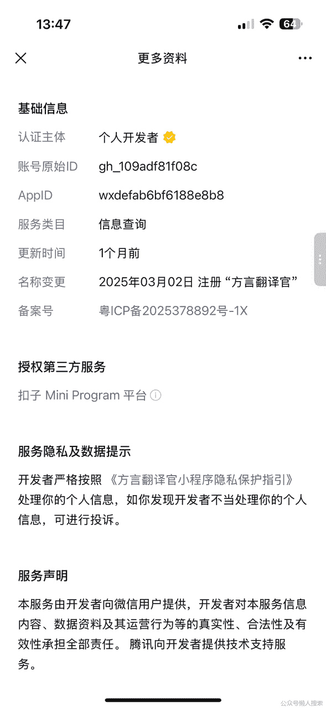

2.2.3 三看商业化和功能难度

点进排名前 10 的个人开发者产品，判断两个事：

• **商业化通没通**：开了广告说明这条路跑通了，变现模式没问题。

• **功能复不复杂**：如果都是简单单页工具——软柿子，好打。功能越单一，用户搜索时越容易找到你，开发维护成本也越低。别碰功能繁多的全家桶。

**2.2.4 四看场景清不清晰**

最后自检一句：能不能用一句话说清楚用户什么时候会打开它？

• 过年走亲戚不知道怎么叫人 → 亲戚计算器 ✓

• 想知道周围有多吵 → 噪音检测 ✓

• 牌打完了要算账 → 打牌记账 ✓

• 说不上来 → 方向还不够具体，再想想 ✗

**总结**

以上四条都过了，方向就值得做。如果某个蓝海词下面有近一两个月刚发布、且已商业化的个人开发者工具，那就更好了——这是很强的信号。不满足就果断换下一个方向。

**小技巧：建一个备选方向清单**

在备忘录或飞书文档里建一个清单，每次发现可能的方向就记下来：小程序名称、功能描述、搜索结果里的竞品数量和质量、你觉得可以做得更好的点。

不用急着马上开始，先积累 5-10 个备选方向，挑最符合以上标准的动手。选方向不要纠结太久——半天足够筛出一个好方向。做错了也没关系，几天时间加几十块成本，换一个方向就行。

1.  方法三：从自身痛点出发

⚠️ 核心原则：个人痛点 ≠ 市场需求，必须用数据验证。

每个人身上都藏着未被解决的痛点，而这些痛点很可能就是产品机会的起点。不过，自身痛点不等于市场有需求，从个人痛点到确认市场机会，中间需要数据支撑来验证是否存在机会。

**整体流程分为四步：**

第一步：从自身反复出现、迟迟没被解决的痛点出发——找到种子；

第二步：用各大平台（抖音、小红书）数据验证这个痛点是否存在广泛共性；

第三步：不急着做产品，先判断解决痛点的解决方案可以是哪些（如：学习英语口语用什么方法更容易掌握）；

**第**四步：通过和 ai 聊透，把自己观察到的痛点需求、解决方法和 ai 聊清楚，直到自己有比较清晰的产品思路；

3.1 第 1 步：找到种子——从自身痛点出发

痛点的来源不一定是灵光一现，更多时候是老问题——那些你反复遇到、一直没被解决的困扰。养成一个习惯：察觉到自己有痛点或需求时马上记下来。来源通常有三种：

• 自己长期未被满足的需求（用过现有产品但始终不够好）

• 刷内容时偶然发现的、引起强烈共鸣的问题

• 身边朋友反复抱怨或求助的事

找到痛点后，关键动作是**拆解需求**——不要停留在我需要一个更好的 XX 这种笼统感受，而是具体写出：你想要什么样的解决方式？你理想中的体验是怎样的？

**⚠️ 重要提醒：**这个阶段的痛点只是一颗种子，它只能说明一件事——在你个人层面上，这是真实存在的需求。个人需求 ≠ 市场需求，所以千万不要在这一步就急着做产品，接下来需要用数据去验证。

**案例说明：**

以学习英语口语的需求为例，这也是我个人的场景需求，痛点是市面上找不到一款让自己觉得容易学且实用的工具。类似的 App 比如多邻国很不错，但自身体感是学了一百天，都找不到哪里可以实际应用。

于是将这个模糊的痛点拆解为具体需求：

1.  把英语日常高频用语按生活场景分类来学习

1.  针对性场景学习

1.  有一种机制能让自己容易坚持下去

这就是一颗清晰的种子——方向有了，但还需要验证。

3.2 第 2 步：验共性——用平台数据确认这不只是你的问题

有了个人层面的痛点之后，需要借助公开平台的数据来判断这个需求是否具备共性。推荐使用抖音和小红书，核心原因是这两个平台的内容互动数据（点赞、收藏、评论）能比较直观地反映用户的真实需求强度。

**具体操作步骤：**

1.  **提炼关键词：**从你拆解出的需求中，提取 2-3 个核心关键词

1.  **平台搜索：**在小红书、抖音等平台分别搜索这些关键词

1.  **观察数据，重点关注四个维度：**

◦

**点赞/收藏量：**短时间内达到几千甚至上万，说明需求量大

◦

**评论区内容：**是否大量出现我也需要、求分享、怎么获取等评论，这是最真实的需求信号

◦

**广告投放：**如果相关内容长期在投放广告，说明背后的产品有正向回报，市场被验证过

◦

**内容持续性：**不是偶尔一篇爆了，而是持续有人在做这类内容且数据都不错

**判断标准不需要特别严谨，**核心逻辑是：大量查看相关内容，如果短时间内视频点赞几千几万、评论里需求声量大、带入自己的需求能感受到共鸣，基本可以判断有机会。

**案例说明：**

继续以英语口语学习需求，根据前面拆解的需求，提炼出两个核心关键词：英语日常和学习卡片。

**第一轮搜索：英语日常**

在小红书搜索后发现，第一篇帖子是分享英语口语 600 句，有 1.3 万人点赞，需求量惊人。另一篇帖子发布于 24 年 12 月，到现在还在投放广告（右下角有广告两个字即为广告贴），说明相关产品有正向回报。再看第一篇笔记的评论区，大量用户在求资料。

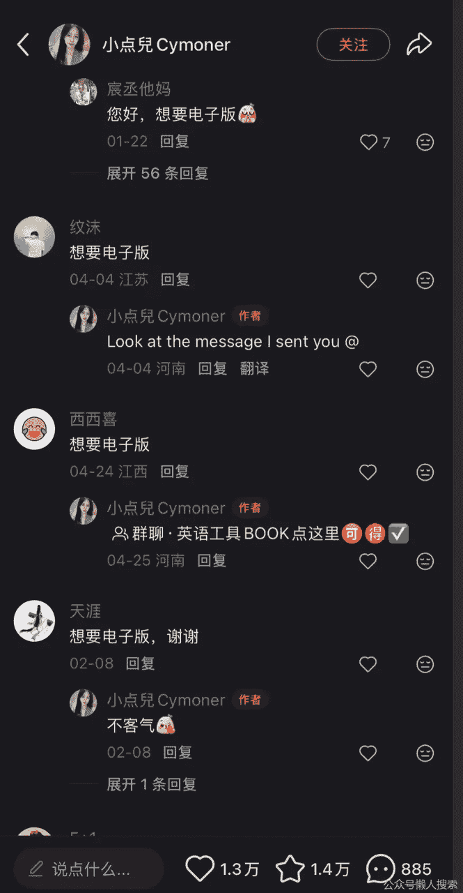

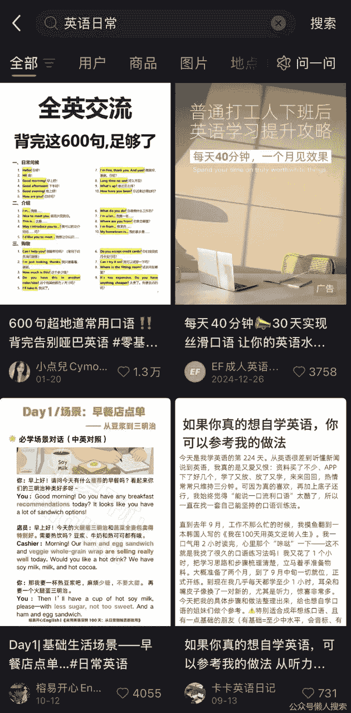

从这几个维度可以确认：学习英语日常用语的需求存在广泛共性。

第二轮搜索：学习卡片英语学习卡片（这也是从自身痛点提出来的关键词）

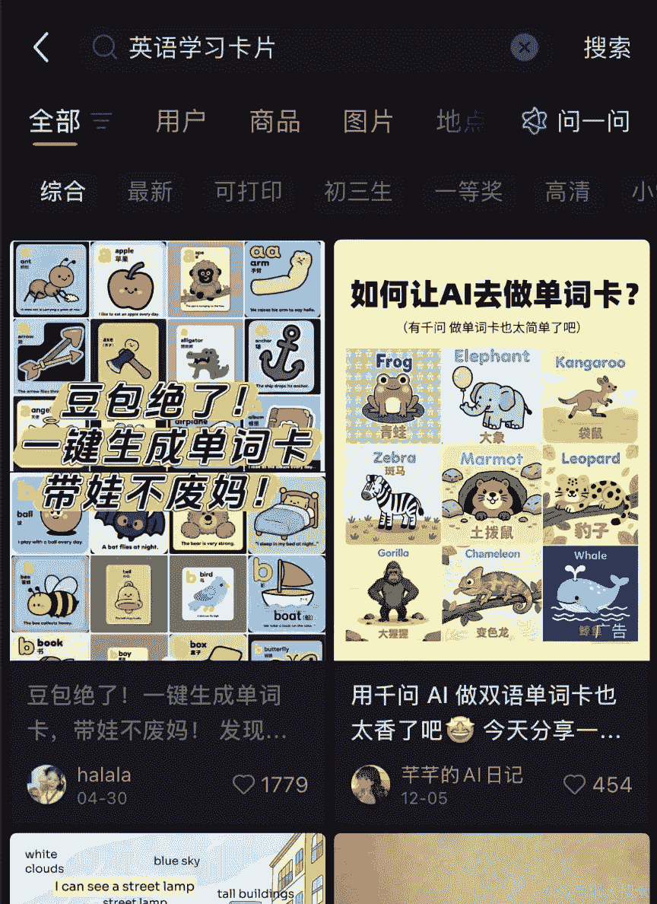

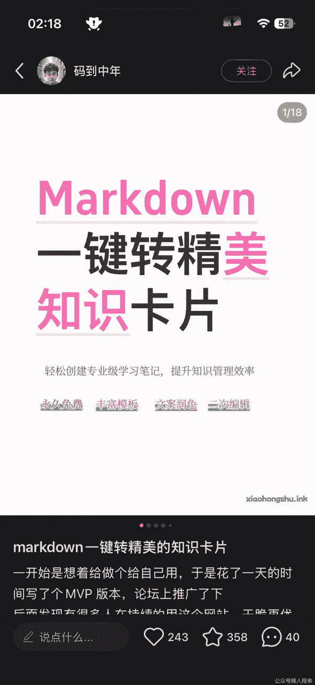

数据反映学习卡片、知识卡片同样存在需求。虽然英语日常和学习卡片没有直接关联的数据，但两者各自都经过了数据验证，加上自身就有将两者结合的需求，因此判断可以并联在一起，作为产品方向继续探索。

不过此时方向仍然是模糊的，需要进入下一步来明确解决路径。

3.3 第 3 步：想清楚最简解法

验证了需求存在共性之后，很多人会直接开始做产品，但这里有一个容易忽略的关键思考——用户知道自己有需求，但往往不清楚哪种解决方式最适合自己。

打个比方：英语口语学习是地基，那要盖什么样的房子，才能吸引更多人来住？这才是真正值得深思的问题。

不管你做的是什么品类的产品，验证完共性需求之后，都可以从两个维度去审视你的解决路径。这两个维度不是拍脑袋想的，而是从大量用户反馈中反复出现的共性模式——用户对一个工具最核心的期待，往往就集中在好不好上手和能不能持续用上。比如做健身工具，用户也是一样：动作太复杂就不想练（上手难），练了三天就放弃（坚持难）

在这一步需要思考两个核心问题：

1.  **工具层面：**用什么方式能让用户更容易学习和掌握？（降低使用门槛）

1.  **坚持层面：**很多用户有心但战胜不了懒惰，用什么机制能让他们容易坚持？（顺应人性而非对抗人性）

如果单纯从自己想出来的方案做产品，容易过于片面。所以这一步的关键是：不要自己拍脑袋，而是借助 AI 来帮你把这个房子勾勒得尽可能客观且有吸引力。

**案例说明：**

回到英语学习的例子。平台数据中可以观察到两类典型用户：

1.有学习口语需求的用户，他们需要一个更容易上手的工具；从这类评论可以看出，用户的英语基础普遍较弱，他们的第一诉求不是内容多或功能全，而是门槛低、容易上手——能让自己直接开始学而不是先研究怎么用。

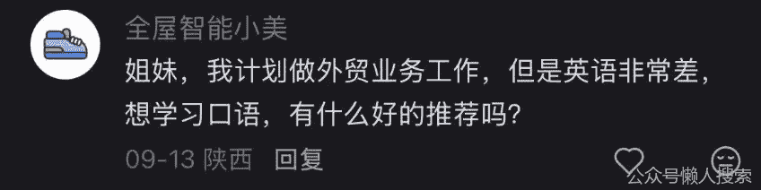

2.有资料需求的用户，他们开心地要了资料，但真的会去学吗？有心却战胜不了懒惰，需要一种帮他们坚持下去的机制。

为什么这么判断？评论区有大量用户在求分享求资料，说明学习意愿是真实存在的。但做过内容分享的人应该都有体感：真正领取资料后坚持学完的人极少。获取资料和真正学会之间存在巨大断层，用户不是不想学，而是拿到资料后缺少一种推动他们持续学下去的机制。所以这里的核心问题不是内容够不够，而是怎么让用户用起来、坚持住。

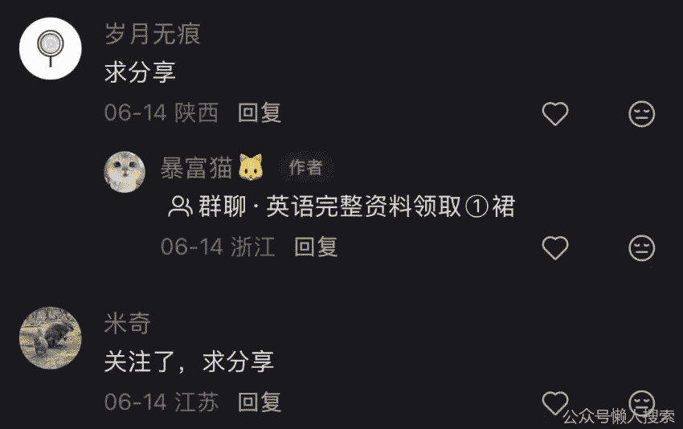

这两个观察直接指向了产品设计的核心方向：不仅要提供内容，更要解决用得上和坚持住的问题。

3.4 第 4 步：和 AI 聊透产品思路

经过前三步，你已经有了初步的需求判断和方向感，但很多地方仍然模糊。这时候可以把 AI（如 ChatGPT）当作一个什么都知道的调研员，把你的需求、想法、困惑通通和它聊透。

和 AI 沟通时，可以尝试五类问题：

下面这五个问题不是固定模板，而是分别对应需求验证中五个关键思考维度：市场是否够大、需求为何没被满足、竞品做到了哪一步、最小可行产品该聚焦什么、以及如何让设计更符合人性。你可以根据自己的项目灵活调整，核心目的是通过这些角度把需求聊透。关键是把自己困惑的东西问透，问到自己越来越清晰

1.  这个需求在目标市场是否普遍？是否有数据支撑？

1.  用户为什么明明有需求，却迟迟没被解决？

1.  市面上已有产品解决了用户问题的哪个环节？还有哪些环节没人做好？（比如很多英语学习产品解决了提供内容这个环节，但帮用户坚持学完这个环节几乎没人做好。)

1.  如果只做一个最小工具，应该保留哪 1-2 个核心功能？

1.  什么设计会更顺应人性，而不是对抗人性？

**使用 AI 的核心心态：**不是让 AI 替你做决定，而是通过不断追问，让自己对需求和解决方案理解得更透、更清晰、更有信心。

**⚠️ 一个需要警惕的问题：如果能**用上 claude 就更好了， 因为其他AI 有时候会倾向于顺着你的想法说话，你说什么它都觉得很有道理。还有，除了让它分析可行性，也要主动让它挑毛病——比如问这个方向最大的风险是什么哪些情况下这个产品会失败如果你是用户，你不用这个产品的理由是什么。刻意让 AI 站在反对的角度给你泼冷水，这样得到的判断才更接近真实。

**关于竞争的思考：**当 AI 告诉你市场上已有类似产品、同质化竞争较强时，不必慌张。需要认识到两点：第一，有竞争恰恰说明这个方向被市场验证过；第二，同一个痛点从来不是只有一个答案，而是多种解法——就像 7-11、全家、罗森三家便利店并排开在一起，依然各自活得很好。

产品的独特性往往不是来自对标竞品，而是来自你自己走过的路径和独特的理解。

**案例说明：**

继续以英语学习小程序为例，将前面的需求和思考输入 AI，逐步追问：

具体怎么输入？不是简单地问英语学习小程序怎么做，而是把你前面积累的判断一起喂给 AI。比如你可以这样写：

我发现中国用户学英语日常口语的需求很大，小红书上相关内容点赞过万、评论区大量用户在求资料。我想做一个按生活场景分类的英语日常用语学习工具，形式是学习卡片，做成小程序。请帮我分析这个方向的可行性。

把背景、数据、初步想法都给到 AI，它才能给出有针对性的回答，而不是泛泛而谈。

1、问学习卡片对学习的帮助时，AI 直接给出了学习卡片有助于坚持的依据

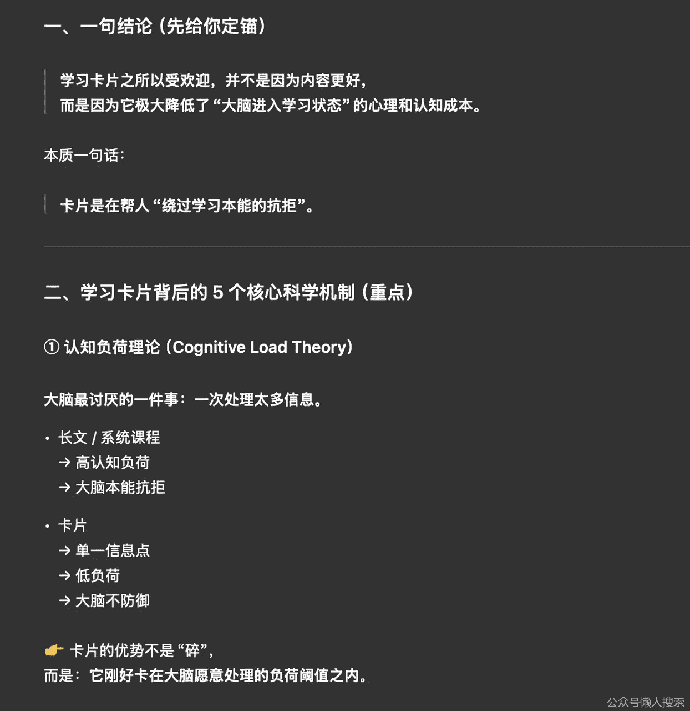

（对应第 5 类问题：顺应人性的设计）

2、问英语日常+学习卡片的组合对中国用户的帮助，以及是否有类似工具时，AI 提供了大量参考信息


（对应第 3 类问题：已有产品覆盖了哪些环节）

3、问中国人学习英语口语的需求规模和阻碍因素时，AI 给出了数据支撑，确认机会存在

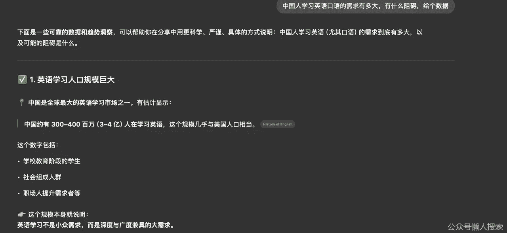

（对应第 1 类问题：需求是否普遍、是否有数据）

4、问如何做一款更容易坚持且用得上的英语口语学习工具时，AI 给出了设计方向

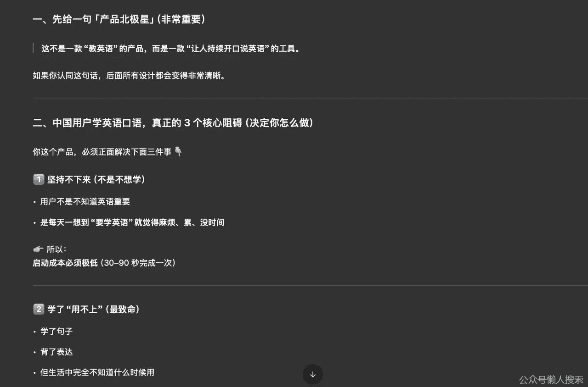

（对应第 1 类问题：需求是否普遍、是否有数据）

经过反复沟通，初步的解决方案逐渐成型：生活场景英语日常用语 + 学习卡片模式 + 游戏升级机制，做成小程序。

随后继续和 AI 确认方案可行性，当 AI 指出同质化竞争较强时，进一步追问如何做出差异化，AI 也给出了具体建议。

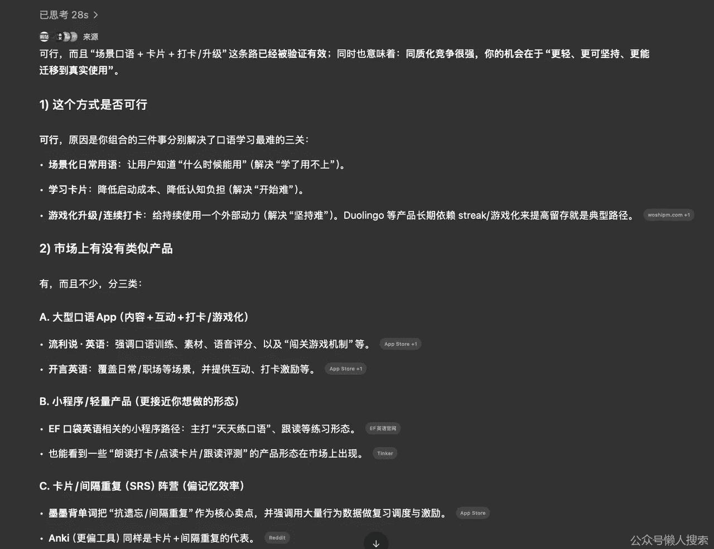

**实际验证：**通过以上的思路，我做出了一款英语日常口语小程序，我上线后，后来在小红书上发现了一款卖得火爆的英语学习网站，思路非常相似——同样是口语场景需求、同样注重让用户容易坚持、同样有学习卡片。这恰恰说明这个方向确实存在机会。而两款产品虽然解决的是同一个痛点，但采用了不同的方式，各自吸引了认可那种方式的用户群体。

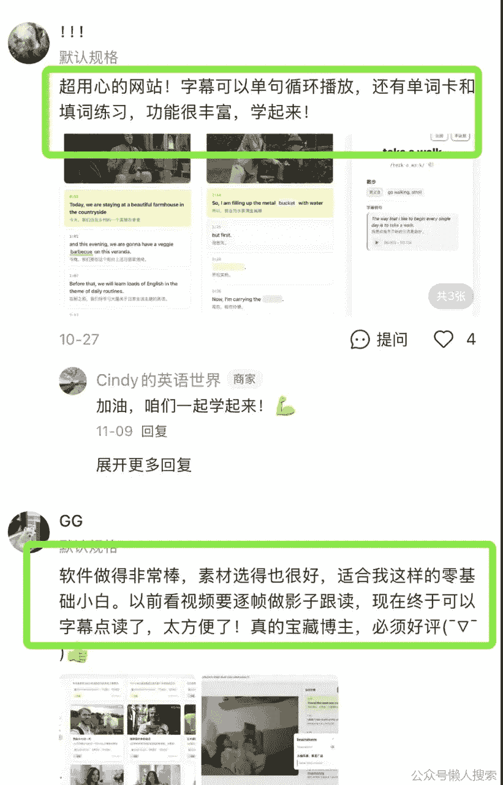

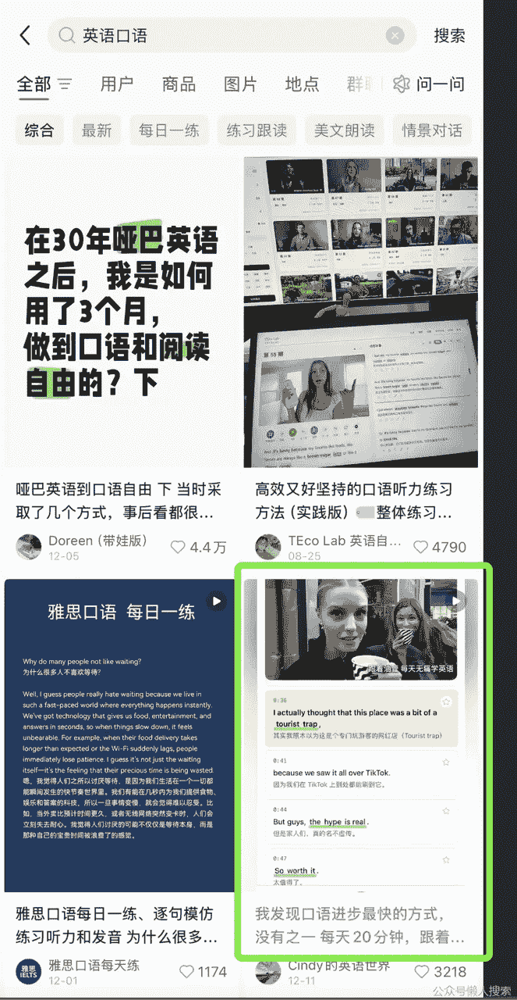

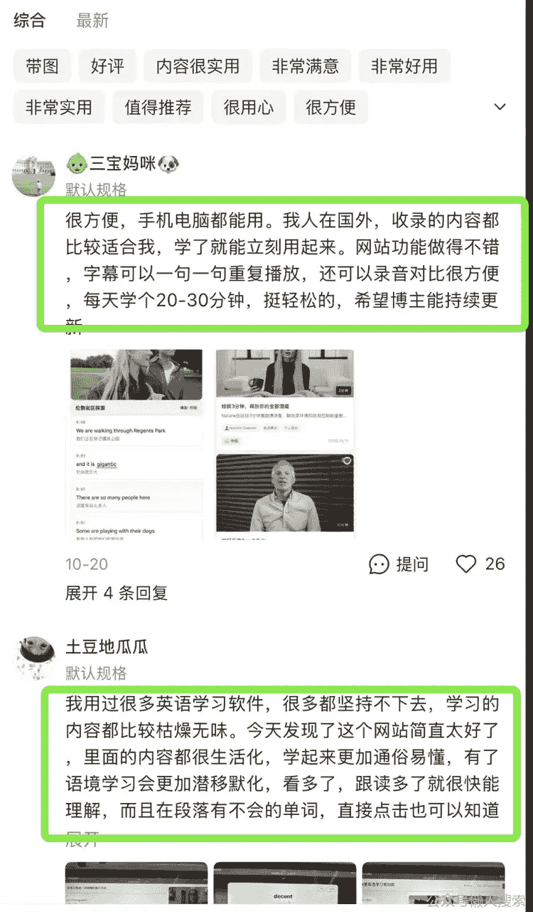

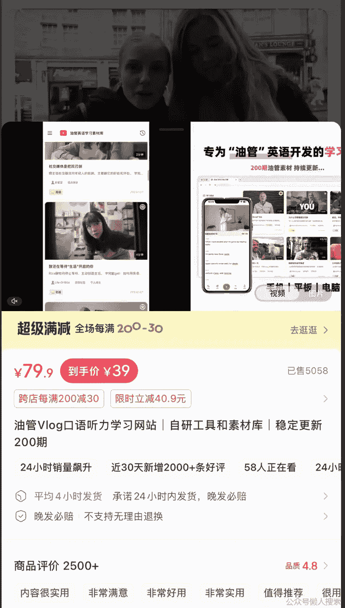

---

## 关卡 3：基础设置：完成小程序信息、类目、备案与认证

### 00. 本章任务

**任务目标**：把关卡 2 确认的方向正式填进微信后台，并让备案和认证流程跑起来。

**任务描述**：

1.  根据你的需求方向，填写小程序名称、图标和简介。

1.  选择和真实功能匹配的服务类目，不要为了省事乱选类目。

1.  提交小程序备案，注意短信核验、电话核实和材料一致性。

1.  提交或完成微信认证。

1.  判断是否需要领取 AI 小程序成长计划福利，需要就领取，不需要就跳过。

**本关需提交作业：**

• 小程序信息、类目、备案、认证已提交或已完成的后台截图（必填）

截图位置：mp.weixin.qq.com后台。截图里尽量能看到小程序信息、服务类目、小程序备案、微信认证这几项的提交或完成状态。

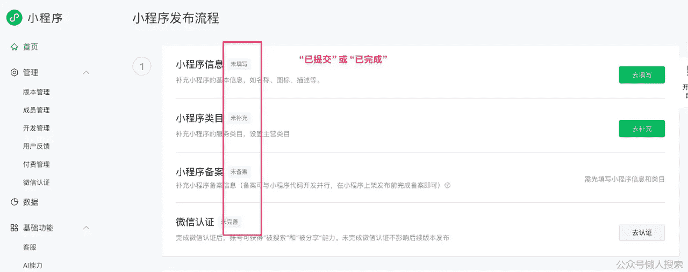

• 分享一下这关最大的收获，或者你遇到的卡点、怎么解决的（选填）

PS：备案和认证需要等待，提交后不要干等。它们在后台跑的时候，你可以继续进入关卡 4 做小程序开发。

---

### 01. 小程序信息、类目、备案与认证实操

备案顺利的话 3-5 个工作日，不顺利可能更久。认证要等审核电话。如果等代码写完再搞这些，你会卡在上线前，什么都做不了。

反过来，现在填好，关卡 4写完代码的时候备案大概率已经过了——代码写完就能直接提审。

打开mp.weixin.qq.com，登录你关卡 1注册的小程序账号。后台左侧菜单栏从上到下，你会看到需要填的四项：小程序信息、小程序类目、小程序备案、微信认证。按这个顺序一个一个来。

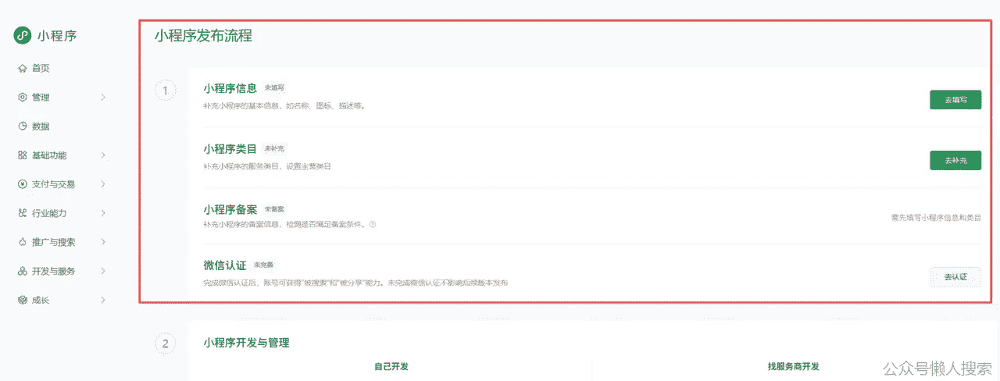

1.  小程序信息

按照你选定的方向，先填三样：名称、图标、简介，可以参考对标小程序来进行设计。

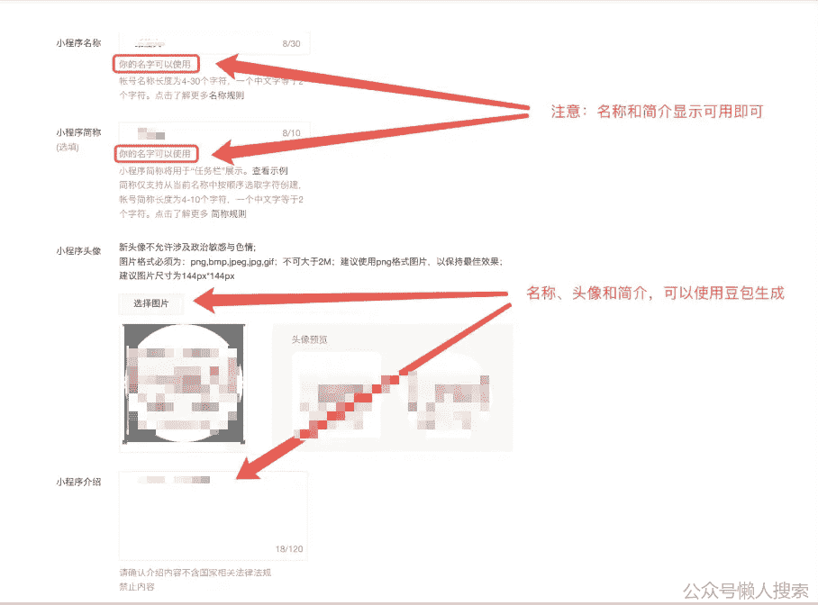

**名称**

名称影响三件事：审核能不能过、用户能不能搜到你、备案信息能不能匹配。

两个真实案例，先看第一个——名字太通用会怎样。

小 A 做了一个记账工具，起名叫「家庭记账本」。提交审核后收到回复：

"由于你申请的名称涉及以通用词命名，故审核不通过，你可以提交《商标注册证》等其他资质。"

翻译一下：微信觉得「家庭记账本」谁都能叫，没有辨识度。后来改成「咱家的账本」——加了个特定前缀，过了。

别用纯行业词。「记账本」「计算器」「提醒器」「日历」「闹钟」——这些太通用，审核会找你要商标。在前面加个品牌前缀或修饰词就能绕开这个坑。

再看第二个案例——名字好听但不被搜到。

小 B 做了一个喝水打卡小程序，起名叫「水润时刻」。听起来挺好的，跟水相关，有文艺感。

问题是：用户在微信里搜「喝水打卡」「喝水记录」「每日喝水」的时候，完全搜不到这个名字。

后来他做了两件事：

1.  把名字改成「吨吨喝水打卡」

1.  在简介里加入了「喝水打卡记录」等关键词

改完之后效果立竿见影——每日新增用户的来源里，手机端搜索开始有用户了。之前一直是 0。

所以起名时问自己两个问题：

• 这个名字会不会被审核认为"太通用"？

• 用户想用这类小程序的时候，会搜什么词？你的名字里包含这些词吗？

还有一个规则要注意：**个人主体**的名称、简介、小程序 UI 里不要出现"AI"字样，可能导致备案被拒。企业或个体户不受这个限制。

**图标**

找一张能代表你产品功能的图。

图标会在微信搜索结果里和你的名字一起出现——用户扫一眼就决定点不点进去。

如果你暂时没有设计能力，用 AI 生成一个也行，但别太复杂，缩小到图标尺寸时还能看清就行。

**简介**

简介不只是介绍你的产品——它也是搜索关键词的载体。像上面「吨吨喝水打卡」的例子，用户在简介里看到了对应的关键词，也可能找到你。

写简介时想一想：如果你的目标用户不知道你的小程序叫什么，他们会搜什么？把这些词自然地写进简介里。

1.  小程序类目

接下来选服务类目，点击添加类目。

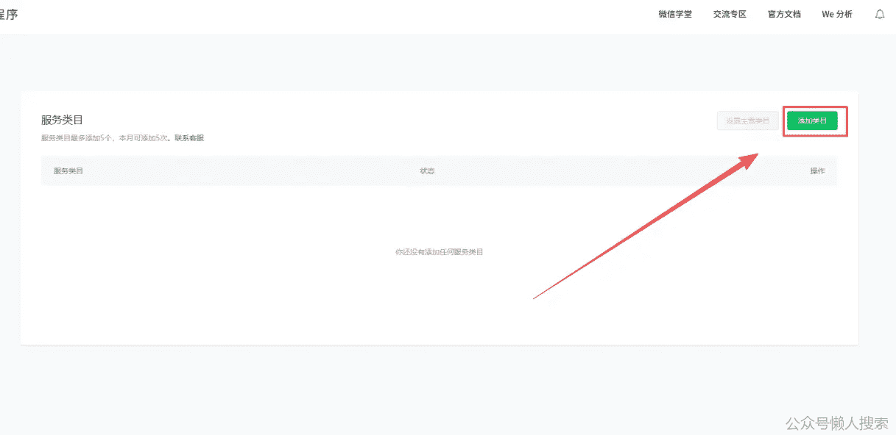

新手做工具型项目，优先看"工具"类目。大多数计算器、记录工具、效率小工具都放这儿。

但有一条红线：类目必须和你小程序的真实功能一致，不是你想选什么就选什么。

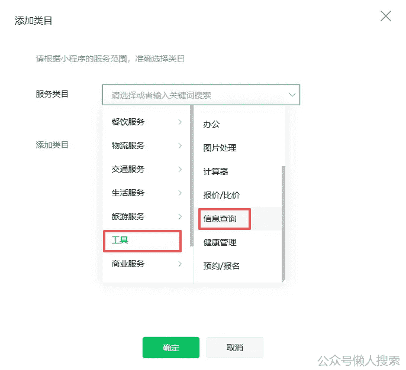

**特殊类目有资质门槛**

下面这些类目需要额外资质，没有资质先别碰：

• 食品类 → 需要食品经营许可证

• 医疗类 → 需要医疗机构执业许可证

• 教育类 → 可能需要办学许可证或 ICP 相关资质

• 社交/论坛 → 可能需要 ICP 相关资质

• 电商/交易 → 对主体、支付、资质要求更复杂

注意：你提交的资质主体必须和你小程序的注册主体一致。不能用别人的证给自己的小程序备案。


1.  小程序备案

信息填完了，类目选好了，接下来备案。

不管你选什么主体，小程序必须备案才能上线。流程是：

提交初审 → 腾讯审核（1-2 个工作日）→ 收到工信部短信，点击链接完成核验 → 管局审核 → 收到备案通过短信

顺利的话 3-5 个工作日走完，但不同地区、不同材料情况会影响速度，拉长到两三周也正常。

**2.备案前的准备**

你需要准备以下材料（个人主体）：

-**身份证正反面照片**——拍清楚，四个角都要完整，不能反光模糊

-**小程序名称和介绍**——提前想好，备案时需要填写

-**一个能接听电话的手机号**——后续管局可能会打电话核实

**3.1 去备案。**

登录微信公众平台后台，在首页 → 点击去备案。


**3.2 填写主体信息。**

上传身份证正反面照片，系统会自动填写姓名、身份证号、联系电话等信息。注意信息要跟身份证完全一致，一个字都不能错。


**3.3 填写主题信息。**

填写通讯地址、负责人手机号和应急手机号。这里需要注意，使用的手机号不能给其他主体进行过备案，并且初审通过后需要去工信部网站提交验证码（短信内有网址，打开后填写即可）


**3.4 填写小程序信息。**

服务内容需要选取合适的类目，我们一般就选择：生活服务-工具。备注需要介绍自己小程序的功能，大概 20 个字以上就可以了。然后负责人扫码进行人脸核验，记住一定要用纯白色的背景，穿着要整齐。


**3.5 提交备案。**

信息填完后提交，先经过腾讯初审（一般 1-2 个工作日），初审通过后会转到你所在地区的通信管理局进行终审。

**审核过程中需要注意：**

**保持电话畅通。**管局可能会在工作日给你打电话核实信息，问你小程序是做什么的、主要功能是什么。如实回答就行，不用紧张，一般就问几句。

**别急，耐心等。**腾讯初审通常 1-2 个工作日，管局终审一般 5-15 个工作日。整个流程下来大概 1-3 周。等待期不要干等——去开发你的小程序代码，备案通过后直接提交审核。

**3.6 常见问题**

**坑 1：材料不清晰被驳回**

所有证件必须是彩色原件拍照或扫描件。模糊、反光、黑白复印件——驳回没商量。拍的时候注意光线，四个角都拍进去。

**坑 2：主体信息不一致**

备案时填的名称、主体信息，必须和微信公众平台注册的信息完全一致，一个字都不能差。

小 A 申请备案后中途改过一次小程序名字，结果备案那边的信息没同步更新——被工信部打回来了。所以备案提交后不要随便改名。如果必须改，等备案通过后再改，然后走变更备案流程。

坑 3：错过短信核验（这个最坑的）

初审通过后，工信部会给主体负责人和管理员手机发核验短信。

你需要在**24 小时内**去工信部备案官网完成核验。超时？直接驳回，全部重来。

所以：收到短信立刻处理，别想着"等会儿再说"。另外——检查手机有没有开短信拦截。工信部的短信可能被当成骚扰短信拦截掉，你就根本看不到。

坑 4：信息变了 30 天内没更新备案

主体信息、负责人、小程序名字变了，30 天内必须提交变更备案，不然可能暂停服务。

小 A 把「水润时刻」改成「吨吨喝水打卡」之后，微信后台改了名字，但备案那边还是「水润时刻」。没过多久就收到了需要变更备案的短信通知——只能再走一遍变更流程。

**坑 5：保持电话畅通**

管局可能在工作日打电话核实信息。问你是做什么的、小程序主要功能是什么。如实回答就行，不用紧张。

还有——把你手机的骚扰拦截先关掉。有人因为这个，管局电话一直打不进来，卡在这步浪费了不少时间。

1.  微信付费认证

管局备案通过后，还需要做一步**微信认证**（费用 30 元/年）。这个认证是证明你是你，完成后你的小程序才具备完整的上线资格。

流程很简单：填身份证信息 → 付认证费 → 等审核人员打电话确认。

**4.1 开始认证**

首页，点击去认证，进入认证流程。


**4.2 填写资料**

同意协议以后，就可以填写资料了。主要就是进行负责人的真实性认证，职业信息（选题），可以不填。


**4.3 确认名称并支付费用**

验证完个人信息后就会验证我们的小程序名字，一般自动下一步就可以，支付认证费（个人/个体：30 元/年，企业：300 元/年）就可以等待第三方认证机构的电话了。

**4.4 常见问题**

**Q：备案填的名称可以改吗？**

可以，但改名后需要重新审核，所以一开始就想好名字比较省事。

**Q：备案被拒了怎么办？**

看拒绝原因。最常见的是信息填写不一致（名字多了个空格、简介里有敏感词等），有问题腾讯初审会提示修改，按要求修改后重新提交就行。

**Q：我有多个小程序需要备案吗？**

是的，每个小程序都需要单独备案。但好消息是第二个开始你已经熟悉流程了，速度会快很多。

1.  领取 AI 小程序成长计划福利

这是可选步骤，不是所有人必须领。

**看你小程序需不需要后端：**纯前端小程序，不需要保存数据、不需要登录、不需要服务器，就不需要领取。最简单的判断方法就是直接告诉 AI 你要小程序及其功能，然后问他是否需要领取。

**看你小程序类目是否符合：**这个 AI 小程序成长计划有类目限制：文娱、工具、社交、深度合成、资讯虚拟行业，才可以参与！**

选了其他类目，直接丧失参与资格。

**激励期为 2026 年 1 月 1** 日至 2026 年 12 月 31 日

成长福利资源包有什么？

除了 1 亿文生文 Token，还送 6 个月云开发环境、We 分析专业版、广告变现免开发接入，企业版还有虚拟支付优惠。

报名入口：微信公众平台-> 行业能力 -> 小程序成长计划


1.  常见卡点

| 常见卡点 | 先检查什么 | 下一步动作 |
| --- | --- | --- |
| 名字被拒 | 先确认具体场景和前一步是否完成 | 检查是不是用了纯行业词（&quot;记账本&quot;&quot;计算器&quot;）。加品牌前缀或修饰词再提交 |
| 类目被拒 | 先确认具体场景和前一步是否完成 | 检查功能是不是比你以为的多了一步——比如&quot;多人可见&quot;就触发社交判定。换类目或去掉那个功能 |
| 备案被拒 | 先确认具体场景和前一步是否完成 | 最常见的原因：信息不一致，比如名字多了空格、简介有敏感词、个人主体名下有&quot;AI&quot;字样。逐字核对后重提 |
| 短信核验没收到 | 先确认具体场景和前一步是否完成 | 先查短信拦截、垃圾短信文件夹。如果 24 小时内确认没收到，联系客服确认状态 |
| 认证电话接不到 | 先确认具体场景和前一步是否完成 | 关掉骚扰拦截，这段时间注意接听陌生来电 |
| 不确定要不要领成长计划 | 先确认具体场景和前一步是否完成 | 问自己：产品需要把数据存在手机之外吗？需要调服务器/AI 吗？YES→领，NO→跳过 |

---

## 关卡 4：开发实战：用 AI 做出第一个可体验小程序

### 00. 本章任务

💡本关卡实践案例主要为演示制作思路。

在关卡 2 已经有自己想要做的方向的人，不需要跟着这个案例制作，只需要制作出自己的MVP即可，提交时也只需要提交自己的小程序即可。

对于想要尝试练手的人，可以直接跟着这个案例做，提交这个案例小程序作为作业。

**任务目标：**用 AI 做出一个能打开、能操作、能体验的微信小程序 MVP 第一版。

**任务描述：**

1.  先把你的想法交给 AI，让它帮你澄清：谁在什么场景下遇到什么问题。

1.  确认一个最小 MVP 方案，只保留最核心、最容易验证的功能。

1.  用 Codex / Claude Code / WorkBuddy 等 AI 编程工具生成本地小程序项目。

1.  把项目导入微信开发者工具，完成编译和预览。

1.  至少跑通一次核心功能，比如新增一条记录后，页面数据真的发生变化。

1.  如果出现报错，把完整报错交给 AI 做最小修复，直到不影响体验。

**本关需提交作业：**

• 1 张微信开发者工具运行成功截图（必填）

• 截图里尽量同时露出：左侧项目文件、右侧小程序预览页、顶部“编译/预览”区域。能看到小程序页面正常显示即可。

• 1 张核心功能验收截图（必填）

• 例如：新增一笔咖啡/奶茶记录后，页面上的本月花费、杯数、打卡天数、最近记录等有变化。

• 说明你的小程序是怎么解决问题（必填）

• 贴体验版小程序码（选填）

体验码长期有效，但**只限体验成员列表里的微信号**能进，上限 200 人 ，需要通过（会收到服务通知点确认，之后就能扫体验码了）

如果你已经上传并设为体验版，可以提交体验码；如果还没做到这一步，本项可以不交。


• 分享一下这关最大的收获，或者你遇到的卡点、怎么解决的（必填）

---

### 01. 具体步骤

本次实战选择的方向是：咖啡奶茶记账本。

1.  为什么做记账小程序

先理解为什么这次选择"记账小程序"作为实战案例。

它不是最炫的方向，但很适合拿来做第一轮小程序实战。

**原因一：需求足够普遍**

大多数人都能理解记账这件事：学生想知道生活费花哪了，月薪族想控制开销，旅行时想算清人均，家庭里也会遇到买菜、药品、小票整理的问题。

**原因二：功能变化容易感知**

记账小程序的反馈很直观。新增一笔账，明细页会多一条记录；改一个标签，统计页的分类金额会变化。对新手来说，这种"我做了什么，页面马上有什么变化"的反馈非常重要。

**原因三：微信里能看到需求信号**

在微信里搜索"记账"，能看到很多记账相关小程序，有的显示 1000+ 最近使用，有的显示 1 万+ 最近使用。这说明它不是凭空想出来的需求，而是微信生态里已经存在的真实工具需求。

你去微信搜索“记账”这个关键词，还能看到记账有很多变体：

• 普通记账：记录日常收入支出

• AA 记账：多人分摊费用

• 旅行记账：记录旅行花费、人均花费

• 共享记账：多人一起维护一个账本

• 可爱风格记账：用猫咪、柚子等视觉风格降低记账的枯燥感

这说明：记账不是只有一种做法。不同人群关心的问题不同，小程序的 MVP 也会跟着变化。

**为什么做咖啡奶茶记账本？**

“记账”是成熟红海：通用产品功能全面，但操作多、坚持成本高。

对于新手来说，更好的切入是挖掘高频、单一的明确场景。

咖啡奶茶相对高频、容易记录，杯量和饮品人格也适合分享。

从红海中切出的细分需求，我们需要快速开发，用 MVP 验证需求，制作一个饮料记账本。

什么是 MVP？MVP 是一个最小可执行的产品 Demo，可以快速开发上线，拿去给到真实用户测试反馈，通过轻投入的方式，快速判断产品方向是否正确，是否值得深入开发。

接下来我们就一步步来完成这个 MVP。

1.  案例工具使用说明

本案例使用 Codex 演示，也可以使用 WorkBuddy、Claude Code 等能够读取项目目录、直接创建和修改文件、运行命令的 AI 编程工具。普通聊天模式只能输出代码，需要手动复制文件，操作效率较低。

当前流程适合三类工具：

• 最适合：Codex、Claude Code、WorkBuddy 等本地编程 Agent；工作流程一致；

**• 可以使用：支持** IDE、项目目录或Agent 模式下的 Kimi、Cursor、Trae 等工具。

• 不太适合：只能聊天、不能直接修改项目文件的网页 AI，无法修改本地文件的网页 AI。

判断工具是否适合，只看四项能力：

1.  能否打开并读取本地项目。

1.  能否直接创建和修改文件。

1.  能否运行检查命令并读取结果。

1.  能否根据微信开发者工具的报错继续定点修

3.第一步：把模糊想法告诉 AI

只需要说清楚自己观察到的问题，不需要先想功能。

复制提示词直接给 Agent：

Plain Text

```
我想用 AI 快速做一个可以交给真实用户测试的微信小程序 MVP 原型。
我的初步想法是：[填写你的想法或观察到的问题]。
现在先不要设计功能，也不要写代码。请通过结构化对话帮助我澄清需求。
每次只问我一个问题，优先确认：
谁遇到了这个问题；
问题发生在什么具体场景；
用户现在如何解决；
最麻烦的一步是什么；
用户最终想完成什么结果。
最多问 5 个问题。不要讨论技术、商业模式或完整产品规划。
```

复制给 AI 以后，它会自动开始向你提问。


咖啡奶茶案例可以这样开始：

Plain Text

```
我发现很多刚开始独立生活的年轻人想了解自己的日常消费，但通用记账软件步骤多，很难坚持。我想先从咖啡奶茶这种高频消费切入。
```


问完问答后，AI 会总结出原型 MVP 的核心，如果你的 AI 没有总结出来，可以让它总结一个 MVP 的核心功能，由你来验证是否准确：


1.  第二步：让 AI 收敛成一个 MVP 方案

需求确认后，即可让 AI 出一个 MVP 开发方案。

可复制提示词：

【这个提示词可以在你要做的任何小程序之前都可以丢给AI，让AI和你讨论】

Plain Text

```
我确认这个 MVP 方案。请把它整理成一份可以直接交给 AI 编程工具执行的完整开发提示词。
要求：
做成可以交给真实用户测试的微信小程序 MVP；
只保留核心功能，优先简单、快速、一个页面；
请主动补齐具体操作规则、数据计算、异常状态、视觉要求和验收标准；
不确定但会影响产品方向的问题先问我；
普通实现细节由你选择最简单可靠的方案；
现在只输出最终开发提示词，不要写代码。
```

1.  第三步：让 AI 直接生成本地 MVP

新建空文件夹DrinkExpenseTracker-miniapp，用 AI Agent 打开，复制下面的提示词。不要先创建微信默认项目，也不要先让 AI 写方案。


**提示词：生成完整 MVP**

以下是 AI 生成的开发提示词，可直接将这段提示词发送给你的 Agent，让它直接开始开发一个小程序的 MVP。

Plain Text

```
在该文件夹下创建一个微信小程序。
产品名：咖啡奶茶打卡。用户默认登录，选择饮品类型、杯数和单杯价格，约 10 秒完成当天记录。

只做一个页面：
本月成绩：花费、杯数、打卡天数、平均每杯；金额最醒目；
快速打卡：类型、杯数、单杯价格、总金额、保存；
当前月杯量格子；
饮品人格、里程碑、类型汇总和最近记录；
好友分享按钮和朋友圈分享引导。
记录规则：
类型为咖啡、奶茶、茶饮、果饮、其他，默认咖啡；
杯数用减号/加号调整，默认 1，范围 1—9；
单杯价格提供 9.9、15、18、22、28 元快捷选择，也可自定义；必须大于 0，最多两位小数；
总金额实时计算为杯数 × 单杯价格；
每条记录包含 id、drinkType、cups、unitPrice、amount、date、createTime；
日期默认为今天；保存中禁用按钮，防止重复提交。
杯量格子：按当前月真实天数生成；未来日期为空；同日记录累加 cups；0 杯为空、1 杯浅色、2 杯中等、3 杯以上深色；显示图例。

饮品人格按本月花费最高的类型决定：咖啡=咖啡充电站，奶茶=奶茶快乐星人，茶饮=清醒喝茶派，果饮=水果能量派，其他=随心探索家。并列时先比较杯数，再按上述顺序决定。记录满 3、7、15 个不同日期时显示一次里程碑；不做断签惩罚。

分享：调用 wx.showShareMenu，开启 shareAppMessage 和 shareTimeline；实现 onShareAppMessage、onShareTimeline；好友分享使用 open-type=&quot;share&quot;；朋友圈引导用户点右上角菜单。标题包含人格、打卡天数、杯数和花费。分享不得携带逐笔数据、OPENID 或身份信息；好友进入后只看到自己的数据和“开始我的饮品记录”。


技术：原生 JavaScript/WXML/WXSS/JSON；创建 app、project.config.json、页面和 README；只做一个页面，无 tabBar、无第三方 UI 库。当前使用微信本地存储。建立数据模块，仅暴露返回 Promise 的 addTransaction() 和 listTransactions()，页面不得直接读写缓存。为打开、记录成功、查看结果、好友分享、朋友圈引导、分享进入预留统一 trackEvent()，不记录逐笔金额。

视觉：奶油暖白、咖啡棕，像轻松的饮品手账；金额最大；类型、杯数、价格适合单手操作；主按钮唯一突出；窄屏不溢出。

必须处理空、保存中、成功、读取失败、保存失败和防重复状态。

不做：登录页、手机号/头像/昵称授权、编辑删除、跨月切换、复杂图表、预算、糖度冰量、咖啡因、排行榜、多人账本、AI 小票、支付、广告、后台和多余页面。

固定验收数据（均在当前月）：第 2 天咖啡/1 杯/18 元；第 5 天奶茶/2 杯/16 元；第 5 天咖啡/1 杯/22 元；第 12 天果饮/1 杯/28 元。

固定答案：花费 100.00、5 杯、打卡 3 天、平均 20.00；咖啡 2 杯/40.00、奶茶 2 杯/32.00、果饮 1 杯/28.00；人格为咖啡充电站；第 2、12 天浅色，第 5 天深色。

完成后列出文件、真实检查结果和微信开发者工具导入方法。无法验证的项目标记“待开发者工具验证”。停止，不接云开发。
```

AI 完成后，就会开始进行开发落地。

案例有使用到一个前端设计 skill，可以把下面这个链接发送给你的 AI，告诉它安装这个 skill 并在开发中使用：https://github.com/anthropics/skills/tree/main/skills/frontend-design


若 AI 只给方案，发送：

• 请停止解释，直接在当前文件夹创建完整项目文件并自检。完成后列出文件和真实结果，然后停止。

• 【截图 1-1】AI 创建的项目文件树。

• •

【截图 1-2】AI 的检查结果与待人工验证项。

6.用微信开发者工具运行代码项目

1.  打开微信开发者工具，点击“导入项目”。


1.  选择 AI 刚生成的文件夹。


1.  导入项目后，填写AppID，选择云开发，模式选择小程序。


选择信任并运行


1.  导入后点击“编译”。


如果编译成功，则可以进行进一步调试。

如果编译报错，把控制台原文发给 AI：

Plain Text

```
微信开发者工具首次编译报错。
完整错误：[粘贴]
请读取当前项目，定位根因并做最小修复。不要重写产品，不接云开发。修复后报告文件、检查结果和复测步骤，然后停止。
```


重复“编译—粘贴真实错误—最小修复”，直到页面显示且没有阻断错误。

7.验收本地 MVP

编译成功后，手机扫码在真机上测试。

通常需要在安卓、ios、华为不同真机上都测试一番，保证不同机型都能交互无错误。


先记录咖啡、1 杯、18 元，检查总金额、保存反馈、当天格子、统计和重开读取。


如果发现结果不一致，给 AI 发送截图，描述问题，可参考以下格式：

预期：[填写]；

实际：[填写]；

控制台：[如有 bug 再粘贴]

修复这两个问题，不重写页面、不增加功能。

等 AI 完成修复后，再次编译验收；重复这个过程，直到调试到你满意；


效果如下：AI 修复前 vs 调试 BUG 之后。


不同 AI 模型能力不同，有的可以一次性完成任务，有的需要反复跟 AI 交流调试；

调试的时候一次性可以只提不超过 3 个需求。

调试完成没有 BUG 后，至此，一个最小的 MVP 已经完成。

8.验收社交功能，正式上线 MVP

开启好友转发和朋友圈的功能，这部分的提示词直接可以 copy，把下面提示词发给 AI：

Plain Text

```
请检查并完善当前页面的微信分享能力，不修改其他功能：
调用 wx.showShareMenu，开启 shareAppMessage 和 shareTimeline；
实现 onShareAppMessage 和 onShareTimeline；
“发送给朋友”使用 open-type=&quot;share&quot; 原生按钮；
标题包含饮品人格、打卡天数、杯数和花费；
分享路径不得包含逐笔记录、OPENID 或身份信息；
朋友圈不能由普通按钮直接发布，只提示“点右上角 ··· 分享到朋友圈”；
好友从分享进入后只能看到自己的数据，无数据时显示“开始我的饮品记录”；
完成后检查代码，给出好友转发、朋友圈和好友落地的真机步骤，然后停止。
```


真机验证好友转发、右上角朋友圈菜单和另一位用户进入。

在审核通过之前，分享功能会受限制，这是正常的，可以待上传发布后，再测试。


完成 MVP 开发后，即可上传到后台，生成内测码，邀请几位朋友测试，看看有没有什么 bug。


填写好版本号后，点击上传。


上传后台之后，选择当前版本为体验版


有了二维码以后，可以下载下来，邀请几个朋友来内测。


如果问题不大，即可点击提交审核，审核通过后即可发布。

9.升级为微信云开发

云函数的构建非必须，新手建议可以先做纯前端代码的工具，当用户积累了一定数量之后，再升级成云函数。

**为什么接云开发？**

• 本地存储只保存在当前设备，清缓存、卸载或换手机可能丢失。

• 云端数据可以跟随微信用户，在不同设备重新读取。

• 云函数可以通过OPENID自动区分用户，不需要设计登录页。

• 服务端可以再次校验金额、杯数等数据，避免前端篡改。

• 后续做统计、运营配置和多人测试更方便。

建议不要一开始接云开发。先用本地 MVP 验证功能和用户需求，确认有人持续使用后再升级。

第一步：完成人需要做的任务

环境 ID 在微信开发者工具的云开发控制台里：

1.  点击顶部或工具栏中的「云开发」；如果尚未开通，先点击「开通」，创建一个云环境。


1.  进入云开发控制台，悬停在左上角的 cloud1 ，复制「环境 ID」。


环境 ID 通常类似：

Plain Text

```
cloud1-8gxxxxxx12345678
```

复制完整环境 ID，替换提示词中的：

Plain Text

```
环境 ID：[粘贴]
```

注意不要误填：

• AppID

• 环境名称

• 数据库集合名称

• 云函数名称

1.  新建transactions集合，禁止所有用户可读写。

transactions是云数据库中的一个“数据集合”，可以理解成一张专门保存饮品记录的数据表。

每次用户完成打卡，就向transactions新增一条记录，例如：

Plain Text

```
{&quot;drinkType&quot;: &quot;咖啡&quot;,
  &quot;cups&quot;: 2,
  &quot;unitPrice&quot;: 18,
  &quot;amount&quot;: 36,
  &quot;date&quot;: &quot;2026-07-20&quot;,
  &quot;_openid&quot;: &quot;用户的微信身份标识&quot;,
  &quot;createTime&quot;: &quot;服务端创建时间&quot;
}
```

各字段作用：

• drinkType：咖啡、奶茶等饮品类型

• cups：杯数

• unitPrice：单杯价格

• amount：本次总金额

• date：消费日期

• _openid：这条记录属于哪个微信用户

• createTime：记录创建时间

小程序利用这些记录计算：

• 本月总花费

• 本月总杯数

• 打卡天数

• 平均每杯价格

• 每天的杯量格子

• 饮品类型汇总

• 饮品人格

操作步骤：

1.  点击顶部「云开发」。


1.  进入已创建的云环境，点击「数据库」，点击「+」或「新建集合」。


1.  集合名称填写：transactions

1.  设置集合权限，选择「所有用户不可读写」，确认创建。


在创建的过程中，遇到了问题，都直接问题 AI，比如上面的流程，都是 AI 告诉我的。


创建完成后，把集合名称transactions和环境 ID 交给 AI，让 AI 配置代码。

第二步：AI 修改代码

下面 Prompt 中标注黄色部分需要替换成你的环境 ID。

Plain Text

```
当前本地 MVP 已通过。请直接把数据层升级为微信云开发，不要重写页面或先输出长方案。

环境 ID：[粘贴你自己的环境 ID]
集合：transactions

保留现有 UI、打卡、统计、格子、人格、里程碑和分享。页面继续调用 addTransaction()、listTransactions()，只替换数据模块内部实现。
保留现有页面功能。页面继续调用 addTransaction()、listTransactions()，只替换数据模块内部实现。

配置 wx.cloud、miniprogramRoot 和 cloudfunctionRoot；创建 addTransaction、listTransactions 云函数；使用 wx-server-sdk 和 DYNAMIC_CURRENT_ENV。云函数通过 getWXContext() 获取 OPENID，不接受前端 openid；不创建登录页或资料授权。
配置云目录和 wx.cloud；创建 addTransaction、listTransactions 云函数。云函数通过 getWXContext() 获取 OPENID，不接受前端 openid；不创建登录页。

addTransaction 校验 drinkType、cups、unitPrice、amount、date；cups 为 1—9 整数，unitPrice 大于 0 且最多两位小数，amount 必须等于 cups × unitPrice；只写允许字段、_openid 和服务端时间。listTransactions 按 _openid 过滤，倒序返回最多 100 条。
addTransaction 校验类型、1—9 杯、单价、总金额和日期；总金额必须等于杯数×单价，只写允许字段、_openid 和服务端时间。listTransactions 按 _openid 过滤，倒序返回最多 100 条。

数据模块改用 wx.cloud.callFunction 并继续返回 Promise；失败时显示失败和重试，不显示假成功。本课程不迁移本地历史数据。不增加其他功能。
数据模块改用 wx.cloud.callFunction 并保持 Promise 接口；失败时允许重试。本课程不迁移本地历史数据。

完成后检查代码与配置，列出部署步骤；未部署前标记“尚未真实部署”，然后停止。
检查代码并列出部署步骤；未部署前标记“尚未真实部署”，然后停止。
```


AI 负责改代码和生成云函数，不能把“代码已写好”写成“云端已部署”，我们需要人工将代码上传部署。

第三步：人部署并验收

1.  右键两个云函数，选择“上传并部署：云端安装依赖”。


右键云函数，点击创建与部署，必须人工把两个云函数上传，才能生效。


配置完成后，再手动扫码前端验收，添加一笔记录，再云函数后台数据看是否有新增的数据，如有说明云函数配置成功。


第四步：出 BUG 时让 AI 调试

可参考 Prompt：

Plain Text

```
当前问题：[描述]；
预期：[填写]；
实际：[填写]；
完整报错：[粘贴]；
最近修改：[填写]。
请先定位根因，再做最小修复。不
要重写无关文件或增加功能。报告修改、检查结果和复测步骤后停止。
```

通用原则：完整需求一次生成；真实运行后定点修复；本地跑通再接云端；没有真实证据不算通过。

---

## 关卡 5：上线发布：提交审核并正式发布小程序

### 00. 本章任务

**任务目标：**把关卡 4 做出的 MVP 推进到微信小程序上传、审核和发布流程。

**任务描述：**

1.  提交前先检查基础设置、类目、备案、认证、隐私协议等前置条件。

1.  在微信开发者工具里上传代码，填写版本号和版本备注。

1.  到微信公众平台后台的版本管理里，找到刚上传的开发版本。

1.  填写清楚版本描述，让审核员知道你的小程序做什么、核心功能是什么。

1.  提交审核后，关注审核结果；如果被拒，先看拒因，再让 AI 帮你做针对性修改。

1.  审核通过后，手动发布，并验证用户能搜索、打开、使用和分享

**本关需提交作业：**

• 1 张微信公众平台版本管理截图（必填）

截图里需要看到你的小程序已处于“审核中 / 审核通过 / 已发布 / 已提交审核”中的任一状态。路径一般是：mp.weixin.qq.com→ 管理 → 版本管理。

• 分享一下这关最大的收获，或者你遇到的卡点、怎么解决的（选填）

PS：审核和发布可能需要等待，所以本关最低提交标准是进入上传/提审流程。审核通过后的正式发布、搜索验证和分享验证，继续往后推进即可。

---

### 01. 提交审核

1.  这一步的重点

产品在自己电脑上跑起来了 ≠ 产品上线了。你只是在开发者工具和真机预览里看过它，你需要提交审核。

微信审核员会真的打开你的小程序看：功能能不能用、类目对不对、页面是不是空壳、有没有隐私协议。只有通过审核并手动发布后，它才真正对所有人开放。

如果关卡3 的备案和认证已通过，现在可以直接进入提审流程。如果还没通过，也别干等——继续修产品、准备推广内容，通过后再回来提交。

1.  提交审核前

别急着点上传。先确认这 4 件事：

1.  **关卡**3 的基础设置已完成**：小程序信息、类目、备案、认证。如果备案还没通过，先继续修产品、准备推广内容，不要在这里硬卡

1.  **核心功能在开发者工具里能跑**：不是"大概能用"，是真的一条路径从头走到尾能通

1.  至少做过 3 次真机测试，安卓、iPhone 、华为都测一下：有开发者只用自己的安卓手机测了，没测 iOS。后来朋友用 iPhone 打开，出现了严重的样式问题，原因是 iOS 刘海屏导致样式变形。不要只在开发者工具模拟器里预览，模拟器和真机差异巨大。

1.  **如果收集用户信息，已经**配置隐私保护指引（**隐私保护示例**）**：后台路径：设置 → 基本设置 → 用户隐私保护指引。涉及收集哪些信息、用途是什么、如何保护，如实填写。这条路没做，审核必拒。如果你的小程序不需要登录、不收集任何用户信息，这条先跳过。

1.  在微信开发者工具上传代码

在微信开发者工具里，点击右上角的"上传"按钮。系统会让你填两样东西：


• **版本号**：第一次就填1.0.0，后续更新递增（比如1.0.1、1.1.0）

• **版本备注**：简单描述这个版本做了什么，比如"首个版本，包含核心功能"

点击确认，代码就会被打包上传到微信后台，几秒钟完成。

上传成功后，打开mp.weixin.qq.com→ 管理 → 版本管理，你会看到上传的代码出现在"开发版本"区域。


1.  到后台提交代码审核

在版本管理页面，找到刚上传的开发版本，点击"提交审核"。


这一步需要你填写：

**版本描述**：写清楚你的小程序做什么、核心功能是什么。审核员靠这段话理解你的产品，写得越清晰越好。


举个例子：

• ✅ 好的描述："电子木鱼工具，用户点击屏幕即可模拟敲击木鱼，支持功德计数和敲击音效。"

• ❌ 差的描述："一个小程序。"（这种大概率会被拒）

**测试账号**：如果你的小程序需要登录才能使用，需要创建一个测试账号给审核员。纯工具类的一般不需要登录，这项可以跳过。

一个实用建议：提交审核时附上功能流程截图，功能描述尽可能清晰——这样被卡的概率会小很多。

1.  审核等待：审核员主要看什么

**提交后，微信审核**团队会对你的小程序进行审核。审核时间一般1-3 个工作日，快的话当天就能过。

审核员真会打开你的小程序看这几样：

• 功能是否正常运行（真人测试，不是机器扫）

• 是否符合选择的类目

• 有没有违规内容（涉黄涉暴、诱导分享等）

• 是否包含必要的隐私协议

• 页面是不是空壳——如果打开后只有一个按钮、几行字，审核员可能判"无实质业务服务"

关于审核时间：工作日审核可能更快，周末节假日可能推后一两天。

1.  审核被拒怎么办

第一次被拒是家常便饭。被拒 2-3 次是正常的——根据拒因改完再提交就行。

**常见被拒原因和具体解法**

① 功能过于简单 / 无实质业务服务

这是最高频的拒绝理由。审核员不喜欢"空壳"小程序。如果页面内容少、功能简单，容易被判"无实质业务服务"。

具体解法：适当丰富一下内容或功能。比如电子木鱼被拒的话，可以加一个功德排行榜或者每日功德统计。不需要做得很复杂，让审核员觉得确实有用就行。

**② 类目不符**

你选的类目跟实际功能不匹配。重新选择正确的类目再提交。

关卡 3 已经讲过多人记账被判社交属性的案例——如果你也遇到类似边界模糊的情况，可以去审核反馈里解释，附上截图，申诉有概率过。

**③ 缺少隐私协议**

如果你的小程序获取了用户信息（哪怕只是头像和昵称），就需要有隐私协议弹窗。

具体解法：任何收集用户信息的小程序都必须配置隐私保护指引。让 AI 写一个隐私协议页面——去后台配置：设置 → 基本设置 → 用户隐私保护指引，按模板如实填写收集了哪些信息、用途是什么、如何保护。

**④ 内容踩红线**

算命、占卜、运势 → 可能被判封建迷信。虚拟支付、游戏 → 个人主体不支持。有开发者之前想做一个游戏攻略类小程序，后来发现个人主体做不了，只能放弃。

**⑤ 功能体验有问题**

页面加载不出来、核心功能点不了、iOS 和 Android 表现不一样。

回到上面第 0 步：提交前必须真机测试。前面提过的血泪教训——只测了安卓没测 iOS，刘海屏导致样式变形，审核时出问题。至少安卓和 iPhone 各测一遍。

**⑥ 虚拟支付个人主体不支持**

个人主体的小程序不支持虚拟支付功能。如果你在代码里用 Web-view 加载外部页面，审核会失败。如果你的产品里有任何收费相关的内容，需要去掉或者升级为企业主体。

**⑦ 内容安全审核没做**

这条不是所有人都会遇到——如果你的小程序没有用户发布内容，这条跳过。

但如果你的小程序让用户上传文字、图片、评论，所有 UGC 内容必须过一遍微信的内容安全接口（msgSecCheck/imgSecCheck）。没做的话审核必拒，上线后被投诉也会下架。

**被拒后的正确处理方式**

不要直接盲改重提。先看拒因，分类处理：

• **类目问题**→ 先改类目再提交

• **内容问题**→ 在"审核反馈"里详细解释，附上截图。上面说的审核边界模糊误判问题，可以尝试申诉

• **资质问题**→ 补充材料重新提交

• **功能问题**→ 修好再提

一条经验：审核是人工的，多沟通、坚持申诉，很多时候能过。被打回一次就放弃，太亏了。

---

### 02. 正式发布

1.  审核通过后，手动发布

审核通过后，你的小程序**不会自动上线**——需要你手动操作。

**在版本管**理页面，审核通过的版本会出现在"审核通过版本"区域，点击全量发布，你的小程序就正式上线了。从这一刻起，所有微信用户都能通过搜索找到你的小程序。

1.  发布后验证 + 基础变现配置

发布完成后，立刻做两件事：

**验证能搜到、能用：**

1.  自己在微信搜索你的小程序名称 → 确认能搜到、能正常打开和使用

1.  分享给几个朋友让他们打开试一遍 → 看有没有你没发现的问题

1.  确认分享入口可用

**基础变现配置**（发布后立刻做）**：**

• **流量主**：mp.weixin.qq.com → 左侧"流量主" → 开通 → 选"免开发智能接入" → 立刻确认封面广告已开启（这是收入的最大影响因子）


**后续更新**

想要更新版本的时候，流程跟第一次一样：修改代码 → 上传 → 提交审核 → 发布。区别是第二次审核通常会更快，因为审核员已经了解你的产品了。

**更新小技巧**：每次只改一两个功能，不要攒一大堆改动一起提交。改动越少审核越容易通过，出问题也容易定位。

---

# 选修篇

## 关卡 6：推广启动：让第一批用户用到你的小程序

### 00. 本章任务

**任务目标：**把已经上线的小程序推给第一批真实用户，拿到真实使用反馈或数据反应。

**任务描述：**

1.  选择 1 个最适合你当前产品的推广渠道，比如朋友圈、微信群、相关社群、评论区、小红书、贴图号或公众号。

1.  用用户视角介绍你的小程序：用户遇到什么问题，你的小程序能帮他解决什么。

1.  把小程序发给一批真实用户，让他们打开、体验或反馈。

1.  看一次后台数据或用户反馈，判断大家是否愿意点开、是否看得懂、是否愿意继续用。

1.  如果反馈还不错，再考虑固定一个推广节奏，比如每天发贴图号、每周写公众号，或者持续做评论区触达。

PS：这一关是选修篇，不需要提交作业。重点不是一开始就做爆，而是让真实用户碰到你的小程序，开始进入产品验证。

---

### 01. 推广思路

产品上线以后，如果没人用，就无法判断方向是否成立。推广这一关的目标不是爆火，而是让真实用户打开、体验、反馈。

用户不会从天而降，产品上线后要做的就是尽可能广泛的触达你的目标用户。

以下是一些触达的方法：

**1.**冷启动：发布到朋友圈和社群**

微信是一个非常容易做冷启动的地方。因为你可以很轻易地转发你的产品到朋友圈和群聊，那么你的产品上线以后，第一件事情你可以立即马上做的，是以一个用户者的视角，把你的产品分享给潜在的用户。不要去做那种硬推广。

相反，需要在群聊或者朋友圈里，以用户视角分享，曾经遇到过什么样的问题，这个小程序可以给大家带来什么样的解决方案。带着一种礼物的心态去做分享，而不是营销的心态。

先利用自己的人脉关系为自己的产品起一波量，然后通过数据监测，看一下你的产品有没有留存，有没有新的增量。如果这个冷启动数据还不错，有持续的用户留存和持续的新增，那你就可以进一步更广地进行推广了。

2.借助有流量者推广

2.1 寻找产品相关的公众号小号博主：

你可以主动去他们的后台私信或评论，邀请他们作为产品的用户，获取一些用户反馈，甚至可以请他们帮忙发帖。如果能以较低或便宜的方式去做，这个效益还是不错的。

2.2 加入相关社群分发产品：

可以在小红书或微信上搜索与你的内容相关的群聊，自己加进去，然后在别人的群里分发自己的产品。当然这会有一点风险，发产品时可能会被别人踢掉。

2.3 发动身边的人（如长辈）：

长辈们特别喜欢分享和转发。你可以把产品分享给他们，告诉他们产品的价值点，然后请他们转发到不同的群里。

适用阶段：适合产品已验证效果，有一定积累后放大推广，前期可找家人帮忙推到社群，也可尝试闲鱼上花钱找人代发朋友圈广告或者转发群。

3.评论区截流法

**3.1 操作方法：**

每天在使用小红书、抖音这类社交媒体时，可以通过搜索产品的目标关键词，去挖掘一些素人的帖子。如果这些帖子的内容刚好和你的产品有关系，可以进行点赞、收藏以及评论。

这样一来，算法就会知道你喜欢这类内容，持续为你推送目标人群与话题相关的内容，以后打开小红书或者抖音，基本上有比较高的概率算法都给你推荐的是目标用户。

在评论区留言，自然引流。这里要注意的是，不要去硬推广，要自然种草。比如，当你的用户刚好对这个选题感兴趣时，你就在下面截个图发送过去；等用户有兴趣询问了，再告知让其搜索小程序。

**3.2**举例子：**

前段时间我比较关注纳指和标普 500 的定投，每天打开后都会有相关内容帖子的推荐。比如今天的纳指、标普的溢价情况，我点进评论区，就看到有人发送一个小程序的截图，功能是显示不同场内 ETF 基金的溢价率。后来有人问他这是什么工具，他就很自然的说出小程序的名字 —— 我看了自然种草了，也去搜索了该小程序，并且添加到了我的小程序中。

这就是一个非常自然的引流过程，不会造成任何违规，同时又非常自然。因为你本质上是给你的目标用户带去了价值，而不是去营销推广。

评论的另外一个好处就是，如果有其他相关用户对这个话题感兴趣，他们看到了也会去主动搜索。

所以，相对于直接做内容营销发图文来说，评论区是更主动地去找到你的目标用户，

并且对于账号没有任何要求，不会因为你是小号或者是零粉号就对你做任何限制。我觉得这也是对我们普通人来说很好的一种方式。

而且它会更隐蔽一点。比如你去做内容营销，竞品很容易看到你是怎么做内容的，他会抄你；但如果你到处去发帖，其实更隐蔽，更难让竞争对手去追踪你的获客渠道和来源。

目前来看不要过于直白提及产品，每天 5- 10 条频率引流，效果较好且较安全，但不确定量多后是否有风险。

**4.**内容种草推广**

4.1精准引流：内容完全围绕和你目标用户相关的话题

如果你在前期对用户评论的需求挖掘得比较深入，那么这个时候写内容应该是没有任何压力的。你知道用户在讨论什么、痛苦的是什么，直接用他们的语言来进行表达。

这一步撰写内容时，要注意以下两点：

1.  围绕用户痛点展开，不要介绍产品：

写的内容一定不要去介绍你的产品，而是要围绕用户的痛点来展开。描述他们的痛点是什么、卡点是什么、需要实现什么样的目标，然后说明你的产品是怎么帮助他们解决卡点、实现目标的。这样写出来的内容种草贴才会更容易转化。

1.  尽早建立小红书群聊：

同时，要尽早建立你的小红书群聊。每一次发帖都关联你的聊天群聊，让感兴趣的目标用户能更容易地跟你触达和交流。

4.2同行流量：有很多想做小程序的人，其实比较关注别人小程序的数据

你可以通过分享小程序的数据信息来吸引这部分流量，他们大概率会去主动看看和搜你的小程序，大概率是非目标用户，适合前期冷启动冲 500 个用户用。比如你可以问：“刚刚开发的小程序为何一点都没有流量？有没有厉害的同行帮我看看是什么情况？假如有人去搜你，又有一些流量带过来的话，微信也会监测到，会给你拨一些自然的流量。

但是不建议你做大了以后去分享你的收益或者数据啊。就算要分享，也不要暴露你的产品，因为可能别人会觉得你做得太好了，就抄袭你。

• **建立社群群聊**

无论是微信公众号、小红书还是抖音，都可以在平台上面建立社群。建立群聊的一个很重要的目标，就是把这些公域的流量尽可能地私有化，变成你自己的资产。不一定全部都要导流到微信，在不同的平台都可以建立这个私域。重要是你要有意识去建立私域，把这些用户圈集起来，尽早和他们进行更进一步的交流和收集反馈，这样才能让你知道：你的产品是否真的是被用户需要，能不能被用户长期用上，以及他们有哪些需求没有被满足。

• **小程序内导流**：在小程序内留群号文档或加客服引导用户到私域

---

### 02. 微信生态里推广小程序（内容种草）

产品做完只是走了一半路。剩下一半叫"让人用起来"。

微信生态里推小程序，渠道不用贪多，抓住两个就够：贴图号负责短平快的日常触达，公众号负责深度种草和信任建设。两个号各司其职，节奏咬合在一起，就是一个完整的获客系统。

以下内容按执行顺序写，你跟着一步步做就行。


1.贴图号：把你的小程序变成一条条"种草笔记"

贴图号本质上是微信里的图文推荐流。你不需要粉丝基础，每一条内容都是一张独立的彩票——发出去就进入推荐池，能被多少人刷到取决于内容本身的质量。


1.1 先搞清楚一件事：用户凭什么停下来看你的内容

推荐流里每个人每分钟划过几十条内容。你的那条凭什么让人停住拇指？

答案只有一个：**跟他有关。**

不是跟你有关，不是跟你的功能有关，是跟正在刷手机的那个人有关。他正在为某件事犯愁，或者对某件事好奇，你的内容恰好撞上了他的心理状态。

所以你写贴图号内容的时候，脑子里要装着一个具体的人。不是"所有用户"，是一个正在某个生活场景里遇到了某个具体问题的人。

1.2 五种内容模板，直接套用

以下每种模板我都用一个"宠物喂养助手"小程序来举例，你替换成自己的产品就行。

模板 A：替用户说出那句"好烦"

核心逻辑：描述一个让人感同身受的麻烦，然后亮出你的解决方案。

"每次去宠物店买猫粮，对着配料表完全看不懂。什么粗蛋白、粗脂肪、灰分，到底多少算合格？后来找到一个工具，拍一下配料表就给你打分，标出哪些成分不达标。选粮终于不用靠猜了。"

配图放拍照识别的界面截图和评分结果页，关键数据用标注框圈出来。

模板 B：抛一个让人忍不住验证的结论

核心逻辑：用一个反直觉或有争议的结论制造好奇心，让用户想自己试一试。

"原来我家猫每天的喂食量一直都多了 30%，难怪越来越胖……你们也可以测一下，输入品种和体重就能算出来。"

配图放超标的数据对比图。用户看到别人家的结果，第一反应是"我家的呢？"

**模板 C：时间线记录**

核心逻辑：用时间维度的变化展示持续使用的效果。

"用喂养助手调整食谱两周了。左边是调整前的体检数据，右边是昨天的复查结果。最明显的变化是毛色和精神状态。"

配图做一个简单的前后对比拼图。这种内容的说服力比任何广告文案都强。

**模板 D：清单盘点**

核心逻辑：用"你可能不知道的 N 件事"的结构制造信息差。

"养猫第一年才知道的 4 件事：① 猫粮不是越贵越好，看配料前三位就行；② 每天的饮水量有公式可以算；③ 不同年龄段营养需求差很多；④ 驱虫日期靠记忆早晚会忘。这几件事我现在全交给一个小工具管了。"

每张图对应一个知识点，最后一张放小程序界面截图。

**模板 E：评论区互动型**

核心逻辑：把用户拉进对话，用互动数据撬动更多推荐。

"做了一张猫咪不同阶段的营养需求对照表，你家猫现在处于哪个阶段？评论区告诉我品种和年龄，我帮你查一下建议食谱。"

这条内容的目的不是直接导流，而是通过大量评论互动把这条内容的推荐权重拉上去。你在评论区回复的时候顺带提一句"用 XX 助手可以一键生成食谱"，比正文里硬推自然得多。


1.3 封面图的生死线

贴图号的封面图就是你的门面。用户在信息流里做出"看还是划走"的决定只需要零点几秒。

**一眼能看懂在讲什么。**如果封面是一张密密麻麻的截图，用户看不清内容就会直接划走。要么放大关键区域，要么做一张带大字标题的封面图。你可以用手机自带的标注工具，在截图上画箭头、加文字。

**色彩要跳出来。**推荐流的背景是白色，如果你的封面也是浅色系，就会"融"进去。适当用饱和度高一点的颜色做标题底色或者边框，让视觉上有冲击力。

**不要用纯文字当封面。**图文混合的封面点击率远高于纯文字。哪怕是一张手机截图加上三个大字的标题，也比一段文字配白底强。

1.4 标签策略

标签的作用是帮平台理解你的内容应该推给谁。

用两层结构来选标签：一层是你的产品品类（"宠物""养猫""猫粮"），一层是内容类型（"实用工具""生活技巧""经验分享"）。两层交叉，平台就能把你的内容精准匹配到对宠物话题感兴趣的用户群体。

每条内容选 3 个标签，不要多也不要少。标签太少匹配不精准，太多反而让平台困惑你的内容到底属于哪个领域。

1.5 节奏感比灵感重要

不要等"想到好内容"了才发。把上面 5 个模板列成一张排期表，周一模板 A，周二模板 B，周三模板 C……循环往复。素材不够的时候，同一个模板换个数据、换组截图就是新内容。

固定时间发布也有好处。平台算法对有规律的创作者会给更稳定的基础推荐量，而不是让你的流量忽高忽低完全靠运气。

2.公众号：用长内容建立信任，用信任驱动转化

贴图号解决的是"让人看见"的问题。但看见不等于信任，更不等于持续使用。

公众号的角色是帮你完成从"知道"到"信赖"的转变。用户可能在贴图号里第一次看到你的小程序，觉得有点意思，但还没下定决心深度体验。这时候如果他又刷到一篇你的公众号长文，讲清楚了这个工具的来龙去脉和使用价值，他大概率就会点进去认真试一次。

而且公众号自带广告变现能力——阅读量上去之后，文内的流量主广告本身就在产生收入。推广小程序的同时，内容本身也是一个独立的收入来源。

2.1 选题的核心原则：写用户会搜的问题

公众号文章和贴图号内容最大的区别在于——公众号更容易被关注。一篇好的公众号文章不只是发出去那天有阅读量，还会有其他人搜索浏览查看。并且用户关注后还会关注你新发布的内容，你的账号还会持续出现。

所以选题要瞄准"用户会主动搜索的问题"。

继续用宠物喂养助手举例：

• "幼猫一天喂几次？不同月龄喂食频率对照"

• "猫粮配料表怎么看？三步教你避开劣质粮"

• "猫咪体重对照表：你的猫胖了吗？"

这些标题本身就是搜索关键词。用户养猫遇到问题，第一反应是去微信搜一下，你的文章标题精准匹配他的疑问，点进来的概率非常高。

2.2 文章结构：三段式就够了

不需要写成长篇论文，三段式是最高效的结构：

第一段：触发共鸣（100 字以内）。用一个具体的场景或困惑开头，让用户觉得"这说的不就是我吗"。越具体越好。不要写"很多人不知道怎么喂猫"，要写"刚接回来一只两个月大的英短，站在宠物店猫粮货架前完全懵了——几十种品牌，价格从 30 到 500，到底买哪个？"

第二段：给出解决方案（正文主体）。用清晰的逻辑把有价值的信息传递给用户，同时在关键步骤处自然嵌入小程序卡片。注意——卡片的位置要出现在用户"需要动手操作"的节点上。比如你讲到"根据猫的体重计算每日喂食克数"这一步时，直接插入小程序卡片并写一句"点这里输入体重自动计算"。用户阅读到这里，逻辑链是通的，点卡片是顺手的事，不会有被推销的感觉。

第三段：留一个开放话题（50 字以内）。结尾抛一个问题或者预告下一期内容，引导用户留言或者关注。"你家猫平时吃的是什么粮？踩过坑的评论区说说，我下期专门做个避坑指南。"

全文控制在 800 字左右。微信后台有完读率数据，800 字是大多数用户能耐心读完的长度。文章太长完读率下降，会直接影响推荐算法对你这篇文章的评价。


2.3 标题决定成败

推荐流里的文章，用户只能看到标题和封面图。标题不行，后面写得再好也没人看到。

几个实测有效的标题结构：

**数字+具体问题：**"猫粮配料表里的 5 个关键指标，看懂了再也不被忽悠"——数字给人确定感，具体问题让人判断跟自己有没有关系。

**反常识：**"兽医说 90%的猫主人都在过度喂食"——挑战用户的既有认知，他会想"我是不是也在犯这个错？"

**时间限定+实用承诺：**"3 分钟学会看懂猫粮配料表"——给出明确的时间预期，降低用户的阅读心理门槛。

**避坑/排雷：**"新手养猫最容易犯的喂食错误，我全踩了一遍"——人对避免损失的兴趣天然大于获得收益。

标题里尽量包含你的目标用户会搜索的关键词。这不仅帮助推荐算法理解你的文章主题，也让文章在微信搜索里有更长的生命周期。

2.4 推荐量的放大机制

微信公众号的推荐系统会经历几轮筛选：先给你一批基础曝光，看点击率和互动数据；数据好就进入更大的流量池，再看一轮数据；如此递进。

你能控制的环节有三个：

**点击率：靠标题和封面。**封面图建议用横版 16:9，内容跟标题呼应。如果标题讲的是"猫粮配料表怎么看"，封面就放一张配料表的特写加标注，不要放一张猫咪卖萌照——好看但不相关。

**完读率：靠内容密度。**开头不要铺垫太久，前两段就要给出有价值的信息。用户的耐心是逐步消耗的，你越早兑现标题的承诺，他越愿意读到最后。

**互动率：靠结尾的引导设计。**单纯说"觉得有用就点个赞吧"效果一般。更好的方式是抛出一个用户有表达欲的问题。"你家猫最爱吃什么粮？"比"觉得好就转发吧"能引发的讨论多得多。有讨论就有互动数据，有互动数据就有更大的推荐量。

3.双线协同：让两个渠道互相输血

贴图号和公众号分开做是两个独立的渠道，合在一起才是一个有飞轮效应的系统。

3.1 贴图号为公众号做选题测试

你不确定某个话题用户感不感兴趣？先在贴图号上发一条轻量内容试试水。如果这条内容的收藏和互动数据明显高于你的平均水平，说明这个方向击中了用户需求——围绕这个方向展开写一篇公众号长文，大概率数据也不会差。

这比你凭感觉选题高效得多。贴图号成了你的内容 AB 测试平台，每条内容都是一次免费的市场调研。

3.2 公众号为贴图号提供素材库

一篇公众号长文里包含的信息量，够你拆出四五条贴图号内容。一篇"猫粮选购完整指南"的文章，里面关于蛋白质的部分拆出来是一条贴图号，关于添加剂的部分拆出来又是一条。同一套知识体系，长文形态在公众号发一次，碎片形态在贴图号发五次，覆盖的用户群完全不重叠。

3.3 互相引流的具体操作

贴图号内容结尾加一句"完整的选粮方法我写了一篇长文，公众号搜 XX 就能找到"。公众号文章结尾加一句"我每天在贴图号分享一条养猫小知识，感兴趣可以关注 XX"。

不是硬推，是在用户已经对你产生兴趣的时刻，告诉他还有另一个获取价值的入口。

4.执行排期：第一个月的具体动作

之后进入稳定期：贴图号保持每日更新，公众号保持每周一篇。重点不是追求单条爆发，而是让你的内容持续出现在推荐流里，用时间换取覆盖面。

5.关于执行中的几个认知校准

**内容不需要完美才能发。**你花两小时打磨一条内容和花十五分钟写一条内容，在推荐算法面前可能拿到差不多的结果。因为算法看的是用户反应，不是你的制作精度。先保证发出去，再在过程中慢慢提高质量。

**同一个卖点可以讲一百遍。**你觉得自己反复在说同一件事，但每天刷到你内容的用户是不同的人。对他们来说，每一条都是第一次看到。不要怕重复，怕的是你自己腻了就停了。

**数据有滞后性。**今天发的内容可能三天后才开始被推荐起量。不要因为发完当天没反应就否定这条内容。一周后再回头看一次数据，可能会有惊喜。

如果推了一段时间还是没人用，先看产品。推广能解决"没人看到"的问题，解决不了"看到了不想用"的问题。后者是产品层面的事。当你确认曝光量已经足够但转化率始终上不去时，与其继续加大推广力度，不如停下来重新审视你的产品是不是真的解决了一个真实的问题。

最后一句话：推广没有捷径，只有积累。你今天发出去的每一条内容，都在为未来的某一个用户铺路。这条路越长，你的护城河就越深。

---

## 关卡 7：反馈决策：用数据判断继续、迭代或换方向

### 00. 本章任务

**任务目标：**根据真实数据和用户反馈，判断这个小程序下一步该继续做、迭代、换推广方式、换方向，还是暂时放弃。

**任务描述：**

1.  给小程序接入或查看数据分析工具，比如 We 分析、微信后台数据或用户反馈记录。

1.  重点看新增用户、用户来源、留存/复访这几类数据。

1.  判断有没有自然搜索流量：如果很弱，就回头看名称、关键词和用户搜索习惯是否匹配。

1.  判断有没有自来水传播：如果分享来源很弱，就思考产品里有没有值得转发的场景。

1.  判断用户是否真的需要：如果有人打开但留不住，要区分是推广不够，还是需求本身不够强。

1.  最后给自己一个明确判断：继续、迭代、换推广、换方向或暂停。

PS：这一关是选修篇，不需要提交作业。它更像一次产品复盘，帮助你从“我觉得还行”切换到“数据和反馈说明了什么”。

---

### 01. 具体步骤

首先，可以在微信里面把「We 分析」添加到自己的小程序里面，这样的话，直接通过这个手机端就可以实时地监测自己的产品数据。

自己的产品主要关注几个问题：

1.  新增用户情况：每日的新增用户大概有多少？

1.  新增用户的来源是什么？主要来自群聊、搜索还是单聊？

1.  用户的留存情况如何？

通过这几个数据主要分析：

**1.**有没有自然搜索流量：**

如果没有用户搜索，那就说明你的整个产品可能没有办法吃到微信自己的搜索流量。这个方法就是结合我们之前说的微信指数，去搜一些搜索量比较高的关键词，你可以直接把它改成你的小程序名称或者标题里，这样可以提高与用户搜索关键词的匹配度。

**2.**有没有自来水用户：**

如果用户通过群聊、单聊等渠道的推广比较少，那你可能要考虑设计一些任务模式，甚至强化一些分享功能，比如说在他完成了很核心的一个使用功能后，把这个分享按钮提示显示，让用户愿意去转发。比如设计一些任务卡点，需要通过转发后才能解锁，通过用户分享为产品带来裂变。

**3. 是不是高频刚需需求：**

1.  如果你的产品是工具型的，没有留存，存不住用户，就得不断有新的流量。

1.  如果你的产品是高频会打开使用的，能够保证你的基本广告收入，要做的就是不断拓展新用户，或者借助老用户的力量，去拓展新的用户，这时候就可以设计一些小程序引流到私域的方式，比如，运营一些活跃用户社群，与高频使用的粘性用户建立关联，设计一些福利奖励，让他们更主动的去帮你分发增长。

---

## 关卡 8：变现闭环：开通收入路径并拿到第一笔钱

### 00. 本章任务

**任务目标：**根据自己的产品类型、用户规模、主体资质和当前反馈，选择一条适合现阶段的变现路径。

**任务描述：**

1.  先判断你的小程序现在适不适合变现：是已经有人用，还是还需要继续验证需求。

1.  如果你的产品适合靠流量赚钱，可以优先了解流量主，确认是否满足开通条件。

1.  如果你的产品适合会员、订阅、付费功能、课程、工具额度或服务交易，再判断主体资质和支付合规是否支持。

1.  设计变现入口时，尽量放在用户已经感受到价值之后，不要一打开就打断核心体验。

1.  最后明确下一步动作：现在开通、先补资质、先继续攒用户，还是暂时不变现。

PS：这一关不是要求所有人都开流量主，也不是要求所有人都做订阅。新手可以从试错成本最低的路径开始，但真正重要的是选对适合自己产品的收入方式。

---

### 01. 微信流量主（新手推荐从这里开始）

**为什么新手先选流量主**：试错成本最低，不需要企业资质。跑通后想加付费功能，再把个人号升级为个体户/企业号——之前的认证费不会白花。

累计独立访客（UV）达到 500 人，且小程序无违规记录。满足条件后，在微信公众平台后台 → 推广 → 流量主 里申请开通。

**1. 广告类型和收益**


开通后你会看到好几种广告类型，重点关注这三种：

**封面广告****——用户打开小**程序时第一眼看到的全屏广告。这是收益的大头，单次展示收入约 0.5 元。很多新手开通流量主后不知道封面广告需要单独开启，白白少赚一大截——开通后第一时间确认封面广告已打开。这一点我反复强调，因为真的有太多人栽在这里。

**激励视频广告**——用户主动点击观看一段 15-30 秒的视频广告，看完后获得某个功能或奖励。单次收入约 0.2 元。适合设置在解锁高级功能查看完整结果这类节点上——用户已经用了你的产品、体验到了价值，愿意看一个广告来换取更多功能。

**插屏广告**——在页面切换或特定操作时弹出的半屏广告。收入低一些，但胜在自然，不需要用户主动触发。适合作为补充收入。

Banner 广告收入最低（几厘钱一次），如果觉得影响页面美观可以不开。

**2. 两种接入方式**

2.1 免开发智能接入（新手首选）

2.1.1 开通后会弹出广告接入方式

我们第一个小程序直接选择智能接入即可，不用修改就可以直接展现广告


**2.1.2 扫描弹出的小程序码**

扫描后会在手机打开小程序，并会自动计算广告位的位置。


2.1.3 手机上调整广告位和样式

选择合适的位置和样式，点击确认使用，最后点击完成即可。


**2.1.4 确认广告位**

点击下一步后会出现刚刚创建的广告位，没有问题的话确认开启即可。


**2.2 自主开发接入（进阶）**

**2.2.1 首先需要创建广告位**

小程序的后台打开流量主—广告管理，点击新建广告位。


**2.2.2 选择广告的类型**

不同的广告类型会有不同的展现形式，我们可以观察右侧的广告位示意图。经过我们测试，插屏广告和激励广告的价格比较高，其他广告收益很低。


**2.2.3 创建对应的广告位**

我们填写一个自己区分广告位的名字，看自己喜好设计就行。然后点击确认。


**2.2.4 获取广告位代码**

我们创建成功以后会看到对应广告类型中会出现广告位，点击后面的获取代码。


2.2.5 复制代码给 ai 添加广告位

我们点击复制代码，并将代码粘贴给 ai 进行开发。


**我**的建议是：新手先用智能接入跑起来，等你对广告位置和用户行为有了体感之后，再切换到自主接入做精细化优化。

**3. 收益结算**

每天上午 8-10 点更新前一天的收益数据。你登录后台就能看到昨天赚了多少钱，精确到分。

**结算周期**：每月 1 号、15 号，结算两次，腾讯代扣个税后，7 个工作日内打款到你的银行账户。第一次提现需要在后台绑定银行卡信息。

**3.1 收益优化的几个心得**

做了十几个小程序之后，我总结出几个提升收益的经验：

**封面广告是第一优先级。**所有广告类型里，封面广告的收益占比最高（通常占总收入的 50%以上）。确保它是开启状态，这一个动作可能比你优化半天其他广告都管用。

**激励视频放在用户最想要的节点。**用户已经用完了核心功能、想要更多的时候，是他最愿意看广告的时刻。比如做测试类小程序，可以把详细结果放在激励视频后面——用户做完测试了，当然想看结果，看个 30 秒广告完全可以接受。

**不要让广告影响核心体验。**这是底线。如果用户一打开就被广告轰炸、操作过程中不停弹广告，他很快就会卸载。失去一个用户的损失远大于多展示一次广告的收入。好的广告配置是让用户觉得广告在，但不烦人。

**收益波动是正常的。**广告单价受广告主投放预算影响，年底 Q4（双十一、双十二）通常是一年里最好的时候，年初偏淡。同一个小程序，Q4 的日收入可能是年初的 2-3 倍。不用因为短期波动就焦虑，看月度和季度的趋势就好。

**多做几个小程序分散风险。**把收入押在单个产品上风险太大。如果那个小程序突然出了问题（被投诉、审核规则变化、用户迁移），你的收入会断崖式下跌。但如果你有 5-7 个小程序在跑，任何一个出问题对整体的影响都有限。

---

### 02. 订阅制

订阅制的本质是：用免费额度钩住用户，用会员体验留住用户。

产品设计原则只有三条：

• 纯净无广告，体验感是你最大的竞争力

• 免费额度要刚好够用户尝到甜头但不够用

• 付费门槛要低，月订阅优于年付，让用户敢于第一次掏钱

26 年 3 月的《微信小程序产品开发》航海中有提供小红书开店售卖，目前在小红书“免费内容/自然流量”里直接卖或引导去微信小程序，现在已经基本行不通了，属于高危违规；只有在“付费广告/官方工具”的特定合规路径下，有条件允许跳转。

自 2025 年 3 月 12 日《交易导流违规管理细则》生效以来，小红书对“站外导流”的打击是全维度的，到了 2026 年监管还在持续加码。你需要区分以下两种情况：

自然流量（笔记、私信、评论、主页）严禁售卖/引导

在普通笔记、评论区、私信、个人简介里，任何明示或暗示引导用户去微信小程序的行为都会被判定为“交易导流”，面临限流、禁言甚至永久封号的处罚。

• **禁止行为包括**：留微信号、发微信小程序码/截图、用水印/谐音暗语引导“去微信搜 XX 小程序”、私信发小程序名称或路径。

• **核心逻辑**：小红书要把交易闭环留在站内（小红书店铺/直播带货），凡是把用户拽到微信生态完成虚拟支付或商品交易的，都被视为侵蚀平台利益。

**官方合规路径（有条件允许）**

如果你是正规商家，可以通过以下**官方认可**的方式关联微信小程序，但这通常伴随门槛和费用：

• 小红书**广告投**放（聚光/乘风平台）：仅限电商类微信小程序，可通过信息流/搜索广告付费投放，用户点击广告卡片可直接跳转微信小程序，但需完成企业认证、API 数据回传等严格审核。

• **官方交易卡（获客工具）**：部分企业专业号可在私信配置“交易卡”，合规跳转至微信小程序等服务，但需走官方留资/获客组件，不能裸奔导流。

• **小红书小程序****：与其卖微信**小程序，不如把服务复刻成小红书小程序在站内跑，这样完全合规，也支持虚拟支付（需符合类目）。

**微信小程序开启虚拟支付**

很多用户会直接去微信搜索小程序，若推广正反馈，建议同步开启虚拟支付。这部分流量很香。

微信虚拟支付是小程序内购买**无实体交付数字商品 / 服务****的专属支付能力，需单独****开通、专用接口与商户号，不可**与普通微信支付混用。2026 年 4 月 1 日起全终端（含 iOS）强制接入，禁止导流至外部支付。

**微信小程序官方虚拟支付（个人小程序不**支持），2026 **年 4 月 1 日起**全终端（含 iOS）已强制接入官方虚拟支付接口；iOS 端需承担苹果渠道费约 15%（微信暂不额外收技术服务费），安卓/鸿蒙/Windows 端为 0.6%左右技术服务费。


开通虚拟支付的要求：

**1. 主体类型要求（最核心）**

• 小程序主体必须是**企业**、**事业单位**或**个体工商户**（已认证）。

• **个人主体小程序**不支持开通虚拟支付（即使类目改为工具，也不行）。

• 如果你的小程序是个人主体，**不能直接在设置里“修改主体”**，必须通过**【小程序主体变更】（迁移）**流程转为个体工商户或企业（路径：小程序后台 → 设置 → 基本信息 **→ 主体信息 → 主体变**更）。需支付 300 元审核费，双方法人扫码或公证验证，耗时约 1-7 个工作日。

**2. 小程序基础要求**

• 小程序已完成**微信认证**（年费 300 元，企业/个体工商户均需）。

• 小程序主体信息完备、无缺陷（若有问题，用平台提供的修改链接修正）。

• 服务类目需符合虚拟支付规范（常见：工具、游戏、教育、娱乐、文娱等涉及虚拟商品的类目；如图片处理、会员订阅、在线课程等）。

• 小程序**必须已完成备案**（境内服务目前已近乎全量要求备案，无备案无法通过虚拟支付审核）。

**3. 商户/支付账户要求**

**提现账户要求**：

• **企业主体**：必须拥有与营业执照一致的对公银行账户，户名需一字不差匹配营业执照“名称”（通常是“XX 个体工商户”或“XX 店”）。

• **个体工商户**：支持使用经营者个**人银行卡（对私）结算，**也支持对公账户，二者可选其一，不再强制要求开办对公户（若填对公账户则户名需匹配营业执照全称如“XX 店”）。

• 如果选了对公账户却填了个人卡（或户名细微差异），会报 ret:701 开户名称取值有误。

在微信小程序后台**【支付与交易】→【虚拟支付】**中提交资料，系统会开通一个**新的独立虚拟支付商户号****（与原普通微信支付商户号分**离），用于虚拟支付结算，不可复用原有普通支付商户号。

4.接口与合规最新要求（关键更新）

• **自 2026 年 4 月 1** 日起，小**程序虚拟支付**不再允许使用普通wx.requestPayment接口或第三方/H5 导流支付，必须接入官方专属接口wx.requestVirtualPayment**，且全终端（iOS/安卓/鸿蒙/Windows）统一走官方虚拟支付体系。

• iOS 端需在虚拟支付后台**单独开启“苹果支付开关”**并配置小程序简称（Apple 要求展示 DisplayName），iOS 资金结算走 Apple IAP 渠道（约 15%渠道费）；安卓等端走微信支付渠道（约 0.6%）。

• 商品需在虚拟支付后台配置道具（Item）或代币（Token），发布后不可随意修改兑换比例，需谨慎设置。


---