# 用AI做🛰️小程序，30元就能起步丨8月航海实战手册


---

<https://my.feishu.cn/sync/Lj5sd8APisk896bxImEcYvjMnlF>

# 引言

## 关卡 0：开船第一课：看全局、做开工准备

### 00. 任务卡

**关卡目标**：先把整条航线的终点和沿途关卡看清楚，再确认进入第一关前需要的账号、工具和时间是否就位。

**任务清单**：

• 摸清AI小程序项目的完整链路，找到最短通关路径

• 看两个真实案例，建立对结果和风险的正确预期

• 把后续要用到的工具、账号和时间安排备齐

**提交模板：**此关不需要交作业**

---

### 01. 开船第一课

**1. 这个项目是做什么的**

**一句话讲清**：从一个真实的小需求切入，依托🛰️小程序把AI产品从0到1完整做出来——找需求、做产品、上线、拿反馈、试变现，全程走一遍。

**机会窗口**：🛰️正在搭建小程序AI生态，配套的AI资源扶持和开发者工具支持相继到位，普通人的试错门槛被压得很低。

把项目基本面摆出来：

• 产品载体：🛰️小程序

• 变现出口：①流量主广告：轻工具先接广告，按使用量吃分成，用的人越多赚得越多；②订阅付费：需求更硬的产品可以做付费功能、会员订阅

• 能力要求：需求挖掘与判断、AI编程、推广运营

• 启动花销：认证费30元（个人）/300元（个体户/企业），再加AI编程工具的订阅费

• 月入参考：起步期从几十元到几千元

**2. 别人已经跑出了什么**

真实案例：西昂——15个小程序月入2万+

他做了什么：零代码背景的运营人，用AI批量生产工具型小程序。🛰️搜需求 → AI开发 → 上线 → 流量主变现。

结果数据：15个产品，7个稳定产出，月入2万+。停更半年，收入依然在进账。试错成本从“几千到几万+几个月”压到了“30块+一两天”。

真实案例：暮子风——英语启蒙小程序，一篇笔记带来650+用户

他做了什么：用Codex从零做「口语小场景」，内置80个场景、480个单词。先在📕发帖验证，再根据评论反馈开发。

结果数据：一篇📕笔记，一周收了650+用户、108个种子用户。接好🛰️支付后，有陌生用户真的付了钱。

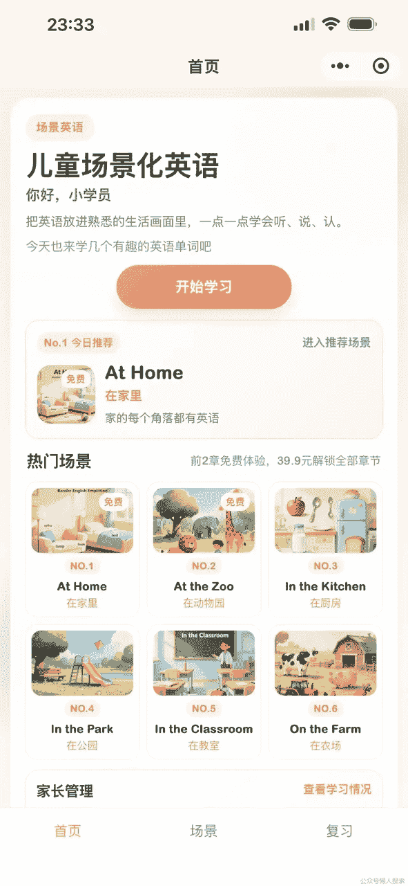

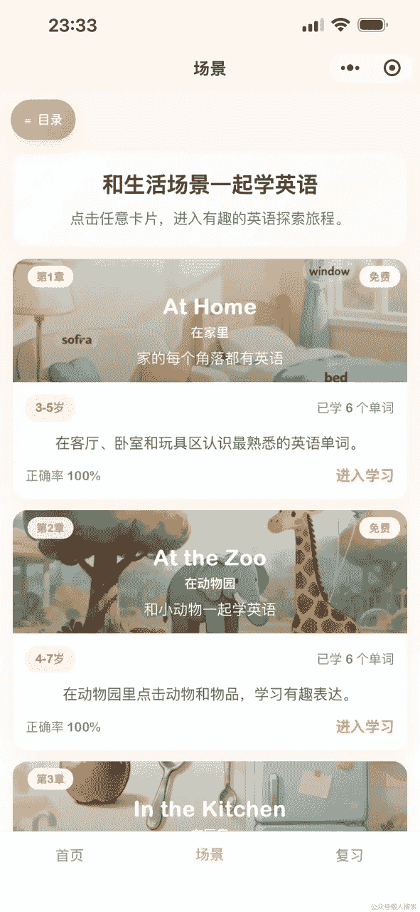

听完这两个案例，你可能在想：具体怎么做到的？我能照着复制吗？

下面拆一个真实小程序，看看它从想法到落地究竟经历了什么。

拆解：暮子风的「口语小场景」——起点是一篇📕笔记

**他是怎么定位方向的**：

暮子风观察到，不少家长在📕搜“幼儿英语启蒙”“口语怎么练”，评论区总有人问“有没有跟读打分的工具”。他由此判断：需求是真实存在的，不是自己脑补出来的——用户正在主动追问。

**他具体做了什么**：

1. 先动脑再动手——不碰设计软件，拿纸笔把产品雏形画出来：首页选场景 → 进入场景听原声 → 自己录音跟读 → AI比对打分 → 看反馈。想得差不多后，把这个思路详细讲给Codex，让AI整理成需求文档。

1. AI产出文档后，他通读一遍，确认“描述确实是我要做的”，再让AI动手写小程序代码。

1. 关键一招：让AI一次只做一个功能。场景选择页跑通了，再补跟读，再补打分，绝不一口气要全套。

1. 发了一篇📕笔记：“给娃做英语启蒙，自己做了个跟读打分小程序”，评论区立刻有人问“怎么用”“在哪下载”。

1. 一周后650+用户进来，108人加了🛰️。有人问“能不能付费开更多场景”——直到这时他才接支付。

**为什么他能成，你也能**：他不是先开发后推广，而是先有方向、发笔记试水、确认有人要了才开发。需求不是猜出来的，是用户用行动告诉他的。

**3. 最终交付什么**

把整本手册跑完，你至少会得到一个完成基础设置、可体验、可提交审核、并且有首批用户反馈通道的🛰️小程序。更理想的结果：围绕真实需求，把找方向、验证、开发、上线、推广、反馈、变现的完整闭环打穿。

**4. 关卡地图**

全文分两篇。必修篇带你把账号准备到小程序发布走完；选修篇负责推广启动、变现和进阶放大。

| 所属篇 | 关卡 | 阶段 | 产出物 | 用时 |
| --- | --- | --- | --- | --- |
| 引言 | 关卡0 | 开船第一课 | 看懂全局，备好开工 | 第1天 |
| 必修 | 关卡1-2 | 账号准备+判断需求 | 账号注册完成，找到值得验证的需求信号 | 第1-4天 |
| 必修 | 关卡3 | 基础设置 | 信息、类目、备案、认证就绪 | 第5-14天 |
| 必修 | 关卡4 | 开发实战 | 用AI做出第一个可体验的小程序 | 第6-14天，可与备案等待并行 |
| 必修 | 关卡5 | 上线发布 | 提审并正式发布 | 第15-21天 |
| 选修 | 关卡6-8 | 推广、变现 | 首批用户用起来，按需做反馈决策和变现闭环 | 按需推进 |

备案是整条链路中等得最久的一环。关卡1注册完账号、关卡2方向验证通过后，第一时间去备案；开发的同时等备案，不要等代码写完再备案。

💡目前的航线图，是按实际做小程序项目的业务逻辑排的。

如果你是完全新手，对AI体验也不深，想先拿点AI产品速成的体感，建议按关卡1-关卡4-关卡3-关卡5-关卡2的顺序来；关卡4也可以直接用提供的案例做出来提交。

【关卡4的案例其实有点难度。想要更轻松的练手，可以看往期16年3月🛰️小程序航海的案例，做一个电子木鱼；如果觉得关卡4的展示不够细，又想挑战这个难度，也可以参考往期「消灭拖延症任务拆解」小程序的做法。】

本期重点重做了两大难点：需求挖掘和推广启动；小程序制作部分做了精简，因为把小程序做出来难度并不大。信息量由直播补足——高手领航直播二聚焦小程序制作，会对后端、UI等知识和操作做补充，敬请期待。

**其余学员**建议直接按真实业务逻辑推进，认认真真做一款属于自己的小程序；关卡4直接提交自己的作品就好。

**5. 关键选择的理由**

**适合谁**：

• 用过AI做东西，但卡在不知道做什么能变现

• 有产品想法、甚至已有成品，但拿不准需求成不成立

• 零基础，但愿意每天花2-3小时跟着手册实操

• 想先做出一个🛰️小程序，打通AI产品0到1闭环

**不适合谁**：

• 指望航海直接保证变现结果

• 只想闷头做产品，不想和用户打交道

• 想要短期暴富，接受不了第一个项目结果不确定

多数人做第一个小程序时赚不到什么钱。西昂也做了15个，其中稳定盈利的只有7个。

新手默认走流量主——试错成本最低，个人主体也能开。

第一个项目的真正价值不在赚多少，而在把完整闭环跑通。跑通了，第二个、第三个只会更快。

敢于放弃也是能力。do小鱼试了3个方向才找到对的路，Wee放弃了3个方向，在第4个方向才跑通。

**6. 出发前准备**

• AI编程工具：Codex（首选），备选 Workbuddy（见工具配置文档）

• 🛰️开发者工具：装好🛰️开发者工具

• 小程序账号：到 mp.weixin.qq.com 注册（个人主体免费）

• 时间预算：每天2-3小时

关卡1会带你完成账号注册，关卡4带你装工具、开始开发。

• 每关开头都有任务卡——扫一眼就知道这关要做什么

• 每关末尾通常有常见卡点——直接告诉你下一步怎么办

**插个题外话：如果你想知道自己每天消耗多少Token，欢迎加入赚钱 TokenRank～**

我们注意到，不少圈友已经在用 Codex、Claude Code、Hermes、WorkBuddy 等工具做项目，但各自用了多少、坚持多久、做成了什么，并没有被记录下来。

TokenRank 可以把真实的AI使用过程存下来，也能帮我们发现优秀作品和实战案例。

注意：Token高≠成果好。比起“用了多少”，我们更关心：你用AI做成了什么、解决了什么问题。

TokenRank 目前已开放接入，跟着教程安装即可：https://scys.com/tokenrank/connect

安装过程遇到问题，直接在航海群里反馈。


---

# 必修篇

## 关卡 1：准备起跑：注册小程序账号，选定主体

### 00. 任务卡

**关卡目标**：注册一个小程序账号，拿到AppID。

**任务清单**：

1. 完成🛰️小程序账号注册，能顺利进入🛰️公众平台后台。

1. 明确自己选的是个人、个体户还是企业主体，并知道为什么这么选。

1. 找到小程序AppID页面，知道后续开发会用到它。

1. 名称、类目、备案、认证先不急着完善，统一放到关卡3处理。

**本关需交作业：**

• 后台小程序AppID页面截图（必填）

• 示范见关卡1任务卡：mp.weixin.qq.com后台 → 开发管理 → AppID。截图露出小程序AppID即可，注意不要泄露AppSecret。

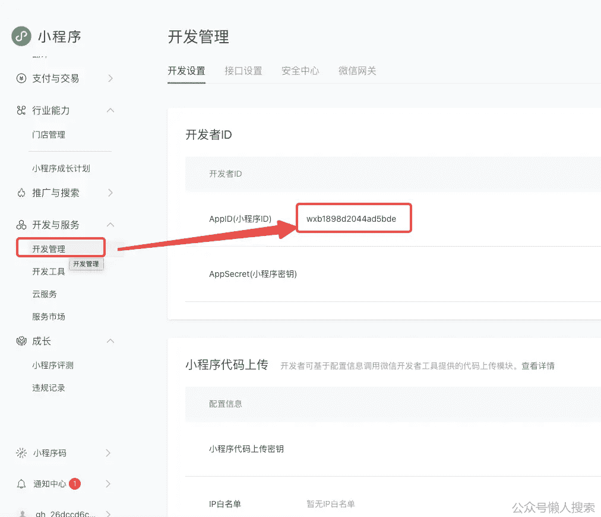

• 分享这关最大的收获，或者卡点与解决过程（必填）

---

### 01. 操作步骤

**1. 先明白：注册账号 ≠ 小程序能上线**

注册账号只是第一步。完整链路长这样：

注册账号 → 关卡2锁定方向 → 关卡3填小程序信息、选类目、做备案和认证 → 关卡4开发 → 关卡5提审、发布

本关要做的：拿到注册后的AppID。

小程序信息、名称、类目、备案、认证，等关卡2方向确认后，关卡3带你正式处理。

为什么不让方向先定再注册？因为注册不花钱，提前注册、熟悉后台没坏处。一张身份证最多能开5个小程序。

**2. 两种赚钱方式，现在看懂**

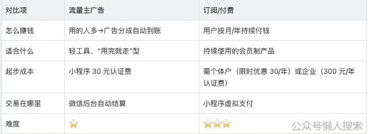

新手建议先选流量主——投入最小，个人主体就能跑通。后续要加付费，再把个人号升成个体户或企业号。关卡8会展开每种变现方式的具体操作。

**3. 注册前先定主体：个人，还是个体户/企业**

注册时就得选主体类型。先看这张对照表，判断你现在该选哪个：

| 维度 | 个人版 | 个体户/企业版 |
| --- | --- | --- |
| 材料要求 | 身份证+实名验证 | 营业执照+法人信息 |
| 收款能力 | 通常不支持🛰️支付 | 更适合支付、交易、电商 |
| 类目空间 | 偏少，适合轻工具 | 更灵活 |
| 建议人群 | 首次跑流程、轻工具 | 一开始就要交易、复杂服务 |
| 认证年费 | 30元 | 个体户限时优惠30元，企业常见300元 |

怎么判断：

• 只做计算器、BMI工具、单位换算、随机抽签、本地文案工具 → 个人主体先跑

• 一开始就盯上支付、电商、会员付费、多人共享、复杂教育服务 → 提前确认主体和类目支不支持，别等代码写完才发现做不了

• 拿不准？先选个人，目的是快速把流程跑通。以后真需要，再办个体户执照。有开发者就是这么走过来的——先用个人号快速上线，把流程过一遍，才有了后来的经验

一张身份证最多注册5个小程序，注册完全免费。30元是后面的🛰️认证费，备案通过后才要付。

**4. 开始注册小程序账号**

**第1步：打开注册页面**

1. 浏览器访问 mp.weixin.qq.com（🛰️公众平台）

1. 点右上角“立即注册”

1. 账号类型选“小程序”

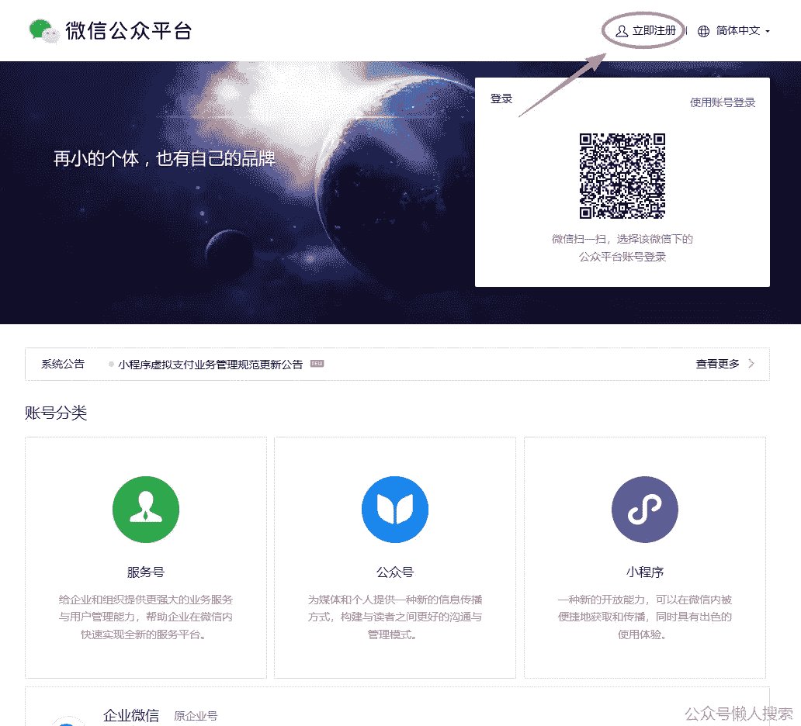

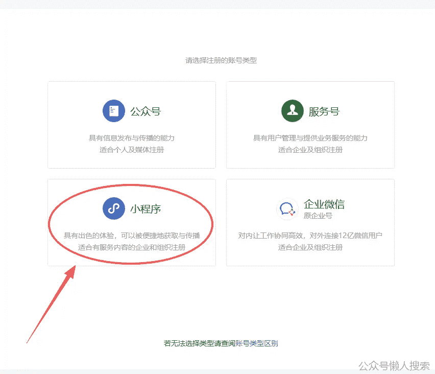

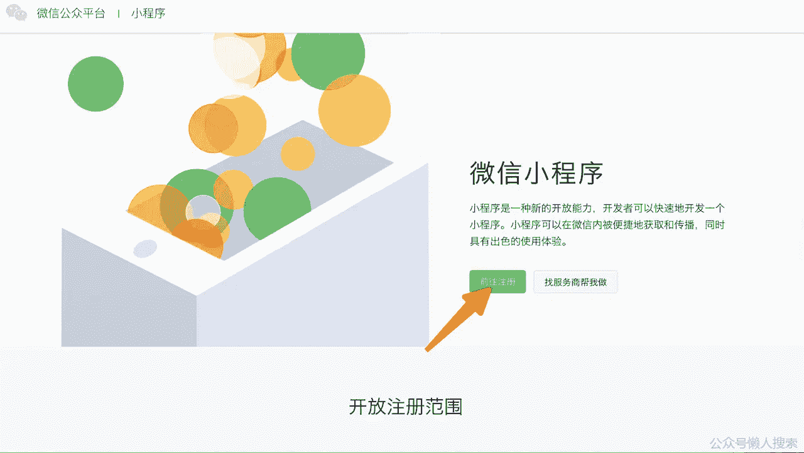

**第2步：填邮箱和密码**

这里有个坑，很多人第一次就栽了。

有开发者随手填了常用邮箱，结果提示“该邮箱已绑定其他平台账号”。

**注意：**

• 需要准备一个全新邮箱，没注册过任何🛰️公众平台账号（订阅号、服务号、企业🛰️等也算）。如果常用🐧邮箱或163邮箱已经注册过👸号，就重新申请一个。打算做很多小程序的，这里推荐一个能无限生成邮箱号的网站：https://www.2925.com/login/

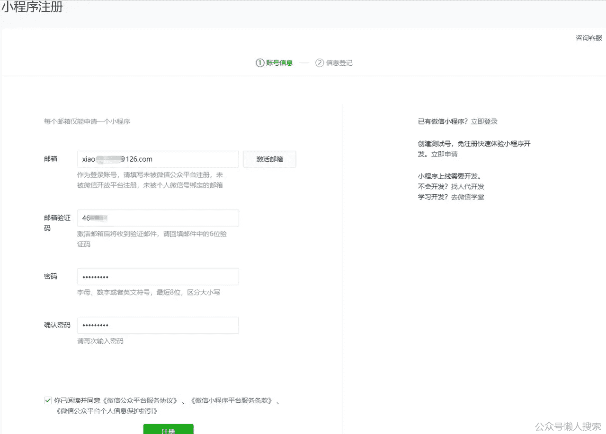

**第3步：选小程序类目和主体类型**

1. 小程序类型选“其他”；主体类型选“个人”（或按前面的判断选企业）

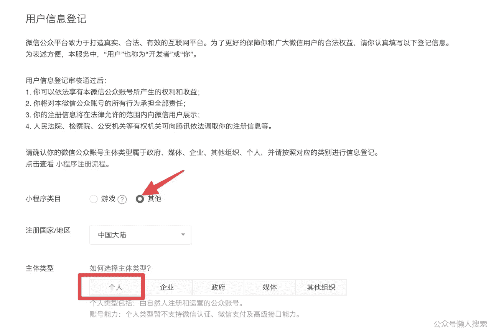

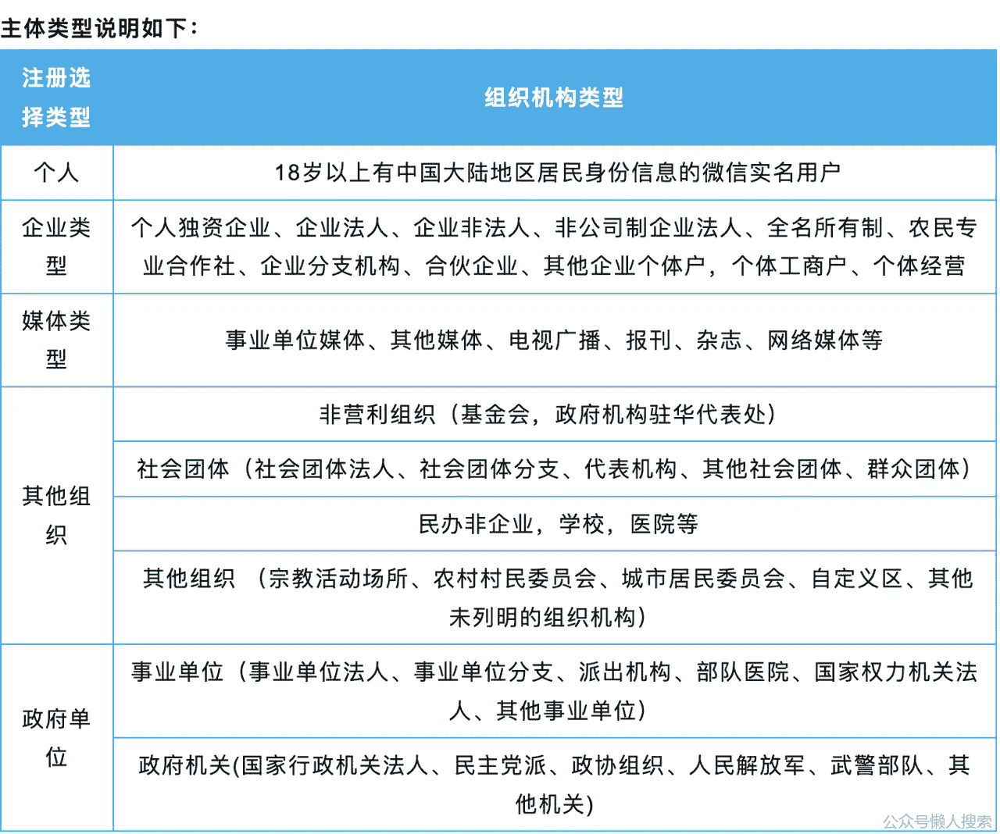

**如果你是个体户/企业**

企业/个体户会比个人多几步：

选「企业」或「个体工商户」→ 填企业名称+营业执照号 → 上传营业执照彩色件 → 填法定代表人姓名+身份证号 → 管理员扫码（法人本人或授权运营者都行）→ 选验证方式完成。

**验证方式有2种，任选：**

• 对公打款验证：适合有对公账户的企业。🛰️会给对公户打几分钱，回填金额即可完成，免费。

• 🛰️认证：适合个体户、赶时间、要做支付的。交30元，通常1-3天审完，想开支付必须走这个。

**建议：**只要需要支付能力，直接选🛰️认证，一步到位。对公打款只能证明“主体是真的”，支付接口还得再认证一次，等于多做一遍。

• 输入姓名、身份证号、手机号，接收验证码

• 用该身份证实名的🛰️扫码验证

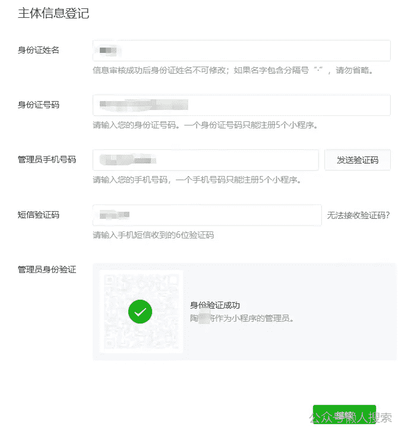

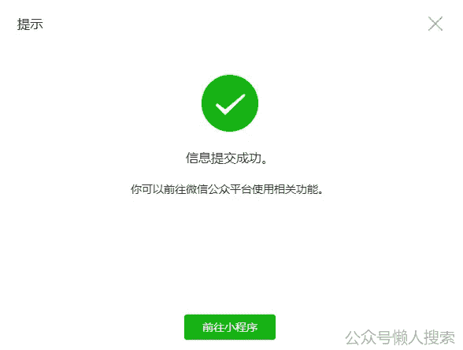

⚠️ 注意事项：

• 一个身份证最多注册5个小程序

• 注册完全免费。30元是🛰️认证费，备案通过后才需付

**5. 注册完先别填信息，方向确认后去关卡3**

注册完成，你拿到了后台入口和AppID。后台能看到“小程序信息”“小程序类目”“小程序备案”“🛰️认证”几个选项——先别急着动。

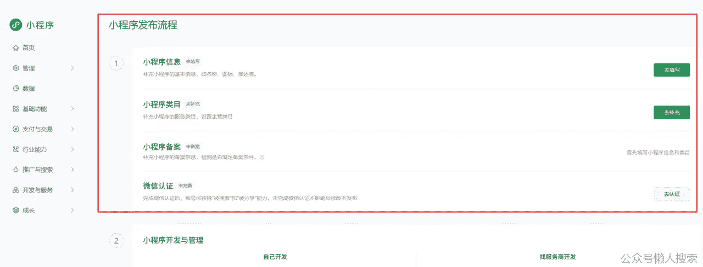

原因：关卡1你还不知道自己要做什么。名字、简介、类目填了大概率要改，改了就要重新审核，纯浪费时间。

关卡2方向找到后，关卡3会带你正式填信息、提交备案和认证。现在先熟悉后台，知道每个选项在哪就行。

备案节奏要知道：备案要等，顺利3-5个工作日，不顺利可能更久。但别担心——备案认证不影响开发，可以边开发边等。关卡3提交备案，关卡4写代码时备案在后台跑，代码写完备案大概率已经过了。

**6. 常见卡点**

| 常见卡点 | 自查项 | 行动建议 |
| --- | --- | --- |
| 不知道选哪种主体 | 先确认具体场景和上一步是否完成 | 轻工具/第一次跑流程 → 个人。涉及交易/支付/社交 → 提前确认主体和类目。不确定就先个人，后面可升级 |
| 不知道选哪种变现 | 先确认具体场景和上一步是否完成 | 新手默认流量主，成本最低。关卡8展开每种方式 |

---

## 关卡 2：找需求：挖出一个值得做的方向

### 00. 任务卡

**关卡目标**：找到1个值得继续做的需求方向，并说清它为什么不是“我觉得”。

**任务清单**：

1. 先挑一种顺手的找需求方式：看评论/差评、搜🛰️小程序和🛰️指数、或者从自己和身边人的真实痛点切入。

1. 找一个具体方向，别只写大品类。“英语学习”太泛，要写清楚“谁在什么场景下，需要解决什么问题”。

1. 收集至少1个真实信号：用户评论、搜索结果、🛰️指数、同类产品使用量、付费案例都可以。

1. 初步判断方向更可能靠什么变现：流量主、订阅、付费功能、商品/服务，或者先不变现只验证。

1. 用AI帮你追问和反向挑刺，确认这个方向值不值得进入下一关。

**本关需交作业：**

• 你要做的1个方向、选择理由和初步变现判断（必填）

写清楚：想做什么小程序？给谁用？解决什么场景里的什么问题？为什么选它？更可能走流量主、订阅、付费功能、商品/服务，还是先不变现继续验证？

• 1-2张需求信号证据截图（必填）

评论截图、🛰️搜索截图、🛰️指数截图、同类小程序使用量截图、付费商品/服务销量截图都可以。

• 分享这关最大的收获，或卡点和怎么解决的（必填）

PS：三个找需求方法不必都做完，选一个能走通的即可。重点是交出真实信号，不是只交一个想法。

---

### 01. 找需求实操方法

先选一个场景——选你顺手的，不必三个都来。

• 爱逛社群、刷📕等社交媒体 → 方法一

• 平时刷🛰️、常搜小程序 → 方法二

• 自己或身边人反复吐槽的事 → 方法三

选定后走到底。觉得不够，再回头试另一个。

# 1. 方法一：从评论和吐槽里提炼卖点

**整体逻辑**：目标用户喜欢待在哪里，就去哪里逛——📕、App Store、🛰️群都算。然后把讨论区和评论区的留言一条条翻完，那些不好的反馈汇总起来，反过来就是产品的卖点。

刷📕的时候、混🛰️群的时候，别只图热闹。多注意大家在聊什么麻烦。别人说出来的问题，往往就是他真实被卡住的地方。产品的意义，就是发现一个人在哪一步进行不下去，然后提供一个工具帮他迈过去。所以，不妨多泡一些兴趣圈子，观察大家在乎的事情和情绪焦点。

评论区的价值也不止于此：该走什么路线、该突出什么差异，几乎都能从用户的留言里看出来。不管想找蓝海还是找差异化，这些反馈都是最直接的素材。

**1.1 从竞品差评中找痛点**

想做某一类工具，可以先搜遍安卓、苹果的应用商店。找到同类产品后，把评分拉到最低，一条条读那些低分留言。各种不满汇总起来，基本就是你的卖点清单。

拿“证件照”举例。在苹果商店搜索这个词，点进 App 的评分区，筛选最低分，一些真实需求会非常明显：
- 有人想要免费修图，不打算付费 → 你可以主打“永久免费”；
- 有人导出的照片质量很差 → 你可以把导出质量做到最好。

营销时可以直接把用户的抱怨讲出来：现在很多 P 图软件都收费，我们的小程序不仅免费，导出的证件照还清晰。一句话——把用户的气话，变成你的产品宣言。

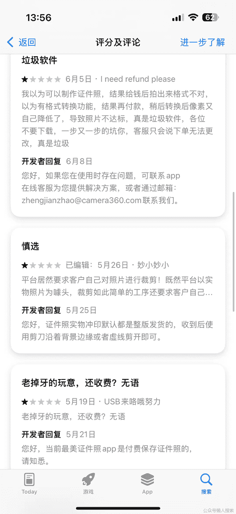

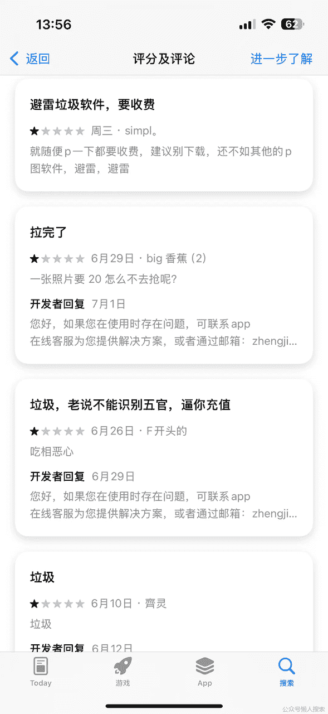

**1.2 翻社交媒体帖子下的留言**

还是证件照的话题。在📕搜索“证件照”，点进“证件照免费生成”相关的笔记，最上面那一条正在教人如何用某个 App 制作证件照。评论往下翻，痛点非常密集：打开图片是模糊的、保存不成功、尺寸不对。这些都是在同类产品里反复出现的坑。

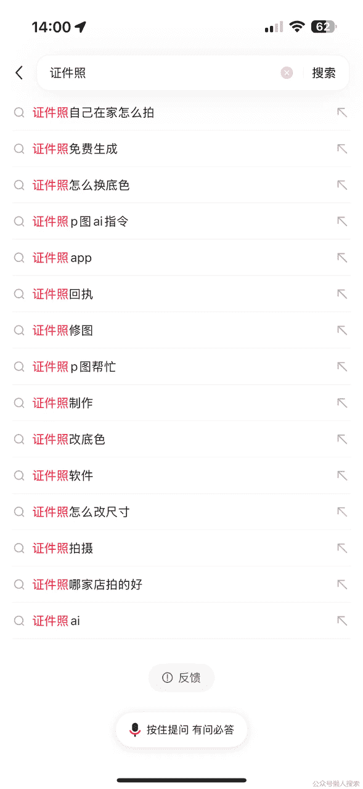

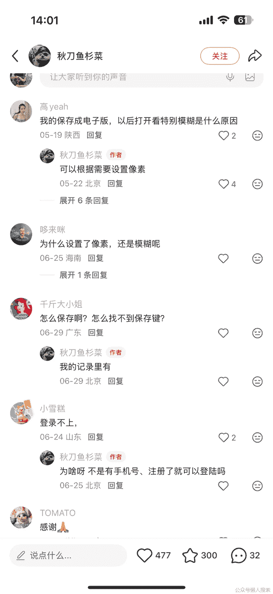

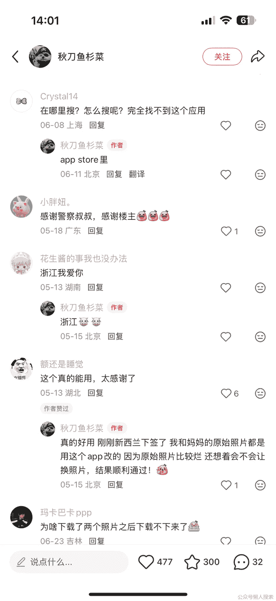

设计产品时，就照着这些坑去填。等到推广的时候，把用户踩过的坑反过来写成你的方案。前期把这些帖子多存几个，产品上线后甚至可以回到评论里直接回复：“这个工具能导出高清图，而且免费”——转化会很自然。

如果调研时发现：某个关键词下排名最高的笔记里有人在开店卖货，而且销量很好，说明这个需求确实有人愿意花钱。比如某个帖子里直接卖证件照精修服务，5 元一单，已经成交了 2 万多笔。既然如此，做一个证件照精修小程序，主打“免费+高清”，是不是也可行？

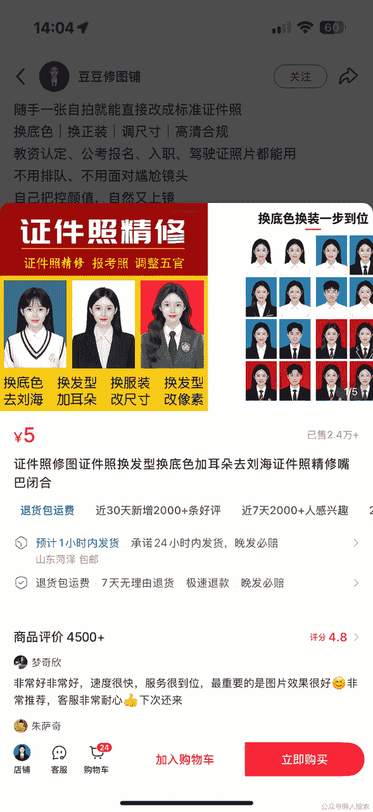


继续往下翻，评论还会暴露更多细分的场景：护照照片、证件照精修等。切口越细分，对手越稀少。也就是说，评论能帮你看清更垂直的需要，越垂直就越容易避开竞争。当你找到一个足够小的蓝海，用产品钻进去站稳，就能牢牢锁住这群用户。

# 2. 方法二：在🛰️生态里找被验证过的需求

**核心逻辑**：🛰️里已经有别人做出来的小程序，就代表需求已经被检验过了。你不需要发明新需求，只需要找到“需求成立但产品没做好”的缝隙，去做出一个用起来更舒服的替代品。

**2.1 从哪里找方向**

**2.1.1 入口一：按分类浏览小程序**

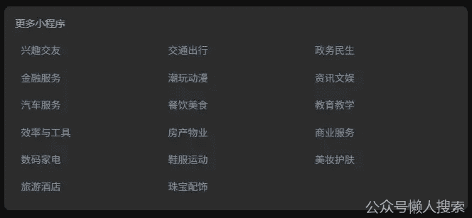

从🛰️底部进入「发现」→「小程序」，一路滑到底部点「更多小程序」，再在右上角点「展开」，就能看到按分类排列的小程序（工具、生活服务、教育、健康等）。花上半小时把每个分类翻一遍，找出自己感兴趣的工具。

如果发现页找不到小程序入口，可以这样开启：「我」→「设置」→「其他功能」→「发现页管理」→「小程序」→ 打开“在发现页中显示该功能”。

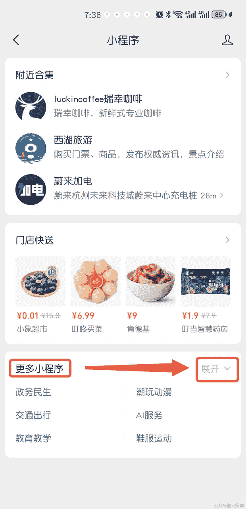

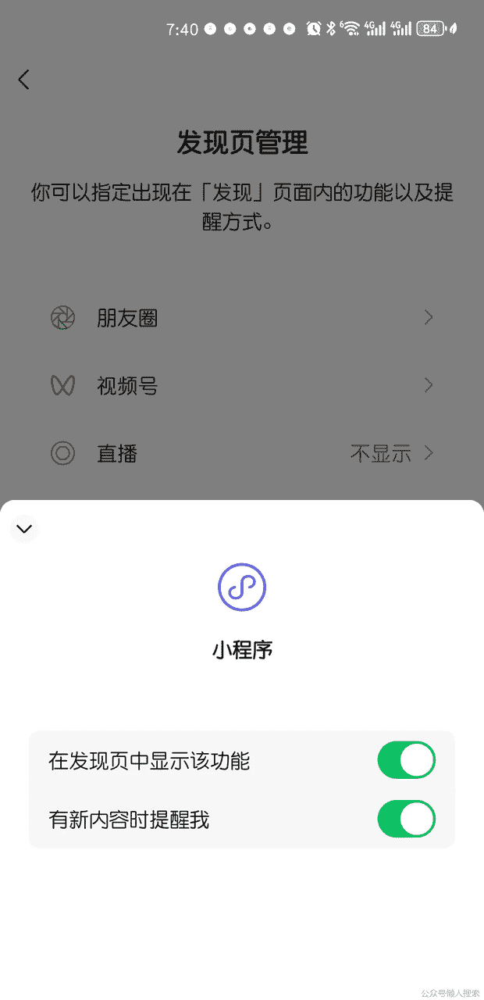

**2.1.2 入口二：直接用关键词搜**

这个方法效率最高。在🛰️搜索框里输入用户有可能敲的关键词，比如“打卡”“接龙”，这两个都是工具类小程序里搜索频率极高的词。🛰️搜索页底部有一个“页面设置”开关，如果搜索结果里看不到小程序这一栏，就进入「页面设置」→「搜索指定内容」→打开「小程序」。

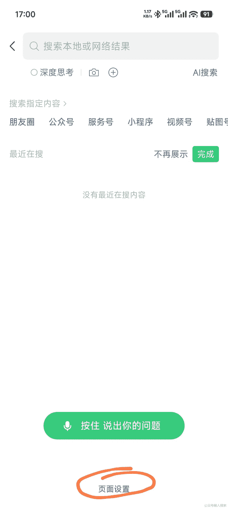

开启小程序指定搜索后，回到搜索页，点击搜索框下方显示的蓝色“小程序”文字，就能锁定小程序范围进行搜索。

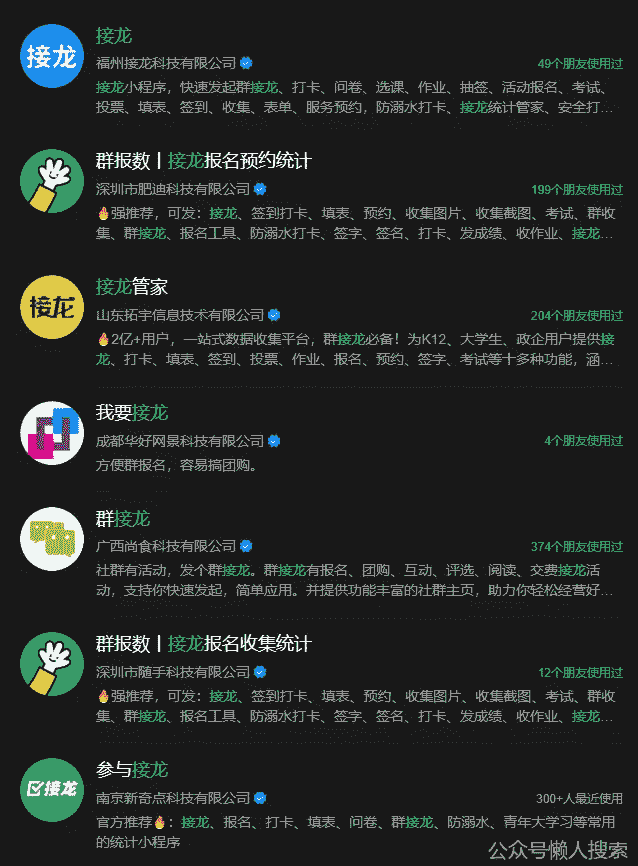

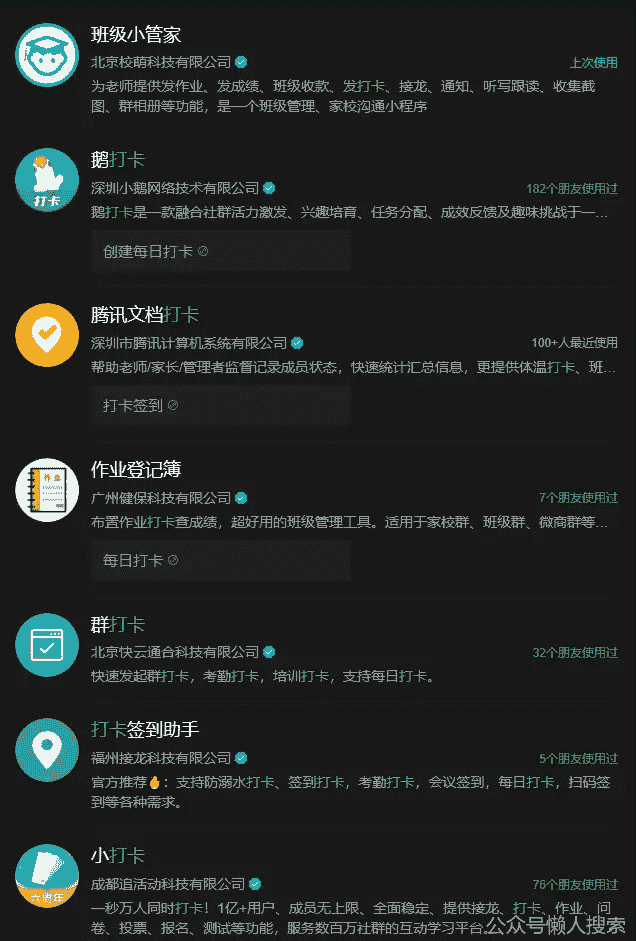

**2.1.3 入口三：🛰️指数**

心里有了大致方向，就可以去搜“🛰️指数”小程序，查看搜索热度的起伏。如果某个词常年保持在 1000 万以上的搜索量，基本可以判定是通用刚需。进入具体关键词后，下拉词会呈现出更多长尾需求。用添加关键词的方式把几个细分词放到一起对比，优先关注那些能转化成工具的词。

比如在下拉词里看到「粤语翻译器」——说明有人需要把普通话翻译成粤语。词本身的搜索量也许不大，但意图极其明确。用户带着这个词进来，你的小程序正好能接住，点进来自然就是顺理成章的事。

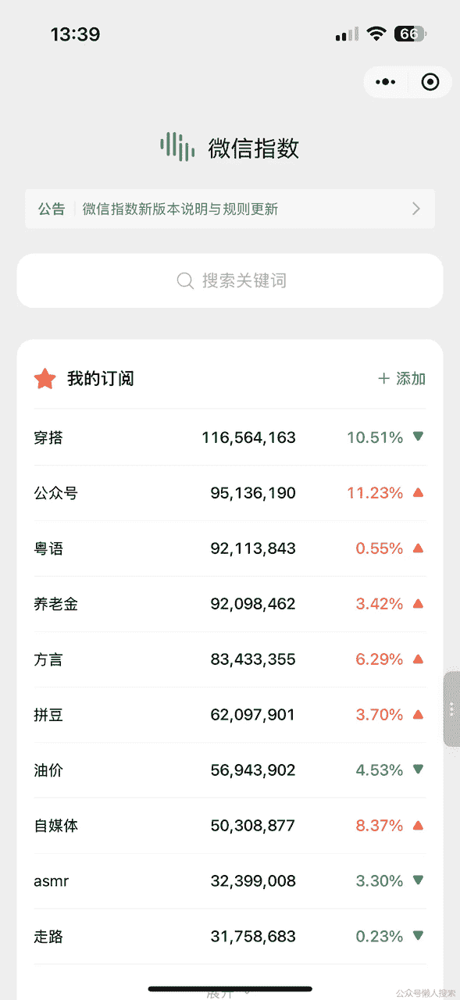

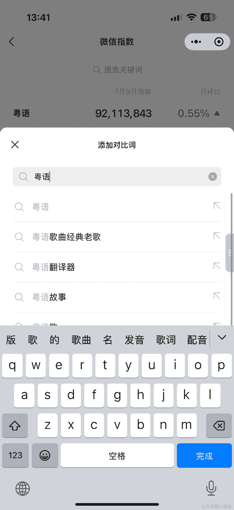

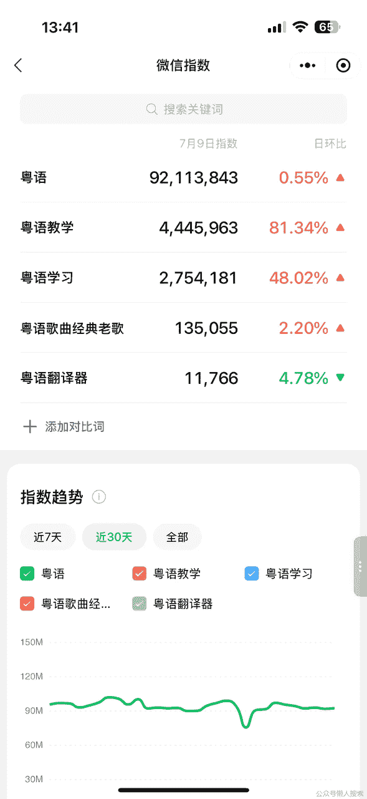

**2.2 怎么判断值不值得做**

不管从哪个入口发现方向，都可以用同一条标准来检验。

**2.2.1 看需求真不真**

先搜一下是否已经有同类型小程序。有，就说明需求客观存在；接着看看里面有没有个人开发者（非企业）。企业能操作的规模，个人未必能复制。找到个人开发者后，去查看他们产品的「最近使用人数」——这代表该类目的用户容量，也暗示了天花板。

如果一个个人开发者都找不到，或者用户量很低，这个方向基本不适合个人入场。

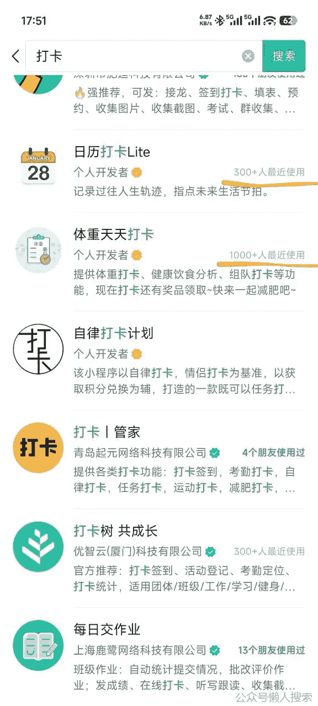

**2.2.2 看竞争能不能打**

点进使用量靠前的产品，分别从数量和体验两个角度来判断：
- 数量上：搜索结果只有三五个 → 竞争小、机会大；一搜一大把 → 赛道拥挤，需要谨慎。
- 体验上：界面好不好用、功能完不完整、广告多不多。如果搜到的产品大多粗糙——界面难看、广告乱弹、操作卡顿——说明用户只是暂时忍着，并没有多满意。你做出一个体验更好的版本，就能切进去。

但有一个例外：如果赛道里已经出现一个非常亮眼的头部产品（设计精美、功能齐全、用户量大），不如干脆放弃。

再观察使用量靠前的个人开发者产品的上线时间。如果全都挤在三四年以前 → 自然搜索想排到前面很难；如果最近两年内还有新上线的 → 说明还没有饱和，可以凭产品力和运营打一打。比如排名第 9 的对手是去年才开始做的，这就是一个竞争信号。

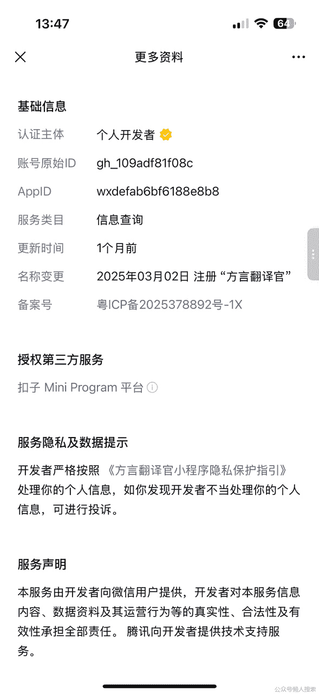

**2.2.3 看商业化与功能难度**

点开排名前十的个人开发者产品，看两件事：
- 商业化通了没有：有广告，说明盈利闭环已经打通，变现模式没有问题。
- 功能是否复杂：如果都是单页轻量的小工具，那最容易对付——功能越简单，用户搜索时越容易找到你，开发维护也越轻松。不要去做功能堆叠的“全家桶”。

**2.2.4 看场景清不清晰**

最后给自己做一次小测验：能不能用一句话说清楚用户什么时候会打开它？
- 过年走亲戚不知道该怎么称呼 → 亲戚计算器 ✓
- 想弄明白周围有多吵 → 噪音检测 ✓
- 打完牌怎么算账 → 打牌记账 ✓
- 说不清楚 → 说明方向还不够具体，不如换一个再想想 ✗

**总结**

上面四条都通过，方向就可以做。更理想的情况是，在某个蓝海词下出现了近一两个月刚上架、已经开始商业化的个人开发者工具，那就等于拿到了一个强信号。如果有一条不过关，立刻换下一个方向。

**小技巧：建一个候选方向清单**

在备忘录或飞书文档里建一张表，每发现一个可能的方向就记下来：小程序名称、功能描述、搜索到的竞品数量和质量、你觉得哪里还能做得更好。不用急着开工，先攒 5-10 个候选，再挑最符合标准的动手。选方向的时间控制在半天以内，足够筛出不错的目标。万一做错了，多花几天时间和几十块钱成本，再换一个方向就是了。

# 3. 方法三：以自身痛点为起点

⚠️ 核心原则：个人痛点 ≠ 市场需求，必须拿数据验证。

每个人身上都有没被妥善解决的痛点，这些痛点很可能是产品机会的源头。不过，自己感到痛，不等于所有人都需要。把个人痛点变成市场机会，中间的桥梁只能是数据验证。

**整体流程分为四步：**

第一步：找出自己反复遇到、一直没能解决的问题——这是种子的来源；
第二步：用抖音、📕等平台的公开数据，验证这个痛点是否具备广泛共性；
第三步：先不要急着做产品，而是想清楚解决方案（比如练口语用什么方法更容易掌握）；
第四步：和 AI 长谈，把自己的观察、需求、想法全部摊开，在对话中让产品思路逐渐清晰。

**3.1 第一步：找到种子——从自身痛点出发**

很多痛点不是灵感的闪光，而是旧问题：同一件事反复困扰你，却始终没有好的解法。最好养成一个习惯，一旦察觉到自己有痛点或需求，就立刻记下来。来源通常是三类：
- 自己长期未被满足的需求（现有产品用过，但总觉得不够好）；
- 刷内容时碰到，突然引起强烈共鸣的问题；
- 身边朋友反复抱怨或经常求助的事。

找到痛点后，真正重要的是拆解需求。不要停留在“我需要一个更好的 XX”这种模糊表达，应该具体写出：你希望问题怎样被解决？理想中的使用体验是什么样？

⚠️ 务必注意：这个阶段只完成了“种子”这一步。它顶多说明个人层面存在这个需求，并不能代表市场需求。千万不要在此刻直接开干，下一步必须用数据来说话。

**案例说明：**

以学英语口语为例——这也是我自己真实的场景。市面上的产品不少，但找不到一款学起来容易、用起来实用的。多邻国这类的 App 做得很好，可是我自己学了 100 天，却不知道在实际生活里怎么用它。

于是把模糊的痛感拆成具体需求：
1. 英语日常高频用语，按生活场景分类学习；
2. 针对具体场景进行练习；
3. 有一套机制让自己能坚持下去。

种子已经清晰了，接下来开始验证。

**3.2 第二步：验证共性——用平台数据确认你的判断**

个人痛点不能代表全员痛点。要把痛点放到公开平台上检验。抖音和📕是首选，因为这两个平台上的点赞、收藏、评论等互动数据，可以直观反映需求热度。

**操作步骤：**

1. 从拆分出的需求中提炼 2-3 个关键词；
2. 到📕、抖音等平台分别进行搜索；
3. 重点观察四个维度：
   - 点赞/收藏量：短期冲到几千甚至上万，说明需求非常旺；
   - 评论区内容：大量出现“我也需要”“求分享”“怎么获取”，就是最真实的需求信号；
   - 广告投放：内容长期带有广告，说明背后产品有正收益，市场已被验证；
   - 内容持续性：不是偶然一篇爆了，而是长期有人在发，数据一直不错。

判断标准不需要太严格。核心就是多看内容，当点赞短时间内达到几千甚至上万、评论里求取的声音很多、自己代入后也有强烈共鸣的时候，就可以初步认定：市场有机会。

**案例说明：**

继续讲英语口语学习。从上面拆出的需求里，提炼两个核心词：英语日常、学习卡片。

第一轮搜索“英语日常”。📕里排在最前的是一篇英语口语 600 句的分享，拿到 1.3 万点赞，热度很高。另一篇发布时间是 24 年 12 月，直到现在还在投广告（右下角标“广告”的就是推广内容），说明盈利模型成立。第一篇笔记的评论区，大量用户留言求资料。


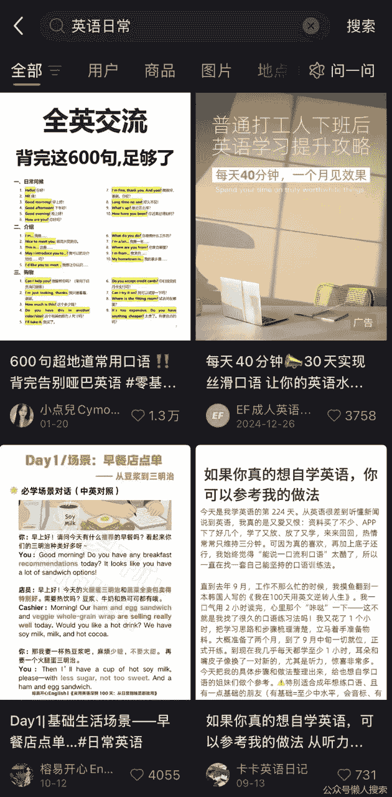

这些信息足以确认：学习英语日常用语的需求，确实有广泛共性。

第二轮搜索“学习卡片”（也就是英语学习卡片，这同样是从自己的痛点里提炼出来的词）。

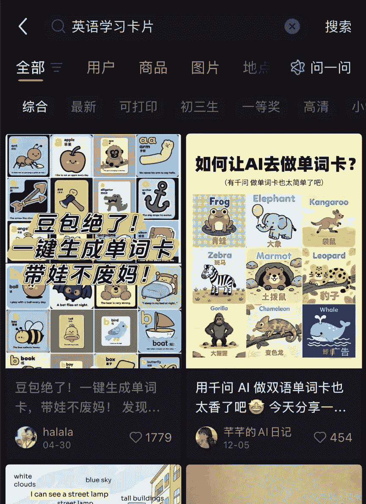

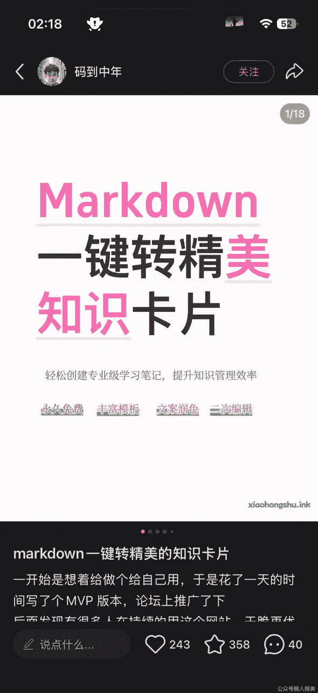

数据显示，学习卡片、知识卡片也都有市场。虽然“英语日常”和“学习卡片”没有现成的交叉数据，但两者各自都通过了验证；加上我自己就存在把二者结合的需求，因此可以把它们拼在一起，作为一个方向继续探索。

不过此时方向仍然模糊，还需要进入下一步。

**3.3 第三步：想清楚最简解法**

验证完需求的普遍性，很多人会直接进入开发。但这里有一个容易忽略的关键点：用户知道自己有问题，却很少清楚什么样的解决方案真的适合自己。

打个比方：英语口语的地基已经确认存在，但该在上面盖一栋什么样的房子，才能让更多人愿意住进来，这才是真正值得思考的。

不管做什么品类，验证共性之后，都可以从两个维度来审视解决路径——这两个维度不是拍脑袋想出来的，而是从大量用户反馈中反复出现的共性里提炼出来的：上手是否轻松、坚持是否容易。以健身工具为例，动作太复杂就容易让人不想练（难上手），练了三天就丢下（难坚持）。

这一阶段要回答两个核心问题：
1. 工具层面：有什么办法降低学习成本和使用门槛？
2. 坚持层面：很多用户有心无力，怎样设计机制让他们更容易坚持？（要顺着人性，不要逆着人性）

如果只按自己想出来的方案做产品，很可能只能看到冰山一角。所以，关键一步是借助 AI 把这栋“房子”描得更有吸引力、更客观，而不是自己关起门来拍板。

**案例说明：**

回到英语学习的例子。平台数据里能看出两类典型用户：

第一类是有口语学习需求的人。评论显示他们的英语基础普遍一般，最重要的不是内容多、功能全，而是门槛不能高——能直接开始学，不用先去研究工具本身怎么用。


第二类是有资料需求的人。他们求资料时非常积极，但真的会坚持学完吗？往往是有心无力，需要外部机制推一把。评论区大量“求分享、求资料”说明学习意愿是真实的；但凡是做过内容分享的人都知道，真正能坚持看完资料的人极少。从拿到资料到真正学会，中间有一条巨大的断层。用户缺的并不是内容，而是推动自己持续用下去的力量。

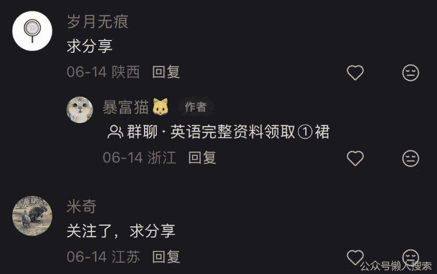

这两个观察直接决定了产品设计的走向：除了提供内容，还必须解决“用得上”和“坚持得住”的问题。

**3.4 第四步：和 AI 聊透产品思路**

经过前面几步，你手里已经有了一些判断和方向感，但很多部分仍然是模糊的。这时可以把 AI（如 ChatGPT）当成调研员，把自己的想法、困惑、数据全部抛给它，一直聊到通透为止。

和 AI 对话时，可以试着问五类问题：

这五个问题不是固定模板，而是对应需求验证中的五个环节：市场够不够大、需求为什么一直没被满足、同行已经做到什么程度、最小可行产品应该保留什么、怎么设计才不违背人性。你可以根据自己的项目灵活调整，核心目标是把所有想不通的地方追问到逐渐清晰。

1. 这个需求在目标市场里普遍吗？有没有数据支撑？
2. 用户一直有需求，为什么到现在还没有被妥善解决？
3. 市面上现有的产品解决了用户问题的哪些环节？还有哪些环节没人触碰？（很多英语产品解决了“提供内容”，却没有解决“陪伴坚持”）
4. 如果只做一个最小的工具，保留哪 1-2 个核心功能就够了？
5. 什么样的设计是顺应人性的，而不是让用户和本能作战？

**使用 AI 的核心心态**：不是让它替你做决定，而是通过反复追问，让你自己对需求与方案的理解越来越深、越来越有把握。

⚠️ 一个要警惕的坑：能用 Claude 最好，因为其他 AI 有时候会一味顺着你说，你说什么它都觉得合理。除了请它评估可行性，也要逼它挑毛病——比如直接问：这个方向最大的风险是什么？什么情况下它会失败？如果你是用户，有什么理由不用它？故意让 AI 泼冷水，得到的判断才更接近现实。

**关于竞争**：如果 AI 告诉你，市场上已经有类似产品、同质化竞争比较强，不用急着慌张。这里有两层意思：第一，有竞争恰恰说明方向被市场验证过；第二，同一个痛点从来不会只有一个答案。还记得 7-11、全家、罗森三家便利店开在同一条街上，却都活得不错吗？产品的独特性不来自盯着竞品找不同，而来自你走过的路和你自己的独特理解。

**案例说明：**

继续看英语学习小程序。把之前的需求和调研结果输入 AI，再一步步追问。

问法有讲究：不要只说一句“帮我设计一个英语学习小程序”，而是把你已经发现的事实一起给它。比如这样写：

“我注意到，想学日常英语口语的中国用户明显很多：📕上的相关笔记点赞过万，评论区里大量人在求资料。我想做一个小程序，按生活场景分类提供英语日常表达，内容用学习卡片呈现。请帮我评估一下这个方向是否可行。”

把背景、数据、初步想法交代完整，AI 的回复才不会浮于表面。

（1）当我问“学习卡片对学习到底有多大帮助”时，AI 直接给出了学习卡片有助于坚持的依据。

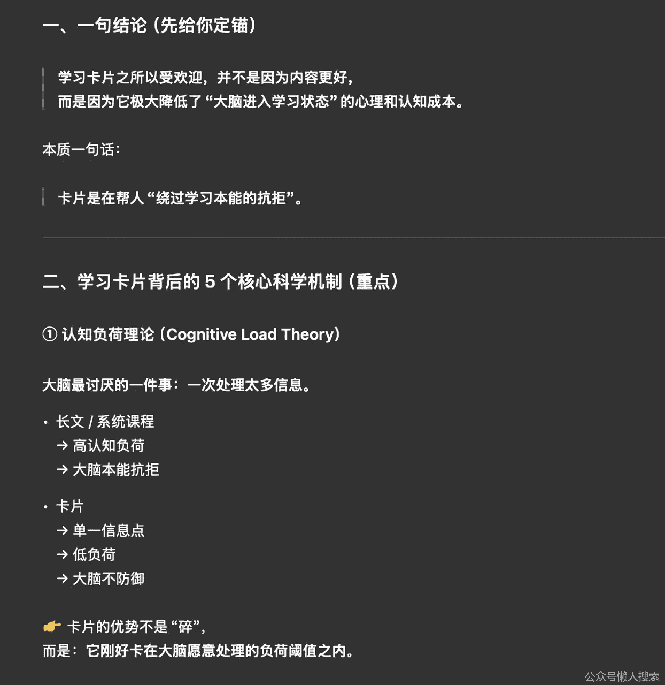

（对应第 5 类问题：顺应人性的设计）

（2）当我问“英语日常+学习卡片”这个组合对中国用户有什么价值、市面上有没有类似产品时，AI 提供了大量参考信息。


（对应第 3 类问题：已有产品覆盖了哪些环节）

### 3、练口语的需求盘子有多大？AI 用数据作答

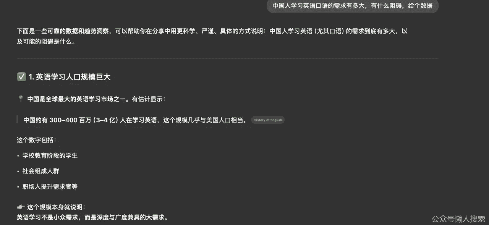

（对应第 1 类问题：需求是否普遍、有没有数据）

### 4、怎样让口语工具更抗放弃、更实用？AI 给出设计思路

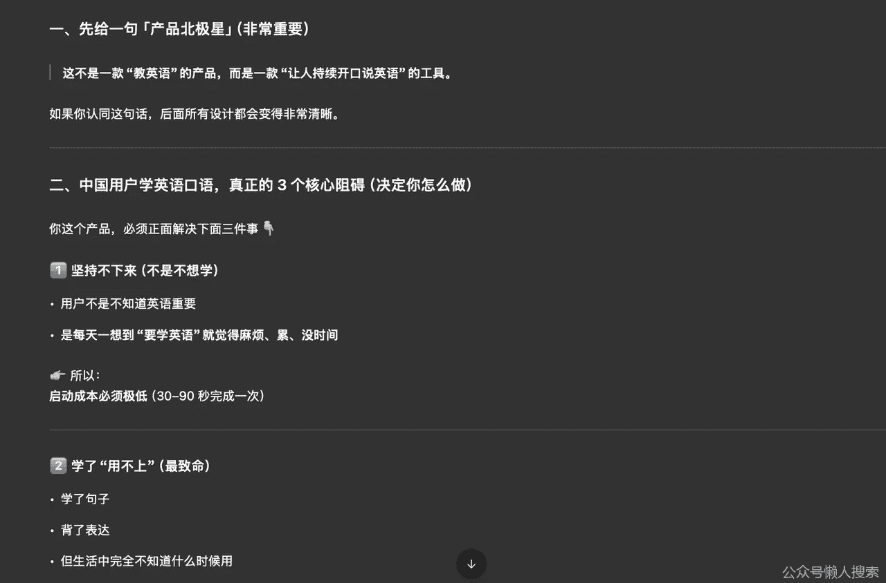

（同样落在第 1 类问题：需求普遍性如何、是否有数据支撑）

几番对话下来，初步解法浮出水面：锁定日常生活里的英文表达，学习单元以卡片承载，再叠一层升级打怪式的游戏反馈，最终做成🛰️端的小应用。

方向有了，还得过可行性这一关。我把设想交给 AI 评估；当它提示同类竞品扎堆时，我继续追问差异化的切口，它给出了较为具体的路子。

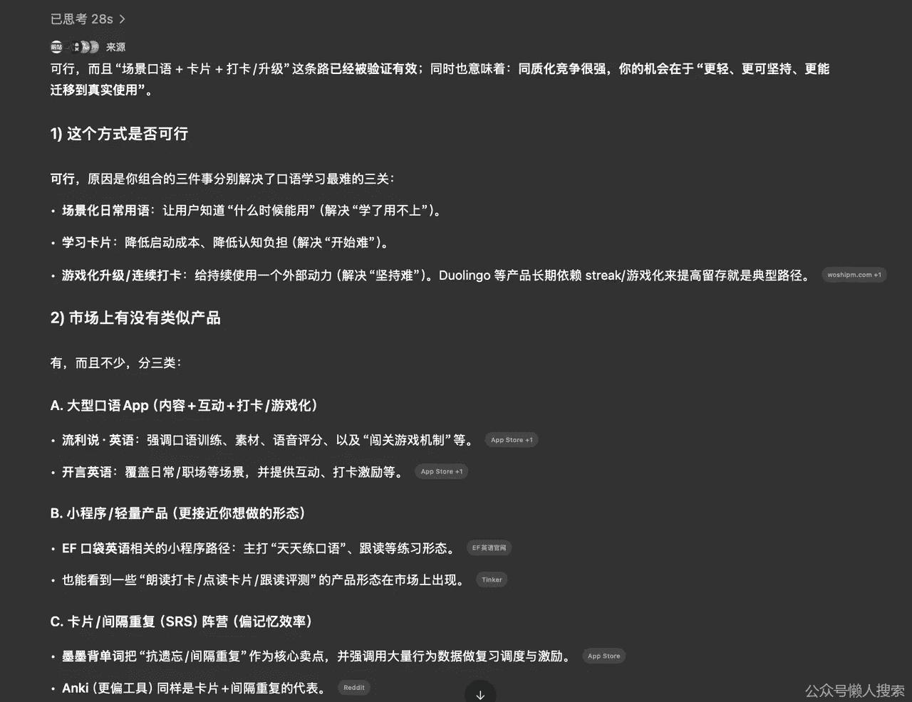

**实际验证：**照着上面这条路，我把一款英语日常口语小程序做了出来并推上线。后来逛📕时撞见一个卖得很火的英语学习站点，思路跟我的出奇接近——同样盯着口语情境，同样在降低坚持门槛，同样以卡片作为学习载体。这反倒从侧面印证了方向本身有市场。两个产品啃的是同一块痛点，只是解法各异，各自圈住了认同自己那套体验的人。

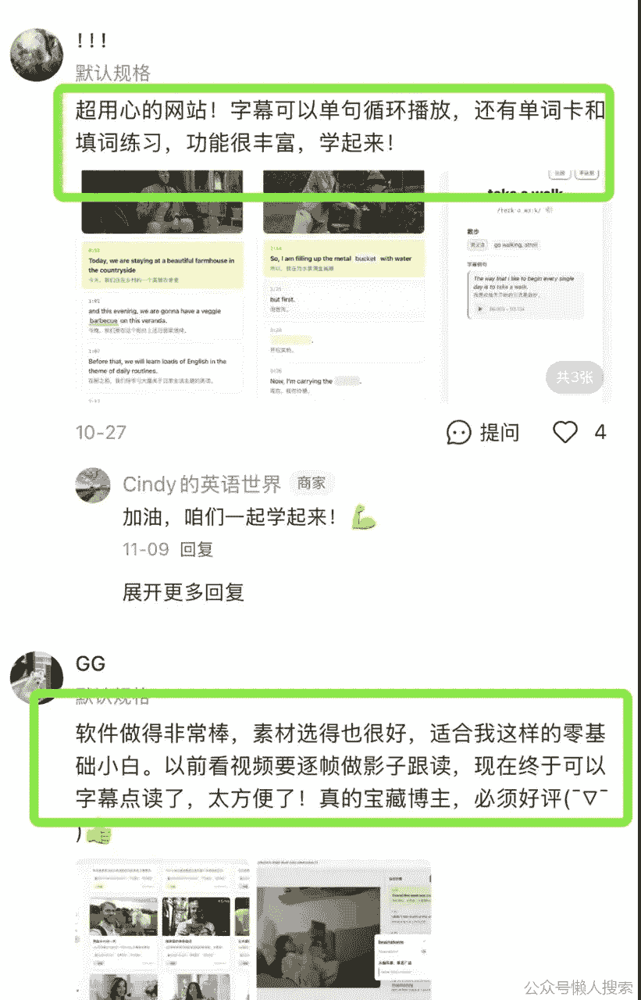

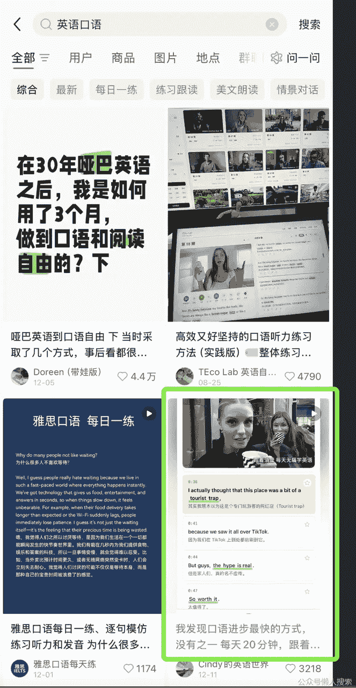

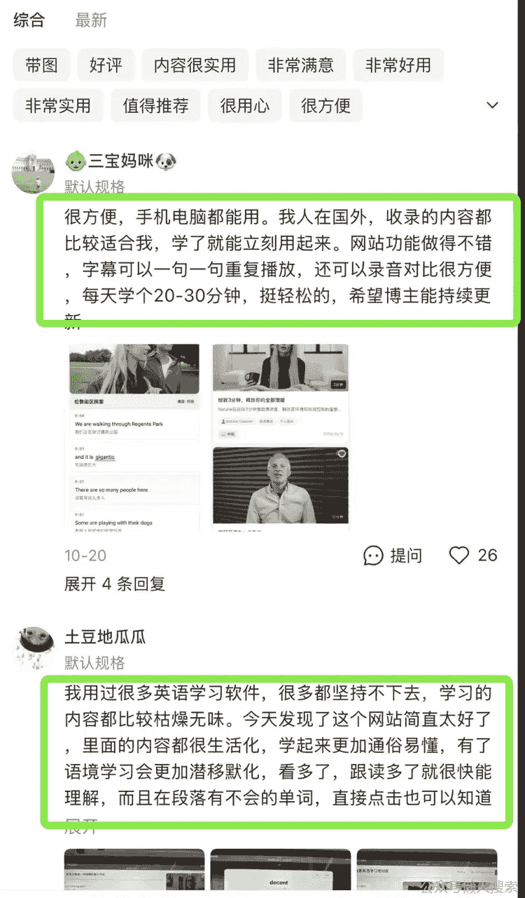

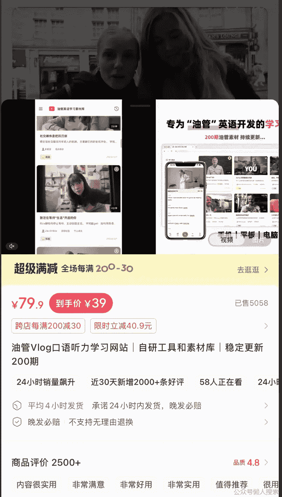

---

## 关卡 3：基础设置：把资料填好，让备案与认证先跑起来

### 00. 这一关要做什么

**目标：**把关卡 2 敲定的方向真正录入🛰️后台，同时让备案和认证两条流程动起来。

**具体动作：**

1. 按既定方向填齐小程序名称、图标、简介。
2. 服务类目必须与真实功能匹配，图省事乱勾会埋雷。
3. 递交备案，盯紧短信核验、电话回访、材料一致性这三处。
4. 提交或走完🛰️认证。
5. 判断要不要申领 AI 小程序成长计划福利：要就领，不要就跳过。

**本关作业：**

• 后台截图（必填），用来证明信息、类目、备案、认证已提交或办理完成。位置：mp.weixin.qq.com。画面尽量把这四项的状态都框进去。

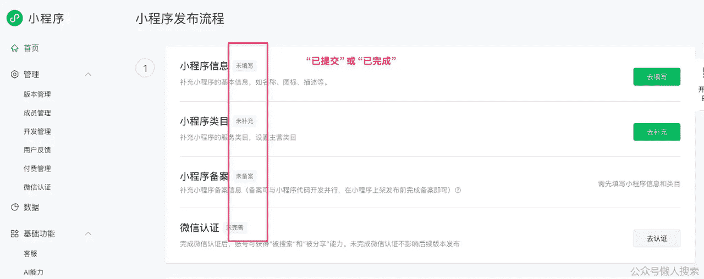

• 聊聊本关收获最大的点，或踩到的坎与破解方式（选填）

PS：备案与认证都要等。交完别干耗，后台审批在跑的时候，你完全可以先推进关卡 4 的编码。

---

### 01. 从填信息到做完认证，全流程实操

顺利的话三五天能出结果，卡壳则可能拖得更久；认证还要额外等审核电话。若把这些留到代码收尾再办，上线节奏很容易被它们拖住。

换个顺序就从容得多：资料先递上去，等关卡 4 代码写完，备案大概率已批下来，能立刻提审。

登录 mp.weixin.qq.com，用关卡 1 注册的账号进入。后台左侧菜单从上往下依次列着四项：小程序信息、小程序类目、小程序备案、🛰️认证。照这个先后次序逐项处理。


#### 1. 先把小程序信息填齐

按已定方向备好三样：名称、图标、简介。动手前不妨参照同赛道竞品的设计。

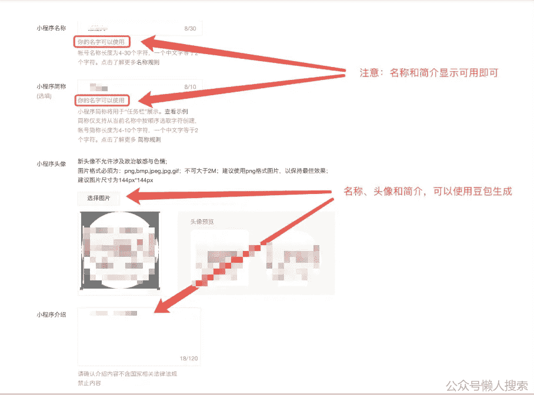

**名称**

一个名字牵动三处：能不能过审、用户能不能搜到、备案资料对不对得上。

先摆两个实例。第一个讲名字过泛的后果。

小 A 做记账工具，取名「家庭记账本」。提交后收到这样的回复：

"由于你申请的名称涉及以通用词命名，故审核不通过，你可以提交《商标注册证》等其他资质。"

直白讲：🛰️认定「家庭记账本」人人可用，辨识度不足。后来他换成「咱家的账本」，加了个有指向性的前缀，才过审。

也就是说，纯行当词要避开。「记账本」「计算器」「提醒器」「日历」「闹钟」这类太泛，审核方会直接索要商标证明。在词前挂个品牌名或限定语，这个坑就绕过去了。

第二个实例讲名字好听却搜不着。

小 B 的喝水打卡应用取名「水润时刻」。单看挺好，既跟水沾边，又带点文艺调子。

问题在于：用户输入「喝水打卡」「喝水记录」「每日喝水」去搜，压根找不到它。

他后来调了两处：

1. 名字改为「吨吨喝水打卡」
2. 简介里补进「喝水打卡记录」这类词

变化来得很快——每日新增来源中，手机端搜索这一栏从零变成了有数。

所以取名时不妨先自问两句：

• 这名字在审核眼里会不会"太泛"？
• 用户要用这类应用时会敲什么词？名字里装进去没有？

另有一条要记住：**个人主体**的名称、简介、以及应用内界面，都不要带"AI"二字，否则备案有被拒风险；企业或个体户不受这条约束。

**图标**

挑一张能一眼看出产品用途的图。

它会与名字并排出现在🛰️搜索结果里——用户扫一眼的工夫，就决定了点不点进来。

暂时不具备设计能力也没关系，可以让 AI 生成一张，但别做得太繁复，等比缩到图标尺寸后仍要辨识得清。

**简介**

简介的作用不止介绍产品，它同样是关键词的落脚处。前面「吨吨喝水打卡」就是现成的例子：用户在简介里读到相关词，一样可能摸到你门口。

落笔前想一件事：当目标用户压根不知道你的应用叫什么，他会输入什么？把这些词顺其自然地嵌进去。

#### 2. 服务类目怎么选

信息备好，接着添加类目。

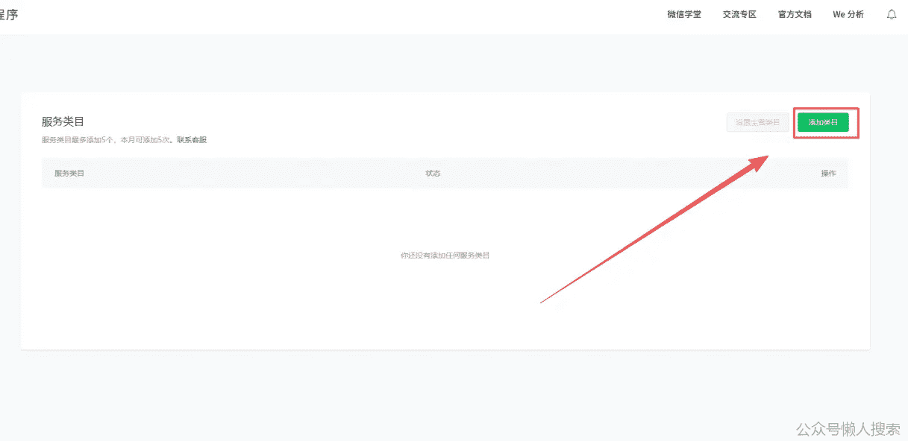

新手做工具型项目，先盯"工具"这一栏。计算器、记录类、效率类的小玩意，大多归在这儿。

但有条红线：所选类目得与应用真实功能匹配，不是想勾哪个勾哪个。

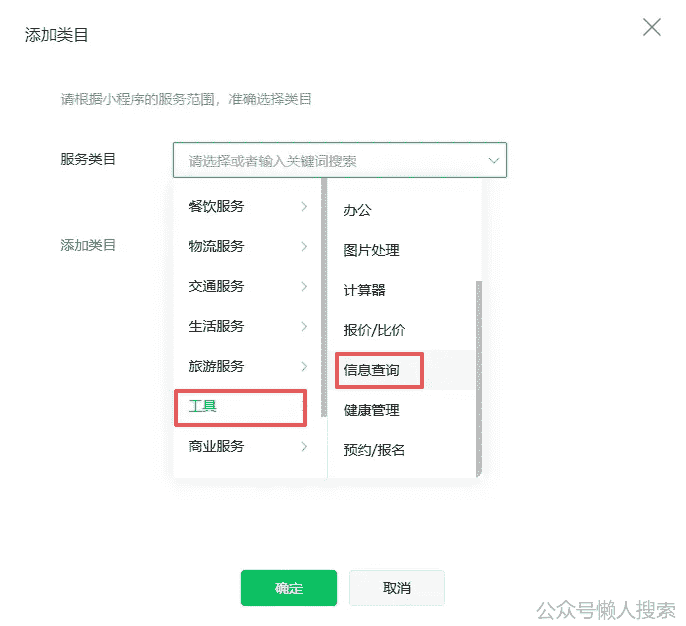

**部分类目设有资质门槛**

下列类目需要附加资质，手上没有就别去碰：

• 食品类 → 食品经营许可证
• 医疗类 → 医疗机构执业许可证
• 教育类 → 可能涉及办学许可证或 ICP 相关资质
• 社交/论坛 → 可能涉及 ICP 相关资质
• 电商/交易 → 主体、支付、资质的要求更繁琐

提醒一句：递交的资质，其主体必须与应用注册主体为同一个，拿旁人的证件给自己备案行不通。

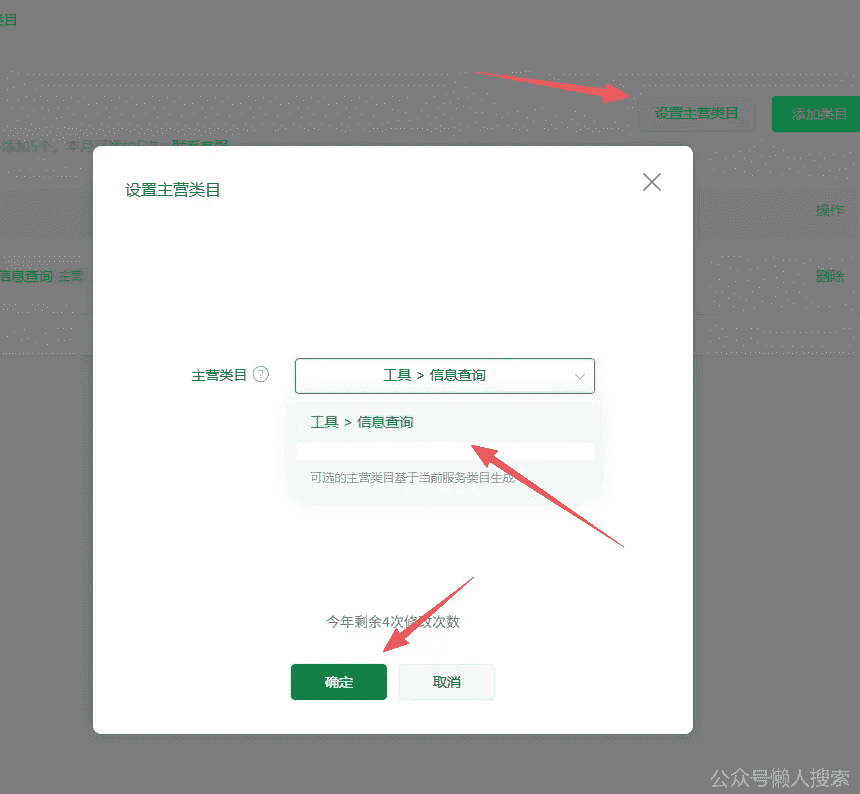

#### 3. 走完备案流程

信息落定、类目勾选完毕，就该办备案了。

无论主体是个人还是企业，不备案就无法上线。流程链条是：

递交初审 → 腾讯侧审核（一到两个工作日）→ 工信部下发短信，点链接做核验 → 管局审核 → 收到通过的短信通知

顺畅的话三五天办结，不过地区不同、材料不同都会影响节奏，拉长到两三周也不稀奇。

**2. 备案之前备好这些**

以个人主体为例：

• **身份证正反面照片**——四角完整入镜，不能反光发虚

• **应用的名称与介绍**——提前定稿，填表时要用

• **一部能接听的手机号**——之后管局有可能打来核实

**3.1 发起备案**

进入🛰️公众平台后台，首页点击"去备案"。

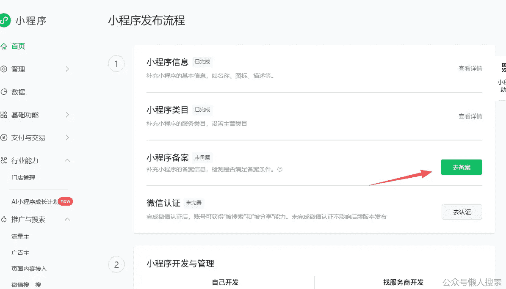

**3.2 录入主体信息**

上传证件正反面，姓名、证件号、联系电话等字段系统会自动带出。要与证件信息分毫不差，错一个字符都不行。

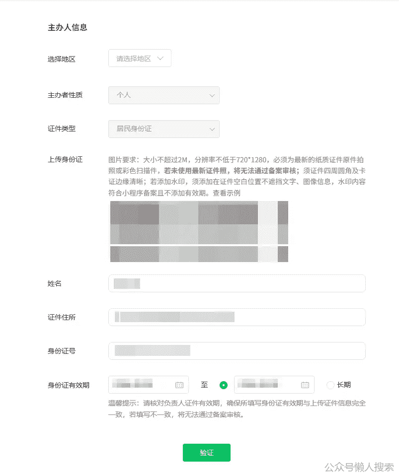

**3.3 录入主体信息**

这里填通讯地址、负责人手机号与应急手机号。注意：该号码此前不能已被别的备案主体用过；初审放行之后，还得去工信部网站回填验证码（网址就在短信里，点开照填）。

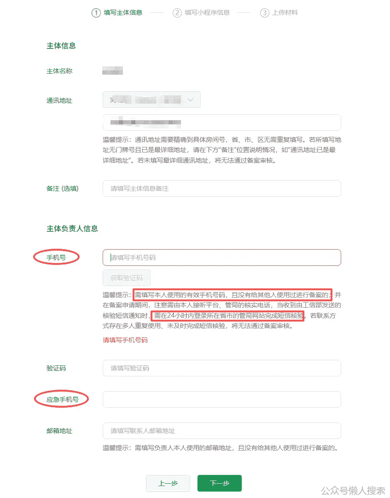

**3.4 录入小程序信息**

服务内容挑一个契合的类目，通常选"生活服务-工具"。备注栏用二十字以上说明用途。随后由负责人扫码完成刷脸验证——背景须为纯白，着装也要整齐。


**3.5 递交备案**

提交之后先由腾讯初审（大致一到两个工作日），过了这关会转往你所在省份的通信管理局做终审。

**审核期内请留意：**

**电话别漏接。**管局有时会在工作日来电，问你的应用做什么、核心功能是什么。照实作答即可，不必紧张，通常也就寒暄式地问几句。

**别急，等得住。**腾讯初审一般一到两个工作日，管局终审通常五到十五个工作日，全流程跑完约一到三周。等待期不是空转期——转身去写代码，备案一过就能直接提审。

**3.6 几个高频坑**

**坑 1：材料不够清晰，被打回**

凡是证件，一律彩色原件拍照或扫描。发虚、反光、黑白复印件，一律退回没商量。拍摄时留意光线，把四角收进画面。

**坑 2：主体信息对不上**

备案里填的名称和主体信息，必须与🛰️后台注册时留存的内容完全吻合，容不得半点出入。

小 A 备案途中改过一次应用名，备案那头没跟着同步——结果被工信部退了回来。所以递交之后别轻易改名。真要改，等备案批下来再动手，然后补一道变更备案。

**坑 3：漏掉短信核验（这一条最要命）**

初审通过后，工信部会往主体负责人和管理员的手机上各发一条核验短信。

你需要在**24 小时内**登入工信部备案官网完成核验。一旦超时，直接驳回，流程从头再来。

所以：短信一到立刻处置，别存"待会儿再说"的念头。另外顺手查一下手机的短信拦截——工信部的通知有时会被当成骚扰信息挡在门外，你压根看不见。

**坑 4：信息变更后 30 天内没更新备案**

主体、负责人或应用名发生变动，须在三十天内提交变更备案，逾期可能被暂停服务。

小 A 把「水润时刻」换成「吨吨喝水打卡」之后，🛰️后台的名字改了，备案那边却还留着旧称。没多久就收到变更提醒——只能再跑一轮变更流程。

**坑 5：电话打不进来**

管局可能在工作日来电核实，问用途和主要功能，照实回答就行，不用慌。

另外——手机上的骚扰拦截先关一关。真有人因为这道拦截，管局的电话始终进不来，卡在这一步白耗了不少时间。

#### 4. 🛰️付费认证

管局备案放行之后，还有一道**🛰️认证**（30 元/年）。它相当于证明"操作者就是本人"，办完之后应用才拿到完整的上线资格。

流程不复杂：填身份证信息 → 缴纳认证费 → 等审核人员来电确认。

**4.1 发起认证**

首页点击"去认证"，进入认证流程。


**4.2 填写资料**

勾选同意协议后即可开始填。核心是负责人的真实性认证；职业信息（选题那一栏）不填也行。


**4.3 核对名称并付费**

个人身份验证完成后，会核对应用名称，通常默认下一步即可。缴费标准：个人/个体 30 元/年，企业 300 元/年。付完等着第三方机构的电话。

**4.4 常见疑问**

**Q：备案时填的名字还能改吗？**

能改，但改名会触发重新审核，所以一开始就把名字想透更省事。

**Q：备案被打回怎么办？**

看驳回理由。最常见的还是信息对不齐——比如名称里多打了个空格、简介中带了敏感词。腾讯初审会给出修改提示，按提示调整后重新递交即可。

**Q：名下多个小程序，是不是每个都得备案？**

是的，一个应用一份备案。好消息是第二个起流程你已经烂熟，速度会明显快起来。

#### 5. 要不要领 AI 小程序成长计划福利

这一步是可选项，并非人人需要。

**先判断要不要后端：**纯前端的应用，不保存数据、不做登录、不调服务器，就不必领。最省事的判断办法：把你的应用和功能描述丢给 AI，直接问它该不该领。

**再判断类目对不对：**该计划只对文娱、工具、社交、深度合成、资讯虚拟这几类开放；类目不在其中，就没有参与资格。

**激励期为 2026 年 1 月 1 日至 2026 年 12 月 31 日**

资源包里都有些什么？

1 亿文生文 Token 之外，还有 6 个月云开发环境、We 分析专业版、广告变现免开发接入；企业版另附虚拟支付优惠。

入口：🛰️公众平台 → 行业能力 → 小程序成长计划。


#### 6. 高频卡点速查

| 卡点 | 先看什么 | 再怎么办 |
| --- | --- | --- |
| 名字被拒 | 回想申报场景，前序动作是否办妥 | 查是否用了纯行当词（"记账本""计算器"）。加品牌前缀或修饰语后重交 |
| 类目被拒 | 回想申报场景，前序动作是否办妥 | 看看功能是否比你以为的多出一环——比如"多人可见"会踩到社交判定。换类目或砍掉该功能 |
| 备案被拒 | 回想申报场景，前序动作是否办妥 | 最常见的还是信息对不上：名称多空格、简介夹敏感词、个人主体名下带"AI"字样。一字一句核验后重提 |
| 短信核验收不到 | 回想申报场景，前序动作是否办妥 | 先翻拦截记录与垃圾箱。24 小时内确认确实没有，联系客服问状态 |
| 认证电话没接到 | 回想申报场景，前序动作是否办妥 | 关掉骚扰拦截，这几天留意陌生来电 |
| 成长计划要不要领 | 回想申报场景，前序动作是否办妥 | 自问两句：数据要不要存到手机之外？要不要调服务器或大模型？要→领，不要→跳 |

---

## 关卡 4：开发实战：让 AI 帮你做出首个能上手的小程序

### 00. 这一关要做什么

💡本关案例主要用来演示思路。

在关卡 2 就已有明确方向的人，不必照着案例走，把自家的 MVP 做出来、提交自己的应用即可。

想找手感练一练的，可以直接跟着做，把案例成品当作业交上来。

**目标：**借助 AI 产出一个能打开、能点、能体验的🛰️小程序 MVP 初版。

**任务清单：**

1. 先把想法讲给 AI 听，让它帮着厘清：谁、在什么情境下、撞上了什么麻烦。
2. 敲定一个最小 MVP，只保留最核心、最便于验证的功能。
3. 用 Codex / Claude Code / WorkBuddy 这类 AI 编程工具，在本地生成项目。
4. 导入🛰️开发者工具，跑通编译与预览。
5. 至少完整走通一回核心链路，比如新增一条记录后，页面数据确实跟着变了。
6. 撞上报错，就把完整报错信息交给 AI 做最小范围修复，直到它不再妨碍体验。

**本关作业：**

• 1 张🛰️开发者工具运行成功的截图（必填）

• 画面尽量同时包含左侧的项目文件树、右侧的预览页、顶部的"编译/预览"区域。能看出页面正常渲染即可。

• 1 张核心功能验收截图（必填）

• 举例：新增一笔咖啡或奶茶记录后，本月花费、杯数、打卡天数、最近记录等都相应变化。

• 说明你的小程序是怎么把问题解决的（必填）

• 贴体验版小程序码（选填）

体验码长期有效，但**只有被加进体验成员名单的🛰️号才进得去**，上限 200 人，需通过验证（会收到服务通知，点确认后即可扫码进入）。

已经上传并设为体验版的，可以交体验码；还没走到这一步，此项可略过。


• 说说本关最大的收获，或踩过的坑与破解办法（必填）

---

### 01. 动手步骤

本次实战选定的方向是：咖啡奶茶记账本。

#### 1. 为什么拿记账来练手

先弄明白这轮实战为什么挑了"记账"。

它未必是最抢眼的方向，但很适合作为第一轮上手的案例。

**理由一：需求面足够宽**

记账这件事，多数人都不陌生：学生想弄清生活费都流向了哪儿，工薪族想掐住支出，出门旅行要算人均，家里柴米油盐、买药、整理小票也都用得着。

**理由二：功能变化看得见**

记账的反馈非常直接。记一笔账，明细里立刻多一行；改个标签，统计页的分类金额随之跳动。对刚上手的人来说，"我动了手，页面立马有反应"这种即时感很要紧。

**理由三：🛰️内部就有需求信号**

在🛰️里检索"记账"，能翻出一批同类应用，有的标着 1000+ 最近使用，有的标着 1 万+。这说明需求并非凭空捏造，🛰️生态中它本就真实存在。

再往下看，这个词底下还有不少变体：

• 普通记账：日常收支流水
• AA 记账：多人分摊费用
• 旅行记账：记录行程开销与人均
• 共享记账：几个人共同维护一本账
• 可爱风格记账：靠猫咪、柚子这类视觉元素削弱记账的枯燥感

由此可以看出：记账并非只有一种做法。人群不同，在意的点不同，MVP 的形态也就各异。

**那为什么偏做咖啡奶茶记账？**

"记账"本身是片成熟的红海：通用产品功能齐全，代价是操作步骤多、长期坚持难。

对新手而言，更聪明的切口是高频、单一、边界清晰的场景。

咖啡奶茶消费频率高、记录动作轻，杯量和所谓的"饮品人格"还自带分享属性。

从红海中切出一块细分需求，讲究的是快：用 MVP 把需求验一遍，做一款饮料记账应用。

何为 MVP？就是最小可执行的产品 Demo——开发快、能上线，拿去给真实用户试用，以极轻的投入判断方向站不站得住、值不值得往下深挖。

接下来，我们就一步一步把这个 MVP 做出来。

#### 2. 本次案例所用工具说明

# 小程序 MVP 落地手记

示范工具选 Codex；换成 WorkBuddy、Claude Code 这类能读工程目录、能落文件、能执行命令的开发代理，流程同样走得通。若只在聊天窗口里生成代码，再手工复制保存，效率会明显偏低。

工具分三档：

- 优先选：Codex、Claude Code、WorkBuddy 等本地开发代理，操作路径基本一致。
- 次选：Kimi、Cursor、Trae 这类支持 IDE、工程目录或 Agent 模式的工具。
- 不建议：纯网页聊天、无法触碰本地工程文件的方案。

挑工具时，看四个能力就够：

1. 能不能读取本地工程；
2. 能不能新建、改写文件；
3. 能不能执行检查命令并拿到输出；
4. 能不能顺着🛰️开发者工具的报错继续修。

## 3. 第一步：先把模糊念头说给代理听

不必先设计功能，先把观察到的麻烦讲清楚。把提示词交给 Agent：```
我想用 AI 快速做一个可以交给真实用户测试的微信小程序 MVP 原型。
我的初步想法是：[填写你的想法或观察到的问题]。
现在先不要设计功能，也不要写代码。请通过结构化对话帮助我澄清需求。
每次只问我一个问题，优先确认：
谁遇到了这个问题；
问题发生在什么具体场景；
用户现在如何解决；
最麻烦的一步是什么；
用户最终想完成什么结果。
最多问 5 个问题。不要讨论技术、商业模式或完整产品规划。
```

它通常会主动追问。

咖啡奶茶案例可以这样开场：```
我发现很多刚开始独立生活的年轻人想了解自己的日常消费，但通用记账软件步骤多，很难坚持。我想先从咖啡奶茶这种高频消费切入。
```

一轮问答结束，代理一般会把原型 MVP 的骨架收出来。若它没有归纳，就让它提炼 MVP 的核心功能，再由你判断是否准确：

## 1. 第二步：用对话收口成 MVP 方案

需求确认后，让代理给一份 MVP 开发方案。下面这段提示词，在任何小程序启动前都能先抛给模型，让它和你一起讨论：```
我确认这个 MVP 方案。请把它整理成一份可以直接交给 AI 编程工具执行的完整开发提示词。
要求：
做成可以交给真实用户测试的微信小程序 MVP；
只保留核心功能，优先简单、快速、一个页面；
请主动补齐具体操作规则、数据计算、异常状态、视觉要求和验收标准；
不确定但会影响产品方向的问题先问我；
普通实现细节由你选择最简单可靠的方案；
现在只输出最终开发提示词，不要写代码。
```

## 1. 第三步：直接落下可运行的本地版本

新建空目录 DrinkExpenseTracker-miniapp，在开发代理中载入这个空目录，再复制下面的提示词。别先建🛰️默认工程，也别先让代理写方案。

**指令：一次产出完整 MVP**

这段开发指令可直接发给 Agent，让它开始做小程序 MVP：```
在该文件夹下创建一个微信小程序。
产品名：咖啡奶茶打卡。用户默认登录，选择饮品类型、杯数和单杯价格，约 10 秒完成当天记录。

只做一个页面：
本月成绩：花费、杯数、打卡天数、平均每杯；金额最醒目；
快速打卡：类型、杯数、单杯价格、总金额、保存；
当前月杯量格子；
饮品人格、里程碑、类型汇总和最近记录；
好友分享按钮和朋友圈分享引导。
记录规则：
类型为咖啡、奶茶、茶饮、果饮、其他，默认咖啡；
杯数用减号/加号调整，默认 1，范围 1—9；
单杯价格提供 9.9、15、18、22、28 元快捷选择，也可自定义；必须大于 0，最多两位小数；
总金额实时计算为杯数 × 单杯价格；
每条记录包含 id、drinkType、cups、unitPrice、amount、date、createTime；
日期默认为今天；保存中禁用按钮，防止重复提交。
杯量格子：按当前月真实天数生成；未来日期为空；同日记录累加 cups；0 杯为空、1 杯浅色、2 杯中等、3 杯以上深色；显示图例。

饮品人格按本月花费最高的类型决定：咖啡=咖啡充电站，奶茶=奶茶快乐星人，茶饮=清醒喝茶派，果饮=水果能量派，其他=随心探索家。并列时先比较杯数，再按上述顺序决定。记录满 3、7、15 个不同日期时显示一次里程碑；不做断签惩罚。

分享：调用 wx.showShareMenu，开启 shareAppMessage 和 shareTimeline；实现 onShareAppMessage、onShareTimeline；好友分享使用 open-type=&quot;share&quot;；朋友圈引导用户点右上角菜单。标题包含人格、打卡天数、杯数和花费。分享不得携带逐笔数据、OPENID 或身份信息；好友进入后只看到自己的数据和“开始我的饮品记录”。


技术：原生 JavaScript/WXML/WXSS/JSON；创建 app、project.config.json、页面和 README；只做一个页面，无 tabBar、无第三方 UI 库。当前使用微信本地存储。建立数据模块，仅暴露返回 Promise 的 addTransaction() 和 listTransactions()，页面不得直接读写缓存。为打开、记录成功、查看结果、好友分享、朋友圈引导、分享进入预留统一 trackEvent()，不记录逐笔金额。

视觉：奶油暖白、咖啡棕，像轻松的饮品手账；金额最大；类型、杯数、价格适合单手操作；主按钮唯一突出；窄屏不溢出。

必须处理空、保存中、成功、读取失败、保存失败和防重复状态。

不做：登录页、手机号/头像/昵称授权、编辑删除、跨月切换、复杂图表、预算、糖度冰量、咖啡因、排行榜、多人账本、AI 小票、支付、广告、后台和多余页面。

固定验收数据（均在当前月）：第 2 天咖啡/1 杯/18 元；第 5 天奶茶/2 杯/16 元；第 5 天咖啡/1 杯/22 元；第 12 天果饮/1 杯/28 元。

固定答案：花费 100.00、5 杯、打卡 3 天、平均 20.00；咖啡 2 杯/40.00、奶茶 2 杯/32.00、果饮 1 杯/28.00；人格为咖啡充电站；第 2、12 天浅色，第 5 天深色。

完成后列出文件、真实检查结果和微信开发者工具导入方法。无法验证的项目标记“待开发者工具验证”。停止，不接云开发。
```

代理接到指令后就开始落地。案例里用到前端设计 skill，可把该链接交给它，要求安装并在开发中使用：https://github.com/anthropics/skills/tree/main/skills/frontend-design 

如果代理只交方案不动手，就回它：停止解释，在当前目录创建完整项目并自检；完成后列出文件清单和真实执行结果，然后停止。

再对照它生成的文件目录（截图 1-1），以及自检输出和待人工核验项（截图 1-2）。

## 6. 在🛰️开发者工具里跑起来

打开🛰️开发者工具，点“导入项目”。

选中代理刚生成的文件夹。

填 AppID，勾选云开发，模式选小程序。

选择信任并运行。

导入后点“编译”。

编译通过就继续调试；若报错，把控制台原始信息交给代理：```
微信开发者工具首次编译报错。
完整错误：[粘贴]
请读取当前项目，定位根因并做最小修复。不要重写产品，不接云开发。修复后报告文件、检查结果和复测步骤，然后停止。
```

之后循环：编译、贴真实报错、只做最小修复，直到页面正常显示且没有阻断性错误。

## 7. 本地 MVP 验收

编译成功后，手机扫码，在真实设备上走一遍。安卓、iOS、华为各跑一次，确认不同机型交互都不出错。

先记一笔咖啡、1 杯、18 元，核对总金额、保存反馈、当天格子、统计和重开读取。

如果结果对不上，就发截图并描述问题，可套这个格式：预期：[填写]；实际：[填写]；控制台：[有 bug 再粘贴]。只处理这两处，别重做页面，也别扩功能。

代理修完后再编译验收，反复到满意为止。

效果：修复前 vs 调完 BUG 后。

不同模型水平不一样，有的一次跑完，有的要多轮沟通。每轮提的问题控制在三条以内。等没有 BUG，最小 MVP 就算完成。

## 8. 社交能力验收与 MVP 上线

开启好友转发和朋友圈。下面提示词可直接复制给代理：```
请检查并完善当前页面的微信分享能力，不修改其他功能：
调用 wx.showShareMenu，开启 shareAppMessage 和 shareTimeline；
实现 onShareAppMessage 和 onShareTimeline；
“发送给朋友”使用 open-type=&quot;share&quot; 原生按钮；
标题包含饮品人格、打卡天数、杯数和花费；
分享路径不得包含逐笔记录、OPENID 或身份信息；
朋友圈不能由普通按钮直接发布，只提示“点右上角 ··· 分享到朋友圈”；
好友从分享进入后只能看到自己的数据，无数据时显示“开始我的饮品记录”；
完成后检查代码，给出好友转发、朋友圈和好友落地的真机步骤，然后停止。
```

在真机上验证好友转发、右上角朋友圈菜单，以及另一位用户能否进入。审核通过前分享受限是正常现象，可等上传发布后再测。

MVP 做完后，在管理后台完成上传，生成邀请内测的码，请几位朋友试用找问题。填好版本号后点上传。

传到后台后，把这一版标记为体验版。

二维码出现后保存下来，邀请朋友参与内测。

问题不大就送审，通过后发布。

## 9. 升级到🛰️云开发

云函数不是非做不可。新手先做纯前端工具，等用户量起来，再升级成云函数。

为什么接云开发？

- 数据仅保存在这台手机，清理缓存、卸载或更换设备都可能丢。
- 同步到云端后，数据会随🛰️号走，换设备也能重新读取。
- 借助 OPENID，云函数能识别不同用户，不必另做登录界面。
- 后端还能复核金额与杯数，减少前端被改数的可能。
- 以后加统计、做运营配置、安排多人试用都更省事。

所以别一开始就接云开发。先拿本地版本试功能、试需求，确认有人持续使用后再升级。

### 第一步：人工先准备这些

打开🛰️开发者工具，环境 ID 要从云开发控制台拿：

1. 从顶部菜单进入“云开发”，工具栏入口也可以；如果还没开通，先点“开通”，创建一个云环境。
2. 进入云开发控制台，鼠标移到左上角 cloud1 上，复制“环境 ID”。

它一般长这样：```
cloud1-8gxxxxxx12345678
```

把整串 ID 复制下来，填到提示词空缺的位置：```
环境 ID：[粘贴]
```

别把它和 AppID、环境名、集合名、云函数名搞混。

3. 先建一个名为 transactions 的集合，并把权限限制为所有用户都不可读写。

在云数据库中，transactions 相当于一张表，用来存放每一笔饮品消费。用户每打一次卡，就往这个集合插入一行，格式如下：```
{&quot;drinkType&quot;: &quot;咖啡&quot;,
  &quot;cups&quot;: 2,
  &quot;unitPrice&quot;: 18,
  &quot;amount&quot;: 36,
  &quot;date&quot;: &quot;2026-07-20&quot;,
  &quot;_openid&quot;: &quot;用户的微信身份标识&quot;,
  &quot;createTime&quot;: &quot;服务端创建时间&quot;
}
```

各列含义如下：drinkType 记饮品类别，比如咖啡、奶茶；cups 是杯数；unitPrice 表示单杯价；amount 表示这一笔总额；date 是消费日；_openid 标明这条数据归谁；createTime 是写入时间。

页面上的本月花费、本月杯数、打卡天数、单杯均价、每日杯量格子、饮品分类汇总以及“饮品人格”，都由这些记录算出来。

操作步骤：

1. 从顶部进入“云开发”。
2. 选已建好的云环境，打开“数据库”，点“+”或“新建集合”。
3. 名称填：transactions。
4. 权限选“所有用户不可读写”，然后确认。

创建过程中遇到卡点，直接问代理；上面这套流程也是我一边请教一边走通的。

完成后，把集合名和环境 ID 提供给代理，由它把代码接上。

### 第二步：代码落地

下方提示词中标黄处要填自己的环境 ID，填完再让代理动代码。

```
当前本地 MVP 已通过。请直接把数据层升级为微信云开发，不要重写页面或先输出长方案。

环境 ID：[粘贴你自己的环境 ID]
集合：transactions

保留现有 UI、打卡、统计、格子、人格、里程碑和分享。页面继续调用 addTransaction()、listTransactions()，只替换数据模块内部实现。
保留现有页面功能。页面继续调用 addTransaction()、listTransactions()，只替换数据模块内部实现。

配置 wx.cloud、miniprogramRoot 和 cloudfunctionRoot；创建 addTransaction、listTransactions 云函数；使用 wx-server-sdk 和 DYNAMIC_CURRENT_ENV。云函数通过 getWXContext() 获取 OPENID，不接受前端 openid；不创建登录页或资料授权。
配置云目录和 wx.cloud；创建 addTransaction、listTransactions 云函数。云函数通过 getWXContext() 获取 OPENID，不接受前端 openid；不创建登录页。

addTransaction 校验 drinkType、cups、unitPrice、amount、date；cups 为 1—9 整数，unitPrice 大于 0 且最多两位小数，amount 必须等于 cups × unitPrice；只写允许字段、_openid 和服务端时间。listTransactions 按 _openid 过滤，倒序返回最多 100 条。
addTransaction 校验类型、1—9 杯、单价、总金额和日期；总金额必须等于杯数×单价，只写允许字段、_openid 和服务端时间。listTransactions 按 _openid 过滤，倒序返回最多 100 条。

数据模块改用 wx.cloud.callFunction 并继续返回 Promise；失败时显示失败和重试，不显示假成功。本课程不迁移本地历史数据。不增加其他功能。
数据模块改用 wx.cloud.callFunction 并保持 Promise 接口；失败时允许重试。本课程不迁移本地历史数据。

完成后检查代码与配置，列出部署步骤；未部署前标记“尚未真实部署”，然后停止。
检查代码并列出部署步骤；未部署前标记“尚未真实部署”，然后停止。
```


### 第三步：人工上传，才算出部署完成

很多人以为 AI 把代码写出来、函数生成好，就等于云端已经跑起来了。其实不是。AI 交出的只是“代码成品”，真正把它推到云端，还要人工完成。

在开发工具左侧找到那两个函数，分别右键，点“上传并部署：云端安装依赖”。随后再对每个函数点“创建与部署”。两步都要人来做，缺了就不生效。


部署完毕后，用手机扫码做一次前端核验：随手加一条记录，然后去函数控制台看数据区域有没有新条目。能看到新增，就说明后端已正常接通。


### 第四步：遇到 BUG 再让 AI 修

调试时可以这样写 Prompt（下方是纯文本）：

```
当前问题：[描述]；
预期：[填写]；
实际：[填写]；
完整报错：[粘贴]；
最近修改：[填写]。
请先定位根因，再做最小修复。不
要重写无关文件或增加功能。报告修改、检查结果和复测步骤后停止。
```

原则就四条：需求一次讲全；真跑起来再定位；本地能通再连云端；拿不出真实结果，就不算修复。

---

# 关卡 5：送审与上线：从提审到全量放出

### 00. 本关任务

**目标：**把关卡 4 做出的 MVP 往前推，走完🛰️的送审、过审与正式发布。

**任务拆解：**

1. 送审前，先把基础信息、类目、备案、认证、隐私协议这些前置项过一遍。
2. 用开发工具把代码传上去，填好版本号和本次备注。
3. 登录平台后台的版本页，找到刚传上去的开发版。
4. 版本描述要写清楚：这工具做什么、核心能力是什么，方便审核员判断。
5. 送审后盯着结果，被驳回就查原因，再让 AI 针对性调整。
6. 过审后手动放出，并验证用户能搜索、打开、正常使用和分享。

**本关作业：**

- 必交 1 张公众平台版本页截图，状态需要是“审核中 / 审核通过 / 已发布 / 已提交审核”之一。常用路径：mp.weixin.qq.com → 管理 → 版本管理。
- 选填：写一下这关最大的收获，或者卡在哪里、怎么解决的。

PS：审核和发布可能要等，所以本关最低提交线是完成“上传/送审”动作；过审后的正式放出、搜索验证和分享验证，可以继续往后推。

### 01. 送审之前

先建立认知：本地能跑 ≠ 已经上线。开发工具里的预览和真机上的临时体验，都不算数。🛰️审核团队会真实打开你的工具，看功能可不可用、类目对不对、页面有没有实质内容、隐私协议有没有铺。过审并手动发布之后，所有🛰️用户才搜得到。

如果关卡 3 的备案和认证已经下来，可以直接送审；如果还没下来，别干等，先继续打磨产品、准备推广内容，等条件齐了再回来。

送审前，确认四件事：

1. 关卡 3 的基础设置已搞定：应用信息、服务类目、备案、认证。备案没通过，就接着修产品和备推广素材，别在这里死磕。
2. 核心链路在开发工具里能完整走一圈：不是“应该没问题”，而是从进来到出去每个环节都实际跑通。
3. 至少做过三次真机测试，安卓、iPhone、华为都要碰。有个开发者只用安卓测，后来朋友拿 iPhone 打开，页面样式垮了，原因就是刘海屏。模拟器不等于真机，差距很大。
4. 如果会收集用户信息，隐私保护指引已经配好：路径是设置 → 基本设置 → 用户隐私保护指引，收集哪些数据、做什么用、如何保护，如实写。这项没有，必被拒。不登录、不采集任何信息的工具，可跳过。

### 02. 上传代码

打开开发工具，右上角有“上传”按钮，点击后要填两个字段：


- 版本号：初始版本写 1.0.0，之后递增，比如 1.0.1、1.1.0。
- 版本备注：一句话讲清这一版做了什么，比如“首个版本，含核心功能”。

确认后，代码会自动打包上传，一般几秒完成。然后打开 mp.weixin.qq.com → 管理 → 版本管理，在“开发版本”里就能看到刚传的包。


### 03. 提交送审

在版本页找到刚才的开发版，点击“提交审核”。


这里需要填：

**版本描述**：讲明白你的工具是干什么的、核心点是什么。审核员要通过这段话快速理解产品，所以越具体越好。


参考两个例子：
✅ “电子木鱼工具：点击屏幕模拟敲木鱼，带功德计数和敲击音效。”
❌ “一个小程序。”——这种大概率被拒。

**测试账号**：如果你的工具需要登录，记得给审核员留一个测试账号；纯工具类不用登录，这栏可以直接跳过。

再给一个实用建议：送审时附上功能流程截图，描述尽量完整，被卡住的概率会小很多。

### 04. 等待审核

送审之后，由🛰️审核团队按顺序处理。通常 1—3 个工作日，顺利的话当天能出结果。

审核员是真人在手机上打开你的产品，逐项检查：

- 功能是不是正常运转（真人试用，不是机器扫描）；
- 类目选得对不对；
- 有没有违规内容，比如色情、暴力、诱导分享；
- 该有的隐私协议有没有；
- 页面算不算“空壳”——如果只有一个按钮加几行字，很可能被判“无实质业务服务”。

时间上，工作日通常更快，周末和节假日可能会慢一两天。

### 05. 被驳回怎么办

第一次被驳回是常事，连续被拒 2—3 次也很正常。重点是看懂拒因，改完再提。

常见拒因和解法：

**① 功能太简单 / 无实质业务服务**
最常遇到。审核员对“空壳型”产品容忍度很低。页面内容少、功能太薄，容易被判没实际价值。解法：适当加料，比如电子木鱼被拒，可以加功德排行榜、每日功德统计。不用做复杂，让它看起来真有用途即可。

**② 类目不符**
当前类目和实际功能不匹配，重新选正确类目再送审。关卡 3 提过“多人记账被判社交属性”的案例；边界模糊时，可以在审核反馈里解释并附截图，有概率被捞回来。

**③ 缺隐私协议**
只要拿了用户信息，哪怕只有头像和昵称，都要有隐私协议弹窗。解法：让 AI 写一个隐私协议页面，再去后台设置 → 基本设置 → 用户隐私保护指引，按模板如实填。

**④ 内容踩线**
算命、占卜、运势类内容，可能被划成封建迷信；虚拟支付和个人主体的小游戏，🛰️也不给过。有人想做游戏攻略类工具，发觉个人主体根本没法做，最后放弃。

**⑤ 体验有问题**
页面加载不了、核心按钮点不动、iOS 和安卓表现不一样。解法就是送审前真机多测，安卓、iPhone 各来一遍。前面那个只测安卓、在 iPhone 上刘海屏样式崩掉的例子，就是教训。

**⑥ 虚拟支付个人主体不支持**
个人主体的产品不能开通虚拟支付。用 Web-view 套外部页面，审核也会失败。凡涉及收费，要么去掉，要么升级企业主体。

**⑦ 内容安全接口没接**
如果你的产品没有用户生成内容，这条可忽略。但只要有 UGC，比如用户上传文字、图片、评论，就必须接🛰️内容安全接口（msgSecCheck/imgSecCheck）。不接，审核必拒；上线后被投诉还会被下架。

**被驳回后的处理流程**

别着急改完重提。先把拒因归类：

- 类目不对 → 换类目再交；
- 内容被误解 → 在“审核反馈”里写清楚，贴截图，尝试申诉；
- 资质不够 → 补材料再交；
- 功能有问题 → 修好再交。

一条心得：审核是人在看，多沟通、坚持申诉，很多问题有转机。被打回一次就放弃，太亏了。

### 06. 正式发布与验证

过审后，产品不会自动上线，必须手动操作。在版本管理页，过审的版本会进到“审核通过版本”区域，点“全量发布”，应用才正式公开，所有🛰️用户都能搜索到。

发布完成后，立即做两件事：

**验证可用性：**

1. 自己在🛰️里搜应用名，确认能搜到、能进、能用。
2. 分享给几个朋友，请他们打开试试，看有没有你漏掉的问题。
3. 看看分享入口能不能正常拉起。

**配置基础变现：**

- 流量主：mp.weixin.qq.com → 左侧“流量主” → 开通 → 选“免开发智能接入” → 立刻确认封面广告已开启。这是影响收入的关键开关。


**后续更新**

更新流程和首发一致：改代码 → 上传 → 送审 → 发布。通常第二次及以后的审核更快，因为审核员已经熟悉你的产品。

更新技巧：每次只改一两个功能，别攒一大堆再交。改得少，过审更容易，出问题也更好定位。

---

# 选修篇

## 关卡 6：推广启动：让第一批用户用起来

### 00. 本关任务

**目标：**把已经正式上线的产品推向第一批真实用户，拿到真实的反馈或数据。

**任务拆解：**

1. 挑 1 个当前最合适的推广渠道：朋友圈、🛰️群、相关社群、评论区、📕、贴图号、👸号都可以。
2. 用用户语言介绍产品：用户遇到什么麻烦，它怎么解决。
3. 把产品发给一批真实用户，让他们打开、体验、给反馈。
4. 看一次后台数据或用户反馈，判断大家愿不愿意点、看不看得懂、留不留得下。
5. 反馈不错，再定一个固定推广节奏，比如每天发贴图号、每周更新👸号、持续做评论区触达。

PS：这是选修篇，不交作业。重点不是起步就爆款，而是让真实用户摸到产品，开始验证。

### 01. 推广思路

产品上线后没人用，方向对不对就没有参考。这一关不是追求爆火，而是把产品递到真实用户手里，获取反馈和反应。用户不会自己冒出来，上线后要做的就是扩大触达面。

**1. 冷启动：朋友圈和社群**

🛰️里做冷启动很容易，因为转发到朋友圈和群聊非常方便。产品一上线，就可以从用户视角发出去：我遇到了什么问题，这个小工具怎么帮我。别搞硬广，要用“分享礼物”的心态，而不是“推销”的心态。

先把身边的资源用起来，冲一波初始量，然后看数据：留存怎么样，新增有没有。数据好、还有持续增量，再考虑扩出去。

**2. 找有流量的人带**

2.1 联系相关领域的👸号小号博主：去后台私信或评论，请对方当用户给反馈，甚至可以约一篇体验文。成本不高的话，效果很不错。
2.2 进相关社群分发：在📕或🛰️里搜同名社群，加进去发产品。有被踢的风险。
2.3 发动身边人，特别是长辈：长辈们爱分享也爱转发。把产品价值讲明白，请他们转到不同群。

适用阶段：适合产品已经验证、有一定积累后放大；前期可以让家人帮推群，也可以闲鱼找人代发朋友圈或群，但要花钱。

**3. 评论区截流**

3.1 操作方式：

每天刷📕、抖音时，用产品目标关键词去搜，找素人帖子。碰到内容相关的，就点赞、收藏、评论。算法会判定你感兴趣，持续给你推同类人群和话题。之后打开平台，常能看到目标用户。

评论时别硬推，要自然种草。比如有人正好聊到这个选题，你可以把功能截图发过去；等对方追问，再告诉他搜索哪个名字。

3.2 真实例子：

我有一段时间关注纳指和标普 500 定投，平台天天给我推相关帖子。某天看到一条讲纳指、标普溢价的帖子，评论区有人发了一张小程序截图，能显示各类场内 ETF 的溢价率。有人问这是什么工具，他自然说出名字。我看了也种草，主动搜了并加了收藏。

这就是很自然的流量引导：不违规，因为它本质上在给目标用户提供价值，而不是硬广。

评论区还有一个优点：其他相关用户看到对话，也会主动去搜。相比做图文内容，评论区更主动地触达目标用户，而且账号有没有粉丝、是不是小号都不影响。隐蔽性也更好：做内容营销容易被竞品看到并模仿，到处评论反而不易被追踪来源。

目前来说，不要太直白地提产品名，每天 5—10 条评论，效果和安全度都不错；量再大盘有没有风险，还没有定论。

**4. 内容种草**

4.1 精准引流：内容要贴住目标用户关心的话题。

前期如果把用户评论挖得够深，写内容会轻松很多：你知道他们在聊什么、痛在哪，直接用他们的话来说。

需要注意两点：

- 围绕痛点写，别介绍产品：先讲用户遇到什么卡点、想达成什么目标，再说产品能怎样帮他们。这样写，种草文的转化率更高。
- 早一点建📕群聊：每篇帖子都挂上群聊，让感兴趣的用户更容易找到你、联系你。

4.2 同行流量：很多想入局做小程序的人，其实也在关注别人产品跑出的数据。

新上线的小程序通常最头疼的是没有第一批种子用户。有个取巧的思路：把自己的访问统计晒出来，好奇的人就会搜过来看看。这些人未必精准，但用来凑够 500 个初始 UV 足够了。比如发一条求助动态：“刚做完的小东西，一点自然流量都没有，哪位前辈能帮忙诊断一下？”一旦有人因此搜索，🛰️会捕捉到这个行为，后续可能给你一点自然曝光。等产品跑起来后，就别再晒收益和核心数据了；实在要展示，也别暴露产品本身，不然被眼红的同行抄走只是一夜之间的事。

把公域流量变成自己的资产，最直接的动作是建私域社群。👸号、📕、抖音都能建，不一定非得导到个人🛰️。关键是主动把用户圈起来，尽早跟用户深聊、收集反馈，这样才能知道产品是不是真被需要、能不能长期留住人、还有哪些痛点没解决。另外，在小程序内部放群号文档，或者通过客服入口引导加群，也是常见的导流方式。

---

### 02. 🛰️里的产品推广：图文号+👸号组合

工具上线只算完成一半，剩下的一半是让人们真正打开它。在🛰️做推广不必铺太多渠道，两条线就够：图文号做高频、轻量的刷脸，👸号做深度解读和信任积累。两者节奏配合，就能形成完整的获客链路。下面按操作顺序展开，直接照做即可。


1. 图文号：让应用以“笔记”的方式被刷到

图文号实际上是🛰️内的笔记流，不要求你积累粉丝。每次发布就像买一张彩票，发出后自动进入公共推荐池，最终触达多少人，完全看内容自身的吸引力。


1.1 首先想明白：用户为什么愿意停下

刷推荐流的用户每分钟会略过几十条内容，凭什么你的信息能让他按住手指？答案只有一个：内容与他有关。不是与你的产品有关，不是与功能介绍有关，而是与此刻刷屏的那个人有关。他正被某个烦恼困住，或正好对某件事产生好奇，你的内容恰好击中了他的状态。因此写图文号时，别盯着“全体用户”，要在脑子里刻画一个具体的人——正处在某个生活场景、面临某个明确问题的人。

1.2 五个现成的内容脚本

下面的示例统一用一款“宠物喂养助手”来演示，换成你自己的工具也成立。

第一个：替用户说出烦恼。先把一个让人咬牙的场景具体描出来，再引出你的解决方式。“每次走进宠物店买猫粮，看着配料表一头雾水：粗蛋白、粗脂肪、灰分这些数字到底读到多少才算合格？后来发现有个工具，用手机拍一下配料表，马上给出评分，还会标出不及格的项目。现在选粮不用再猜了。”配图放拍照识别的界面和评分结果，重点数据画圈标注。

第二个：抛出一个引人验证的反直觉结论。用一个出乎意料或带争议的说法制造好奇，让人想亲手验证一下。“原来我家猫每天的投喂量多出了三成，怪不得越来越胖……你们也可以算算，输入品种和体重就能知道答案。”配图放超标对比。用户看到别人家的结果，第一反应往往是“我家的呢？”

第三个：记录时间带来的变化。用前后时间的对比展示持续使用的成效。“用喂养助手调整食谱两周，左边是之前的体检报告，右边是刚出来的复查结果，最明显的是毛色和精神头变好了。”配图做一张前后对照拼图。这种内容的说服力远超任何硬广。

第四个：盘点式清单。用“你可能不知道的N件事”制造信息差。“养猫第一年才弄明白的4件事：①猫粮不是越贵越好，认准配料表前三位；②每天的饮水量能按公式算；③不同年龄段的营养需求差很多；④驱虫日期靠脑子记早晚会忘。现在这些全交给一个小工具。”每张图讲一个知识点，最后一张放应用界面。

第五个：引导评论区讨论。把用户拽进对话，用互动数据推高推荐权重。“做了一张猫咪分阶段营养需求对照表，你家主子现在处在哪个阶段？在评论区留下品种和年龄，我帮你查建议食谱。”这条内容的目标不是直接转化，而是先攒评论。回复时顺嘴带一句“用XX助手可以一键生成食谱”，比在正文里硬推自然。


1.3 封面的第一眼胜负

图文号的封面就是入口，用户决定点开还是滑走只有零点几秒。封面上必须一眼能看出主题。如果是密密麻麻的截图，他看不清就划走了。要么放大关键区域，要么做张带大字标题的封面。用手机自带的标注工具画箭头、加文字即可。色彩要有跳跃感。推荐流背景是白色，浅色封面容易“隐身”，用饱和度高些的底色或边框做视觉强调。别用纯文字当封面。图文混排的封面明显更容易收到点击，哪怕是手机截图加三个大字的标题，也比一段文字配白底强。

1.4 标签怎么选

标签帮平台判断分发对象。采用两层结构：一层是品类词，比如“养猫”“猫粮”“宠物”；另一层是内容类型，如“实用工具”“生活技巧”“经验分享”。两层交叉，算法就能把你的内容匹配给兴趣相符的人。每条笔记配3个标签，不多不少。太少匹配不够准，太多会让平台摸不清你的领域。

1.5 稳定更新比灵感更重要

别等“灵感来了”再更新。把上面5个框架做成一张排期表，按天轮流使用。素材不够，就把同一个框架换换数据、换换截图，也是一条新内容。固定时段发布同样有好处：平台更青睐有规律的创作者，会给予更稳定的基础推荐，而不是让你靠运气等爆发。

2. 👸号：用深度内容完成从信任到转化

图文号解决“被看见”，但看见不等于信任，更不等于长期使用。👸号的作用，是把用户从“知道”推向下定决心。用户可能在图文号里刷到过你的应用，觉得有意思，但还没准备好深度体验；这时他再读到一篇👸号长文，把工具的来龙去脉、使用价值讲透，他大概率会去认真试一次。此外，👸号本身能接广告，阅读量起来后，文内广告本身就是收入，推广产品的同时还能赚钱。

2.1 选题逻辑：回答用户会搜的问题

👸号内容与图文号的本质区别在于它有搜索长尾。一篇好文章不只是发布当天有阅读量，之后还能通过搜一搜反复被发现；用户关注后，后续更新也会持续出现在他面前。所以选题应该围绕“用户主动搜索的问题”。还是拿宠物喂养助手举例：

- “刚满月的幼猫该多久喂一次？”
- “猫粮包装上的指标到底怎么理解？”
- “怎么判断自家猫是不是超重了？”

这些题目本身就是高频搜索词。用户遇到困惑时，第一反应是去搜一搜，你的标题命中他的疑问，点进来的可能性自然高。

2.2 写文章：三段式足够

不用写成论文，三段式最实用。开头段：触发共鸣，100字内。用具体场景开篇，让用户觉得“这就是我”。别写“很多养猫人不清楚怎么喂”，要写“接回家一只两个月大的英短，站在宠物店猫粮货架前懵了——几十个牌子，价格从30到500，到底怎么选？”主体段：给出解法。用干净利落的逻辑把有用信息讲完，并在需要动手操作的地方自然放入应用卡片。比如讲到“按猫咪体重计算每日喂食量”时，直接插入卡片并写一句“点这里输入体重，自动帮你算”。用户读到这里逻辑顺畅，点卡片顺势而为，不觉得被打扰。结尾段：抛一个开放问题或预告下期，引导留言和关注。“你家猫平时吃什么猫粮？踩过什么坑？评论区聊聊，下期专门写一篇避坑指南。”全文控制在800字左右。🛰️后台会统计完读率，800字是多数人能耐心看完的长度。写太长完读率下跌，推荐算法对文章的评价也会大打折扣。


2.3 标题是打开率的命门

在推荐流里，用户只看得到标题和封面。标题失败，内容再好也没人看见。几个被验证有效的标题结构：

数字+具体问题：“猫粮配料表里的5个关键指标，看懂了不再被忽悠”——数字制造确定感，具体问题让用户对号入座。

反常识：“兽医说90%的猫主人都在过度喂食”——挑战固有认知，让人想问“我是不是也这样”。

时间+实用承诺：“3分钟学会看懂猫粮配料表”——降低阅读门槛。

避坑/排雷：“新手养猫最常见的喂食错误，我全踩了一遍”——人对损失的厌恶远大于获得喜悦。

标题里最好带上目标用户会搜索的词，既帮算法理解主题，也能让文章在🛰️搜索中获得更长生命期。

2.4 推荐量怎么放大

👸号推荐系统是逐轮筛选的：先给一批基础曝光，看点击和互动；表现好就进入更大的池子，再跑一轮数据；以此类推。你能掌控的环节只有三个：

点击率，取决于标题和封面。封面用横版16:9，内容要呼应标题。比如标题讲“猫粮配料表怎么看”，封面就放一张标注过的配料表特写，放萌猫图虽然好看但不相关。

完读率，取决于内容密度。开头不要拖沓，前两段就要给出干货。用户耐心会持续消耗，你越早兑现标题的承诺，他越可能读到结尾。

互动率，取决于结尾的引导。只写“有用就点个赞”效果有限。更好的办法是抛出让人有表达欲的问题：“你家猫最爱吃什么粮”比“觉得好请转发”讨论量高得多。有讨论就有互动数据，有互动就有更大推荐。

3. 两条线互为放大器

图文号和👸号各做各的只是两个渠道，组合起来才是一个有飞轮的系统。

3.1 用图文号验证选题方向

不确定某个话题值不值得做？先发一条图文笔记试水温。如果这条内容的收藏、互动明显高于你的平均水平，说明方向成立，围绕它写一篇👸号长文，表现也不会差。这比凭感觉选题稳妥，图文号相当于免费的市场问卷。

3.2 用👸号反哺图文素材

一篇👸号长文的信息量，足够拆出四五条图文笔记。比如一篇《猫粮选购全指南》，讲蛋白质的那段可以独立发一条，讲添加剂的那段又能发一条。同样一套知识，长文在👸号发一次，碎片在图文号发多次，触达的是不重叠的人群。

3.3 两号互相导流怎么做

图文号结尾加一句：“完整的选粮方法我整理成长文了，👸号搜XX就能看到。”👸号结尾加一句：“我每天会在图文号分享一条养猫知识，关注XX就行。”这不是硬推，而是在用户已经产生兴趣的节点，告诉他另一个入口。

4. 第一个月的执行节奏

初期先跑通流程，之后进入稳定期：图文号坚持日更，👸号保持周更。别追求单条爆款，重要的是持续出现在推荐流里，靠时间换取覆盖面。

5. 需要提前纠正的几个认知

内容不用完美也能发。花两小时打磨和花十五分钟写完，在算法眼里可能相差无几。算法看的是用户反馈，不是制作精细度。先发出去，再慢慢优化。

一个卖点可以反复讲。你会觉得重复，但每天刷到你的用户是不同的人，对他们来说这是第一次。别怕重复，怕的是你提前腻味。

数据有延迟。今天发的笔记，可能三天后才起量。当天没反应不代表失败，一周后再看，也许有惊喜。

但如果你持续推广很久仍然没有用户，问题可能出在应用本身。推广解决的是“看不见”，解决不了“看见了但不想用”。后者是产品层面的事。当你确认曝光足够而转化始终不行时，与其继续投精力放大推广，不如退回去审视产品是否真的解决了某个真实痛点。

最后说一句：推广没有速成法，只有持续积累。你今天发出的每一条内容，都是为明天的某个用户铺路。路铺得越远，竞争壁垒就越厚。

---

## 关卡 7：数据复盘与方向取舍

### 00. 本关要做什么

目标：结合真实数据和用户反馈，判断接下来应该继续深耕、优化迭代、调整获客方式、更换赛道，还是先搁置。

任务：
1. 在后台或第三方分析工具（如官方分析、运营后台、用户反馈记录）中查看数据。
2. 把新增人数、用户从哪儿来、留存和回访情况作为核心指标。
3. 观察是否有人通过搜索找到你。如果自然搜索很弱，回查产品名称、关键词设置和用户实际搜索习惯是否一致。
4. 观察自发分享的比例。如果分享来源极少，就要想产品里有没有让人主动转发的理由。
5. 判断需求是否真实。如果用户来了但留不住，要分清是触达不够，还是需求根本不强。
6. 最终给自己一个明确的结论：继续做、做迭代、换推广、换方向或暂停。

PS：本章属于选读内容，不用交作业。更像是一次产品复盘，把你从“我以为还不错”拉回到“数据怎么说”。

### 01. 行动流程

先在小程序里接入🛰️官方的数据产品，比如“We分析”，之后用手机就能随时看到数据变化。

盯着三个数字就够了：一是每天的新增用户数量；二是新增用户从哪进来，群聊、搜索还是单聊；三是用户用完之后还会不会回来。

围绕这些数据，做三层判断。

第一层：有没有搜索带来的自然流量。如果几乎搜不到，说明产品并没有吃到🛰️搜索的红利。解法是结合🛰️指数，找出有一定搜索量的关键词，把它们放进小程序名称或简介标题中，让产品和用户的搜索词更匹配。

第二层：有没有用户自发分享。如果群聊、单聊里的分享占比很低，就要在应用里设置分享激励。例如，用户完成一次核心操作后弹出分享引导；或者设定某些功能必须转发后才能解锁，以此触发裂变。

第三层：需求是不是高频且刚需。如果产品属于用完即走的工具类，留存很弱，那只能不断寻找新流量。如果用户会经常打开，广告收入就有保障，这时候重点应该是扩大新客来源，同时撬动老用户带新。可以建立核心用户社群，把高活跃的人聚起来，再设计积分或福利，让他们愿意主动帮你传播。

---

## 关卡 8：变现闭环——打通收入渠道，赚到第一笔钱

### 00. 本关要做什么

目标：结合你的产品形态、用户体量、账号资质和目前的数据反馈，找出现阶段最适合的变现方式。

任务：
1. 先看产品是否已经到了变现阶段：有人稳定在用，还是需求还没验证完。
2. 如果商业模式适合流量变现，优先研究🛰️流量主，查看自己是否符合开通门槛。
3. 如果打算做会员、订阅、付费功能、课程、工具次数或服务交易，先确认账号主体和支付合规能不能支持。
4. 变现入口要放在用户已经体验到价值之后，别一进应用就弹出付费，打断核心体验。
5. 最后决定下一步：立刻开通、先补齐资质、继续养用户，还是暂不变现。

PS：本章并不要求所有人都开流量主或做订阅。新手完全可以从试错成本最低的方式起步，关键是找到与产品匹配的收入模型。

### 01. 🛰️流量主（新手首选）

为什么推荐从流量主开始？因为它门槛低、不需要营业执照。等模式跑通想追加付费能力，再把个人主体升级成个体户或企业号，之前的认证费用不会打水漂。

开通条件很简单：累计独立访客达到500人，同时没有任何违规记录。达标后，到🛰️公众平台后台的“推广–流量主”页面提交申请即可。

1. 广告类型与收入


开通之后后台会列出多种广告位，建议优先关注以下三类：

开屏广告：用户启动应用时看到的整屏广告，这是最主要的收入来源，每次展示大约能带来0.5元。不少人开通后没意识到开屏广告要手动打开，凭空少赚了很多。所以开通以后第一件事就是确认开屏广告已经开启，这一点值得强调好几次，踩坑的人实在太多。

激励视频：用户自愿观看15到30秒的广告，换一个功能或奖励，单次约0.2元。适合放在解锁高阶能力、查看完整报告等位置——这时用户已经用到了产品、感受到了价值，愿意用看广告换取更多好处。

插屏：在页面跳转或特定动作时弹出的半屏广告。单价不算高，但无需用户主动触发，比较自然，适合当作补充收入。

横幅广告收益最低，一次只有几厘钱，觉得影响体验可以直接关掉。

2. 接入方式：免开发 vs 开发

2.1 免开发智能接入（推荐新手）

2.1.1 开通后系统会弹出接入广告的模式选择。首个应用选“智能接入”就行，不用改任何代码，广告就能正常显示。


2.1.2 用🛰️扫掉弹出来的小程序码。扫码后手机端会打开你的应用，并自动帮你算出最适合放广告的位置。


2.1.3 在手机上微调广告位和样式。选定位置和样式，点确认使用，再点完成。


2.1.4 复查广告位。点击“下一步”，刚才创建的广告位会显示出来，确认无误后开启就完成了。


## 2.2 进阶玩法：自己动手配置广告槽位

### 2.2.1 广告槽位建档
进入小程序管理后台，打开流量主模块里的广告管理页，找到新建入口，先建一个广告槽位。


### 2.2.2 挑类型，先看展示样式
不同形态的广告，露出方式不一样，右侧一般会配示意图。我们实测下来，插屏、激励这两类单价更亮眼，其他形态进账相对偏薄。


### 2.2.3 给槽位起名并确认
名字只要能让自己在后台一眼分辨就行，样式按个人偏好调，最后点确认。


### 2.2.4 拿到对应代码
建好之后，在所选类型下面会列出刚生成的项，点它右侧的按钮拿代码。


### 2.2.5 把片段交给 AI 接入
按下复制，把剪贴板里的内容贴进 AI 对话，让它帮你完成接入开发。


起步阶段别贪精细：先用智能接入把流程跑顺，等你对广告摆位和用户反应有手感，再换自主接入慢慢抠细节。

# 3 钱款如何结算
后台数据会在每天上午八点到十点之间刷新，展示的是前一日金额，能细到分。

结算日定在每月 1 号和 15 号，各结一次。腾讯先代扣个税，随后七个工作日内入账到你绑定的银行卡；首次提现前，要先在后台把银行卡信息绑好。

## 3.1 收入提升：我踩过坑后的几条经验
我陆续做过十几个小程序，下面几条是真正影响进账的：

**封面广告先开起来。**它是收入大头，往往能超过总进账的一半；先确认它没被关掉，仅这一项，常常比反复调其他广告更有效。

**激励视频卡在用户最想继续的瞬间。**核心功能用完、需求还没被满足时，看广告的意愿最高。以测试类小程序为例，把详细结果锁在激励视频之后：测试都做完了，用户为了看结果，等上半分钟一般能接受。

**核心体验不能被广告破坏。**这是红线。若用户一进来就满屏广告、操作中反复弹窗，卸载会很快发生；丢一个用户的代价，高于多一次曝光带来的收入。理想状态是：广告有存在感，但不惹人烦。

**收入起落别慌。**单价会随广告主预算变化；Q4（双十一、双十二）常是全年高峰，年初相对淡。同款产品在 Q4 的日均进账，有时能达到年初的 2 至 3 倍。不用因短期起伏焦虑，重点看月度和季度趋势即可。

**多铺几个小程序分摊风险。**只靠一个产品，遇到投诉、审核规则调整或用户迁移，收入可能骤降；手里有五到七个在跑，单个出状况对总体的冲击就小。

---

### 02. 订阅制：免费用量拉新，会员权益留存
它的底层逻辑可以概括成：先用不付费的用量把用户带进来，再靠会员价值把他留下。

产品设计上，守住三条即可：

• 页面别塞广告，干净顺畅本身就是卖点
• 免费用量要拿捏好：让用户刚尝到好处，又明显不够
• 首次付费别设太高，月付通常比年付更容易让人试第一单

2026 年 3 月那期《🛰️小程序产品开发》航海，曾介绍过在📕开店卖货的玩法。但眼下，靠📕“免费内容/自然流量”直接成交，或把用户往🛰️小程序引，已经很难走通，风险很高；仅有“付费广告/官方工具”中的特定合规通道，才可能获准跳转。

自 2025 年 3 月 12 日《交易导流违规管理细则》实施后，📕对站外导流的治理覆盖各个入口，2026 年仍在收紧。要分两类看：

**第一类，自然流量严禁卖货或引导。**普通笔记、评论区、私信、个人简介中，只要出现明示或暗示用户去🛰️小程序的表达，都可能被认定为交易导流，处罚从限流、禁言到永久封号。具体包括：留🛰️号；发小程序码或截图；借水印、谐音暗语提示“去🛰️搜 XX 小程序”；私信发送小程序名称或路径。平台的核心考虑是，交易闭环要留在📕站内（店铺、直播带货）；把用户带到🛰️生态完成虚拟支付或实物交易，等于动了平台利益。

**第二类，官方通道有条件放行。**正规商家可借平台认可的方式关联🛰️小程序，但一般有门槛和成本：

• 广告投放（聚光/乘风）：只面向电商类🛰️小程序，可买信息流或搜索广告；用户点广告卡片能直接跳小程序，但企业认证、API 数据回传等审核很严。
• 官方交易卡（获客工具）：部分企业专业号可在私信挂“交易卡”，合规跳到🛰️小程序等服务；必须使用官方留资/获客组件，不能直接裸奔导流。
• 📕小程序：与其硬把🛰️小程序往站外推，不如把服务另做一套到📕小程序里，在站内闭环，完全合规，也支持虚拟支付（类目需符合）。

**小程序侧的虚拟支付，也建议一并开通**
不少用户会自己去🛰️搜小程序。推广有正反馈时，建议顺手把虚拟支付打开，这部分流量价值不低。

🛰️虚拟支付，是小程序内销售无需实体履约的数字商品/服务的专用支付能力；要单独申请，使用专门接口和商户号，不能与普通🛰️支付混在一起。2026 年 4 月 1 日起，所有终端（含 iOS）都要接官方虚拟支付，外部支付导流被禁止。

官方虚拟支付不开放给个人小程序。自 2026 年 4 月 1 日起，全终端（含 iOS）已被要求接入官方虚拟支付接口；iOS 侧有约 15% 的苹果渠道费（🛰️目前不另收技术服务费），安卓、鸿蒙、Windows 侧约 0.6% 技术服务费。


想开通，要过下面几关：

**1. 主体门槛（最关键）**

• 小程序归属须为企业、事业单位或个体工商户，并且已经认证。
• 个人主体不能开；即使把类目改成工具，也开不了。
• 个人主体无法在设置里直接改主体，只能走【小程序主体变更】（迁移），把归属转成个体工商户或企业。入口：后台→设置→基本信息→主体信息→主体变更。费用 300 元审核费，需双方法人扫码或公证核验，耗时约 1 至 7 个工作日。

**2. 小程序本身要达标**

• 完成🛰️认证（年费 300 元，企业、个体工商户都要）。
• 主体资料完整、无瑕疵；有问题按平台给的修改链接处理。
• 服务类目要落在虚拟支付允许范围，常见如工具、游戏、教育、娱乐、文娱等涉及虚拟商品的类目，例如图片处理、会员订阅、在线课程。
• 必须完成备案；境内服务目前基本全面要求备案，没备案过不了虚拟支付审核。

**3. 商户与收款账户**

提现账户：

• 企业主体：需对公银行账户，且户名与营业执照名称完全一致（常见为“XX 个体工商户”或“XX 店”）。
• 个体工商户：可用经营者个人银行卡对私结算，也可用对公账户，二选一；不再强制开对公户。若走对公，户名要匹配营业执照全称，如“XX 店”。
• 若选对公却填个人卡，或户名有细微出入，会提示 ret:701 开户名称取值有误。

在后台【支付与交易】→【虚拟支付】提交材料后，系统会生成一个独立的新虚拟支付商户号，和原普通🛰️支付商户号分开，专用于虚拟支付结算，不能拿旧商户号顶替。

**4. 接口与合规更新（重点）**

• 从 2026 年 4 月 1 日起，普通 wx.requestPayment 接口和第三方/H5 导流支付都不能再用；必须接官方专属接口 wx.requestVirtualPayment。iOS、安卓、鸿蒙、Windows 全部统一走官方虚拟支付体系。
• iOS 侧要在虚拟支付后台单独打开“苹果支付开关”，并填好小程序简称（Apple 要求展示 DisplayName）。iOS 资金走 Apple 的 IAP，渠道费约 15%；安卓等端走🛰️支付，约 0.6%。
• 商品要在虚拟支付后台配置道具（Item）或代币（Token）；发布后兑换比例不能随意改，设置前要谨慎。

