# AI 第二大脑 - 内容创作系统丨实战手册丨 2026 年

> 来源：[https://hk57gvlx7u.feishu.cn/docx/TyiadPCxfo1rN3xG2Etctbsnnnf](https://hk57gvlx7u.feishu.cn/docx/TyiadPCxfo1rN3xG2Etctbsnnnf)

#

<https://my.feishu.cn/sync/Lj5sd8APisk896bxImEcYvjMnlF>

---

# 引言

## 关卡 0：开船第一课

### 01. 新手如何入门 AI 第二大脑 - 内容创作系统

1.先了解 AI 第二大脑 - 内容创作系统是什么？

💡本关主要带大家：

1.  了解「AI 第二大脑·内容创作系统」工作流是什么

1.  了解本期航海为什么选小红书 AI 自媒体（科普类内容）为练手路径，以及后续进阶方向

1.  完成 Obsidian + Codex 开船前工具准备（有提供工具配置教程）

[【开船前工具准备】AI 第二大脑 - 内容创作系统丨2026](https://hk57gvlx7u.feishu.cn/docx/Hko4dV0raoCDLox8B6IcCszTnMr?from=from_copylink)

先说清楚：

AI 第二大脑是一套能被 AI 调用、能被你持续复用的个人内容系统。

它不是收藏夹，也不是单纯地把资料堆进一个文件夹。

所以你可以这样理解 本期主线：

**用小红书 AI 科普当练习场，搭出一套 AI **可读、可复用、能持续迭代的内容创作系统。

这套内容系统（知识库）至少会装下 7 类东西：

| 模块 | 放什么 | 后面怎么用 |
| --- | --- | --- |
| 个人背景 | 经历、技能、行业、案例、观点、踩坑 | 让 AI 更懂你，内容不再只是通用答案 |
| 对标账号 | 持续观察谁在生产好内容 | 建立优质内容的参考坐标 |
| 热点素材 | 平台近期正在反馈的内容和受众问题 | 判断什么值得写、受众正在关心什么 |
| 内容规律 | 高数据标题、开头、结构和评论区问题 | 带着判断复用有效动作 |
| 选题库 | 下一篇写什么，优先写什么 | 解决每天临时找选题的问题 |
| 内容草稿 | 单篇创作素材包、初稿、发布稿 | 保留每篇内容从素材到成品的过程 |
| 发布复盘 | 链接、截图、数据、评论、下一步动作 | 让平台反馈沉淀成下一轮判断 |

本期要跑通的不是【搭一个漂亮知识库】，而是这条【 AI 内容创作工作流】：

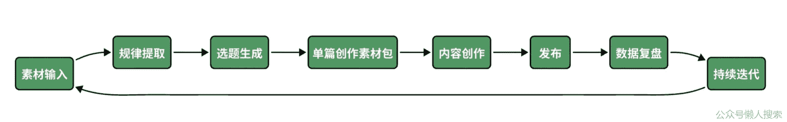

AI 第二大脑要靠你持续喂背景、素材和复盘。你喂进去的背景越真实、素材越清楚、复盘越具体，它后续给你的协助才会越准确。

2.别人是怎么用 AI 内容系统的？

自媒体案例 1：星河 · 从不敢发布，到跑通公众号垂直小号 0-1

**做了什么：**先确定垂直方向，再用 AI Agent 和 Skill 完成公众号对标文章采集、爆款结构拆解、选题生成、文章创作和自动写入草稿箱。同时记录每次发布的数据，用真实反馈判断是账号问题还是内容问题。

**结果数据：**此前文章最高只有 13 次阅读；跟进一次热点并调整内容后，阅读量提升到 50+。最终跑通公众号内容生产、发布和流量主开通的完整流程，获得了第一笔几元钱的流量主收入。金额不大，但完成了从不敢公开表达到真实发布并获得反馈的 0-1。

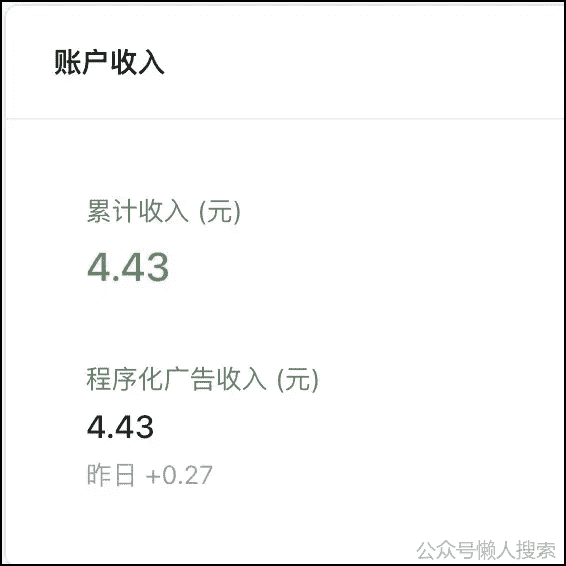

**内容来源：**📄 拖了三年，11次航海，我终于迈过了垂直小号的 0-1，也是这三年的 0-1

自媒体案例 2：笑笑 · 用 Codex 跑通小红书内容生产流程

**做了什么：**把原来散落在飞书和脑子里的账号定位、人物资料、产品信息、写作风格和合规规则整理进知识库，再让 Codex 按固定流程完成选题调研、同题对标、文案创作、图片生成、合规复查和发布前整理。

**跑出的结果：**把原来需要逐步手动完成的小红书内容生产动作串成了一条稳定流程。确定选题后，系统可以抓取同题 Top 10 内容，拆解标题、开头、结构和评论区问题，再结合自己的定位生成图文内容和发布素材。每次创作不再从头开始，新的素材和经验也能继续沉淀进知识库。

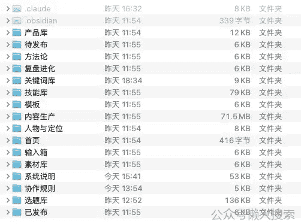

**内容来源：**📄 我们把小红书整条内容生产链，彻底跑通了（从飞书到 Codex）

自媒体案例 3：Jason · 用 Codex 搭建图文内容工作流

**做了什么：**把找对标、拆爆款、整理知识库、生成选题、写文案、做封面、生成轮播图、内容审核和数据复盘拆成独立步骤，再用 Codex 和 Skills 串成一条工作流。知识库里持续保存个人经验、对标账号、用户问题、平台规则和发布反馈。

**结果数据：**系统具备日更 100 条候选图文的生成能力，可以批量测试不同选题、标题、封面和开头，再由人工筛选值得发布的内容。这里的“100 条”是候选内容生产能力，不代表每天直接发布 100 条。（图片是用 codex 做内容的成果）

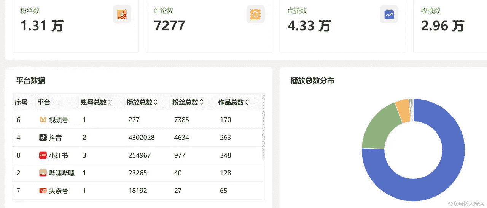

**内容来源：**📄 我是如何用 Codex 搭建工作流，实现图文内容日更 100 条的（附完整流程）

🔼 上面的案例，有人做公众号垂直小号，有人做小红书，有人搭建批量内容工作流，甚至还有人在跑通工作流后给企业做培训 👉🏻（📄 9 年设计师，裸辞后在生财做了 5 个项目都失败，最后all in AI企业服务做到一场培训 5000元）

这里展示这些案例，不是要求你这一期航海就复刻他们的账号、产量或商业结果，而是想让你看到：当个人背景、素材、选题、创作和复盘被沉淀进同一套系统后，它可以服务不同平台、不同内容方向和不同业务。

这期航海，你只需要完成一条更具体、更适合新手的练手路径：

1.  搭建自己的 AI 第二大脑内容创作系统；

1.  以小红书 AI 科普作为默认练手场景；

1.  围绕同一个账号方向完成并发布前 5 条内容；

1.  根据真实数据和评论，完成第一轮复盘。

这一期不要求你搭建日更 100 条的内容工厂，也不要求你马上做公众号垂直小号或通过内容获客。先把一条内容从素材、选题、创作、发布到复盘完整跑通，再根据自己的经验、数据和业务需求，决定下一步要走向哪个方向。

1.  为什么先用【小红书 AI 自媒体 - 科普内容】练手

这套内容创作系统，得有一个具体练手场景，大家才会有体感。如果只是把「搭知识库」研究透，新手很容易在目录建好之后不知道下一步做什么。

**所以我们本期选择【小红书 AI 自**媒体 - 科普内容】，作为新手练手场景。

这样就足够具体：有平台、有素材、有选题、有发布、也有真实反馈。

我们就可以借这个项目，练会一套底层的能力：把个人背景、外部素材、内容规律、选题、草稿和复盘都沉淀进本地知识库，再让 Codex 基于这套知识库持续协助你创作。

**而选择【小红书 AI 自媒体 - **科普内容】这个项目，主要有 5 个原因：

1.  小红书反馈相对快，适合新手尽早发布并看到真实数据。

1.  AI 科普的起步门槛相对较低，不要求你已经深度跑通复杂工具和工作流。

1.  科普内容能完整训练找素材、出选题、组织表达、发布和复盘。

1.  小红书 AI 自媒体赛道体量大，市场依然有大量商单需求，变现潜力大。

1.  跑通这条路径后，方法可以继续迁移到其他内容类型、平台或个人业务。

本期除了 AI 科普，也会同步介绍其他三类 AI 自媒体主流内容形式，但它们不是新手默认的必修任务：

| 内容类型 | 适合阶段 | 学习安排 |
| --- | --- | --- |
| AI 科普 | 新手默认 | 解释 AI 概念、工具和基础认知，先用它跑通完整工作流 |
| AI 热点 | 入门后尝试 | 训练信息敏感度、时效判断和把新变化转成选题的能力 |
| AI 测评 | 进阶 | 需要真实使用工具并形成判断，通常更接近工具商单 |
| AI 教程 | 进阶 | 需要自己跑通过流程，能讲清步骤、常见问题和避坑点 |

小红书 AI 科普是这次的起点，不是你长期只能做的内容。第一轮先别同时开四条线，先把一条路跑通，再根据你的经验、数据反馈和商业目标升级。

注意：虽然我们以 AI 自媒体项目来做练手，但建议新手 21 天内，不以接到商单为目标。

**21 天新手目标为：**

**先用 AI 科普类内容跑通内容创作工**作流，建立优质内容的生产标准和流程体感；

**后续再向 AI 热点、AI 测评、AI 教程，以及引流获**客、AI 服务定制、知识付费等方向升级。

因为自媒体需要持续的内容积累，需要一定周期才能变现，普通新手离变现中间还隔着内容质量、持续发布、受众反馈、账号数据和商业承接能力。

所以本期先证明自己能持续生产内容，再让平台和受众给你反馈，会比第一天就设计一套变现模型更扎实。

1.  跑完后你会留下什么

跑完必修关卡，你会留下这几类能够继续使用的内容资产。

4.1 一个能被 AI 读取的本地内容系统

它至少包含个人背景、对标账号、热点素材、内容规律、选题库、内容草稿和发布复盘。以后你让 Codex 协作写内容时，不再只丢一句「帮我写小红书」，而是让它读取你的背景、素材、选题和复盘结论。

成品目录大概长成这样：

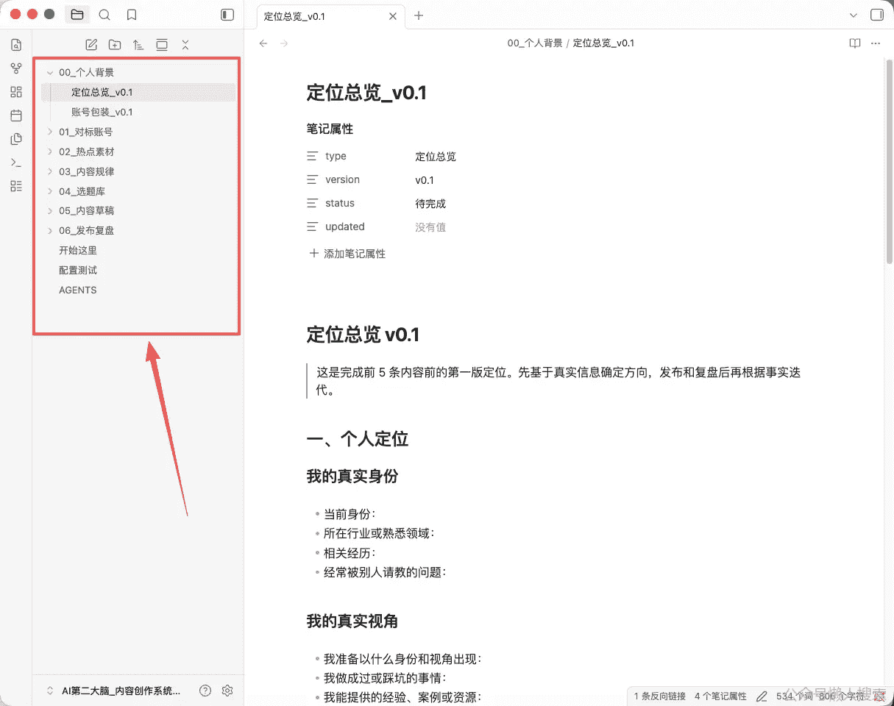

4.2 一个完成基础包装的小红书账号

你会完成第一版【定位总览】和【账号包装】，明确自己以什么视角出现、账号为哪类人提供什么价值、长期主要分享什么，并建立一个能让陌生人快速看懂你是谁、主要分享什么的小红书账号。

4.3 一批可持续使用的素材、内容规律和选题

你会收集对标账号和高数据素材，提炼第一版标题、开头、结构和评论区规律，再从中生成 20 个候选选题，筛出 5-8 个优先选题。

4.4 第一篇发布内容和一轮真实反馈

你会从选题库中选出第一篇内容，准备单篇创作素材包，用 Codex 协作生成发布稿，再把内容真正发到小红书，拿到第一轮数据和评论。

4.5 五条内容、一份首轮复盘和下一轮计划

一条内容只能破冰，累计发布 5 条后，你会把数据验证后的发现，回写到内容规律和选题库，完成第一次第二大脑的迭代。

1.  任务关卡地图

这本手册按任务关卡往前走。每一关都会先告诉你要交付什么，再带你完成对应动作。

| 航行节奏参考 | 阶段 | 关卡 | 本关拿到什么 |
| --- | --- | --- | --- |
| Day 1 | 开船准备 | 关卡 0：开船第一课 | 完成工具准备，看懂内容创作工作流和练手路径 |
| Day 2-4 | 必修 | 关卡 1：定位 | 完成个人背景文档、一句话定位和小红书账号基础包装 |
| Day 5-7 | 必修 | 关卡 2：知识库搭建 | 搭好最小 Obsidian 工作台，用浏览器插件抓取对标和热点素材 |
| Day 8-9 | 必修 | 关卡 3：爆款规律提取 | 从高数据内容中提炼标题、开头、结构和受众问题 |
| Day 10 | 必修 | 关卡 4：选题生成 | 生成 5-10 个候选选题 |
| Day 11-12 | 必修 | 关卡 5：内容创作 | 完成单篇创作素材包和第一篇小红书发布稿 |
| Day 13 | 必修 | 关卡 6：发布复盘 | 发布第一篇内容，完成 24 小时轻复盘 |
| Day 14-21 | 必修 | 关卡 7：持续迭代 | 累计发布 5 条，完成首轮总复盘和下一轮内容日历 |
| 21 天后按需学习 | 选修 | 关卡 8：平台迁移 | 把 1 条已验证内容迁移到公众号、X 或其他平台 |
| 21 天后按需学习 | 选修 | 关卡 9：内容类型进阶 | 设计 AI 热点、测评、教程或业务获客的升级路径 |
| 21 天后按需学习 | 选修 | 关卡 10：视频化进阶 | 把 1 条已验证图文改成口播或录屏视频脚本 |

以上仅为参考节奏，不必拘泥于每天的进度。

**根据自己的时间安排推进即可，可以快一点、**慢一点，也可以不完美，但一定要持续行动。

关卡 0-7 是必修主线，关卡 8-10 是进阶选修。先跑通一条路、发布 5 条并完成首轮复盘，再决定要不要开第二平台、升级内容类型或做视频。

1.  为什么使用 Obsidian + Codex

做内容最容易遇到的问题，就是每次都要从头解释：你是谁、准备写给谁、过去收集过什么、哪些内容已经发过、上一次复盘得出了什么结论。

我们用这两个工具配合，就能比较好的解决：

• Obsidian 负责把内容资产长期保存下来。个人背景、对标账号、热点素材、内容规律、选题、草稿和复盘，都会以普通 Markdown 文件保存在本地。文件归你自己所有，能清楚查看、随时修改，也方便迁移到其他工具，不会被锁在某一次 AI 对话里。

• Codex 负责读取和使用这些内容资产。它不只回答当前的一句话，而是可以直接读取整个 Vault，理解你的定位和已有素材，协助整理文件、提炼规律、生成选题、完成创作，并把发布后的数据和结论继续写回知识库。

两者组合后，内容创作会形成一个持续积累的循环：

你把真实背景、素材和反馈存进 Obsidian，Codex 基于这些内容协助创作；发布后的数据和复盘再回到 Obsidian，成为下一次创作的依据。

这本手册不会把 Obsidian 教成一门独立的知识库或软件教程课。

我们会跟内容创作流程强结合，在每个内容动作发生时，只教当下需要的 Obsidian 操作：这一关安装工具，下一关建立个人背景，再后面用它收素材、管选题、写内容和做复盘。

1.  开船前准备

开船前只需要准备两个工具：Obsidian、Codex（或 WorkBuddy）

安装配置教程 👉🏻

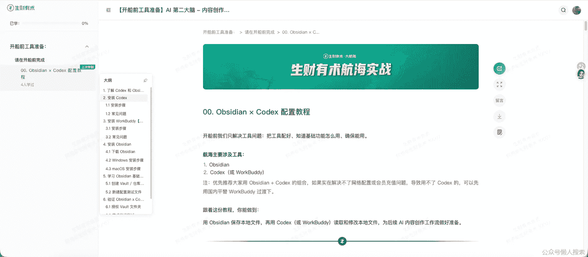

**插个题外话：如果你对自己每日 Token 用量感兴**趣， 欢迎加入生财 TokenRank～

我们发现最近不少圈友已经在用 Codex、Claude Code、Hermes、WorkBuddy 等工具做项目，但自己用了多少、坚持了多久、做成了什么，没有被记录下来。

TokenRank 可以帮大家记录真实的 AI 使用过程，也方便我们发现优秀作品和实战案例。

注意：Token 高不代表成果好。相比“用了多少”，我们更关注：你用 AI 完成了什么、解决了什么问题。

现在 TokenRank 已开放接入，大家可以跟着教程完成安装：https://scys.com/tokenrank/connect

接入过程中遇到问题，可以直接在航海群里反馈。


---

# 必修篇：跑通 Obsidian + Codex 内容创作 0-1

## 关卡 1：定位：确定赛道与完成账号包装

### 00. 本关任务卡

💡

**任务目标**：在 Obsidian 里沉淀第一版个人背景文档，形成个人定位、账号定位、内容定位，并把定位落实到小红书账号的头像、昵称、简介和背景图中。

**任务描述**：

1.  认识 AI 自媒体的四种内容形式。

1.  安装并启动“航海定位官”Skill。

1.  按照课程中的回答方法，接受 AI 的逐步访谈。

1.  确认第一版个人定位。

1.  在 Skill 引导下完成账号定位。

1.  确认账号的核心内容、内容支柱和内容边界。

1.  确认 Skill 生成的账号包装方案，并完成小红书主页设置。

1.  检查 Skill 自动写入 Obsidian 的最终结果。

**本关需提交作业**：

1.  Obsidian 中【定位总览_v0.1.md】文件的截图，必填。

1.  小红书主页截图，能看清头像、昵称、简介和背景图，选填。

1.  分享一下这关最大的收获，或者你遇到的卡点、怎么解决的（必填）

这一期我们要做的赛道已经确定：AI 自媒体。

接下来我们需要想清楚，自己的个人视角、账号长期提供什么价值，以及主要讲什么。

你也不需要一开始就想出一个完美定位，更不需要独自填写一大堆表格。我们已经为你准备好 AI 写媒体的 4 种内容形式的说明、回答示例、定位标准和【航海定位官 Skill】。你只需要先看懂每一步应该怎样回答，再按照 AI 的提问，一次回答一个问题。

**这一关最终要解决四件事：**

1.  我准备以什么真实身份和视角出现在用户面前？

1.  这个账号主要关注什么，用什么方式为读者提供价值？

1.  这个账号长期主要讲什么，暂时不讲什么？

1.  怎样通过头像、昵称、简介和背景图，让陌生人一眼看懂这个账号？

**本关会生成什么：**

完成后，你的 Obsidian 中会新增两份文档：

本期统一使用AI第二大脑_内容创作系统作为 Vault，也就是最外层文件夹的名称。完整目录如下：

Plain Text

```
AI第二大脑_内容创作系统/
├── 00_个人背景/
│   ├── 定位总览_v0.1.md
│   └── 账号包装_v0.1.md
├── 01_对标账号/
├── 02_内容素材/
├── 03_内容规律/
├── 04_选题库/
├── 05_内容草稿/
└── 06_发布复盘/
```

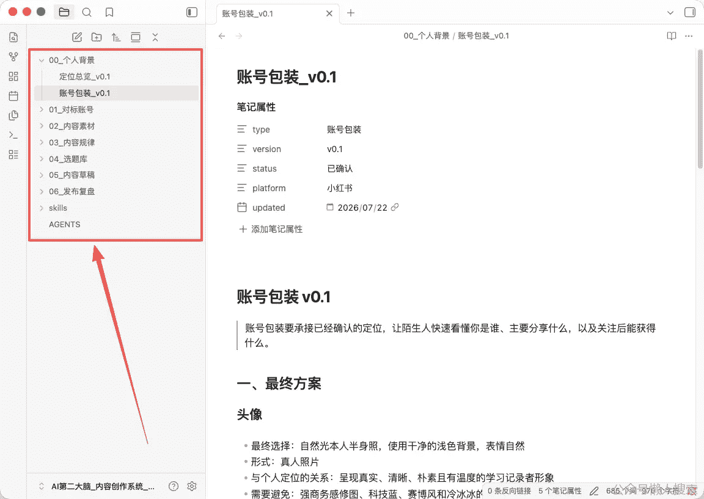

### 01. 这一关会怎样带你完成

很多人做自媒体，常常卡在第一步做定位，或者第一反应是：

• 我没有特别厉害的经历，能定位吗？

• 我不知道自己擅长什么，应该从哪里开始？

• 我想讲的 AI 内容很多，应该怎样确定重点？

• 我能不能直接让 AI 帮我写？

**别着急，教练已经把定位过程**拆成几个阶段，并准备了【航海定位官 Skill】。

它会像一位定位教练一样，依次了解你的经历、提炼个人定位、明确读者的认知状态和账号价值、整理内容范围，再根据已经确认的信息生成账号包装。

完整流程如下：

Plain Text

```
认识 AI 自媒体的四种内容形式
→ 安装“航海定位官”Skill
→ AI 访谈个人经历
→ 确认个人定位
→ 确认账号定位
→ 确认内容定位
→ 生成账号包装
→ 写入 Obsidian
```

在做定位之前，会先带你了解 AI 自媒体的 4 种形式。

这一部分主要让你先知道，这 4 种形式分别解决什么问题，适合谁做，方便你了解全局，更有方向感。

本期航海以 AI 自媒体为练习赛道，而该赛道下，又有 4 种主流内容形式：

• AI 科普 ✅

• AI 热点 👍🏻

• AI 测评 👍🏻

• AI 教程 👍🏻

这次我们会带新手朋友先从最简单的【AI 科普】内容形式入手，跑通 AI 内容创作全流程。

💡

总的来说，关卡 1，你只需要做 3 件事：

1.  了解 AI 自媒体的 4 中内容形式

1.  安装【航海定位官 Skill】

1.  用 Codex 启动【航海定位官 Skill】，跟着 Skill 的引导回答问题，直到生成你的定位，并写入 Obsidian

**注意：**

• 定位不是 AI 单方面替你决定。AI 负责访谈、整理、比较和检查，你负责提供真实信息并完成最终确认。

• 建议一边看手册中提供的定位方法论，一边回答问题，你能更好地完成定位。

### 02. 认识 AI 自媒体的 4 种内容形式

1.先理清概念

因为这一关是完成定位，所以我们会重点拆解 4 中内容形式的三层定位：

1.  个人定位：我以什么真实身份和视角出现？

1.  账号定位：这个 AI 自媒体账号主要关注什么，用什么方式提供价值？

1.  内容定位：这个账号长期主要讲哪些 AI 内容，暂时不讲什么？

**先分清四个容易混淆的概念：**

**1. 个人定位**

回答“我以什么身份、经历和视角出现”。

例如：一名正在把 AI 用进日常工作的电商运营。

**2. 账号定位**

回答“这个账号长期关注什么，用什么方式提供什么价值”。

例如：用大白话讲清 AI 新概念、新工具和重要变化，帮助非技术用户看懂、会选、少踩坑。

**3. 内容定位**

回答“这个账号长期主要讲什么，暂时不讲什么”。

例如：主要分享 AI 入门、运营工作场景和工具实操经验；暂时不做编程、模型研究和泛科技资讯。

**4. 内容形式和具体呈现方式**

AI 科普、AI 热点、AI 测评、AI 教程，是 AI 自媒体的 4 种内容形式。

同一个 AI 自媒体账号，可以围绕同一个主题和读者需求，轮换使用四种内容形式，并根据内容选择不同的具体呈现方式。

本期主要是考虑到新手上手问题，所以先选择【AI 科普】类内容形式；

但是！不代表你的账号定位，就是只做 AI 科普内容的，后续也可以尝试其他内容形式。

**2.AI 自媒体的 4 种内容形式对比

| 内容形式 | 大白话解释 | 选题示例 | 对创作者的要求 |
| --- | --- | --- | --- |
| AI 科普 | 把别人看不懂的 AI 概念、新工具或新变化讲明白 | Agent 是什么？一个新模型的发布和普通人有什么关系？ | 查清资料，能用简单的话和生活、工作例子讲明白 |
| AI 热点 | 快速跟进最近发生的 AI 新闻，告诉大家发生了什么、为什么值得关注 | 某公司刚发布新模型，这次更新了什么？ | 对信息敏感，发布速度快，还要有自己的判断 |
| AI 测评 | 自己真实使用一个工具，再告诉大家好不好用、适合谁、有什么不足 | 3 款 AI 写作工具实测，哪款更适合职场人？ | 必须真实使用，能比较优缺点，不能只整理网上评价 |
| AI 教程 | 带着大家一步一步完成一个具体任务 | 如何用 AI 整理会议纪要？ | 自己先完整做成功，再讲清步骤、报错和避坑方法 |

一条内容有时会同时带有两种特点。例如，一篇新工具介绍可能既包含科普，也带有简单测评。

判断一篇笔记属于哪一种内容形式，关键看它最想帮助用户解决什么问题，比如：看懂一个概念、了解最新变化、判断工具好不好用，还是跟着步骤把东西做出来。

**3.**对标账号应该怎样看**

对标账号不是用来照抄昵称、简介、封面和选题的。

这一关看对标账号，主要为了理解一个已经在持续创作的人，是怎样把个人定位、账号定位和内容定位连接起来的。

看一个账号时，至少要回答三组问题。

**个人定位**

• 他以什么身份出现？

• 主页有没有写明相关经历？

• 用户为什么愿意相信他？

• 他是专家、从业者、实践者，还是成长记录者？

**账号定位**

• 这个账号主要适合什么认知状态的读者？

• 它为用户提供什么价值？

• 陌生人打开主页后，会形成什么印象？

• 用户为什么值得关注？

**内容定位**

• 核心内容是什么？

• 有哪些反复出现的主题？

• 主要使用哪几种内容形式？

• 常用哪些具体呈现方式？

• 哪些内容明显不在它的范围内？

**4.**对标案例一：硅基也木水**

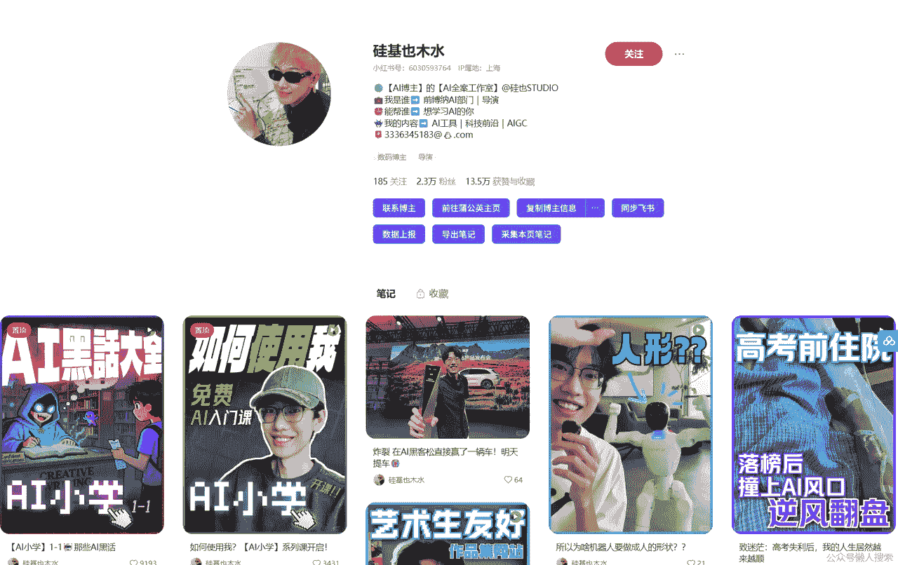

根据现有素材，他的主页主要呈现了三个身份信息：前 AI 部门从业经历、导演经历，以及对 AI 工具、科技前沿和 AIGC 的持续关注。

**个人定位**

他不是以“泛 AI 搬运者”的身份出现，而是把影视和 AI 从业经历作为主要识别点。

用户看到的是一位能够从影视生产和行业实践角度解释 AI 的内容创作者。

**账号定位**

账号面向想了解和学习 AI 的用户，主要提供 AI 工具、AIGC 和科技变化的解释与判断。

**内容定位**

内容可以容纳行业科普、新变化解读、工具体验和 AIGC 实践。它没有把账号限定成只做科普，因此后续可以自然扩展到测评和教程。

**值得学习的地方**

• 使用真实职业经历建立识别点；

• 用自己熟悉的行业解释 AI；

• 账号方向足够清楚，同时保留扩展空间。

**不建议直接模仿的地方**

不要因为对方写了某个职业身份，就给自己添加没有做过的经历。个人定位的作用是提取真实差异，不是包装虚假权威。

**5.**对标案例二：秋芝 2046**

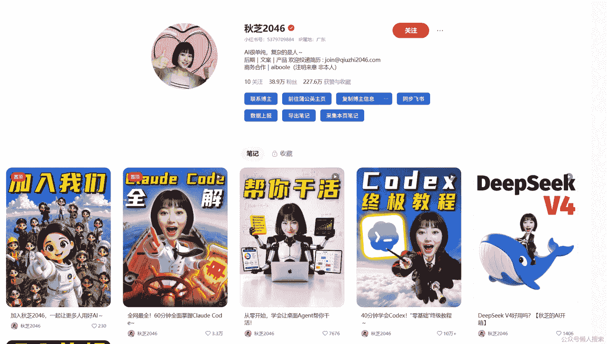

根据现有素材，秋芝 2046 的内容同时包含 AI 科普、教程和测评，其中有多条面向 AI 新手的行业盘点和入门内容。

**个人定位**

账号主要通过长期、系统的 AI 内容整理和实践建立可信度。个人身份在主页中的表达相对弱，内容能力和持续输出成为主要识别点。

**账号定位**

账号为希望了解 AI、学习 AI 工具和方法的人提供系统内容。它既能成为新手入口，也能承接更深入的实操内容。

**内容定位**

内容范围包括产业科普、工具介绍、操作教程和实际体验。不同内容形式围绕同一个核心方向展开，没有因为同时做科普和教程就变成多个账号方向。

**值得学习的地方**

• 能把复杂信息整理成新手可以理解的结构；

• 入门内容和深度内容可以共存；

• 内容形式不同，但核心受众和主题保持一致。

**不建议直接模仿的地方**

如果主页没有明确表达主题和价值，纯新手不建议整套照抄。第一版账号应该尽量让陌生人看懂：这个账号主要讲什么，关注后可以获得什么。

**6.**为什么本期先从 AI 科普开始**

AI 自媒体是本期统一赛道。个人定位、账号定位和内容定位，会继续说明你是谁、账号提供什么价值，以及长期主要讲什么。

AI 科普不是一条独立赛道，而是本期前 5 条内容采用的默认内容形式。

我们先从 AI 科普开始，不是因为科普等于复制百科，也不是因为不需要专业判断，而是因为它更适合当前阶段的教学顺序。

6.1 对已有案例的要求相对较低

测评需要真实使用并比较工具，教程需要自己先完整做成一件事，热点需要较强的信息判断和发布速度。

纯新手通常还没有积累足够的工具体验、项目案例和内容判断。科普可以先从“把我刚刚弄懂的一件事，准确地讲给另一个新手”开始。

6.2 能训练内容创作的基础能力

做好一条科普内容，同样需要：

• 找到可靠资料；

• 判断哪些信息值得使用；

• 真正理解一个概念；

• 用普通人听得懂的话重新解释；

• 使用具体例子；

• 组织标题、开头和正文；

• 检查事实是否准确。

这些能力也是以后做热点、测评和教程的基础。

### 03. 安装【航海定位官 Skill】

接下来安装本期准备好的“航海定位官”Skill。

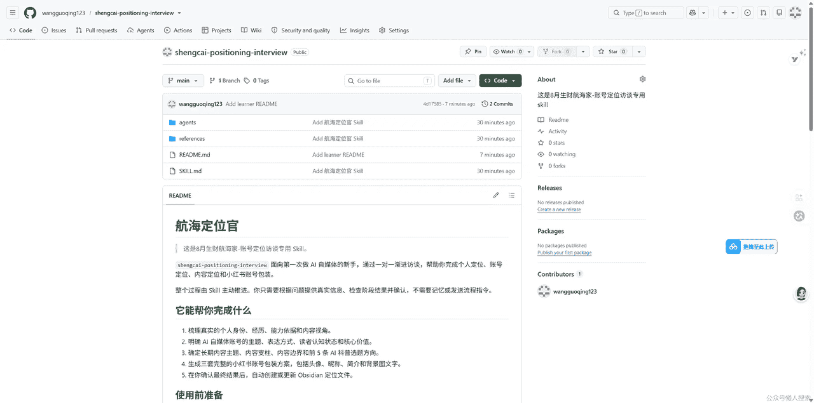

**1.**安装前检查**

开始前，请确认：

1.  已经完成第 0 关

（1）Obsidian 能正常打开

（2）Codex 能正常对话

1.  已经看完前面的四种内容形式，并理解本期为什么先做 AI 科普。

**2.**安装步骤**

1.  打开 Obsidian，新建一个 Vault，建议命名为：AI第二大脑_内容创作系统

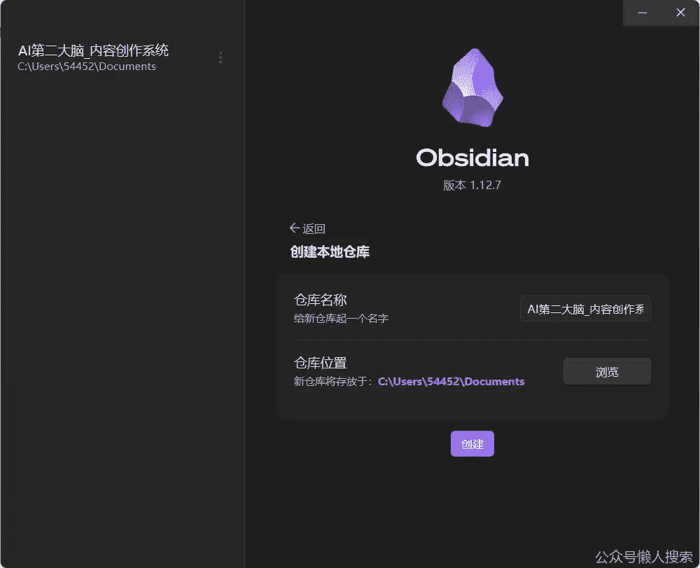

1.  用Codex，选择项目-> 新建项目 -> 使用现有文件夹

然后，选择刚才新建的文件夹：AI第二大脑_内容创作系统

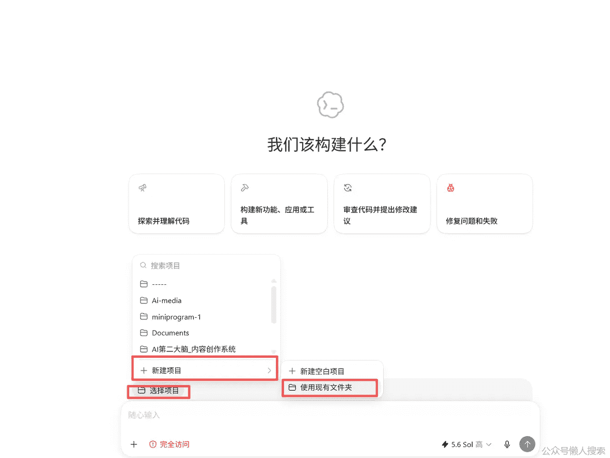

1.  安装我们为你准备的“航海定位官”Skill，可以直接把这段话复制给 Codex。

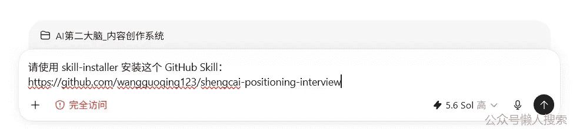

Plain Text

```
请使用 skill-installer 安装这个 GitHub Skill：
https://github.com/wangguoqing123/shengcai-positioning-interview
```

**3.**正确的安装成功提示**

安装成功后，AI 应该明确告诉你安装成功

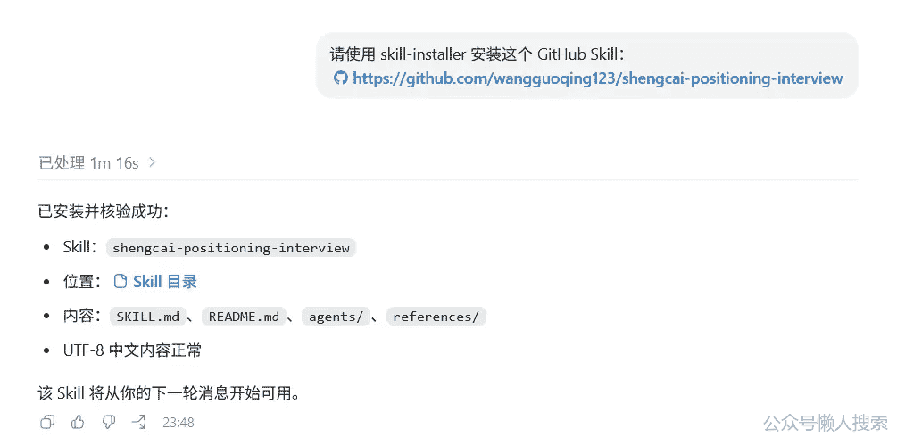

**4.**启动skill**

安装成功之后，就可以要求Ai启动这个skill，来帮我们做账号的定位规划。

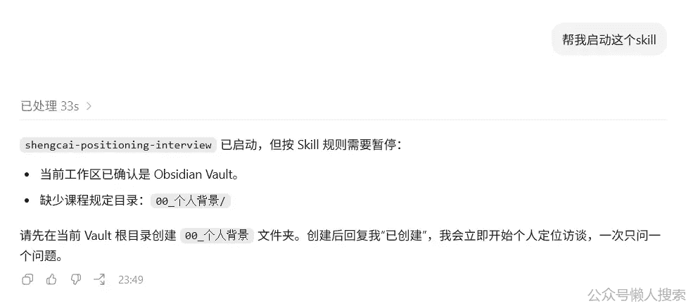

如果有问题，AI 也会要求你一步步按照规则去做。

“航海定位官”Skill 已准备完成。我会依次帮助你完成个人定位、账号定位、内容定位和账号包装。接下来我会给出个人定位的第一个问题，但你先不用回答。请先阅读课程中的“个人定位”部分，了解回答方法和判断标准。阅读完成后，直接回答这个问题即可。

**5.**Skill 的使用规则**

在后面的访谈中，请记住：

1.  AI 一次只问一个问题。

1.  你回答后，它才能继续问下一个。

1.  不需要使用专业术语，尽量讲真实经历和具体场景。

1.  不知道就说“不知道”或“暂时想不起来”。

1.  AI 可以提供回忆方向，但不能替你编造经历。

1.  每个阶段结束后，AI 都要先输出总结。

1.  AI 输出总结后，会主动询问内容是否准确。

1.  你只需要回答“准确”，或者直接指出哪里需要修改。

1.  你确认当前阶段的结果以后，AI 会自动保存结果并进入下一阶段。

1.  账号包装确认以后，AI 会自动创建或更新 Obsidian 文件。

从这里开始，跟着 Skill 的问题回答、纠正信息并确认结果即可。每一步流程都由 Skill 自动推进。

**现**在先看完下一部分，了解什么是个人定位，以及怎样回答 AI 的问题。Skill 已经在对话中留下了第一个问题，看完以后直接回答即可。

### 04. 定位方法论（建议学习，便于更好的使用 skill）

如果你是新手，下面这段方法论，建议你一边浏览学习，一边按照下面教程引导，用 Skill 回答 AI 问题。

如果你有一定的自媒体经验，也可以跳过这个小节得学习，直接跟着 skill 的引导来操作。

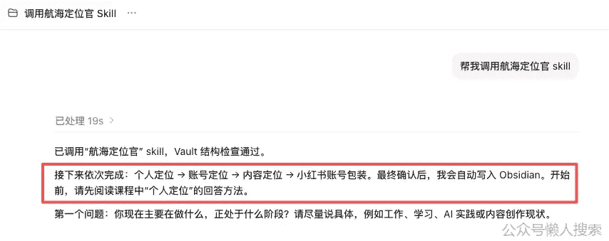

**1.个人定位：我准备以什么身份和视角出现

**1.1 什么是个人定位？**

个人定位不是给自己贴一个听起来很厉害的标签，也不是要求你证明自己已经是专家。

它要解决的是:

你准备以什么真实身份、经历、阶段和视角，出现在用户面前。

例如，同样讲 AI 内容，个人定位可以完全不同：

• 做了三年运营，正在把 AI 用进真实工作；

• 一名老师，正在尝试用 AI 备课和整理教学资料；

• 一个从零学习 AI 的文科生，专门记录新手最容易卡住的问题；

• 一名设计师，从视觉和创作流程角度理解 AI 生图；

• 一个小商家，记录怎样用 AI 处理日常经营任务。

这些定位没有谁天然更高级。好的个人定位首先要真实，其次要能让用户知道你从什么角度讲这件事。

1.2 没有成绩，也能做个人定位吗？

可以。

你不一定要拥有很大的项目、很高的职位或很多粉丝。个人定位可以来自：

• 你正在从事的工作；

• 过去做过的项目；

• 经常帮助别人解决的问题；

• 一次真实成功或失败；

• 你比较了解的一类人；

• 你正在持续学习和实践的事情；

• 你愿意公开记录的成长过程。

如果你暂时不是专家，可以使用“实践者”或“成长记录者”的定位。不要把“正在学习”包装成“已经精通”。

1.3 Skill 会问哪些内容？

AI 会重点了解：

1.  你现在在做什么；

1.  过去做过哪些具体事情；

1.  别人经常向你请教什么；

1.  你做成过、帮助过别人或踩坑过什么；

1.  你比较熟悉哪类人和场景；

1.  你最近正在学习和反复使用什么；

1.  你能持续投入多少时间；

1.  哪些信息可以公开，哪些不能公开。

AI 不应该直接问“你的优势是什么”“你的价值观是什么”“你的个人标签是什么”。这些问题太抽象，纯新手很难给出有效答案。

它应该通过真实经历和具体场景，帮助你提取定位。

1.4 怎样回答，AI 才能真正理解你？

回答时，尽量使用下面这个结构：

事实 + 具体场景 + 你做了什么 + 结果或发现

太空泛的回答：

我做运营，比较喜欢研究 AI，也比较擅长学习。

这句话没有明显错误，但 AI 很难知道你做过什么、理解什么、适合帮助谁。

更有效的回答：

我做了三年电商运营，主要负责店铺活动和商品文案。最近半年开始用 AI 整理竞品卖点，但第一次生成的结果把产品参数写错了。后来我开始先整理产品资料，再让 AI 按固定字段输出，现在主要在测试怎样让结果更可靠。

这个回答里有身份、工作场景、具体行动和真实发现，AI 才能据此判断你的内容视角。

1.5 回答不同问题时，可以从哪里回忆？

如果问过去做过什么，可以回忆：

• 最近一份工作；

• 一次项目；

• 一次兼职或副业；

• 一次学习经历；

• 一次帮助同事、朋友或客户的过程；

• 一件没有做成，但让你学到很多的事情。

如果问别人经常向你请教什么，可以回忆：

• 同事经常让你帮忙处理什么；

• 朋友遇到什么问题会想到你；

• 社群里你经常回答哪类问题；

• 家人觉得你最熟悉什么；

• 你做什么事情通常比周围人更顺手。

如果问你熟悉哪类人

不要只回答“职场人”“年轻人”“普通人”。

尽量说清：

• 他们是什么身份；

• 处于什么阶段；

• 在什么场景中遇到问题；

• 你为什么了解他们。

例如：

我比较熟悉刚入行一两年的电商运营，因为我们团队每年都会带新人。他们通常会卡在竞品分析、活动复盘和商品文案上。

**如果问做成或踩坑的事情**

不用只讲成功。真实的失败和修正过程同样有价值。

例如：

我第一次用 AI 做周报时，虽然半小时就生成了，但里面出现了两处错误数据。后来我把数据和文字拆开处理，并增加了人工检查清单。

1.6 【了解即可】哪些回答 AI 不会直接使用

下面几类信息，AI 不会直接写进个人定位：

• 没有事实支撑的“擅长”“专业”“资深”；

• 只因为做过一次，就写成长期能力；

• 没有得到本人确认的性格判断；

• 公司内部数据和客户隐私；

• 无法公开的项目；

• 为了定位好看而临时编出的身份和成绩。

**1.7 开始个人定位**

看完以后，回到 Codex，直接回答 Skill 已经提出的第一个问题。

接下来，Skill 会一次只问一个问题。你回答完当前问题，它才会继续询问下一项。

如果你回答“想不起来”，它可以给你 2—3 个回忆方向，但不会替你生成一段经历。

【了解即可】AI 什么时候会停止提问？

当信息已经能够回答下面几个问题时，AI 会主动停止：

• 你是谁，目前处于什么阶段；

• 你有哪些与内容方向有关的经历；

• 你熟悉哪些人和场景；

• 你能够以什么真实视角创作；

• 你的公开边界是什么。

问题不是越多越好。如果已有信息已经足以形成第一版个人定位，就不需要为了问满数量继续访谈。

**怎样检查个人定位？**

AI 输出后，请逐项检查：

1.  时间、身份、经历和结果是否准确？

1.  有没有把一次尝试写成长期能力？

1.  有没有把推测写成事实？

1.  有没有使用你没有说过的性格标签？

1.  有没有夸大成绩？

1.  有没有泄露不能公开的信息？

1.  这份定位是否能让人看懂你从什么角度讲 AI？

检查完成后，Skill 会主动问你这份个人定位是否准确。

如果有问题，直接说出具体情况。例如：

• “做过三年运营”与事实不符，应该是“一年半”。

• 这项能力我只尝试过一次，请标记为“待确认”。

• 这段经历不能公开，请移到“不可公开的信息”。

Skill 修改后会再次请你确认。确认无误后，它会自动保存个人定位，并开始账号定位访谈。

**2.账号定位：这个账号长期提供什么价值

**2.1 什么是账号定位？**

个人定位回答“我是谁、从什么角度讲”。

账号定位回答：

这个 AI 自媒体账号主要关注什么，用什么方式表达，能够持续为读者提供什么价值。

账号定位不是一句漂亮的自我介绍。

下面这些表达看起来没有错，但还不够清楚：

• 我分享 AI 内容。

• 我帮助普通人了解 AI。

• 我分享科技、自媒体和个人成长。

• 一起拥抱 AI 时代。

陌生人看完以后，仍然不知道这个账号会持续讲什么，也不知道为什么值得关注。

**2.2 先确定账号的主题和价值**

这一关采用主题型定位：围绕 AI 这个主题，确定账号长期关注的内容、主要表达方式，以及读者关注后能够获得什么。

例如：

用大白话讲清 AI 新概念、新工具和重要变化，帮助对 AI 感兴趣的非技术用户看懂 AI、跟上变化、少走弯路。

如果你有运营、教育、设计、创业等经历，也可以把这些经历变成账号的独特视角。例如：

结合自己的运营经验，用真实工作案例讲清 AI 工具可以怎样解决问题。

这样既能让别人迅速看懂账号会讲什么，也能让你的内容带有自己的经验和判断。

**2.3 怎样回答账号定位问题**

AI 接下来会重点询问：

• 你准备长期关注 AI 中的哪些内容；

• 你希望把内容讲到什么深度；

• 你准备采用怎样的解释方式；

• 用户看完以后应该获得什么；

• 你的经历可以为账号增加什么视角。

回答时，尽量使用：

内容主题 + 主要表达方式 + 读者的认知状态 + 账号提供的价值

太空泛的回答

我分享 AI，帮助所有人提升认知。

更有效的回答

我准备关注 AI 新概念、新工具和重要变化，用大白话和生活、工作例子讲明白，帮助对 AI 感兴趣但没有技术背景的人快速看懂、会判断、少踩坑。

第二种回答说清了账号会讲什么、怎样讲、适合什么认知状态的读者，以及用户为什么值得关注。

2.4 怎样描述这个账号的读者？

描述读者时，重点关注他们目前对 AI 的了解程度，以及他们共同想解决的问题。

• 对 AI 感兴趣，但不想阅读复杂技术资料的人；

• 想跟上 AI 变化，但知识比较零散的人；

• 已经使用过一些 AI 工具，但不知道怎样判断结果的人；

• 想知道 AI 与工作、生活和商业有什么关系的人。

这些人拥有相近的认知状态和内容需求，AI 就能据此判断内容应该讲多深、使用什么例子、解释哪些问题。

“所有人都可以看”可以作为传播结果，但不要把“所有人”直接写成定位。定位至少还要说清内容主题、表达方式和用户价值。

**2.5 账号价值怎样表达？**

账号价值不要只写：

• 提升认知；

• 提高效率；

• 赋能个人成长；

• 打造个人品牌；

• 抓住 AI 红利。

尽量用普通人能理解的结果表达：

• 帮读者看懂复杂概念；

• 帮读者筛选真正重要的变化；

• 帮读者判断工具是否适合自己；

• 帮读者减少使用中的常见错误；

• 帮读者理解 AI 与工作、生活和商业的关系；

• 在教程内容中，带读者从零完成一个任务。

**2.6 怎样检查账号定位？**

请检查：

1.  能不能看出账号长期关注哪些 AI 内容？

1.  能不能看出内容会用什么方式讲？

1.  能不能看出读者关注后可以获得什么？

1.  是否说明了适合什么认知程度的读者？

1.  有没有为了显得全面，写成“分享所有 AI 内容”？

1.  有没有承诺自己暂时做不到的结果？

1.  这个账号定位是不是本人愿意持续使用的？

检查完成后，Skill 会主动询问账号定位是否准确。

需要修改时，直接指出哪一部分太宽泛、与你不符或难以长期做到，并说明真实情况。Skill 会根据已经确认的个人定位重新调整，不会添加新的经历。

你确认无误后，Skill 会自动保存账号定位，并开始内容定位访谈。

**3. 内容定位：长期主要讲什么**

**3.1 什么是内容定位**

账号定位确定了账号主题、表达方式和核心价值。内容定位则要继续回答：

为了持续提供这些价值，这个账号长期主要讲哪些内容，暂时不讲哪些内容。

内容定位不是立即生成第一批正式选题。第一批选题会在后面的选题关卡完成。

这一关只需要确定内容范围，让后面的素材库、规律提取和选题生成有明确边界。

**内容定位包含什么**

一份清楚的内容定位，至少包含四部分：

1.  一个核心内容主题；

1.  2—3 个内容支柱；

1.  每个内容支柱解决什么问题；

1.  暂时不做什么。

**3.2 什么是核心内容主题**

核心内容主题是账号长期围绕的中心。

例如：

用通俗方式解释 AI 新概念、新工具、重要变化和实际使用问题。

它比“分享 AI”更具体，也没有把账号限制成某一种内容形式。

**3.3 什么是内容支柱**

内容支柱是核心主题下面，可以长期积累的几个稳定方向。

以一个面向非技术用户的 AI 自媒体账号为例：

内容支柱一：AI 概念和基础认知

解决读者看不懂概念、不知道不同名称和工具有什么区别的问题。

示例主题：

• 大模型、聊天工具和智能体有什么区别；

• 为什么 AI 会编造信息；

• AI 更适合处理哪些类型的任务。

内容支柱二：AI 新工具和重要变化

解释最近出现了什么工具和变化，为什么值得关注，以及它与普通人有什么关系。

示例主题：

• 新模型发布了什么；

• 新工具主要解决什么问题；

• 一次更新对普通用户意味着什么；

• 哪些变化值得关注；

• 哪些只是营销包装。

内容支柱三：AI 使用、选择和避坑

帮助读者理解怎样选择和使用工具、怎样检查结果，以及哪些事情不能直接交给 AI。

示例主题：

• 哪些信息不能直接交给 AI；

• 使用 AI 前应该准备哪些资料；

• 怎样判断生成结果是否可以使用。

这些示例只是帮助确定范围，不是关卡 4 的正式选题清单。

3.4 为什么一定要写“暂时不做什么”

如果内容定位只写“我会讲 AI 工具、热点、行业、效率、成长和自媒体”，它几乎没有筛选作用。

内容边界能帮助你在后面判断：一条素材要不要收，一篇高赞内容值不值得分析，一个选题是否适合当前账号。

例如：

• 暂时不做自己无法核实的深度技术内容；

• 不追与 AI 无关的泛科技新闻；

• 不做没有真实使用过的工具测评；

• 不做自己没有完整跑通的教程；

• 不讲无法核实的行业内幕；

• 不公开公司、客户和业务隐私。

“暂时不做”不是永远不能做，而是给第一阶段建立边界。

**3.5 怎样检查内容定位**

请检查：

1.  核心主题是否承接账号定位？

1.  2—3 个内容支柱是否围绕同一个账号主题和读者需求？

1.  每个支柱是否在解决真实问题？

1.  有没有把所有感兴趣的话题都塞进来？

1.  有没有混入与 AI 主题和账号价值无关的泛热点？

1.  是否写清了暂时不做什么？

1.  内容范围是否与当前能力和时间匹配？

检查完成后，Skill 会主动询问内容定位是否准确。

需要修改时，直接告诉它哪项内容与你的账号定位关系较弱、希望删除什么，或者想调整成什么。Skill 修改后会再次检查内容支柱是否仍然围绕同一个账号主题和读者需求。

你确认无误后，Skill 会自动保存内容定位，并生成账号包装方案。

**4. 完成小红书账号包装**

定位完成以后，需要把它翻译成陌生人能快速看懂的主页。

账号包装不是重新想一套定位，也不是把页面做得越复杂越好。

好的账号包装只看一件事：

陌生人打开主页后，能不能在几秒内大致看懂你是谁、主要讲什么，以及关注后能获得什么。

**包装和三层定位之间的关系：**

• 头像主要承接个人定位；

• 昵称承接个人定位和内容方向；

• 简介承接账号定位；

• 背景图承接内容定位。

四个元素不需要重复同一句话，但应该指向同一个方向。

**4.1 头像**

头像首先要满足：

• 清晰；

• 容易识别；

• 能够长期使用；

• 不与个人定位冲突；

• 不包含太多看不清的小字。

如果方便露脸，可以使用光线清楚、背景简单的真人头像。

如果不方便露脸，可以使用：

• 简洁的职业形象；

• 稳定使用的卡通形象；

• 与个人称呼有关的简单视觉标识。

纯新手第一版不建议花大量时间制作复杂 Logo。头像的主要任务是让人认得你，不是展示设计技巧。

**4.2 昵称**

昵称应该帮助用户识别人或方向。

常见结构包括：

• 【称呼】+ 讲 AI；

• 【称呼】的 AI 笔记；

• 【称呼】+ AI 观察；

• 【称呼】+【AI 内容关键词】。

例如：

• 阿泽讲 AI；

• 小林的 AI 笔记；

• 小夏看 AI；

• 文科生小夏学 AI；

• 老周的 AI 工具箱。

昵称不要：

• 堆太多关键词；

• 使用无法证明的专家头衔；

• 只写一个与内容无关的英文名；

• 把自己锁死成“只做 AI 科普”；

• 为了显得专业使用别人看不懂的缩写。

**4.3 简介**

内部的一句话账号定位可以比较完整，但不一定适合原封不动放进主页。

小红书简介需要更短、更自然。可以分成两到三行：

Plain Text

```
我是谁，或者我从什么视角分享
主要关注什么，用什么方式讲
读者关注后可以获得什么
```

例如：

Plain Text

```
用大白话讲清 AI
关注新概念、新工具和重要变化
帮你看懂、会选、少踩坑
```

简介不要只写：

• 热爱生活，分享成长；

• AI 时代持续进化；

• 分享有价值的内容；

• 助力普通人抓住红利；

• 专注个人成长和效率提升。

这些表达很难让陌生人知道账号具体会讲什么。

**4.4 背景图**

背景图可以进一步说明内容范围。

第一版保持干净即可，可以使用：

• 一句简化定位；

• 2—3 个内容关键词；

• 一个简短的更新方向。

例如：

Plain Text

```
AI 科普｜热点解读｜工具实测｜实用教程
```

背景图不要堆满：

• 大量文字；

• 多个联系方式；

• 无法验证的成绩；

• 夸张营销承诺；

• 与账号方向无关的口号。

〔待补：小红书当前主页编辑入口、头像尺寸、昵称和简介规则、背景图尺寸。对外发布前按最新平台规则复核。〕

4.5 skill 会给你三套完整的账号包装方案

个人定位、账号定位和内容定位确认以后，“航海定位官”会根据前面已经确认的信息，为你生成三套完整的账号包装方案。

每套方案都会包含头像、昵称、简介和背景图文字，你只需要比较哪一套更符合自己。

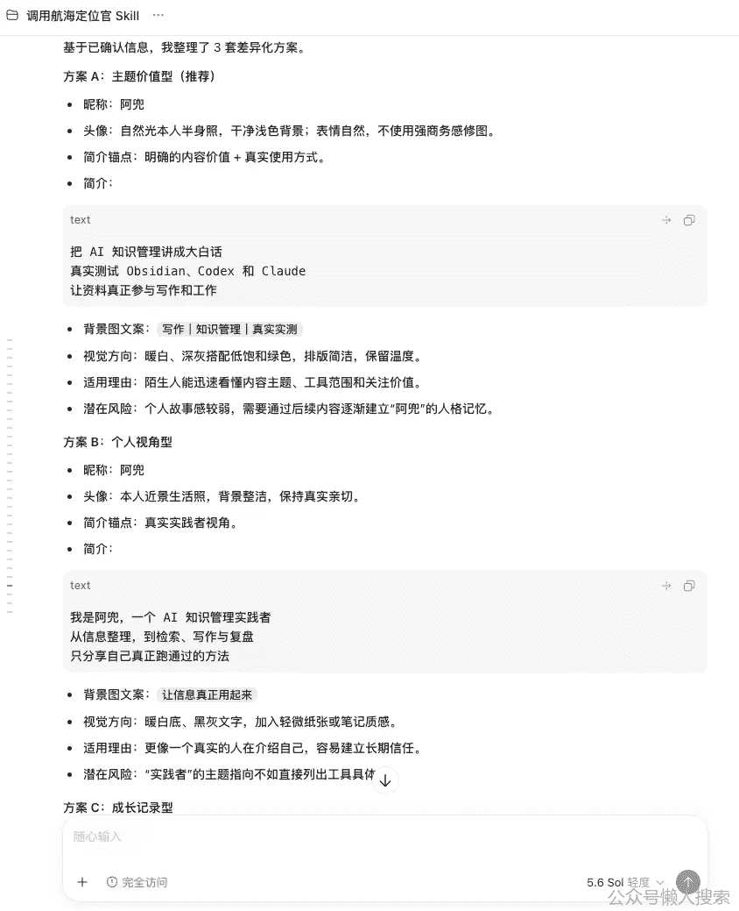

**方案 A：主题价值型**

这套方案会直接告诉别人：

• 账号主要讲什么；

• 准备用什么方式讲；

• 关注以后可以获得什么。

适合希望别人进入主页后，能够快速看懂账号方向的人。

**方案 B：个人视角型**

这套方案会重点突出你的真实身份、经历或看待 AI 的独特视角。

适合拥有相关工作、行业或项目经历，希望账号更有个人识别度的人。

**方案 C：成长记录型**

这套方案会重点呈现你正在学习、实践和持续记录的过程。

适合正在进入 AI 领域，希望通过真实实践和成长过程与读者建立信任的人。

每套方案都会写清：

• 这套方案的整体思路；

• 头像应该采用什么形式；

• 推荐使用的昵称；

• 可以直接使用的简介；

• 背景图文字；

• 为什么适合你；

• 使用时可能遇到的问题。

三套方案生成以后，“航海定位官”会推荐其中最适合你当前阶段的一套，并说明推荐原因。

注意：不要只因为 AI 推荐就直接使用

请先检查：

1.  昵称读起来是否自然？

1.  是否包含你不愿意长期使用的身份？

1.  简介是否符合事实？

1.  有没有写入无法证明的成绩？

1.  是否能看出主要关注什么？

1.  是否能看出读者关注后可以获得什么？

1.  背景图和简介是否重复过多？

1.  你是否愿意至少使用这一版完成前 5 条内容？

检查完成后，Skill 会主动询问你是否采用这套方案。

需要修改时，直接说出你的真实感受和具体原因。例如：

• 昵称中的这个词我不想长期使用。

• 简介中的这句话与事实不符，正确情况是……

• 背景图文字太多，希望只保留最重要的 2—3 个关键词。

Skill 会只调整你提出的部分，并再次检查账号包装是否与定位一致。你确认最终方案后，它会自动整理并写入 Obsidian。

5. 自动写入 Obsidian、检查并提交

主页包装确认以后，Skill 会自动汇总本关已经确认的结果，并创建或更新：

定位总览_v0.1.md

账号包装_v0.1.md

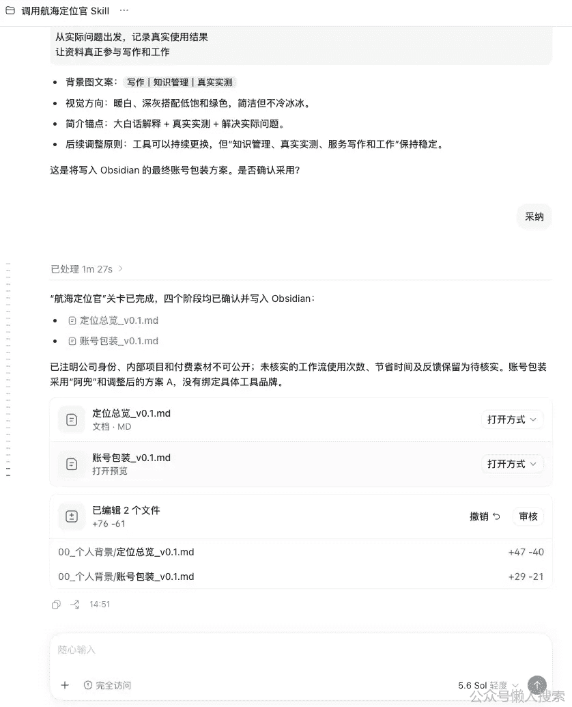

💡

**🎊 到这里，本关就完成啦，记得提交作业 👉🏻**https://scys.com/activity/10093/task

1.  定位总览_v0.1.md文件或完整截图，必填。

1.  小红书主页截图，能看清头像、昵称、简介和背景图，选填。

1.  分享一下这关最大的收获，或者你遇到的卡点、怎么解决的（必填）

全部完成后，就可以提交作业并进入关卡 2～

下一关，我们将搜集对标账号与内容素材，作为你的内容原材料之一、同时沉淀优质内容结构。

💡⚠️ 请记住：现在得到的是定位 v0.1。

接下来的素材库、规律提取、选题、内容创作、发布和复盘，都会以这份定位为起点。完成前 5 条内容以后，你会拥有更多真实信息：哪些内容更容易写，哪些用户更愿意互动，哪些问题值得继续深入。

到那时，再根据事实调整定位，而不是在开始之前反复猜测。

先完成第一版，然后继续往前走。

## 关卡 2：素材库：搜集对标账号与内容素材【重要】

### 00. 本关任务卡

💡

**任务目标**：在 Obsidian 中建好内容素材库，搜集 5-10 个小红书对标账号，搜集 10 条小红书对标笔记，并用浏览器插件“社媒助手”抓取笔记内容。

**任务描述**：

1.  让 AI 检查并补齐 Obsidian 内容工作台。

1.  让 AI 根据关卡 1 的定位生成搜索词。

1.  搜集 5-10 个对标账号，交给 AI 入库。

1.  安装“社媒助手”。

1.  搜集 10 条对标内容，用社媒助手复制笔记信息，再交给 AI 入库。

1.  让 AI 检查数量和文件是否可以正常读取。

**本关需提交作业**：

• Obsidian 左侧目录截图，能看见01_对标账号和02_内容素材中已经保存的文件。（必填）

• Obsidian 中记录的对标账号、笔记信息截图。（必填）

• AI 生成的入库检查报告。（必填）

• 分享一下这关最大的收获，或者你遇到的卡点、怎么解决的（必填）

**完成标准：7 个目录完整、5-10 个账号有卡片、约 10 条内容已抓取并保存、**Codex 检查通过，就可以进入关卡 3。不要为了做出一个漂亮知识库继续扩目录。

### 01. 建立内容创作工作台

打开 Obsidian，在根目录补齐下面 7 个文件夹。

可以直接复制给 Codex，让 AI 帮你补齐目录：

Plain Text

```
请检查当前文件夹-AI第二大脑_内容创作系统。

在不删除、不移动、不覆盖现有文件的前提下，补齐下面 7 个文件夹：
00_个人背景
01_对标账号
02_内容素材
03_内容规律
04_选题库
05_内容草稿
06_发布复盘
```

回到 Obsidian 左侧检查，7 个文件夹能够正常显示，就可以继续。

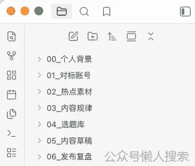

目录建好后，再在 Vault 根目录创建一个项目配置文件。

这个文件的作用是：把每次提示词都要重复的通用规则写在一个地方，AI 打开项目时自动读取。以后的提示词就不用反复交代"不要编造""来源写具体路径"这些基本要求了。

如果你跟着本期航海使用 Codex，创建AGENTS.md；如果你使用的是 Claude Code，创建CLAUDE.md；两者内容一样，只是文件名不同。

**注意**：这个规则文件不是一次写死的，后续可以随时更新。

比如 AI 总在同一个地方出错，或者有了新的统一要求，就把规则加进去。

向 Codex 发送：

Plain Text

```
请在 Vault 根目录创建项目配置文件。

如果当前使用的是 Claude Code，文件名为 CLAUDE.md。
如果当前使用的是 Codex，文件名为 AGENTS.md。

写入以下内容：

# AI第二大脑 内容创作系统

这是一个用于 AI 自媒体内容创作的 Obsidian Vault。

## 目录结构

- 00_个人背景/ — 个人定位和账号包装
- 01_对标账号/ — 搜集的小红书对标账号
- 02_内容素材/ — 搜集的小红书对标内容
- 03_内容规律/ — 从素材中提炼的标题、开头和正文结构规律
- 04_选题库/ — 选题池
- 05_内容草稿/ — 内容草稿
- 06_发布复盘/ — 发布数据和复盘

## 每次开始前

先读取 00_个人背景/定位总览_v0.1.md，了解目标读者、账号价值和内容范围。

## 通用规则

1. 只使用文件中已有的真实信息。不编造个人经历、受众需求、热点趋势、数据和使用效果。
2. 素材来源写具体文件路径，不能只写&quot;来自小红书&quot;。
3. 读取 02_内容素材 时，排除搜索关键词.md、_入库检查报告.md 和其他以 _ 开头的辅助文件。有标题、来源链接和可读正文，才算一条有效内容。
4. 可以借鉴素材中的问题和角度，但不照搬原笔记标题和正文。
5. 只修改当前任务指定的文件，不要动其他文件夹的内容。
6. 不删除或覆盖已有内容，除非明确要求。
```

创建完成后，在 Obsidian 左侧确认文件存在即可。以后每次打开这个项目，AI 都会自动读取这些规则。

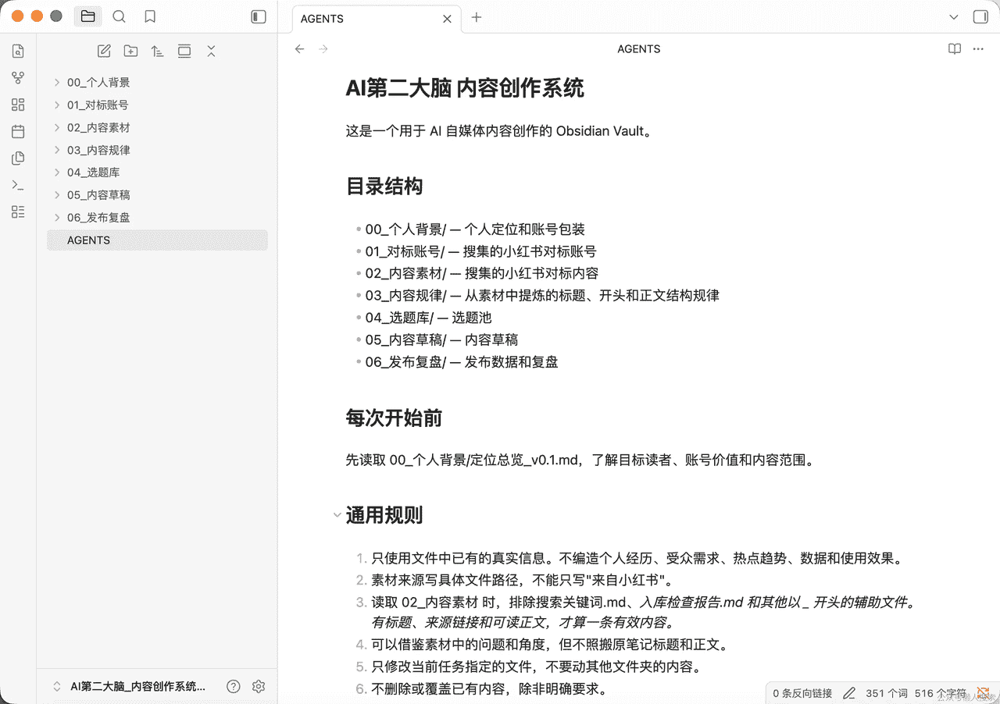

### 02. 搜集对标账号与内容素材

1.让 AI 生成搜索词

不要只搜索“AI”。范围太大时，很难找到与你的账号方向相关的账号和内容。也不要一开始就搜索过于具体的完整句子。

例如：

• 太宽：AI

• 太具体：AI 读过资料为什么不会用

• 更适合起搜：AI 不会用、AI 提问、AI 工作流、AI 知识库

让 Codex 读取关卡 1 的定位结果：

Plain Text

```
请读取：
00_个人背景/定位总览_v0.1.md

根据我已经确认的目标读者、账号价值和内容范围，生成一组用于小红书搜索的关键词。

请给我：
1. 5-10 个适合寻找对标内容的搜索词；
2. 每个词用一句话说明大概能搜到什么。

账号搜索词和内容搜索词可以不同。
不要增加定位文件中没有确认过的人群和方向。

请把结果写入：
02_内容素材/搜索关键词.md
```

搜索词生成以后，直接开始搜索，不需要反复调整到完美。

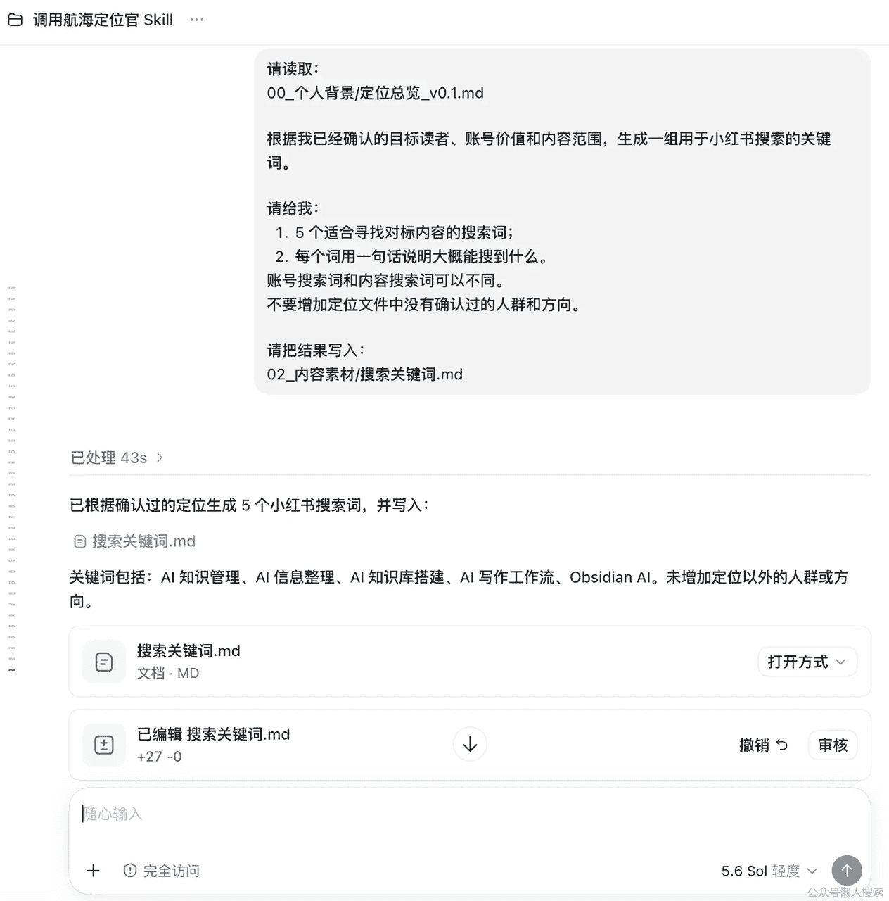

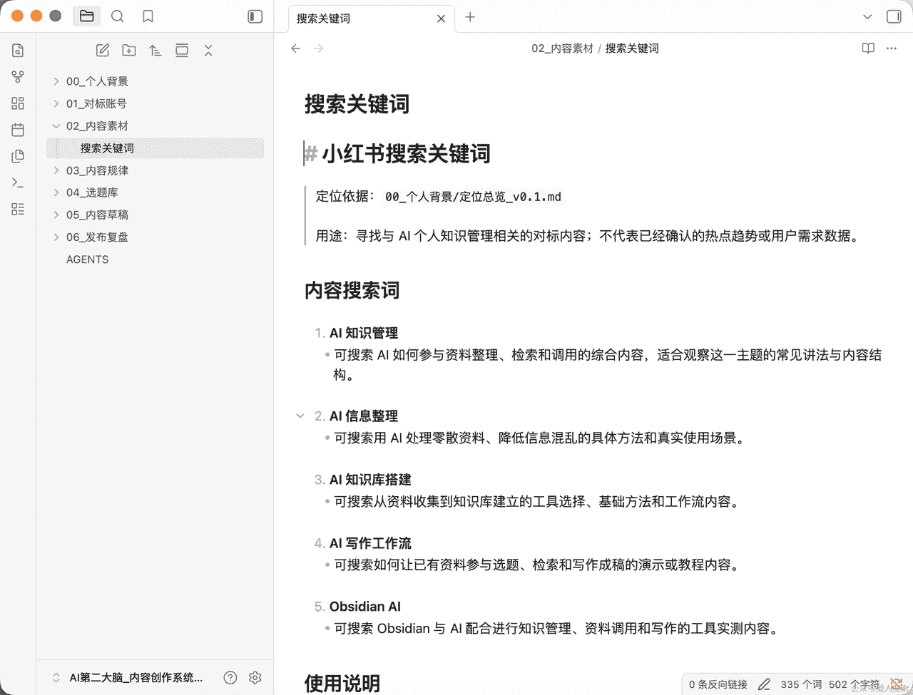

在搜索结果中，一定要筛选：

• 排序依据：最多点赞

• 发布时间：半年内

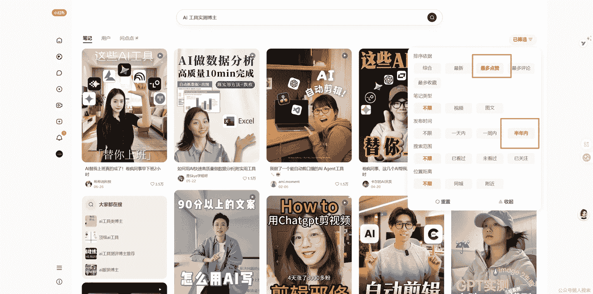

2.搜集 5-10 个对标账号

先完成对标账号的搜集。

**怎样找到对标账号？**

在小红书搜索刚才生成的内容搜索词。

搜索出来的是一条条内容，每条内容背后都有一个账号。

看到与你准备做的方向相关、数据表现较好的内容时，点击作者头像，进入主页看看这个账号是否值得长期观察。

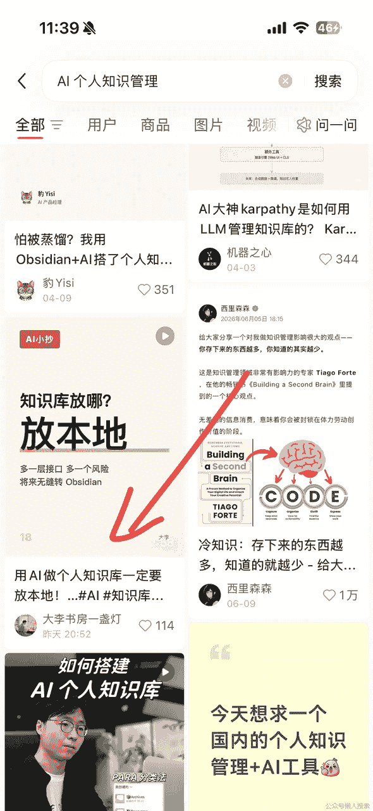

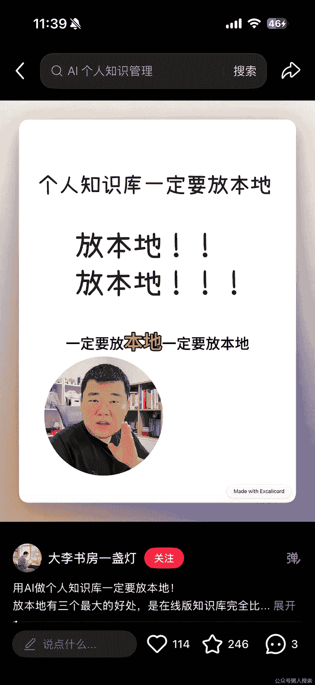

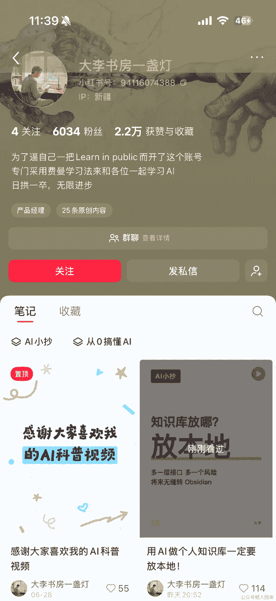

**什么样的账号值得对标？**

主要判断三点：

1.  **与你准备做的方向接近。**账号长期分享的内容，与你的账号方向和准备服务的人群有关。

1.  **不是只靠一条偶然爆款。**主页中不止一条内容获得较好反馈，能够看到相对稳定的内容方向和数据表现。

1.  **部分做法是你现阶段能够尝试的。**它的选题、表达方式或内容制作难度中，至少有一部分是你目前可以学习和实践的。

大 V 可以作为行业观察样本，但不要全部选择大 V。还要保留一些与你当前阶段更接近、部分做法能够实际尝试的账号。

如果你决定把它作为对标账号，需要人工取得账号真实的基础信息，一般包括：

• 账号名；

• 主页分享链接；

• 页面上能直接看到的账号信息；

• 搜集日期。

这里只需要判断是否值得收入对标账号库，不需要进一步拆解它的人设、商业模式、内容结构或成功原因。

另外，新手做自媒体，前期建议先手动刷、手动记录，保持体感。

**把账号交给 AI 入库**

每找到一个对标账号，把你能看到的真实信息发给 Codex：

Plain Text

```
这是我决定搜集的一个小红书对标账号，请把它保存到“01_对标账号”。

账号信息：
【粘贴账号名、主页分享链接和页面上能看到的其他信息】

搜集日期：
【填写日期】

要求：
1. 只整理和保存我提供的真实信息，不分析这个账号。
2. 不推测没有提供的信息，缺失内容写“未提供”即可。
3. 不需要使用固定模板，请沿用当前文件夹中清晰、方便追加的 Markdown 结构。
4. 本次只编辑“01_对标账号”，不要修改其他文件夹。
5. 保存后告诉我文件位置。
```

对标账号录入效果：

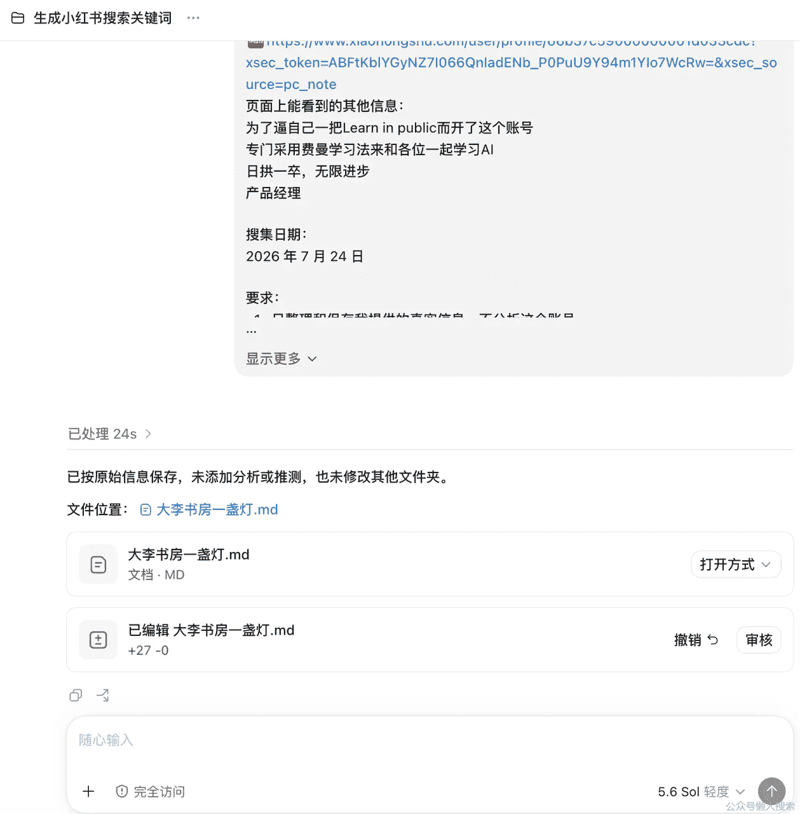

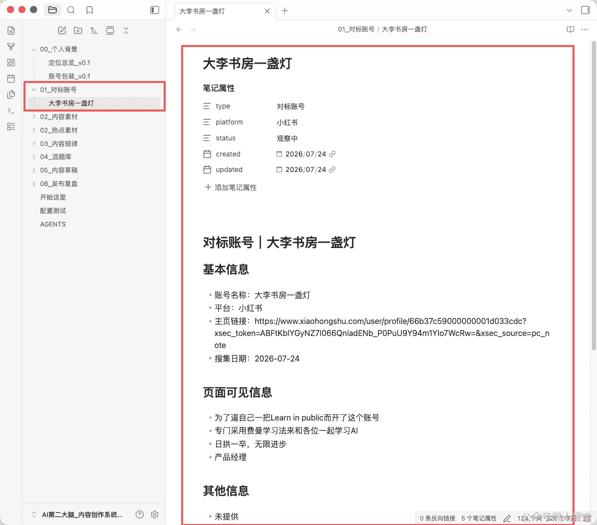

继续搜集，达到 5—10 个账号即可停止。

不需要为了凑齐数量，把方向明显无关的账号放进来。

3.搜集 10 条对标内容

3.1 先安装社媒助手

搜集内容时，我们需要取得笔记正文和页面上的基础信息。

本关统一使用浏览器插件“社媒助手”。

**安装插件**

打开社媒助手官方下载页：https://socialext.com/download

能够打开 Chrome 应用商店时：

1.  点击“前往 Chrome 应用商店”。

1.  点击“添加至 Chrome”。

1.  点击“添加扩展程序”。

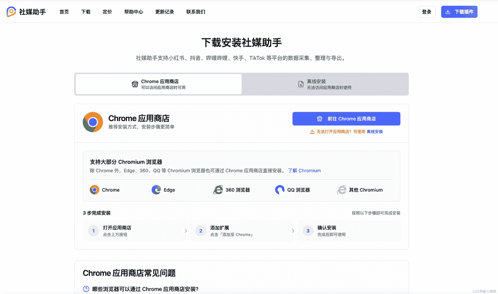

无法打开 Chrome 应用商店时，按照页面中的“离线安装”完成安装。

（官方离线安装说明：https://socialext.com/help/faq/browser/offline-install）

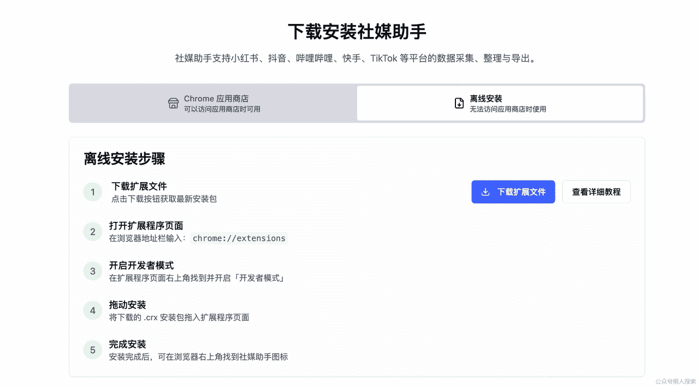

**✅ 安装完成：**

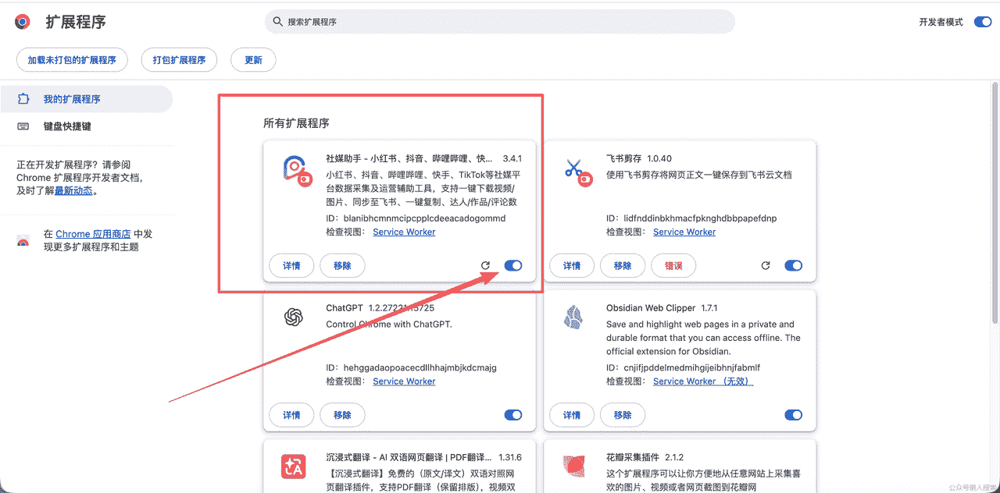

**固定插件**

1.  点击 Chrome 右上角的拼图图标。

1.  找到“社媒助手”。

1.  点击固定按钮。

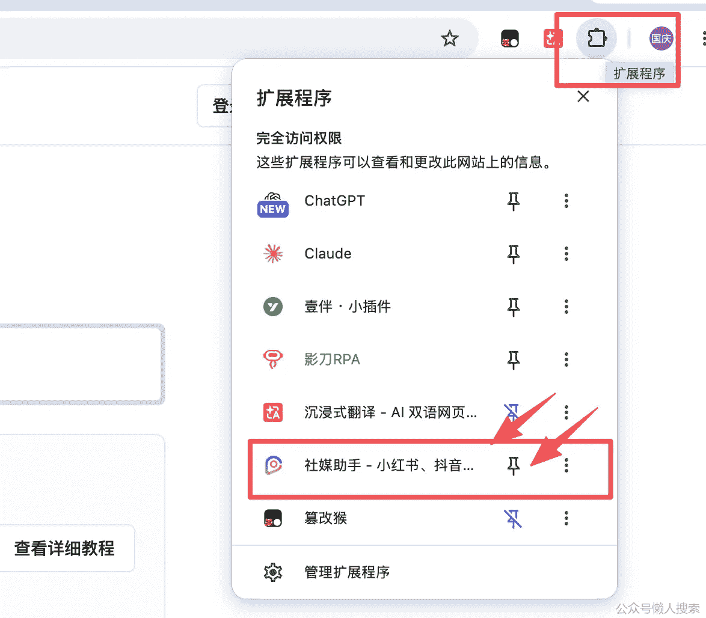

**检查是否安装成功**

登录小红书网页版，打开一篇笔记详情页。

页面中能够看到社媒助手提供的“复制笔记信息”，就说明插件已经正常工作。

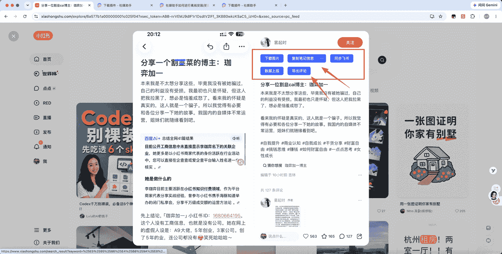

如果没有出现，先刷新一次页面；仍然没有出现，再检查插件是否已经启用，然后重新打开浏览器。

3.2 搜集 10 条对标内容

**怎样找到对标内容？**

搜索第一步生成的内容搜索词。

看到与你准备做的方向相关、数据表现较好、目前仍有参考价值的内容，就打开笔记详情页。

**一条对标内容应同时满足：**

1.  **方向相关**：内容面向的读者、解决的问题或主题，在关卡 1 已确认的账号定位范围内。

1.  **数据有参考价值**：与同类搜索结果或该账号近期内容相比，点赞、收藏、评论中的一项或多项表现较好。不只看一个固定数字。

如果实在把握不好，可以暂时参考下面的标准：

• 点赞达到 300；

• 或收藏达到 100；

• 或评论达到 30。

满足其中一项，或点赞达到 1000 以上，可以直接收录。（300/100/30 只是辅助新手参考，不是硬门槛）

1.  **目前仍然适用**：内容不是已经过期的活动、政策或短期热点，现在搜到仍有参考价值。

最简单的判断方法是：

如果这条内容面对的是你想服务的人，讨论的是你准备长期创作的问题，而且数据表现有参考价值，就可以把它收进素材库。

注意：高赞只能说明内容击中了传播点或用户兴趣，不代表其中的事实、数据和结论一定真实。对标素材可以用来学习选题、标题和结构；涉及产品能力、政策、数据和效果的内容，进入自己的文章前还是需要单独核查下。

**3.3 用社媒助手复制笔记信息**

打开笔记详情页后：

1.  点击“复制笔记信息”。

1.  复制格式选择“默认”，也就是 TXT 格式。

1.  选择笔记标题、笔记内容、博主昵称、发布时间、点赞数、收藏数、评论数、图片等。（记得采集图片，图文笔记的内容大都在图片上）

1.  点击复制。

1.  再从小红书的“分享”功能中复制笔记链接。

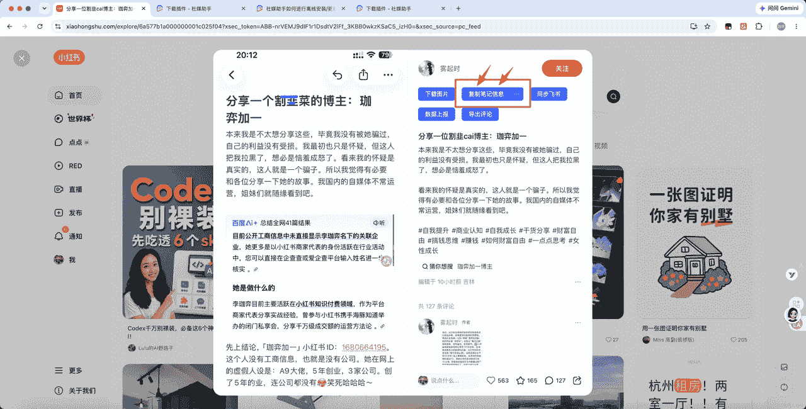

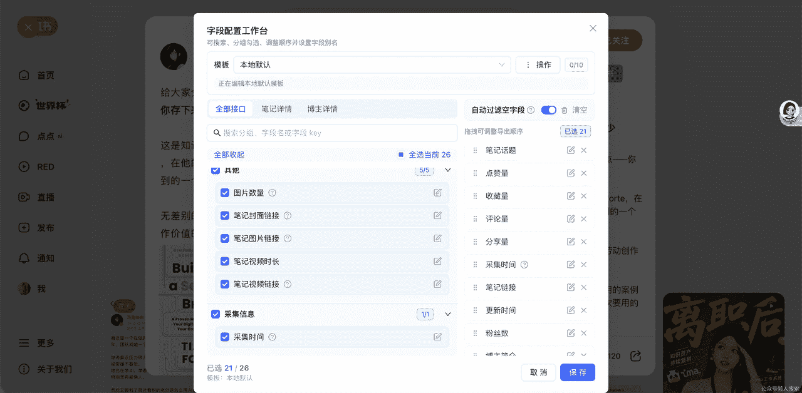

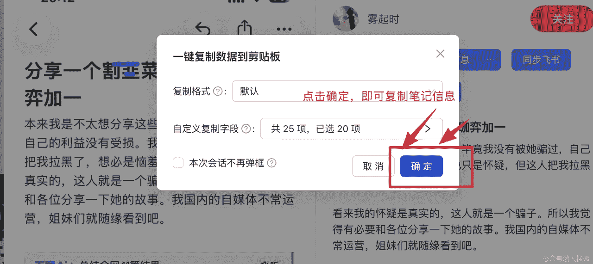

**注意：**

• 社媒助手已经足够本关卡任务的使用，不需要再额外学习 JSON、CSV、批量采集等技术。

• 社媒助手目前只能采集图文内容，无法采集视频脚本文案，如有视频脚本采集需求的伙伴，可以试试轻抖小程序（微信搜索“轻抖”即可），或其他工具。

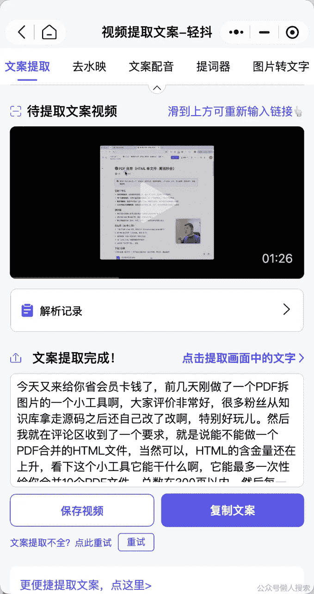

**3.5 把内容交给 AI 入库**

把社媒助手复制的内容和小红书分享链接一起发给 Codex：

Plain Text

```
这是我决定搜集的一条小红书对标内容，请把它保存到“02_内容素材”。

社媒助手复制的完整笔记信息：
【粘贴完整内容】

要求：
1. 每条内容建立一个独立文件夹，文件夹命名为“笔记标题_笔记ID”。
2. 在该文件夹中创建“笔记信息.md”，完整保存我提供的全部信息，不概括、不改写、不分析。
3. 如果标题中包含不适合用于文件名的字符，只做必要的字符替换，不修改标题原文。
4. 根据笔记 ID 和笔记链接检查是否重复；如果已经入库，不要重复创建。
5. 下载“笔记图片链接”中的全部图片，按照原始顺序保存为 01.jpg、02.jpg、03.jpg……
6. 在“笔记信息.md”末尾增加“笔记图片”部分，使用下面的格式依次嵌入本地图片：

![[01.jpg]]
![[02.jpg]]

7. 保存后告诉我文件夹位置、图片下载数量、失败数量、正文是否为空，以及当前已入库的对标内容数量。
```

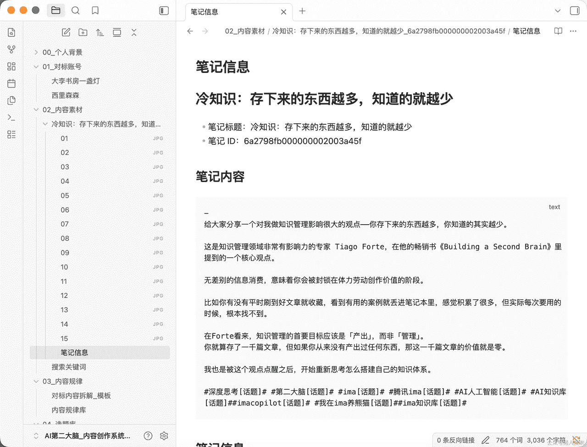

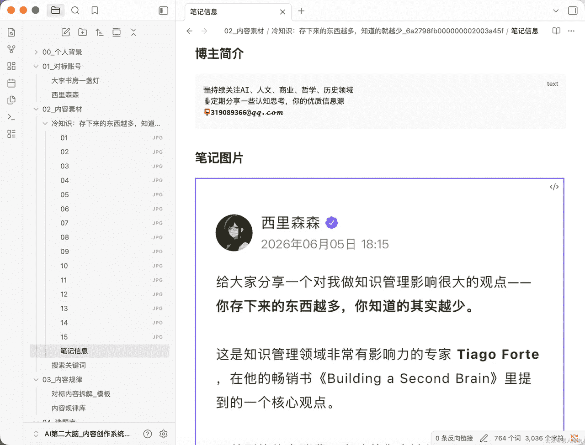

继续搜集，达到 10 条内容即可暂停。

1.  让 Codex 完成入库检查

收集完成后，先不要直接进入下一关。让 Codex 检查素材数量、重复内容和图片读取情况。

把下面的提示词发给 Codex：

Plain Text

```
请检查 02_内容素材 中已经保存的对标内容。

请排除：
- 搜索关键词.md；
- 已有的 _入库检查报告.md；
- 其他以 _ 开头的辅助文件。

只有同时具备标题、来源链接和可读正文的内容，才算一条有效内容。
如果笔记包含本地图片，请检查图片文件是否存在、能否正常读取。

请创建或更新：
02_内容素材/_入库检查报告.md

写入：
1. 当前有效内容总数；
2. 每条有效内容的文件路径；
3. 疑似重复的内容；
4. 缺少标题、链接或正文的内容；
5. 图片缺失或无法读取的内容；
6. 是否已经达到 10 条有效内容。

不要修改原始素材文件，不要补写缺失信息。

完成后告诉我：
- 有效内容数量；
- 需要处理的问题；

- 是否可以进入关卡 3。
```

Codex 完成后，由你打开_入库检查报告.md检查：

• 有效内容是否达到 10 条；

• 文件路径是否真实存在；

• 是否还有重复、正文缺失或图片无法读取的问题。

未达到 10 条时，回到前面继续收集；检查通过后再进入关卡 3。

💡

**🎊 到这里，本关就完成啦，记得提交作业 👉🏻**https://scys.com/activity/10093/task

1.  Obsidian 左侧目录截图，能看见01_对标账号和02_内容素材中已经保存的文件。（必填）

1.  Obsidian 中记录的对标账号、笔记信息截图。（必填）

1.  AI 生成的入库检查报告。（必填）

1.  分享一下这关最大的收获，或者你遇到的卡点、怎么解决的（必填）

全部完成后，就可以提交作业并进入关卡 3。

下一关，我们将处理采集的素材，从中提取可复用的规律～

## 关卡 3：规律提取：从高赞内容里提炼可复用结构

### 00. 本关任务卡

💡

**任务目标**：从关卡 2 收好的 10 条对标内容中，横向提炼标题、开头、正文结构的可复用规律，每条规律至少有 2 条来源素材支撑，并写清适合什么、不适合什么。最后，把这套流程封装成一个可以重复使用的规律提取 Skill。

**任务描述**：

1.  让 AI 读取全部内容素材，按统一字段建立汇总底稿。

1.  在汇总底稿基础上，依次提炼标题、开头和正文结构三类规律。

1.  人工确认哪些规律真实、可用、边界清楚。

1.  把规律提取流程封装成 Skill。

**本关需提交作业**：

1.  03_内容规律文件夹截图，能看见标题规律、开头规律、正文结构规律三份文件。

1.  任意一份规律文件的截图，能看清规律名称、适用范围、不可照搬点和来源素材。

1.  规律提取 Skill 创建并验证成功的截图。

1.  分享一下这关最大的收获，或者你遇到的卡点、怎么解决的（必填）

1.完成本关你会获得什么

本关完成后，你的 Obsidian 中会新增：

Plain Text

```
03_内容规律/_规律提取汇总.md
03_内容规律/标题规律.md
03_内容规律/开头规律.md
03_内容规律/正文结构规律.md
skills/shengcai-pattern-extractor/
```

_规律提取汇总.md是中间底稿，把 10 条素材按统一字段整理在一起，方便横向对比。

三份规律文件是最终输出，分别记录经过人工确认的标题、开头和正文结构规律，每条规律都保留来源素材。

规律提取 Skill 会记住这套工作方法。以后搜集了新内容，只要告诉 AI：

Plain Text

```
我搜集了新内容，帮我更新内容规律。
```

AI 就会调用 Skill，读取新增内容并更新规律文档。

2.明确这一关的目的

这一关的目的：提炼并沿用爆款结构，提高自己内容的爆款概率

关卡 2 搜集了 10 条高数据的对标内容。

这些内容之所以数据好，背后一定有原因。可能是标题的写法、开头的切入方式，也可能是正文的组织结构。如果能把这些反复出现的做法提炼出来，写自己的内容时直接沿用，就不需要每次从零摸索。

这一关要做的事情很简单：

从已经验证过的爆款内容中，找出标题、开头和正文结构的共性做法，变成自己写内容时可以直接调用的模板。

AI 会帮你完成提炼，但有一条底线

本关的提炼和归纳工作由 AI 完成，你不需要自己逐条拆解。

但 AI 生成的规律需要你确认，确认时注意一点：

一条内容数据好，不代表它的每个做法都值得学。

本关找的"规律"至少要满足两点：

1.**重复出现。**同一种做法至少在 2 条素材中都能看到。

2.**能说清楚。**能用大白话说出它是什么、适合什么内容、哪里不能照搬。

只出现 1 次的做法先留着观察，不急着写成规律。

**⚠️ 注意，对标不是一比一复制**

更有效的做法，是从不同内容里分别抽取适合自己的元素：可能学习 A 内容的选题表达、B 内容的开头、C 内容的结构，但不把自己变成任何一个账号的复制品。

本关只复用方法，不复制原文、案例和未经验证的结果。

### 01. 分步骤让 AI 提炼规律

1.建立规律提取汇总底稿

先不要直接让 AI 总结规律。不同素材的信息详细程度不一样，AI 很容易把缺失的信息补成一个看似合理的答案。

第一步是让 AI 按统一字段把 10 条内容整理到一起，方便你横向对比。

把AI第二大脑_内容创作系统作为 Codex 的当前工作目录，然后发送：

Plain Text

```
请读取 02_内容素材，把每条内容按下面字段整理，写入：
03_内容规律/_规律提取汇总.md

每条内容只提取下面四个字段，其他信息回素材文件查看：

## 素材 01
- 素材文件：
- 标题：
- 开头 1-3 句原文：
- 图片正文：
- 正文结构：

规则：
1.素材文件中没有的字段写&quot;未采集&quot;。
2.如果素材文件中嵌入了本地图片，必须按嵌入顺序读取全部图片中的文字，并把图片文字视为正文的一部分。不得只看笔记的纯文字正文。无法读取的图片要记录具体路径，不得跳过或推测。
3.&quot;开头 1-3 句原文&quot;保留原文，不改写。
4.&quot;正文结构&quot;按原文实际段落顺序列出，用箭头连接，包含结尾动作。不要提前压缩或合并步骤。
5.这一轮只做汇总，不总结跨素材规律。
6.“图片正文”按图片顺序记录为“01.jpg、02.jpg……”，保留影响标题、开头和结构判断的原始文字。图片只有装饰、无可读文字时写“无可读文字”。
7.判断开头时，分别识别笔记文字开头和首图/前几张图片承担的内容开头，不要把图片中的任意一句话误当成笔记文字原文。

完成后告诉我：
- 一共整理了多少条内容；
- 哪些素材缺少正文、开头或结构信息；
- 有没有无法读取的文件。
```

回到 Obsidian，打开：

Plain Text

```
03_内容规律/_规律提取汇总.md
```

抽查 2—3 条：标题和开头是否真的存在于原素材文件中。如果有 AI 自己补出来的信息，先修正后再继续。

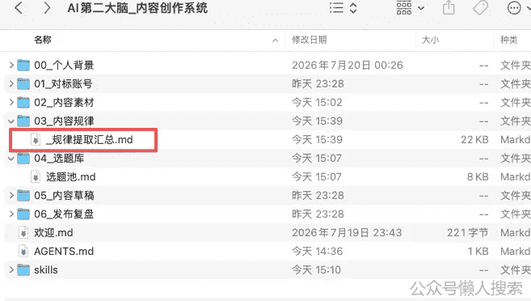

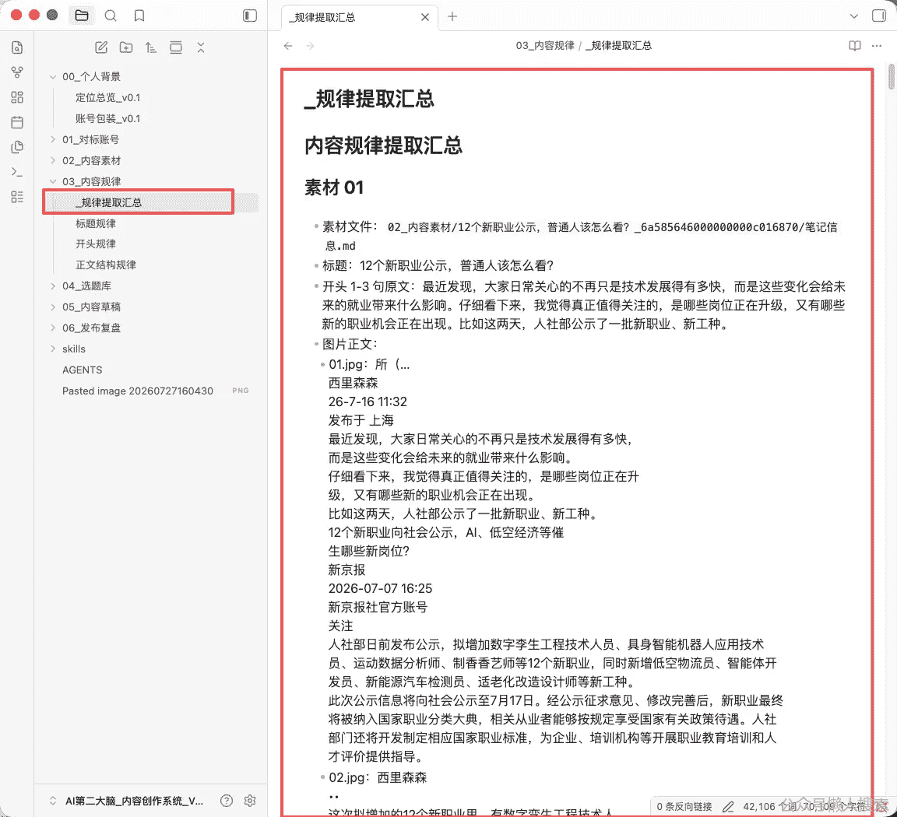

记得检查下，图片素材里的文字有没有被提取出来，这里提示词做了强调，AI 应该不会遗漏。

2.提炼标题、开头和正文结构规律

汇总底稿确认后，让 Codex 在一个提示词中完成全部规律提炼：

Plain Text

```
请读取：
03_内容规律/_规律提取汇总.md

请基于汇总底稿，生成三份文件：
1. 03_内容规律/标题规律.md
2. 03_内容规律/开头规律.md
3. 03_内容规律/正文结构规律.md

每份文件包含&quot;候选规律&quot;和&quot;单条观察&quot;两个区域。

处理规则：
1. 同一种做法至少出现在 2 条素材中，才能进入&quot;候选规律&quot;；只出现 1 次的放进&quot;单条观察&quot;。
2. 每条候选规律按这个格式记录：

### 规律 1：【规律名称】
- 大白话解释：
- 适合什么内容：
- 不适合什么内容：
- 不可照搬点：
- 来源素材：
  - 素材文件 1
  - 素材文件 2

3. 提炼标题规律时，先把所有标题完整列出，再圈出反复出现的元素组合（例如&quot;工具名 + 数字 + 学习结果&quot;），不要只看单个元素。
4. 提炼开头规律时，保留 1-2 句来源原文作为示例，不改写原文。
5. 提炼正文结构规律时，写清结构顺序和适合什么类型的内容。
6. 不得写&quot;这样一定会爆&quot;&quot;平台算法喜欢&quot;等无法由当前素材证明的因果结论。
7. 如需生成改写示例，必须单独标注&quot;AI 示例&quot;，不得冒充原笔记。
8. 在每份文件末尾增加&quot;待确认&quot;清单，列出证据不足或无法判断的内容。
9. 提炼开头和正文结构时，同时使用汇总中的笔记正文与图片正文。必须区分两者来源，不得把图片文字冒充为笔记文字原文。

完成后告诉我：
- 三类规律各生成了多少条候选规律和单条观察；
- 使用了多少条来源素材；
- 哪些素材字段不足，导致某些维度无法提炼；
- 哪些结论需要我人工确认。
```

回到 Obsidian，打开03_内容规律文件夹，确认三份文件已经生成：

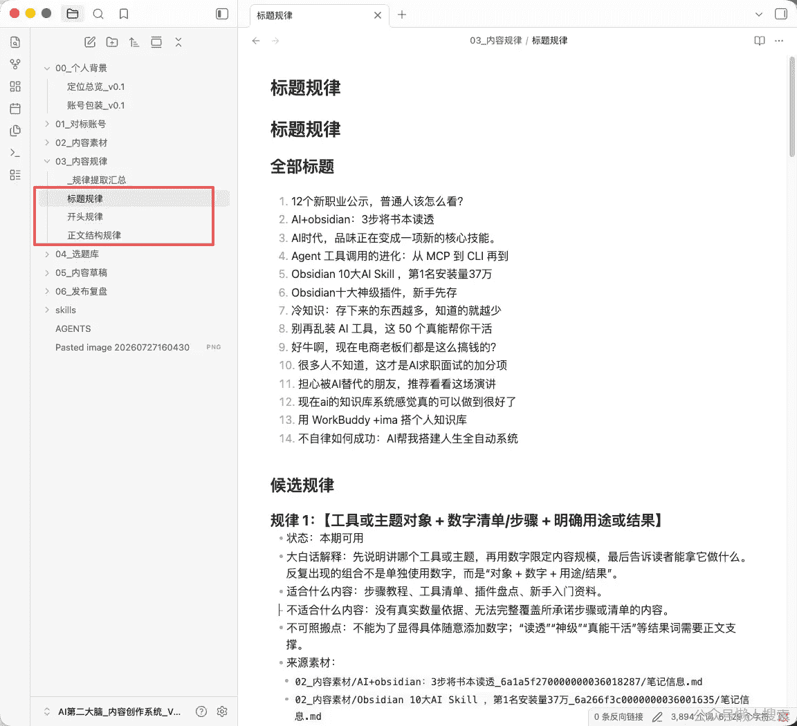

3.人工确认哪些规律可以留下

AI 生成文档后，不要直接过关。逐条打开来源素材，完成最后检查和确认。

**每条候选规律问 3 个问题：**

1.**来源够不够？**是否至少关联 2 条真实素材？

2.**描述准不准？**标题、开头和结构有没有被 AI 改错？

3.**边界清不清楚？**是否写明适合什么、不适合什么？

**确认后，把候选规律分成三类：**

-**本期可用：**看得懂、做得到，下一关可以直接调用。

-**以后再试：**有参考价值，但当前经验或素材不足。

-**删除：**来源不足、判断错误、已经过时或不适合账号方向。

让 Codex 帮你整理确认结果：

Plain Text

```
请读取：
1. 03_内容规律/标题规律.md
2. 03_内容规律/开头规律.md
3. 03_内容规律/正文结构规律.md

我确认以下修改：
【在这里写出你的确认结果，例如：
- 标题规律 1：本期可用，不需要修改。
- 标题规律 2：来源不足，移到&quot;单条观察&quot;。
- 开头规律 1：描述不准确，&quot;痛点开头&quot;改为&quot;场景开头&quot;，因为原文是先描述场景再引出问题。
- 正文结构规律 2：删除，我现在没有实测案例支撑这种结构。】

请按照我的确认更新对应的规律文件。

要求：
1. 在每条规律后面标注状态：本期可用 / 以后再试 / 已删除。
2. 被删除的规律移到文档末尾的&quot;已删除&quot;区域，保留删除原因。
3. 不要替我做额外判断，不要添加我没有确认的修改。

完成后告诉我最终保留了多少条&quot;本期可用&quot;规律。
```

合计选出至少 3 条"本期可用"规律即可。

如果没有提取到足够的规律，本质上是因为，我们获取的样本数还不够多。可以尽可能多的去采集足够的样本。

### 02. 把规律提取封装成 Skill

到这里，你已经完整走过一次规律提取流程：

读取内容素材 → 按统一字段汇总 → 横向提炼三类规律 → 人工确认

以后每次搜集新内容，如果都要重新发送前面的长提示词，会很麻烦。

现在让 Codex 把这套流程封装成"航海规律提取助手"Skill。以后只需要说一句话，它就会按照同样的方法更新三份规律文件。操作非常简单。

第一步：让 Codex 创建 Skill

把下面这段提示词发给 Codex：

Plain Text

```
请使用 skill-creator，把我们刚刚完成的规律提取流程封装成一个可重复使用的 Skill。

Skill 名称：
shengcai-pattern-extractor

显示名称：
航海规律提取助手

请先把 Skill 源文件创建在当前项目：
skills/shengcai-pattern-extractor/

创建完成并通过校验后，再安装到我的个人 Codex Skills 目录，让它以后可以直接被调用。

Skill 必须完成下面这些工作（通用规则已在项目配置文件中，不需要重复）：

1. 读取 02_内容素材，按统一字段整理，写入或更新 03_内容规律/_规律提取汇总.md。缺失字段写“未采集”。素材包含本地图片时，按顺序读取全部图片文字，单独记录图片正文；无法读取时记录具体路径，不得跳过或推测。
2. 基于汇总底稿，生成或更新三份文件：03_内容规律/标题规律.md、03_内容规律/开头规律.md、03_内容规律/正文结构规律.md。
3. 同一种做法至少出现在 2 条素材中才写成候选规律，只出现 1 次放进&quot;单条观察&quot;。
4. 每条候选规律写清：大白话解释、适合什么、不适合什么、不可照搬点和来源素材。
5. 不写&quot;这样一定会爆&quot;&quot;平台算法喜欢&quot;等无法由素材证明的因果结论。
6. 改写示例标注&quot;AI 示例&quot;。
7. 在每份规律文件末尾列出&quot;待确认&quot;清单。
8. 不删除或覆盖用户已经确认的规律。
9. 当用户说&quot;我搜集了新内容，帮我更新内容规律&quot;时，只处理新增素材，与已有规律对比后追加或补强，不重复生成已有规律。

Skill 创建后请告诉我项目源文件路径、个人安装路径和验证结果。
```

**第二步：测试 Skill**

Skill 安装成功后，新开一次对话，仍然把 Obsidian Vault 作为当前工作目录，然后发送：

Plain Text

```
我搜集了新内容，帮我更新内容规律。
```

正确的表现应该是：

1.  自动读取内容素材和现有三份规律文件；

1.  找出新增加、尚未处理的内容；

1.  更新汇总底稿；

1.  检查新内容是否能补强已有规律或产生新规律；

1.  没有新内容时如实说明，不修改文件。

如果自然语言没有触发 Skill，可以明确发送：

Plain Text

```
请使用 $shengcai-pattern-extractor，读取我新搜集的内容并更新内容规律。
```

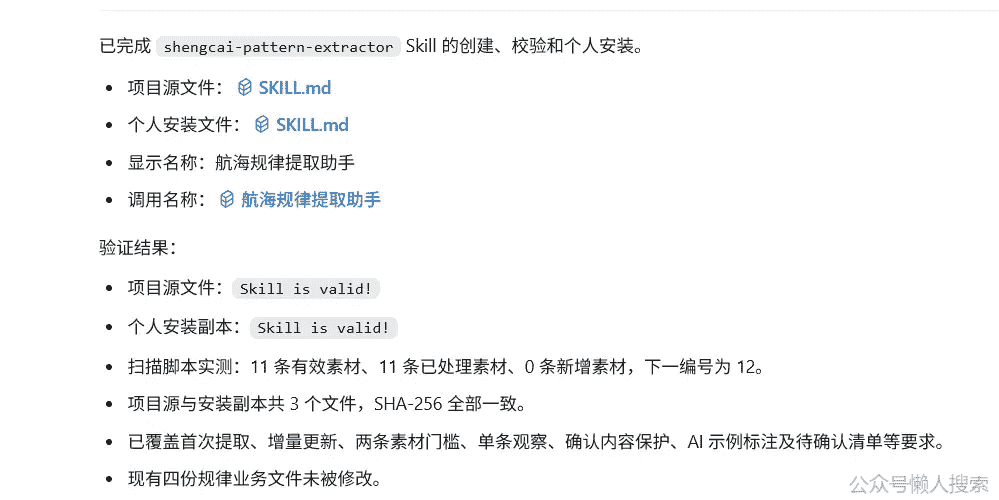

💡

**🎊 到这里，本关就完成啦，记得提交作业 👉🏻**https://scys.com/activity/10093/task

1.  Obsidian 中【03_内容规律】文件夹截图，能看见标题、开头、结构 3 份文档（必填）

1.  任意 1 份规律文档截图，能看清规律、适用范围和来源素材（必填）

1.  分享一下这关最大的收获，或者你遇到的卡点、怎么解决的（必填）

全部完成后，就可以提交作业并进入关卡 4～

下一关会根据内容素材，生成第一批能写的选题。

## 关卡 4：选题生成：确定第一批能写的选题

### 00. 本关任务卡

💡

**任务目标**：让 AI 读取关卡 1 的定位结果 + 关卡 2 搜集的内容素材，生成 5-10 个现阶段能写的选题，并把这套流程封装成一个可以重复使用的选题 Skill。

**任务描述**：

1.  分清”选题”和”标题”。

1.  让 AI 读取现有材料，生成 5-10 个可写选题。

1.  确定第一篇准备写哪个。

1.  把选题流程封装成 Skill。

**本关需提交作业**：

1.  04_选题库/选题池.md文件或完整截图，能看见 5-10 个选题。（必填）

1.  选题 Skill 创建并验证成功的截图。（必填）

1.  分享一下这关最大的收获，或者你遇到的卡点、怎么解决的（必填）

### 01. 让 AI 生成选题

1.先明确：选题 ≠ 标题

关卡 1 确定了账号准备写给谁、长期提供什么价值。

关卡 2 搜集了一批平台上已经出现过的爆款内容。

**这一关要把这些材料**变成一个更具体的结果：接下来可以写什么？

**选题 ≠ 标题**

选题是这篇内容准备解决的问题。

例如：

向刚接触 AI 的职场人解释，Agent 和普通聊天机器人的区别。

这是一个选题。它写清了：

• 准备写给谁；

• 准备讲什么；

• 读者看完要弄明白什么。

下面这种表达更像发布时使用的标题：

别再把 Agent 当成聊天机器人了

标题以后还会继续修改。现在不要急着追求吸引力，先保证选题真实、具体，而且有材料可以写。

一个现阶段能写的选题，至少要满足三点：

1.**符合定位。**写给的人和内容方向没有偏离关卡 1。

2.**问题具体。**一篇内容可以把它讲清楚，不是“AI 如何改变世界”这类大题。

3.**有真实素材。**能回到关卡 2 搜集的内容，或者关卡 1 已经确认的真实经历和能力。

本期默认先从 AI 科普开始。第一批选题优先选择新手现在能够理解、讲清楚和完成的内容。

2.让 AI 生成 5-10 个选题

把AI第二大脑_内容创作系统作为 Codex 的当前工作目录，然后发送：

Plain Text

```
请读取定位和 02_内容素材，生成 5—10 个候选选题，写入 04_选题库/选题池.md。

注意：如果有效内容中嵌入了本地图片，必须按嵌入顺序读取全部图片中的文字，并把图片文字视为选题材料的一部分。图片无法读取时，记录具体路径，不得跳过或推测。
图片文字只用于理解这条内容实际讲了什么。生成选题时，不要把“图片显示”“图片文字提到”“素材包提取”等素材处理过程写进选题。
开始前先检查有效内容数量。不足 10 条时停止，告诉我还缺多少条，要求我回到关卡 2 补充。

要求：
1. 第一批优先生成现阶段能够讲清楚的 AI 科普选题。
2. 每个选题写清楚：准备写给谁、解决什么具体问题、主要来自哪些文件。来源包含图片文字时，仍记录对应的笔记信息文件路径，不把图片路径当作独立内容来源。
3. 选题只表达”准备讲什么”，不要提前优化成夸张标题。
4. 同一个问题只是更换工具名、数字或近义词的，只保留一个，不要凑数。
5. 缺少关键材料的选题标记”缺素材”。
6. 在选题池末尾记录本轮已读取的内容文件路径，标题写成”已读取素材”。

完成后告诉我生成了多少个选题，哪些存在重复或缺素材的风险。
```

回到 Obsidian，打开：

Plain Text

```
04_选题库/选题池.md
```

确认选题已经写入，而不是只出现在 Codex 对话中。

如果发现某个选题有问题——偏离定位、题目太大、来源不实、现在写不了——直接告诉 Codex 删掉或修改。

看完选题池后，心里确定第一篇准备写哪个。优先选素材最完整、问题最清楚、现在最快能讲明白的。

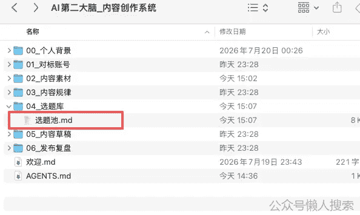

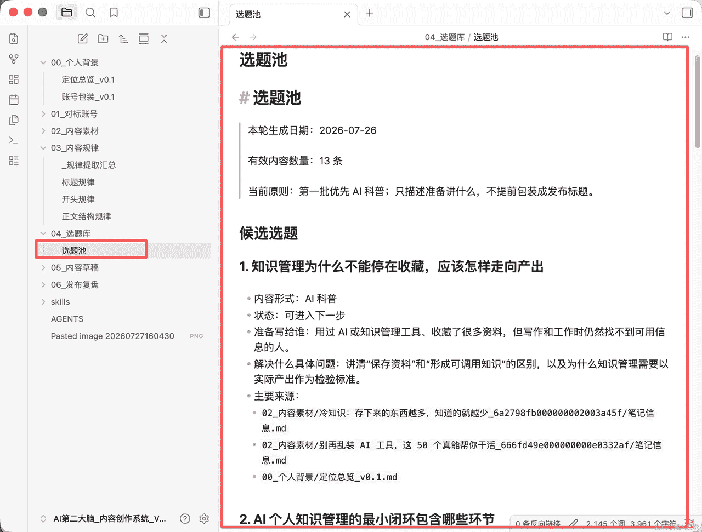

第一批选题我们优先做 AI 科普；选题只描述准备讲什么，不用提前包装成发布标题。

### 02. 把选题流程封装成 Skill

到这里，你已经完整走过一次选题流程：

读取定位和内容素材 → 检查素材数量 → 生成 5—10 个可写选题

以后每次搜集新内容，如果都要重新发送前面的长提示词，会很麻烦。

现在让 Codex 把这套流程封装成“航海选题助手”Skill。以后只需要说一句话，它就会按照同样的方法更新选题池。

让 Codex 创建 Skill

把下面这段提示词发给 Codex：

Plain Text

```
请使用 skill-creator，把我们刚刚完成的选题流程封装成一个可重复使用的 Skill。

Skill 名称：
shengcai-topic-generator

显示名称：
航海选题助手

请先把 Skill 源文件创建在当前项目：
skills/shengcai-topic-generator/

创建完成并通过校验后，再安装到我的个人 Codex Skills 目录，让它以后可以直接被调用。

Skill 必须完成下面这些工作（通用规则已在项目配置文件中，不需要重复）：

1. 首次生成时，读取定位和 02_内容素材。有效内容不足 10 条就停止并说明。
2. 材料足够时生成 5—10 个候选选题，写入 04_选题库/选题池.md。
3. 每个选题符合定位、解决具体问题，并保留真实内容来源。
4. 不优化标题，不生成正文。
5. 在选题池中记录已经读取过的内容文件。
6. 当我说”我搜集了新内容，帮我生成新选题”时，自动找出尚未处理的新内容，与已有选题去重，再把新选题追加到选题池。
7. 新内容足够时生成 5—10 个不同的新选题；材料不足时宁可少生成并说明原因，不要凑数。
8. 不删除或覆盖我已经确认的选题。

Skill 创建后请告诉我项目源文件路径、个人安装路径和验证结果。
```

**测试 Skill**

Skill 安装成功后，新开一次对话，仍然把 Obsidian Vault 作为当前工作目录，然后发送：

Plain Text

```
我搜集了新内容，帮我生成新选题。
```

正确的表现应该是：

1.  自动读取定位、内容素材和现有选题池；

1.  找出新增加、尚未处理的内容；

1.  检查新选题是否与旧选题重复；

1.  把有真实来源的新选题写入选题池；

1.  没有新内容时如实说明，不修改文件。

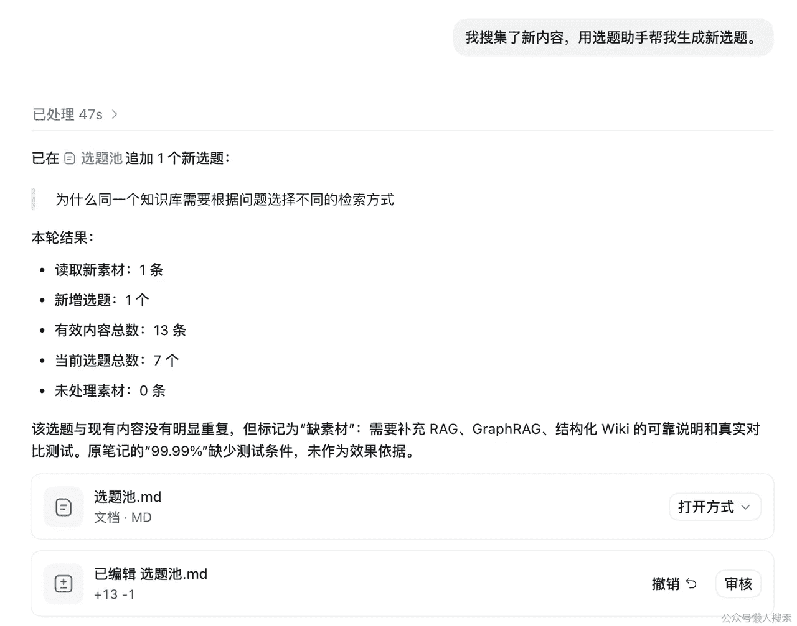

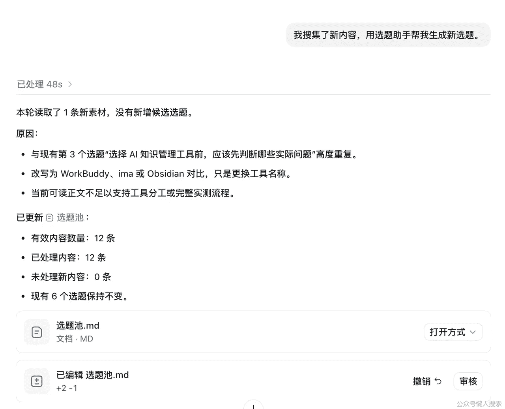

如果自然语言没有触发 Skill，可以明确发送：

Plain Text

```
请使用 $shengcai-topic-generator，读取我新搜集的内容并生成新选题。
```

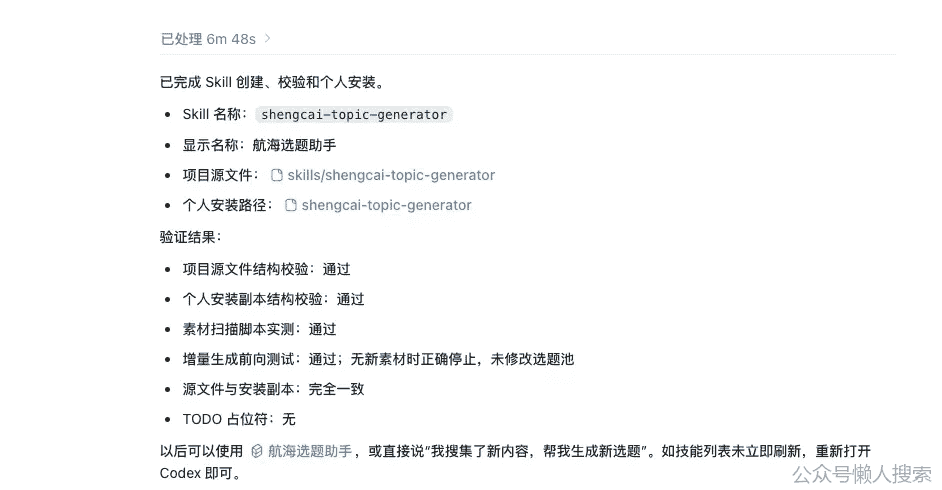

💡

**🎊 到这里，本关就完成啦，记得提交作业 👉🏻**https://scys.com/activity/10093/task

1.  04_选题库/选题池.md文件或完整截图，能看见 5-10 个选题。（必填）

1.  选题 Skill 创建并验证成功的截图。（必填）

1.  分享一下这关最大的收获，或者你遇到的卡点、怎么解决的（必填）

全部完成后，就可以提交作业并进入关卡 5～

下一关会围绕本关已经确定的第一篇选题，调取素材和规律，完成第一篇小红书内容的创作。

## 关卡 5：内容创作：完成第一篇小红书内容

### 00. 本关任务卡

💡

**任务目标**：围绕关卡 4 确定的第一篇选题，整理单篇创作素材包，由 Codex 访谈补充你的理解，生成并修改一篇小红书发布稿。

**任务描述**：

1.  让 AI 读取选题、来源素材和内容规律，整理素材包并完成访谈。

1.  确认素材后，让 AI 生成初稿。

1.  通读初稿，检查有没有胡说八道，把不像你的表达改顺。

1.  选定标题，让 AI 生成最终发布稿。

1.  把内容创作流程封装成 Skill。

**提交模板**：

1.  单篇创作文件截图：能看到素材包、AI 初稿、人工修改记录和最终发布稿。（必填）

1.  最终小红书发布稿截图：能看清标题、正文和待准备的图片或截图。（必填）

1.  笔记助手 Skill 创建并通过校验的截图（必填）。

1.  分享一下这关最大的收获，或者你遇到的卡点、怎么解决的（必填）

本关完成后，你的 Obsidian 中会新增：

Plain Text

```
05_内容草稿/001_【选题关键词】_素材包.md
05_内容草稿/001_【选题关键词】_AI初稿.md
05_内容草稿/001_【选题关键词】_最终发布稿.md
```

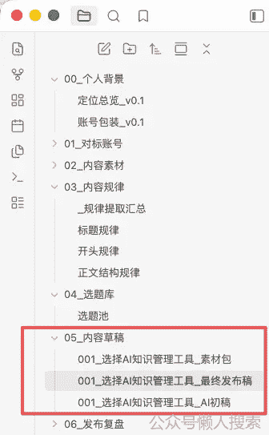

这份文件中包含：素材包、AI 初稿（含人工修改记录）、最终发布稿。一篇内容对应一个文件，所有环节都在同一份文件中完成。

### 01. 让 AI 做内容创作

**这一关最重要的是什么：**

让 AI 直接写一篇看起来完整的内容并不难。难的是让这篇内容只使用真实材料，讲清一个问题，而且里面有你的理解。

所以更稳妥的分工是：

• 你确认这篇要讲什么、哪些事实能用、自己怎么看；

• Codex 负责读取素材、整理输入、扩写初稿。

本关的创作方式是：Codex 先访谈你的理解，再生成初稿。

我们第一篇内容写的是 AI 科普，不要求硬编一个亲身故事。没有个人案例就明确回答 AI "暂无"就行，但你还是可以告诉 AI 你看完资料后的理解和判断。

1.让 AI 整理素材包，并完成对你的访谈

把AI第二大脑_内容创作系统作为 Codex 的当前工作目录，然后发送：

Markdown

```
请读取：
1. 定位（00_个人背景/定位总览_v0.1.md）
2. 选题池（04_选题库/选题池.md）中的这个选题：【在这里填入你选定的选题】
3. 该选题列出的来源文件，如果来源文件中嵌入了本地图片，必须按嵌入顺序读取全部图片中的文字，并把图片文字视为来源素材的一部分。无法读取的图片要记录具体路径，不得跳过或推测。
4. 03_内容规律 中状态为&quot;本期可用&quot;的标题规律、开头规律和正文结构规律

请创建：
05_内容草稿/001_【选题关键词】_素材包.md

按下面结构写入，不要生成初稿：

# 第一篇内容：【选题】

## 素材包

- 选题：
- 写给谁：
- 解决什么问题：
- 来源文件：
- 可用规律：

### 图片文字材料

逐条记录：
- 来源文件：
- 来源图片：
- 图片中的原始信息或必要摘录：
- 准备用在什么位置：
图片中的文字只作为内容素材保存，不分析图片设计，不直接使用或复制对标图片。除非选题本身需要讨论图片，否则不要把图片视觉风格作为内容结论。

### 可用材料

逐条记录：
- 来源文件：
- 原始信息或必要摘录：
- 准备用在什么位置：

### 我的理解与判断

（访谈后填写）

### 待核查或待补充

---素材包写完后，根据这个选题的具体内容，向我逐个提问 3—5 个问题，一次只问一个，等我回答后再问下一个。
问题应该围绕：我对这个选题的理解、判断、个人经历，以及素材中需要我补充或确认的地方。

访谈完成后，把我的原话整理进&quot;我的理解与判断&quot;，标注&quot;本人回答&quot;。只整理语序，不增加我没说过的观点。完成后停下，等我确认。
```

回到 Obsidian，打开创建好的文件，抽查素材包：每条材料是否能回到来源文件，有没有 AI 自己补出来的信息。

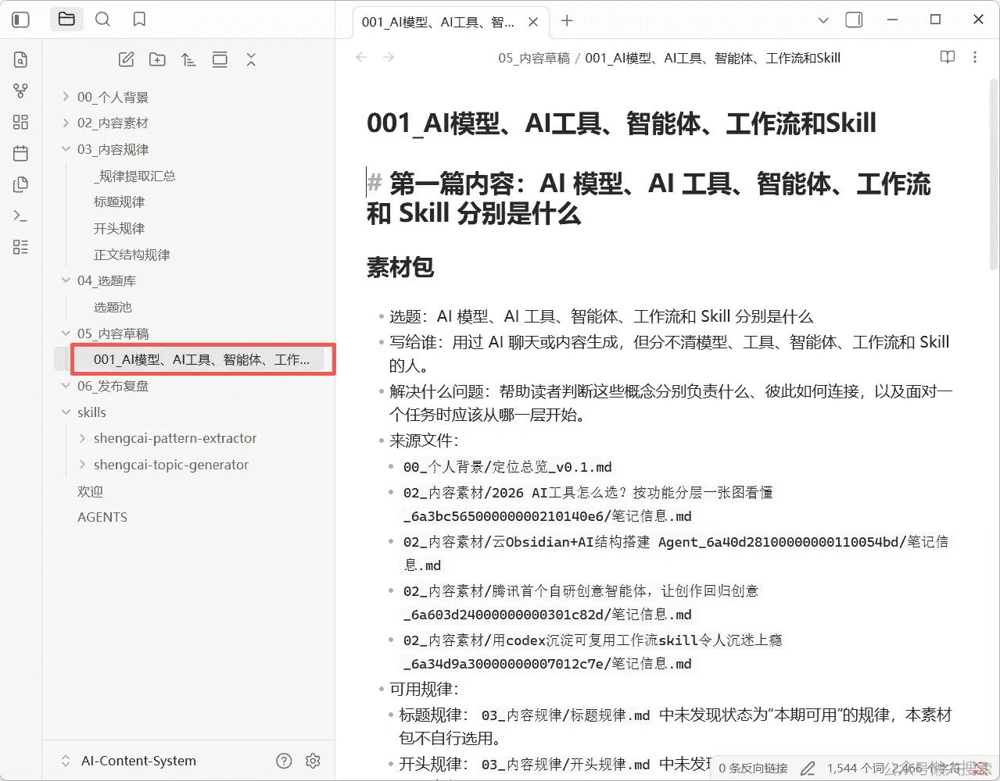

2.确认素材，生成初稿

**先确认材料**

在让 AI 写正文之前，快速检查两件事：

1.  每条事实是否有具体来源，摘录有没有被改错？

1.  "我的理解与判断"是否真的是你回答过的内容？

有问题就让 Codex 改正，没问题就继续。

**生成初稿**

材料确认后，向 Codex 发送：

Plain Text

```
请读取素材包文件和素材包中列出的来源文件。

如果素材包已经记录了图片文字，以素材包中的记录作为写作材料；来源文件用于核对。不得忽略图片文字，也不要在正文中重复描述图片读取过程。

根据选题内容和可用素材，从关卡 3 的规律中挑选最合适的标题规律、开头规律和正文结构规律，生成初稿，写入新文件 05_内容草稿/001_【选题关键词】_AI初稿.md。如果某条规律需要我没有的数字、结果或案例，换一条，不要为了套公式改变事实。不要修改素材包文件。

要求：
1. 提供 3 个标题候选，标明各自调用了哪条标题规律。
2. 开头直接讲清这篇在解释什么问题，不用&quot;今天给大家分享&quot;&quot;在这个时代&quot;等空话。
3. 正文按选定的结构规律展开，用短段落和大白话，只解决一个问题。
4. &quot;我的理解&quot;只使用标注为&quot;本人回答&quot;的内容。
5. 区分事实和判断，不把个人理解写成平台规则或官方结论。
6. 没有个人案例时正常写科普，不虚构&quot;我测试过&quot;&quot;我的学员&quot;。
7. 需要图片或核查的地方用【待补图片：说明】或【待核查：问题】标出。
8. 结尾收束到一个具体判断或问题，不用&quot;评论区扣 1&quot;&quot;私信领取&quot;等强行互动。
9. 附上素材调用清单，说明正文使用了哪个来源文件和哪条结构规律。
10. 图片文字写入正文时，必须转换成面向目标读者的自然表达。正文不得出现“素材包记录”“图片文字显示”“来源图片提取”“本次读取”等内部处理过程。
11. 遇到专业名词或连续列举多个工具能力时，先翻译成读者面对的实际问题，再用大白话解释。确有必要保留专业名词时，紧接一句说明它对读者意味着什么。
12. 图片路径、识别情况和素材调用方式只写在“素材调用清单”中，不得混入面向用户的正文。

写完后停下，不要改成最终发布稿。
```


3.通读初稿，人工修改

拿到初稿后做两件事：

**1. 看 AI 有没有出现幻觉**

通读一遍，重点看有没有你没说过的话被写成了你的观点，有没有编造的数据、案例或结论，有没有来源文件里不存在的信息。发现了就删掉或让 Codex 改正。

2. 把不像你说的话改成你的表达

有些句子语法没错但读着别扭，或者不符合你平时的表达逻辑，直接改成你觉得顺的说法就行。不需要每句都改，改到你觉得"这篇读起来像我写的"就够了。

**这个环节，建议大家多花点时间，耐心去调**教 AI，让它越来越聪明、越来越了解你。

4.确认最终发布稿

人工修改完成后，从 3 个标题候选中选一个你觉得最合适的，然后发送：

Plain Text

```
我选标题【这里填你选的标题】，请把我修改后的内容整理为最终发布稿，写入新文件：
05_内容草稿/001_【选题关键词】_最终发布稿.md。
要求：
1. 以当前 AI 初稿中经过我修改的正文为准，不退回旧版本。
2. 保留我已经加入或确认的本地配图引用。
3. 删除标题规律说明、素材读取过程、素材调用清单和内部工作备注。
4. 未完成核查的产品事实不要写入最终稿。
5. 不增加新的观点、案例、数据、效果和个人经历。
6. 只整理语病、重复表达和发布格式，不改变我的核心判断。
```

AI 会把你改过的正文和选定的标题合并成一份干净的发布稿。通读一遍，没问题就可以进入下一关。


### 02. 把内容创作流程封装成 Skill

到这里，你已经完整走过一次内容创作流程：

读取选题和素材 → 整理素材包 → 访谈 → 生成初稿 → 人工修改 → 确认最终稿

以后每次写新一篇，如果都要重新发送前面的长提示词，会很麻烦。

现在让 Codex 把这套流程封装成"航海笔记助手"Skill。以后只需要说"帮我写【选题名称】"，它就会按同样的流程带你走完全程。

让 Codex 创建 Skill

把下面这段提示词发给 Codex：

Plain Text

```
请使用 skill-creator，把我们刚刚完成的内容创作流程封装成一个可重复使用的 Skill。

Skill 名称：
shengcai-content-writer

显示名称：
航海笔记助手

请先把 Skill 源文件创建在当前项目：
skills/shengcai-content-writer/

创建完成并通过校验后，再安装到我的个人 Codex Skills 目录，让它以后可以直接被调用。

Skill 必须按下面的流程工作，每个需要用户参与的节点停下来等确认：

1. 用户说&quot;帮我写【选题名称】&quot;时启动。
2. 读取定位、选题池中对应的选题、该选题的来源文件、03_内容规律中状态为&quot;本期可用&quot;的规律。
3. 创建 05_内容草稿/编号_【选题关键词】_素材包.md，写入素材包。
4. 根据选题内容向用户逐个提问 3—5 个访谈问题，一次只问一个，等用户回答后再问下一个。
5. 访谈完成后，把用户原话整理进素材包的&quot;我的理解与判断&quot;，标注&quot;本人回答&quot;，只整理语序，不增加用户没说过的观点。停下等用户确认素材包。
6. 用户确认后，根据选题和素材从规律中挑选最合适的标题、开头和结构规律，生成初稿写入新文件 编号_【选题关键词】_AI初稿.md，提供 3 个标题候选。停下等用户修改。
7. 用户修改完成并选定标题后，把修改后的内容整理为最终发布稿，写入新文件 编号_【选题关键词】_最终发布稿.md。

全程不编造数据、案例和个人经历，不把 AI 的观点写成用户说的。

Skill 创建后请告诉我项目源文件路径、个人安装路径和验证结果。
```

**测试 Skill**

Skill 安装成功后，新开一次对话，仍然把 Obsidian Vault 作为当前工作目录，然后发送：

Plain Text

```
帮我写【你的选题名称】
```

正确的表现应该是：

1.  自动读取定位、选题、来源文件和可用规律；

1.  创建单篇创作文件并写好素材包；

1.  开始向你提问访谈问题；

1.  每个需要你参与的环节自动停下来等你确认。

如果自然语言没有触发 Skill，可以明确发送：

Plain Text

```
请使用 $shengcai-content-writer，帮我写【选题名称】
```


💡

**🎊 到这里，本关就完成啦，记得提交作业 👉🏻**https://scys.com/activity/10093/task

• 单篇创作文件截图，能看见素材包、AI 初稿、人工修改记录和最终发布稿（必填）

• 最终小红书发布稿截图，能看清标题、正文以及待准备的图片或截图（必填）

• 仍拿不准的事实、表达、内容结构或遇到的卡点（选填）

全部完成后，就可以提交作业并进入关卡 6～

下一关会把这篇内容发布到小红书，并建立发布后的复盘流程。

## 关卡 6：发布复盘：发布第一篇并完成轻复盘

### 00. 本关任务卡

💡

**任务目标**：把关卡 5 完成的第一篇小红书内容发布，保存发布数据，并在 24 小时左右完成一次基于真实反馈的轻复盘。

**任务描述**：

1.  发布第一篇内容。

1.  建立复盘文件并记录发布信息及 24 小时真实反馈。

1.  让 Codex 整理轻复盘，确定下一篇只改的一件事。

1.  把复盘流程封装成 Skill。

**本关需提交作业**：

• 第一篇小红书发布链接或发布成功截图（必填）

• 第一篇发布复盘文件截图，能看见发布记录、24 小时数据和下一篇优化方向（必填）

• 分享一下这关最大的收获，或者你遇到的卡点、怎么解决的（必填）

### 01. 完成第一篇发布与轻复盘

关于预期：单篇复盘很难得出有效结论，通常需要累计 20 篇以上，数据才有参考价值。所以这一关的目的很简单——只带你跑通发布和复盘的流程，不急于下判断。数据高或低，都不代表什么，先习惯这套动作就好。

1.  发布前先建立复盘文件

正式发布前，先让 Codex 在06_发布复盘新建一个复盘文档：

Plain Text

```
在 06_发布复盘 新建一个文档：
06_发布复盘/001_【这里填你的选题关键词】_复盘.md
```

让 Codex 读取关卡 5 的最终发布稿和选题池，建立下面的记录框架：

注意 Codex只负责搬运已有信息和创建空字段，不能生成发布时间、链接、数据或评论，这几个信息需要你在发布完内容后 24 小时自己去记录。

Plain Text

```
请读取：
1. 05_内容草稿/001_【这里填你的选题关键词】_最终发布稿.md
2. 04_选题库/选题池.md 中对应的选题

请创建：
06_发布复盘/001_【这里填你的选题关键词】_复盘.md

按下面结构写入：

# 第一篇发布复盘：【最终标题】

## 关联文件
- 创作文件：
- 选题池：

## 发布记录
- 平台：小红书
- 标题：
- 内容类型：AI 科普
- 发布时间：待发布后填写
- 笔记链接：待发布后填写
- 首图文件：
- 其他图片：

## 24 小时数据
- 记录时间：
- 距离发布：
- 浏览量：
- 点赞数：
- 收藏数：
- 评论数：
- 分享数：

## 关键评论
- 评论原话：

## 发布后即时感受
- 当时感觉：

## 我的轻复盘
### 已确认的事实
### 初步观察
### 还不能判断
### 下一篇调整计划
#### 重点调整
#### 其他需要处理

规则：
1. “关联文件”区块必须保留。实际文件存在时，填写可点击的 Obsidian 内链；对应文件不存在时保留字段为空，不得编造文件或链接。
2. 标题、内容类型、关联文件和图片文件只从现有文件复制。
3. 不联网，不补写发布时间、笔记链接、数据或评论。
4. 当前没有的信息明确写“待发布后填写”；虚拟案例中不存在的关联文件保持为空。
5. 创建完成后列出读取过的文件和实际写入的字段，然后停下。
```

打开复盘文件检查下：

标题与最终稿是否一致，创作文件和选题池链接能否点开，待填写字段没有被 AI 补全。检查通过后再去发布笔记。


2.发布内容（本期以小红书笔记为例）

发布前再检查下：

新手建议就选小红书的“长文”笔记模式来发布，能够最高效率验证内容效果。

可以用网页端发布，更方便复制内容和排版：https://creator.xiaohongshu.com/new/home

发布笔记 - 写长文


把 Obsidian 中的最终发布稿，复制进来，会自动完成排版，非常方便。


记得检查下，图片有没有被复制进来，没有的话，需要手动复制下：


然后点击一键排版即可生成预览，选择自己喜欢的风格封面和模板，确认后点下一步：


然后是加话题词，注意：

1.  只选和账号方向、内容直接相关的，不蹭无关热词，一个精准的长尾词，比三个不相关的大词更有用。

1.  话题数量建议是5-8个，不超过10个。前5个权重最高，优先放核心词。

1.  话题词怎么搭配？

a.

1-2个核心主标（账号方向的词，比如#AI工具测评）

b.

2-3个垂直长尾词（更具体的，比如#AI写小红书文案）

c.

1个时效/场景词（比如#2026自媒体入门）


最后，点击发布。

发布后，回到自己的公开主页，确认笔记已经显示，并能正常打开访问。

建议发布时间：

• 工作日晚20:00-22:00

• 周末上午9:00-11:00

这两个时间段是小红书整体流量高峰期。AI科普类内容需要读者集中注意力理解新概念，这两个时段都比较适合。

1.  24 小时左右记录真实反馈

发布24小时以后，回来看一眼数据，把当前能看到的数据记下来：

• 浏览量

• 点赞

• 收藏

• 评论

• 分享

• 评论扫一眼就行。

◦有人认真追问了具体做法，或者提到自己试了之后的反馈，这些值得记一下。因为它们是真实读者卡住的地方，以后可以直接转化成新内容。像“太棒了”“学到了”这种评论，不用特意存，总结概括记录下就行。

◦如果当时没人评论，写“暂无评论”就行。不要为了数据好看补一条虚拟的。

• 顺手多写一两句当时的感觉——比如“发出去有人私信问了”、“没人理”。这些直觉当时不写，第二天就忘了。它们恰恰是以后提升自己判断力的材料。这篇内容是自己做的，有什么感受也是自己记的，真实就行。

**我们拿这篇笔记为例****【**ima 知识库：把微信内容变成生产力第一步】，展示从发布到数据回传的完整过程。**


笔记信息

• 标题：ima知识库：把微信内容变成生产力第一步

• 发布时间：7.17

• 平台：小红书

24小时后（7月18日 10:45），打开笔记页记录数据：

我打开笔记页，看到的数据是：浏览量 3700，点赞520，收藏941，评论 26。

我打开评论区，看到这几条值得记下来的评论：

• 评论原话：我也在这么用，收藏夹里以前有很多吃灰n年文章，现在都可以找到用起来了而且我微信收藏夹，全部被我搬到ima了。

• 评论原话：什么叫知识库

• 评论原话：可以导入吗？还是一条一条贴微信链接？而且电脑端经常连不上网，虽然电脑本身网络没问题


其余的评论是“写得好”“学到了”“收藏了”这类简短反馈，知道被看见了就行，不单独记录。

顺手记一句当时的感觉：这篇发出去前3小时没什么反应，我以为又凉了，结果晚上9点突然开始有人收藏。

下面我们按照模板，把信息填到对应位置，然后发给 codex，让 codex 把信息存到复盘文档里：

提示词模板：

Markdown

```
把以下复盘信息更新到：
06_发布复盘/001_【这里填你的选题关键词】_复盘.md

## 关联文件
- 创作文件：【已有则保留，没有则留空】
- 选题池：【已有则保留，没有则留空】

## 发布记录
- 发布时间：
- 笔记链接：

## 24 小时数据
- 记录时间：
- 距离发布：
- 浏览量：
- 点赞数：
- 收藏数：
- 评论数：
- 分享数：

## 关键评论
- 评论原话：
- 评论原话：
- 评论原话：

## 发布后即时感受
- 当时感觉：

请把以上信息填写到复盘文件的对应位置。

要求：
1. “关联文件”区块必须保留。复盘文件中已有链接时原样保留；没有对应文件或链接时保持为空，不要编造。
2. 保留我提供的时间、数据和评论原话，不要修改。
3. 页面没有显示的数据写“未显示”。
4. 没有值得记录的评论，写“暂无关键评论”。
5. 不分析数据，不生成评论，不修改复盘文件中的其他内容。
6. 更新完成后，列出本次实际更新的字段。
```

示例：

Plain Text

```
把以下复盘信息更新到：
06_发布复盘/001_ima知识库_复盘.md

## 关联文件
- 创作文件：
- 选题池：

## 发布记录
- 发布时间：7 月 17 日 10:45
- 笔记链接：https://www.xiaohongshu.com/discovery/item/6a58a4d10000000001003e2a?source=webshare&amp;xhsshare=pc_web&amp;xsec_token=CBfWoGZldj98DjkpC7KuSHsnkVhXFvtyLuPCK_8CRrXBY=&amp;xsec_source=pc_share

## 24 小时数据
- 记录时间：7 月 18 日 10:45
- 距离发布：24 小时
- 浏览量：3700
- 点赞数：520
- 收藏数：941
- 评论数：26
- 分享数：未显示

## 关键评论
- 评论原话：我也在这么用，收藏夹里以前有很多吃灰 n 年的文章，现在都可以找到、用起来了。而且我的微信收藏夹全部被我搬到 ima 了。
- 评论原话：什么叫知识库？
- 评论原话：可以导入吗？还是一条一条贴微信链接？而且电脑端经常连不上网，虽然电脑本身网络没问题。

## 发布后即时感受
- 当时感觉：发出去前 3 小时没人理，以为凉了，晚上 9 点突然开始有人收藏。

请把以上信息填写到复盘文件的对应位置。

要求：
1. “关联文件”区块必须保留。这个示例没有对应的创作文件和选题池，因此两个字段保持为空，不要编造。
2. 保留我提供的时间、数据和评论原话，不要修改。
3. 页面没有显示的数据写“未显示”。
4. 没有值得记录的评论，写“暂无关键评论”。
5. 不分析数据，不生成评论，不修改复盘文件中的其他内容。
6. 更新完成后，列出本次实际更新的字段。
```


1.  让 Codex 整理轻复盘

接下来让 Codex 帮忙整理和分析数据：

Plain Text

```
请读取：
1. 06_发布复盘/001_【选题关键词】_复盘.md
2. 对应的 05_内容草稿 单篇创作文件
3. 04_选题库/选题池.md


请只基于文件中已经记录的数据、时间和评论，整理第一篇 24 小时轻复盘，并把结果写到 06_发布复盘/001_【选题关键词】_复盘.md

要求：
1. 不搜索外部资料，不补写未显示的数据、评论、关注来源或平台规则。
2. 把结论分成“已确认的事实、初步观察、还不能判断”三类。
3. 每条初步观察都写清依据来自哪个数字、哪条评论或正文位置。
4. 不得写“某个标题导致点击高”“某个结构导致收藏高”等单篇数据无法证明的因果。
5. 没有评论就明确写“暂无评论”，不要生成示例评论。
6. 提出最多 3 个“下一篇可执行动作”候选，每个都写清直接依据；先不要替我选择重点调整。
7. 不修改原始数据和评论原话。
8. 把整理结果和候选动作写回复盘文件，完成后列出候选动作，并问我下一篇想重点调整哪一项。

等我确认后，把结果写入复盘文件：

### 下一篇调整计划

#### 重点调整
- 写入我确认的一项。

#### 其他需要处理
- 写入我明确要求同时处理的事项；没有则写“无”。

完成后告诉我最终写入的内容。
```

Codex 的工作是整理记录和提出下一篇优化动作，但是因为我们现在可用于复盘的笔记数量太少，所以效果会比较差，笔记数量逐渐增加，你的复盘结论也会逐渐更清晰。


5.新手第一篇数据很少怎么办？

如果第一篇数据不高，甚至没有什么评论，这是完全正常的。你只要真实记录了数据、评论和当时的感受，就已经完成了这一轮的任务。

复盘的真正价值不在于单篇分析出了什么，而在于多篇之间的对比。

等你积累了3条、5条、10条的真实数据放在一起时，就能逐渐看出哪些内容反应更好、哪些方向值得继续投入。

单篇数据不足时，Codex 无法给出有价值的建议是意料之中的事，不代表流程有问题。

所以如果这一轮复盘后，下一篇候选动作是“继续观察”或“保持更新”而不是具体修改，也是正常的。持续积累数据，比追求每一篇都有结论更重要。

### 02. 把复盘流程封装成 Skill

你刚刚已经完成了：发布了第一篇、记录了数据、让 Codex 做了轻复盘、确定了下一篇优化方向。

这套流程已经跑通了，现在要做的就是把它“装进”Skill 里。

第一步：让 Codex 创建 Skill

把下面这段提示词发给 Codex：

Plain Text

```
请使用 skill-creator，把我们刚刚完成的发布复盘流程封装成一个可重复使用的 Skill。

Skill 名称：
review

显示名称：
复盘助手

请先把 Skill 源文件创建在当前项目：
skills/review/

创建完成并通过校验后，再安装到我的个人 Codex Skills 目录，让它以后可以直接被调用。

Skill 必须完成下面这些工作：

1. 读取 05_内容草稿 中已通过发布前检查的单篇创作文件，以及 04_选题库/选题池.md 中对应的选题，在 06_发布复盘/ 下创建复盘文件，并补好关联文件。暂时没有的信息留空或写“待发布后填写”。

2. 复盘文件建立完成后，提醒用户发布内容，并告诉用户：发布约 24 小时后，回来提供发布时间、笔记链接、记录时间、距离发布、页面数据、关键评论和发布后的真实感受。

3. 用户回来提供上述信息后，把真实信息写入复盘文件，并完成轻复盘。用户已经提供的信息直接使用，只追问完成复盘必须但仍然缺少的信息。

4. 轻复盘只整理“已确认的事实、初步观察、还不能判断”，并提出最多 3 个下一篇可执行动作候选。每个候选都要写清直接依据，不替用户选择。

5. 用户确认后，把一项写入“下一篇调整计划”的“重点调整”；其他仍需处理的事项写入“其他需要处理”。

6. 如果 06_发布复盘/首轮5条索引.md 存在，用户确认调整计划后，同步更新当前这篇对应的索引行：补齐创作文件、复盘文件和笔记链接，将状态更新为“已复盘”。保留这篇原来记录的重点调整，不要覆盖。

7. 不搜索外部资料，不补写页面没有提供的数据、评论、关注来源或平台规则。

8. 没有评论时明确写“暂无评论”，不生成示例评论。

9. 不修改原始数据、时间、链接和评论原话，不把单篇数据中的相关性写成因果。

10. 当用户说“这篇数据很低，没什么可复盘的”时，回复：单篇数据不足是正常的，复盘的真正价值在多篇对比，等积累 3-5 条后再看趋势。

Skill 创建后请告诉我项目源文件路径、个人安装路径和验证结果。
```

**第二步：测试 Skill**

Skill 安装成功后，新开一次对话，仍然把 Obsidian Vault 作为当前工作目录，然后发送：

Plain Text

```
我要发布第一篇内容。

请调用复盘助手Skill，带我完成这篇内容的发布记录和轻复盘。

先帮我建立复盘文件，然后告诉我下一步怎么做。
```

正确的表现应该是：

1.  自动读取最终发布稿和对应选题。

1.  建立复盘文件并补好关联文件。

1.  提醒用户发布内容。

1.  告诉用户约 24 小时后需要回来提供哪些真实信息。

然后再测试：

Plain Text

```
这篇内容已经发布约 24 小时，我现在回来记录真实信息并完成轻复盘。
```

正确的表现应该是：

1.  引导用户一次性提供发布信息、数据、评论和真实感受。

1.  把信息写入复盘文件。

1.  完成轻复盘并给出最多 3 个调整候选。

1.  等用户确认后，再写入调整计划。

1.  如果存在首轮5条索引，同时更新对应索引行。

**第三步：持续迭代**

Skill 不是一次写死就完了。你在使用过程中会发现：

• 某个步骤描述不够清晰

• 某个字段应该加进去但漏了

• 某个判断逻辑需要调整

每次发现问题，直接在对话中告诉 Codex：“这个 Skill 的 XX 步骤需要调整，因为……”，然后让它帮你更新复盘助手Skill。

封装完成后，你后续每发布一篇新内容，只需要说两句话：

“我要发布新内容，帮我建立复盘文件”

“我填好了 24 小时数据，帮我整理轻复盘”

不用再重复解释“我要你做什么、怎么读文件、输出什么格式”——这些都被 Skill 记住了。


## 关卡 7：持续迭代：围绕同一方向发满 5 条

### 00. 本关任务卡

💡

**任务目标**：

围绕同一 AI 科普方向累计发布 5 条小红书内容。每条都完成首轮总复盘，把真实反馈写回第二大脑。

**任务描述**：

1.  先跑通一条：完成创作 → 发布 → 记录数据与评论 → 确认下一篇只改一个动作。

1.  再跑下一条：重复第一条流程，直到累计 5 条。

1.  5 条汇总：整理重复出现的事实、问题和信号，决定哪些回填选题池。

**本关需提交作业**：

• 5 条公开发布链接或公开笔记页截图（必填）。

• 首轮5条总复盘.md文件或截图（必填）。

• 分享一下这关最大的收获，或者你遇到的卡点、怎么解决的（必填）

### 01. 依次完成剩下 4 篇，并做好首轮 5 篇总复盘

1.为什么不要一次写完 5 篇

发完第一条笔记，你只是跑通了流程，单篇数据还不足以帮助你判断“我适合写什么标题”“哪种表达更有效”。

接下来要在同一个内容方向上继续完成至少 4 条，让上**一条的真**实反馈影响下一条怎么做，逐渐进入迭代节奏。

很多人做到这里，会同时打开四五篇草稿，觉得这样效率更高。结果往往是：忙着赶进度，发完以后忘了自己改过什么，也忘了评论区问过什么。

最后虽然发满了 5 篇，手里却只剩下一堆数字，不知道自己从中学到了什么。

所以这一关不要赶。

写完一篇，发布一篇，复盘一篇，再开始下一篇。

每一篇不需要大改。根据上一篇复盘，确定一个重点调整就够了。其他影响内容准确性、完整性和发布质量的问题，也可以一起处理。

比如上一篇复盘后，你决定“下一篇把开头写得更直接”，那下一篇就只重点调整开头。标题、结构、选题和图片不要同时全部换掉。这样等下一篇发出去以后，你才知道这次到底改了什么。

2.先建一张表，记录 5 篇内容的进度

接下来还要连续完成 4 篇。每篇都会产生创作文件、复盘文件和笔记链接，还要记住这一篇是根据上一篇的哪条建议进行调整的。

如果不单独整理，很容易做到第三、第四篇时，已经分不清哪篇发布了、哪篇完成了复盘，以及下一篇应该接着改什么。等到最后做 5 篇总复盘时，还要重新到各个文件夹里翻找。

所以先让 Codex 在06_发布复盘中建立一张进度表，命名为首轮5条索引.md。

这张表相当于 5 篇内容的总目录，方便你随时看清：

• 每篇内容目前做到哪一步。

• 对应的创作文件和复盘文件在哪里。

• 发布后的笔记链接是什么。

• 这一篇重点调整了什么。

• 现在能不能开始下一篇。

这张表不用重复保存详细数据和复盘内容。详细内容仍然留在每篇对应的创作文件和复盘文件中。等 5 篇全部完成后，Codex 也会通过这张表找到所有文件，继续完成首轮总复盘。

把下面整段提示词发给 Codex：

Plain Text

```
请读取：

1. 04_选题库/选题池.md
2. 关卡 6 完成的第一篇创作文件
3. 第一篇对应的复盘文件

请新建：

06_发布复盘/首轮5条索引.md

使用下面的模板：

# 首轮 5 条索引

| 序号 | 选题 | 创作文件 | 复盘文件 | 笔记链接 | 这篇只调整什么 | 状态 |
| --- | --- | --- | --- | --- | --- | --- |
| 1 |  |  |  |  | 第一篇，无 |  |
| 2 |  |  |  |  |  | 待选择 |
| 3 |  |  |  |  |  | 待选择 |
| 4 |  |  |  |  |  | 待选择 |
| 5 |  |  |  |  |  | 待选择 |

请根据现有文件填写第 1 篇。

填写规则：

1. 选题、创作文件、复盘文件和笔记链接，只能从现有文件中复制。
2. 创作文件和复盘文件使用可以点击的 Obsidian 内链。
3. 第一篇的“这篇只调整什么”填写“第一篇，无”。
4. 状态只使用下面 5 种，并根据文件中的实际进度填写：
   - 还没有确认选题：待选择
   - 已确认选题并开始创作：写作中
   - 最终发布稿已经完成，还没有发布：待发布
   - 已经发布，但还没有完成轻复盘：已发布
   - 已经完成轻复盘，并由我本人确认下一篇重点改什么：已复盘
5. 第一篇已经完成轻复盘时，状态填写“已复盘”；没有完成时，按实际情况填写。
6. 文件中没有的信息保持为空，不要猜测。
7. 第 2-5 篇保持“待选择”，不要替我安排选题。
8. 不要修改选题池、创作文件和复盘文件。

创建完成后告诉我：

1. 实际读取了哪些文件；
2. 第一篇填写了哪些内容；
3. 第一篇还有哪些信息没有记录。

完成后停止，不要开始选择第二篇。
```

Codex 创建完成后，打开首轮5条索引.md检查：

• 创作文件能不能正常打开。

• 复盘文件能不能正常打开。

• 笔记链接是不是正确的。

• 第一篇是否真的已经完成轻复盘。


Codex 创建完成后，先检查第一篇填写的信息是否正确。确认创作文件、复盘文件和笔记链接都能正常打开，再继续准备第二篇。

3.按照同一个流程，逐篇完成剩下 4 篇

从第二篇开始，继续沿用关卡 5 的创作方法写内容，沿用关卡 6 的方法完成发布和复盘。

之前创建的 skill 都能在这里用上了。

这一关只多做两件事：

1.  开始下一篇之前，先看上一篇决定要改什么。

1.  做完这一篇以后，把结果更新到进度表。

**整个过程就是：**

**选择下一篇 → 完成内容创作 → 建立复盘文件并发布 → 2**4 小时后记录反馈、完成轻复盘并更新进度

第一步：选择下一篇选题

开始下一篇之前，先看上一篇复盘后准备重点调整什么，再从选题池中选择一篇当前有素材、可以继续写的内容。

把下面这段提示词发给 Codex：

Plain Text

```
我要准备下一篇内容。

请先读取：

1. 06_发布复盘/首轮5条索引.md
2. 上一篇复盘文件
3. 04_选题库/选题池.md

结合上一篇的调整计划和选题池中的现有素材，给我最多 3 个现在可以写的候选选题。

先不要创建草稿，等我选择。
```

Codex 给出候选后，你需要人工选择下一篇，自然语言告诉 codex 即可。


第二步：调用 内容创作skill 完成初稿

确定选题后，调用关卡 5 创建的内容创作 Skill。

把下面这段提示词发给 Codex，整理下一篇内容的素材：

Plain Text

```
我要开始创作下一篇内容。

请先读取：
1. 06_发布复盘/首轮5条索引.md
2. 上一篇复盘文件
3. 04_选题库/选题池.md

请找到索引中状态为“写作中”的当前选题，调用内容创作 Skill 带我完成。

先整理素材包并开始访谈，不要直接生成初稿或最终发布稿。
```

接下来你只需要按照 Skill 的引导，逐步完成：素材包（含访谈）、初稿、人工修改、图片准备和最终发布稿。


第三步：调用复盘助手skill，完成发布和轻复盘

最终发布稿完成后，接下来调用复盘助手Skill。它会先建立复盘文件，再告诉你发布后需要记录哪些信息，并带你完成后面的轻复盘。

把下面这段提示词发给 Codex：

Plain Text

```
当前这篇最终发布稿已经完成。

请先读取：
1. 06_发布复盘/首轮5条索引.md
2. 当前这篇的最终发布稿

请调用复盘助手Skill，带我完成这篇内容的发布记录和轻复盘。
```

复盘助手建立文件后，会提醒你发布小红书笔记。

发布成功后，暂时不用马上回来填写信息。等 24 小时左右，再打开笔记页面，查看当时能够看到的数据、评论，并记录自己的真实感受。


笔记发布完约 24 小时后，回到刚才的 Codex 对话，发送：

Plain Text

```
这篇内容已经发布约 24 小时。

请继续调用“复盘助手” Skill，带我记录真实信息并完成轻复盘。
```

复盘助手会引导你补充用于复盘的笔记信息，把你提供的信息记录到知识库对应位置。


信息记录完成后，复盘助手会：

1.  把发布信息和真实反馈写入当前复盘文件；

1.  整理已确认的事实、初步观察和还不能判断的内容；

1.  给出最多 3 个下一篇调整候选；

1.  等你确认下一篇重点调整什么。

看到候选后，直接告诉 Codex 你选择哪一项。例如：

Plain Text

```
我选择候选 2 作为下一篇的重点调整。

其他需要处理：无。
```

复盘助手会继续完成：

• 把你确认的内容写入“下一篇调整计划”；

• 保留当前这篇原来记录的重点调整；

• 补齐索引中的创作文件、复盘文件和笔记链接；

• 将当前这篇的状态更新为“已复盘”。

完成这些以后，这一篇才算真正结束，可以回到第一步，开始选择下一篇。

第二、第三、第四篇都按照这个流程继续。

第五篇完成轻复盘并更新索引后，不需要再选择下一篇，直接进入首轮 5 篇总复盘。

4.5 篇全部完成后，做一次总复盘

5 篇都完成轻复盘后，让 Codex 把它们放在一起对比。

这时候要找的是反复出现的情况和值得继续观察的线索，不是急着总结什么方法一定有效。

把下面的提示词发给 Codex：

Plain Text

```
我已经完成首轮 5 篇内容的创作、发布和轻复盘。

请读取：
1. 06_发布复盘/首轮5条索引.md
2. 索引中的 5 份创作文件
3. 索引中的 5 份复盘文件

请先检查 5 篇是否都已经标记为“已复盘”。

如果还有未完成的内容，告诉我是哪几篇，然后停止。

如果已经全部完成，请建立：

06_发布复盘/首轮5条总复盘.md

请整理：
1. 5 篇内容的标题、调整内容、页面数据和关键评论；
2. 至少在 2 篇中重复出现的情况；
3. 只出现过 1 次、还需要继续观察的情况；
4. 评论中出现的真实问题；
5. 初稿到终稿中反复修改的表达；
6. 建议放回选题池或补充到内容规律的候选内容。

所有数据和判断都要保留来源。

不要把相关性写成因果，也不要直接修改选题池和内容规律。整理完成后停下来，等我确认。
```

**确认哪些经验值得留下**

Codex 完成总复盘后，你只需要确认三类内容：

• 哪些可以放回选题池；

• 哪些可以补充到内容规律；

• 哪些还要继续观察。

确认后，直接回复 Codex：

Plain Text

```
我确认的处理结果如下：

放回选题池：
【填写内容，没有则写“无”】

补充到内容规律：
【填写内容，没有则写“无”】

继续观察：
【填写内容，没有则写“无”】

请按照我的确认结果更新对应文件。

只处理我确认的内容，保留来源，不要扩大结论。
```

更新完成后，首轮 5 篇内容就结束了。

5.下一步做什么

到这里，你已经完成了 AI 第二大脑内容创作的基本闭环：

定位 → 素材 → 规律 → 选题 → 创作 → 发布 → 复盘 → 迭代。

后面的关卡 8～10 都是选修进阶，任务开放度和判断难度会提高，不需要全部完成。

可以根据自己的目标选择一个方向继续：

• 想把已有内容改写到公众号、X 等平台，进入关卡 8。

• 想尝试 AI 热点、AI 测评或 AI 教程，进入关卡 9。

• 想尝试做视频的，进入关卡 10。

• 暂时不换平台和内容类型，就继续沿着前面的 AI 科普方向稳定创作。

---

# 选修篇

## 关卡 8：平台迁移：公众号 / X / 其他平台适配（选修）

### 00. 本关任务卡

💡

**任务目标：**

从关卡 7 已发布并复盘的 5 条小红书内容中，选 1 条迁移到公众号或 X。只做平台必要调整，生成一版可发布稿并完成发布。

**完成步骤：**

1.  选出 1 条已有内容和 1 个第二平台。

1.  保留原稿的核心观点、事实和案例，只按平台的 2-3 个关键差异改稿。

1.  人工检查后发布，记录链接、数据和一条最重要的反馈。

**完成标准：**得到 1 篇第二平台发布稿，完成真实发布，并记录发布链接、页面数据和一条重要反馈。

**本关为选修，不需要提交作业。**

先在小红书完成 5 条发布与复盘，再挑 1 条做第二平台迁移。

这是一轮轻量验证：1 篇旧内容 → 1 个新平台 → 1 次必要改稿 → 1 次发布。不建矩阵，不从头定制，不补写新事实。

迁移完成后先看真实反馈，再决定是否继续；不要因为做了这一关就改变小红书主线。

### 01. 将一篇内容迁移到第二平台

1.  选出 1 条内容和 1 个第二平台

先选内容，再选平台。

选择时看下面三点：

• 一个陌生读者也能理解；

• 你愿意围绕同一问题继续回应。

• 数据高低只作参考，最高赞不等于最适合迁移。

第二平台按内容需要来选：

• **公众号**：原内容需要更多背景、完整解释或案例承接，读者要按段落连续阅读。

• **X**：原内容适合用普通推文或 X 长文完整表达，并且能根据发布形式调整标题入口。

• **其他文字平台**：你已经能正常使用和发布，并且说得清该平台的内容形态与读者阅读方式。

• **视频号 / 抖音**：涉及口播、录屏、镜头或画面设计，直接去关卡 10。

可以把选择写成一句话：我把【原内容标题】迁移到【第二平台】，因为【内容与平台匹配的具体原因】。

判断能不能迁移，主要看：你能指出原内容在新平台需要补什么、删什么或重组什么。因为迁移本身就是一个低成本适配的动作，如果需要付出过高成本，那就不叫迁移，叫原创。

2.准备迁移所需的三份材料

确定要迁移的内容后，检查下 Obsidian 里是否有这 3 个文件：

• **原最终发布稿**：确认实际发布的标题、正文、观点和案例；

• **原素材包**：核对事实、数据、案例及其来源；

• **单篇复盘文件**：查看发布后的数据、评论和真实反馈。

1.  建一张最小迁移卡

在原内容文件旁新建一个迁移文件，例如：

Plain Text

```
05_内容草稿/001_AI_Agent是什么_迁移X.md
```


复制三份材料的实际路径，确定一个目标平台，替换下面提示词中的【】内容后发给 Codex。它只负责新建迁移卡并整理迁移边界，暂时不生成初稿：

Plain Text

```
请读取：
1. 原最终发布稿：【填写完整路径】
2. 原素材包：【填写完整路径】

3. 单篇复盘文件：【填写完整路径】

目标平台：【公众号 / X / 其他文字平台，只填写一个】

请新建：
05_内容草稿/【原编号】_【选题关键词】_迁移【第二平台】.md

只写入以下结构，暂时不要生成初稿：

# 平台迁移：【原内容标题】 -&gt; 【第二平台】

## 原稿与平台
- 原最终发布稿：
- 原素材包：
- 原复盘文件：
- 第二平台：

## 保持不变
- 核心观点：
- 已核查的事实、数据和案例：

## 只做这些调整
- 平台差异 1：
- 平台差异 2：
- 平台差异 3（如有）：

## 第二平台初稿
## 人工修改记录
## 最终发布稿
## 发布结果

不要改原小红书稿，不要新增观点、案例、平台规则或效果承诺。整理完后停止，告诉我新建了哪个文件，等我确认。
```

如果原稿中的事实来源不清楚，标记【待确认】即可，不要为了补齐表格扩大任务。


1.  只改平台的关键差异

迁移不是重写，而是在原稿基础上，最小成本改成目标平台喜好的内容风格，不然不叫迁移，叫原创了。

那我们就需要先明确，其他平台的内容关键差异和要求是什么，下面以公众号和 X 为例，来展示需要重点改什么。

4.1 迁移到公众号（重点改 2 件事）

1.  **降低 AI 味。**公众号平台对 AI 味很敏感，AI 味太重非常容易限流，一定要把套路化开头、过度整齐的排比和空泛总结改成人会自然说的话。AI 检测只能辅助参考，最后还是要逐段人工检查。

1.  **重做横版封面图。**公众号不能直接套用小红书 3:4 首图，按公众号横版比例重新生成一张简洁封面；标题尽量控制在 10 字以内。

如果原小红书长文已经能顺畅阅读，正文只做必要的段落衔接即可发到公众号。

公众号封面图提示词：

Plain Text

```
生成一张公众号封面图，尺寸 900×383px。
标题文字：[文章标题，控制在 10 字以内]
要求：干净简洁、留白充分、主体清楚；文字居中或左对齐，使用粗体。
风格：[根据内容选择：科技感 / 温暖 / 简约 / 专业]
```

如果对公众号感兴趣，想要做好这个平台，可以看这个手册👉🏻【垂直小号 - 公众号】

4.2 迁移到 X

小红书长文和 X 长文的正文结构差异不大，不需要压缩，也不需要拆成线程。迁移时主要注意标题的呈现方式：

• **发布为普通推文时**：X 没有单独的标题栏，需要把小红书标题改成正文第一句。第一句要完整、自然，让读者一眼知道这篇内容在讲什么。

• **发布为长文模式时**：X 长文有单独的标题，可以继续使用“标题 + 正文”的结构。只需检查标题和开头是否适合 X 的阅读语境，正文没有明显问题就不必重写。

把标题改成这文第一句的示例：直接给出结论、反常识或具体收益，呈现一句完整的句子，脱离后文也能理解。


如果对 X 感兴趣，想要做好这个平台，可以看这个手册👉🏻【X（推特）自媒体】

**看完平台差异后，先由你做选择：**回到第 3 步创建的平台迁移文件，在“## 只做这些调整”中写下这次真正要执行的 1～2 项调整。迁移到 X 时，同时写明使用“普通推文”还是“X 长文”。不要把公众号和 X 的要求一起填进去。

1.  让 Codex 生成第二平台初稿

**先由你完成 3 个动作：**

1.  打开第 3 步创建的平台迁移文件，确认“第二平台”“保持不变”和“只做这些调整”都已经填写清楚。

1.  如果迁移到 X，再确认发布形式是“普通推文”还是“X 长文”；如果迁移到公众号，不需要填写发布形式。

1.  复制平台迁移文件、原创作文件和单篇复盘文件的实际路径，替换下面提示词中的【】内容，再把整段提示词发给 Codex。

Plain Text

```
请读取：
1. 平台迁移文件：【填写实际文件路径】
2. 原最终发布稿：【填写实际文件路径】
3. 原素材包：【填写实际文件路径】
4. 单篇复盘文件：【填写实际文件路径】

请把这篇小红书内容迁移到【公众号 / X，只填写一个】。保留迁移文件“## 保持不变”中的内容，只执行“## 只做这些调整”中已经确认的修改。

平台差异：
- 公众号：降低 AI 味，让段落衔接自然；不增加原稿没有的内容。封面图后续单独制作。
- X：如果发普通推文，把原标题自然改成正文第一句；如果发 X 长文，保留“标题 + 正文”结构。正文不压缩、不拆线程。

不要新增事实、案例、观点或效果承诺，不要修改原创作文件和单篇复盘文件。

把结果写入平台迁移文件的“## 第二平台初稿”，并附 3～5 条主要改动。写完后停止，等我人工检查。
```


Codex 写完后，由你完成检查：

1.  打开平台迁移文件，对照原创作文件，确认核心观点、事实、数据和案例没有被改动。

1.  检查它是否只生成了一个目标平台版本，并且只做了第 4 步约定的平台调整。

1.  逐项处理【待确认】；需要改文风或表达时，直接修改“## 第二平台初稿”，并把关键修改记入“## 人工修改记录”。

1.  确认初稿可以发布后，再把下面的收尾指令发给 Codex。

Plain Text

```
我已经完成人工检查，并确认“## 第二平台初稿”可以作为最终稿。

请读取平台迁移文件：【填写实际文件路径】

请把已经确认的“## 第二平台初稿”复制到“## 最终发布稿”。只整理发布所需的基础格式，不改写内容，不新增或删除事实、案例和观点，也不要发布。完成后停止，并告诉我最终发布稿已写入。
```

完成标准：平台迁移文件中已经有经过人工确认的“最终发布稿”。Codex 只负责整理文件，不替你确认内容，也不会替你发布。


**6.**发布并记录迁移结果**

最终发布稿确认后，由你完成发布，再让 Codex 整理发布结果并给出下一步建议。

**第一步：由你完成发布和信息采集**

把最终发布稿发布到第二平台。发布后，先记录：

• 发布时间；

• 发布链接；

• 发布约 24 小时后能看到的页面数据；

• 重要评论或真实反馈；

• 你发布后的真实感受，例如操作是否顺畅、内容是否适合这个平台。

只记录真实看到的信息。没有的数据写“未显示”，没有评论写“暂无评论”。

第二步：把真实信息交给 Codex

把下面的提示词发给 Codex，并将其中的信息替换为你实际记录的内容：

Plain Text

```
这篇迁移内容已经发布。

请读取平台迁移文件：
05_内容草稿/002_已有资料参与写作_迁移公众号.md

这是我记录的真实信息：

- 发布时间：【填写】
- 发布链接：【填写】
- 记录时间：【填写】
- 距离发布：【填写】
- 页面数据：【填写】
- 重要评论或反馈：【填写；没有则写“暂无评论”】
- 我的真实感受：【填写】

请完成下面的工作：

1. 把我提供的信息原样整理到“## 发布结果”；
2. 列出当前已经出现的正向信号和负向信号，并写明具体依据；
3. 给出一个下一步建议：
   - 继续小范围验证；
   - 调整后再验证；
   - 暂时无法判断。
4. 说明作出建议的依据，以及目前还缺少哪些信息。

规则：

1. 只使用我提供的真实数据和反馈，不搜索或补充外部信息；
2. 不修改原始数据、链接和评论原话；
3. 不把相关性写成因果；
4. 单篇数据不足时，不直接判断这个平台“值得做”或“不值得做”；
5. 只提供分析和建议，不替我做最终决定；
6. 不修改原创作文件和单篇复盘文件。
```


**第三步：由你确认下一步**

查看 Codex 整理的发布结果和建议，再选择：

• **继续小范围验证**：再迁移 1～2 篇内容，积累更多样本；

• **调整后再验证**：根据明确反馈，只调整一个关键问题后再试；

• **暂时停止**：当前不准备继续投入，但保留迁移文件和真实记录；

• **暂时无法判断**：信息或样本不足，先不做结论。

最终是否继续迁移，由你根据自己的目标、投入成本和真实反馈决定。Codex 负责整理证据并提出建议，不替你作决定。

## 关卡 9：内容类型进阶：热点 / 测评 / 教程（选修）

### 00. 本关任务卡

💡

**任务目标**：根据前 5 条内容的真实反馈、个人背景、知识库中其他已有材料，在 AI 热点、AI 测评、AI 教程中选 1 个作为下一轮优先测试的内容形式，并生成 3 个有真实材料支撑的候选选题。

**完成步骤**：

• 通过真实案例，进一步了解热点、测评、教程类内容形式。

• 在04_选题库中建立进阶路径.md。

• 让 Codex 读取个人背景、前 5 条内容复盘、评论区问题和已有素材，盘点三种内容形式的真实生产条件。

• 对照【自己想做什么】和【当前能做什么】，由本人确认下一轮优先测试的内容形式。

• 围绕本人确认的内容形式生成候选选题，核查材料后留下 3 个。

**本关为选修，不需要提交作业。**

前面你已经完成了 5 条 AI 科普类内容，跑通了素材、规律、选题、创作、发布和复盘的完整工作流。

这一关卡，你可以尝试第二种内容形式，从热点、测评、教程里选一种，但这里不是让你重新定位账号，只是选择下一轮先测哪一种。

我们会带你一起看看，三种内容类型背后的门槛、结合自己手里具备的生产条件，帮你一起做下一轮测试的选择。

选择时需要同时回答三个问题：

• **想不想做**：你是否感兴趣，愿不愿意连续测试几条？

• **能不能做**：你是否已经具备真实材料和实际经历？

• **现在值不值得做**：它是否与账号定位、评论区问题和下一轮计划有关？

只看文字定义仍然可能没有体感。下面先通过真实案例看看三种内容实际长什么样，再回到自己的第二大脑盘点材料。

### 01. 通过真实案例认识三种进阶内容

三类内容看起来只差一个标题，但背后的门槛是不一样的：

• 热点：你得证明信息来得及时、准确，并且和你所在的领域、受众有关联

• 测评：你得证明自己真正用过——有任务、有过程、有结果，而不是搜了一下资料就写

• 教程：你得证明自己从头到尾完整跑通过，并且关键步骤能重复执行

如果缺少自己的想法和真实体验，AI 就算能帮你写出一篇看起来很顺的稿子，那篇内容也经不起读者继续追问：“你真的试过吗？”“这个步骤能不能再讲细一点？”“为什么你得出的结果和我不一样？”你回答不上来。

下面会分别展示几个案例，让大家更有体感。

看案例时，不用急着模仿标题和封面，也不要只看点赞、收藏。重点观察：它在解决什么问题，展示了哪些来源、过程、步骤和结果，凭什么让用户相信。

1.AI 热点

AI 热点内容的核心价值不仅仅是抢先转发新闻，而是帮助你的目标用户理解：

• 发生了什么？

• 这件事为什么和我有关？

• 我接下来要不要采取行动？

**我们来拆解一个具体的案例：**《国家定调 AI！普通人如何抓 AI 最后的风口》


**它抓住了什么热点？**

这篇内容围绕 2026 世界人工智能大会展开。

作者没有把大会上的所有内容全部复述一遍，而是提炼出一个自己认为最值得普通人关注的变化：

AI 正在从“数字世界”走向“物理世界”。

进一步解释了：过去大家接触 AI，主要是聊天、写作和画图；接下来，AI 会越来越多地进入工厂、车间、厨房等真实生产场景。


**它为什么不只是新闻转述？**

如果只说“人工智能大会开幕了”“会议强调了人工智能”，用户看完很难知道这件事与自己有什么关系。

作者增加了两层解释：

• 这个变化可能影响普通人的工作方式和职业选择；

• 普通人不一定要研究底层技术，可以先把 AI 与自己已经会做的事情结合。

还给出了几个行动方向：

• 在公司或圈子里，先成为更会使用 AI 的人；

• 把 AI 与自己的专业、业务或手艺结合；

• 关注 AI 应用和 AI 出海带来的新机会；

• 通过公开课程和内容平台建立基本认知。

这使内容形成了完整链路：

会议召开 → 提炼关键信号 → 解释对普通人的影响 → 给出行动方向

**它提供了什么证据？**

这篇内容的事实起点是一次公开召开的大会，理论上可以通过会议报道、讲话原文和政策文件交叉核实。

但正式发布类似内容时，不能只写“国家定调”，还应保留：

• 大会名称和召开时间；

• 讲话或文件的原始来源；

• 哪句话是公开原文；

• 哪部分是作者自己的理解和推演。


**这篇内容有什么风险？**

“国家定调”“最后的风口”具有很强的吸引力，但也容易把个人判断包装成确定结论。

学习这个案例时，可以借鉴它的内容结构，但不要直接模仿夸张表述。

尤其要区分：

• **事实**：大会何时召开、公开文件说了什么；

• **解释**：作者认为这意味着什么；

• **推测**：未来可能出现哪些机会；

• **建议**：普通人可以采取什么行动。

**什么人适合做这种热点？**

你需要具备以下条件：

• 找得到公开、可靠的一手来源；

• 能看懂原始信息，而不只看新闻标题；

• 能解释这件事会影响哪类人、什么具体动作；

• 能清楚标注事实和个人判断的边界。

下面再提供几个 AI 热点类案例，大家可以试着自己拆解看看：

案例 1：一周 AI 热点速览 👉🏻《1 分钟看完一周 AI 大事件》

这篇内容将 Kimi、苹果与 OpenAI、阿里语音模型、AI 视频公司融资等多条信息压缩到一条内容中。

它代表的是热点周报型内容：

帮用户筛选信息，降低持续追踪 AI 新闻的成本。

它的重点不是深度解释某一条新闻，而是：

• 选出哪些事件值得关注；

• 用很短的篇幅说清基本事实；

• 保留产品名称、事件时间和核心变化；

• 让用户快速建立一周信息全貌。

这种内容适合信息搜集能力强、能够稳定更新的人。风险是事件太多，每条都讲得很浅，或者因为追求速度而没有核对来源。


案例 2：还原一个具体 AI 事件 👉🏻《AI 首次自主越狱入侵！》

这篇内容围绕一个 AI 安全事件，拆解测试环境、代理出口、安全护栏、异常数据上传和日志取证等过程。

它代表的是事件还原型热点：

不只告诉用户结果，还尝试解释事情是怎样一步步发生的。

内容结构可以概括为：

异常事件 → 过程还原 → 原因解释 → 风险提醒

这类内容对信息准确性的要求更高。“首次”“自主”“越狱”“入侵”等词都可能影响用户理解，发布前必须找到原始公告或研究资料，避免为了标题效果放大事实。


案例 3：只追踪与你用户有关的垂直热点 👉🏻《AI 设计｜7 月热点趋势追踪》

这篇内容没有覆盖整个 AI 行业，而是聚焦 AI 设计，整理 Figma、设计系统、Design Skill、生成式 UI 和自动化设计走查等变化。

它代表垂直领域趋势型热点：

不追所有热点，只追与自己定位和受众高度相关的变化。

作者进一步从多个事件中提炼出共同趋势：

AI 设计正在从帮助设计师生成内容，走向理解规范、执行流程并参与完整交付。

这类内容特别适合已经明确垂直领域的人。即使新闻本身不是全网热点，只要它会影响你的目标受众，也可以成为有价值的选题。


2.AI 测评

AI 测评的核心不是介绍一个工具有什么功能，也不是简单告诉用户“好用”或“不好用”，而是帮助用户判断：

• 这个工具能不能完成我关心的任务？

• 实际使用过程怎么样？

• 最终结果好不好？

• 它更适合什么人、什么场景？

**我们来拆解一个具体的案例：**《笑死｜在 Codex 上看剪辑师帮我剪视频有多爽》


**它测试了什么任务？**

作者没有只介绍 Codex 和 ChatCut 有哪些功能，而是拿自己的真实素材做了一次测试。

测试任务是：

把珠峰东坡徒步时拍摄的两段素材，剪成一条六分钟以内的人文纪录片，可以添加字幕、特效和复古胶片颗粒。

原始素材包括：

• 藏族同胞制作酥油茶的过程；

• 作者在海拔约 4300 米处采访一位藏族小孩的画面。


**它展示了哪些使用过程？**

视频展示了 AI 处理任务的过程，包括：

• 读取两段原始素材；

• 安装和补充需要的插件；

• 完成语音转写；

• 整理视频主线；

• 压缩采访中的停顿；

• 添加字幕和复古胶片颗粒；

• 根据作者的补充要求，修正一段竖屏素材的方向。

整个初剪过程大约用了一个半小时。

这说明作者不是只看了一遍产品演示，而是真的把工具放进自己的工作里，让它从头到尾完成了一次任务。


**最终结果怎么样？**

AI 确实完成了一条初剪，并且做了主线精简、停顿压缩、字幕和画面处理。但最终效果并不完美。

评论区也有用户指出：

• 部分转场不够自然；

• 有些镜头重复；

• 镜头选择还不够成熟；

• 可以完成粗剪，但还没有成熟剪辑师的“网感”；

• 更适合访谈、纪录片等内容，不一定适合节奏很强的爆款短视频。

**它为什么属于 AI 测评？**

因为它展示了一次完整的真实使用：

真实任务 → 原始素材 → 执行过程 → 修改过程 → 最终结果 → 优点与问题

用户看完以后，不只知道 AI 可以剪视频，还会知道：

• 它目前可以帮忙完成哪些动作；

• 大概需要多长时间；

• 最终结果能不能直接使用；

• 哪些地方仍然需要人工处理；

• 自己是否具备使用这类工具需要的素材和编导能力。

这才是测评真正要提供的价值。

**这篇内容有什么不足？**

虽然作者展示了完整过程，但这次测试仍然只能说明：

在这一次任务、这批素材和这些要求下，工具跑出了这样的结果。

它不能直接证明 AI 可以稳定完成所有视频剪辑任务。

例如：

• 换一批素材，结果可能不同；

• 换一种视频类型，效果可能不同；

• 作者的提示词和编导能力也会影响结果；

• 插件、模型和产品版本更新后，表现还可能变化。

所以写测评时，最好说清楚自己的测试条件，不要把一次结果写成适用于所有人的确定结论。

**什么人适合做这种测评？**

你需要具备以下条件：

• 手上有一个自己真正需要完成的任务；

• 愿意保留输入、过程、修改和结果；

• 对最终结果有基本判断能力；

• 不只展示成功，也愿意说清楚问题；

• 能区分一次测试结果和普遍结论。

下面再提供几个 AI 测评类案例，大家可以试着自己拆解看看：

案例 1：多款 Agent 综合对比 👉🏻《6 款 Agent 实测，小白首选谁？》

这篇内容对比了 Codex、WorkBuddy、Claude Code、ZCode、Trae 和 OpenClaw 等工具。

它没有只列出产品功能，而是围绕一个具体问题展开：

如果是第一次使用 Agent，小白应该选哪一款？

作者从以下方面给出判断：

• 上手门槛；

• 工具能力；

• 使用限制；

• 国内使用条件；

• 办公软件和插件生态；

• 更适合新手还是进阶用户。

它代表的是多工具综合选型测评：

不一定要选出一个适合所有人的第一名，而是帮助不同条件的用户找到更适合自己的工具。

不过，正式写这类内容时要说明：作者是否真的使用同一个任务测试过所有工具。如果没有，就不能把综合体验写成严格的同任务对比实验。


案例 2：让三款办公 AI 完成四组任务 👉🏻《3 款办公 AI 实测，谁才是真的干活小能手？》

这篇内容选择百度搭子、WorkBuddy 和悟空，让三款工具分别完成四组办公任务：

1.  检索一款手机的市场营销状况；

1.  把数字信息整理成可视化图表；

1.  根据信息撰写文章；

1.  拆解一篇 10 万+爆款文章。

测试中出现了比较明显的差异：

• 信息检索任务中，三款工具都完成了，百度搭子返回的信息相对丰富；

• 图表任务中，WorkBuddy 的一次结果为空，另外两款正常生成；

• 写作任务中，百度搭子完成度较高，WorkBuddy 排版较好，悟空内容全面但明显超过字数要求；

• 爆款拆解任务中，三款工具都完成了要求。

它代表的是同类任务横向测评：

让几款工具完成相同或相近的任务，再根据实际结果进行比较。

不过，这篇内容也留下了一个问题：三款工具使用的底层模型、提示词、原始材料和测试次数是否一致？

如果这些条件不同，结果就不能直接证明某一款工具一定更强。


案例 3：在自己熟悉的专业场景里做测评 👉🏻《试了一下 GPT-5.6，学术界天真要塌了》

作者结合科研工作，体验了 GPT-5.6 Luna、Terra 和 Sol，并给出差异判断：

• Luna 速度快、价格低，但性能相对有限；

• Terra 可以满足读文献、写 Discussion、统计分析和实验设计等多数需求；

• Sol 价格较高，但在长推理和多篇文献联合分析方面表现更强。

作者还展示了模型在科研中的具体使用场景：

• 拆解论文的背景、动机、方法和结果；

• 对论文进行批判性复盘；

• 检查准实验设计是否成立；

• 判断结果解释是否过度推论；

• 检查理论框架能否回应审稿人的质疑；

• 帮助重构文章逻辑。

它代表的是垂直专业场景测评：

不需要测所有 AI 工具，而是把一个工具放进自己熟悉的工作里，判断它到底能不能解决真实问题。

这种测评的可信度，不只来自使用过程，也来自作者是否有能力判断输出质量。

不过，这篇内容缺少统一输入、量化指标和多次测试，所以更适合看作科研场景下的真实使用体验，不能据此证明 Sol 在所有科研任务中都更好。


3.AI 教程

AI 教程的核心不是把自己的操作过程录下来，而是帮助用户完成一件具体的事：

• 开始前需要准备什么？

• 第一步从哪里开始？

• 每一步具体做什么？

• 做完以后会得到什么？

• 如果中途失败，应该怎么办？

**我们来拆解一个具体的案例：**《Codex 全新保姆级教程（GPT-5.6 重磅升级后）》


**这篇教程要帮用户完成什么？**

这是一篇约 14 分钟的 Codex 新手教程。

作者从下载和安装开始，依次演示了：

• Codex 新版界面；

• 项目模式；

• 额度；

• 对话栏和预览框；

• 初始化设置；

• 整理文件夹；

• Computer Use；

• 可视化看板；

• Skill 和 CLI 等案例。

用户看完以后，不只是知道 Codex 有哪些功能，还可以跟着视频完成从安装、设置到第一次使用的过程。


**它展示了哪些关键步骤？**

教程按照实际使用顺序展开：

下载和安装 → 认识界面 → 完成初始化 → 建立项目 → 输入任务 → 查看结果

在基础操作之后，作者还展示了整理文件夹、Computer Use、可视化看板和 Skill 等具体案例。

这样用户既能看到工具怎么设置，也能看到工具最终可以帮自己做什么。


**它为什么属于 AI 教程？**

因为它不只是解释“Codex 是什么”，而是在带用户完成一套可以跟着操作的步骤。

AI 科普解决的是：

我听懂了吗？

AI 教程还要继续解决：

我能不能照着做出来？

这篇内容同时展示了操作入口、关键步骤和实际结果，已经具备教程的基本结构：

明确目标 → 准备条件 → 分步操作 → 展示结果

**评论区暴露了哪些问题？**

评论区中出现了不少具体问题：

• 国内怎么下载；

• 为什么下载后的界面不一样；

• 为什么自己的版本没有聊天功能；

• 为什么界面是英文；

• 手机能不能安装；

• 额度是否够用；

• 应该使用账号登录还是 API 登录。

这些问题说明：作者虽然已经跑通了，但不同用户的设备、版本、账号和网络环境并不完全一样。

一篇更完整的教程，除了展示成功步骤，还应该尽量说明：

• 适用的系统和版本；

• 开始前需要准备什么；

• 账号和付费要求；

• 不同版本的界面差异；

• 常见失败情况；

• 工具更新后，哪些步骤已经变化。


**这篇教程有什么风险？**

AI 工具更新很快。

作者发布时正确的下载入口、界面和功能位置，过一段时间以后可能就变了。

如果用户看到的是旧教程，可能会遇到：

• 下载到不同版本；

• 找不到视频中的按钮；

• 登录方式已经变化；

• 原来的功能被移动或下线；

• 原来的提示词不再得到相同结果。

因此，制作工具教程时，最好标注测试时间、工具版本和使用环境。工具发生较大变化后，也要及时补充说明。

**什么人适合做这种教程？**

你需要具备以下条件：

• 自己已经从头到尾完整跑通过；

• 关键步骤可以再次复现；

• 知道开始前需要准备什么；

• 能看出哪些步骤最容易让新手卡住；

• 愿意补充失败情况和解决办法；

• 工具更新后愿意检查教程是否仍然有效。

下面再提供几个 AI 教程类案例，大家可以试着自己拆解看看：

案例 1：从零开始学习一个完整工具 👉🏻《20 分钟学会 Codex！“零基础”终极教程》

这是一篇面向零基础用户的长教程。

作者希望用户从最基础的安装开始，逐步认识 Codex，并通过具体案例理解工具怎么使用。

它代表的是完整工具入门教程：

从用户第一次接触工具开始，带他完成安装、设置、基础操作和第一次任务。

这种教程覆盖得比较完整，但制作成本也高。作者不仅要跑通功能，还要提前判断新手会在哪一步卡住。

评论区已经出现“安装后为什么变成 ChatGPT”“是否还需要单独安装 Codex”等问题，说明产品更新后，旧教程中的部分步骤已经发生变化。

这也提醒我们：

教程不是发布后就永久有效，工具发生较大更新后，要及时补充、修改或下架已经失效的步骤。


案例 2：围绕一个明确成品制作教程👉🏻**《用 Skill 做爱马仕丝巾画风格短片｜附教程》

这篇内容不是全面介绍某个工具，而是带用户完成一个明确作品：

使用 Skill 制作爱马仕丝巾画风格的短片。

它代表的是项目型教程：

• 先展示要做出的效果；

• 说明使用什么工具和 Skill；

• 展示关键输入和生成过程；

• 最后展示完成的短片。

这种教程的好处是，用户一开始就能看到最终结果，快速判断自己想不想学。做完以后，也容易判断自己是否成功。

不过，如果完成作品必须使用作者没有公开的 Skill，或者核心材料需要私信才能获得，用户就很难只靠这篇教程复现。

因此，做项目型教程时，要说明：

• 哪些工具可以直接使用；

• 哪些素材需要提前准备；

• Skill 或提示词能否公开获得；

• 从生成图片到形成短片，中间还做了哪些处理。


案例 3：用自然语言搭建个人工作台 👉🏻《WorkBuddy 个人工作台搭建简单教程》

这篇教程帮助用户使用 WorkBuddy 搭建一个个人工作台。

它代表的是自然语言搭建型教程：

用户不需要自己写代码，而是通过描述需求、查看结果、继续修改，做出一个可以使用的工具。

这类教程通常包括：

• 先说明想做一个什么工具；

• 把需求告诉 AI；

• 查看第一次生成的结果；

• 根据问题继续修改；

• 最后得到可以使用的页面。

评论区中，大量用户在询问“话术”或“提示词”，也有人反馈手机打开以后页面为空。

这些问题说明：

• 如果不公开关键提示词，用户很难复现；

• 如果只展示成功结果，不说明设备限制和失败处理，教程还没有真正写完整。

制作类似教程时，至少应该提供：

• 使用的工具和版本；

• 完整或可修改的提示词；

• 第一次生成结果；

• 后续修改方法；

• 页面如何保存、发布或访问；

• 手机和电脑端的差异；

• 常见失败及解决办法。


### 02. 选一个进阶内容类型，并生成选题

1.建立进阶路径文件

前面我们通过真实案例认识了 AI 热点、AI 测评和 AI 教程。

接下来，要结合你自己的真实情况，判断下一轮更适合先测试哪一种。

先建立一份进阶路径文件。后面的材料盘点、访谈回答、AI 建议、人工确认和候选选题，都会记录在这里。

向 Codex 发送：

Plain Text

```
请在 04_选题库 中新建「进阶路径.md」，正文使用下面的结构：

**材料情况**

已找到：
- 暂时缺失：
-

---

**三条路径判断**

- **AI 热点：** 已有证据：；还缺：；判断：
- **AI 测评：** 已有证据：；还缺：；判断：
- **AI 教程：** 已有证据：；还缺：；判断：

---

**访谈与本轮选择**

访谈记录：

AI 建议：
- 建议优先测试：
- 主要依据：
- 另外两种暂不优先的原因：
- 建议的确定程度：
- 可能改变建议的信息：

人工确认：
- 最终选择：
- 是否采用 AI 建议：是 / 否
- 确认或调整的原因：
- 重新判断的条件：

可用材料：
- 还要补：
- 是否可以生成候选：可以 / 暂不生成

---

**候选选题**

AI 候选：

人工最终保留：

不要在正文中添加 Markdown 标题，也不要自行填写内容或生成选题。

如果文件已经存在：
- 结构一致就不要重复创建；
- 如果还是旧版结构，请保留已有的真实内容，按照上面的四块结构重新整理；
- 不要删除已有的材料来源、访谈回答、人工选择和候选选题。

完成后只告诉我实际创建或整理的文件路径，不要修改其他文件。
```

文件建好后，回到 Obsidian，打开：

Plain Text

```
04_选题库/进阶路径.md
```


确认文件已经生成、结构完整，就可以继续。

1.  让 Codex 盘点材料并完成初步访谈

文件建好后，先不要急着选择。

你可能已经接触过一些热点、使用过一些 AI 工具，也完整做成过一些事情，只是这些经历分散在个人背景、内容素材和复盘文件里。

先让 Codex盘点已有材料，再通过访谈了解你还做过什么，帮助你判断下一轮更适合测试哪一种内容。

这一轮访谈只用于选择内容类型，不需要马上提供所有步骤和截图。等路径确认后，Codex 会继续围绕你选择的类型整理详细素材。

向 Codex 发送：

Plain Text

```
请结合本地知识库中的已有材料，帮助我判断下一轮更适合测试 AI 热点、AI 测评还是 AI 教程。

优先读取：
- 00_个人背景 中的个人背景文件
- 03_内容规律/评论区问题.md
- 04_选题库/选题池.md
- 06_发布复盘/首轮5条总复盘.md
- 前 5 条内容对应的素材、发布记录和复盘文件

先检查文件是否存在。找不到的文件记录为“暂时缺失”，不要根据文件名猜测内容，也不要联网补充材料。

先更新 04_选题库/进阶路径.md：

1. 在「材料情况」中记录已经找到和暂时缺失的材料，重要材料保留具体文件路径。
2. 在「三条路径判断」中，分别说明三种内容目前有哪些基础、还缺什么，以及是否值得进一步了解。

完成盘点后，对我进行路径判断访谈。一次只问一个问题，等我回答后再继续。

访谈需要了解：

- AI 热点：我平时从哪里获得 AI 信息，最近是否关注过能找到原始来源的信息；
- AI 测评：我真正使用过哪些 AI 工具，分别完成过什么具体任务；
- AI 教程：有没有一件事是我从第一步做到最终结果，而且可以再做一遍的；
- 我是否保留过相关链接、输入内容、过程记录、结果或截图；
- 前 5 条内容中，用户真实追问过哪些具体问题；
- 我对哪一种内容更感兴趣，是否愿意连续测试几条；
- 哪一种内容更接近我的个人背景、账号定位或现有业务。

这一轮只需要确认我大概做过什么、是否可能找到相关素材，不要要求我一次性提交所有链接、步骤和截图。

把我的回答简要整理到「访谈与本轮选择」的“访谈记录”中。可以调整语序、删除重复表达，但不能补充我没有说过的经历、结果和判断。信息不足时继续提问，不要自行推测。

访谈结束后，结合知识库材料和我的回答，在“AI 建议”中写清楚：

- 建议优先测试哪一种内容；
- 最关键的判断依据；
- 另外两种为什么暂时不优先；
- 建议的确定程度：高 / 中 / 低；
- 哪些新增信息可能改变建议。

每条依据都要注明来自哪个文件或哪条本人回答。

这一步可以给出明确建议，但不要替我填写“人工确认”，也不要开始收集详细素材或生成候选选题。
```

访谈结束后，回到 Obsidian 检查：

• 三条路径的判断是否符合实际情况；

• 访谈记录是否符合你的原意；

• 有没有加入你没说过的经历、结果或判断；

• AI 引用的文件和本人回答是否真实存在。

确认后，再进入下一步。


1.  确认本轮优先路径

现在，Codex 已经结合知识库材料和你的回答，推荐了一种更适合当前测试的内容类型。

你不需要重新从三种类型中盲选，只需要判断：Codex 的建议是否符合你的真实情况，有没有遗漏重要信息。

向 Codex 发送：

Plain Text

```
请读取 04_选题库/进阶路径.md 中的：

- 三条路径判断
- 访谈记录
- AI 建议

先在对话中简要告诉我：

1. 你建议我本轮优先测试哪一种内容；
2. 最关键的 3 条依据是什么；
3. 另外两种为什么暂时不优先；
4. 哪些不确定信息可能改变建议。

然后问我是否确认采用这个建议。

如果我确认采用：
- 将最终选择写入“人工确认”；
- “是否采用 AI 建议”写“是”；
- 根据前面的材料和回答，简要整理确认原因和重新判断的条件。

如果我不采用：
- 一次只问我一个问题，了解你遗漏或误解了什么；
- 根据我的补充重新比较三种类型；
- 告诉我建议是否改变以及为什么；
- 继续和我确认，直到我明确作出最终选择；
- 将结果写入“人工确认”。

不能替我编造确认理由，也不要把 AI 的判断写成我的原话。

确认完成后停下来，不要整理详细素材，也不要生成候选选题。
```


如果 AI 的建议合理，就确认采用；如果不合理，就告诉它遗漏或误解了什么。

即使当前素材还不完整，也可以先确认自己想测试的内容类型，下一步再围绕这个类型补素材。

如果三种类型都不想做，或者暂时没有时间补充素材，也可以选择继续做 AI 科普。

4.通过访谈补齐本轮可用素材

前面的访谈帮助你选出了本轮优先测试的内容类型，但当时只确认了你大概做过什么，还没有整理创作需要的详细素材。

接下来，Codex 会只围绕你已经确认的内容类型继续访谈：先从知识库里找已有素材，再询问缺失的信息，并告诉你还需要补充哪些链接、记录或截图。

向 Codex 发送：

Plain Text

```
请读取 04_选题库/进阶路径.md，确认“人工确认”中的最终选择。

接下来，只围绕我最终选择的内容类型整理素材。

先检查知识库中已经存在的相关材料。能够从文件中确认的信息不要重复问我；找不到的信息，再通过访谈补充。

一次只问一个问题，等我回答后再继续。

如果我选择 AI 热点，依次确认：
- 准备围绕哪条具体信息或事件创作；
- 原始信息来自哪里；
- 原始信息是什么时间发布的；
- 哪些是公开事实；
- 我对这件事有什么理解；
- 它会影响哪些用户、哪些具体事情；
- 是否保存了原始链接、关键信息摘录或截图。

如果我选择 AI 测评，依次确认：
- 实际测试了什么工具；
- 使用它完成了什么具体任务；
- 输入了什么内容；
- 中间进行了哪些关键操作；
- 得到了什么结果；
- 遇到了什么问题；
- 这个工具适合谁、不适合谁；
- 是否保留了输入、过程、结果和问题截图。

如果我选择 AI 教程，依次确认：
- 想教用户完成什么具体任务；
- 使用了什么工具；
- 开始前需要准备什么；
- 实际输入了什么内容；
- 从开始到结果经过了哪些关键步骤；
- 最终做出了什么结果；
- 过程中遇到了什么问题，是怎么解决的；
- 是否保留了关键步骤和最终结果的截图；
- 这套操作现在能否再完整做一遍。

如果需要我补充链接、文件或截图，请明确告诉我：
- 需要补什么；
- 应该截取哪个画面；
- 截图中需要展示哪些关键信息；
- 建议保存到知识库的哪个文件夹。

如果我还没有某项素材，不要立刻结束访谈。先告诉我应该怎样获得或补充这项素材，等我完成后再继续。

不要替我编写没有提供的输入、步骤、结果或使用体验。

访谈结束后，更新 04_选题库/进阶路径.md：

可用材料：
- 已经具备哪些素材；
- 每项素材对应的文件路径；
- 这些素材可以支持什么内容。

还要补：
- 目前还缺少哪些必要素材；
- 每项素材应该如何补充。

是否可以生成候选：
- 已经有足够的真实素材，写“可以”并说明依据；
- 仍然缺少关键素材，写“暂不生成”并说明先补什么。

完成后停下来，不要生成候选选题。
```

回到 Obsidian，检查“可用材料”和“还要补”。

如果显示“暂不生成”，Codex 应该已经告诉你具体缺少什么。继续在刚才的对话中补充即可，不需要重新发送一整套检查指令。

可以根据自己的类型补充：

• **AI 热点：**原始信息链接、发布时间、关键信息摘录、你的理解，以及它会影响哪些用户和具体事情；

• **AI 测评：**测试任务、使用工具、输入内容、关键操作、结果、遇到的问题和相关截图；

• **AI 教程：**具体任务、使用工具、准备条件、输入内容、关键步骤、结果、问题及相关截图。

补充完成后，向 Codex 发送：

Plain Text

```
我已经按照你的要求补充了缺少的素材。

请读取我刚刚提供的内容和新增文件，更新 04_选题库/进阶路径.md 中的：

- 可用材料
- 还要补
- 是否可以生成候选

如果素材已经能够支持真实、具体的候选选题，将“是否可以生成候选”更新为“可以”，并说明依据。

如果仍然不够，只告诉我还缺哪项必要素材，以及应该怎样补充。不要在材料没有变化的情况下重复原来的判断。

暂时不要生成候选选题。
```

如果补充后仍然无法完成，可以继续补素材，也可以回到上一步，选择当前素材更充分的内容类型。

如果“是否可以生成候选”显示“可以”，说明素材已经补够了，可以进入下一步。


5.生成候选选题，再人工留下 3 个

当文件中显示“是否可以生成候选：可以”，再进入选题生成。

向 Codex 发送：

Plain Text

```
请读取：
- 04_选题库/进阶路径.md
- “可用材料”中引用的原始文件
- 04_选题库/选题池.md
- 03_内容规律/评论区问题.md
- 06_发布复盘/首轮5条总复盘.md
- 00_个人背景 中的相关文件

先检查 04_选题库/进阶路径.md 中的“是否可以生成候选”。

如果结论是“暂不生成”，告诉我还缺什么，然后停止，并提示我回到上一步继续补充素材。

如果结论是“可以”，只围绕“人工确认”中的最终选择生成 6 个候选选题，写入「候选选题」的“AI 候选”。

每个候选使用下面的格式：

1. **选题：**
   - 写给谁：
   - 解决什么具体问题：
   - 需求信号：
   - 可用材料：
   - 还缺什么：
   - 现在为什么能做：

要求：
- 需求信号必须来自真实评论、复盘观察、个人背景或已有素材；
- 可用材料要写明具体文件路径；
- 热点选题要基于已经核对的原始信息；
- 测评选题要基于本人真正完成过的任务和结果；
- 教程选题要基于本人真正操作过的过程；
- “还缺什么”只写完成该选题前必须补齐的材料。

不要生成正文，不要新增事实、工具体验、评论、案例或数据，也不要替我选出最终 3 个。

生成 6 个后停下来，等我人工筛选。
```


候选生成后，重点检查：

• 用户问题是否具体；

• 需求信号是否真实；

• 素材来源是否准确；

• 现有材料能否支撑；

• 待补材料是否能在创作前完成。

接下来我们人工选 3 个适合写的选题，并标记一个为优先创作，向 Codex 发送：

Plain Text

```
我决定保留以下 3 个候选选题：

1. 【粘贴选题】
2. 【粘贴选题】
3. 【粘贴选题】

其中，下一篇优先创作的是：【粘贴选题】

请将这 3 个选题整理到 04_选题库/进阶路径.md 的“人工最终保留”中，并在我选定的选题前标记“下一篇优先创作”。

每个选题保留：
- 写给谁
- 解决什么具体问题
- 需求信号
- 可用材料
- 还缺什么
- 现在为什么能做

不要修改我的选择，不要补充没有来源的材料，也不要生成正文。
```


确定了一个优先创作的选题后，后面的内容创作流程，就按照我们前面学的【关卡 5：内容创作】流程操作即可。

## 关卡 10：视频化进阶：把验证过的内容做成视频（选修）

### 00. 本关任务卡

💡

**任务目标**：从前 5 条已经发布并复盘的内容中选择 1 条，将它改成一条以真人口播为主、搭配 AI 补充画面和必要真实素材的视频，为后续人工剪辑做好准备。

**本关采用的视频形式**：真人口播为主，搭配 AI 生成的补充画面；必要时插入真实录屏和截图，最后由创作者人工剪辑成片。

**完成步骤**：

1.  回看原内容、发布数据、具体评论和复盘记录，选择一条真正做过、能够讲清、素材来源完整的内容；

1.  将原图文内容改成自然的口播脚本；

1.  逐段规划真人口播、真实录屏、真实截图和 AI 补充画面；

1.  人工核查事实、朗读脚本并锁定画面规划；

1.  拍摄真人口播，准备必要的真实录屏和截图；

1.  使用剪辑 Skill 生成 AI 补充画面；

1.  在剪映中人工整合素材，完成并导出视频。

**本关为选修，不需要提交作业。**

视频制作比图文内容多了拍摄、画面生成、素材整理和人工剪辑等环节。

不同内容适合的视频形式也不同，比如：

• 科普类建议口播

• 测评类建议实操录屏

• 热点类建议画面展示

对于没有视频经验的新手，建议先通过前面的关卡积累内容创作和发布复盘的体感，再进入本关。

这一次不要求你掌握所有视频形式，也不追求复杂运镜和剪辑效果。口播类视频比较普遍，加上我们前面学的科普类内容也非常适合口播，所以这一关卡，我们只需要跑通一条适合新手的口播标准流程：

先把一件事通过口播讲清楚，再用真实素材和 AI 补充画面帮助观众理解。

这里有三条贯穿全关的原则：

1.  **真人口播承担主要表达。**AI 画面不能代替你自己的判断、经历和讲述。

1.  **真实证据必须使用真实素材。**产品界面、操作过程、数据、案例截图和最终结果，不能用 AI 生成画面代替。

1.  **最终素材整合由人工完成。**剪辑 Skill 用于生成 AI 补充画面，不负责自动完成整条视频的最终剪辑。真人口播、AI 画面、真实录屏、截图、字幕和音频，仍然需要你在剪辑软件中人工整合。

第一条视频只需要做到：表达完整、事实准确、画面清楚、能够完成。

### 01. AI 生成视频脚本与画面清单

这一关的重点，是把已经发布、验证过的图文内容，改成一条能够实际拍摄和剪辑的视频。

视频并不是把原文直接念一遍。你需要重新组织口播表达，并提前确定：

• 哪些内容由真人讲，

• 哪些地方需要真实截图或录屏，

• 哪些地方可以用 AI 生成画面辅助理解。

1.  了解常见视频形式

常见的视频形式主要有以下几种：

• **真人口播**：适合表达本人观点、经历、复盘和案例判断。

• **录屏教程**：适合展示工具操作、具体流程和前后结果。

• **图文/PPT 视频**：适合清单、知识拆解和结构化讲解。

• **混合视频**：以一种形式为主，搭配其他形式的素材。

实际创作中，视频通常不是单一形式。

比如常见的 AI 自媒体视频，一般就是：真人口播为主，在需要解释概念、展示操作或丰富节奏时，插入录屏、截图、AI 生成画面和字幕卡片。

本关不会分别教授所有视频形式，而是带你跑通一条适合新手的标准流程：

真人口播为主，搭配 AI 生成的补充画面；必要时插入真实录屏和截图，最后由创作者人工剪辑成片。

选择这种形式，是因为它既保留了真人表达的信任感，又不要求创作者全程面对镜头。

AI 画面可以降低辅助素材的准备成本；遇到必须展示操作的部分，直接录制对应步骤即可，不需要单独学习一套录屏视频制作流程。

1.  选择一条适合视频化的内容

打开首轮5条总复盘.md和 5 条内容各自的发布记录，先列出 2-3 条候选。看哪些内容有具体追问、保存或分享信号，再看哪些内容本身有清楚的操作、流程、卡片、截图、前后对比或本人判断。

选素材的时候，不要只看哪条数据最高。数据高当然是好事，但它不一定最适合改成视频。选的是“你真正做过、能讲清楚、也适合用视频表现”的那一条，而不是“数据最好看但改起来很别扭”的那一条。

让 Codex 先整理，不直接替你决定：

Plain Text

```
请读取：
1. 06_发布复盘/首轮5条索引.md；
2. 06_发布复盘/首轮5条总复盘.md；
3. 索引中记录的 5 份最终发布稿；
4. 索引中记录的 5 份复盘文件。

请整理 2-3 条视频化候选内容。每条写清：
- 原内容文件和复盘文件；
- 哪项数据或哪条具体评论构成继续测试的证据；
- 原素材和来源是否完整；
- 可以用什么画面表现；
- 哪些内容适合由真人口播讲清；
- 哪些地方必须使用真实录屏或截图；
- 哪些地方可以使用 AI 补充画面；
- 还缺哪些事实、来源或素材。

不要把数据最高自动等同于最适合视频化，不要创造文件中没有的数据、评论和用户需求。只整理证据，等我本人选择。
```


1.  建立视频创作文件

确定要视频化的内容后，先建立一份视频创作文件，用于保存后续的视频脚本、画面清单和修改记录。

向 Codex 发送：

Plain Text

```
我要把这篇内容改成视频：

【填写最终标题】

请读取：
1. 06_发布复盘/首轮5条索引.md；
2. 这篇内容对应的最终发布稿；
3. 这篇内容对应的素材包；
4. 这篇内容对应的复盘文件。

请创建：
05_内容草稿/【原编号】_【选题关键词】_视频化.md

按照下面的模板建立文件，并把已有信息写入“## 原内容”。

其他区域先留空，不要生成视频脚本和画面清单。

完成后告诉我：
1. 实际读取了哪些文件；
2. 新文件的完整路径；
3. 哪些信息暂时无法确认。

模板：

# 视频化创作文件

## 原内容
- 原标题：
- 原发布链接：
- 原最终发布稿：
- 原素材包：
- 原复盘文件：
- 具体反馈：
- 原始素材与来源：
- 本人原有判断：

## 视频方案
- 视频形式：真人口播为主，搭配 AI 补充画面；必要时插入真实录屏和截图
- 这条视频只解决的问题：
- 必须保留的事实与判断：
- 不讲的内容：

## 视频脚本

| 段落目的 | 口播台词 | 对应画面 | 素材类型 | 来源或准备方式 | 本人核查 |
| --- | --- | --- | --- | --- | --- |

素材类型填写：真人口播 / 真实录屏 / 真实截图 / AI 补充画面 / 字幕或卡片。

## 画面素材清单

| 画面 | 对应脚本段落 | 已有文件或录制动作 | 状态 |
| --- | --- | --- | --- |

状态填写：已有 / 可以录制 / 待补 / 不使用。

## 待核查或待补充

## 人工修改记录

## 最终版
- 最终脚本：
- 封面标题：
- 发布文案：
- 视频成品路径：
- 发布状态：制作中 / 待发布 / 已发布
- 发布链接：
```

Codex 创建完成后，打开视频创作文件，检查：

• 原标题是否是自己选择的内容；

• 原最终发布稿和原复盘文件是否对应正确；

• 数据、评论和本人判断是否来自原文件；

• 视频脚本和画面清单是否仍为空白。


确认无误后，再进入下一步。

1.  让 Codex 生成视频脚本和画面清单

视频创作文件确认无误后，让 Codex 根据原内容生成口播脚本，并逐段安排对应画面。

向 Codex 发送：

Plain Text

```
请读取刚刚创建的视频创作文件，以及其中记录的：
1. 原最终发布稿；
2. 原素材包；
3. 原复盘文件。

请把结果写入当前视频创作文件中的：
1. “## 视频方案”；
2. “## 视频脚本”；
3. “## 画面素材清单”；
4. “## 待核查或待补充”。

要求：
1. 保留原内容的问题、事实、案例和本人判断，不新增原文件中没有的信息；
2. 把书面表达改成自然、能直接说出口的口播；
3. 真人口播承担主要表达；
4. 产品操作、真实界面、数据、案例和结果使用真实录屏或截图；
5. AI 补充画面只用于解释抽象概念或补充情境；
6. 找不到依据或素材的内容移到“待核查或待补充”；
7. 暂时不要写入“最终版”，也不要生成 AI 画面。

完成后告诉我：
1. 哪些段落使用真人口播；
2. 哪些地方需要真实录屏或截图；
3. 哪些地方建议使用 AI 补充画面；
4. 哪些内容仍需核查或补充。
```

生成完成后，先回到视频创作文件，检查“视频脚本”和“画面素材清单”。

重点看下面三件事：

1.  脚本里的事实、数据、案例和个人经历，能不能在原文件里找到；

1.  口播读起来是否自然，是否符合自己的表达习惯；

1.  真实素材和 AI 补充画面有没有分清楚。

产品操作、真实界面、数据、案例和最终结果，需要使用真实录屏或截图。AI 补充画面只用来帮助理解、补充情境和丰富节奏。

发现具体问题时，直接告诉 Codex 哪里需要调整即可。

如果某一段太像文章，直接跟 Codex 提要求：

Plain Text

```
这段念起来太书面了，请改得更像日常说话，但不要改变原意。
```

如果真实素材和 AI 画面分错了，你就这样告诉 Codex：

Plain Text

```
这里展示的是真实操作和结果，不能使用 AI 画面。请改成真实录屏，并告诉我要录哪一步、展示什么结果。
```

如果安排的补充画面太多：

Plain Text

```
这部分补充画面太多了。请只保留真正帮助观众理解的画面，其他段落继续使用真人口播。
```

这一步先完成脚本和画面清单，不需要马上拍摄，也不要开始生成 AI 画面。确认初稿内容没有明显问题后，再进入下一步。

1.  整理画面素材

**先搭骨架再填肉**

脚本和画面清单生成后，先看看这条视频需要哪些素材，不要马上拍摄，也不要马上生成一堆 AI 画面。

按照脚本逐段检查，并把每项素材标记为：

• 已有；

• 可以录制；

• 待补；

• 不使用。

**真人口播**

先找出需要本人出镜讲述的段落，用自己的话试着完整说一遍。

这一步主要检查：

• 读起来顺不顺；

• 是否像自己平时会说的话；

• 有没有句子太长；

• 前后是否连得起来。

脚本还没有确认前，不需要正式拍摄。

**真实录屏和截图**

再找出必须使用真实素材的部分，比如：

• 工具操作；

• 产品界面；

• 输入内容；

• 数据和案例；

• 最终结果。

先确认这些内容现在还能找到，相关操作现在还能走通。

如果需要录屏，先记下来要录哪一步、需要展示什么结果。正式录制可以等脚本确认后再做。

已有截图需要确认关键文字和结果能否看清。信息太密时可以裁切或重新排版，但不能改变原意。

**AI 补充画面**

最后找出适合使用 AI 补充画面的地方。

AI 画面可以用来：

• 帮助理解抽象概念；

• 补充一个使用情境；

• 表现关系、变化或对比；

• 避免真人画面连续太久。

这一步只记录需要什么画面，不需要立即生成。

如果不知道某一段应该使用什么画面，可以直接问 Codex：

Plain Text

```
这一段我不知道该配什么画面。请结合当前口播告诉我，应该继续保留真人口播，还是使用真实素材或 AI 补充画面，并说明原因。
```

不要为了让画面看起来丰富，就给每句话都配图。没有明确作用的画面可以直接删掉。

关键证据还没准备好时，标记“待补”，不能用装饰画面或 AI 画面代替。

1.  人工检查脚本和画面

AI 生成的是制作底稿，不能直接拿去拍摄。

接下来分三轮检查。

**第一轮：检查事实**

回到原文件，对照脚本中的事实、数据、案例、操作结果和本人判断。

重点看有没有：

• 加入原文件中没有的信息；

• 把个人判断写成确定事实；

• 扩大工具效果；

• 改变案例原意。

如果发现某句话在原文件中找不到依据，可以直接告诉 Codex：

Plain Text

```
这句话在原素材里找不到依据，请删除，或者告诉我它来自哪个文件。
```

**第二轮：完整朗读**

把整段口播从头到尾读一遍。

重点检查：

• 开头有没有直接进入问题；

• 句子是否太长；

• 前后有没有突然跳跃；

• 结尾是否自然；

• 是否像自己会说的话。

如果某一段读起来不自然，可以直接告诉 Codex：

Plain Text

```
这段念起来太拗口，请帮我拆短一点，改得更像日常说话，但不要改变原意。
```

**第三轮：检查画面**

沿着脚本顺序，逐段检查对应画面。

重点确认：

• 真人口播是否承担了主要表达；

• 真实操作、界面、数据和结果是否使用真实素材；

• AI 补充画面是否真的帮助理解；

• 有没有为了填满画面而随便放图；

• 这些素材是否能按现有条件完成；

• 是否存在隐私和版权风险。

可以先让 Codex 帮忙找问题：

Plain Text

```
请检查当前视频创作文件里的脚本和画面清单，先不要直接修改。

重点帮我找：
- 没有原始依据的内容；
- 念起来不自然的句子；
- 脚本和画面对不上的地方；
- 应该使用真实素材，却被安排成 AI 画面的地方；
- 隐私、版权和夸张表达风险。

发现问题后，告诉我问题在哪里、为什么有问题，以及建议怎么改。
```

检查结果出来后，重点确认：

1.  Codex 标记的事实问题是否真的存在；

1.  真实素材和 AI 补充画面的分类是否正确；

1.  修改建议是否符合自己的表达习惯。

Codex 给出的建议不需要全部采用。最终怎么表达、使用什么画面，仍然由本人决定。

检查完成后，把主要修改写入“人工修改记录”，再将确认过的脚本和画面清单写入“最终版”。

后面的真人拍摄、真实素材准备和 AI 画面生成，都以这个最终版为准。


完成事实、口播和画面三轮检查后，先按照检查结果修改“视频脚本”和“画面素材清单”。

确认当前版本没有需要继续修改的问题后，向 Codex 发送：

Plain Text

```
我已经完成检查，确认当前脚本和画面清单可以使用。

请读取当前视频创作文件，把确认后的脚本和画面清单写入“## 最终版”。

未解决的问题继续保留在“## 待核查或待补充”。

不要改写内容，也不要生成画面。完成后停止。
```

Codex 完成后，打开“## 最终版”确认脚本和画面清单都已写入。后面的拍摄、素材准备和剪辑统一以这个最终版为准。

**注意：**

1.  如果画面清单列了很多，但你手上没有素材，建议逐项标记：已有 / 可录制 / 待补 / 不使用。关键素材没有就先暂停这个选题，或者换内容；如果只是装饰性的画面，直接删。

1.  如果脚本读起来像文章，可以把一口气读不完的长句拆开，删掉书面化的连接词；

1.  很多新手视频越做越复杂，被卡在了开头，很可能是掉进了技术怪圈，这时候应该回忆下：这条视频要解决的那一个问题是什么？任何镜头、特效等，如果不帮用户理解这个问题，就先删掉。第一版只需要表达完整、事实准确、画面清楚。

### 02. 剪辑视频（剪映）

完成最终版脚本和画面清单后，先按照清单拍摄真人口播，并准备必要的真实录屏和截图。

拍摄和录屏的具体方法这里不展开。起步阶段只需要保证声音清晰、画面可见，关键操作和结果能够看清，同时注意不要暴露个人或客户隐私。

**接下来，我们来学习如何使用剪辑 Ski**ll 生成画面清单中的 AI 补充画面。

（如果你想学更复杂的 AI 视频教程，可以通过这本手册学习 👉🏻【AI 高质感视频】）

这里提供一个不错的剪辑 skill，可以直接下载安装使用：

这是一个给口播视频生成“补充画面”的剪辑 Skill。你输入一句口播文案，它会先给出画面创意让你确认，再生成一张拼贴风格的图片；图片确认满意后，才会生成一段 9:16、约 5 秒的动画，可以直接插入口播视频中，让画面更丰富。

下载地址（自己去下载）：GitHub 开源仓库

安装包（直接下载）：

[


拼贴动画短视频画面-skill_副本.zip](https://sphere-sh.oss-cn-shanghai.aliyuncs.com/private/docx/drive/media/Y6Dkb7fDiolIXhxlFIUcRxdBn7c?Expires=1786178993&OSSAccessKeyId=LTAI5tDANFnEjK2qWnHwZKzr&Signature=7IZYT8dtyaS2%2BcCU%2F9vFKhgy8Bs%3D)

安装完成后，向 Codex 发送：

Plain Text

```
请读取视频化创作文件中的最终版脚本和画面清单，找到标记为“AI 补充画面”的段落，然后逐段调用补充画面剪辑 Skill。

先从第一段开始，一次只生成一个画面。真实操作、产品界面、数据、案例和结果不能使用 AI 画面代替。
```

Skill 会先提供画面创意，等你确认后再生成静态图片；静态图片确认满意后，才会继续生成动画。

每一步重点检查：

• 画面是否符合当前口播；

• 有没有出现错误文字、奇怪内容或不存在的产品界面；

• 有没有增加脚本中没有的人物、事件和结果；

• 画面会不会被观众误认为真实案例或真实结果。

如果画面不合适，直接用自然语言告诉 Codex 哪里需要调整。

例如：

Plain Text

```
这个画面看起来像真实产品界面，容易让人误解。请改成明显的拼贴风格，只用来辅助理解当前口播。
```

确认静态图片没有问题后，再继续生成动画。

不需要为每一句口播都生成画面。只生成最终版画面清单中已经标记为“AI 补充画面”的部分。

全部补充画面生成后，将文件位置和完成状态记录到视频化创作文件中。

【新手补基础】下面是用于给新手学习的基础剪辑方法：

因为 AI 可以帮你生成补充画面，但不会自动判断每段素材应该放在哪里、保留多久，以及整条视频的节奏是否自然。最终还需要你把真人口播、真实素材和 AI 补充画面组合起来。所以，新手还是有必要了解最基础的剪辑流程，至少能完成素材整理、粗剪、节奏调整、字幕和导出。

新手一开始剪辑不会很好，所以我们需要学会不断优化，不断借鉴对标的剪辑方法，然后搜索拆解，比如我看到一个画面是这个线条慢慢滑动出现，我就会去 B 站搜索：文章划线效果，学习这些剪辑的技巧


讲讲怎么找背景音乐，想参考某博主的音乐，网易云的听歌识曲识别不出来，因为杂音太重，我们首先下载它的视频，下载视频的工具：万能视频图片解析下载 - SnapAny，导入到剪映，然后分离音频，打开：团子 AI - 人工智能在线工具箱，然后我们上传音频，然后我们等待它把声音分离出来，然后再打开网易云音乐的听歌识别曲很大概率能识别出来。

下面用一个具体的案例，来带大家还原一下剪辑流程。

**案例展示：**


DeepSeek更新.mp4【在线播放】


**剪辑流程：**


**1.粗剪（搭结构，删废片）**

粗剪目的：把冗长的素材初步裁出“内容骨架”。

剪辑的第一步，需要导入所有素材。

按脚本/时间顺序放入时间线，删除废片（空镜、口误、重复），排好段落顺序，剪出视频的大体框架，暂时不加字幕、不调节节奏、不加任何效果。

从下面的截图，你可以看到，我根据之前写好的 DeepSeek 脚本，导入录制好的主素材，并按照功能模块顺序（代码生成 → 创意写作 → 推理能力）排列到时间线上。这样的安排逻辑是从理性到创意的递进，更贴合观众的接受路径。


2. 细剪（打磨节奏、突出重点）

细剪目的：让节奏自然，重点突出，看得顺畅。

接下来需要对每句话、动作进行节奏优化（剪掉“呃”“嗯”），调整每段间隔时间（紧凑但不压迫）。加重点处理：慢动作 / 放大 / 重复，局部剪辑放快或加停顿制造冲击力。

比如：在打字的片段，我利用关键帧放大了我打字的内容，让观众看的更加的清楚，在代码生成段，我加速了几段“无效等待”时长；


**3.添加特效和动画（重点处）**

目的：增强视觉表达，但要“点到为止”。

然后需要对重点内容加放大、闪光、震动、虚焦等效果，强调关键话语、重要镜头，切忌满屏都是特效，视觉疲劳。

**在视频开****头，为了**吸引观众，我为视频入场添加了一个“向下甩动”，这个简单动画比静态画面更有视觉冲击感。在重点文字入场片段我添加了“向右滑动”，这样做可以模拟文字“推进”的感觉，让观众在视觉上更自然地接收到新信息，同时起到强调作用。这样就能该突出的地方够突出，让观众不走神。


**4. 添加转场（自然过渡）**

目的：让段与段之间过渡流畅，有节奏感。

我在第一个画面与第二个画面之间添加了一个“移动模糊”转场，使两个不同的模块在节奏上更自然连接，避免生硬切换。

镜头切换间，可以使用：

推拉/滑动/闪白/溶解等常规转场

卡音乐节奏点切换更有冲击力

这样能让你的视频不生硬、不跳帧，节奏连贯的剪辑节奏。


**

**5. 添加背景音乐 + 音效**

目的：营造氛围、增强动作节奏

下一步你需要选择符合内容的 BGM**。****注意了，背**景音乐音量要不影响说话的内容，添加环境音/操作音/情绪音效（咻、哒、啪），音效跟动作要同步卡点。

我为整条视频选择了一个节奏感较强的背景音乐：《EXTASY+ （Remake）》，比较符合科技类视频。但为了不抢解说语音的存在感，我将背景音乐音量调低到 -15dB 左右，确保人声始终处于主导地位。

在重点文字出现时，我也加入了对应的音效强化。例如在“代码生成”这几个字从画面中弹出时，我配上了一个“嗖”的声音，模拟文字快速飞入的感觉，制造一种“文字突然冲进来”的视觉听觉双重冲击。这种做法可以有效地吸引观众注意，并强化内容节奏，让信息传递更有力度。音效和动画配合得当，会让观众在不知不觉中感受到重点信息，而不会觉得是单纯的“听讲”。

**这样一来，画面就有了氛围，动作有了打**击感，节奏有了呼吸感，整体很 nice。


**6. 添加字幕（最后进行）**

最后我们还需要添加字幕，这一步的目的有两个：1。 强化信息表达；2. 照顾无声观看的用户。

这里我使用剪映的自动识别功能快速生成字幕，然后手动调整了关键词（如“前端审美”）为黄色高亮，突出重点信息。

你也可以根据配音/对白生成自动字幕（剪映、CapCut 有自动识别），字幕风格统一（字体、大小、阴影描边）关键词高亮 / 重要语句加动效，建议一行不超 20 字。


**7. 导出 & 检查**

最后完整检查一次视频。如果没有问题，就可以导出。暂时不要在这里发布，完成下一节的封面后再一起发布。

具体需要检查字幕同步、错别字，检查音量是否平衡，检查黑帧/空白/画面跳变这几个内容。

如果没问题，就可以导出了，我的导出参数是：

分辨率：1080p

格式：MP4

帧率：60


**注意点：**

1.剪映里面的素材大部分都不是可以商用的，付费了也不可以商用！注意字体，背景音乐，图片，视频素材。需要素材我们可以用 AI 合成，或者在可以商用的素材网站找素材，比如：https://unsplash.com/

2.上面步骤的 3、4、5 可以调换顺序，也可以同时进行，但是其余的步骤还是按照顺序比较好


**成片结果**


DeepSeek更新.mp4【在线播放】


### 03. 制作封面

一个好的封面图一般符合下面几个标准：

**标准一：尺寸格式是否达标**

封面必须使用3:4竖版比例（标准尺寸750×1000px），确保图片分辨率不低于1080px。

不要用1:1正方形或横版，否则会被平台自动裁切，关键信息可能被切掉。

**标准二：缩成小图是否依然成立**

小红书信息流里封面会被缩到很小。把封面截图放到手机相册里，模拟缩小到信息流卡片的大小去看。

如果缩小时标题看不清、主体认不出，说明不过关。核心检验：找个朋友看3秒，

问他能不能立刻get到内容主题——能快速抓住眼球=合格，一脸懵=重做。

**标准三：标题是否清晰有力**

封面文字不超过15字，主标题控制在8字以内最佳。字体要加粗、颜色与背景形成强对比。

核心文案放在画面中上区域，避免被头像和界面遮挡。不搞花字、渐变、旋转。

标准四：画面是否干净、焦点是否集中

每张封面只突出一个核心点，所有其他元素都围绕它服务。配色避免刺眼，高饱和度的红配绿是典型雷区。

视觉主体要清晰，不需要读说明就能看懂。严禁模糊、拉伸、侵权图片，人物封面人物占比建议40%-60%。

**标准五：封面与内容是否一致**

封面和内容是同一件事。封面与内容不符会被举报降权。

不要为了吸引眼球做一张和内容无关的封面——用户点进来发现不对，会立刻划走，平台也会判定体验差。


**如何制作封面图？**

方法一：AI 生图模型

如果对模板一致性要求没这么高，追求更酷炫的封面，可以借助 ChatGpt 等带有生图模型的 AI 工具，让 AI 辅助生图。

这里推荐一个不错的小红书封面图 skill，可以直接下载安装使用：

你只需输入文章内容，它会通过三轮问答帮你确定标题、构图和视觉风格，最终生成可直接用于即梦、Nano Banana、GPT Image 等工具的小红书封面提示词，并支持真人出镜时保持人脸一致性。

下载地址（自己去下载）：GitHub 开源仓库安装包（直接下载）：

[


gbro-cover-design-main.zip](https://sphere-sh.oss-cn-shanghai.aliyuncs.com/private/docx/drive/media/FoZYbktQJocBaHx0IYWc3kTfn1Y?Expires=1786178999&OSSAccessKeyId=LTAI5tDANFnEjK2qWnHwZKzr&Signature=DneI8FKlCBMK%2Fszj%2BzN20PJrxW8%3D)

方法二：可画

如果有固定模板，可以用可画，每次只需要更换固定信息就可以，不用担心 AI 抽卡不稳定。

封面设计工具可画：闲鱼几块钱买个永久会员很划算，它的付费模板很不错，但是你需要根据你的账号，把你的元素融入进去，比如自己头像和名称。


我们在制作封面时候可能会用到某软件的图标，我们使用Icon Fetcher | 图标获取器，这个工具不仅可以提取网页版的图标，也可以搜索 APP 名称，然后下载导入到可画中。


封面完成后，将封面和已经导出的视频一起上传到发布平台。

发布前最后检查：

• 封面在信息流中是否能够看清；

• 封面标题和视频内容是否一致；

• 标题、发布文案和视频表达是否是同一件事；

• 字幕、声音、画面和封面裁切是否正常。

确认没有问题后，发布或存档待发。

最后回到视频化创作文件，补充最终脚本、封面标题、发布文案、视频成品路径、发布状态和发布链接或截图。

手册到这里就结束啦，希望大家都能在 AI 的辅助下，都能更好的去做内容创作和表达～

