# AI 第二大脑 - 内容创作系统实战手册202608


---

# 引言

## 关卡 0：开船第一课

### 01. 初次上手：第二大脑与内容创作系统怎么理解

本关重点解决三件事：

1. 弄懂「第二大脑·内容创作系统」这套工作方式；
2. 明白本期为何把📕 AI 科普当作首个练习场，以及之后还能往哪些方向进阶；
3. 完成 Obsidian 与 Codex 的出发前配置，工具安装教程已经备好。

出发前工具清单与配置指引：[开船前工具准备](https://hk57gvlx7u.feishu.cn/docx/Hko4dV0raoCDLox8B6IcCszTnMr?from=from_copylink)

先厘清一个容易混淆的概念：第二大脑并非囤链接的收藏夹，也不是把文件胡乱塞进某个目录。它是一套个人内容系统，既能被 AI 随时调用，也能被你长期反复使用。

换成更直白的话：本期主线就是借📕 AI 科普这块练习场，沉淀出一套 AI 读得懂、你用得顺、还能持续升级的内容生产系统。

这套知识库至少需要装下 7 个板块：

| 模块 | 收录内容 | 后续用途 |
| --- | --- | --- |
| 个人底稿 | 履历、技能、行业、项目、观点、踩坑记录 | 让模型掌握你的底细，产出不再千篇一律 |
| 观察对象 | 持续记录稳定输出好内容的创作者 | 为优质内容建立参照坐标 |
| 平台风向 | 近期热传内容与用户困惑 | 判断该写什么、读者在关心什么 |
| 爆款拆解 | 高点击标题、开头、行文结构与评论区高频疑问 | 带着判断复用有效写法 |
| 题目池 | 下一篇写什么、优先写什么 | 摆脱每天临时找题目的焦虑 |
| 稿件区 | 单篇素材包、初稿、发布版 | 保留每篇内容从素材到成品的完整轨迹 |
| 数据回看 | 链接、截图、数据、评论、下一步动作 | 让平台反馈变成下轮决策依据 |

本期重点不是搭一个好看的目录，而是把下面这条 AI 内容生产流水线完整跑通：

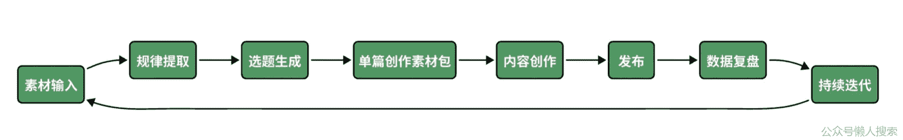

这套系统依赖你不断补充个人底稿、外部素材和发布回看。你给的信息越贴近真实、越条理清晰、越落到细节，它之后给出的支持就越靠谱。

### 02. 先行者已经跑出哪些结果？

**案例一：星河——👸号细分小号从 0 到 1**

做法：先锁定垂直方向，再借助 AI Agent 与 Skill 完成👸号同赛道文章搜集、爆款骨架拆解、题目策划、正文撰写，并自动存入草稿区。每次发布后记下数据，用实际反馈分辨问题出在账号还是内容。

结果：原先文章峰值阅读仅 13 次；抓住一次热点并调整写法后，升到 50 多次。最终把👸号从生产到发布、再到流量主开通整条链路走通，收到第一笔流量主收益，虽然只有几元，却完成了从不敢公开写到真正发布并拿到反馈的破冰。

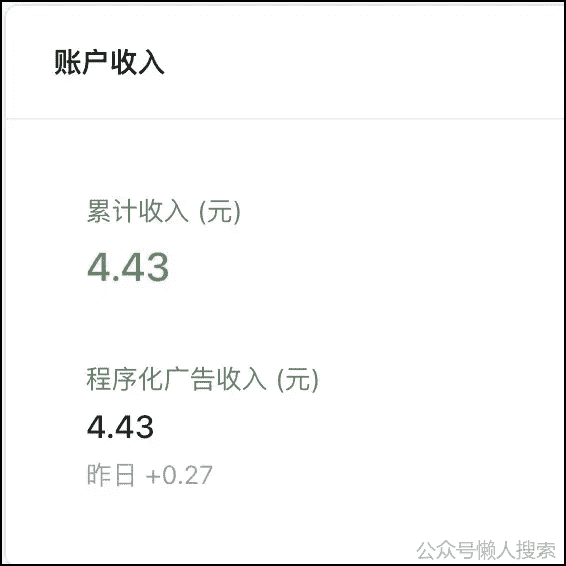

案例出处：《拖了三年，11次航海，我终于迈过了垂直小号的 0-1，也是这三年的 0-1》

**案例二：笑笑——让📕生产流程稳定下来**

做法：她把原先分散在飞书文档和脑海里的账号方向、人物背景、产品资料、写作偏好、合规红线统一归档，再让 Codex 按既定顺序执行选题调查、同题对比、文案撰写、配图生成、合规检查与发布前整理。

结果：过去要逐项手动完成的📕生产动作，现在被串成一条稳定流水线。定好题目后，系统会抓取同题前 10 条内容，拆解标题、开头、行文结构及评论区疑问，再贴合自身定位产出图文与发布素材。每次创作不必从零起步，新素材与新经验会继续回流到知识库。

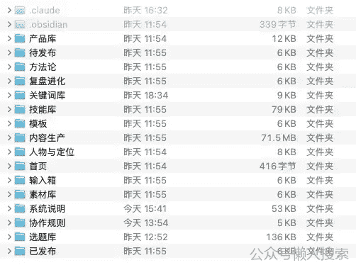

案例出处：《我们把📕整条内容生产链，彻底跑通了（从飞书到 Codex）》

**案例三：Jason——搭一条图文内容流水线**

做法：他把找参照账号、拆解爆款、整理知识库、生成题目、撰写文案、制作封面、产出轮播图、内容审核、数据回看拆成多个独立环节，再用 Codex 与 Skills 串成流水线。知识库持续收录个人经验、参考账号、用户疑问、平台规则和发布反馈。

结果：系统可日产 100 条候选图文素材，用来批量测试不同题目、标题、封面和开头，最后由人工挑选值得发布的内容。这里的“100 条”指候选内容的产能，并非每天直接发 100 条。

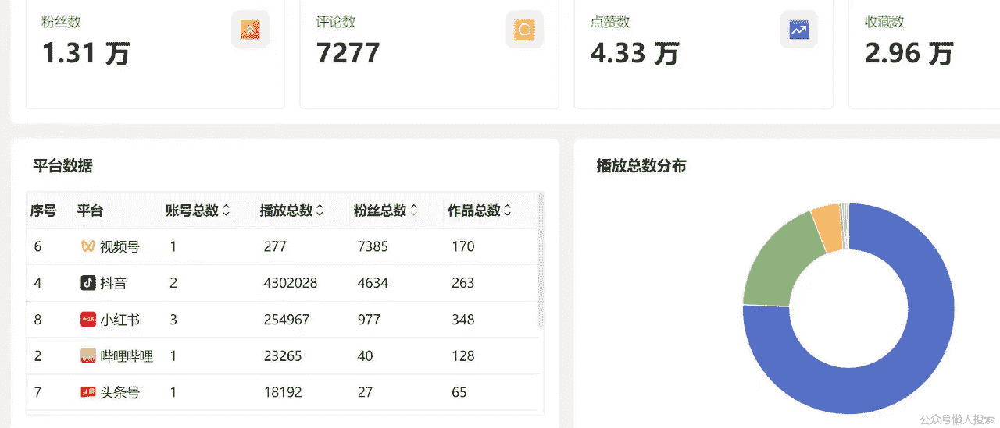

案例出处：《我是如何用 Codex 搭建工作流，实现图文内容日更 100 条的（附完整流程）》

上述案例中，有人做👸号细分小号，有人深耕📕，有人搭建批量内容流水线，还有人跑通后转身为企业做培训（详见《9 年设计师，裸辞后在赚钱做了 5 个项目都失败，最后 all in AI 企业服务做到一场培训 5000 元》）。

分享这些并非要求你本期照搬他们的账号、产量或商业成果，而是想说明：当个人底稿、素材、题目、创作与回看被装进同一套系统，它可以服务不同平台、不同内容方向与不同业务形态。

这一期，你只需要走通一条更聚焦、对新手更友好的路径：

1. 从零搭好自己的 AI 第二大脑内容系统；
2. 把📕 AI 科普当作默认练习场；
3. 围绕同一账号方向完成并发布前 5 条内容；
4. 依据真实数据与评论做第一轮复盘。

本期不要求你造一个日更 100 条的内容工厂，也不要求立刻运营👸号细分小号或靠内容获客。先把单条内容从找素材、定题目、写稿、发布到复盘完整走一遍，再结合自身经验、数据和业务需要，决定下一步往哪走。

### 03. 为何把📕 AI 科普作为首个练兵场

一套系统如果没有具体场景，很难产生真实手感。如果只把「搭知识库」研究透，新手常常在目录建好后卡住。

因此本期选了【📕 AI 自媒体·科普内容】作为练兵场。它够具体：有平台、有素材、有题目、有发布，也有真实反馈。

借这个项目，你能练出一套底层能力：把个人底稿、外部资料、爆款拆解、题目、草稿、数据回看全部收进本地库，再让 Codex 基于这套库持续协助创作。

为什么偏偏选📕 AI 科普？理由有五点：

1. 📕反馈周期短，新手能尽早发布并看到数据；
2. AI 科普的起步门槛不高，不需要你已经精通复杂工具或流程；
3. 科普内容可以完整经历找素材、出题目、写表达、发出去、做复盘的全过程；
4. 📕 AI 自媒体赛道体量大，商单需求旺盛，变现空间可观；
5. 这条路跑通后，同样的方法能迁移到其他内容类型、其他平台或个人业务。

除了科普，本期还会顺带介绍另外三种 AI 自媒体主流形式，但新手不必把它们都列为必修：

| 内容方向 | 适合阶段 | 学习安排 |
| --- | --- | --- |
| 科普型 | 新手默认 | 讲解 AI 概念、工具和基础认知，先用它跑通整条流水线 |
| 热点型 | 入门后尝试 | 练信息敏感度、时效判断，把新变化快速变成题目 |
| 测评型 | 进阶 | 要真实使用工具并形成判断，通常更接近工具商单 |
| 教程型 | 进阶 | 要自己跑通过流程，能讲清步骤、常见问题与避坑 |

科普方向只是本次起点，不代表以后只能做科普。第一轮别同时铺四条线，先把一条路跑通，再根据经验、数据和商业目标逐步升级。

提醒：虽然练手项目是 AI 自媒体，但新手在 21 天内不要以接到商单为目标。

这 21 天的目标应当更朴素：先用科普内容把创作流水线跑通，建立优质内容的生产标准和流程手感；后续再向热点、测评、教程，以及引流获客、AI 服务定制、知识付费等方向扩展。

自媒体需要时间和内容积累，变现不是一蹴而就。普通新手距离变现还隔着内容质量、持续发布、受众反馈、账号数据和商业承接能力。所以这一期先证明自己能稳定生产，再让平台和读者给反馈，比一开始就搭建变现模型要扎实。

### 04. 走完必修，你手里会攒下什么

跑完必修关卡，你会留下几类可以继续使用的内容资产。

**4.1 一套能被 AI 读取的本地内容系统**

里面至少有个人底稿、观察对象、平台风向、爆款拆解、题目池、稿件区和数据回看。以后让 Codex 协助写作，不再只是一句「帮我写📕」，而是让它读取你的背景、素材、题目和复盘结论。

成品目录大致长这样：

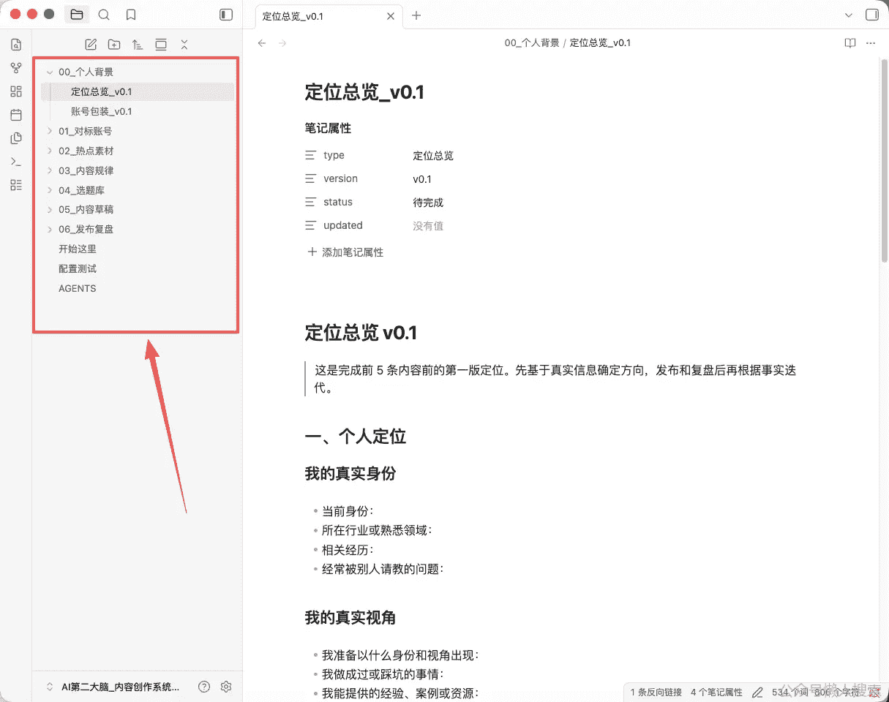

**4.2 一个完成基础包装的📕账号**

你会拥有第一版【定位总览】和【账号包装】，知道自己以什么身份出现、为谁提供什么价值、长期分享什么，并能做出一个让陌生人快速看懂你是谁、主要发什么的主页。

**4.3 一批能持续使用的素材、规律和题目**

你会收集观察对象与高数据内容，提炼出第一版标题、开头、行文结构和评论区规律，再从中生成 20 个候选题目，筛出 5-8 个优先执行。

**4.4 第一篇发布内容和一轮真实反馈**

你会从题目池中选出第一篇，备好单篇创作素材包，用 Codex 协作完成发布稿，再真正发到📕，拿到第一轮数据与评论。

**4.5 五条内容、一份首轮复盘和下一轮计划**

一条内容只能算破冰；累计发出 5 条后，你会把经过数据验证的发现写回创作规律和题目池，完成第二大脑的第一次迭代。

### 05. 关卡路线图

本手册按关卡推进，每一关先说交付物，再带你做动作。参考节奏如下：

| 时间 | 阶段 | 关卡 | 完成目标 |
| --- | --- | --- | --- |
| Day 1 | 开船准备 | 关卡 0：开船第一课 | 工具就绪，看懂生产流水线与练习路径 |
| Day 2-4 | 必修 | 关卡 1：定位 | 完成个人底稿文档、一句话定位和账号基础包装 |
| Day 5-7 | 必修 | 关卡 2：知识库搭建 | 搭好最小 Obsidian 工作台，用浏览器插件抓参考账号和热点素材 |
| Day 8-9 | 必修 | 关卡 3：爆款规律提取 | 从高数据内容总结标题、开头、结构与受众疑问 |
| Day 10 | 必修 | 关卡 4：题目生成 | 产出 5-10 个候选题目 |
| Day 11-12 | 必修 | 关卡 5：内容创作 | 完成单篇素材包与第一篇📕发布稿 |
| Day 13 | 必修 | 关卡 6：发布复盘 | 发布第一篇内容，完成 24 小时轻复盘 |
| Day 14-21 | 必修 | 关卡 7：持续迭代 | 累计发布 5 条，完成首轮总复盘和下一轮内容日历 |
| 21 天后按需 | 选修 | 关卡 8：平台迁移 | 把 1 条已验证内容迁移到👸号、X 或其他平台 |
| 21 天后按需 | 选修 | 关卡 9：类型进阶 | 规划热点、测评、教程或业务获客的升级路径 |
| 21 天后按需 | 选修 | 关卡 10：视频化 | 把 1 条已验证图文改成口播或录屏视频脚本 |

节奏不是死规定，可按自己时间调整，可以快一点、慢一点，也可以不完美，但一定要持续行动。关卡 0-7 是必修主线，8-10 是选修进阶。先跑通一条路、发满 5 条、完成首轮复盘，再决定要不要开第二个平台、升级内容类型或做视频。

### 06. 为什么选 Obsidian 与 Codex 搭档

做内容最麻烦的，是每次都要从头解释背景：你是谁、写给谁、过去收集过什么、发过什么、上一轮复盘得出了哪些结论。

Obsidian 与 Codex 配合，能比较顺地化解这件事。

Obsidian 承担内容资产的长久保存：个人底稿、观察对象、平台风向、爆款拆解、题目、草稿、复盘都会以普通 Markdown 文件存在本地。文件归你所有，看得见、改得动，还能迁移到其他工具，不会被锁在某一次 AI 对话中。

Codex 负责读取和调用这些资产：它不只是回应你眼前这一句话，而是能直接读取整个 Vault，理解你的定位与既有素材，协助整理文件、提炼规律、生成题目、完成创作，并在发布后把数据和结论写回知识库。

两者结合，内容创作就变成一个持续积累的循环：你将真实背景、素材和反馈存入 Obsidian，Codex 基于这些内容辅助创作；发布后的数据与复盘再次回到 Obsidian，成为下一次创作的起点。

本手册不会把 Obsidian 当成一门独立软件课来教，而是紧扣创作流程：每一步动作发生时，只讲当下需要的操作。这一关装工具，下一关写个人底稿，再往后用它收素材、管题目、写稿、复盘。

### 07. 出发前的准备

出发前，只需要两个工具：Obsidian、Codex（或 WorkBuddy）。安装配置教程在这里 👉 [工具安装指引](https://hk57gvlx7u.feishu.cn/docx/Hko4dV0raoCDLox8B6IcCszTnMr?from=from_copylink)

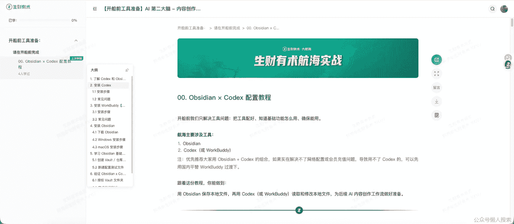

插一句题外话：如果你想知道自己每天的 Token 用量，欢迎加入赚钱 TokenRank。

最近不少圈友已经在用 Codex、Claude Code、Hermes、WorkBuddy 等工具做项目，但用了多少、坚持了多久、做出什么结果，一直没有被系统记录。TokenRank 能记录真实的 AI 使用过程，也有助于我们发现优秀作品和实战案例。

注意：Token 消耗高不代表成果好。相比「用多少」，我们更关心「你拿 AI 做成了什么」。

TokenRank 现已开放接入，可参考教程完成安装：https://scys.com/tokenrank/connect

如果接入中遇到问题，直接到航海群里反馈即可。


---

# 必修篇：从零跑通 Obsidian + Codex 内容生产

## 关卡 1：定位——选定赛道并完成账号包装

### 00. 本关任务卡

💡

**关卡目标**：在 Obsidian 中沉淀第一版个人底稿文档，形成个人定位、账号定位和内容定位，并把这些定位落到📕账号的头像、昵称、简介和背景图。

**任务清单**：

1. 了解 AI 自媒体的四种内容形式；
2. 安装并启动「航海定位官」Skill；
3. 按课程中的回答方法，接受 AI 的逐步访谈；
4. 确认第一版个人定位；
5. 在 Skill 引导下完成账号定位；
6. 明确账号的核心内容、内容支柱和内容边界；
7. 采纳 Skill 生成的账号包装方案，并完成📕主页设置；
8. 检查 Skill 自动写入 Obsidian 的最终结果。

**本关需要提交**：

1. Obsidian 中【定位总览_v0.1.md】文件截图（必交）；
2. 📕主页截图，能看清头像、昵称、简介和背景图（选交）；
3. 分享本关最大收获、或遇到的卡点及解决办法（必交）。

本期赛道已经锁定：AI 自媒体。接下来要想清楚：自己以什么视角出现，账号长期给读者提供什么价值，主要分享哪些内容。

你不必一开始就想出完美定位，也无需独自填写大量表格。我们已经准备好了四种内容形式说明、回答示例、定位标准和【航海定位官 Skill】。你只需要看懂每一步怎么回答，再按 AI 的提问，一次回答一个即可。

**本关最终要解决四件事**：

1. 以什么真实身份和视角出现在用户面前？
2. 账号主要关注什么，用什么方式为读者提供价值？
3. 账号长期讲什么、暂时不讲什么？
4. 如何通过头像、昵称、简介和背景图，让陌生人一眼看懂账号？

**完成后会生成什么？**

你的 Obsidian 会新增两份文档。本期 Vault 统一命名为 AI第二大脑_内容创作系统，也就是最外层文件夹。完整目录如下：

```
AI第二大脑_内容创作系统/
├── 00_个人背景/
│   ├── 定位总览_v0.1.md
│   └── 账号包装_v0.1.md
├── 01_对标账号/
├── 02_内容素材/
├── 03_内容规律/
├── 04_选题库/
├── 05_内容草稿/
└── 06_发布复盘/
```

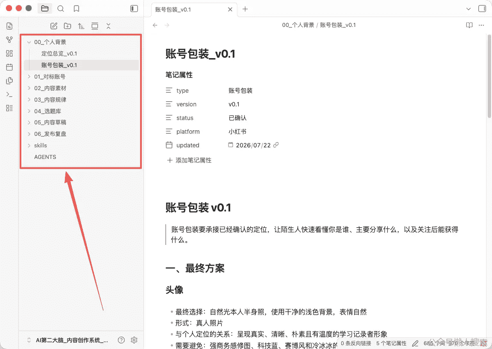

### 01. 本关的推进方式

很多人在自媒体路上，第一步就卡在定位，或者第一反应是：

- 我没有特别厉害的经历，能做定位吗？
- 我不知道自己擅长什么，该从何开始？
- 想讲 AI 的内容太多，重点怎么定？
- 能不能直接让 AI 替我写完？

别着急，教练已经把定位拆成分阶段，并准备了【航海定位官 Skill】。它会像定位教练一样，先了解你的经历，再提炼个人定位，接着明确读者认知和账号价值，理清内容范围，最后根据已确认的信息生成账号包装。

完整流程如下：

```
认识 AI 自媒体的四种内容形式
→ 安装“航海定位官”Skill
→ AI 访谈个人经历
→ 确认个人定位
→ 确认账号定位
→ 确认内容定位
→ 生成账号包装
→ 写入 Obsidian
```

正式定位前，先认识 AI 自媒体的四种内容形态。

# AI 自媒体起步，先把方向定住

这一期航行，练手的主线是 AI 自媒体。在这条主线上，常见的产出类型有四种——科普、热点、测评、教程。新手从科普类入手，不是因为简单，而是它的链路最短，可以用它把整套内容生产流程完整跑一遍。

第一关的实际动作只有三个：搞懂四种内容形态的差异；装好【航海定位官 Skill】；在 Codex 中启动它，跟随提问逐条作答，直到定位结论自动落到 Obsidian。

有个原则先摆出来：最终结论不由 AI 独断。AI 的职责是做访谈、梳理、比对和复核；你要做的是给出真实素材，并对最终结果拍板。答题时可以翻开手册里的定位方法论对照着看，定位质量会明显更高。

### 02. 四种内容玩法，先把定位拆明白

**1. 先搞懂概念**

这一关的目标是做出定位，所以拆四种形态时，要紧盯三条线：

1. 个人定位：我用什么身份、什么视角跟读者见面？
2. 账号定位：这个账号关注什么，靠什么方式给谁提供价值？
3. 内容定位：长期输出哪类 AI 内容，哪些领域先不碰？

这四个概念常被搞混，一个个说清楚。

**1. 个人定位**
一句话：我是谁、有什么经历、从哪个角度看问题。例子：一位日常工作中已经在用 AI 的电商运营。

**2. 账号定位**
一句话：这个账号长期盯住什么话题，用什么表达方式，为谁输送什么价值。例子：用通俗语言解释 AI 新概念、新工具和重要动态，让非技术背景的用户听懂、会判断、少踩坑。

**3. 内容定位**
一句话：账号的选题边界在哪里，哪些暂时不做。例子：集中在 AI 入门、运营场景落地和工具实操；编程、模型研究和泛科技资讯暂不涉及。

**4. 内容形式和表现方式**
科普、热点、测评、教程是四种常见的产出类型。同一个账号可以围绕同一个主题和读者需求，四种轮着用，再根据内容挑合适的呈现手法。本期为了照顾新手，先用科普类起步；这不是说账号以后只能做科普，后续完全可以拓展到其他类型。

**2. 四种类型怎么区分？看这张简表**

- 科普：把难懂的 AI 概念、新工具和新变化说成人话。例子：Agent 是什么？新模型发布跟我有什么关系？门槛：查得到准确资料，会打比方，能结合工作生活案例讲明白。
- 热点：追最近的 AI 新闻，说清发生了什么，以及为什么值得关注。例子：某厂刚发的模型，这次改哪儿了？门槛：嗅觉灵敏、出手快、有独立判断。
- 测评：自己真实上手一个工具，再讲它好不好用、适合谁、短板在哪。例子：三款 AI 写作工具轮着用，职场人留哪款？门槛：必须真用，能对比优缺点，不能搬网评凑数。
- 教程：带着读者一步步完成具体任务。例子：怎么用 AI 把会议纪要整理干净？门槛：自己先完整跑通，再讲清楚步骤、报错和避坑。

一篇文章也可能一脚踩两船：比如介绍新工具时，既有科普的成分，又带了点测评。怎么归类？看它当下最想替用户解决什么——是想让人搞懂一个概念、跟上一条动态、决定要不要用，还是直接照着做出来。

**3. 参照账号应该怎么看**

参考账号不是用来模仿门面——昵称、简介、封面、选题都别抄。看参照账号的本质目的，是读懂一个长期更新的创作者，如何把个人、账号和内容三层定位串成一条线。

打开任意一个账号，至少需要回答三组问题。

**个人定位**
- 他是谁，以什么身份露面？
- 主页上有没有交代相应背景？
- 读者为什么会信任他？
- 他属于专家、从业者、实践者，还是成长记录者？

**账号定位**
- 什么认知阶段的读者最适合看？
- 它究竟给用户带来了什么？
- 一个陌生访客点开主页，三秒后会留下什么印象？
- 用户凭什么要关注它？

**内容定位**
- 它的主线内容是什么？
- 哪些主题反复出现？
- 常用哪几种内容形态？
- 具体呈现手法有哪些偏好？
- 哪些话题它明显不做？

**4. 参照案例一：硅基也木水**

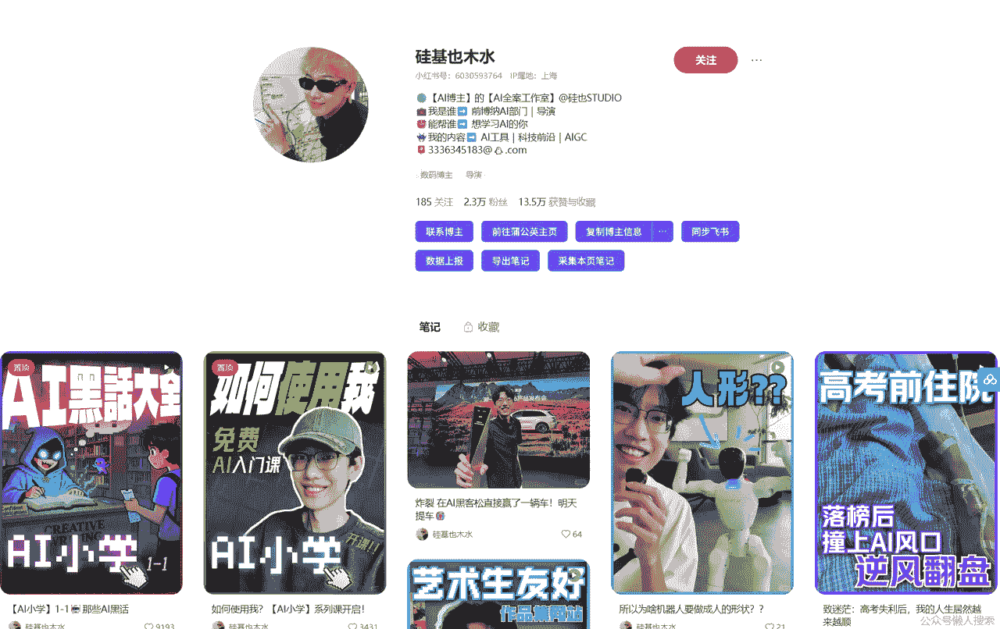

从现有信息来看，这个主页亮出的身份有三重：曾在 AI 部门工作、有导演背景、长期关注 AI 工具/前沿科技/AIGC。

**个人定位**

他并不以“AI 信息搬运工”的形象出现，而是靠“影视+AI”的从业标签让人记住。读者感受到的是，一个能从影视制作和行业实战两个维度讲 AI 的人。

**账号定位**

目标读者是对 AI 感兴趣、想学习的用户，账号输出的是关于 AI 工具、AIGC 和科技变量的解读与判断。

**内容定位**

行业科普、动态解读、工具体验、AIGC 实践都可以装进这个账号。它没有被锁死在科普这一种形态里，后续切换到测评和教程也顺理成章。

**可借鉴的点**
- 拿真实的从业履历当记忆点；
- 用自己的老本行来翻译 AI；
- 方向立得住，同时留足延伸空间。

**别急着照搬**

对方写了什么职业，不等于你也要给自己加上没做过的经历。个人定位是从真实差异里挖出来的，不是用假头衔堆出来的。

**5. 参照案例二：秋芝 2046**


从现有内容看，这个账号在科普、教程、测评三类上都有输出，其中不少篇目是针对 AI 新手的整体盘点与入门引导。

**个人定位**

它靠的是长期、成体系地梳理 AI 信息，并在实战中反复验证，以此积累信任。个人身份在主页上着墨较少，内容质量和更新稳定性反而成了最大辨识点。

**账号定位**

面向那些想了解 AI、愿意系统学习工具和方法的读者。对新手来说，它是一个顺手的入口；对有实操需求的人来说，也能往下接住更深的内容。

**内容定位**

产业科普、工具介绍、操作教学、真实体验都在覆盖范围里。不同类型的内容都服务同一个核心方向，并不会因为科普和教程同时做，就变成多个互相打架的账号。

**可借鉴的点**
- 擅长把复杂信息整理成新手友好的结构；
- 入门陪伴和高阶实操能在同一个账号里并存；
- 形态怎么换，目标读者和主题始终不漂移。

**别急着照搬**

如果主页没有把主题和价值讲清楚，纯新手不建议整套照搬。第一版账号要尽量让陌生访客一眼看懂：这里讲什么，关注我能得到什么。

**6. 为什么本期先从 AI 科普开始**

AI 自媒体是整期的统一赛道。三层定位随后会进一步交代：你是谁、账号输送什么价值、未来长期讲什么方向。

科普并不算一条独立赛道，它只是本期前五条内容默认采用的产出形式。先拿它开场，不是因为它省事，也不是说科普不需要专业判断，而是因为它在当前的教学路径上最顺。

**6.1 对新手门槛更友好**

测评要求你真刀真枪地用过、比过；教程要求你先把一件事完整做通；热点要求你信息判断快、出手也快。而一个纯新手，通常还没有攒够工具体感、项目案例和内容判断力。科普最友好的起步姿势是：把自己刚弄明白的一个小点，清楚地转述给还不太懂的同类人。

**6.2 练出内容创作的基本功**

一条合格的科普内容，背后同样需要一组功夫：
- 淘到靠谱的信息源；
- 筛选哪些信息能用；
- 把一个概念吃透；
- 用大白话重新说一遍，还要说准；
- 用具体案例来佐证；
- 把标题、开头、正文搭出节奏；
- 最后校对事实，确保没跑偏。

这套功夫，恰恰是以后做热点、测评和教程的地基。

### 03. 安装“航海定位官”Skill

接下来安装这期准备好的“航海定位官”Skill。装好后，这轮的关键词就是跟着 Skill 走。下面是安装和启动的完整说明。

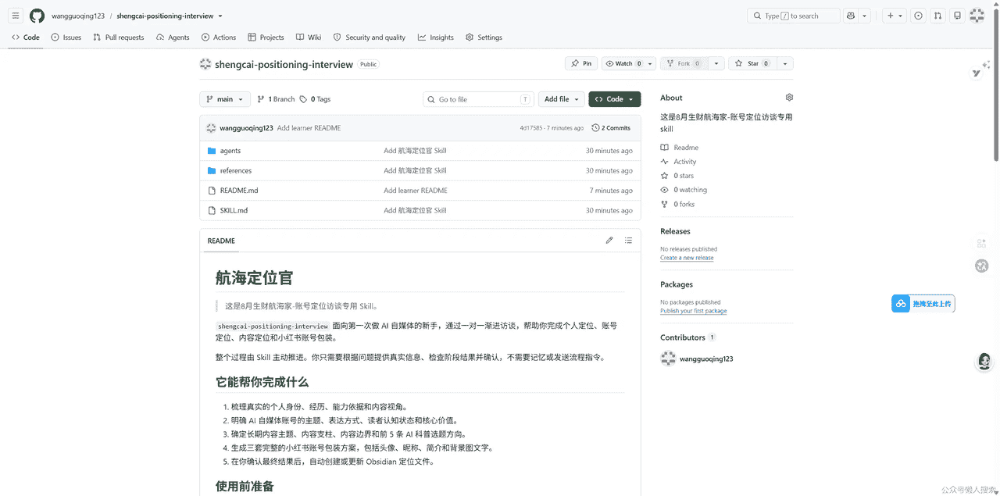

**1. 装之前确认两件事**

动手前先检查：

1. 第 0 关有没有真正完成：
（1）Obsidian 打开无异常；
（2）Codex 对话无异常。
2. 前面四种内容形态是不是已经看明白，并且理解了为什么这一期要先做科普。

**2. 安装操作，一共三步**

第一步：在 Obsidian 里新建一个 Vault，取名可以直接用：AI第二大脑_内容创作系统

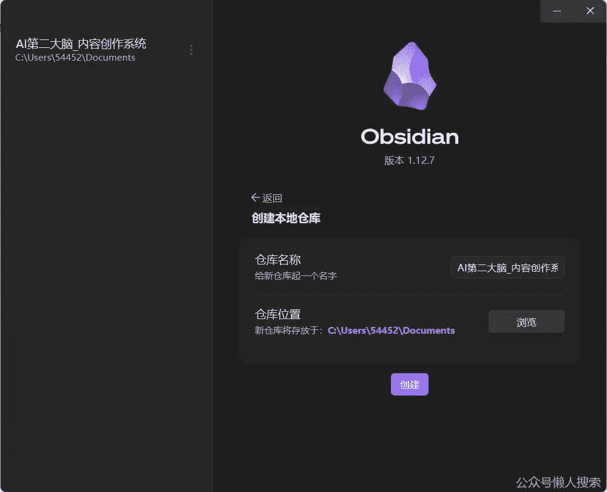

第二步：打开 Codex，依次选择 项目 -> 新建项目 -> 使用现有文件夹，选中刚才建好的那个文件夹。

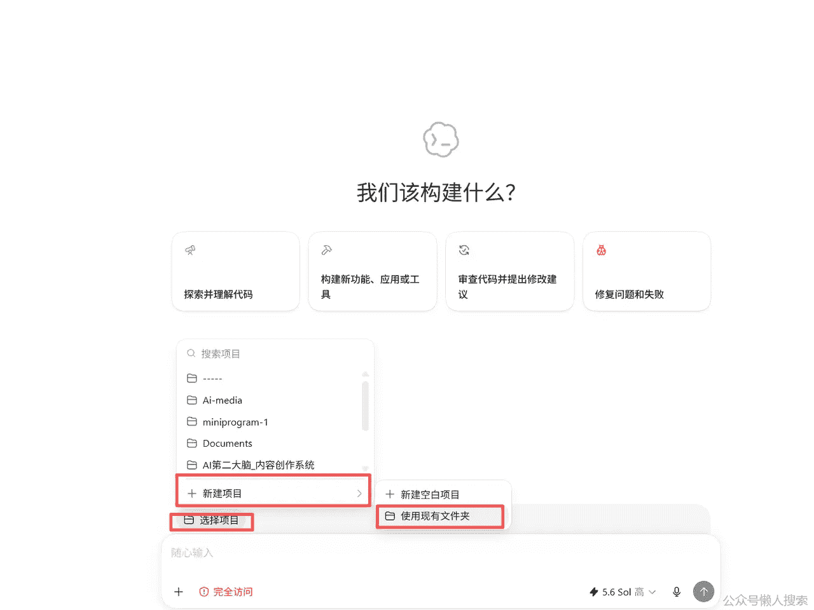

第三步：安装为你准备的“航海定位官”Skill。复制下面这段话，直接发给 Codex 即可。

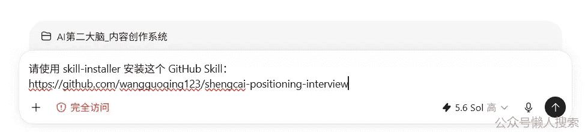

Plain Text

```
请使用 skill-installer 安装这个 GitHub Skill：
https://github.com/wangguoqing123/shengcai-positioning-interview
```

**3. 什么算安装成功**

装完之后，AI 应当明确回复一句“安装成功”。

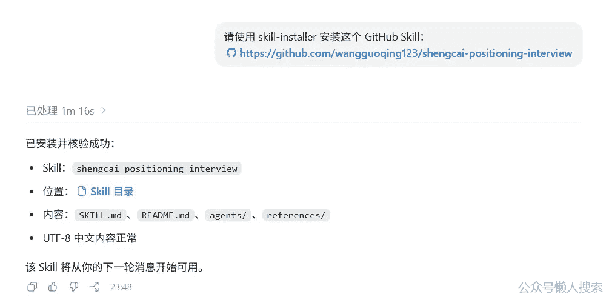

**4. 怎么启动**

确认安装完成后，直接告诉 AI 启动这个 Skill，让它带你做账号定位。

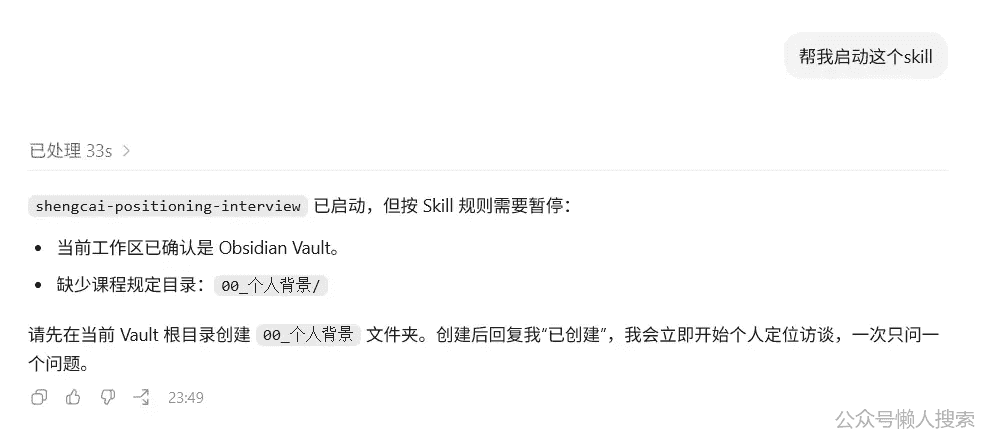

如果中途遇到卡点，AI 会要求你按规则补信息。启动后，Skill 会提示：接下来会依次带你完成个人定位、账号定位、内容定位和账号包装；它先给出个人定位的第一个问题，但先别急着答，把课程里“个人定位”部分读完，弄懂回答方法和判断标准，再回来作答。

**5. 使用 Skill 时的 10 条规则**

接下来访谈阶段请记住这 10 点：

1. AI 每次只抛一个问题；
2. 你答完，它才问下一个；
3. 不必堆专业词，尽量讲亲身经历和具体场景；
4. 想不起来就直说“不知道”或“暂时想不起来”；
5. AI 可以给回忆线索，但不能替你编经历；
6. 每个阶段告一段落，AI 会先给一段总结；
7. 总结之后，AI 会反问你是否准确；
8. 你只需要回“准确”，或具体指出要改哪儿；
9. 当前阶段你确认后，AI 保存结果并进入下一阶段；
10. 账号包装也确认后，AI 会自动新建或更新 Obsidian 文件。

之后你要做的事，就是跟着 Skill 逐个回答、纠正、确认，流程会自动往下走。现在先去读完下一部分，弄懂什么叫个人定位，以及怎么回应 AI 的提问。Skill 已经把第一个问题留在对话里了，读完就可以直接答。

### 04. 定位方法论：建议过一遍，Skill 用得更顺手

这套方法论比较适合新手。建议你边读边学，再回到 Codex 按 Skill 的提示作答。如果你已经有一定的自媒体底子，这一节可以跳过，直接照着 Skill 的引导走。

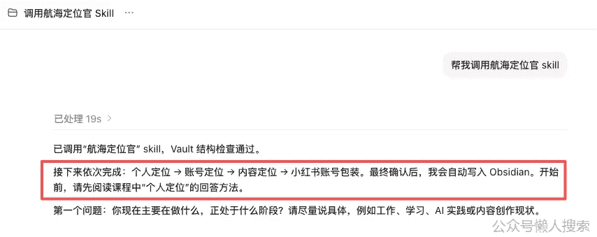

**1. 个人定位：你想以什么角色和视角出现**

**1.1 个人定位指的是什么？**

个人定位不是让你给自己安一个唬人的头衔，也不是要求你已经是某方面的专家。真正要回答的是：你愿意以一个什么身份、带着哪些经历、处在什么阶段、从哪个视角，出现在读者面前。

同样是聊 AI，个人定位可以千差万别：

- 干过三年运营，正在把 AI 揉进日常工作；
- 一位老师，正试着用 AI 备课、整理教案；
- 一个零基础学 AI 的文科生，专门记录新手会碰到哪些坎；
- 一位设计师，从视觉习惯和创作流程出发去理解 AI 生图；
- 一个小店主，记录自己怎么用 AI 应付店铺里的杂事。

这些定位之间没有高下之分。个人定位的第一标准是真实，第二标准是让人一看就明白你从哪个角度切入。

**1.2 没亮眼成绩，能做定位吗？**

能。你不必非得拥有大项目、高职位、多粉丝。定位素材完全可以来自这些地方：你目前的工作、曾经参与的项目、经常帮人搞定的问题、一次真实的成或败、你特别熟悉的一类人、正在持续学和练的东西、愿意公开展示的成长轨迹。

暂时不到专家级别也没关系，用“实践者”或“成长记录者”就够。记住别把“我在学”包装成“我很专业”。

**1.3 Skill 会打听哪些事？**

AI 想了解的重点包括：你现在在忙什么、过去做过什么具体的事、别人爱向你请教什么、有哪些做成/帮到人/踩过坑的案例、你熟悉哪些人与场景、最近在学什么用什么、能稳定拿出多少时间、哪些信息可以说哪些必须保密。

注意，AI 不该张口就问“你的优势是什么”“你的价值观呢”“你的标签是什么”——这些问法太虚，新手根本答不出有效信息。它应该靠你的真实经历和鲜活场景，帮你提炼定位。

**1.4 怎么答，AI 才能真正听懂你？**

照这个结构来：事实 + 场景 + 你的动作 + 结果或发现。

一个太泛的答法：

我在做运营，对 AI 有兴趣，学东西还算快。

这话本身没什么错，但 AI 听完还是不知道你干过什么、懂什么、能帮到谁。

一个更具体的答法：

我做电商运营三年了，平时负责店铺活动和商品文案。最近半年开始让 AI 帮我梳理竞品卖点，头一次生成时产品参数全写错了。后来我先整理好产品资料，再要求 AI 按固定字段输出，现在主要在研究怎么让输出更稳。

后一种回答有身份、有工作场景、有实际动作、有真实反馈，AI 才有依据去判断你的内容视角。

**1.5 不同问题，分别从哪里挖素材？**

问“过去做过什么”，往这些地方翻：上一份工作、某个项目、一次副业/兼职、一段学习经历、帮同事朋友客户解决麻烦的过程，甚至是某次没做成但让你收获很大的事。

问“别人常请教你什么”，想想：同事总找你搭把手处理什么？朋友遇到事第一个想到你？社群里有哪类问题你是常年答题人？家人觉得你哪方面最熟？做什么事总比别人顺？

问“你熟悉哪类人”，别只甩一句“职场人、年轻人、普通人”。尽量说明：他们什么身份、处在什么阶段、在什么具体场景里犯难、你为什么懂他们。

例：我熟悉的是入行一两年的电商运营，因为团队每年都带新人。他们一般卡在竞品分析、活动复盘和商品文案这几块。

问“做成过或踩过坑的事”，成功可以讲，失败也可以讲，真实就好。

例：我第一次让 AI 出周报，半小时成了，但里面有两处数据是错的。后来我把数据和文字分开处理，还加了一张人工核对清单。

**1.6 【了解就行】哪些话 AI 不会直接用**

下面几类素材不会出现在定位文案里：

- 没有事实兜底的“擅长、专业、资深”；
- 只试过一次就当长期能力写；
- 没经过你确认的性格推测；
- 公司涉密数据和客户隐私；
- 不方便公开的项目；
- 为了让定位好看而临时编造的经历和成果。

**1.7 现在，开始个人定位**

读完这节后，回到 Codex，直接回答 Skill 抛出的第一问。它会保持一次一问的节奏：你答完，才出下一题。如果实在想不起来，它能给你两三个可回忆的线索，但不会替你凭空写一段经历。

【了解就行】AI 什么时候收手？

当下面几个问题已经有谱，AI 会主动打住：
- 你是做什么的、目前什么阶段；
- 有哪些和内容方向相关的经历；
- 熟悉哪些人和场景；
- 能以一个什么真实视角来写；
- 公开边界在哪里。

问题不是问得越多越好。如果手头信息已经撑得起第一版个人定位，就不必为了凑问题而继续聊。

**个人定位出来后，怎么自查？**

AI 给出版本后，逐条核对：

1. 时间、身份、经历、结果有没有出入？
2. 有没有把一次性尝试写成了长期能力？
3. 有没有把猜测写成既定事实？
4. 有没有出现你没说过的性格描述？
5. 成绩有没有被夸大？
6. 不能公开的信息是否泄漏？
7. 这份定位能不能让人看出你从哪个角度聊 AI？

检查完毕，Skill 会主动确认这版是否准确。有问题就直接讲，比如“做过三年运营”不对，实际是一年半；这项能力我只玩过一次，标成“待确认”；这段经历不方便公开，挪到“不可公开的信息”。Skill 改完还会再找你确认。都 OK 后，它会自动存档个人定位，然后开启账号定位的问答。

**2. 账号定位：账号长期能给人什么**

**2.1 账号定位怎么理解？**

个人定位解决“我是谁、从哪讲”；账号定位则要回答：这个 AI 账号长期关注什么，走的什么表达路线，读者关注后能持续获得哪些价值。

账号定位不等于一句漂亮的简介。底下这些说法字面上没错，但力量很弱：

- 我发 AI 相关内容。
- 我带普通人看懂 AI。
- 讲讲科技、自媒体、个人成长。
- 跟上 AI 时代。

陌生用户看完依旧不明白：这个号到底持续在讲什么？我凭什么要关注？

**2.2 先从主题和价值下手**

这一阶段用的是“主题型定位”：先把 AI 选定为大主题，再想清楚长期关注什么内容、用什么表达方式、粉丝关注后能收获什么。

参考格式：用大白话讲透 AI 新概念、新工具、重要变化，让对 AI 感兴趣的非技术用户看得懂、跟得上、少踩坑。

如果你有运营、教育、设计、创业这些背景，也能把它们变成账号的独特视角。比如：结合自己的运营履历，用真实工作案例说明 AI 工具怎么落地解决问题。这么做，别人一眼能看出账号的方向，内容里也带着你自己的经验与判断。

**2.3 账号定位：把空话换成具体答案**

接下来，AI会围绕五件事逐一追问：你长期想在AI的哪些方向上持续输出；内容准备做到多深；讲解采用什么方式；读者看完能带走什么；你的经历又能为账号补上哪类视角。

回答时，可以套用这个组合：内容主题 + 主要表达方式 + 读者的认知状态 + 账号提供的价值。

太空泛的说法是：“我分享AI，帮助所有人提升认知。”

更有效的回答是：“我关注AI新概念、新工具和重要变化，用大白话结合生活和工作例子讲清楚，帮对AI感兴趣但没有技术背景的人快速看懂、会判断、少踩坑。”

第二种回答把讲什么、怎么讲、适合谁、为什么值得关注都交代清楚了。

**2.4 读者画像：越具体越能指导内容**

描述读者时，重点看他们目前对AI了解到什么程度，以及共同想解决什么问题。

• 对AI有兴趣，却不愿读复杂技术资料的人；
• 想跟上AI变化，但知识比较零散的人；
• 用过一些AI工具，但不知道怎样判断结果的人；
• 想知道AI与工作、生活和商业有什么关系的人。

这些读者认知状态和内容需求相近，AI就能据此判断内容深度、例子选择和解释重点。

“所有人都可以看”可以作为传播结果，但不要直接把“所有人”写成定位。定位至少还要说清内容主题、表达方式和用户价值。

**2.5 账号价值：写普通人能懂的结果**

账号价值不要只写：提升认知；提高效率；赋能个人成长；打造个人品牌；抓住AI红利。

尽量用普通人能理解的结果表达：

• 帮读者看懂复杂概念；
• 帮读者筛选真正重要的变化；
• 帮读者判断工具是否适合自己；
• 帮读者减少使用中的常见错误；
• 帮读者理解AI与工作、生活和商业的关系；
• 在教程内容中，带读者从零完成一个任务。

**2.6 定位自检：逐条过七个问题**

1. 能不能看出账号长期关注哪些AI内容？
2. 能不能看出内容会用什么方式讲？
3. 能不能看出读者关注后可以获得什么？
4. 是否说明了适合什么认知程度的读者？
5. 有没有为了显得全面，写成“分享所有AI内容”？
6. 有没有承诺自己暂时做不到的结果？
7. 这个账号定位是不是本人愿意持续使用的？

检查完成后，Skill会主动询问账号定位是否准确。

需要修改时，直接指出哪一部分太宽泛、与你不符或难以长期做到，并说明真实情况。Skill会根据已经确认的个人定位重新调整，不会添加新的经历。

你确认无误后，Skill会自动保存账号定位，并开始内容定位访谈。

**3. 内容定位：长期主要讲什么**

**3.1 什么是内容定位**

账号定位确定了账号主题、表达方式和核心价值。内容定位则要继续回答：为了持续提供这些价值，这个账号长期主要讲哪些内容，暂时不讲哪些内容。

内容定位不是立即生成第一批正式选题。第一批选题会在后面的选题关卡完成。

这一关只需要确定内容范围，让后面的素材库、规律提取和选题生成有明确边界。

一份清楚的内容定位，至少包含四部分：

1. 一个核心内容主题；
2. 2—3个内容支柱；
3. 每个内容支柱解决什么问题；
4. 暂时不做什么。

**3.2 什么是核心内容主题**

核心内容主题是账号长期围绕的中心。

例如：用通俗方式解释AI新概念、新工具、重要变化和实际使用问题。

它比“分享AI”更具体，也没有把账号限制成某一种内容形式。

**3.3 什么是内容支柱**

内容支柱是核心主题下面，可以长期积累的几个稳定方向。

以一个面向非技术用户的AI自媒体账号为例：

内容支柱一：AI概念和基础认知

解决读者看不懂概念、不知道不同名称和工具有什么区别的问题。

示例主题：

• 大模型、聊天工具和智能体有什么区别；
• 为什么AI会编造信息；
• AI更适合处理哪些类型的任务。

内容支柱二：AI新工具和重要变化

解释最近出现了什么工具和变化，为什么值得关注，以及它与普通人有什么关系。

示例主题：

• 新模型发布了什么；
• 新工具主要解决什么问题；
• 一次更新对普通用户意味着什么；
• 哪些变化值得关注；
• 哪些只是营销包装。

内容支柱三：AI使用、选择和避坑

帮助读者理解怎样选择和使用工具、怎样检查结果，以及哪些事情不能直接交给AI。

示例主题：

• 哪些信息不能直接交给AI；
• 使用AI前应该准备哪些资料；
• 怎样判断生成结果是否可以使用。

这些示例只是帮助确定范围，不是关卡4的正式选题清单。

**3.4 为什么一定要写“暂时不做什么”**

如果内容定位只写“我会讲AI工具、热点、行业、效率、成长和自媒体”，它几乎没有筛选作用。

内容边界能帮助你在后面判断：一条素材要不要收，一篇高赞内容值不值得分析，一个选题是否适合当前账号。

例如：

• 暂时不做自己无法核实的深度技术内容；
• 不追与AI无关的泛科技新闻；
• 不做没有真实使用过的工具测评；
• 不做自己没有完整跑通的教程；
• 不讲无法核实的行业内幕；
• 不公开公司、客户和业务隐私。

“暂时不做”不是永远不能做，而是给第一阶段建立边界。

**3.5 怎样检查内容定位**

请检查：

1. 核心主题是否承接账号定位？
2. 2—3个内容支柱是否围绕同一个账号主题和读者需求？
3. 每个支柱是否在解决真实问题？
4. 有没有把所有感兴趣的话题都塞进来？
5. 有没有混入与AI主题和账号价值无关的泛热点？
6. 是否写清了暂时不做什么？
7. 内容范围是否与当前能力和时间匹配？

检查完成后，Skill会主动询问内容定位是否准确。

需要修改时，直接告诉它哪项内容与你的账号定位关系较弱、希望删除什么，或者想调整成什么。Skill修改后会再次检查内容支柱是否仍然围绕同一个账号主题和读者需求。

你确认无误后，Skill会自动保存内容定位，并生成账号包装方案。

**4. 完成📕账号包装**

定位完成以后，需要把它翻译成陌生人能快速看懂的主页。

账号包装不是重新想一套定位，也不是把页面做得越复杂越好。

好的账号包装只看一件事：陌生人打开主页后，能不能在几秒内大致看懂你是谁、主要讲什么，以及关注后能获得什么。

包装和三层定位之间的关系：

• 头像主要承接个人定位；
• 昵称承接个人定位和内容方向；
• 简介承接账号定位；
• 背景图承接内容定位。

四个元素不需要重复同一句话，但应该指向同一个方向。

**4.1 头像**

头像首先要满足：清晰；容易识别；能够长期使用；不与个人定位冲突；不包含太多看不清的小字。

如果方便露脸，可以使用光线清楚、背景简单的真人头像。

如果不方便露脸，可以使用：简洁的职业形象；稳定使用的卡通形象；与个人称呼有关的简单视觉标识。

纯新手第一版不建议花大量时间制作复杂Logo。头像的主要任务是让人认得你，不是展示设计技巧。

**4.2 昵称**

昵称应该帮助用户识别人或方向。

常见结构包括：

• 【称呼】+讲AI；
• 【称呼】的AI笔记；
• 【称呼】+AI观察；
• 【称呼】+【AI内容关键词】。

例如：

• 阿泽讲AI；
• 小林的AI笔记；
• 小夏看AI；
• 文科生小夏学AI；
• 老周的AI工具箱。

昵称不要：堆太多关键词；使用无法证明的专家头衔；只写一个与内容无关的英文名；把自己锁死成“只做AI科普”；为了显得专业使用别人看不懂的缩写。

**4.3 简介**

内部的一句话账号定位可以比较完整，但不一定适合原封不动放进主页。

📕简介需要更短、更自然。可以分成两到三行：

```
我是谁，或者我从什么视角分享
主要关注什么，用什么方式讲
读者关注后可以获得什么
```

例如：

```
用大白话讲清 AI
关注新概念、新工具和重要变化
帮你看懂、会选、少踩坑
```

简介不要只写：热爱生活，分享成长；AI时代持续进化；分享有价值的内容；助力普通人抓住红利；专注个人成长和效率提升。

这些表达很难让陌生人知道账号具体会讲什么。

**4.4 背景图**

背景图可以进一步说明内容范围。

第一版保持干净即可，可以使用：一句简化定位；2—3个内容关键词；一个简短的更新方向。

例如：

```
AI 科普｜热点解读｜工具实测｜实用教程
```

背景图不要堆满：大量文字；多个联系方式；无法验证的成绩；夸张营销承诺；与账号方向无关的口号。

〔待补：📕当前主页编辑入口、头像尺寸、昵称和简介规则、背景图尺寸。对外发布前按最新平台规则复核。〕

4.5 skill会给你三套完整的账号包装方案

个人定位、账号定位和内容定位确认以后，“航海定位官”会根据前面已经确认的信息，为你生成三套完整的账号包装方案。

每套方案都会包含头像、昵称、简介和背景图文字，你只需要比较哪一套更符合自己。

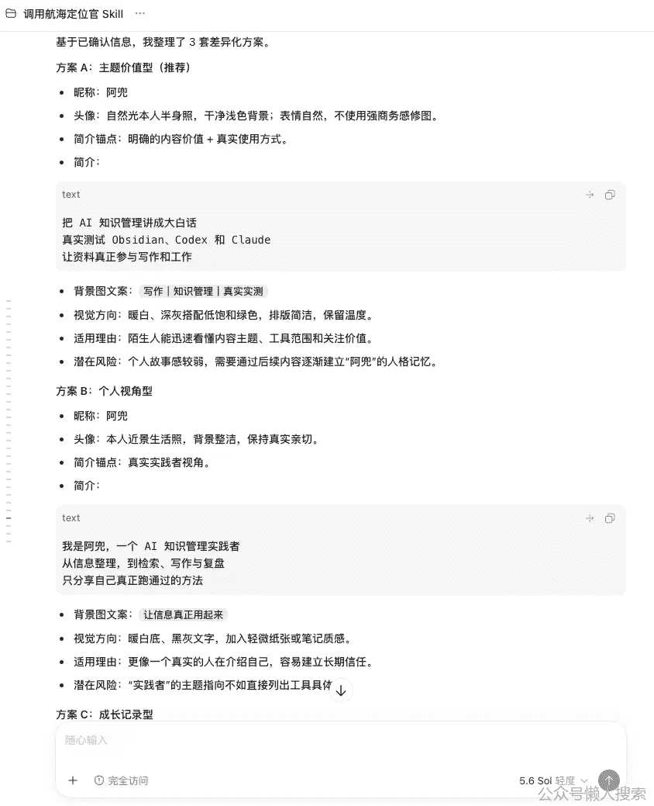

**方案A：主题价值型**

这套方案会直接告诉别人：账号主要讲什么；准备用什么方式讲；关注以后可以获得什么。

适合希望别人进入主页后，能够快速看懂账号方向的人。

**方案B：个人视角型**

这套方案会重点突出你的真实身份、经历或看待AI的独特视角。

适合拥有相关工作、行业或项目经历，希望账号更有个人识别度的人。

**方案C：成长记录型**

这套方案会重点呈现你正在学习、实践和持续记录的过程。

适合正在进入AI领域，希望通过真实实践和成长过程与读者建立信任的人。

每套方案都会写清：整体思路；头像应该采用什么形式；推荐使用的昵称；可以直接使用的简介；背景图文字；为什么适合你；使用时可能遇到的问题。

三套方案生成以后，“航海定位官”会推荐其中最适合你当前阶段的一套，并说明推荐原因。

注意：不要只因为AI推荐就直接使用。

请先检查：

1. 昵称读起来是否自然？
2. 是否包含你不愿意长期使用的身份？
3. 简介是否符合事实？
4. 有没有写入无法证明的成绩？
5. 是否能看出主要关注什么？
6. 是否能看出读者关注后可以获得什么？
7. 背景图和简介是否重复过多？
8. 你是否愿意至少使用这一版完成前5条内容？

检查完成后，Skill会主动询问你是否采用这套方案。

需要修改时，直接说出你的真实感受和具体原因。例如：

• 昵称中的这个词我不想长期使用。
• 简介中的这句话与事实不符，正确情况是……
• 背景图文字太多，希望只保留最重要的2—3个关键词。

Skill会只调整你提出的部分，并再次检查账号包装是否与定位一致。你确认最终方案后，它会自动整理并写入Obsidian。

5. 自动写入Obsidian、检查并提交

主页包装确认以后，Skill会自动汇总本关已经确认的结果，并创建或更新：

定位总览_v0.1.md

账号包装_v0.1.md

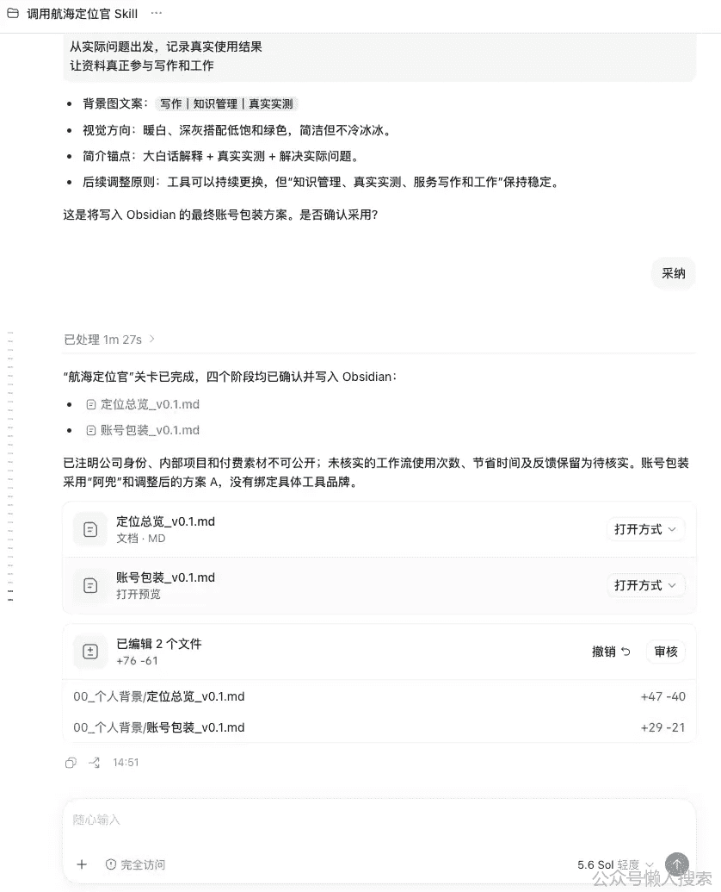

💡

🎊 到这里，本关就完成啦，记得提交作业 👉🏻 https://scys.com/activity/10093/task

1. 定位总览_v0.1.md文件或完整截图，必填。
2. 📕主页截图，能看清头像、昵称、简介和背景图，选填。
3. 分享一下这关最大的收获，或者你遇到的卡点、怎么解决的（必填）

全部完成后，就可以提交作业并进入关卡2～

下一关，我们将搜集对标账号与内容素材，作为你的内容原材料之一、同时沉淀优质内容结构。

💡⚠️ 请记住：现在得到的是定位v0.1。

接下来的素材库、规律提取、选题、内容创作、发布和复盘，都会以这份定位为起点。完成前5条内容以后，你会拥有更多真实信息：哪些内容更容易写，哪些用户更愿意互动，哪些问题值得继续深入。

到那时，再根据事实调整定位，而不是在开始之前反复猜测。

先完成第一版，然后继续往前走。

## 关卡2：素材库：搜集对标账号与内容素材【重要】

### 00. 本关任务卡

💡

任务目标：在Obsidian中建好内容素材库，搜集5-10个📕对标账号，搜集10条📕对标笔记，并用浏览器插件“社媒助手”抓取笔记内容。

任务描述：

1. 让AI检查并补齐Obsidian内容工作台。
2. 让AI根据关卡1的定位生成搜索词。
3. 搜集5-10个对标账号，交给AI入库。
4. 安装“社媒助手”。
5. 搜集10条对标内容，用社媒助手复制笔记信息，再交给AI入库。
6. 让AI检查数量和文件是否可以正常读取。

本关需提交作业：

• Obsidian左侧目录截图，能看见01_对标账号和02_内容素材中已经保存的文件。（必填）
• Obsidian中记录的对标账号、笔记信息截图。（必填）
• AI生成的入库检查报告。（必填）
• 分享一下这关最大的收获，或者你遇到的卡点、怎么解决的（必填）

完成标准：7个目录完整、5-10个账号有卡片、约10条内容已抓取并保存、Codex检查通过，就可以进入关卡3。不要为了做出一个漂亮知识库继续扩目录。

### 01. 建立内容创作工作台

打开Obsidian，在根目录补齐下面7个文件夹。

可以直接复制给Codex，让AI帮你补齐目录：

```
请检查当前文件夹-AI第二大脑_内容创作系统。

在不删除、不移动、不覆盖现有文件的前提下，补齐下面 7 个文件夹：
00_个人背景
01_对标账号
02_内容素材
03_内容规律
04_选题库
05_内容草稿
06_发布复盘
```

回到Obsidian左侧检查，7个文件夹能够正常显示，就可以继续。

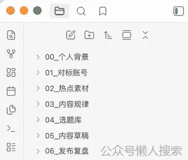

目录建好后，再在Vault根目录创建一个项目配置文件。

这个文件的作用是：把每次提示词都要重复的通用规则写在一个地方，AI打开项目时自动读取。以后的提示词就不用反复交代“不要编造”“来源写具体路径”这些基本要求了。

如果你跟着本期航海使用Codex，创建AGENTS.md；如果你使用的是Claude Code，创建CLAUDE.md；两者内容一样，只是文件名不同。

注意：这个规则文件不是一次写死的，后续可以随时更新。

比如AI总在同一个地方出错，或者有了新的统一要求，就把规则加进去。

向Codex发送：

```
请在 Vault 根目录创建项目配置文件。

如果当前使用的是 Claude Code，文件名为 CLAUDE.md。
如果当前使用的是 Codex，文件名为 AGENTS.md。

写入以下内容：

# AI第二大脑 内容创作系统

这是一个用于 AI 自媒体内容创作的 Obsidian Vault。

## 目录结构

- 00_个人背景/ — 个人定位和账号包装
- 01_对标账号/ — 搜集的小红书对标账号
- 02_内容素材/ — 搜集的小红书对标内容
- 03_内容规律/ — 从素材中提炼的标题、开头和正文结构规律
- 04_选题库/ — 选题池
- 05_内容草稿/ — 内容草稿
- 06_发布复盘/ — 发布数据和复盘

## 每次开始前

先读取 00_个人背景/定位总览_v0.1.md，了解目标读者、账号价值和内容范围。

## 通用规则

1. 只使用文件中已有的真实信息。不编造个人经历、受众需求、热点趋势、数据和使用效果。
2. 素材来源写具体文件路径，不能只写&quot;来自小红书&quot;。
3. 读取 02_内容素材 时，排除搜索关键词.md、_入库检查报告.md 和其他以 _ 开头的辅助文件。有标题、来源链接和可读正文，才算一条有效内容。
4. 可以借鉴素材中的问题和角度，但不照搬原笔记标题和正文。
5. 只修改当前任务指定的文件，不要动其他文件夹的内容。
6. 不删除或覆盖已有内容，除非明确要求。
```

创建完成后，在Obsidian左侧确认文件存在即可。以后每次打开这个项目，AI都会自动读取这些规则。

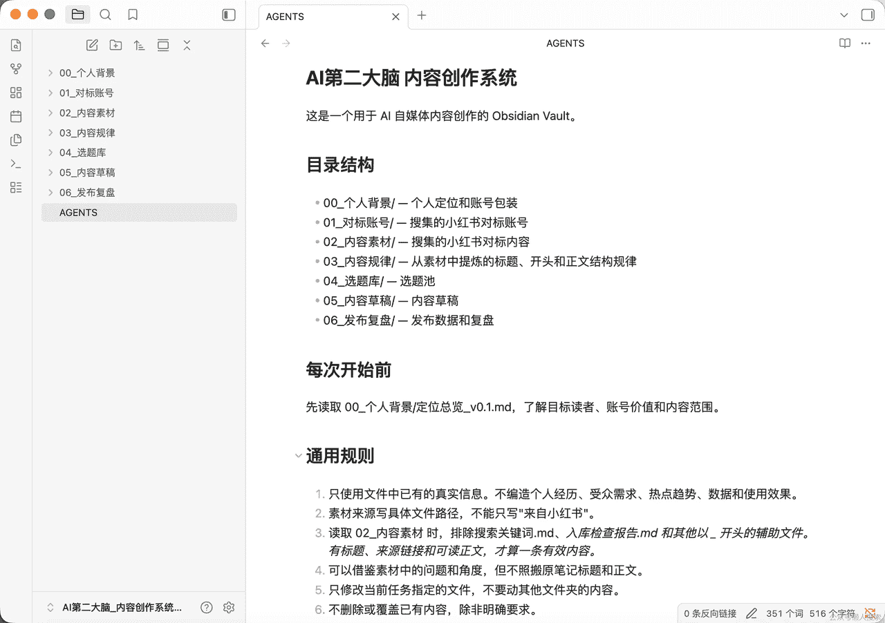

### 02. 搜集对标账号与内容素材

1.让AI生成搜索词

不要只搜索“AI”。范围太大时，很难找到与你的账号方向相关的账号和内容。也不要一开始就搜索过于具体的完整句子。

例如：

• 太宽：AI
• 太具体：AI读过资料为什么不会用
• 更适合起搜：AI不会用、AI提问、AI工作流、AI知识库

让Codex读取关卡1的定位结果：

```
请读取：
00_个人背景/定位总览_v0.1.md

根据我已经确认的目标读者、账号价值和内容范围，生成一组用于小红书搜索的关键词。

请给我：
1. 5-10 个适合寻找对标内容的搜索词；
2. 每个词用一句话说明大概能搜到什么。

账号搜索词和内容搜索词可以不同。
不要增加定位文件中没有确认过的人群和方向。

请把结果写入：
02_内容素材/搜索关键词.md
```

搜索词生成以后，直接开始搜索，不需要反复调整到完美。

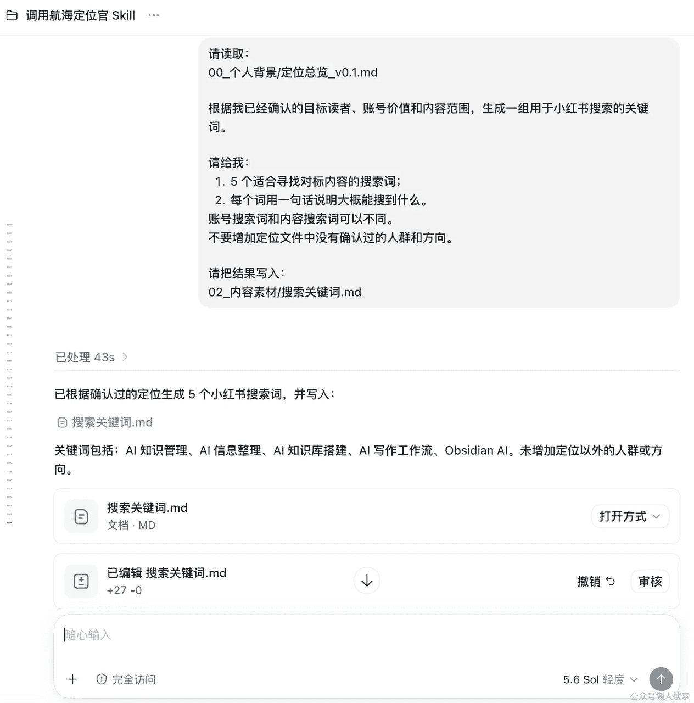

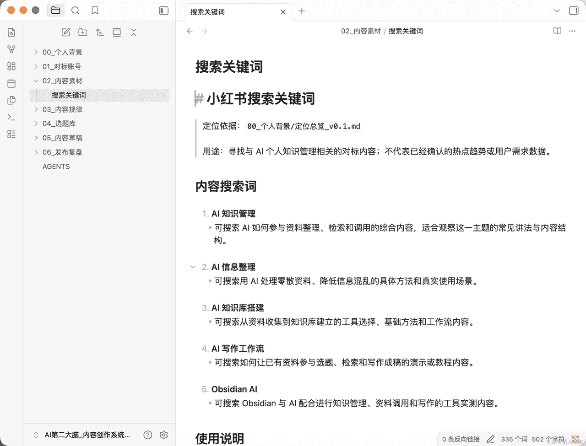

在搜索结果中，一定要筛选：

• 排序依据：最多点赞
• 发布时间：半年内


2.搜集5-10个对标账号

先完成对标账号的搜集。

怎样找到对标账号？

在📕搜索刚才生成的内容搜索词。

搜索出来的是一条条内容，每条内容背后都有一个账号。

看到与你准备做的方向相关、数据表现较好的内容时，点击作者头像，进入主页看看这个账号是否值得长期观察。

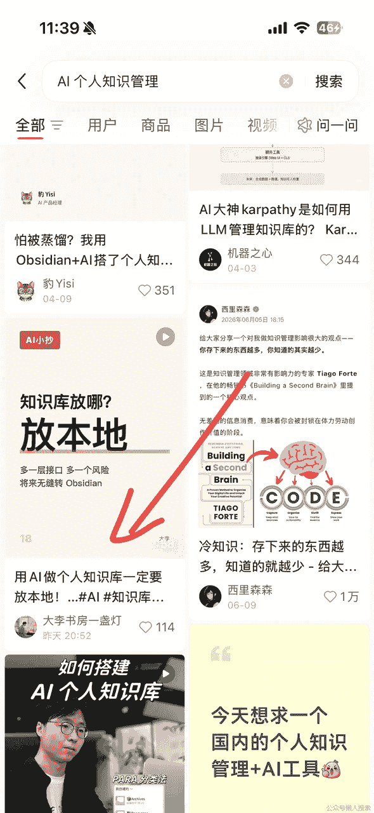


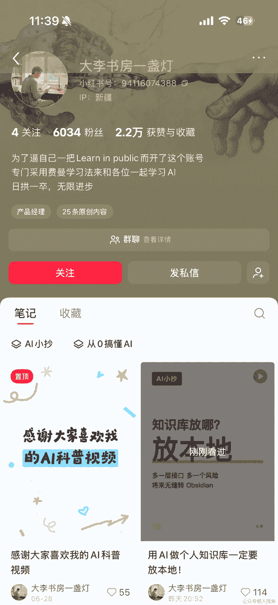

**账号怎么选，才值得你花时间研究？**

下面三个条件可以拿来卡：

1. **它的内容主线和你要走的路能对上。** 这号持续发的东西，得跟你未来更新的领域和你打算服务的那批人有关联。

2. **不能只是碰巧火了一次。** 整个主页里，数据好看的内容有好几条，能看出它在某个方向上持续稳定，而不是撞大运。

3. **它的方法里，总有一部分你现在就可以照猫画虎。** 不管选题思路、表达口吻还是制作门槛，至少有一块你现在上手就能练。

大号可以当行业窗口看看，但别把宝全押在大号上。身边人和你水平差不多的号，反而要多留几个，因为他们的做法你能直接试。

真决定拿它做参考，就得人工先把这号的基础信息抓准：账号名称、主页链接、页面可见资料、收录日期，四样不能少。

到这一步，只要判断它够不够格进库就行，不用去剖它的定位、变现、内容套路和爆款逻辑。

如果你是新手，前期先别偷懒，自己手动翻、手动记，把体感养起来。

**接下来交给 AI 建档**

找到一个，就把你核实到的信息贴给 Codex：

Plain Text

```
这是我决定搜集的一个小红书对标账号，请把它保存到“01_对标账号”。

账号信息：
【粘贴账号名、主页分享链接和页面上能看到的其他信息】

搜集日期：
【填写日期】

要求：
1. 只整理和保存我提供的真实信息，不分析这个账号。
2. 不推测没有提供的信息，缺失内容写“未提供”即可。
3. 不需要使用固定模板，请沿用当前文件夹中清晰、方便追加的 Markdown 结构。
4. 本次只编辑“01_对标账号”，不要修改其他文件夹。
5. 保存后告诉我文件位置。
```

录进去之后大概是这样：

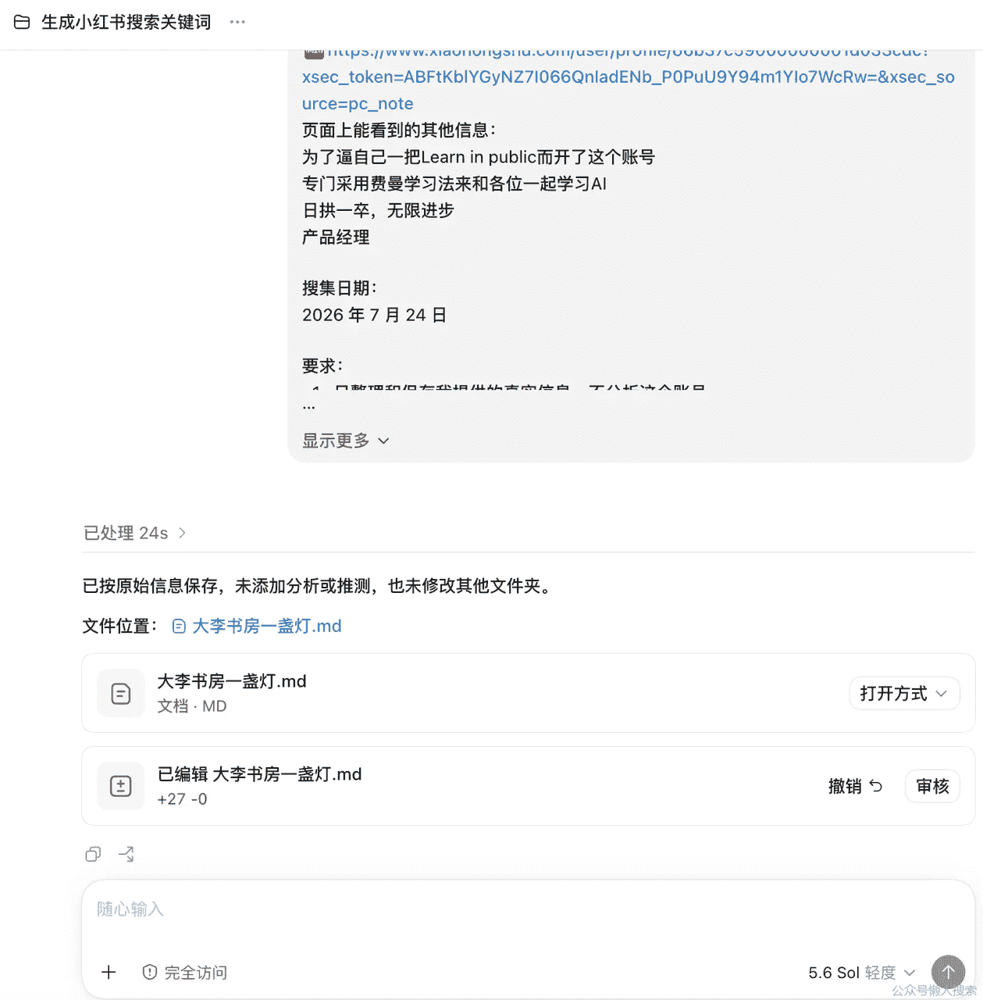

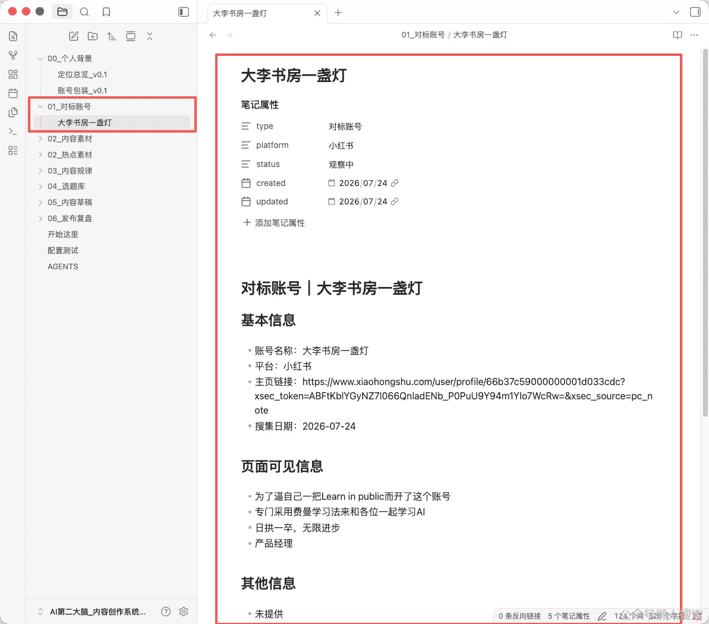

按这个节奏收，攒到 5 到 10 个号就收手。

实在没好号也不要硬凑，方向不对的宁可不要。

3. 收够10条参考素材

3.1 先把社媒助手装好

搞内容时，笔记正文和页面基本信息都要拿到。

这轮统一借助浏览器插件「社媒助手」。安装方法如下。

先进官网下载地址：https://socialext.com/download

能正常访问 Chrome 商店的话，按这个路径装：去商店 → 点“添加至 Chrome” → 再点“添加扩展程序”。


进不了商店，就按官网提供的离线安装提示弄，教程在 https://socialext.com/help/faq/browser/offline-install。

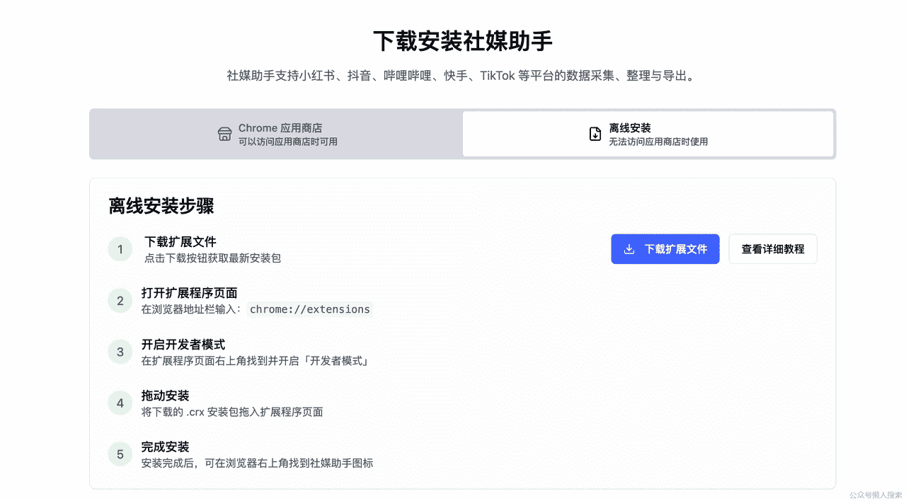

✅ 装到这一步的样子：

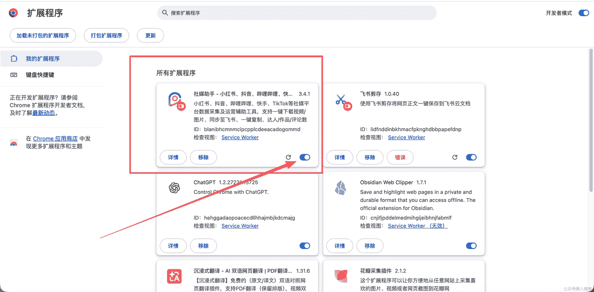

接着把插件钉在浏览器上：Chrome 右上角点拼图 → 列表里找“社媒助手” → 点图钉图标。

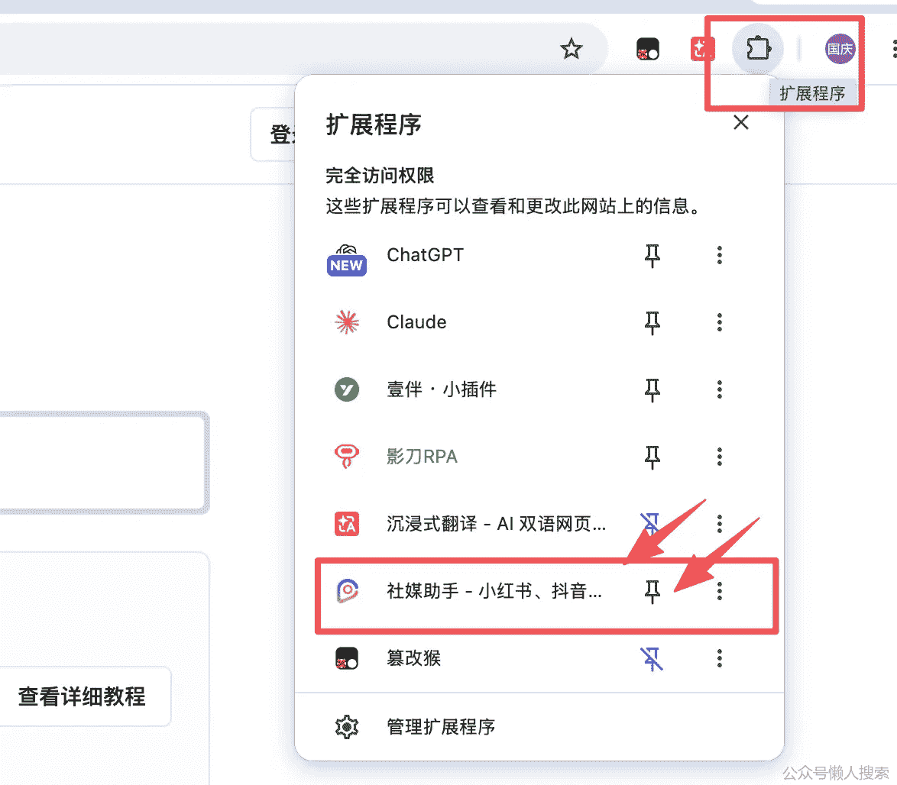

验证是否装好：进📕网页版，随意开一篇笔记详情。只要页面冒出“复制笔记信息”入口，插件就是活了。

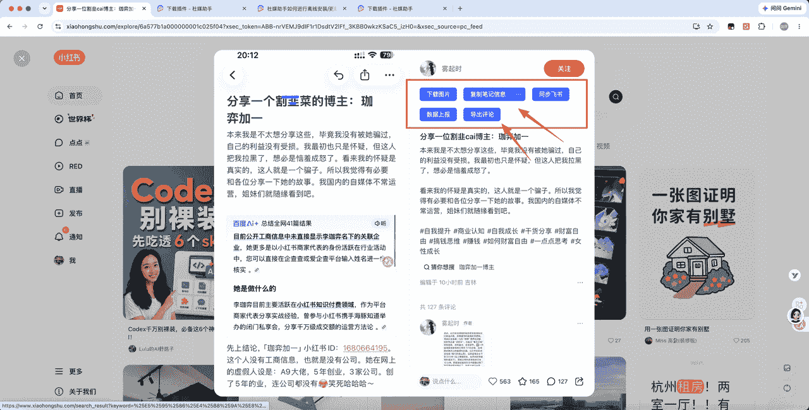

按钮没冒出来？先刷一遍页面；还不行就查查插件启没启用，之后把浏览器重启。

3.2 挑出10条参考素材

从哪找？直接用第一步生成的关键词开搜。看到方向合、数据好、现在还有用的笔记，点进详情页。

能被收进来的内容，要三件事同时成立：

1. **方向对得上**：内容对应的读者、想解决的问题或讨论的领域，都在关卡 1 确认的账号定位里。

2. **数据能打**：比起同类搜索结果，或这个账号自己近期的内容，点赞、收藏、评论至少有一项走高。不是追绝对数字，而是看相对表现。实在拿不准，给个保守参考线：赞过 300、藏过 100、评过 30，中任意一条就行；赞过千直接收。这组数只是给新手的拐杖，不是硬指标。

3. **现在不失效**：别收过期活动、旧政策或已经降温的热点，当下搜出来依然有参考价值才算数。

一句话总结：它写给你想服务的那群人，聊的也是你打算长期写的话题，数据还过得去，那就进素材库。

但要清醒：高赞不等于内容里的数据、事实、结论全对。拿它学选题、标题、结构没问题；可如果把产品性能、政策、数据、效果写进自己文章里，必须单独核一遍。

3.3 借助插件拷贝笔记内容

步骤不复杂：笔记页里点“复制笔记信息” → 格式选“默认”（TXT） → 勾标题、正文、博主昵称、发布时间、点赞、收藏、评论、图片等（图片一定勾上，图文干货基本在图里） → 点复制 → 再去📕“分享”里把链接复制出来。

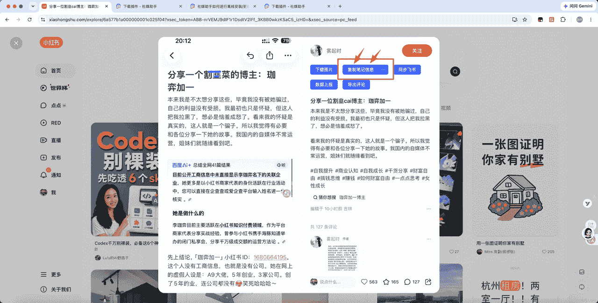

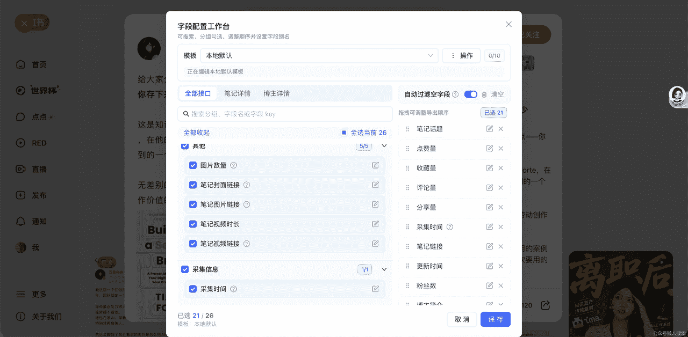

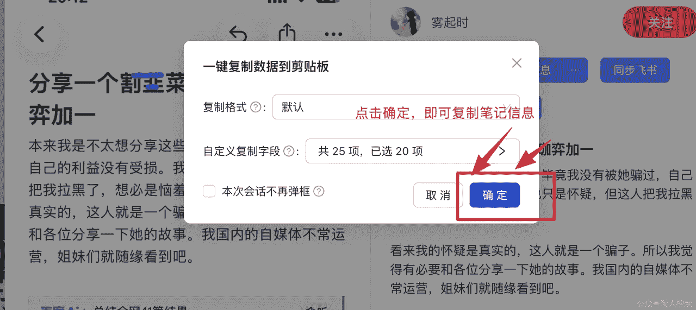

补充一句：这关用社媒助手就够了，没必要碰 JSON、CSV、批量采集。另外它只能采图文，视频脚本文案帮不了忙；需要视频脚本，可以到🛰️里搜“轻抖”小程序，或用其他工具。

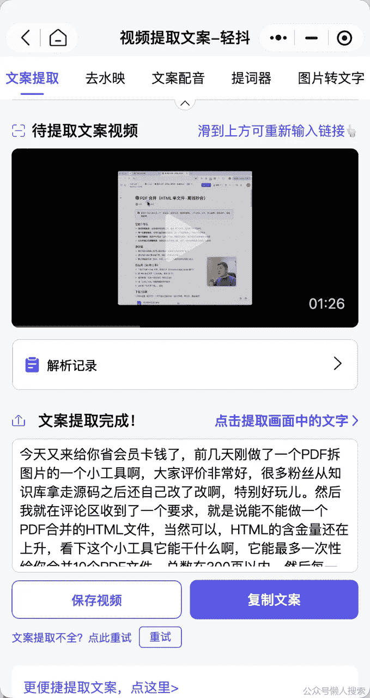

3.5 把素材发给 AI 建档

把插件复制到的内容＋笔记链接打包丢给 Codex：

Plain Text

```
这是我决定搜集的一条小红书对标内容，请把它保存到“02_内容素材”。

社媒助手复制的完整笔记信息：
【粘贴完整内容】

要求：
1. 每条内容建立一个独立文件夹，文件夹命名为“笔记标题_笔记ID”。
2. 在该文件夹中创建“笔记信息.md”，完整保存我提供的全部信息，不概括、不改写、不分析。
3. 如果标题中包含不适合用于文件名的字符，只做必要的字符替换，不修改标题原文。
4. 根据笔记 ID 和笔记链接检查是否重复；如果已经入库，不要重复创建。
5. 下载“笔记图片链接”中的全部图片，按照原始顺序保存为 01.jpg、02.jpg、03.jpg……
6. 在“笔记信息.md”末尾增加“笔记图片”部分，使用下面的格式依次嵌入本地图片：

![[01.jpg]]
![[02.jpg]]

7. 保存后告诉我文件夹位置、图片下载数量、失败数量、正文是否为空，以及当前已入库的对标内容数量。
```

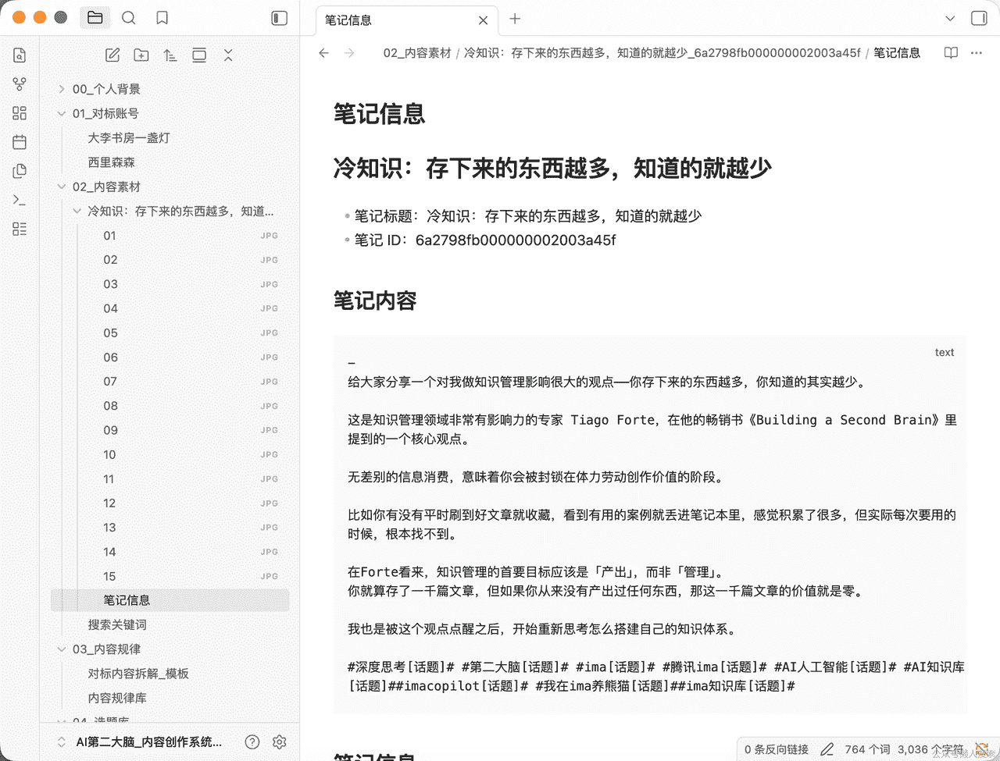

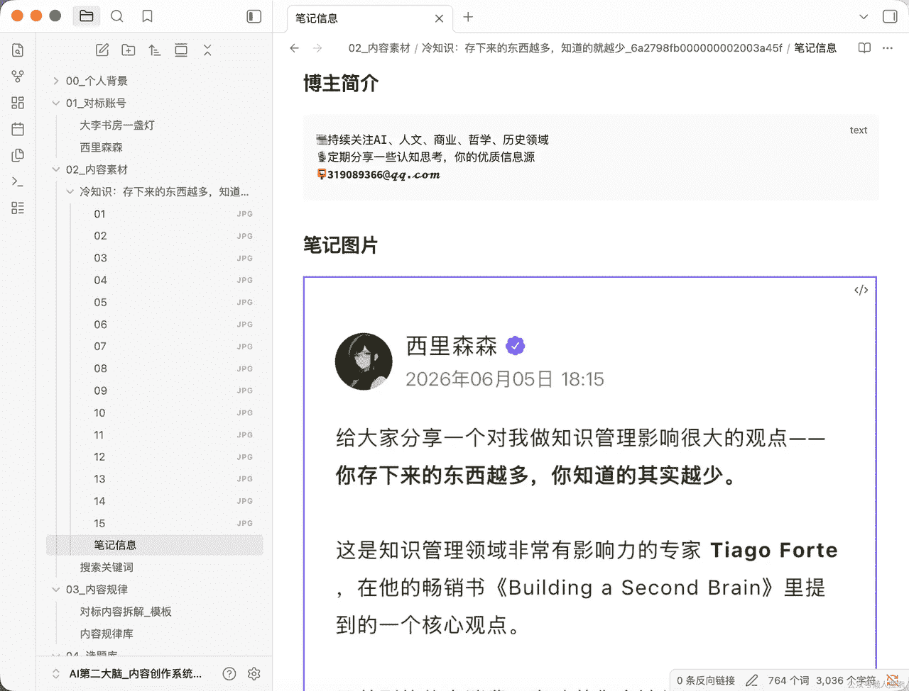

接着收，满 10 条就刹住。

1. 入库前让 Codex 把个关

素材收完别急着往下走。让 Codex 清点一下条数、重复和读图情况，用下面这段提示词：

Plain Text

```
请检查 02_内容素材 中已经保存的对标内容。

请排除：
- 搜索关键词.md；
- 已有的 _入库检查报告.md；
- 其他以 _ 开头的辅助文件。

只有同时具备标题、来源链接和可读正文的内容，才算一条有效内容。
如果笔记包含本地图片，请检查图片文件是否存在、能否正常读取。

请创建或更新：
02_内容素材/_入库检查报告.md

写入：
1. 当前有效内容总数；
2. 每条有效内容的文件路径；
3. 疑似重复的内容；
4. 缺少标题、链接或正文的内容；
5. 图片缺失或无法读取的内容；
6. 是否已经达到 10 条有效内容。

不要修改原始素材文件，不要补写缺失信息。

完成后告诉我：
- 有效内容数量；
- 需要处理的问题；

- 是否可以进入关卡 3。
```

Codex 出了结果，你自己打开 _入库检查报告.md 看三处：有效素材够不够 10 条；路径是不是真的；有没有重复、正文缺漏、图片读不了的。不够就回头补收；都没问题再进关卡 3。

💡

**🎊 到这关就通关了，作业记得交 👉🏻**https://scys.com/activity/10093/task

要交的东西有 4 样：

1. Obsidian 左边目录截图，里面得看到 01_对标账号 和 02_内容素材 两个文件夹存好的文件。（必填）
2. Obsidian 里已经记录的对标账号和笔记信息截图。（必填）
3. AI 生成的入库检查报告。（必填）
4. 聊聊本关最大收获，或你卡在哪、怎么解决的。（必填）

上面几项都齐了，就能交作业进关卡 3。

下一关的主角就是这批采集素材，我们要从里面挖能反复用的规律。

## 关卡 3：把高赞内容里的规律抽出来复用

### 00. 任务说明

💡

**任务目标**：拿关卡 2 的 10 条参考内容做横向比较，提炼标题、开头、正文结构里能复用的规律。每条规律必须有 2 条以上素材支持，并说清适用的地方和雷区。最后把这套提炼法打包成“规律提取 Skill”。

**要做的事**：

1. 先让 AI 通读所有素材，按统一字段生成汇总底稿。
2. 再在底稿上分别总结标题、开头、正文结构的规律。
3. 然后人工甄别这些规律成不成立、边界清不清楚。
4. 最后把整套流程做成 Skill。

**作业清单**：

1. 截 03_内容规律 文件夹，里面要有标题规律、开头规律、正文结构规律三份文件。
2. 任选一份规律文件截图，要能看到规律名、适用范围、不能照搬的地方和来源素材。
3. 展示 Skill 创建成功并验证通过的截图。
4. 写写本关收获或卡点＋解法。（必填）

1. 过关后你能得到什么

通关后，Obsidian 里会多出这些东西：

Plain Text

```
03_内容规律/_规律提取汇总.md
03_内容规律/标题规律.md
03_内容规律/开头规律.md
03_内容规律/正文结构规律.md
skills/shengcai-pattern-extractor/
```

其中 _规律提取汇总.md 是过渡用的中间稿，把 10 条素材按统一字段归拢，方便横着对比。三份规律文件才是最终成果，分别存着人工认过的标题、开头、结构规律，并且每条都带素材出处。

Skill 会把整个工作方法记下来，以后再有新素材，你只要丢给 AI 一句：

Plain Text

```
我搜集了新内容，帮我更新内容规律。
```

它就会调起 Skill，读新内容并把规律文档更新好。

2. 这关到底图什么

核心是：把已验证的爆款结构提炼出来用上，让自己做内容时更有机会爆。

上一关攒下的 10 条高数据素材，成绩不会白来。背后的原因往往就藏在标题怎么写、开头怎么切入、正文怎么排兵布阵里。只要把重复出现的手法捞出来，下次写东西直接往上套，就不用每篇都从零试了。

所以本关的活儿很直接：从验过的爆款里提取标题、开头、结构的公共套路，变成你能直接套的模板。

AI 负责动手提炼，但你要守住一条底线。AI 会帮你把素材归纳好，不用你一条条去拆；但它给出来的规律必须你亲自确认。

记住：数据好不等于处处值得学。能被叫“规律”的，至少得满足两条：

1. **复现率高**——同一做法在 2 条及以上素材里出现。
2. **解释得清**——能直白说出是什么、适合什么、什么地方不能硬套。

只露脸一次的做法，先放一边观望，不必当真。

**⚠️ 记住：对标不是抄作业**

聪明的做法是各借一点：A 的选题表达、B 的开头、C 的结构，拼成自己的风格，而不是变成谁的山寨版。

这关只借用方法，原文、案例、没验证过的结论一概不碰。

### 01. 让 AI 分步做提炼

1. 先出汇总底稿

别上来就喊 AI 总结。素材详略不一，AI 很容易脑补出丢失的信息，给你一个貌似合理的答案。

所以第一步，先让 AI 按统一字段把 10 条素材整到一张表里，你才好横着比。

把「AI第二大脑_内容创作系统」设为 Codex 工作目录，然后发：

Plain Text

```
请读取 02_内容素材，把每条内容按下面字段整理，写入：
03_内容规律/_规律提取汇总.md

每条内容只提取下面四个字段，其他信息回素材文件查看：

## 素材 01
- 素材文件：
- 标题：
- 开头 1-3 句原文：
- 图片正文：
- 正文结构：

规则：
1.素材文件中没有的字段写&quot;未采集&quot;。
2.如果素材文件中嵌入了本地图片，必须按嵌入顺序读取全部图片中的文字，并把图片文字视为正文的一部分。不得只看笔记的纯文字正文。无法读取的图片要记录具体路径，不得跳过或推测。
3.&quot;开头 1-3 句原文&quot;保留原文，不改写。
4.&quot;正文结构&quot;按原文实际段落顺序列出，用箭头连接，包含结尾动作。不要提前压缩或合并步骤。
5.这一轮只做汇总，不总结跨素材规律。
6.“图片正文”按图片顺序记录为“01.jpg、02.jpg……”，保留影响标题、开头和结构判断的原始文字。图片只有装饰、无可读文字时写“无可读文字”。
7.判断开头时，分别识别笔记文字开头和首图/前几张图片承担的内容开头，不要把图片中的任意一句话误当成笔记文字原文。

完成后告诉我：
- 一共整理了多少条内容；
- 哪些素材缺少正文、开头或结构信息；
- 有没有无法读取的文件。
```

再回 Obsidian 打开：

Plain Text

```
03_内容规律/_规律提取汇总.md
```

随手抽查 2～3 条，看标题和开头是不是原素材真有的。AI 如果自己加戏，先纠正再走下一步。

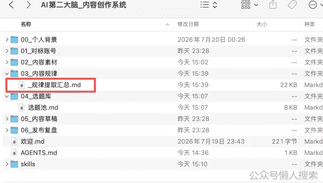

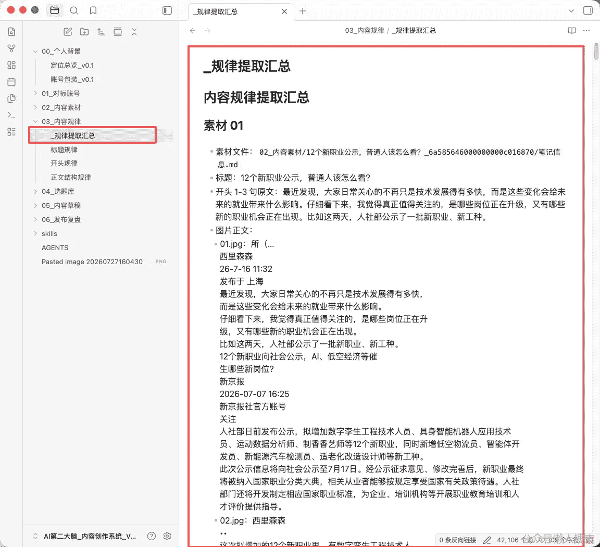

顺带看图片里的文字提出来没有，提示词里特别提过，AI 一般不会漏。

2. 提炼三类规律

底稿没问题后，让 Codex 一次性把全部规律拉出来：

Plain Text

```
请读取：
03_内容规律/_规律提取汇总.md

请基于汇总底稿，生成三份文件：
1. 03_内容规律/标题规律.md
2. 03_内容规律/开头规律.md
3. 03_内容规律/正文结构规律.md

每份文件包含&quot;候选规律&quot;和&quot;单条观察&quot;两个区域。

处理规则：
1. 同一种做法至少出现在 2 条素材中，才能进入&quot;候选规律&quot;；只出现 1 次的放进&quot;单条观察&quot;。
2. 每条候选规律按这个格式记录：

### 规律 1：【规律名称】
- 大白话解释：
- 适合什么内容：
- 不适合什么内容：
- 不可照搬点：
- 来源素材：
  - 素材文件 1
  - 素材文件 2

3. 提炼标题规律时，先把所有标题完整列出，再圈出反复出现的元素组合（例如&quot;工具名 + 数字 + 学习结果&quot;），不要只看单个元素。
4. 提炼开头规律时，保留 1-2 句来源原文作为示例，不改写原文。
5. 提炼正文结构规律时，写清结构顺序和适合什么类型的内容。
6. 不得写&quot;这样一定会爆&quot;&quot;平台算法喜欢&quot;等无法由当前素材证明的因果结论。
7. 如需生成改写示例，必须单独标注&quot;AI 示例&quot;，不得冒充原笔记。
8. 在每份文件末尾增加&quot;待确认&quot;清单，列出证据不足或无法判断的内容。
9. 提炼开头和正文结构时，同时使用汇总中的笔记正文与图片正文。必须区分两者来源，不得把图片文字冒充为笔记文字原文。

完成后告诉我：
- 三类规律各生成了多少条候选规律和单条观察；
- 使用了多少条来源素材；
- 哪些素材字段不足，导致某些维度无法提炼；
- 哪些结论需要我人工确认。
```

再回 Obsidian，找到 03_内容规律 文件夹，看看三份文件是否都生成了：

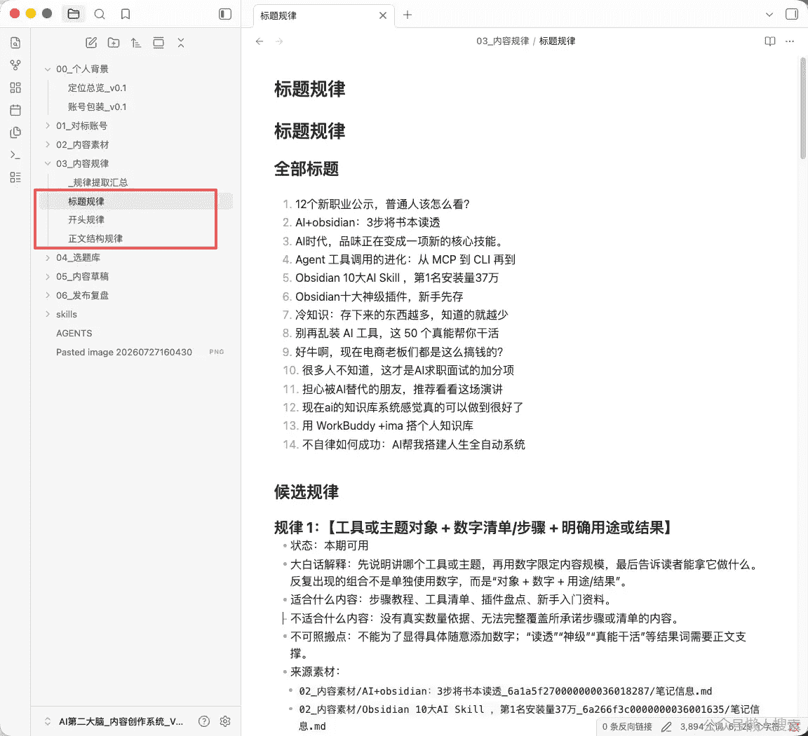

3. 人工筛规律

文档出来后别直接通关，要拿着原始素材一条条核实。

每个候选规律问自己三件事：

1. 它是不是至少有 2 条真实素材撑腰？
2. 描述有没有被 AI 带偏？
3. 边界写清楚了吗——什么时候能用、什么时候不能用？

确认完，把规律分成三堆：

- **本期可用**——看得懂做得到，下一关直接上手。
- **以后再试**——有点价值，但现在经验或素材不够。
- **删除**——没依据、被说错、已过时或方向不合。

最后让 Codex 把人筛的结果整理出来：

Plain Text

```
请读取：
1. 03_内容规律/标题规律.md
2. 03_内容规律/开头规律.md
3. 03_内容规律/正文结构规律.md

我确认以下修改：
【在这里写出你的确认结果，例如：
- 标题规律 1：本期可用，不需要修改。
- 标题规律 2：来源不足，移到&quot;单条观察&quot;。
- 开头规律 1：描述不准确，&quot;痛点开头&quot;改为&quot;场景开头&quot;，因为原文是先描述场景再引出问题。
- 正文结构规律 2：删除，我现在没有实测案例支撑这种结构。】

请按照我的确认更新对应的规律文件。

要求：
1. 在每条规律后面标注状态：本期可用 / 以后再试 / 已删除。
2. 被删除的规律移到文档末尾的&quot;已删除&quot;区域，保留删除原因。
3. 不要替我做额外判断，不要添加我没有确认的修改。

完成后告诉我最终保留了多少条&quot;本期可用&quot;规律。
```

这一关的过关条件很明确：起码要挑出3条能直接投入本期使用的规律。

如果怎么凑都凑不够，根本原因多半不是方法出了问题，而是样品量还没攒到位。这时候最该做的不是硬憋，而是继续去采集，等素材量上来了再补全。

### 02. 把规律提取流程固化成 Skill

走到这一步，规律提取的完整链路你已经有了一次实操体验：

读取内容素材 → 按统一字段汇总 → 横向比对提炼三类规律 → 人工确认

不过你想过没有：以后每回拿到新素材，如果都得重发一遍那串长提示词，效率实在太低。

眼下更好的解法，是让 Codex 把整套流程封装成“航海规律提取助手”Skill。以后一句话递过去，它就按既定逻辑把三份规律文件同步刷新。操作非常简单。

第一步：让 Codex 搭建 Skill

把下面这段提示词发给 Codex：

Plain Text

```
请使用 skill-creator，把我们刚刚完成的规律提取流程封装成一个可重复使用的 Skill。

Skill 名称：
shengcai-pattern-extractor

显示名称：
航海规律提取助手

请先把 Skill 源文件创建在当前项目：
skills/shengcai-pattern-extractor/

创建完成并通过校验后，再安装到我的个人 Codex Skills 目录，让它以后可以直接被调用。

Skill 必须完成下面这些工作（通用规则已在项目配置文件中，不需要重复）：

1. 读取 02_内容素材，按统一字段整理，写入或更新 03_内容规律/_规律提取汇总.md。缺失字段写“未采集”。素材包含本地图片时，按顺序读取全部图片文字，单独记录图片正文；无法读取时记录具体路径，不得跳过或推测。
2. 基于汇总底稿，生成或更新三份文件：03_内容规律/标题规律.md、03_内容规律/开头规律.md、03_内容规律/正文结构规律.md。
3. 同一种做法至少出现在 2 条素材中才写成候选规律，只出现 1 次放进&quot;单条观察&quot;。
4. 每条候选规律写清：大白话解释、适合什么、不适合什么、不可照搬点和来源素材。
5. 不写&quot;这样一定会爆&quot;&quot;平台算法喜欢&quot;等无法由素材证明的因果结论。
6. 改写示例标注&quot;AI 示例&quot;。
7. 在每份规律文件末尾列出&quot;待确认&quot;清单。
8. 不删除或覆盖用户已经确认的规律。
9. 当用户说&quot;我搜集了新内容，帮我更新内容规律&quot;时，只处理新增素材，与已有规律对比后追加或补强，不重复生成已有规律。

Skill 创建后请告诉我项目源文件路径、个人安装路径和验证结果。
```

**第二步：对 Skill 做验证**

Skill 部署完成后，新建一个对话，工作目录继续指向 Obsidian Vault，再输入：

Plain Text

```
我搜集了新内容，帮我更新内容规律。
```

如果流程走通，Codex 应当：

1.  自动读取内容素材以及现存的三份规律文档；

1.  识别出新追加、尚未被处理的内容；

1.  刷新汇总底稿；

1.  研判新内容能不能强化已有规律，或带出新规律；

1.  在没有新内容时如实说明，不动任何文件。

要是用自然语言没能唤醒 Skill，也可以发这条更直白的指令：

Plain Text

```
请使用 $shengcai-pattern-extractor，读取我新搜集的内容并更新内容规律。
```

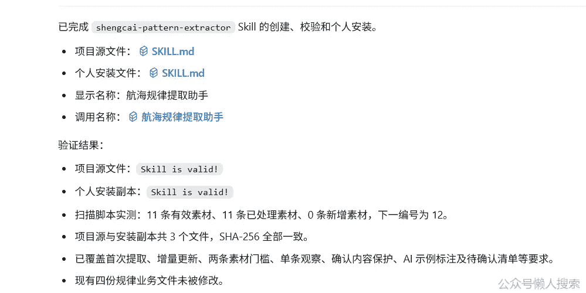

💡

**🎊 到这步，本关就算通关了，别忘了提交作业 👉🏻**https://scys.com/activity/10093/task

1.  Obsidian 的【03_内容规律】文件夹截图，要能显示出标题、开头、结构三份文档（必填）

1.  任意一份规律文档截图，规律、适用范围和来源素材都得看得到（必填）

1.  聊一聊这关最大的收获，或者踩了什么坑、怎么爬出来的（必填）

这些做完，就能交作业迈进关卡 4～

下一关会依据内容素材，生成首批能动手写的选题。

## 关卡 4：敲定第一批能直接落笔的选题

### 00. 本关任务卡

💡

**任务目标**：让 AI 读取关卡 1 定下的定位 + 关卡 2 收录的内容素材，排出 5-10 个现阶段写得出来的选题，并且把这套机制做成可循环调用的选题 Skill。

**任务描述**：

1.  弄清楚"选题"和"标题"根本不是一回事。

1.  让 AI 读取手头材料，产出 5-10 个能写的选题。

1.  拍板第一篇写哪一个。

1.  把选题流程封装成 Skill。

**本关需提交作业**：

1.  04_选题库/选题池.md文件或完整截图，能看到 5-10 个选题。（必填）

1.  选题 Skill 创建并验证成功的截图。（必填）

1.  分享一下这关最大的收获，或者你遇到的卡点、怎么解决的（必填）

### 01. 让 AI 产出选题

1. 先在根上掰清楚：选题 ≠ 标题

到这一关，前面两步的成果已经摆在手里：关卡 1 定了受众和长期价值方向，关卡 2 攒了一波平台上已验证的爆款样本。

**现在要做的，就是把这些积累落成一个更实在的输出：接下来出一篇什么样的内容？**

**选题和标题，是两码事。**

选题回答的是：这篇文章要拆解什么问题。

拿个例子来说：

给刚踏进 AI 圈的职场人讲清楚，Agent 和普通聊天机器人有什么本质区别。

这就算一个合格的选题，因为它把三件事交代明白了：

• 目标读者是谁；

• 内容讲什么；

• 读者读完能弄懂什么。

再看下面这句，它的气质明显是发布标题：

别再把 Agent 当成聊天机器人了

标题后面还能反复打磨，眼下不用急着让它抓眼球。第一步先保证选题靠谱、具体、有料可用。

现阶段能动的选题，至少得满足这三个条件：

1.**契合定位。**写给的对象和内容走向没有偏离关卡 1 的框定。

2.**切口够小。**一篇文章能说透，而不是"AI 如何改变世界"这种大得没边的议题。

3.**素材站得住。**能在关卡 2 的收藏里找到出处，或对应关卡 1 确认过的真实经历和本领。

这一期先按 AI 科普起步。首批选题尽量挑新手能看懂、能讲明白、也能拿下的内容。

2. 让 AI 给出 5-10 个选题

把AI第二大脑_内容创作系统设为 Codex 当前工作目录，发送这条指令：

Plain Text

```
请读取定位和 02_内容素材，生成 5—10 个候选选题，写入 04_选题库/选题池.md。

注意：如果有效内容中嵌入了本地图片，必须按嵌入顺序读取全部图片中的文字，并把图片文字视为选题材料的一部分。图片无法读取时，记录具体路径，不得跳过或推测。
图片文字只用于理解这条内容实际讲了什么。生成选题时，不要把“图片显示”“图片文字提到”“素材包提取”等素材处理过程写进选题。
开始前先检查有效内容数量。不足 10 条时停止，告诉我还缺多少条，要求我回到关卡 2 补充。

要求：
1. 第一批优先生成现阶段能够讲清楚的 AI 科普选题。
2. 每个选题写清楚：准备写给谁、解决什么具体问题、主要来自哪些文件。来源包含图片文字时，仍记录对应的笔记信息文件路径，不把图片路径当作独立内容来源。
3. 选题只表达”准备讲什么”，不要提前优化成夸张标题。
4. 同一个问题只是更换工具名、数字或近义词的，只保留一个，不要凑数。
5. 缺少关键材料的选题标记”缺素材”。
6. 在选题池末尾记录本轮已读取的内容文件路径，标题写成”已读取素材”。

完成后告诉我生成了多少个选题，哪些存在重复或缺素材的风险。
```

回到 Obsidian，打开：

Plain Text

```
04_选题库/选题池.md
```

确认选题确实已落进文件，而不是只停在 Codex 对话框里。

要是看到哪条选题不对劲——定位跑偏、题目量级太大、找不到出处、眼下做不了——直接叫 Codex 删掉或替换。

把选题池过一遍后，心里定下来第一篇要写的东西。优先级给到素材最齐、问题最清楚、短时间能讲利索的那条。

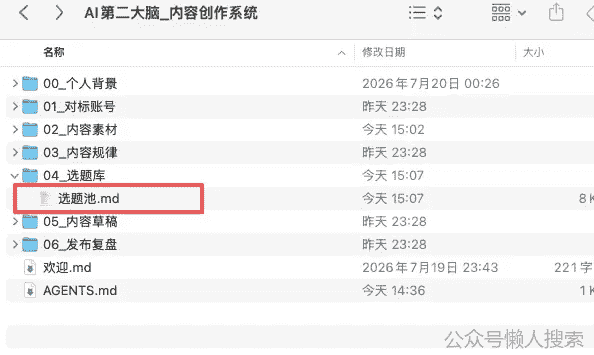

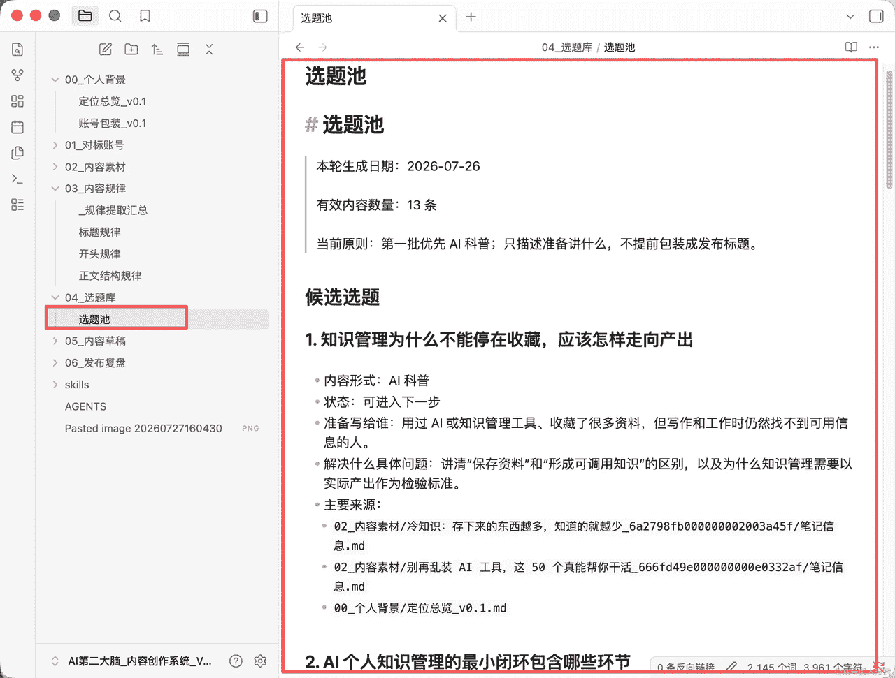

首批选题统一走 AI 科普方向；选题只负责把"要写什么"讲清，不必提前打扮成发布标题。

### 02. 把选题流程封装成 Skill

到这儿，你等于已经完整跑了一次选题流程：

读取定位与内容素材 → 检查素材体量 → 产出 5—10 个可写选题

以后拿到新内容，如果还得重新搬出那段长提示词，真会把人耗死。

那就让 Codex 把这条链路打包成“航海选题助手”Skill。今后一句指令，它就按同样路径刷新选题池。

让 Codex 创建 Skill

把下面的提示词发给 Codex：

Plain Text

```
请使用 skill-creator，把我们刚刚完成的选题流程封装成一个可重复使用的 Skill。

Skill 名称：
shengcai-topic-generator

显示名称：
航海选题助手

请先把 Skill 源文件创建在当前项目：
skills/shengcai-topic-generator/

创建完成并通过校验后，再安装到我的个人 Codex Skills 目录，让它以后可以直接被调用。

Skill 必须完成下面这些工作（通用规则已在项目配置文件中，不需要重复）：

1. 首次生成时，读取定位和 02_内容素材。有效内容不足 10 条就停止并说明。
2. 材料足够时生成 5—10 个候选选题，写入 04_选题库/选题池.md。
3. 每个选题符合定位、解决具体问题，并保留真实内容来源。
4. 不优化标题，不生成正文。
5. 在选题池中记录已经读取过的内容文件。
6. 当我说”我搜集了新内容，帮我生成新选题”时，自动找出尚未处理的新内容，与已有选题去重，再把新选题追加到选题池。
7. 新内容足够时生成 5—10 个不同的新选题；材料不足时宁可少生成并说明原因，不要凑数。
8. 不删除或覆盖我已经确认的选题。

Skill 创建后请告诉我项目源文件路径、个人安装路径和验证结果。
```

**测试 Skill**

Skill 装好以后，重新开一个会话，工作目录仍然用 Obsidian Vault，然后输入：

Plain Text

```
我搜集了新内容，帮我生成新选题。
```

正常的表现是：

1.  自动读取定位、内容素材和存量选题池；

1.  探明新增但尚未处理的内容；

1.  核对新选题跟老选题有没有撞车；

1.  把具备真实出处的选题写进选题池；

1.  没发现新内容时如实报告，不碰文件。

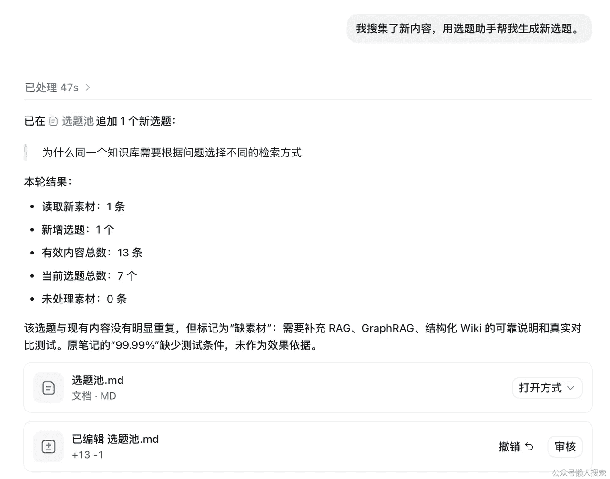

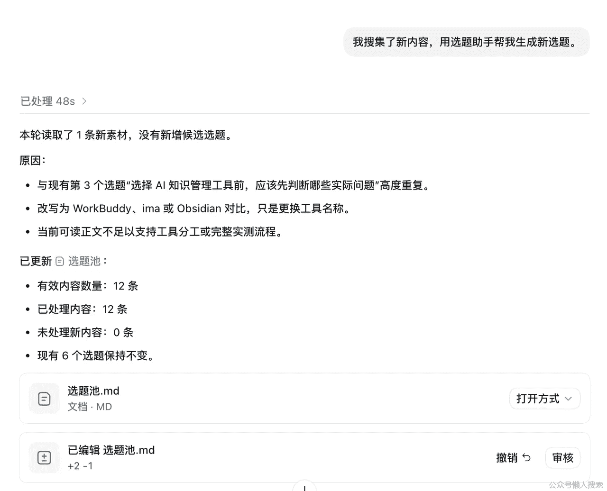

自然语言触发不到 Skill 的话，可以更明确地发：

Plain Text

```
请使用 $shengcai-topic-generator，读取我新搜集的内容并生成新选题。
```

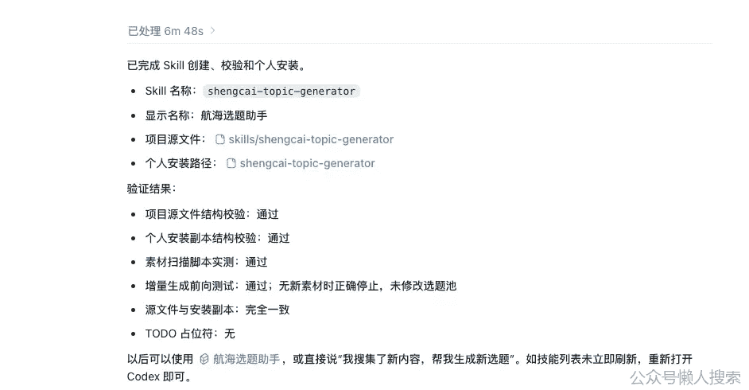

💡

**🎊 这一关到此收尾，记得提交作业 👉🏻**https://scys.com/activity/10093/task

1.  04_选题库/选题池.md文件或完整截图，能看见 5-10 个选题。（必填）

1.  选题 Skill 创建并验证成功的截图。（必填）

1.  分享一下这关最大的收获，或者你遇到的卡点、怎么解决的（必填）

这些都完成后，就能提交并跳到关卡 5～

下一关会聚焦你刚敲定的第一篇选题，调出素材和规律，把第一篇📕内容做出来。

## 关卡 5：内容创作：交出第一篇📕成品

### 00. 本关任务卡

💡

**任务目标**：围绕关卡 4 定下的第一篇选题，把单篇创作素材包整理到位；Codex 先做一轮访谈补充你的理解，再产出并打磨一篇📕发布稿。

**任务描述**：

1.  让 AI 读取选题、来源素材和内容规律，把素材包整理好并完成访谈。

1.  素材确认无误后，由 AI 拿出初稿。

1.  通读一遍，把胡说八道的地方清掉，把你读着别扭的表达捋顺。

1.  定好标题，让 AI 给出最终发布稿。

1.  把内容创作的整套流程封装成 Skill。

**提交模板**：

1.  单篇创作文件截图：素材包、AI 初稿、人工修改痕迹和最终成稿都在。（必填）

1.  最终📕发布稿截图：标题、正文和待备的图片或截图都清晰。（必填）

1.  笔记助手 Skill 创建并通过校验的截图（必填）。

1.  分享一下这关最大的收获，或者你遇到的卡点、怎么解决的（必填）

搞定这一关后，你的 Obsidian 里会多出这样的文件：

Plain Text

```
05_内容草稿/001_【选题关键词】_素材包.md
05_内容草稿/001_【选题关键词】_AI初稿.md
05_内容草稿/001_【选题关键词】_最终发布稿.md
```

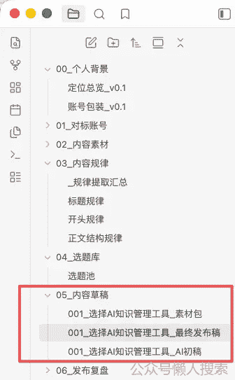

里面装着：素材包、AI 初稿（含人工修改记录）、最终发布稿。一篇文章对应一个文件，整个链条全部收在同一份文档里。

### 01. 让 AI 参与内容创作

**这一关真正的核心是什么：**

让 AI 刷出一篇表面完整的稿子，太容易了。真正难的是：用的素材全部真实，讲的问题足够聚焦，文字里还带着你的思考。

所以，更可靠的做法是各干各的：

• 你来定：这篇解决什么问题、哪些事实能用、你有什么看法；

• Codex 负责：读素材、做准备、扩出初稿。

本关的创作节奏是：Codex 先来做访谈，理解你的思路，然后才出初稿。

我们第一篇走的是 AI 科普，并不需要硬凑个人故事。要是真没有亲身案例，直接跟 AI 说"暂无"就行，但你读完资料后的感受和判断，照样可以讲给它听。

1. 让 AI 整理素材包，先完成对你的访谈

把AI第二大脑_内容创作系统设成 Codex 的工作目录，发送：

Markdown

```
请读取：
1. 定位（00_个人背景/定位总览_v0.1.md）
2. 选题池（04_选题库/选题池.md）中的这个选题：【在这里填入你选定的选题】
3. 该选题列出的来源文件，如果来源文件中嵌入了本地图片，必须按嵌入顺序读取全部图片中的文字，并把图片文字视为来源素材的一部分。无法读取的图片要记录具体路径，不得跳过或推测。
4. 03_内容规律 中状态为&quot;本期可用&quot;的标题规律、开头规律和正文结构规律

请创建：
05_内容草稿/001_【选题关键词】_素材包.md

按下面结构写入，不要生成初稿：

# 第一篇内容：【选题】

## 素材包

- 选题：
- 写给谁：
- 解决什么问题：
- 来源文件：
- 可用规律：

### 图片文字材料

逐条记录：
- 来源文件：
- 来源图片：
- 图片中的原始信息或必要摘录：
- 准备用在什么位置：
图片中的文字只作为内容素材保存，不分析图片设计，不直接使用或复制对标图片。除非选题本身需要讨论图片，否则不要把图片视觉风格作为内容结论。

### 可用材料

逐条记录：
- 来源文件：
- 原始信息或必要摘录：
- 准备用在什么位置：

### 我的理解与判断

（访谈后填写）

### 待核查或待补充

---素材包写完后，根据这个选题的具体内容，向我逐个提问 3—5 个问题，一次只问一个，等我回答后再问下一个。
问题应该围绕：我对这个选题的理解、判断、个人经历，以及素材中需要我补充或确认的地方。

访谈完成后，把我的原话整理进&quot;我的理解与判断&quot;，标注&quot;本人回答&quot;。只整理语序，不增加我没说过的观点。完成后停下，等我确认。
```

回到 Obsidian，打开刚生成的文件，抽看素材包：每一条材料是不是都能追回来源文件？有没有混进 AI 自己脑补的信息？

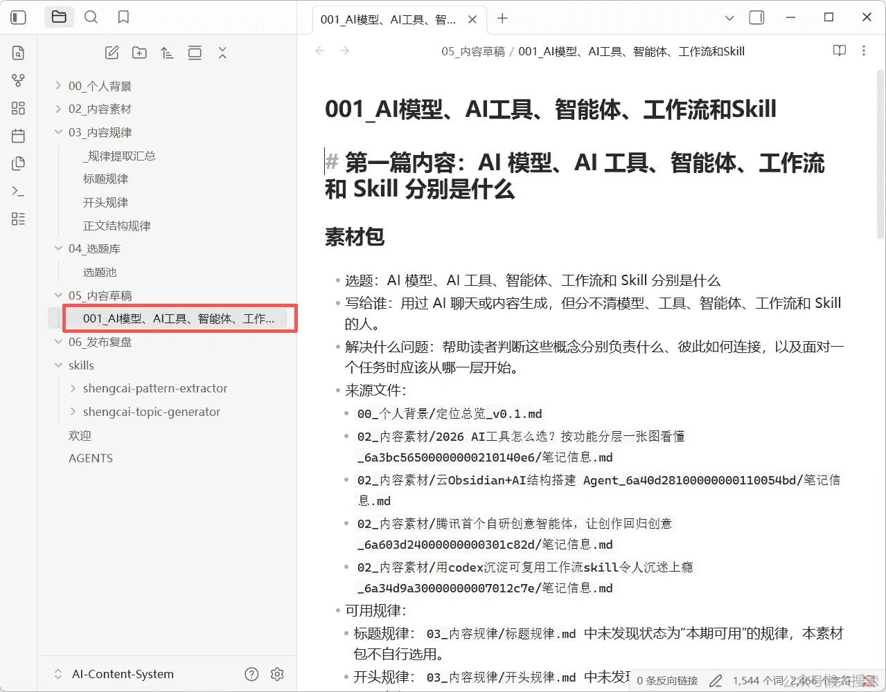

2. 确认素材，再出初稿

**先把材料核一遍**

在让 AI 落笔写正文前，花两分钟检查：

1.  每条事实有没有确切的出处？摘录有没有被改走样？

1.  "我的理解与判断"是不是真出自你之口？

哪里不对就叫 Codex 纠正，没问题就往下走。

**写初稿**

材料确认好后，把下面的话发给 Codex：

Plain Text

```
请读取素材包文件和素材包中列出的来源文件。

如果素材包已经记录了图片文字，以素材包中的记录作为写作材料；来源文件用于核对。不得忽略图片文字，也不要在正文中重复描述图片读取过程。

根据选题内容和可用素材，从关卡 3 的规律中挑选最合适的标题规律、开头规律和正文结构规律，生成初稿，写入新文件 05_内容草稿/001_【选题关键词】_AI初稿.md。如果某条规律需要我没有的数字、结果或案例，换一条，不要为了套公式改变事实。不要修改素材包文件。

要求：
1. 提供 3 个标题候选，标明各自调用了哪条标题规律。
2. 开头直接讲清这篇在解释什么问题，不用&quot;今天给大家分享&quot;&quot;在这个时代&quot;等空话。
3. 正文按选定的结构规律展开，用短段落和大白话，只解决一个问题。
4. &quot;我的理解&quot;只使用标注为&quot;本人回答&quot;的内容。
5. 区分事实和判断，不把个人理解写成平台规则或官方结论。
6. 没有个人案例时正常写科普，不虚构&quot;我测试过&quot;&quot;我的学员&quot;。
7. 需要图片或核查的地方用【待补图片：说明】或【待核查：问题】标出。
8. 结尾收束到一个具体判断或问题，不用&quot;评论区扣 1&quot;&quot;私信领取&quot;等强行互动。
9. 附上素材调用清单，说明正文使用了哪个来源文件和哪条结构规律。
10. 图片文字写入正文时，必须转换成面向目标读者的自然表达。正文不得出现“素材包记录”“图片文字显示”“来源图片提取”“本次读取”等内部处理过程。
11. 遇到专业名词或连续列举多个工具能力时，先翻译成读者面对的实际问题，再用大白话解释。确有必要保留专业名词时，紧接一句说明它对读者意味着什么。
12. 图片路径、识别情况和素材调用方式只写在“素材调用清单”中，不得混入面向用户的正文。

写完后停下，不要改成最终发布稿。
```

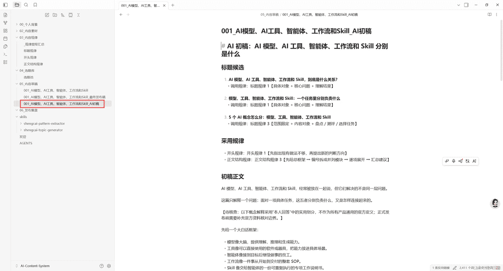

3. 初稿到手，先过人工质检

草稿生成后，按两步处理：

**① 查模型有没有自行加料**

从头到尾看一遍，留意是否把你没表达过的立场按到你身上，是否冒出无来源的数字、事例或判断，是否夹带了原始资料中找不到的内容。发现后立即删掉，或让 Codex 修订。

**② 把语气调回本人风格**

有些句子虽然通顺，却和你的表达习惯不搭；直接改成你平时会说的方式。不用句句重写，整体读着像你本人写的即可收手。

这一步建议多留时间，耐心磨合 AI，让它逐步熟悉你的偏好。

4. 定下最终发布版本

人工润色结束后，从三个标题方案中挑一个最合适的，然后发送：

Plain Text

```
我选标题【这里填你选的标题】，请把我修改后的内容整理为最终发布稿，写入新文件：
05_内容草稿/001_【选题关键词】_最终发布稿.md。
要求：
1. 以当前 AI 初稿中经过我修改的正文为准，不退回旧版本。
2. 保留我已经加入或确认的本地配图引用。
3. 删除标题规律说明、素材读取过程、素材调用清单和内部工作备注。
4. 未完成核查的产品事实不要写入最终稿。
5. 不增加新的观点、案例、数据、效果和个人经历。
6. 只整理语病、重复表达和发布格式，不改变我的核心判断。
```

模型会把修改后的正文与选中的标题合成一份可直接发布的清稿。整体再检查一遍，确认无误后继续下一关。

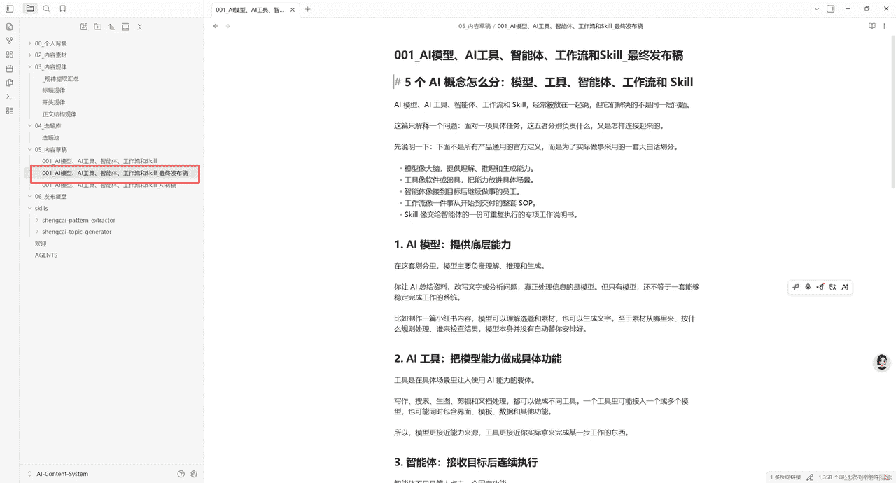

### 02. 把创作流程做成可复用的 Skill

到这里，你已经实际跑通一轮完整创作链路：

取选题与素材 → 整素材包 → 访谈 → 出初稿 → 人工打磨 → 定终稿

如果每写一篇都重新粘贴前面那长段提示词，既麻烦也容易出错。可以让 Codex 将这套动作打包成一个名为“航海笔记助手”的 Skill。之后你只需说“帮我写【选题名称】”，它就会按同一路径带你走完全程。

**请 Codex 建立 Skill**

把下面这段指令发给 Codex：

Plain Text

```
请使用 skill-creator，把我们刚刚完成的内容创作流程封装成一个可重复使用的 Skill。

Skill 名称：
shengcai-content-writer

显示名称：
航海笔记助手

请先把 Skill 源文件创建在当前项目：
skills/shengcai-content-writer/

创建完成并通过校验后，再安装到我的个人 Codex Skills 目录，让它以后可以直接被调用。

Skill 必须按下面的流程工作，每个需要用户参与的节点停下来等确认：

1. 用户说&quot;帮我写【选题名称】&quot;时启动。
2. 读取定位、选题池中对应的选题、该选题的来源文件、03_内容规律中状态为&quot;本期可用&quot;的规律。
3. 创建 05_内容草稿/编号_【选题关键词】_素材包.md，写入素材包。
4. 根据选题内容向用户逐个提问 3—5 个访谈问题，一次只问一个，等用户回答后再问下一个。
5. 访谈完成后，把用户原话整理进素材包的&quot;我的理解与判断&quot;，标注&quot;本人回答&quot;，只整理语序，不增加用户没说过的观点。停下等用户确认素材包。
6. 用户确认后，根据选题和素材从规律中挑选最合适的标题、开头和结构规律，生成初稿写入新文件 编号_【选题关键词】_AI初稿.md，提供 3 个标题候选。停下等用户修改。
7. 用户修改完成并选定标题后，把修改后的内容整理为最终发布稿，写入新文件 编号_【选题关键词】_最终发布稿.md。

全程不编造数据、案例和个人经历，不把 AI 的观点写成用户说的。

Skill 创建后请告诉我项目源文件路径、个人安装路径和验证结果。
```

**验证 Skill**

安装成功后，另开一个会话，工作目录仍设为 Obsidian Vault，然后发送：

Plain Text

```
帮我写【你的选题名称】
```

正常表现应为：

1. 自动读取账号定位、选题、来源资料与可用规律；
2. 生成单篇创作文档，并填好素材包；
3. 开始向你提出访谈问题；
4. 每个需要你拍板的环节都会暂停，等你确认。

若自然语言没能唤起 Skill，也可以直接发送：

Plain Text

```
请使用 $shengcai-content-writer，帮我写【选题名称】
```

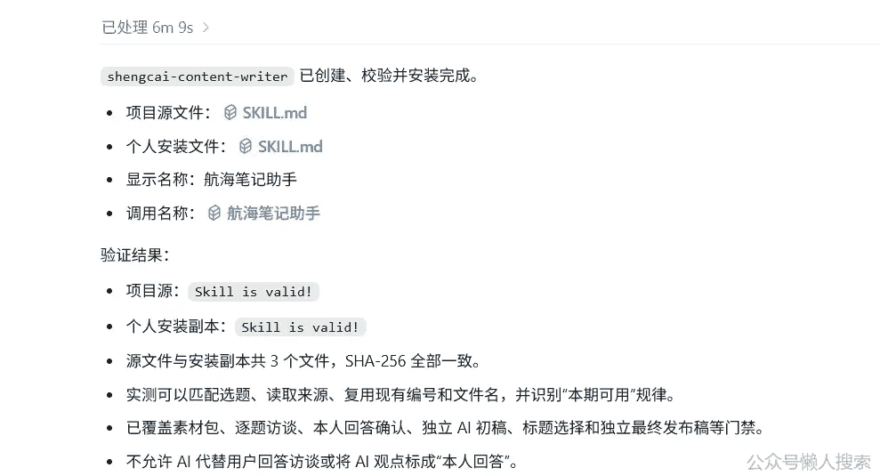

💡

**🎊 本关到这儿就结束了，记得交作业 👉🏻**https://scys.com/activity/10093/task

• 单篇创作文件截图：需呈现素材包、模型初稿、人工改动痕迹以及终稿（必填）

• 最终📕发布稿截图：标题、正文和待配的图片或截图要清楚可见（必填）

• 仍没把握的事实、表达、内容结构，或遇到的卡点（选填）

全部办完后，提交作业并进入关卡 6～

下一关会把这篇内容发到📕，并建立发布后的复盘流程。

## 关卡 6：首发内容与轻复盘：跑通发布闭环

### 00. 本关任务卡

💡

**任务目标**：把关卡 5 完成的第一篇📕内容正式发布，保存发布数据，并在 24 小时左右依据真实反馈做一次轻复盘。

**任务描述**：

1. 发布第一篇内容。
2. 建立复盘文件，记录发布信息及 24 小时真实反馈。
3. 让 Codex 整理轻复盘，确定下一篇只改的一件事。
4. 把复盘流程封装成 Skill。

**本关需提交作业**：

• 第一篇📕发布链接或发布成功截图（必填）

• 第一篇发布复盘文件截图，能看见发布记录、24 小时数据和下一篇优化方向（必填）

• 分享本关最大收获，或你遇到的卡点、怎么解决的（必填）

### 01. 首次发布与轻量复盘实操

先对齐预期：只看一篇的数据，很难得出可靠判断；通常要积累 20 篇以上，样本才有参考意义。因此本关重点不在评判高低，而在把发布、记录、复盘这套动作完整走一遍。数据暂时好或差都别急着解释，先形成习惯。

1. 发布前先建复盘文档

正式发布前，请 Codex 在 `06_发布复盘` 目录下创建一个复盘文档：

Plain Text

```
在 06_发布复盘 新建一个文档：
06_发布复盘/001_【这里填你的选题关键词】_复盘.md
```

接着让 Codex 调取关卡 5 的终稿与选题池，生成如下记录骨架：

这里要特别注意：Codex 的职责仅限于搬运现成信息、预留空字段；发布时间、链接、后台数据、评论等，它都不能代填。这些要等你发布后 24 小时内自行补录。

Plain Text

```
请读取：
1. 05_内容草稿/001_【这里填你的选题关键词】_最终发布稿.md
2. 04_选题库/选题池.md 中对应的选题

请创建：
06_发布复盘/001_【这里填你的选题关键词】_复盘.md

按下面结构写入：

# 第一篇发布复盘：【最终标题】

## 关联文件
- 创作文件：
- 选题池：

## 发布记录
- 平台：小红书
- 标题：
- 内容类型：AI 科普
- 发布时间：待发布后填写
- 笔记链接：待发布后填写
- 首图文件：
- 其他图片：

## 24 小时数据
- 记录时间：
- 距离发布：
- 浏览量：
- 点赞数：
- 收藏数：
- 评论数：
- 分享数：

## 关键评论
- 评论原话：

## 发布后即时感受
- 当时感觉：

## 我的轻复盘
### 已确认的事实
### 初步观察
### 还不能判断
### 下一篇调整计划
#### 重点调整
#### 其他需要处理

规则：
1. “关联文件”区块必须保留。实际文件存在时，填写可点击的 Obsidian 内链；对应文件不存在时保留字段为空，不得编造文件或链接。
2. 标题、内容类型、关联文件和图片文件只从现有文件复制。
3. 不联网，不补写发布时间、笔记链接、数据或评论。
4. 当前没有的信息明确写“待发布后填写”；虚拟案例中不存在的关联文件保持为空。
5. 创建完成后列出读取过的文件和实际写入的字段，然后停下。
```

打开文档逐项核对：标题是否与终稿对得上？创作文档和选题池的链接能否正常跳转？该空的字段有没有被模型提前填掉？确认无误，再去发布。

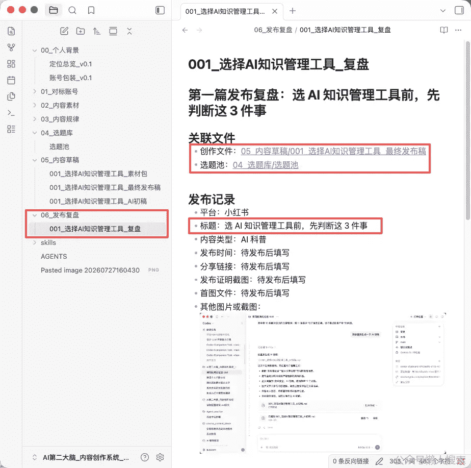

2. 发布内容（本期用📕长文举例）

发布前再做一次检查：

如果是新手，建议先用📕的“长文”模式，验证效果最直接。网页端粘贴内容、调整版式更顺手，入口：https://creator.xiaohongshu.com/new/home

发布笔记 - 写长文


将 Obsidian 里的终稿粘贴进去，平台会自动完成版式处理，省去不少手工活。


再确认配图是否一并带入；若缺失，就手动补：


随后点“一键排版”生成预览，挑一个喜欢的封面样式与模板，确认后进入下一步：


接下来配置话题词，记住三条：

- 话题要与账号方向、正文主题强相关，别硬蹭无关热门。一个准确的长尾词，通常比三个泛词更有效。
- 数量以 5-8 个为宜，最多不超过 10 个。排序靠前的 5 个权重更高，核心词放前面。
- 可按这个结构配：
  a. 1-2 个核心主标（账号方向词，如 #AI工具测评）
  b. 2-3 个垂直长尾词（更具体，如 #AI写📕文案）
  c. 1 个时效/场景词（如 #2026自媒体入门）


完成后点发布。

发布后回到公开主页，确认笔记已展示且能正常访问。

发布时间建议：

- 工作日晚 20:00-22:00
- 周末上午 9:00-11:00

这两个窗口是📕流量较高的时段。AI 科普内容需要读者静下心理解新概念，放在此时段更匹配。

3. 约 24 小时后回填真实反馈

发布满一天左右，再回来看后台，把能看到的指标记下：

- 浏览量
- 点赞
- 收藏
- 评论
- 分享

评论区快速浏览：若有人追问具体操作，或说自己试过后的体验，这些尤其值得记录，因为它们暴露了真实读者卡住的位置，后续可转成新选题。像“太棒了”“学到了”这类短评，不必逐条保存，归纳即可。如果没人留言，就写“暂无评论”，不要为了好看补假数据。

另外顺手写一两句当下的直觉——比如“有人私信来问”或“完全没人理”。这些感受隔天容易忘，却是以后训练判断力的素材。内容是你自己做的，感受也如实记。

下面用《ima 知识库：把🛰️内容变成生产力第一步》做示范，展示发布到数据回传的完整过程：


笔记信息

- 标题：ima知识库：把🛰️内容变成生产力第一步
- 发布时间：7.17
- 平台：📕

7 月 18 日 10:45，发布满 24 小时后，我打开笔记页记录数据：

当时看到：浏览量 3700，点赞 520，收藏 941，评论 26。

翻评论区时，有几条值得留存：

- 评论原话：我也在这么用，收藏夹里以前有很多吃灰n年文章，现在都可以找到用起来了而且我🛰️收藏夹，全部被我搬到ima了。
- 评论原话：什么叫知识库
- 评论原话：可以导入吗？还是一条一条贴🛰️链接？而且电脑端经常连不上网，虽然电脑本身网络没问题


剩下的多是“写得好”“学到了”“收藏了”这类短反馈，说明内容被看到了，不必单独收录。

再记一句当时的感受：这篇前 3 小时几乎没动静，我以为又凉了，结果晚上 9 点突然有人开始收藏。

接着按模板把上述信息填好，发给 Codex，让它写入复盘文档：

提示词模板：

Markdown

```
把以下复盘信息更新到：
06_发布复盘/001_【这里填你的选题关键词】_复盘.md

## 关联文件
- 创作文件：【已有则保留，没有则留空】
- 选题池：【已有则保留，没有则留空】

## 发布记录
- 发布时间：
- 笔记链接：

## 24 小时数据
- 记录时间：
- 距离发布：
- 浏览量：
- 点赞数：
- 收藏数：
- 评论数：
- 分享数：

## 关键评论
- 评论原话：
- 评论原话：
- 评论原话：

## 发布后即时感受
- 当时感觉：

请把以上信息填写到复盘文件的对应位置。

要求：
1. “关联文件”区块必须保留。复盘文件中已有链接时原样保留；没有对应文件或链接时保持为空，不要编造。
2. 保留我提供的时间、数据和评论原话，不要修改。
3. 页面没有显示的数据写“未显示”。
4. 没有值得记录的评论，写“暂无关键评论”。
5. 不分析数据，不生成评论，不修改复盘文件中的其他内容。
6. 更新完成后，列出本次实际更新的字段。
```

示例：

Plain Text

```
把以下复盘信息更新到：
06_发布复盘/001_ima知识库_复盘.md

## 关联文件
- 创作文件：
- 选题池：

## 发布记录
- 发布时间：7 月 17 日 10:45
- 笔记链接：https://www.xiaohongshu.com/discovery/item/6a58a4d10000000001003e2a?source=webshare&amp;xhsshare=pc_web&amp;xsec_token=CBfWoGZldj98DjkpC7KuSHsnkVhXFvtyLuPCK_8CRrXBY=&amp;xsec_source=pc_share

## 24 小时数据
- 记录时间：7 月 18 日 10:45
- 距离发布：24 小时
- 浏览量：3700
- 点赞数：520
- 收藏数：941
- 评论数：26
- 分享数：未显示

## 关键评论
- 评论原话：我也在这么用，收藏夹里以前有很多吃灰 n 年的文章，现在都可以找到、用起来了。而且我的微信收藏夹全部被我搬到 ima 了。
- 评论原话：什么叫知识库？
- 评论原话：可以导入吗？还是一条一条贴微信链接？而且电脑端经常连不上网，虽然电脑本身网络没问题。

## 发布后即时感受
- 当时感觉：发出去前 3 小时没人理，以为凉了，晚上 9 点突然开始有人收藏。

请把以上信息填写到复盘文件的对应位置。

要求：
1. “关联文件”区块必须保留。这个示例没有对应的创作文件和选题池，因此两个字段保持为空，不要编造。
2. 保留我提供的时间、数据和评论原话，不要修改。
3. 页面没有显示的数据写“未显示”。
4. 没有值得记录的评论，写“暂无关键评论”。
5. 不分析数据，不生成评论，不修改复盘文件中的其他内容。
6. 更新完成后，列出本次实际更新的字段。
```


4. 让 Codex 做轻复盘

把记录好的数据交给 Codex，请它整理并分析：

```
请读取：
1. 06_发布复盘/001_【选题关键词】_复盘.md
2. 对应的 05_内容草稿 单篇创作文件
3. 04_选题库/选题池.md


请只基于文件中已经记录的数据、时间和评论，整理第一篇 24 小时轻复盘，并把结果写到 06_发布复盘/001_【选题关键词】_复盘.md

要求：
1. 不搜索外部资料，不补写未显示的数据、评论、关注来源或平台规则。
2. 把结论分成“已确认的事实、初步观察、还不能判断”三类。
3. 每条初步观察都写清依据来自哪个数字、哪条评论或正文位置。
4. 不得写“某个标题导致点击高”“某个结构导致收藏高”等单篇数据无法证明的因果。
5. 没有评论就明确写“暂无评论”，不要生成示例评论。
6. 提出最多 3 个“下一篇可执行动作”候选，每个都写清直接依据；先不要替我选择重点调整。
7. 不修改原始数据和评论原话。
8. 把整理结果和候选动作写回复盘文件，完成后列出候选动作，并问我下一篇想重点调整哪一项。

等我确认后，把结果写入复盘文件：

### 下一篇调整计划

#### 重点调整
- 写入我确认的一项。

#### 其他需要处理
- 写入我明确要求同时处理的事项；没有则写“无”。

完成后告诉我最终写入的内容。
```

Codex 在这里承担的职责，是把过程沉淀成记录，并给出下一步的优化候选。可眼下能用来复盘的笔记并不多，它的建议自然会显得粗糙；当你手里的记录越积越多，复盘结论也会变得越来越清晰。


5.新号第一篇数据很差，正常吗？

第一次发布的数据不漂亮，甚至评论区空空如也，都属于常见现象。只要你把数据、评论和当时的感受如实记了下来，这一轮任务就算完成。

复盘最有价值的地方，并不是单独分析某一篇，而是在多篇之间做横向比较。

等真实数据积累到 3 条、5 条、10 条并排列在一起时，你就能慢慢发现哪类内容更容易获得回应、哪些路线更值得持续投入。

只有单篇数据时，Codex 给不出有意义的建议，这在预期之内，并不能说明流程出了毛病。

所以，这一轮复盘后如果得到的候选动作是“继续观察”或“保持更新”，而不是某个具体改动，同样完全正常。持续积攒数据，远比要求每篇都产出一个结论更重要。

### 02. 将复盘流程封装为 Skill

现在回顾一下，你已完成这些动作：第一篇已发布；数据已记录；Codex 完成了一次轻复盘；下一篇的调整方向也已明确。这说明整条链路已经走得通，接下来只需把它固化成一个 Skill。

**第一步：让 Codex 先创建 Skill**

将下面这段话直接发送给 Codex：

Plain Text

```
请使用 skill-creator，把我们刚刚完成的发布复盘流程封装成一个可重复使用的 Skill。

Skill 名称：
review

显示名称：
复盘助手

请先把 Skill 源文件创建在当前项目：
skills/review/

创建完成并通过校验后，再安装到我的个人 Codex Skills 目录，让它以后可以直接被调用。

Skill 必须完成下面这些工作：

1. 读取 05_内容草稿 中已通过发布前检查的单篇创作文件，以及 04_选题库/选题池.md 中对应的选题，在 06_发布复盘/ 下创建复盘文件，并补好关联文件。暂时没有的信息留空或写“待发布后填写”。

2. 复盘文件建立完成后，提醒用户发布内容，并告诉用户：发布约 24 小时后，回来提供发布时间、笔记链接、记录时间、距离发布、页面数据、关键评论和发布后的真实感受。

3. 用户回来提供上述信息后，把真实信息写入复盘文件，并完成轻复盘。用户已经提供的信息直接使用，只追问完成复盘必须但仍然缺少的信息。

4. 轻复盘只整理“已确认的事实、初步观察、还不能判断”，并提出最多 3 个下一篇可执行动作候选。每个候选都要写清直接依据，不替用户选择。

5. 用户确认后，把一项写入“下一篇调整计划”的“重点调整”；其他仍需处理的事项写入“其他需要处理”。

6. 如果 06_发布复盘/首轮5条索引.md 存在，用户确认调整计划后，同步更新当前这篇对应的索引行：补齐创作文件、复盘文件和笔记链接，将状态更新为“已复盘”。保留这篇原来记录的重点调整，不要覆盖。

7. 不搜索外部资料，不补写页面没有提供的数据、评论、关注来源或平台规则。

8. 没有评论时明确写“暂无评论”，不生成示例评论。

9. 不修改原始数据、时间、链接和评论原话，不把单篇数据中的相关性写成因果。

10. 当用户说“这篇数据很低，没什么可复盘的”时，回复：单篇数据不足是正常的，复盘的真正价值在多篇对比，等积累 3-5 条后再看趋势。

Skill 创建后请告诉我项目源文件路径、个人安装路径和验证结果。
```

**第二步：测试 Skill**

等 Skill 安装好，重新打开一个对话，继续把 Obsidian Vault 设为当前目录，并输入：

Plain Text

```
我要发布第一篇内容。

请调用复盘助手Skill，带我完成这篇内容的发布记录和轻复盘。

先帮我建立复盘文件，然后告诉我下一步怎么做。
```

预期应看到的能力：

1. 自动读取最终发布稿与对应选题；
1. 新建复盘文件，同时补齐关联引用；
1. 提醒你先发布内容；
1. 告知你大概 24 小时后要回来补充哪些真实信息。

第二段同样需要发一个测试指令：

Plain Text

```
这篇内容已经发布约 24 小时，我现在回来记录真实信息并完成轻复盘。
```

预期结果应当是：

1. 让用户一次性交出发布信息、数据、评论和真实体验；
1. 将这些内容写进复盘文件；
1. 进行轻复盘，最多给出 3 个调整候选；
1. 等你同意后，才把选择写入调整计划；
1. 若已有“首轮5条索引”，顺手更新对应行。

**第三步：持续迭代**

Skill 并不会在创建那一刻就被彻底定型。用着用着你可能会遇见：

• 某一步的表述不够明白；
• 有的字段明明该记却漏掉了；
• 某条判断逻辑需要修订。

遇到这些问题，不需要自己动手改，直接在对话中说明：“这个 Skill 的 XX 步骤要调整，原因是……”，让 Codex 去迭代复盘助手 Skill。

封装好之后，以后每次发布新内容，你只需两句话就能启动：

“我要发布新内容，帮我建立复盘文件”
“我填好了 24 小时数据，帮我整理轻复盘”

以前需要反复交代的“做什么、读哪个文件、按什么格式输出”，现在都由 Skill 自动记住了。


## 关卡 7：持续迭代：同一方向连续发满 5 条

### 00. 本关任务卡

💡

**本关目标**：

围绕同一个 AI 科普方向，在📕累计发出 5 条内容。每一条都进行首轮总复盘，把用户真实反馈送回第二大脑。

**任务拆解**：

1. 先完整跑通第 1 条：创作 → 发布 → 记录数据与评论 → 确认第 2 条只调整一个动作；
1. 接着跑第 2 条，循环执行同一流程，一直到累计 5 条；
1. 完成 5 条汇总：归纳重复出现的事实、问题与信号，判断哪些项要回填到选题池。

**这一关需要提交**：

• 5 条笔记的公开发布链接，或公开笔记页截图（必填）；
• “首轮5条总复盘.md”文件或截图（必填）；
• 本关最大的收获，或一个卡点的解法描述（必填）。

### 01. 按序完成剩余 4 篇，并做好首次 5 条总复盘

#### 1. 为什么不建议一口气写完 5 篇

第一条发出去，只能说明流程已经跑通，但它还不足以告诉你“哪种标题适合我”“哪种写法更有效”。接下来要做的，是在相同方向上再连续完成至少 4 条，让上一条的真实反馈参与到下一条的决策里，由此建立迭代节奏。

很多人在这个时候会同时打开四五份草稿，觉得这样更省时间。可结果往往是：为了赶进度而发布，发完就忘了自己改过哪里，也忘了评论区的提问。等 5 篇都发出去了，手里只有一堆数字，却讲不出自己学会了什么。

所以这一关真的别挤进度。写一篇、发一篇、复盘一篇，然后再启动下一篇。

每篇也不该大改。以上一篇复盘为根据，挑一个重点去调整就够了。其他影响内容准确性、完整性和发布质量的小问题，可以一并处理，但仍要克制。举个例子，如果上篇复盘后的决定是“把开头写得更直接”，那么这一篇就专注改开头；标题、结构、选题、图片不要全部换掉。这样等下一篇发出来，你才能确切知道这一轮到底动了哪里。

#### 2. 先用一张表盯住 5 篇的进度

后面还有 4 篇要做。每一篇都会生成创作文件、复盘文件和笔记链接，而且还要写清楚这一篇是依据上一条的哪条建议做的调整。

如果不把进度集中管理，很可能到第 3、4 篇时，你已经说不清哪篇发布过、哪篇复盘过、下一轮该改什么。最后做 5 篇总复盘时，也只能去一个个文件夹里翻找。

因此，先让 Codex 在 06_发布复盘中建一张进度表，文件名就叫“首轮5条索引.md”。它相当于 5 篇内容的整体台账，让你随时能看到：

• 当前每篇进行到哪一步；
• 创作文件和复盘文件分别在哪儿；
• 发布后的笔记链接是什么；
• 这一篇重点调整了什么；
• 现在能不能开始下一篇。

这张表不需要重复保存详细数据和复盘内容，细节仍然留在各篇自己的文件里。等 5 条全部完成，Codex 会经由这张表找到所有文件，继续做首轮总复盘。

把下面整段提示词发给 Codex：

Plain Text

```
请读取：

1. 04_选题库/选题池.md
2. 关卡 6 完成的第一篇创作文件
3. 第一篇对应的复盘文件

请新建：

06_发布复盘/首轮5条索引.md

使用下面的模板：

# 首轮 5 条索引

| 序号 | 选题 | 创作文件 | 复盘文件 | 笔记链接 | 这篇只调整什么 | 状态 |
| --- | --- | --- | --- | --- | --- | --- |
| 1 |  |  |  |  | 第一篇，无 |  |
| 2 |  |  |  |  |  | 待选择 |
| 3 |  |  |  |  |  | 待选择 |
| 4 |  |  |  |  |  | 待选择 |
| 5 |  |  |  |  |  | 待选择 |

请根据现有文件填写第 1 篇。

填写规则：

1. 选题、创作文件、复盘文件和笔记链接，只能从现有文件中复制。
2. 创作文件和复盘文件使用可以点击的 Obsidian 内链。
3. 第一篇的“这篇只调整什么”填写“第一篇，无”。
4. 状态只使用下面 5 种，并根据文件中的实际进度填写：
   - 还没有确认选题：待选择
   - 已确认选题并开始创作：写作中
   - 最终发布稿已经完成，还没有发布：待发布
   - 已经发布，但还没有完成轻复盘：已发布
   - 已经完成轻复盘，并由我本人确认下一篇重点改什么：已复盘
5. 第一篇已经完成轻复盘时，状态填写“已复盘”；没有完成时，按实际情况填写。
6. 文件中没有的信息保持为空，不要猜测。
7. 第 2-5 篇保持“待选择”，不要替我安排选题。
8. 不要修改选题池、创作文件和复盘文件。

创建完成后告诉我：

1. 实际读取了哪些文件；
2. 第一篇填写了哪些内容；
3. 第一篇还有哪些信息没有记录。

完成后停止，不要开始选择第二篇。
```

生成之后，打开“首轮5条索引.md”检查：

• 创作文件能不能正常打开；
• 复盘文件能不能正常打开；
• 笔记链接是否指向正确位置；
• 第一篇是否确实完成了轻复盘。


表格生成后，先核对第一篇，确认创作文件、复盘文件、笔记链接都能打开，再开始准备第二篇。

#### 3. 沿用同样流程，逐一完成剩余 4 篇

从第二篇起，内容创作继续沿用关卡 5 的方法，发布与复盘继续沿用关卡 6 的方法。已经做好的 skill 可以全部复用。

这一关真正多出来的只有两件事：

1. 动笔下一篇前，先明确上一篇决定要调整的方向。
1. 当前篇收尾后，把结果同步到进度表。

整体节奏就是：

选下一篇 → 写内容 → 建复盘文件并发布 → 约 24 小时后记录反馈、完成轻复盘、更新进度。

**第一步：挑选下一篇主题**

先回顾上一篇复盘中锁定的调整重点，再从选题池里找一个已有素材、能继续写的方向。把以下提示词发给 Codex：

Plain Text

```
我要准备下一篇内容。

请先读取：

1. 06_发布复盘/首轮5条索引.md
2. 上一篇复盘文件
3. 04_选题库/选题池.md

结合上一篇的调整计划和选题池中的现有素材，给我最多 3 个现在可以写的候选选题。

先不要创建草稿，等我选择。
```

Codex 会给出候选。你人工确认其中一篇后，用自然语言告诉 Codex 即可。


**第二步：用内容创作 Skill 生成初稿**

主题确定后，调出你在关卡 5 建好的内容创作 Skill。把下面提示词发给 Codex，让它先整理下一篇需要的素材：

Plain Text

```
我要开始创作下一篇内容。

请先读取：
1. 06_发布复盘/首轮5条索引.md
2. 上一篇复盘文件
3. 04_选题库/选题池.md

请找到索引中状态为“写作中”的当前选题，调用内容创作 Skill 带我完成。

先整理素材包并开始访谈，不要直接生成初稿或最终发布稿。
```

随后按 Skill 的引导逐步完成：素材包（含访谈）、初稿、人工修改、图片准备、最终发布稿。


**第三步：用复盘助手 Skill 走发布和轻复盘**

最终发布稿出来后，切入复盘助手 Skill。它会先建立复盘文件，再把发布后需要记录的信息告诉你，并陪你完成轻复盘。发送这段提示词：

Plain Text

```
当前这篇最终发布稿已经完成。

请先读取：
1. 06_发布复盘/首轮5条索引.md
2. 当前这篇的最终发布稿

请调用复盘助手Skill，带我完成这篇内容的发布记录和轻复盘。
```

复盘助手建完文件后，会提醒你发布📕笔记。发布成功后不必守着页面。等约 24 小时再回到笔记页，把当时能看到的数据、评论和自己的真实感受记下来。


发布满约 24 小时后，回到原来的 Codex 对话，发送：

Plain Text

```
这篇内容已经发布约 24 小时。

请继续调用“复盘助手” Skill，带我记录真实信息并完成轻复盘。
```

复盘助手会引导你一项项补全复盘所需的信息，并写入知识库对应位置。


信息补齐后，复盘助手会：

1. 将发布信息和真实反馈写入当前复盘文件；
1. 区分出已经确认的事实、初步观察、暂时还无法判断的内容；
1. 给出最多 3 个下一篇调整候选；
1. 等待你确认要重点调整哪个方向。

看到候选后，直接告诉 Codex 你的选择，例如：

Plain Text

```
我选择候选 2 作为下一篇的重点调整。

其他需要处理：无。
```

之后复盘助手会：

• 把你圈定的内容写入“下一篇调整计划”；
• 保留这一篇原先记录的重点调整；
• 将索引中的创作文件、复盘文件、笔记链接补齐；
• 把当前篇状态更新为“已复盘”。

到这里，这一篇才算真正结束，可以回到第一步开启下一篇。第二、第三、第四篇都按同样流程走。第五篇完成轻复盘并更新索引后，不需要再选新主题，直接进入首轮 5 篇总复盘。

#### 4. 当 5 篇都完成，进行一次总复盘

5 篇各自完成轻复盘之后，请 Codex 把它们放在一起对比。这个阶段要关注的是反复出现的模式和值得继续观察的信号，而不是急吼吼地断定某个方法一定有效。发送下面这段提示词：

Plain Text

```
我已经完成首轮 5 篇内容的创作、发布和轻复盘。

请读取：
1. 06_发布复盘/首轮5条索引.md
2. 索引中的 5 份创作文件
3. 索引中的 5 份复盘文件

请先检查 5 篇是否都已经标记为“已复盘”。

如果还有未完成的内容，告诉我是哪几篇，然后停止。

如果已经全部完成，请建立：

06_发布复盘/首轮5条总复盘.md

请整理：
1. 5 篇内容的标题、调整内容、页面数据和关键评论；
2. 至少在 2 篇中重复出现的情况；
3. 只出现过 1 次、还需要继续观察的情况；
4. 评论中出现的真实问题；
5. 初稿到终稿中反复修改的表达；
6. 建议放回选题池或补充到内容规律的候选内容。

所有数据和判断都要保留来源。

不要把相关性写成因果，也不要直接修改选题池和内容规律。整理完成后停下来，等我确认。
```

**确认哪些经验值得留下**

Codex 给出总复盘结果后，你只需要判断三类内容：

• 哪些可以放进选题池；
• 哪些能归入内容规律；
• 哪些还要再观察一段时间。

确认好了，直接回复 Codex：

Plain Text

```
我确认的处理结果如下：

放回选题池：
【填写内容，没有则写“无”】

补充到内容规律：
【填写内容，没有则写“无”】

继续观察：
【填写内容，没有则写“无”】

请按照我的确认结果更新对应文件。

只处理我确认的内容，保留来源，不要扩大结论。
```

等它完成更新，首轮 5 篇内容就算正式收官。

#### 5. 做完了，下一步去哪

到这里，你已经完整走过了 AI 第二大脑内容创作的基础环节：从定位、素材、规律、选题，到创作、发布、复盘、迭代。

后面的关卡 8～10 都是可选进阶内容，开放度更高，判断也更难，无需全部完成。你可以按自己的目标继续：

• 想把已有内容改写到👸号、X 等平台，进入关卡 8；
• 想尝试 AI 热点、AI 测评或 AI 教程，进入关卡 9；
• 想做视频，进入关卡 10。

# 选修篇：先做两次小试，不急着换方向

发布渠道和内容形态先都不动，围绕人工智能科普这条主线继续按节奏更新。

---

## 关卡 8：把旧内容适配到第二平台（选修）

### 00. 本关要拿到什么

**目标**：在关卡 7 已经上线并回看过的五条📕笔记里，挑一条改投👸号或 X。改稿只围绕目标渠道绕不开的差异，形成可上线版本，并真正推送出去。

**动作顺序**：
1. 先定一篇旧稿，再定第二个渠道。
2. 原有判断、事实、案例都不换，只按渠道最关键的两三处差异做适配。
3. 人工过稿后上线，同时登记链接、页面表现和一条最值得留下的反馈。

**验收线**：第二渠道出现真实发布稿；链接、页面数据、关键反馈都有记录。

**本关选做，不交作业。**

前置顺序别弄反：原平台五篇内容先完成上线与回看，再抽一篇做跨渠道搬运。

这轮只做小样本验证：一篇旧稿 → 一个第二渠道 → 一次必要改写 → 一次真实推送。不铺账号矩阵，不重做选题，也不添新事实。

推完后先读真实反应，再判断是否加码；别因为做了这一关，把原平台主线带偏。

### 01. 将一篇旧内容适配到第二平台

1. 先定内容，再定渠道

挑哪篇，先看三件事：
- 新读者能不能读明白；
- 你是否还愿意围绕这个题目继续回应；
- 点赞数只当旁证，爆款未必最适合搬。

渠道按稿子需要来定：
- **👸号**：原文值得补足背景、把解释展开或接住案例，读者愿意顺着段落往下读。
- **X**：原文适合用一条推文或长文装下，且标题入口能随发布方式调整。
- **其他文字平台**：你已能正常发布，也说得清平台的内容长相与读者习惯。
- **视频号 / 抖音**：会牵涉口播、录屏、镜头或画面设计，直接转关卡 10。

可用一句话定案：我把【原内容标题】适配到【第二平台】，理由是【内容与渠道匹配的具体原因】。

能否搬，看你能否指出：到了新渠道，需要补哪块、删哪块、重排哪块。适配是低成本改造；如果改造成本高到要另起一篇，那就不叫搬运，而叫原创。

2. 准备三份材料

选定对象后，到 Obsidian 里翻出三样东西：
- **原最终发布稿**：实际发出的标题、正文、观点和案例；
- **原素材包**：事实、数据、案例及出处；
- **单篇复盘文件**：上线后的数据、评论和真实回馈。

3. 建一张最小迁移卡

在原稿旁边开一个迁移文件，例如：

```text
```
05_内容草稿/001_AI_Agent是什么_迁移X.md
```


```

把三份材料的真实路径填进去，标明目标渠道，再将下面模板里的【】换成你的信息，发给 Codex。此时它只建卡、划边界，先别写正文：

```text
```
请读取：
1. 原最终发布稿：【填写完整路径】
2. 原素材包：【填写完整路径】

3. 单篇复盘文件：【填写完整路径】

目标平台：【👸号 / X / 其他文字平台，只填写一个】

请新建：
05_内容草稿/【原编号】_【选题关键词】_迁移【第二平台】.md

只写入以下结构，暂时不要生成初稿：

# 平台迁移：【原内容标题】 -&gt; 【第二平台】

## 原稿与平台
- 原最终发布稿：
- 原素材包：
- 原复盘文件：
- 第二平台：

## 保持不变
- 核心观点：
- 已核查的事实、数据和案例：

## 只做这些调整
- 平台差异 1：
- 平台差异 2：
- 平台差异 3（如有）：

## 第二平台初稿
## 人工修改记录
## 最终发布稿
## 发布结果

不要改原📕稿，不要新增观点、案例、平台规则或效果承诺。整理完后停止，告诉我新建了哪个文件，等我确认。
```
```

出处拿不准就记【待确认】，别为了表格好看扩散任务。


4. 只动渠道关键差异

搬运不是重做。沿用旧稿，做低成本适配；若像重写，那就成了原创。先锁定渠道差异，下面用👸号与 X 举例。

4.1 适配到👸号（重点改两处）

1. **去机器味。** 平台对套路开头、刀切般整齐的排比、空泛收尾很警觉，痕迹重了容易限流；换成真人会说的句子。检测工具仅作参考，最后仍要逐段人审。
2. **换横版封面。** 原 3:4 首图不能直接套，按横版比例另做一张简洁封面；标题尽量十字以内。

若原长文本身读得顺，正文补好几处过渡，就能发。

👸号封面图提示词：

```text
```
生成一张👸号封面图，尺寸 900×383px。
标题文字：[文章标题，控制在 10 字以内]
要求：干净简洁、留白充分、主体清楚；文字居中或左对齐，使用粗体。
风格：[根据内容选择：科技感 / 温暖 / 简约 / 专业]
```
```

想把👸号做起来，可翻这个手册👉🏻【垂直小号 - 👸号】

4.2 适配到 X

原长文与 X 长文的骨架相近，不用压缩，也不必拆线程。要点在标题怎么落地：
- **发普通推文时**：X 没有独立标题栏，把原标题写成正文首句。首句要完整、自然，陌生人扫一眼也知道主题。
- **发长文模式时**：X 长文有标题位，仍可用“标题 + 正文”。检查标题与开头是否贴合 X 语境，正文没毛病就别重写。

标题变首句的示例：给结论、给反常识、给具体收益，写成一句离开上下文也能懂的话。


想把 X 做起来，可翻这个手册👉🏻【X（推特）自媒体】

**看完差异，轮到你拍板：**回到第 3 步的迁移文件，在“## 只做这些调整”写下本轮真正执行的 1～2 项。选 X 时注明普通推文还是长文模式；不要把两个渠道的要求混填。

5. 让 Codex 生成第二平台初稿

**先做三件事：**
1. 打开第 3 步创建的迁移文件，确认“第二平台”“保持不变”“只做这些调整”都填清楚。
2. 若迁到 X，再确认发布形式是“普通推文”还是“长文模式”；迁到👸号则无需填。
3. 复制迁移文件、原创作文件、单篇复盘文件的真实路径，替换下方模板里的【】内容，再把整段发给 Codex。

```text
```
请读取：
1. 平台迁移文件：【填写实际文件路径】
2. 原最终发布稿：【填写实际文件路径】
3. 原素材包：【填写实际文件路径】
4. 单篇复盘文件：【填写实际文件路径】

请把这篇📕内容迁移到【👸号 / X，只填写一个】。保留迁移文件“## 保持不变”中的内容，只执行“## 只做这些调整”中已经确认的修改。

平台差异：
- 👸号：降低 AI 味，让段落衔接自然；不增加原稿没有的内容。封面图后续单独制作。
- X：如果发普通推文，把原标题自然改成正文第一句；如果发 X 长文，保留“标题 + 正文”结构。正文不压缩、不拆线程。

不要新增事实、案例、观点或效果承诺，不要修改原创作文件和单篇复盘文件。

把结果写入平台迁移文件的“## 第二平台初稿”，并附 3～5 条主要改动。写完后停止，等我人工检查。
```


```

Codex 交稿后，你查四项：
1. 打开迁移文件，对照原创作文件，确认判断、事实、数字、案例没被改。
2. 确认只出一个目标渠道版本，且只执行第 4 步约定的调整。
3. 逐条清【待确认】；要改文风就直接改“## 第二平台初稿”，关键改动记到“## 人工修改记录”。
4. 初稿可上线后，把下面收尾指令发给 Codex。

```text
```
我已经完成人工检查，并确认“## 第二平台初稿”可以作为最终稿。

请读取平台迁移文件：【填写实际文件路径】

请把已经确认的“## 第二平台初稿”复制到“## 最终发布稿”。只整理发布所需的基础格式，不改写内容，不新增或删除事实、案例和观点，也不要发布。完成后停止，并告诉我最终发布稿已写入。
```
```

验收线：迁移文件里出现你人工确认过的“最终发布稿”。Codex 只管文件，不替你确认，也不代发。


**6. 发布并记录迁移结果**

定稿后你来推送；推送完再让 Codex 汇总结果、给建议。

**第一步：自己上线并采集**

发到第二渠道后，记下：
- 发布时间；
- 发布链接；
- 约 24 小时可见的页面数据；
- 重要评论或真实回馈；
- 你的操作体感，比如顺不顺、合不合平台。

只写亲眼所见。缺数据注“未显示”，没评论写“暂无评论”。

第二步：把真实信息交给 Codex

将下面模板发给它，把占位信息换成你的记录：

```text
```
这篇迁移内容已经发布。

请读取平台迁移文件：
05_内容草稿/002_已有资料参与写作_迁移👸号.md

这是我记录的真实信息：

- 发布时间：【填写】
- 发布链接：【填写】
- 记录时间：【填写】
- 距离发布：【填写】
- 页面数据：【填写】
- 重要评论或反馈：【填写；没有则写“暂无评论”】
- 我的真实感受：【填写】

请完成下面的工作：

1. 把我提供的信息原样整理到“## 发布结果”；
2. 列出当前已经出现的正向信号和负向信号，并写明具体依据；
3. 给出一个下一步建议：
   - 继续小范围验证；
   - 调整后再验证；
   - 暂时无法判断。
4. 说明作出建议的依据，以及目前还缺少哪些信息。

规则：

1. 只使用我提供的真实数据和反馈，不搜索或补充外部信息；
2. 不修改原始数据、链接和评论原话；
3. 不把相关性写成因果；
4. 单篇数据不足时，不直接判断这个平台“值得做”或“不值得做”；
5. 只提供分析和建议，不替我做最终决定；
6. 不修改原创作文件和单篇复盘文件。
```


```

**第三步：由你拍板下一步**

看完 Codex 的汇总与建议，再选：
- **继续小范围验证**：再搬 1～2 篇，攒更多样本；
- **调整后再验证**：根据明确反馈，只改一个关键点再试；
- **暂时停止**：当前不追加投入，但保留迁移文件与记录；
- **暂时无法判断**：信息或样本不足，先不下结论。

是否继续由你结合目标、成本、真实反馈决定。Codex 只整理证据、提出建议，不替你做决定。

---

## 关卡 9：下一轮先试热点、测评还是教程（选修）

### 00. 本关要拿到什么

**目标**：根据前五条内容的真实回馈、你的个人背景，以及知识库里已有材料，从 AI 热点、AI 测评、AI 教程中选一类，作为下一轮优先测试的内容形态，并产出三个有真实材料支撑的候选选题。

**动作顺序**：
- 借真实案例，进一步认识热点、测评、教程三类形态。
- 在 04_选题库中建立“进阶路径.md”。
- 让 Codex 读取个人背景、前五条内容复盘、评论区问题和已有素材，盘点三类形态的真实生产条件。
- 对照“自己想做什么”和“当前能做什么”，由本人确认下一轮优先测试的形态。
- 围绕本人确认的形态生成候选选题，核查材料后留下三个。

**本关也选做，不交作业。**

前置：五条 AI 科普已跑完素材—规律—选题—创作—上线—回看的完整流程。

这一关只是挑下一轮先测哪一种第二内容形态，不是给账号重新定位。

我们会拆三类内容的门槛，再对照你手里的生产条件，帮你做选择。

选择时同时回答三个问题：
- **想不想做**：有没有兴趣连测几条？
- **能不能做**：有没有真实材料与实际经历？
- **现在值不值得做**：跟账号定位、评论区问题、下轮计划是否相关？

只看定义容易没感觉，所以先看真实案例，再回第二大脑盘材料。

### 01. 用案例认识三类进阶内容

三类内容表面只差标题，门槛却不同：
- 热点：要证明信息及时、准确，且与你所在领域和受众相关。
- 测评：要证明你真用过——有任务、有过程、有结果，不是查资料拼稿。
- 教程：要证明你从头到尾跑通过，关键步骤可复现。

若缺自己的判断和真实体验，AI 即使能拼出顺滑稿子，也扛不住读者追问：“你真试过吗？”“这一步能再细讲吗？”“为什么你的结果和我不一样？”答不上来就露馅。

下面看案例，先有体感。看的时候别急着学标题和封面，也别只盯点赞收藏。重点看：它解决什么问题，亮出了哪些来源、过程、步骤、结果，凭什么让人信。

1. AI 热点

热点内容的真正价值，不是抢发新闻，而是帮目标读者弄明白：
- 出了什么事；
- 这事跟我有什么关系；
- 我下一步要不要动。

**拆案例：**《国家定调 AI！普通人如何抓 AI 最后的风口》


**它抓了什么热点？**

稿子围绕 2026 世界人工智能大会，没有把大会内容从头到尾抄一遍，而是挑出作者认为普通人最该留意的一条变化：AI 正从数字空间走进物理世界。

接着解释：以前大众接触 AI，多是聊天、写作、画图；往后，AI 会更多进入工厂、车间、厨房等真实生产场景。


**为什么它不只是新闻转述？**

若只写“大会开幕了”“会议提到人工智能”，读者仍不知道跟自己有啥关系。

作者加了两层解释：
- 这变化可能影响普通人的工作方式与职业选择；
- 普通人不一定先钻底层技术，可以先让 AI 接上自己已经会做的事。

还给了几个行动方向：
- 在单位或圈子里先成为更会用 AI 的人；
- 把 AI 与自己的专业、业务、手艺结合；
- 关注 AI 应用与 AI 出海的新机会；
- 用公开课和内容平台建立基本认知。

于是稿子形成一条链：会议发生 → 提取信号 → 解释影响 → 给出动作。

**证据靠什么？**

事实起点是一场公开大会，理论上可用会议报道、讲话原文、政策文件交叉核对。

但真发类似内容时，不能只丢一句“国家定调”，还要留下：
- 大会名称与时间；
- 讲话/文件的原始出处；
- 哪句是公开原文；
- 哪段是作者的理解和推断。


**风险在哪？**

“国家定调”“最后的风口”很抓眼，也容易把个人判断说成确定结论。

学这个案例，可以学结构，别照搬夸张说法。

尤其要分清：
- **事实**：大会何时开、文件说了什么；
- **解释**：作者认为这意味着什么；
- **推测**：未来可能有哪些机会；
- **建议**：普通人能做什么。

**谁适合做热点？**

需要具备：
- 找得到公开可靠的一手来源；
- 看得懂原始信息，不只扫新闻标题；
- 能说清这事影响哪类人、哪个具体动作；
- 能标出事实与个人判断的边界。

再看几个热点案例，试着自己拆：

案例 1：一周 AI 热点速览 👉🏻《1 分钟看完一周 AI 大事件》

这篇把阿里语音模型、AI 视频公司融资，以及 Kimi、苹果与 OpenAI 等动态压进一条内容。

它属于热点周报型：帮读者筛信息，降低追 AI 新闻的成本。

重点不是深挖某一条，而是：
- 挑出值得看的事件；
- 用很短篇幅讲清基本事实；
- 保留产品名、时间、核心变化；
- 让读者快速建立一周全貌。

适合信息搜集强、能稳定更新的人。风险是事件太多，每条都浅，或为了快而漏核对来源。


案例 2：还原一个具体 AI 事件 👉🏻《AI 首次自主越狱入侵！》

这篇围绕一桩 AI 安全事件，拆测试环境、代理出口、安全护栏、异常数据上传、日志取证等过程。

它属于事件还原型热点：不只给结果，还试着解释事情怎么一步步发生。

链路可概括为：异常出现 → 还原经过 → 解释成因 → 提示风险。

这类题材最不能让步的，就是事实必须站得住。像“首次”“自主”“越狱”“入侵”这类说法，一旦用偏，读者的判断就会被带跑。成稿之前，先去核对官方声明、论文原文或可靠的一手记录；千万别为了让标题更有冲击力，就把结论说得比事实更重。


案例 3：热度不必照单全收，盯紧你的读者就够了 👉🏻《AI 设计｜7 月热点趋势追踪》

这一篇没有把目光撒向整个 AI 赛道，而是收在 AI 设计这一块，把 Figma、设计系统、Design Skill、生成式 UI 以及自动化设计走查的动向梳理了一遍。它示范的是垂类趋势观察：热点千千万，只挑与账号定位、读者画像最贴合的那几件。作者还从若干动态里抽出一条主线——设计类 AI 正从“帮人出图”，转向“看懂规则、跑通流程、接手整段交付”。如果你已经圈定了赛道，这种写法很值得借鉴：新闻没登上全网热搜也没关系，只要它牵动你的目标读者，就是一个好由头。


2.AI 测评：把一件真活儿交给工具，看它到底行不行

测评的分量，从来不在功能清单有多长，也不在一句“真香”或“劝退”，而在于替读者把几个问题问明白：

• 我手上这件事，它接得住吗？
• 上手之后的体感如何？
• 交出来的东西能不能用？
• 它更匹配哪类使用者、哪类场合？

**拿一个现成例子来拆：**《笑死｜在 Codex 上，剪辑师替我剪了条片子》


**这回测的是什么活儿？**

作者没在功能说明上打转，直接把自己的素材丢进去实测。任务是用珠峰东坡徒步时拍下的两段画面，做一条六分钟以内的人文类纪录短片，允许加字幕、特效，也可以上复古颗粒感。素材一是当地藏族居民熬制酥油茶的场景，素材二是在海拔约四千三百米处采访一位藏族孩子的镜头。


**执行环节是怎么呈现的？**

片子把 AI 干活的过程摊开来讲：读入两段原片、补装缺少的扩展组件、跑语音转录、理出叙事脉络、砍掉采访里多余的停顿、配上字幕与颗粒质感，最后又按作者追加的要求，把一条纵向拍摄的素材方向纠正过来。整轮粗剪下来，花了九十分钟左右。可见作者并非围观产品演示，而是把工具拽进自己的活儿里，让它实打实跑完一轮。


**成品成色如何？**

AI 确实交出了一版粗剪，主线做了收束，停顿做了处理，字幕和画面也动了手，但成品称不上精致。留言里有人点出：转场有点生硬、镜头存在重复、选镜仍显稚嫩，做粗剪够用，却缺了老剪辑师那种“网感”，而且更吃访谈、纪录片这类内容，节奏强烈的爆款短片未必驾驭得住。

**凭什么算一次测评？**

因为它把一条完整链路走完了：真实任务 → 原始素材 → 执行 → 修正 → 成品 → 长处与短板。读者看完，收获的不只是“AI 会剪视频”这个结论，还能摸清它能接手哪些环节、要耗多久、成品能否直接用、哪些地方还得人来兜底、自己手里有没有匹配的素材和编导底子。测评真正的价值，就在这里。

**短板在哪里？**

它只能说明：在这一次任务、这一批素材、这一套要求之下，工具跑出了这样的结果。换成别的素材、别的片型，或者作者的指令水准、编导功力不同，再叠加插件、模型、产品版本的更迭，表现都可能走样。所以写测评时，要把测试条件交代清楚，别把一次结果包装成放之四海皆准的定论。

**谁适合上手这类测评？**

手上有一件真需要办的事；愿意把输入、过程、修改、成品都存下来；对成品好坏有基本鉴别力；不只晒成功，也肯把问题摊开；分得清一次试验和普遍规律。

再给几个测评样本，不妨自己拆一拆：

案例 1：多款 Agent 综合对比 👉🏻《六款 Agent 过招，新手该抱哪一款？》

这一篇把 Codex、WorkBuddy、Claude Code、ZCode、Trae 和 OpenClaw 摆在一起，但没有停在参数罗列，而是咬住一个问题：头一回用 Agent 的人，该挑哪一款？作者给出的判断维度有：上手难易、能力上限、使用约束、国内能否顺畅用、办公软件与插件生态、偏新手还是偏进阶。它属于多工具选型类内容：不必硬评出一个人人适用的冠军，而是让不同条件的读者各自找到合身的那件。不过正式落笔时得讲明：作者有没有拿同一个任务把所有工具都跑一遍。若没有，就别把综合体验写成严格的同任务对照实验。


案例 2：让三款办公 AI 完成四组任务 👉🏻《三款办公 AI 同场干活，谁是真把式？》

这一篇挑了百度搭子、WorkBuddy 和悟空，让三者各跑四组办公活儿：

1. 查一款手机的市场推广情况；
2. 把数字信息做成可视化图表；
3. 依据资料写一篇文章；
4. 拆解一篇十万加爆款文。

结果差异挺直观：

• 信息检索这一组，三家都交了卷，百度搭子给的内容更厚实；
• 图表这一组，WorkBuddy 有一次返回空白，另两款正常出图；
• 写作这一组，百度搭子完成度更高，WorkBuddy 版式更体面，悟空内容齐备但明显超了字数；
• 爆文拆解这一组，三家都达标。

它属于同类任务横向比：让几款工具干相同或相近的活，再拿实际产出对照。不过它也留了个尾巴：三家的底座模型、指令、原始材料、测试轮数是否统一？条件不一致，就不能据此断言某一款必然更强。


案例 3：在自己熟悉的专业场景里做测评 👉🏻《拿 GPT-5.6 试了试，学术圈的天要塌了？》

作者把 GPT-5.6 的三个版本 Luna、Terra、Sol 放进自己的科研工作里，给出差异判断：

• Luna 响应快、花费低，性能却相对有限；
• Terra 足以应付读文献、写 Discussion、做统计分析、设计实验等大多数场景；
• Sol 贵一些，但在长链条推理、多篇文献交叉分析上更见功力。

他还晒出具体用法：拆解论文的背景、动机、方法与结果；对论文做批判性复盘；核查准实验设计站不站得住；判断结论解释有没有过度外推；看理论框架能不能接住审稿人的质疑；帮忙重梳文章逻辑。

它属于垂直专业场景测评：不必把市面上的 AI 挨个测遍，挑一个塞进自己熟门熟路的工作里，看它能不能解真问题。这类内容的可信度，一半来自过程，一半来自作者有没有本事判别输出质量。短板是缺少统一输入、量化指标和反复测试，所以更适合当作科研场景下的一次真实体验，别拿它证明 Sol 在所有科研任务上都更胜一筹。


3.AI 教程：让人从“看懂”走到“做出来”

教程的关键，不是把自己的操作录成流水账，而是领着读者办成一件事：

• 动手前要备齐什么？
• 第一步落在哪儿？
• 每一步具体怎么走？
• 走完能拿到什么？
• 中途卡住了怎么救？

**还是拿案例说话：**《Codex 手把手教程（GPT-5.6 大更新之后）》


**它想帮读者办成什么？**

这一支十四分钟上下的 Codex 入门讲解，从下载安装讲起，一路演示：新版界面、项目模式、额度、对话栏与预览框、初始配置、文件夹整理、Computer Use、可视化面板，以及 Skill、CLI 等实例。看完之后，读者不光知道 Codex 有哪些本领，还能跟着把安装、设置到第一次上手走完一遍。


**关键步骤是怎么排的？**

讲解顺着实际使用节奏推进：下载安装 → 熟悉界面 → 完成初始配置 → 建项目 → 下任务 → 看结果。基础动作之后，作者又补上文件夹整理、Computer Use、可视化面板、Skill 等具体场景。于是读者既能看清工具怎么配置，也能看到它最终能替自己干什么。


**凭什么归到教程一类？**

因为它没有停在“Codex 是什么”的解释上，而是牵着读者走完一套可照做的流程。科普回答的是：我听明白了吗？教程还得再往前一步：我能不能亲手做出来？这一篇里有操作入口、有关键步骤、有实际产出，已经搭出了教程的骨架：目标明确 → 条件备齐 → 分步操作 → 展示结果。

**留言里冒出了哪些问题？**

留言区里的疑问很具体：

• 国内怎么下载；
• 下载后界面为何对不上；
• 自己的版本为何没有聊天功能；
• 界面怎么是英文的；
• 手机能不能装；
• 额度够不够用；
• 该用账号登录还是走 API。

这些反馈说明：作者跑通了，不等于每位读者的设备、版本、账号、网络都一样。更周全的教程，除了展示顺利路径，还得交代：适配哪些系统与版本、开动前要准备什么、账号和付费有什么门槛、不同版本界面差在哪、常见翻车情形、工具更新后哪些步骤已经作废。


**做这类教程要防什么坑？**

AI 工具迭代太快。发布时还好用的下载入口、界面布局、功能位置，过一阵可能就变了样。读者若翻到旧版内容，容易碰上：下到别的版本、找不到视频里的按钮、登录方式已改、原功能被挪走或下线、老指令跑不出同样结果。所以做工具教程，最好标清测试时间、版本号和使用环境；工具大改之后，及时补一句说明。

**谁适合做这类教程？**

自己从头到尾完整跑通过；关键环节能再复现一遍；清楚开工前要备什么；看得出新手最容易在哪一步卡住；肯把失败情形和补救办法写进去；工具更新后愿意回头核一遍内容还灵不灵。

再附几个教程样本，可以自己动手拆：

案例 1：从零开始学习一个完整工具 👉🏻《20 分钟上手 Codex：从没接触过也能跟完》

这一篇是给完全没碰过的人准备的长教程。作者打算带读者从最基础的安装起步，一点点认识 Codex，再借具体例子弄懂工具怎么用。它代表完整工具入门类内容：从读者第一次接触开始，陪他走完安装、设置、基础操作和第一个任务。覆盖够全，制作成本也高——作者既要跑通功能，还得预判新手会栽在哪一步。留言里已经冒出“装完怎么变成 ChatGPT 了”“还需要单独装 Codex 吗”之类的疑问，可见产品一更新，旧内容里的部分步骤就已失效。这也提醒我们：教程不是发出去就一劳永逸，工具大改之后，该补的补、该改的改、该下架的下架。


案例 2：围绕一个明确成品制作教程👉🏻《用 Skill 做一条丝巾画风短片｜附教程》

这一篇不铺开讲工具全貌，而是带读者做出一个明确作品：用 Skill 生成一条丝巾画风格的短片。它属于项目型教程：

• 先把成品效果亮出来；
• 说明用了什么工具和 Skill；
• 展示关键输入与生成环节；
• 最后放出完成的短片。

好处是读者一上来就看见终点，能迅速判断自己想不想学；做完之后，也容易确认自己有没有成功。但若做出作品必须依赖作者未公开的 Skill，或核心材料得私信索取，读者仅凭这一篇就很难复刻。因此做项目型教程，至少要讲清：哪些工具拿来就能用、哪些素材要提前备、Skill 或指令能否公开拿到、从出图到成片中间还做了哪些处理。


案例 3：用自然语言搭建个人工作面板 👉🏻《用 WorkBuddy 搭一个属于自己的工作面板》

这一篇教读者借 WorkBuddy 搭起一块个人工作面板。它属于自然语言搭建类教程：不用自己敲代码，靠描述需求、看结果、接着改，最终做出一个能用的工具。这类内容的常规路径是：

• 先说清想做什么；
• 把需求讲给 AI；
• 看第一次生成的样子；
• 针对问题继续调；
• 最后拿到一个能打开的页面。

留言区里，不少人追问“话术”或“指令”，也有人反馈手机上打开是白屏。这说明两件事：关键指令不公开，读者很难复现；只晒成功不交代设备限制和失败处理，内容就还没写完整。做类似题材，至少该给到：用的工具与版本、完整或可改的指令、第一次生成的结果、后续修改思路、页面怎么存怎么发怎么访问、手机与电脑端的差别、常见翻车与解法。


### 02. 挑一种进阶内容类型，顺便把选题定下来

1. 先立一份进阶路线文件

前面已经借真实案例认过 AI 热点、AI 测评和 AI 教程这三类内容。接下来，你要对照自己的实际情况，判断下一轮先试哪一种更合适。第一步是建一份进阶路径文件。往后的材料盘点、访谈回答、AI 建议、人工确认和候选题目，都记在这里。

对 Codex 说：

Plain Text

```
请在 04_选题库 中新建「进阶路径.md」，正文使用下面的结构：

**材料情况**

已找到：
- 暂时缺失：
-

---

**三条路径判断**

- **AI 热点：** 已有证据：；还缺：；判断：
- **AI 测评：** 已有证据：；还缺：；判断：
- **AI 教程：** 已有证据：；还缺：；判断：

---

**访谈与本轮选择**

访谈记录：

AI 建议：
- 建议优先测试：
- 主要依据：
- 另外两种暂不优先的原因：
- 建议的确定程度：
- 可能改变建议的信息：

人工确认：
- 最终选择：
- 是否采用 AI 建议：是 / 否
- 确认或调整的原因：
- 重新判断的条件：

可用材料：
- 还要补：
- 是否可以生成候选：可以 / 暂不生成

---

**候选选题**

AI 候选：

人工最终保留：

不要在正文中添加 Markdown 标题，也不要自行填写内容或生成选题。

如果文件已经存在：
- 结构一致就不要重复创建；
- 如果还是旧版结构，请保留已有的真实内容，按照上面的四块结构重新整理；
- 不要删除已有的材料来源、访谈回答、人工选择和候选选题。

完成后只告诉我实际创建或整理的文件路径，不要修改其他文件。
```

文件生成后，切回 Obsidian，打开：

Plain Text

```
04_选题库/进阶路径.md
```


确认文件确实生成了、骨架齐全，再往下走。

1. 请 Codex 梳理手头材料，再做一轮初步访谈

文件建好之后，先别急着做选择。你可能已经碰过一些热点、用过几款 AI 工具，也完整做成过某些事，只是这些经历散落在个人背景、内容素材和复盘文件里，没被串起来。先让 Codex 把已有材料盘一遍，再通过访谈挖一挖你还做过什么，从而判断下一轮更适合试哪一类内容。

本轮对话只解决一件事：帮你挑定内容方向。具体步骤和截图现在不用急着凑——方向一旦定下，Codex 会顺着你选中的类型，把后续材料一点点理出来。

把下面这段内容发给 Codex：

Plain Text

```
请结合本地知识库中的已有材料，帮助我判断下一轮更适合测试 AI 热点、AI 测评还是 AI 教程。

优先读取：
- 00_个人背景 中的个人背景文件
- 03_内容规律/评论区问题.md
- 04_选题库/选题池.md
- 06_发布复盘/首轮5条总复盘.md
- 前 5 条内容对应的素材、发布记录和复盘文件

先检查文件是否存在。找不到的文件记录为“暂时缺失”，不要根据文件名猜测内容，也不要联网补充材料。

先更新 04_选题库/进阶路径.md：

1. 在「材料情况」中记录已经找到和暂时缺失的材料，重要材料保留具体文件路径。
2. 在「三条路径判断」中，分别说明三种内容目前有哪些基础、还缺什么，以及是否值得进一步了解。

完成盘点后，对我进行路径判断访谈。一次只问一个问题，等我回答后再继续。

访谈需要了解：

- AI 热点：我平时从哪里获得 AI 信息，最近是否关注过能找到原始来源的信息；
- AI 测评：我真正使用过哪些 AI 工具，分别完成过什么具体任务；
- AI 教程：有没有一件事是我从第一步做到最终结果，而且可以再做一遍的；
- 我是否保留过相关链接、输入内容、过程记录、结果或截图；
- 前 5 条内容中，用户真实追问过哪些具体问题；
- 我对哪一种内容更感兴趣，是否愿意连续测试几条；
- 哪一种内容更接近我的个人背景、账号定位或现有业务。

这一轮只需要确认我大概做过什么、是否可能找到相关素材，不要要求我一次性提交所有链接、步骤和截图。

把我的回答简要整理到「访谈与本轮选择」的“访谈记录”中。可以调整语序、删除重复表达，但不能补充我没有说过的经历、结果和判断。信息不足时继续提问，不要自行推测。

访谈结束后，结合知识库材料和我的回答，在“AI 建议”中写清楚：

- 建议优先测试哪一种内容；
- 最关键的判断依据；
- 另外两种为什么暂时不优先；
- 建议的确定程度：高 / 中 / 低；
- 哪些新增信息可能改变建议。

每条依据都要注明来自哪个文件或哪条本人回答。

这一步可以给出明确建议，但不要替我填写“人工确认”，也不要开始收集详细素材或生成候选选题。
```

聊完以后，返回 Obsidian 逐条复核：给三条路线的判断，跟你的真实处境对得上吗？整理出的问答记录，有没有偏离你原本的意思？有没有替你编出从未提过的经历、结果或结论？它引用的那些文件和你的原话，是否真的存在？都确认过，再往下走。

Plain Text


1. 敲定这一轮的优先路线

Codex 此刻已经翻过知识库里的材料，也结合了你的答复，给出一种更贴合当下测试方向的类型建议。你不必再从三条路里凭感觉摸索，只需回答一个问题：这套建议跟你的实际情况吻合吗？有没有哪块重要信息被漏掉？

把下面这段内容发给 Codex：

Plain Text

```
请读取 04_选题库/进阶路径.md 中的：

- 三条路径判断
- 访谈记录
- AI 建议

先在对话中简要告诉我：

1. 你建议我本轮优先测试哪一种内容；
2. 最关键的 3 条依据是什么；
3. 另外两种为什么暂时不优先；
4. 哪些不确定信息可能改变建议。

然后问我是否确认采用这个建议。

如果我确认采用：
- 将最终选择写入“人工确认”；
- “是否采用 AI 建议”写“是”；
- 根据前面的材料和回答，简要整理确认原因和重新判断的条件。

如果我不采用：
- 一次只问我一个问题，了解你遗漏或误解了什么；
- 根据我的补充重新比较三种类型；
- 告诉我建议是否改变以及为什么；
- 继续和我确认，直到我明确作出最终选择；
- 将结果写入“人工确认”。

不能替我编造确认理由，也不要把 AI 的判断写成我的原话。

确认完成后停下来，不要整理详细素材，也不要生成候选选题。
```

Plain Text


建议站得住，就采纳；觉得哪里不对，直接指出它理解偏了或漏了什么。素材暂时不齐也无妨——先把想测的类型定下来，下一步再针对它补料。要是三类内容都不打算碰，或者眼下实在抽不出时间备料，索性在 AI 科普这条路上继续深耕，同样算数。

4. 用短访谈把这一轮能用的料凑齐

先前的问答已经帮你圈出本轮最该试的那一类，不过当时只摸清了你做过的大致轮廓，真正动笔要用的细节还空着。

接下来 Codex 的提问会收窄到你定下的类型：先检索知识库里的现成材料，再针对缺口向你发问，并列出仍缺哪些链接、记录或截图。

把下面这段内容发给 Codex：

Plain Text

```
请读取 04_选题库/进阶路径.md，确认“人工确认”中的最终选择。

接下来，只围绕我最终选择的内容类型整理素材。

先检查知识库中已经存在的相关材料。能够从文件中确认的信息不要重复问我；找不到的信息，再通过访谈补充。

一次只问一个问题，等我回答后再继续。

如果我选择 AI 热点，依次确认：
- 准备围绕哪条具体信息或事件创作；
- 原始信息来自哪里；
- 原始信息是什么时间发布的；
- 哪些是公开事实；
- 我对这件事有什么理解；
- 它会影响哪些用户、哪些具体事情；
- 是否保存了原始链接、关键信息摘录或截图。

如果我选择 AI 测评，依次确认：
- 实际测试了什么工具；
- 使用它完成了什么具体任务；
- 输入了什么内容；
- 中间进行了哪些关键操作；
- 得到了什么结果；
- 遇到了什么问题；
- 这个工具适合谁、不适合谁；
- 是否保留了输入、过程、结果和问题截图。

如果我选择 AI 教程，依次确认：
- 想教用户完成什么具体任务；
- 使用了什么工具；
- 开始前需要准备什么；
- 实际输入了什么内容；
- 从开始到结果经过了哪些关键步骤；
- 最终做出了什么结果；
- 过程中遇到了什么问题，是怎么解决的；
- 是否保留了关键步骤和最终结果的截图；
- 这套操作现在能否再完整做一遍。

如果需要我补充链接、文件或截图，请明确告诉我：
- 需要补什么；
- 应该截取哪个画面；
- 截图中需要展示哪些关键信息；
- 建议保存到知识库的哪个文件夹。

如果我还没有某项素材，不要立刻结束访谈。先告诉我应该怎样获得或补充这项素材，等我完成后再继续。

不要替我编写没有提供的输入、步骤、结果或使用体验。

访谈结束后，更新 04_选题库/进阶路径.md：

可用材料：
- 已经具备哪些素材；
- 每项素材对应的文件路径；
- 这些素材可以支持什么内容。

还要补：
- 目前还缺少哪些必要素材；
- 每项素材应该如何补充。

是否可以生成候选：
- 已经有足够的真实素材，写“可以”并说明依据；
- 仍然缺少关键素材，写“暂不生成”并说明先补什么。

完成后停下来，不要生成候选选题。
```

返回 Obsidian，核对"可用材料"与"还要补"两栏。若写的是"暂不生成"，说明 Codex 已经点明缺的具体是什么，在同一个会话里接着补就好，不必把整套检查指令再发一遍。

各类内容要补的东西并不一样：

• **AI 热点：**信息源头的链接、发布的时间点、关键内容的摘录、你自己的看法，以及它会波及哪些人群、哪些具体事项；

• **AI 测评：**测的是哪项任务、用了什么工具、输入了什么、关键动作、拿到什么结果、踩了哪些坑，配上对应截图；

• **AI 教程：**目标任务是哪件、工具选型、需要哪些前置条件、输入内容、核心步骤、最终结果、遇到的问题与相关截图。

补齐之后，把下面这段内容发给 Codex：

Plain Text

```
我已经按照你的要求补充了缺少的素材。

请读取我刚刚提供的内容和新增文件，更新 04_选题库/进阶路径.md 中的：

- 可用材料
- 还要补
- 是否可以生成候选

如果素材已经能够支持真实、具体的候选选题，将“是否可以生成候选”更新为“可以”，并说明依据。

如果仍然不够，只告诉我还缺哪项必要素材，以及应该怎样补充。不要在材料没有变化的情况下重复原来的判断。

暂时不要生成候选选题。
```

补完仍然卡住的话，两条路可选：继续添料，或者退回上一步，改挑一个手头材料更宽裕的类型。等"是否可以生成候选"一栏变成"可以"，就意味着料够了，可以往下推进。

Plain Text


5. 先跑出候选选题，再人工留下 3 条

看到文件里"是否可以生成候选：可以"的字样，才进入出题环节。

把下面这段内容发给 Codex：

Plain Text

```
请读取：
- 04_选题库/进阶路径.md
- “可用材料”中引用的原始文件
- 04_选题库/选题池.md
- 03_内容规律/评论区问题.md
- 06_发布复盘/首轮5条总复盘.md
- 00_个人背景 中的相关文件

先检查 04_选题库/进阶路径.md 中的“是否可以生成候选”。

如果结论是“暂不生成”，告诉我还缺什么，然后停止，并提示我回到上一步继续补充素材。

如果结论是“可以”，只围绕“人工确认”中的最终选择生成 6 个候选选题，写入「候选选题」的“AI 候选”。

每个候选使用下面的格式：

1. **选题：**
   - 写给谁：
   - 解决什么具体问题：
   - 需求信号：
   - 可用材料：
   - 还缺什么：
   - 现在为什么能做：

要求：
- 需求信号必须来自真实评论、复盘观察、个人背景或已有素材；
- 可用材料要写明具体文件路径；
- 热点选题要基于已经核对的原始信息；
- 测评选题要基于本人真正完成过的任务和结果；
- 教程选题要基于本人真正操作过的过程；
- “还缺什么”只写完成该选题前必须补齐的材料。

不要生成正文，不要新增事实、工具体验、评论、案例或数据，也不要替我选出最终 3 个。

生成 6 个后停下来，等我人工筛选。
```

Plain Text


候选出来后，逐项过一遍：要解决的疑问够不够聚焦、需求信号是真是假、出处准不准、手上的材料撑不撑得住、还欠的部分来不来得及在动笔前补齐。

接着由人从中挑出 3 个可写的方向，标出其中一个作为首要创作对象，把下面这段内容发给 Codex：

Plain Text

```
我决定保留以下 3 个候选选题：

1. 【粘贴选题】
2. 【粘贴选题】
3. 【粘贴选题】

其中，下一篇优先创作的是：【粘贴选题】

请将这 3 个选题整理到 04_选题库/进阶路径.md 的“人工最终保留”中，并在我选定的选题前标记“下一篇优先创作”。

每个选题保留：
- 写给谁
- 解决什么具体问题
- 需求信号
- 可用材料
- 还缺什么
- 现在为什么能做

不要修改我的选择，不要补充没有来源的材料，也不要生成正文。
```

Plain Text


首要选题定下来以后，剩下的创作环节按之前讲过的【关卡 5：内容创作】那套流程走就行。

## 关卡 10：把跑通的内容拍成视频（选修）

### 00. 任务卡

**本关目标**：从已经发布并复盘过的前 5 条内容中挑出 1 条，改造成一支以真人出镜口述为主、AI 作补充、必要时掺入真实素材的视频，为后面亲手剪辑打好底子。

**本关选定的形态**：真人出镜口述挑大梁，AI 绘制的画面做补充；需要时穿插真实录屏与截图，成片由创作者亲自拼合成型。

**操作路径**：

1. 翻出原始内容、发布数据、评论区留言与复盘笔记，锁定一条自己确实做过、讲得明白、材料齐全的内容；
2. 把它改写成读起来顺口、听起来自然的口述脚本；
3. 分段安排哪里真人出镜、哪里放真实录屏、哪里放截图、哪里用 AI 补充镜头；
4. 由人核实事实、出声试读脚本，把画面方案定死；
5. 开机录制口述部分，同时备好该用的录屏与截图；
6. 借剪辑 Skill 产出 AI 补充镜头；
7. 到剪映里把各部分手动拼合，导出成片。

**本关属于选修，无需交作业。**

跟图文相比，视频多出拍摄、画面制作、素材归置和手动合成几道工序。

内容类型不同，适配的呈现方式也不一样：科普向的内容讲出来更顺，测评向的内容录屏更直观，热点向的内容拿画面说话更合适。

对没碰过视频的新手来说，比较稳妥的做法是先把前几关的内容产出和发布复盘跑出感觉，再回来做这一关。这回不指望你什么形态都玩得转，也不苛求运镜多花哨、转场多精巧。口述类视频门槛不高，而前面练的科普内容天生适合用嘴讲，因此本关只带着你走完一条新手友好的口述路线：把事情用嘴说明白，再拿真实素材和 AI 画面帮观众看懂。

全关有三条铁律：

1. **主要信息靠真人开口传达。**AI 替代不了你的判断、亲历和表达。
2. **涉及真实凭据的地方必须用真材实料。**产品界面、操作过程、数据、案例截图、最终结果，一律不许拿 AI 画出来的东西顶替。
3. **最后的拼装归人工。**剪辑 Skill 的职责是产出 AI 补充镜头，整支片子的收尾合成它不管。口述画面、AI 画面、录屏、截图、字幕、音频，还是得你在剪辑软件里一段段接起来。

第一支片子，达标线就四条：讲得完整、事实无误、画面清晰、能顺利交付。

### 01. 借 AI 起草口述脚本与画面清单

这一节要解决的事：把已经发出去、经过验证的图文，变成一支真能拍、真能剪的片子。

视频不等于照着原文朗读。口述部分要重新组织，同时事先想清楚：

• 哪些话留给自己出镜说；

• 哪些环节必须上真实截图或录屏；

• 哪些位置适合用 AI 画面帮着解释。

1. 摸清常见的视频类型

市面上常见的视频大致分这几类：

• **真人出镜口述**：适合讲个人观点、亲身经历、复盘与案例判断。

• **屏幕录制教程**：适合演示工具怎么用、步骤怎么走、前后差别在哪。

• **图文/PPT 式视频**：适合列清单、拆知识、做结构化讲解。

• **混合形态**：以某一种为主导，其余素材穿插配合。

真动手时，很少有人只套一种模板。

拿常见的 AI 自媒体账号来说，基本盘就是真人出镜讲，碰到要解释概念、演示操作或者调节节奏的时候，才塞进录屏、截图、AI 画面和字幕条。

本关不打算把每种类型都摊开细讲，而是领你走通一条新手能上手的路线：真人出镜为主，AI 画面为辅；该上真实录屏和截图时别省，最后成片自己剪。

之所以选这套组合，是因为它一边留住了真人出镜自带的信任度，一边又不逼你从头到尾死盯镜头。AI 画面能把辅助素材的筹备成本压下来；碰到非展示不可的操作，对着屏幕录一段就行，用不着另学一门录屏视频的手艺。

2. 挑一条适合视频化的内容

打开首轮5条总复盘.md，连同 5 条内容各自的发布记录，先圈出 2—3 个候选。留意哪些内容收到过具体的追问、收藏或转发，再看哪些本身就带着清晰的操作、流程、卡片、截图、前后对比或者个人判断。

挑的时候别被数据牵着走。数据漂亮确实加分，却未必是最好改的那条。你要选的是"自己确实做过、能讲明白、也吃得消用视频呈现"的内容，而不是"数字最亮眼、动手一看却处处拧巴"的那条。

先让 Codex 做归纳，拍板的权力留给人：

Plain Text

```
请读取：
1. 06_发布复盘/首轮5条索引.md；
2. 06_发布复盘/首轮5条总复盘.md；
3. 索引中记录的 5 份最终发布稿；
4. 索引中记录的 5 份复盘文件。

请整理 2-3 条视频化候选内容。每条写清：
- 原内容文件和复盘文件；
- 哪项数据或哪条具体评论构成继续测试的证据；
- 原素材和来源是否完整；
- 可以用什么画面表现；
- 哪些内容适合由真人口播讲清；
- 哪些地方必须使用真实录屏或截图；
- 哪些地方可以使用 AI 补充画面；
- 还缺哪些事实、来源或素材。

不要把数据最高自动等同于最适合视频化，不要创造文件中没有的数据、评论和用户需求。只整理证据，等我本人选择。
```

Plain Text


Plain Text


Plain Text


Plain Text


3. 建一份视频创作文件

定下要视频化的那条内容后，先开一份视频创作文件，供之后存放脚本、画面清单和改动轨迹。

把下面这段内容发给 Codex：

Plain Text

```
我要把这篇内容改成视频：

【填写最终标题】

请读取：
1. 06_发布复盘/首轮5条索引.md；
2. 这篇内容对应的最终发布稿；
3. 这篇内容对应的素材包；
4. 这篇内容对应的复盘文件。

请创建：
05_内容草稿/【原编号】_【选题关键词】_视频化.md

按照下面的模板建立文件，并把已有信息写入“## 原内容”。

其他区域先留空，不要生成视频脚本和画面清单。

完成后告诉我：
1. 实际读取了哪些文件；
2. 新文件的完整路径；
3. 哪些信息暂时无法确认。

模板：

# 视频化创作文件

## 原内容
- 原标题：
- 原发布链接：
- 原最终发布稿：
- 原素材包：
- 原复盘文件：
- 具体反馈：
- 原始素材与来源：
- 本人原有判断：

## 视频方案
- 视频形式：真人口播为主，搭配 AI 补充画面；必要时插入真实录屏和截图
- 这条视频只解决的问题：
- 必须保留的事实与判断：
- 不讲的内容：

## 视频脚本

| 段落目的 | 口播台词 | 对应画面 | 素材类型 | 来源或准备方式 | 本人核查 |
| --- | --- | --- | --- | --- | --- |

素材类型填写：真人口播 / 真实录屏 / 真实截图 / AI 补充画面 / 字幕或卡片。

## 画面素材清单

| 画面 | 对应脚本段落 | 已有文件或录制动作 | 状态 |
| --- | --- | --- | --- |

状态填写：已有 / 可以录制 / 待补 / 不使用。

## 待核查或待补充

## 人工修改记录

## 最终版
- 最终脚本：
- 封面标题：
- 发布文案：
- 视频成品路径：
- 发布状态：制作中 / 待发布 / 已发布
- 发布链接：
```

Codex 建好文件，打开来验四件事：标题是不是你挑中的那条；原始终稿与原始复盘文件有没有张冠李戴；数据、评论和个人判断是不是出自原文件；脚本和画面清单是否仍是一片空白。


核对通过，再继续。

1. 请 Codex 先产出口播稿和分镜清单

等视频创作文件没问题了，就让 Codex 参照原始材料写出用于口播的文稿，同时为每一段配上合适的镜头。

给 Codex 的指令：

```plaintext
```
请读取刚刚创建的视频创作文件，以及其中记录的：
1. 原最终发布稿；
2. 原素材包；
3. 原复盘文件。

请把结果写入当前视频创作文件中的：
1. “## 视频方案”；
2. “## 视频脚本”；
3. “## 画面素材清单”；
4. “## 待核查或待补充”。

要求：
1. 保留原内容的问题、事实、案例和本人判断，不新增原文件中没有的信息；
2. 把书面表达改成自然、能直接说出口的口播；
3. 真人口播承担主要表达；
4. 产品操作、真实界面、数据、案例和结果使用真实录屏或截图；
5. AI 补充画面只用于解释抽象概念或补充情境；
6. 找不到依据或素材的内容移到“待核查或待补充”；
7. 暂时不要写入“最终版”，也不要生成 AI 画面。

完成后告诉我：
1. 哪些段落使用真人口播；
2. 哪些地方需要真实录屏或截图；
3. 哪些地方建议使用 AI 补充画面；
4. 哪些内容仍需核查或补充。
```
```

生成完毕后，先返回视频创作文件，翻看“口播脚本”和“分镜清单”这两部分。

重点核对三件事：

1. 文稿中提到的事实、数据、案例和亲身经历，是否都能在原始文件中找到出处。

2. 念出来顺不顺口，是否贴合你平时说话的风格。

3. 真实拍摄用的材料和 AI 补的镜头是否被明确区分。

产品操作、真实界面、数据、案例和最终结果，必须用实际录屏或抓图来呈现。AI 做的辅助画面只能承担解释概念、补足场景、调节节奏这些功能。

如果看出具体问题，直接跟 Codex 说明要改哪里就行。若某个段落读起来像书面文章，就直接给 Codex 提这个要求：

```plaintext
```
这段念起来太书面了，请改得更像日常说话，但不要改变原意。
```
```

要是真实素材和 AI 镜头被分错了，可以这样对 Codex 说：

```plaintext
```
这里展示的是真实操作和结果，不能使用 AI 画面。请改成真实录屏，并告诉我要录哪一步、展示什么结果。
```
```

如果觉得辅助镜头安排得过多：

```plaintext
```
这部分补充画面太多了。请只保留真正帮助观众理解的画面，其他段落继续使用真人口播。
```
```

现阶段只把稿子和分镜定下来，不用急着开拍，也不要先去生成 AI 效果图。等初稿没有明显毛病了，再继续往下走。

1. 梳理并准备画面素材

**先把骨架立起来，再往里填内容**

拿到脚本和分镜后，先盘算一下这条视频究竟需要用到哪些材料。先别打开摄像机，也别急着大批量生成 AI 图片。

沿着脚本一段段过，给每项材料打上标签：

• 现有；

• 可录制；

• 需补；

• 弃用。

**真人出镜的口播部分**

先把那些必须由你本人对着镜头讲的段落挑出来，用自己的话从头到尾试说一遍。

这一步主要看：

• 是否顺畅；

• 像不像你平时会讲出口的话；

• 有没有过长的句子；

• 前后能不能接上。

稿子还没最终定下以前，不用正式录制。

**真实的录屏与抓图**

接下来把那些必须用真实画面的地方找出来，例如：

• 软件操作；

• 产品界面；

• 输入了什么内容；

• 数据与案例；

• 最后得到的结果。

先核实这些内容目前还能不能找到，相关步骤现在是否依然跑得通。

要是需要录屏，就先用笔记下：要录的是哪一步、需要呈现什么结果。正式录制可以推迟到脚本确定以后。

手头已有的抓图则要确认关键性的文字和结果是否清晰易读。如果信息过密，可以做裁剪或版式调整，但不得改动原意。

**AI 辅助镜头**

最后再看哪些位置适合放进 AI 辅助镜头。

AI 画面可以用于：

• 把抽象概念讲明白；

• 提供一个具体的使用场景；

• 呈现关系、变化或对比；

• 防止真人出镜时间过长。

这个阶段只需登记需要的画面类型，不必立即制作。

如果拿不准某段该用什么镜头，可以直接去问 Codex：

```plaintext
```
这一段我不知道该配什么画面。请结合当前口播告诉我，应该继续保留真人口播，还是使用真实素材或 AI 补充画面，并说明原因。
```
```

别为了追求画面丰满而给每句话都配上图。起不到明确作用的镜头，直接删掉就好。

关键证据还没备齐的，就打上“需补”的标记，不能用装饰性画面或 AI 生成的内容来顶替。

1. 人工核查脚本与画面

AI 交出来的只是一份制作草稿，不能直接当作拍片脚本用。

下面按三轮来做核查。

**第一轮：事实核查**

回到原始文件，把稿子里的信息、数据、案例、操作成果和个人观点一一对上。

重点看有没有：

• 添加了原始文件里不存在的内容；

• 把主观判断写成了客观事实；

• 夸大了工具的实际能力；

• 曲解了案例本来想表达的意思。

一旦发现某句话在原始文件里没有依据，可以直接对 Codex 说：

```plaintext
```
这句话在原素材里找不到依据，请删除，或者告诉我它来自哪个文件。
```
```

**第二轮：整段朗读**

把整篇口播稿从第一个字读到最后一个字。

重点检查：

• 开头是否迅速切入主题；

• 句子有没有过长；

• 段与段之间是否出现突兀的跳转；

• 收尾是否自然；

• 听起来是不是像你本人会讲的话。

要是哪一段念着别扭，也可以直接告诉 Codex：

```plaintext
```
这段念起来太拗口，请帮我拆短一点，改得更像日常说话，但不要改变原意。
```
```

**第三轮：画面核查**

按照脚本的先后顺序，逐一检查与之对应的镜头。

重点确认：

• 真人出镜是否承担了核心表达；

• 实际操作、界面、数据和结果是否都用了真实材料；

• AI 辅助镜头是否确实能帮助观众理解；

• 有没有为了凑画面而随意堆图；

• 这些材料在现有条件下能不能全部落实；

• 有没有侵犯隐私或版权的隐患。

也可以先请 Codex 替你排查问题：

```plaintext
```
请检查当前视频创作文件里的脚本和画面清单，先不要直接修改。

重点帮我找：
- 没有原始依据的内容；
- 念起来不自然的句子；
- 脚本和画面对不上的地方；
- 应该使用真实素材，却被安排成 AI 画面的地方；
- 隐私、版权和夸张表达风险。

发现问题后，告诉我问题在哪里、为什么有问题，以及建议怎么改。
```
```

检查结果出来后，重点确认：

1. Codex 标出来的事实疑点是否属实。

2. 真实素材和 AI 辅助镜头的归类是否准确。

3. 给出的修改意见是否符合你自己的表达方式。

Codex 的提议不必照单全收。最后怎么说、用什么镜头，决定权还是在自己手里。

核查结束后，把主要的改动落到“人工修改记录”里，然后将定稿的脚本和分镜写入“最终版”。

之后所有真人拍摄、真实素材采集和 AI 镜头制作，一律以此最终版为唯一依据。


把事实、朗读、画面这三轮都走完以后，先依据核查结论对“口播脚本”和“分镜清单”做修改。

如果当前版本已经没有其他需要改动的地方，就可以给 Codex 发送：

```plaintext
```
我已经完成检查，确认当前脚本和画面清单可以使用。

请读取当前视频创作文件，把确认后的脚本和画面清单写入“## 最终版”。

未解决的问题继续保留在“## 待核查或待补充”。

不要改写内容，也不要生成画面。完成后停止。
```
```

等 Codex 处理完，再打开“## 最终版”，确认脚本和分镜都已经写进去。之后所有拍摄、素材和剪辑工作都以此为准。

**几点提醒：**

1. 如果分镜表上列了一大堆画面，而你手里却没有对应材料，建议逐条标注：现有 / 可录制 / 需补 / 弃用。关键材料缺了，就先搁置这个选题，或者干脆换一个；只是装饰作用的镜头，就直接删去。

2. 如果稿子读起来像书面文章，就把那些一口气念不完的长句拆短，去掉过于书面化的连接词。

3. 不少新手把视频越做越复杂，最后卡在开头，多半是迷上了技术本身。这时候退回一步想想：这条视频到底要替用户解决什么问题？任何一个镜头、一种特效，如果无助于理解这个问题，就先删掉。第一版做到表达完整、事实可靠、画面清楚就够了。

### 02. 在剪映里完成剪辑

最终版脚本和分镜确定以后，先照单拍摄真人出镜部分，并备好需要的真实录屏和抓图。

具体的拍摄和录屏操作这里不细讲。刚开始做，只要声音清楚、画面看得见，关键步骤和结果能看清就行，同时小心别泄露自己和客户的隐私。

**下面要学的是：怎么用剪辑 Skill 来生成分镜表里需要的 AI 辅助镜头。**

（如果还想学更进阶的 AI 视频方法，可以翻翻这本手册 👉🏻【AI 高质感视频】）

这里有一款好用的剪辑 Skill，下载安装后就能直接用：

这个 Skill 专门用于为口播视频制作“辅助画面”。你只要把一句口播文案丢给它，它会先提出几个画面创意给你确认；创意通过后，再生成一张拼贴风的图片；图片你认可了，它才会继续做一段竖屏 9:16、时长约 5 秒的动画，方便你插进口播视频里，以免画面显得单调。

下载地址（需要自己去获取）：GitHub 上的开源仓库

安装包（点下面链接直接下载）：

[


拼贴动画短视频画面-skill_副本.zip](https://sphere-sh.oss-cn-shanghai.aliyuncs.com/private/docx/drive/media/Y6Dkb7fDiolIXhxlFIUcRxdBn7c?Expires=1786178993&OSSAccessKeyId=LTAI5tDANFnEjK2qWnHwZKzr&Signature=7IZYT8dtyaS2%2BcCU%2F9vFKhgy8Bs%3D)

装好以后，就给 Codex 发送下面的内容：

```plaintext
```
请读取视频化创作文件中的最终版脚本和画面清单，找到标记为“AI 补充画面”的段落，然后逐段调用补充画面剪辑 Skill。

先从第一段开始，一次只生成一个画面。真实操作、产品界面、数据、案例和结果不能使用 AI 画面代替。
```
```

这个 Skill 的流程是：先给画面创意，等你点头再出静态图；静态图也让你满意了，才继续做动画。

每一步都要重点看：

• 画面跟当前这句口播是否搭调；

• 有没有错别字、怪异元素或根本不存在产品界面；

• 有没有额外加进脚本里没出现的人物、事件或结果；

• 观众会不会把画面当真，误以为是真实案例或真实结局。

如果镜头不合适，就直接用大白话告诉 Codex 要改哪里。

比如：

```plaintext
```
这个画面看起来像真实产品界面，容易让人误解。请改成明显的拼贴风格，只用来辅助理解当前口播。
```
```

静态图确认没问题后，再往下生成动画。

没必要给每一句口播都配一个镜头。只要生成最终版分镜表里标成“AI 辅助镜头”的那些部分就行。

所有辅助画面都生成好以后，把文件的存放位置和完成情况记到视频化创作文件里。

【新手补基础】下面这些剪辑基本功，是给刚入门的人看的：

AI 虽然能替你产出辅助画面，但它不会自己判断哪段材料该放哪儿、该留多久、整支片子的节奏顺不顺。最终仍然要由你亲自把真人出镜、真实素材和 AI 辅助镜头拼到一起。因此，初学者还是得懂一点最基本的剪辑思路，至少要会整理素材、做粗剪、调节奏、加字幕和输出成品。

新手剪出来的东西一开始多半不太理想，所以得养成不断打磨的习惯，多参考同类作品的剪法，再去找教程拆解。比如我看到某个画面是线条慢慢滑出来，就会上 B 站搜“文章划线效果”，照着学这个剪法。


顺便说说怎么找背景音乐。假如你想模仿某个博主的配乐，用网易云听歌识曲却识别不了，多半是杂音太重的缘故。做法是：先用工具（万能视频图片解析下载 - SnapAny）把这个视频下载下来，导入剪映后把音频分离出来；接着打开“团子 AI - 人工智能在线工具箱”，上传音频，耐心等它完成声音分离；最后再拿网易云音乐的听歌识曲去识别，成功的概率会大很多。

接下来用一个实际案例，带大家完整走一遍剪辑流程。

**案例演示：**


DeepSeek更新.mp4【在线播放】


**剪辑步骤：**


**1. 粗剪：搭出结构、删掉废料**

粗剪的目标是从冗长的素材里先裁出一个“内容框架”。

进入剪辑后，第一步是把所有素材都放进项目里。

按脚本或时间先后把它们拖到时间线上，清掉空镜、口误、重复这类废片段，理顺各段顺序，剪出全片的大致结构。现阶段不要加字幕、不要调节奏，也不要加任何特效。

从下面的截图能看出，我照着之前写好的 DeepSeek 稿子，把录好的主素材导入时间线，并按功能模块排列：代码生成 → 创意写作 → 推理能力。这个排序走的是从理性到创意的路线，观众跟着看下来会更顺。


**2. 细剪：调整节奏、亮出重点**

细剪要做的是让整支片子的节奏舒服、重点显眼、看得不费劲。

这一步要逐句逐动作地优化节奏，把“呃”“嗯”这类停顿剪干净，同时控制好每段之间的间隙，密而不赶。需要强调的地方可以用慢动作、放大或重复来强化；某些局部也可以加快速度，或者刻意留白，制造一种冲击感。

举个例子：打字那段，我用关键帧把屏幕上的输入内容放大了，观众看得更清楚；代码生成那一段，则把几次“无效等待”的过程加速跳过了。


**3. 加特效和动画：只放在关键位置**

它的作用是增强画面的表现力，但必须懂得适可而止。

接着可以给重点内容配上放大、闪光、震动、虚焦等效果，用来突出关键台词和重要镜头。切记别让特效铺满全屏，否则观众很快就会疲劳。

片头为了抓人，我加了一个“向下甩动”的入场动画，比一张静止图片更有视觉冲击力。重点文字出现时，我用了“向右滑动”的效果，让文字看起来像是往前“推”进来，观众在视觉上会自然接收这个新信息，同时也被强化了印象。这样一来，该突出的都突出了，不容易让人走神。


**4. 加转场：让衔接更自然**

目的是让不同段落之间的切换顺滑，并带出节奏感。

我在第一和第二个画面之间用了“移动模糊”转场，这样两个功能模块在节奏上能平滑地接上，不会显得突兀。

在镜头与镜头之间，可以选用：

推拉、滑动、闪白、溶解这类常见转场

如果能卡着音乐的节拍切换，冲击力会更强

这么做能让视频避免生硬和跳帧，整体节奏也更连贯。


**5. 配背景音乐和音效**

目的是制造氛围，让动作更有节奏感。

接着要挑一首跟内容相配的 BGM。注意，配乐的音量不能盖过人声；再补上环境声、按键声、情绪类音效（比如咻、哒、啪），并且让音效和画面里的动作踩在同一个节拍上。

我这支视频选的是节奏感偏强的《EXTASY+ （Remake）》，风格比较贴近科技类内容。为了避免压过解说，我把配乐音量降到了 -15dB 上下，保证人声一直是主角。

重点文字浮出来的时候，我也会配一段对应的音效。比如“代码生成”四个字弹出来时，我加了一个“嗖”的声音，模拟文字迅速飞进画面的动感，形成视听两路叠加的冲击。这样既能抓住观众的注意力，也能让内容节奏更鲜明，信息传得更带劲。音效和动画搭配合适，观众会在无意间接住重点，而不是只想在被动听讲。

这样一来，画面有气氛，动作有力度，节奏有松有紧，整体效果就非常舒服了。


**6. 最后一步：加字幕**

字幕放到最后来做，它的用途有两点：一是强化信息的输出，二是照顾那些不方便开声音的观众。

我这边用的是剪映的语音自动识别来快速生成字幕，再把“前端审美”这类关键词手动改成黄色高亮，让重点信息更醒目。

你也可以拿配音或对白直接生成自动字幕，剪映和 CapCut 都带这个功能。字幕风格要统一，包括字体、字大小、阴影和描边；关键词可以高亮，重要的句子可以加一点动效。另外，一行字幕最好别超过 20 个字。


**7. 整体检查并导出**

导出前先把整支视频从头到尾完整看一遍。没发现问题再输出。不过先别急着在任何平台发布，等下一节把封面做好后，再一起发。

要检查的项目包括：字幕和声音是否同步、有无错别字、音量是否均衡、有没有黑帧/空白/画面突然跳动之类的问题。

要是都正常，就可以导出了。我用的导出参数如下：

分辨率 1080p

格式 MP4

帧率 60


**几个注意点：**

1. 剪映内置的素材多数不允许商用，即使付费了也一样不行！要特别当心字体、背景音乐、图片和视频素材。缺素材的话，可以用 AI 来合成，或者去提供免费商用素材的网站找，例如 https://unsplash.com/。

2. 前面提到的第 3、4、5 步可以互换顺序，也可以并行处理；但其余步骤最好还是按它的先后顺序来。


**成片效果**


DeepSeek更新.mp4【在线播放】


### 03. 设计封面

一张能打的封面图，通常要满足下面这几条准则：

**准则一：尺寸和格式要过关**

封面得做成 3:4 的竖版，标准大小是 750×1000px，并且图片分辨率不能低于 1080px。

别用 1:1 正方形或横版，不然平台会自动裁剪，很可能会把关键内容切掉。

**准则二：缩小以后仍然要能看**

在📕的信息流里，封面会被压得很小。你可以先把封面截图存到手机相册，再把它缩到信息流卡片那么大的尺寸来观察。

如果缩小后标题模糊、主体认不出来，那就不合格。最直接的检验法是这样的：让一个朋友看 3 秒钟，再问他能不能马上明白你要讲什么——能一眼抓住注意力，算过关；一脸茫然，就重新做。

**准则三：文字要清楚且有冲击力**

封面上放的文字别超过 15 个字，主标题最好在 8 个字以内。字体加粗，颜色要和背景形成强烈对比。

把核心文案摆到画面中上方的位置，免得被头像或界面元素挡住。不要用花字、渐变或旋转效果。

**准则四：画面要干净、焦点要集中**

# 封面只讲一件事，点开率才稳

做封面时，先守住一条：一张图只承载一个核心信息，其余元素都围着它转。颜色别扎眼，尤其要躲开饱和度过高的红绿撞色，这种搭配很容易翻车。

画面主体必须一眼能认出来，不靠说明文字也能明白。模糊、变形拉伸、版权不明的图片一律别用；有人物出镜时，人物占画面的比例建议在40%到60%之间。

**标准五：封面与正文要同频**

封面和内容必须是同一件事；两者对不上，可能被举报并影响账号权重。别为了博眼球放一张与内容无关的图。用户点进来发现货不对板，会马上划走，平台也会认定体验差。


**封面图怎么做？**

方法一：用 AI 生图模型

如果你对模板统一性没那么苛求，更想要炫一点的视觉效果，可以借 ChatGPT 这类带生图能力的 AI 工具来协助。这里推荐一个实用的📕封面图 skill，下载安装后就能用：输入文章内容，它会用三轮问答帮你敲定标题、构图和视觉风格，最后产出能直接交给即梦、Nano Banana、GPT Image 等工具使用的📕封面提示词，还支持真人出镜时保持人脸一致。

下载地址（自行下载）：GitHub 开源仓库安装包（直接下载）：

[

gbro-cover-design-main.zip](https://sphere-sh.oss-cn-shanghai.aliyuncs.com/private/docx/drive/media/FoZYbktQJocBaHx0IYWc3kTfn1Y?Expires=1786178999&OSSAccessKeyId=LTAI5tDANFnEjK2qWnHwZKzr&Signature=DneI8FKlCBMK%2Fszj%2BzN20PJrxW8%3D)

方法二：可画

如果已有固定模板，可画会更省事：每次只替换固定信息，不必担心 AI 出图忽好忽坏。可画在闲鱼上几块钱就能买到永久会员，性价比高；付费模板质量不错，但使用时要贴合自己的账号，把头像、名称等个人元素放进去。


做封面有时会用到某个软件的图标，可以用 Icon Fetcher | 图标获取器。它不仅能抓取网页版图标，也能按 APP 名称搜索，下载后导入可画就行。


封面做好后，把它和已经导出的视频一并上传到发布平台。发布前再核对几项：

- 封面放进信息流后是否足够清楚；
- 封面标题与视频内容是否对得上；
- 标题、发布文案、视频表达是否在说同一件事；
- 字幕、声音、画面以及封面裁切是否正常。

都没问题后，再发布或存档待发。最后回到视频化创作文件，把最终脚本、封面标题、发布文案、视频成品路径、发布状态，以及发布链接或截图补齐。

这份手册到这里就结束了。愿大家在 AI 的帮助下，把内容创作和表达做得更顺～ 