# 微信贴图号丨生财有术 Mini 航海实战手册丨2026 年

> 来源：[https://hk57gvlx7u.feishu.cn/docx/ZG7RdpnCOoDKLGx50SccHUS8nsc](https://hk57gvlx7u.feishu.cn/docx/ZG7RdpnCOoDKLGx50SccHUS8nsc)

<https://my.feishu.cn/sync/Lj5sd8APisk896bxImEcYvjMnlF>

# 引言：

## 开船第一课

### ⛵【微信贴图号】项目介绍

微信贴图号是什么项目

**什么是贴图号？**

**术语说明：**“贴图号”是方便理解的行业叫法，不是新的账号类型；后台看到的功能名称可能显示为“贴图”，官方推荐规范使用“图片消息”。

哪里可以看到贴图号？

打开微信，进入订阅号消息的推荐区域，可以看到一些以图片为主、搭配短文案的内容。

微信后台把这类内容称为“图片消息”，本课为了方便交流，统一简称为“贴图号”。下图红框是图片消息，蓝框是传统公众号长文。

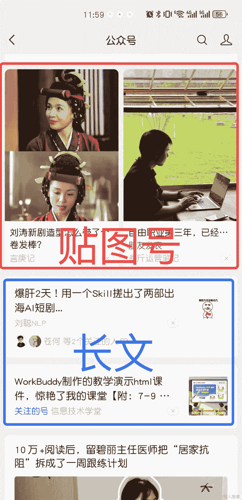

一条基础贴图内容通常包括：1 个标题＋1—3 张图片＋80—180 字短文案＋1 个自然互动问题。第一条先把主题讲清楚，不需要为了数量硬凑图片。

说明：图片数量不是平台硬性规则。本课为了降低第一条的操作难度，统一按 1—3 张成品图准备；交给 WorkBuddy 的参考图上传 1—2 张即可。

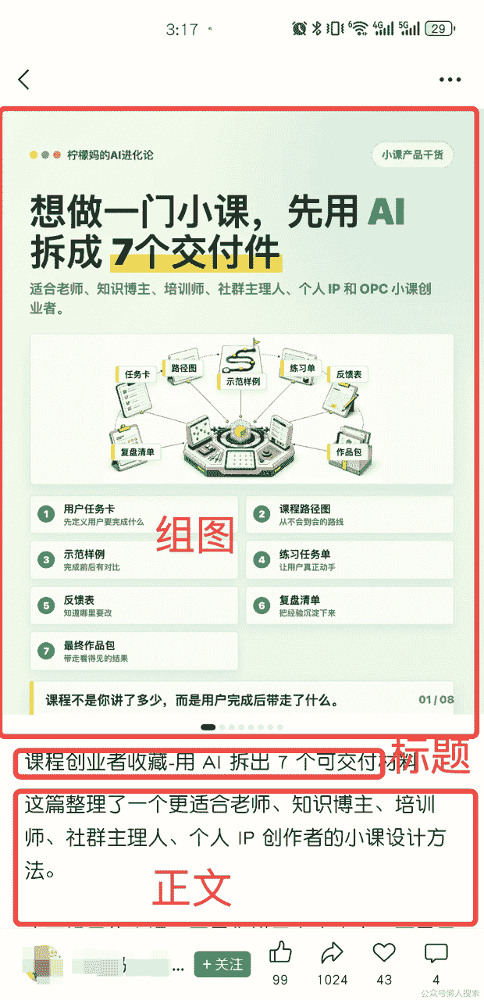

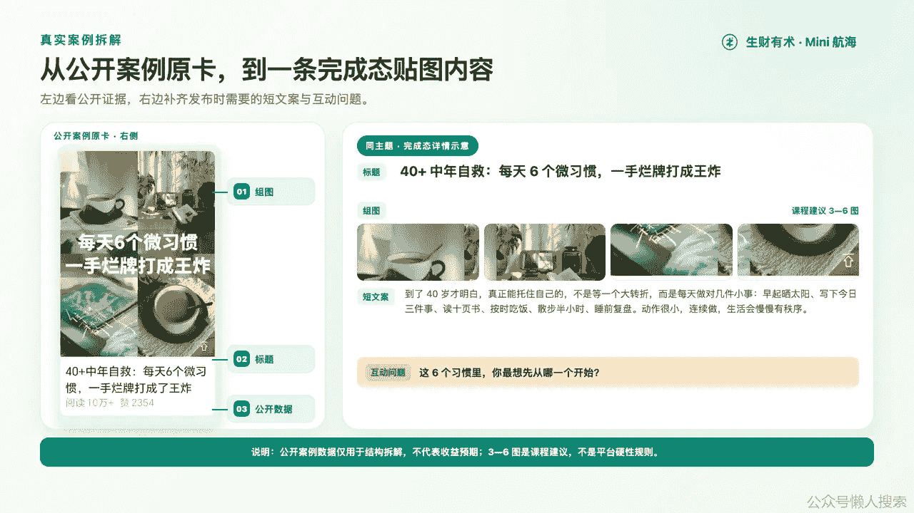

内容发布后，可能从订阅、推荐、搜索和分享等入口获得阅读。账号开通流量主后，广告被真实用户看到，才可能产生广告分成。

收益会受到阅读量、广告需求、用户反馈和内容质量等因素影响，没有一条固定公式。我们先把内容做出来、发出去，再用自己账号的真实数据判断，不承诺阅读量或收益结果。

**和长文章相比，贴图内容更轻：一个清楚的标题、1—3 张图，再配一段百来字的文案，就能先**完成第一条。刚开始不用追求一天发很多，先把“选题—出图—出文案—发布”完整跑通。

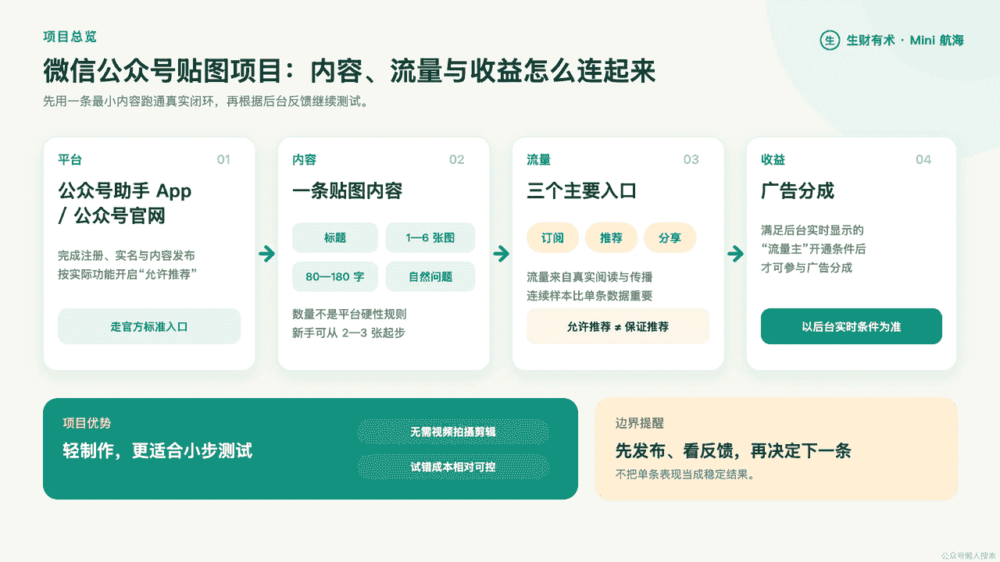

为什么可以把它作为一个轻量项目来测试？

• **图片消息有推荐机会：**内容可能进入微信的推荐和搜索入口，但是否获得持续分发，仍要看账号方向、内容质量和真实用户反馈。

• **创作与变现能力仍在更新：**公众号助手持续优化贴图编辑、已发布贴图修改及广告相关设置，手机端也能完成轻量发布。

• **AI 降低了执行成本：**整理素材和生成文案初稿更快，但赛道判断、选图、真实性核对和复盘仍由人完成。

项目完整操作思路

**选 1 个赛道 → 注册账号 → 从对标库选 1 条样本 → 拆 3 个重点 →** 交给 WorkBuddy 生成 → 人工检查 → 发布并记录 → 再进入选修篇

**课程为什么按这个顺序安排**？**

**这份手册先带你完成一条真实发布。第一条先跑通，不要求一次把对标库、素材**库和所有工具都学完。做完以后，你会更清楚自己卡在选题、图片、文案，还是发布环节。

1.  先选赛道和样本：从 6 个赛道中选择 1 个方向，再到对应的对标库里选 1 条主题清楚的近期样本。第一条暂时不用去小红书扩充素材。

1.  把样本整理成可用输入：上传 1—2 张参考图，并补齐对标标题、原文、原文链接，以及“话题、图片吸引力、情绪切口”3 点拆解，再交给对应赛道 Skill 重新创作。

1.  **先发布，再优化：**没有真实阅读和评论，就无法判断题材、图片和表达哪里需要改。

1.  发布后再进入关键进修：根据真实结果，继续学习对标扩充、图片制作和数据复盘。

内容出品人

内容出品人：


⃰辰风

手册出品方：生财有术团队

出品时间：2026 年 9 月

---

# 必修篇

## 一、赛道选择&账号注册

### 01. 选赛道

赛道介绍（6个赛道介绍-100个对标库）

💡

**本章概要**

打开[贴图号定位 Agent](https://chenfengai-tietu.pages.dev)（秘钥：SCYS-TIETU-99A75D51E5；密钥仅限生财社群内部使用，请不要把授权信息放到外部。）

回答问卷后可直接先选一个方向。

如果想要仔细了解赛道，直接看6个赛道的介绍和对标，更加直观。

长期的赛道选择遵循：内容可成为系列、用户可产生情绪和互动、素材可持续找到这3个原则

可以写出明确的具体人群 + 高频场景 + 可重复素材 + 明确互动。

**1.1**贴图号赛道推荐 Agent**如何操作**

步骤一：打开[贴图号定位 Agent](https://chenfengai-tietu.pages.dev)；回答5道题如左图所示，即可得到一个定位推荐如右图所示。

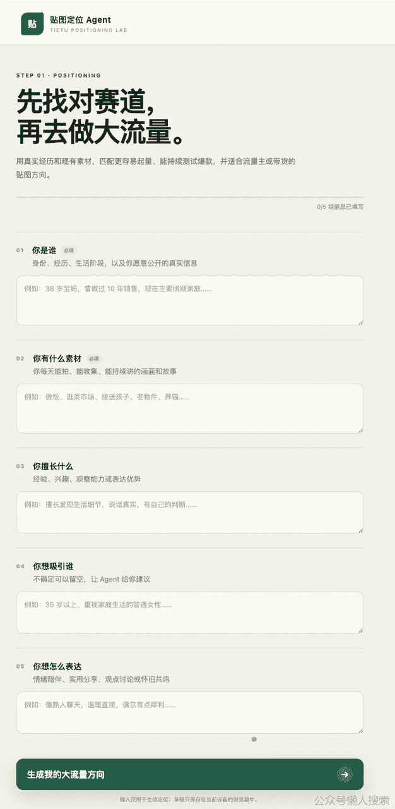

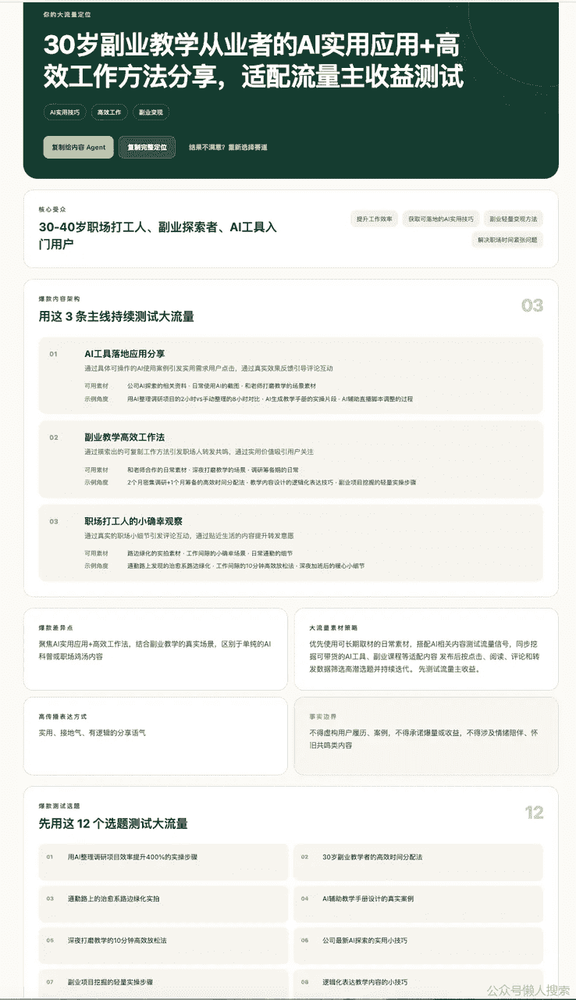

步骤二：点击推荐赛道的【填写后续对接信息】。完成表单登记，给大家分配到对应的赛道群。

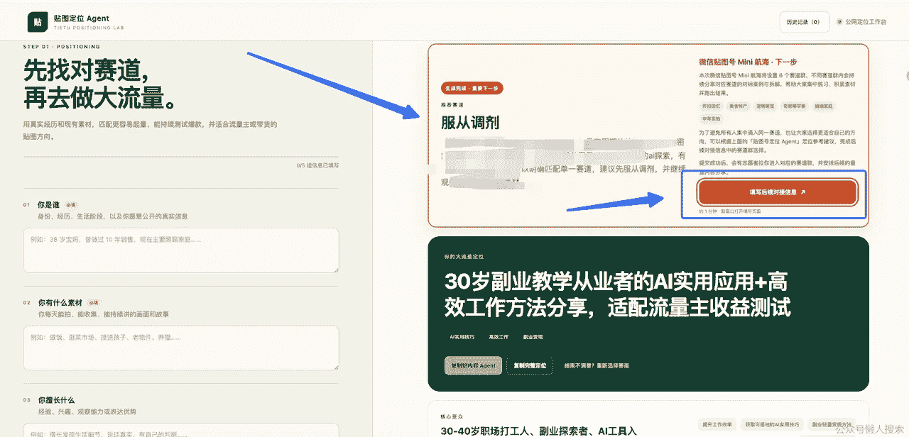

1.2本期 6 个主赛道一览表

[6个](https://ima.qq.com/wiki/?shareId=ff529677595dd004cafad7d97029e82cb6117b55cf12ee7c6f7a454ddfee563f)主赛道【ima知识库】贴图爆款学习库：https://ima.qq.com/wiki/?shareId=ff529677595dd004cafad7d97029e82cb6117b55cf12ee7c6f7a454ddfee563f

| 主赛道 | 人群、情绪、流量入口和第一条怎么做 |
| --- | --- |
| 怀旧回忆 | 人群与情绪： 35 岁以上、对家乡或年代有记忆的人；核心是认出感、失去感和地域身份。 流量入口： “小时候见过吗”“你们那里叫什么”“现在很少见了”。 常见对标： 老物件、旧证件、停产零食、老房子和过去的生活方式。 第一条： 选一个具体物件，补使用场景、年代细节，再问地域叫法或个人经历。 |
| 美食特产 | 人群与情绪： 本地人、做饭人群、吃货和在外生活的人；核心是食欲、乡愁和实用。 流量入口： 锅里正在发生的变化、地方做法差异、“本地人才懂”的味道。 常见对标： 菜市场、制作过程、地方特产、成品前后和家庭做法。 第一条： 只讲一道菜或一种特产，用“食材—过程—结果”组图，最后问大家的做法或叫法。 |
| 宠物萌宠 | 人群与情绪： 养宠人和喜欢动物的人；核心是治愈、好笑和把人的情绪投射到宠物身上。 流量入口： 意外反应、反差行为、回家瞬间和长期变化。 常见对标： 宠物小习惯、前后对比、主人与宠物互动、带情节的连续照片。 第一条： 抓一个真实行为，补发生前后，再问“你家也会这样吗”。 |
| 奇葩稀罕事 | 人群与情绪： 喜欢新鲜见闻和冷知识的人；核心是惊讶、怀疑和求证。 流量入口： 反常现象、罕见物件、特殊职业和“不看不知道”的细节。 常见对标： 近景证据、出处截图、前后对比和简短解释。 第一条： 选一个可核验现象，至少准备两张证据图和来源；无法核验的奇闻不要发。 |
| 婚姻家庭 | 人群与情绪： 伴侣、父母和家庭责任较重的人；核心是委屈、站队、被理解和关系选择。 流量入口： 一个具体冲突，比泛泛讲“婚姻真相”更容易让人代入。 常见对标： 家务分工、婆媳、育儿、家庭开支和沟通场景。 第一条： 只写一个家庭场景，给出双方选择，结尾问用户会怎么处理。 |
| 中年实拍 | 人群与情绪： 35 岁以上的普通人；核心是现实压力、自我重建、希望和“原来不只我这样”。 流量入口： 时间、账单、工作、家庭和重新学习中的具体细节。 常见对标： 40+ 日常、下班后的第二生活、家庭责任、重新开始和小习惯。 第一条： 用一个真实细节讲清处境，再写你做了什么改变，最后问相似经历。 |

1.3六个赛道先看图：一眼认出大方向

贴图号最重要的是图片，所以请先看图片。

把图片缩小到手机大小，看第一眼出现的是年代记忆、食欲、萌感、稀奇、家庭冲突，还是中年处境。

用户第一眼接收到的情绪，基本就是这个赛道的入口。

你也可以看图猜猜下面分别是哪个赛道：


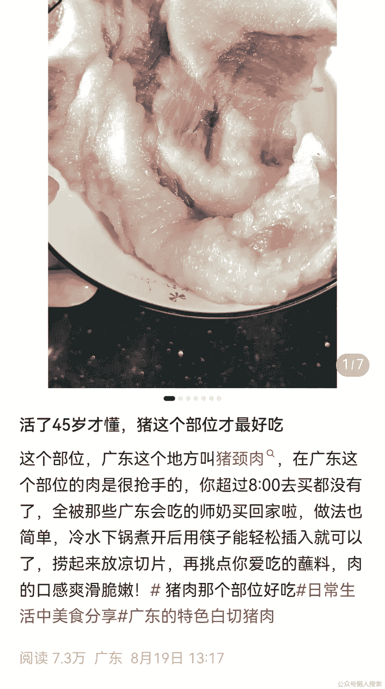

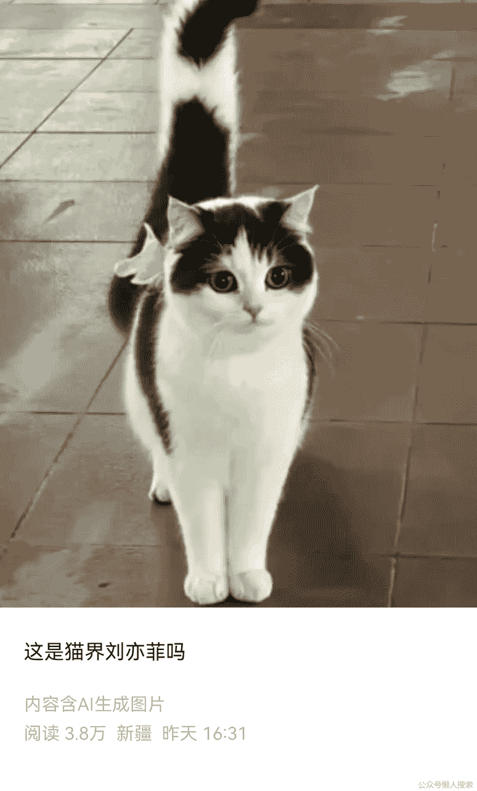

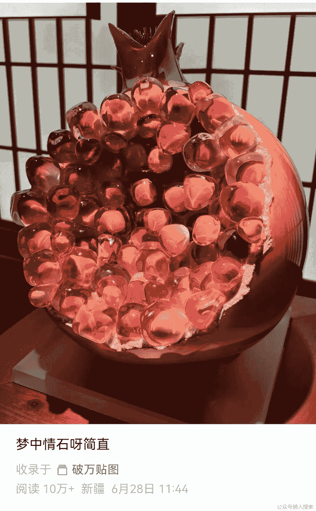

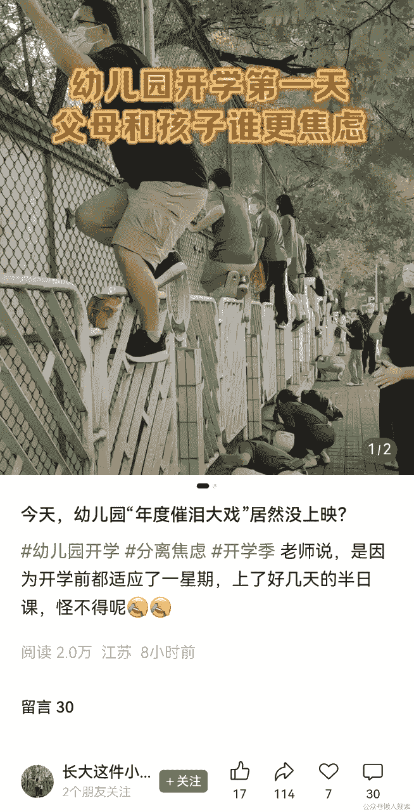


💡

**识别口诀：**怀旧看“认出”，美食看“想吃”，宠物看“反应”，稀罕事看“没见过”，婚姻家庭看“冲突与选择”，中年实拍看“具体处境”。先选一种主要情绪，不要一条内容同时塞进多个赛道。

💡

**图片说明：**这里的对标截图只帮助识别赛道和画面入口，不代表可以直接搬运。正式发布时换成自己拍摄、明确授权或重新制作的素材；涉及人物、旧照片和具体经历时尤其注意授权与事实。

💡

**ima**知识库还有其他方向。**

职场、情绪、生活、旅游、民生等都可以测试，已经有持续素材优势的人可以选择扩展方向。

没有明确优势时，请先从上述六个赛道里根据推荐选一个。

选赛道，得看一个方向能不能持续

1.  **素材足够多：**不是只找到三五张图，而是能持续找到同类场景和相邻题材。

1.  **情绪足够明确：**认出、好奇、治愈、吐槽、选择、实用或共鸣，一条内容只打一个主要情绪。

1.  **互动动作足够简单：**用户能够回答、站队、补经历、晒经验或提出问题。

赛道不是一个大词，而是具体人群 + 高频场景 + 可重复素材 + 明确互动。选方向的目标，不是猜哪个一定爆，而是找到你能连续测试的内容。

举个例子：为什么“新奇、没见过”能持续做

比如下面这 5 条样本：像宝石一样的石榴、手里拿不下的现金、落在宝宝手腕上的蚊子、长得很有记忆点的猫、很多人没见过的猪肉部位。

它们不是同一种题材，但第一眼都会让人停一下：这是什么？是真的吗？为什么会这样？


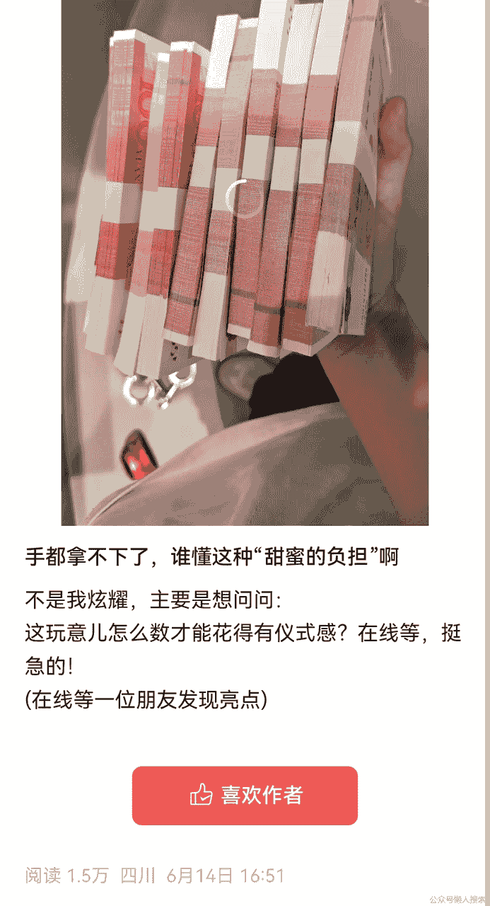

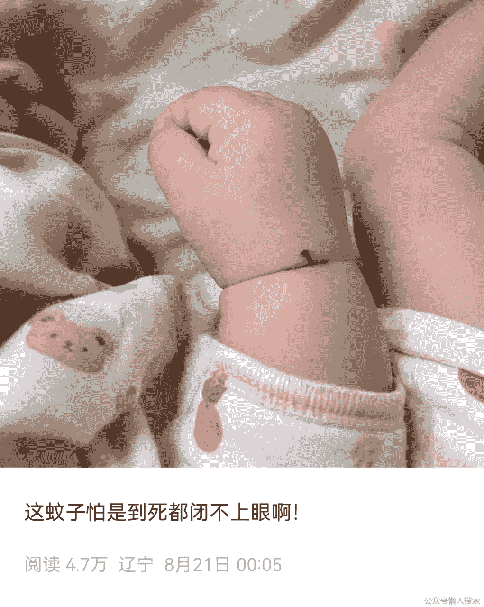


1.  **素材足够多：**新奇内容不只等于“怪事”。少见物件、反常现象、动物瞬间、地方食材、特殊做法和生活巧合，都可以持续找。今天发一种没见过的东西，下一条可以换成“没见过的吃法”“没见过的动物反应”或“本地人才认识的物件”，题材能够自然延展。

1.  **情绪足够明确：**核心不是一味吓人，而是先满足好奇和轻度猎奇心理，再带出惊讶、求证欲和分享欲。用户会想点开看清楚，也容易顺手转给朋友问一句：“你见过这个吗？”

1.  **互动动作足够简单：**不要问大而空的问题，直接问“你见过吗”“这是真的吗”“你们那里叫什么”“这 5 张里，哪一张你最想发给朋友”。用户不用想太久就能回答。

💡

**把这个方向拆开就是：**喜欢新鲜见闻的人＋少见物件、反常现象和地方题材＋持续可找的相邻素材＋“你见过吗”的低门槛互动。

💡

**边界提醒：**这类内容最容易把“新奇”做成“编故事”。图片和说法要先核验来源；这里的截图只用来观察选题与互动结构，正式发布时请换成自己拍摄、获得明确授权或重新制作的素材，不要直接搬原图原文。

### 02. 注册账号

💡

**本章概要**

个人公众号优先通过**“公众号助手”App**完成注册和实名；

微信内置“公众号”入口与电脑官网只作为备选。

注册后先确认账号能正常管理和进入创作页，再继续后面的昵称、简介与首批内容设置。

推荐：通过“公众号助手”App 注册个人公众号

💡

**本航海优先推荐这条路径。**注册、实名校验和后续内容发布都可以在腾讯官方“公众号助手”App 内完成，手机操作更集中。

请认准应用名称“公众号助手”，开发者/运营者为深圳市腾讯计算机系统有限公司，不要下载名称相似的第三方工具。

**完整流程：**应用商店安装 → 微信登录 → 创建公众号 → 设置头像和名称 → 实名校验 → 返回公众号助手 → 确认账号可管理。

在应用商店搜索并安装

打开手机应用商店或应用市场，搜索“公众号助手”，

找到标注“微信官方提供的公众号管理工具”的应用，点击“安装”。

安装完成后，回到手机桌面点击公众号助手图标。

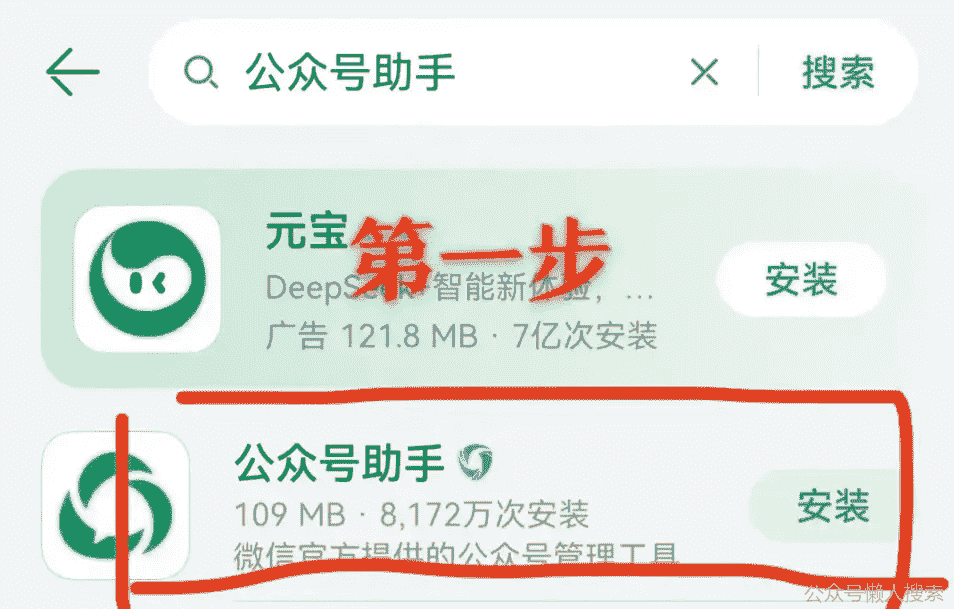

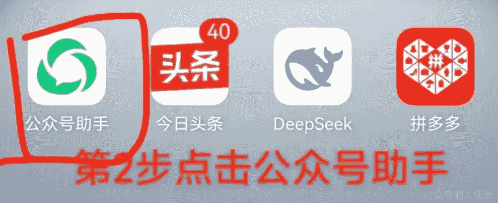

勾选协议并选择微信登录

**怎么操作：**第一次打开 App，先勾选“我已阅读并同意用户协议和隐私政策”，再点击“微信登录”。页面跳转到微信后，按微信页面提示确认授权。

**看到什么：**如果这个微信已经管理公众号，会进入账号选择或管理页面；如果没有可管理的个人公众号，页面会继续进入“创建公众号”。

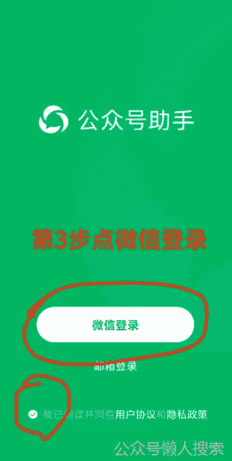

进入“创建公众号”页面

**怎么操作：**进入创建页面后，先上传头像，再填写公众号名称；

根据当前页面补充性别、地区等信息。

名称不要临时乱填，优先使用前面已经确定的赛道名称或备选名称。

**提交前检查：**头像清晰、名称没有错字，并已勾选《微信公众平台服务协议》和《个人信息保护指引》，然后点击“创建”。

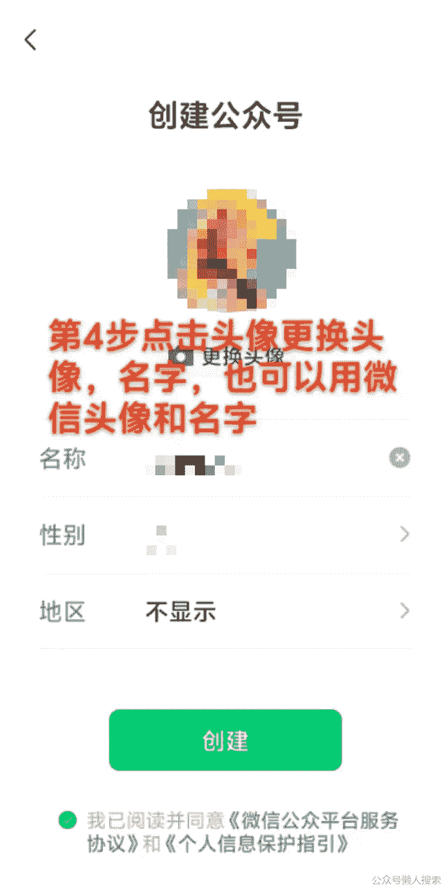

创建完成后进入实名校验

**怎么操作：**

看到“已创建”页面后，不要直接退出。点击页面上的“实名校验”；

出现“即将打开微信进行实名认证”的提示时，再点击一次“实名认证”。

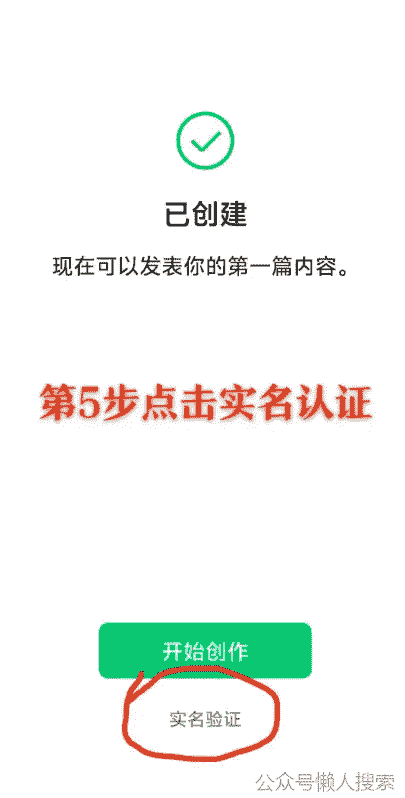

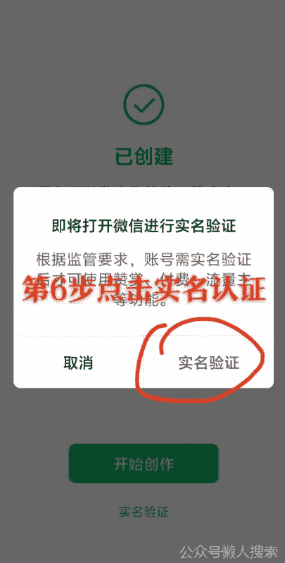

在微信完成实名验证

**怎么操作：**页面跳转到微信后，点击绿色“实名验证”按钮，按微信支付页面提示完成本人身份核验。

需要输入支付密码时，只在微信官方支付页面输入，不要在任何第三方网页或聊天窗口提交密码。

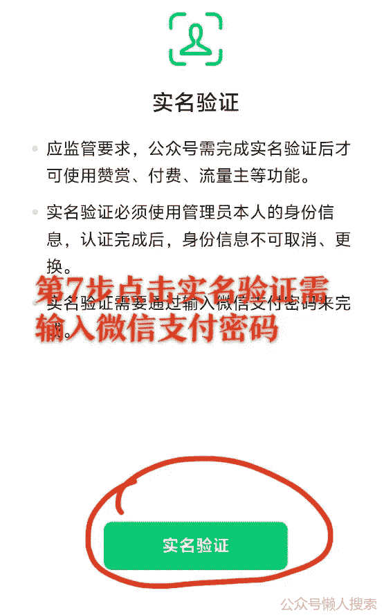

允许返回公众号助手并检查结果

**怎么操作：**实名完成后，微信会提示即将打开“公众号助手”，点击“允许”返回 App。

进入账号主页后，确认能看到刚创建的公众号、头像和名称，并且能够进入创作页面。

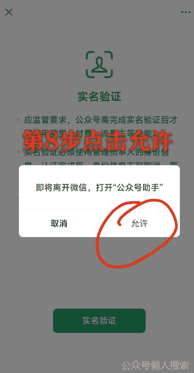

📌

**注册完成标准：**公众号助手里能够看到新账号，头像和名称正确，实名状态已完成，并能正常进入创作页面。若页面提示注册数量、身份或实名状态异常，先按当前提示处理，不要频繁重复注册。

💡

后续内容发布也优先走公众号助手 App 或微信公众平台官网。不要使用微信内置“公众号”入口直接发布贴图内容。流量主资格、数据和收益以微信公众平台的实际规则与后台记录为准。

备选：通过微信内置“公众号”入口注册

手机端只保留最短注册流程，不展开复杂设置。

打开微信后，依次进入“公众号 → 右上角个人中心 → 我的公众号 → 发表”；

进入“创建公众号”页面后，设置头像和名称，勾选协议并点击“创建”。

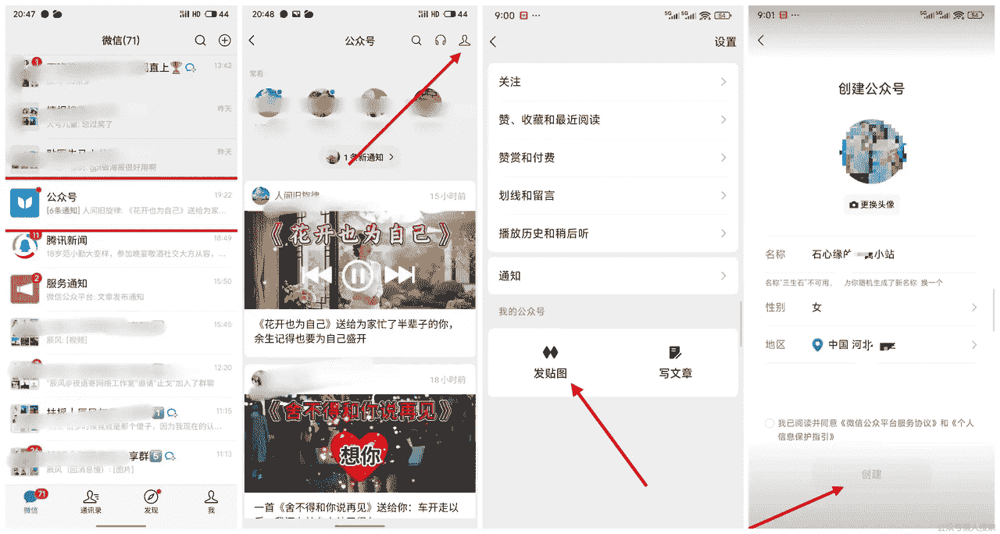

说明：微信内进入“公众号”，打开个人中心并点击“发表”｜适用场景：手机端快速创建个人公众号

**注册完成标准：**页面出现“注册成功”，并能在“我的公众号”里看到刚创建的账号。界面细节可能随微信版本变化，以手机当前显示为准。

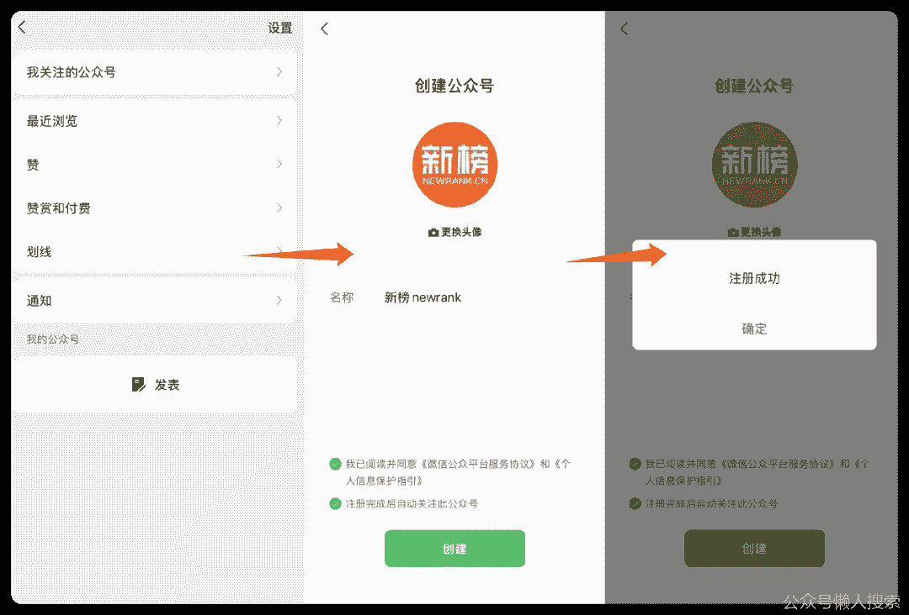

💡

**重要：手机微信里的“公众号”入口只用于完**成账号注册，不要从这里直接发布贴图内容。

**后**续内容统一通过**“公众号助手”App或微信公众平台官网后台**发布。

课程内所有发布操作都按这两个入口执行，避免使用微信内置入口直接发贴图，确保内容进入公众号的标准发布链路，并正常参与后续流量主收益。

备选：通过微信公众平台官网注册

注册前先准备这些信息

进入微信公众平台官网，按页面提示选择公众号并完成主体登记。开始前准备好可用邮箱、身份信息、手机号和管理员微信。页面字段若有更新，以平台当前提示为准。

注册前先写下三个答案：准备长期测试什么方向、主要写给哪类人、主要使用什么内容形态。不要注册完成后再临时决定，否则昵称、头像、简介和后续内容容易互相矛盾。

**按这 6 步完成个人公众号注册**

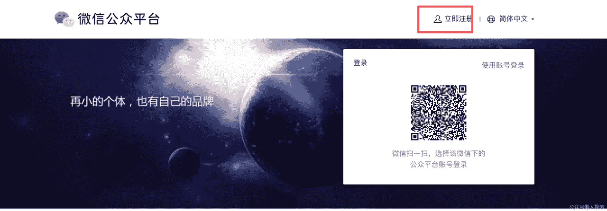

**下一步：**点击“立即注册”后，选择要创建的账号类型。

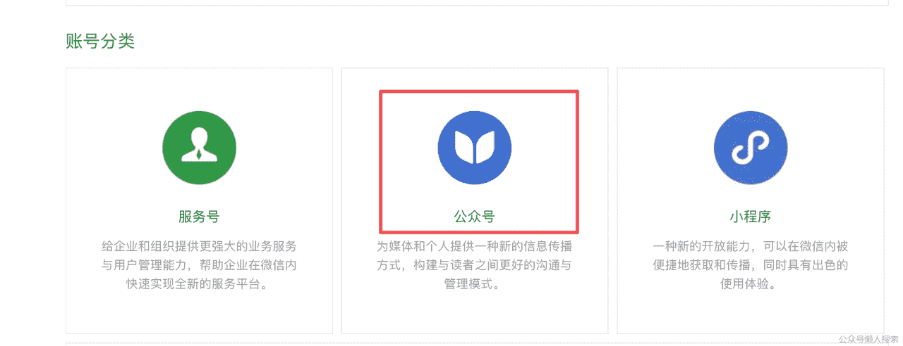

**下一步：**选择公众号后，用可用邮箱建立登录账号。

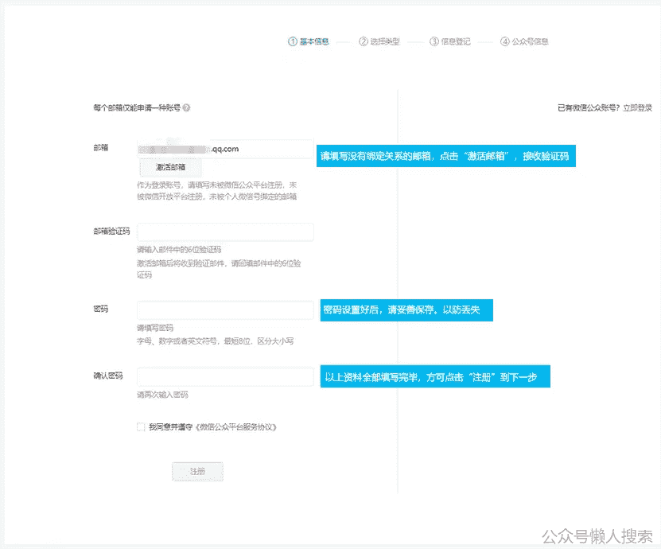

**下一步：**基础信息完成后，选择个人主体并完成管理员验证。

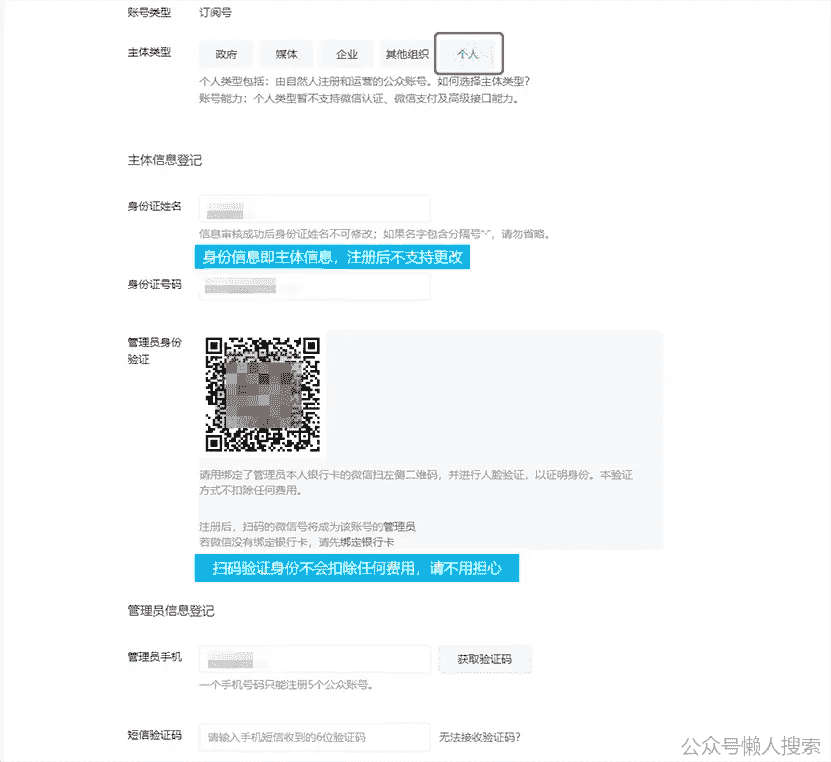

**下一步：**验证完成后，填写账号名称、功能介绍和运营地区。

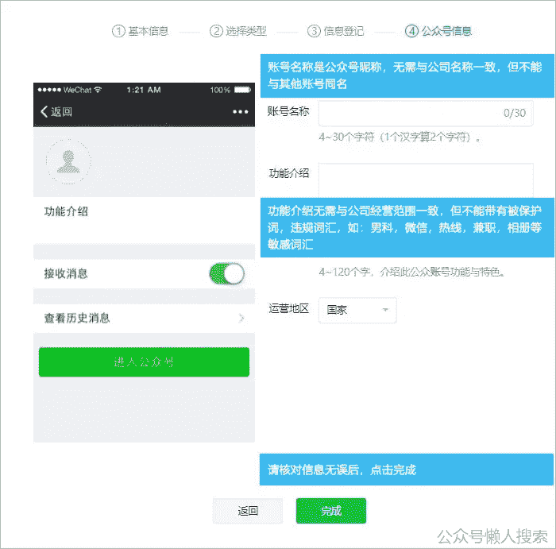

**最后一步：**核对信息并提交，看到注册成功页面后再进入公众号后台。

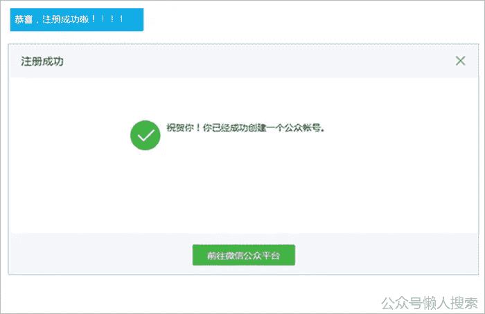

昵称、头像和简介怎么设置

**昵称。**让用户一眼看懂大致方向。名称可以保留人格感，但最好带有赛道或场景线索。过于宽泛的“某某生活”“某某日记”，不如“某某职场避坑”“某某养花笔记”清楚。

**头像。**保持清晰、简单，并与赛道气质一致。怀旧内容可以使用有年代感的物件或场景；职场内容适合干净利落的视觉；植物、美食和城市内容直接使用主体明确的图片。不要使用模糊图、复杂文字或与内容无关的表情包。

**简介。**用一句话说清“写给谁、持续提供什么”。可以采用“目标人群＋内容方向＋更新方式”的结构，例如：写给普通打工人的职场避坑贴图，持续记录真实场景和实用提醒。

**自动回复。****保持简单，只说明这里会持续更新**什么内容、用户有问题可以留言。主线阶段不放销售和外部联系方式。

1.  先理解平台会观察什么

| 观察维度 | 对应操作 |
| --- | --- |
| 账号垂直度 | 持续围绕一个人群和一组相邻话题更新 |
| 内容原创度 | 素材重新组织，标题、文案和图片不直接照搬 |
| 停留与阅读 | 标题和首图清楚，组图有递进，不堆无关信息 |
| 互动 | 提出用户能立即回答的问题，观察真实评论内容 |
| 更新稳定性 | 保持自己能长期执行的节奏，不突然大量发布又长期停更 |

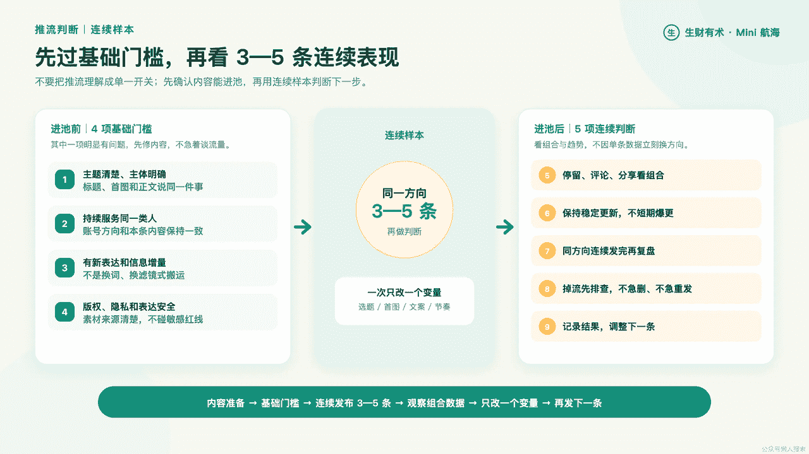

1.  账号前期的六个不要

• 不要今天发职场，明天发旅游，后天又改成养生；

• 不要频繁修改昵称、头像和简介；

• 不要同一套图片和文字在多个账号同步复制；

• 不要数据不理想就频繁删文重发；

• 不要使用恐吓、擦边、夸大或事实不清的标题；

• 不要一开始就同时运营多个账号，先把单号流程跑通。

1.  常见卡点

| 现象 | 可能原因 | 处理方法 |
| --- | --- | --- |
| 没有“注册”按钮 | 版本未更新、当前账号已有可管理公众号，或账号暂不符合注册条件 | 升级 App，退出后重新登录；仍无入口时走官网二维码备用路径 |
| 提示达到注册上限 | 本人身份已注册过个人公众号 | 先找回并管理已有账号；不要用他人身份绕过限制 |
| 收不到验证码 | 网络、短信拦截、频繁请求或手机号状态异常 | 检查信号与拦截记录，等待倒计时结束后再试，不要连续点击 |
| 名称无法使用 | 名称重复、包含限制词，或容易让人误认官方身份 | 使用备选名称，避免“官方、第一、唯一”等高风险表述 |
| 身份核验失败 | 实名信息不一致、环境光线差或网络中断 | 核对本人实名信息，在光线充足、网络稳定的环境重试 |

**7. 进阶：多账号矩阵**

如果你已经跑通1个账号，想要做矩阵，就需要先把主体、设备和网络关系理清**

**矩阵操作**注意事项**：**

**亲友主体合作。**可以由亲友本人合规注册并共同运营，但不是“借身份证绕过限制”。开始前写清账号归属、管理员、登录恢复、收益结算、税务责任和退出方式；亲友应持续知情，并保留终止合作和取回账号管理权的权利。单号流程还没有跑通前，不建议急着铺矩阵。

**一机一号一卡。**多账号运营时，可以按“专用设备＋长期使用的手机号或 SIM 卡＋固定管理员”分开管理，减少误登、串号和权限混乱。这是账号安全与运营管理建议，不是平台保证流量的规则。

**设备、登录和网络保持稳定。**尽量使用真实、稳定的常用网络，减少多人、多地频繁切换。不要使用代理、虚拟定位或频繁更换 IP 去规避审核和平台规则。这里讲的是账号安全和责任清楚，不是流量技巧。

## 二、快速制作 1 条贴图号内容并发布

### 01. 找选题：从对标库选 1 条样本，整理成 WorkBuddy 输入资料

**因赛道与对标提供有限，为防止赛道内卷，**贴图爆款对标数据库为付费专享，敬请谅解～

📌

**这一节只完成一个结果：**从本期 6 个赛道中选定一个方向，再从对标库取出 1 条样本，整理出图片、原文和 3 点拆解。

材料准备好后，下一节直接交给 WorkBuddy 调用对应 Skill，同时生成文案和新图。

1.第一步：进入自己准备持续测试的赛道

1.  打开“**贴图爆款对标数据库**”，点击与你账号方向一致的赛道视图。本期只使用 6 个赛道：怀旧回忆、美食特产、宠物萌宠、奇葩稀罕事、婚姻家庭、中年实拍。

1.  第一条内容只选一个赛道，不在全库混着找。比如准备做“中年实拍”，就只进入“赛道｜中年实拍”。

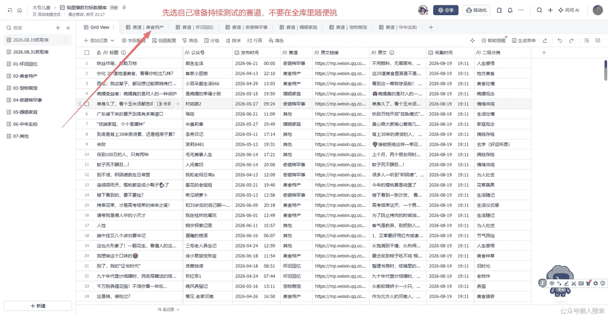

2.第二步：在该赛道里选 1 条近期样本

1.  优先看发布时间较近、标题能看懂、图片主体明确的内容。

1.  第一次不要只追最高阅读量。先判断这条内容是否容易看懂、是否有明显图片反差、是否方便重新创作。

1.  点开记录详情，确认“赛道、标题、原文、原文链接”四项信息完整。

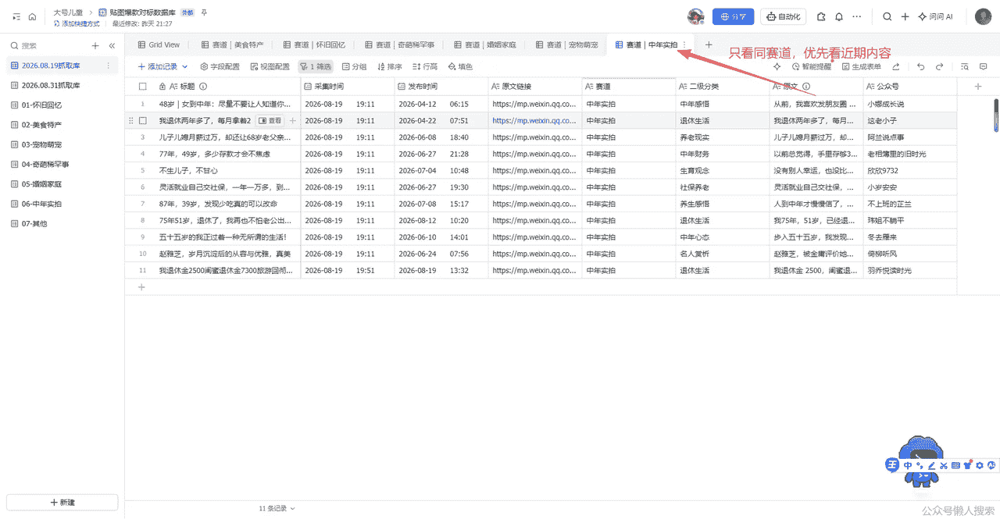

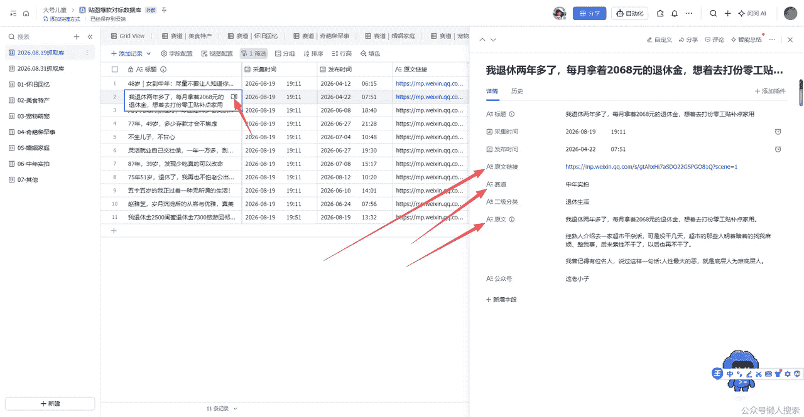

💡

不要只把私有多维表链接发给 WorkBuddy。**为了避免权限或页面读取失败，请把标题和原文直接复制出来，同时上传 1—2 张参考图片或截图；原文链接只用于回查。

3.第三步：围绕图片只拆 3 个信息

不用写专业分析报告。看着图片，各写一句能够被普通人直接说出来的话：

1.  **话题：**这张图最适合讲什么事？

1.  **图片吸引力：**它和日常看到的同类画面有什么不一样？

1.  **情绪切口：**用户看到后最容易产生什么感受？

**案例：一辆挂满玩偶的外卖车**

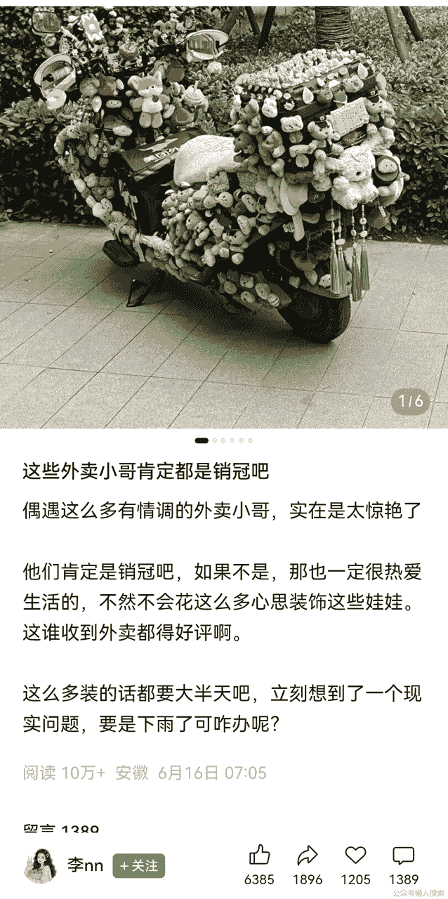

| 要拆的内容 | 外卖车案例怎么写 |
| --- | --- |
| 话题 | 外卖车上的生活小细节 。 |
| 图片吸引力 | 整辆外卖车挂满玩偶，数量多、密度高，和普通外卖车明显不同。 |
| 情绪切口 | 忙碌的日常里，也能看见一点有意思的生活细节 。 |

**注意：**“忙碌日常里的一点趣味”是我们从画面延展出来的表达方向，不代表图片已经证明了骑手的真实经历。年龄、收入、家庭情况和玩偶来源等无法确认的信息，不要写成事实。

4.第四步：整理成 WorkBuddy 输入资料

把下面 6 项放在同一个文件夹或同一条消息里，下一节直接使用：

| 序号 | 需要准备 | 外卖车案例 |
| --- | --- | --- |
| 1 | 赛道 | 奇葩稀罕事 |
| 2 | 对标标题 | 复制对标库中的原始标题 |
| 3 | 对标原文 | 复制对标库中的原文，不需要自己先改写 |
| 4 | 原文链接 | 用于回查来源 |
| 5 | 参考图片 | 上传 1—2 张外卖车参考图或截图 |
| 6 | 3 点拆解 | 话题、图片吸引力、情绪切口 |

💡

**完成标准：**你手里已经有“1 个赛道＋1 条对标标题＋对标原文＋原文链接＋1—2 张参考图片＋3 点拆解”。做到这里就停止找资料，马上进入 WorkBuddy 出稿，不继续刷推荐流。

### 02. 用 WorkBuddy 调用赛道 Skill，一次做完文案和图片

**赛道skill数量有限，为避免造成赛道拥挤，赛道 S**kill 包仅限付费学员使用，敬请谅解～

**开放手册的圈友，可以练习并使用**

**跨赛道爆款二创skill**

[ZIPtietu-viral-rewriter-](https://lazy-1254325532.cos.ap-shenzhen-fsi.myqcloud.com/attachments/f4437fc770.zip)client.zip压缩包 · 点击下载

Markdown

```
跨赛道爆款二创授权码：
CF-LOCAL-VIRAL-REWRITER-B792C551422EE4F490753E31FD691CBB9343
```

💡

**本节主线：**安装并登录 WorkBuddy → 上传对应赛道 Skill → 上传上一节的参考图片 → 粘贴对标原文和 3 点拆解 → 一次生成标题、短文案、互动问题和 1—3 张新图 → 检查后再发布。

1.第一步：安装并登录 WorkBuddy

已经能够进入 WorkBuddy 对话页面的学员，直接跳到第二步。第一次使用时，电脑端和手机端任选一个；需要导入 Skill、查看文件和反复修改时，优先使用电脑端。

1.1电脑端（建议用）

1.  打开 WorkBuddy 官网https://copilot.tencent.com/work/，选择自己的 Windows、Mac 或 Mac ARM64 版本。

1.  安装后完成登录。回到客户端，能够看到“新建任务”和对话输入框，就说明可以继续。

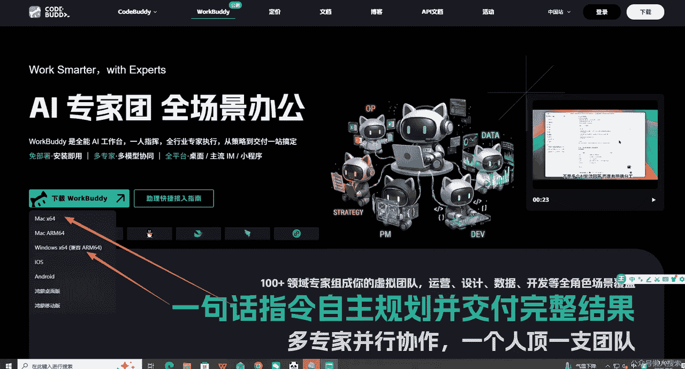

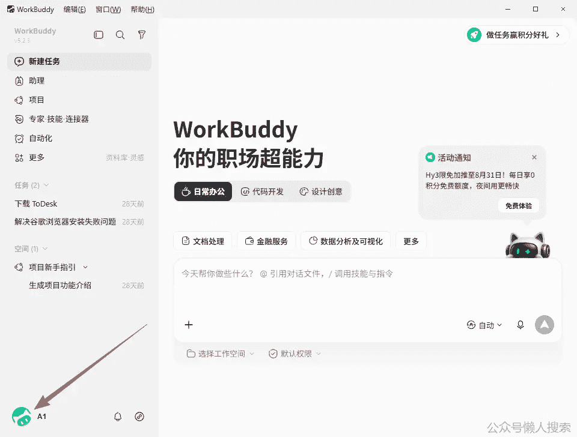

1.2手机端

1.  在应用商店搜索“WorkBuddy - AI 工作台”，下载安装并完成手机号登录。

1.  进入主界面后，点击输入框旁边的“+”，即可上传 Skill 压缩包和图片。

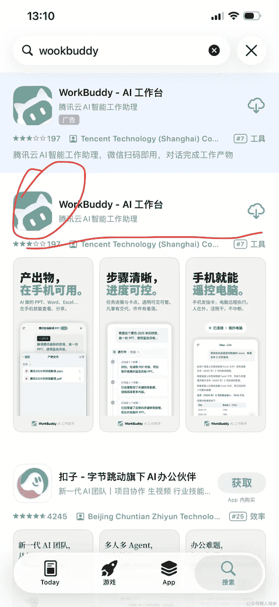

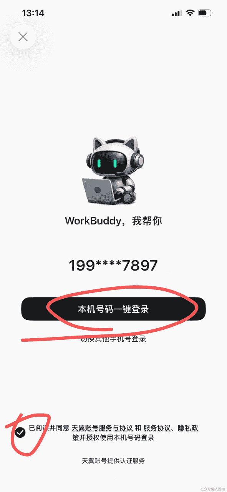

2.第二步：根据对标赛道，选择同名 Skill

打开课程提供的“贴图号 6 赛道 Skill 总包”，找到与对标库赛道一致的单赛道 Skill 压缩包或 .skill 文件。不要把 6 个 Skill 一次全部上传。

| 对标库赛道 | 上传的 Skill |
| --- | --- |
| 怀旧回忆 | 怀旧回忆 Skill |
| 美食特产 | 美食特产 Skill |
| 宠物萌宠 | 宠物萌宠 Skill |
| 奇葩稀罕事 | 奇葩稀罕事 Skill |
| 婚姻家庭 | 婚姻家庭 Skill |
| 中年实拍 | 中年实拍 Skill |

**首次安装与授权：按 4 步完成**

1.  **上传对应赛道 Skill：**下载课程提供的单赛道 Skill 完整压缩包，不要解压，直接拖进 WorkBuddy，并发送“下载并安装这个 Skill”。不要只上传 SKILL.md，压缩包里的其他配套文件也要一起保留。

1.  **等待安装完成：**WorkBuddy 会读取并检查压缩包；如果提示确认安装、覆盖同名目录或选择安装位置，先确认当前文件确实是课程提供的对应赛道 Skill，再回复确认。

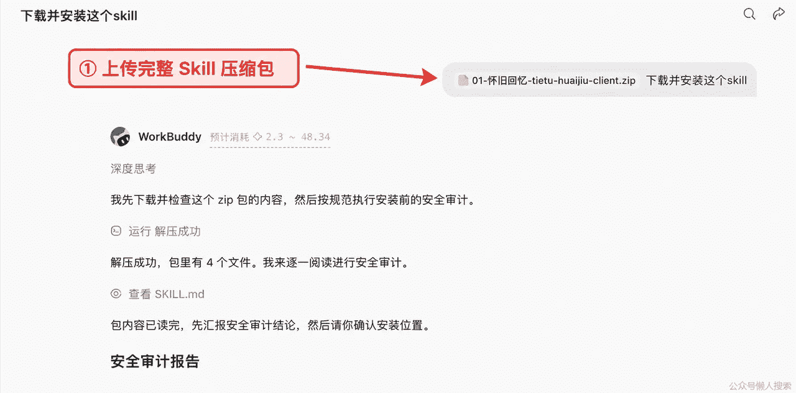

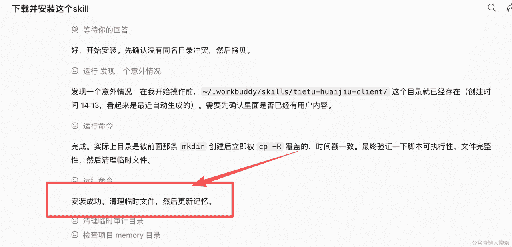

1.  **输入授权码完成激活：**看到“安装成功”只代表 Skill 已经放进 WorkBuddy。首次正式调用时，还要在同一个对话里输入课程提供的授权码，并等待验证通过。

**输入授权码并确认授权完成**

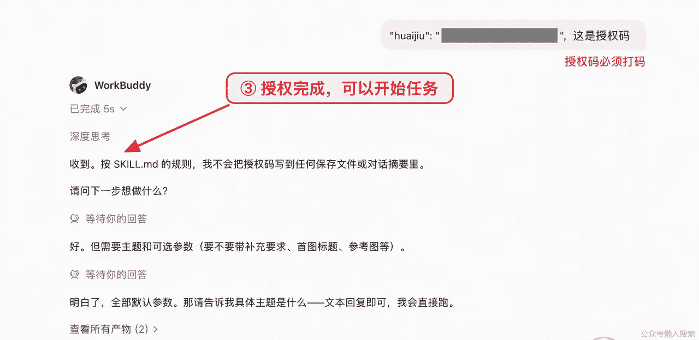

1.  **开始生成内容：**只有 WorkBuddy 明确提示授权通过、可以运行后，才进入下一步，上传对标图片、标题、原文和 3 点拆解。

💡

**安装完成 ≠ 授权完成。**未输入或未通过授权码验证时，不继续生成文案和图片。授权码属于个人使用凭证，只在自己的 WorkBuddy 对话中输入，不发到群聊、公开文档或未打码截图中。若验证失败，先检查是否复制完整、前后是否多了空格，以及授权码是否适用于当前 Skill；不要反复猜码。

3.第三步：上传图片和文案，粘贴完整提示词

回到上一节准备好的输入包：上传 1—2 张参考图片；

将赛道、对标标题、对标原文、原文链接和 3 点拆解粘贴在同一条消息里。

只粘贴链接不够，WorkBuddy 可能无法读取私有多维表中的内容。

**外卖车案例可以直接这样发送：**

Plain Text

```
请调用刚刚上传的“奇葩稀罕事 Skill”，根据下面的对标资料重新创作一套贴图号内容。\n\n【对标资料】\n对标赛道：奇葩稀罕事\n对标标题：[粘贴对标库标题]\n对标原文：[粘贴对标库原文]\n原文链接：[粘贴原文链接，仅用于回查]\n参考图片：已经上传 1—2 张外卖车图片\n\n【3 点拆解】\n话题：外卖车上的生活小细节。\n图片吸引力：整辆外卖车挂满玩偶，数量多、密度高，和普通外卖车明显不同。\n情绪切口：忙碌的日常里，也能看见一点有意思的生活细节。\n\n【请完成】\n1. 生成 1 个贴图号标题、1 段短文案和 1 个自然互动问题。\n2. 生成 1—3 张 3:4 竖版新图：第一张展示车辆全貌和反差，后面的图片补玩偶细节、街道环境或不同角度。\n3. 只学习对标的选题、情绪和画面逻辑，不照搬原文原句，不复刻原图中的人物、车辆、品牌、文字和水印。\n4. 不要编造骑手年龄、收入、家庭、经历和玩偶来源。\n5. 先给我一版完整结果，不要一次生成多套。
```

操作图 8｜授权完成后，开始第一条内容任务

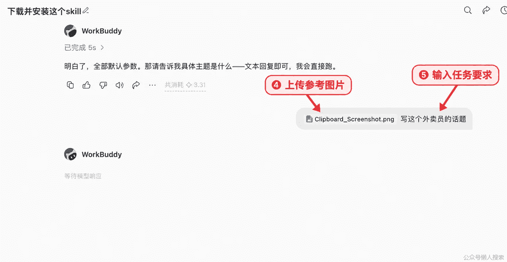

💡

**这一条提示词为什么有效：**前半段告诉 WorkBuddy“参考什么”，中间 3 点告诉它“为什么值得写”，最后 5 项告诉它“具体交付什么”。学员只需要替换赛道、标题、原文、图片和 3 点拆解。

4.第四步：先检查文案结果

生成完成后，先打开 content.txt（旧版本可能显示 result.txt）或正文结果，不急着发布。按顺序核对：

1.  **标题：**是否一眼能看懂主体和反常点。

1.  **正文：**是否围绕“话题＋图片吸引力＋情绪切口”展开。

1.  **事实：**是否增加了原文和图片都没有提供的人物经历、故事或结论。

1.  **互动：**结尾问题是否自然、普通人容易回答。

操作图 9｜打开 WorkBuddy 的实际产物

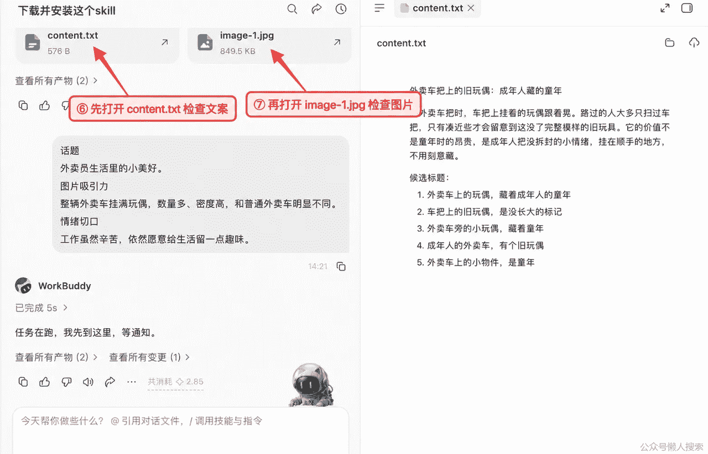

5.第五步：再打开并检查实际图片

不要只看 WorkBuddy 对图片的文字说明。必须逐张打开图片，检查主体、构图和细节。

1.  首图能否看清主体，反常点是否足够明显。

1.  后面的图片有没有补充新信息，而不是重复同一画面。

1.  有没有乱码、水印、品牌标识、错误文字、肢体变形或明显 AI 穿帮。

1.  图片和标题、正文是否在讲同一件事。

打开 image-1.jpg 检查生成图片

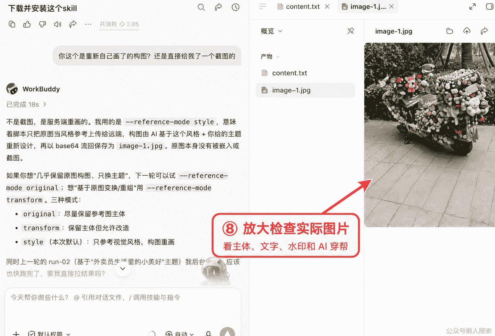

💡

不要只看 WorkBuddy 的文字说明：它说“已重画、未嵌入原图”不代表图片一定可用。仍要以实际打开的 image-1.jpg 为准，逐张检查；任何一项不合格，都回到同一对话只修改那个问题。

6.第六步：判断继续改，还是换输入

Skill 生成的是第一版候选稿，不代表一定可以直接发布。

调整的目的不是把一句话“润色得更漂亮”，而是解决一个明确问题：主题有没有跑偏、文案有没有说人话、图片有没有把爆点表现出来、内容有没有编造事实。

6.1先判断：继续修改，还是更换输入

先看生成结果和参考图是不是在讲同一件事。

主体、话题和情绪方向都对，只是字数、语气、内容顺序或互动问题不合适，就留在同一个 Skill 对话里继续改；

图片认错、主题跑偏，或参考样本本身没有清楚爆点，就不要靠润色硬救，直接补充输入、重新上传图片，必要时换一条样本。

💡

**为什么一次只改一个变量：**如果同时改赛道、选题、文案、构图和画风，你无法判断到底是哪一项让结果变好或变差。每次只解决一个问题，下一轮才知道这条要求要不要继续保留。

| 看到什么问题 | 下一步怎么做 | 为什么这样处理 |
| --- | --- | --- |
| 图片主体和话题都对，只是文案太硬、太空或太长 | 保留图片，只修改语气、字数或表达顺序 | 方向没有错，不需要重新换样本 |
| 文案方向对，但图片反差不明显或出现乱码、穿帮 | 保留文案，只重新生成图片 | 内容逻辑已经成立，只修画面表现 |
| 外卖车没有被识别出来，或者写成了无关主题 | 重新上传参考图，补清楚主体；仍然跑偏就换样本 | 输入已经错误，继续润色只会越改越偏 |
| 连续 2—3 条都出现同一种问题 | 先确认新的要求确实有效，再写回 Skill | 单条问题可能只是素材差异，不要过早改变整个 Skill |

6.2具体如何调整｜文案不满意：先确定要改哪一项

• **人设身份：**决定“谁在说”。外卖车案例如果只是路上看到的画面，就使用“城市路人观察”的口吻，不要假装自己是骑手，也不要替骑手讲家庭和收入。

• **选题角度：**同一张图只保留一个角度。这里选择“忙碌日常里的一点趣味”，不要同时写职业辛酸、收入焦虑、城市管理和人生鸡汤。

• **内容顺序：**先说看见了什么，再说哪里不一样，然后给出自己的感受，最后留一个容易回答的问题。

• **字数和语气：**偏长就明确要求压缩；太像说明书就要求使用短句、具体动作和日常口语，不要只说“值得关注、引发思考”。

**外卖车案例的文案修改指令：**

Plain Text

```
图片方向不变，只修改文案。使用“路上偶然看到这辆车”的观察口吻，不要假装自己是骑手。保留“外卖车挂满玩偶”的反常点，按照“看到车辆—发现细节—说出感受—留下问题”的顺序展开。语气像普通人聊天，往“忙碌日常里也有一点趣味”展开，不要拔高，也不要编造骑手经历。
```

**操作图 ｜方向正确时，只改文案**

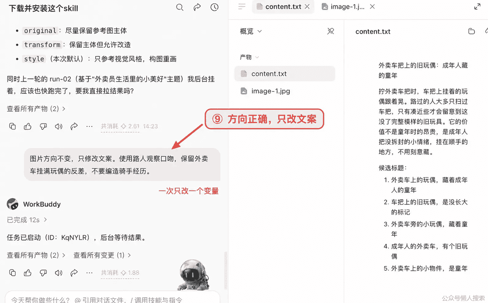

改完达到下面 4 项，就停止继续润色：

1.  第一句话能让人知道看见了什么。

1.  正文写出了“玩偶很多、和普通外卖车不同”这个具体反差。

1.  没有出现无法核实的年龄、收入、家庭、采访和玩偶来源。

1.  结尾问题普通人可以直接回答，不需要理解复杂观点。

6.3具体如何调整｜图片不满意：先判断是画面问题还是输入问题

**图片修改指令：**

Plain Text

```
文案不变，只重新生成图片。保留“外卖车＋密集玩偶”的主体。第一张突出车辆全貌和数量反差；第二张补玩偶细节；后面的图片补街道环境或不同角度。画面真实、主体明确、3:4 竖版、无字、无品牌、无水印，不复刻参考图中的车辆外观和人物。
```

**改图通过标准：**缩小看仍能认出外卖车；玩偶数量和反差足够明显；每张图补充不同信息；没有乱码、水印、品牌、肢体错误和明显 AI 穿帮。只要其中一项不合格，就针对这一项再改，不同时更换场景、人物、构图和画风。

💡

**主线到这里已经跑通：**学员只要会判断“继续改还是换输入”，并拿到可发布的文案和图片，就可以进入第七步人工过稿。把稳定要求写回 Skill 是选修动作，第一次做不需要修改技能包本身。

6.4选修｜把反复有效的要求保存进 Skill

**什么时候再做这一步：**不是第一条不满意就去改 Skill。连续做 2—3 条后，如果每次都要补同一种要求，而且补完确实更好，再把它保存进当前 Skill。比如外卖车案例中，“使用路人观察口吻”“先写场景再写反差”“图片无字且主体明确”反复有效，就可以统一加进去。

Plain Text

```
把刚刚已经连续验证有效的文案和图片要求写回当前 Skill：保留原赛道边界，只增加“使用可核实的观察者口吻、先写画面再写反差、图片无字且主体明确”三条规则。不要修改其他文件和赛道规则，完成后导出更新后的完整 Skill 压缩包。
```

💡

**素材边界：**对标图片只用于内部分析和画面参考，不直接搬运发布。最终发布优先使用自己拍摄、明确授权、正规图库可用或重新生成并检查通过的图片。使用 Pexels 等图库时，也要逐张核对授权范围；不是自己的真人照片，不要随意发布。AI 纪实示意图不能写成真人亲历或真实新闻现场。

7.第七步：人工过稿，确认拿到完整发布包

1 个可以直接看懂的标题

1 段与图片同主题的短文案

1 个自然、好回答的互动问题

1—3 张顺序明确的新图，首图负责吸引，后图补充信息

没有编造事实，没有直接搬运对标图片和原文

💡

**完成标准：**从对标库选出的图片和文案已经经过对应赛道 Skill 重新创作，WorkBuddy 给出了完整文案和1—3 张新图。人工检查通过后，直接进入下一节发布。

### 03. 发布

**第一步：选择电脑或手机发布**

💡

**本章概要**

电脑或手机二选一，把已经准备好的标题、短文案、互动问题和1—3 张图片真正发出去。最小结果是 1 条已发布内容和 1 条简单记录。

1.电脑端操作

1.  登录微信公众平台，进入草稿箱。

1.  点击右侧“+”，选择**贴图**。

1.  上传1—3 张图片，把最清楚的一张放在第一张。

1.  填入标题和正文，把自然问题放在结尾。

1.  预览无误后发布。

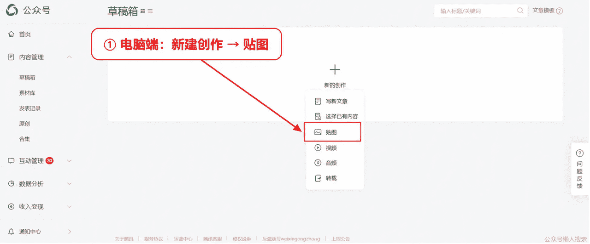

2.手机端操作

1.  打开公众号助手，进入“新的创作”。

1.  选择**贴图**，上传图片并调整顺序。

1.  填入标题和正文，把自然问题放在结尾。

1.  预览无误后发布。

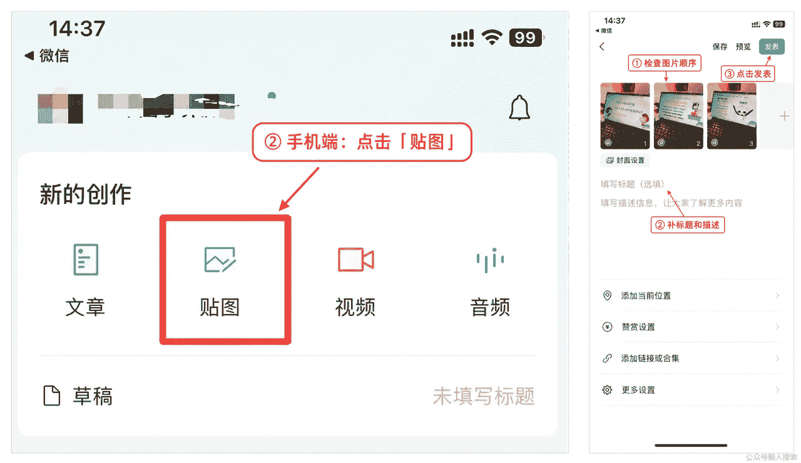

3.发布前只检查 4 项

图片、标题和正文是同一个主题，首图一眼能看懂。

图片清楚，顺序正确，没有重复图或错字。

正文不重复图上文字，结尾问题自然、好回答。

图片、文字和事实来源已经核对，没有直接搬运。

### 04. 流量主安全红线：不要制造广告点击和虚假数据

• 不要自己点击广告，也不要让亲友、学员或合作伙伴反复帮助点击。

• 不要在标题、正文、评论、自动回复、群聊或朋友圈明示、暗示用户帮忙点击广告。正常分享内容可以，但不能以提高收益为目的组织互点、互赞或刷曝光。

• 不要使用多设备、多账号、脚本或付费服务制造广告曝光、点击和互动数据。

• 遇到数据异常、广告限制或收益问题，以后台通知和平台当前规范为准，不用异常操作反复测试。

参考：[微信广告流量主违规处罚资料](https://training.tencentads.com/uploads/202406/jSSG9yck_S2Ke5p.pdf)

**发布后只留最小记录**

只记 4 项：**发布时间、主题、阅读、评论**。第一条不要求爆，只要求完整跑通一次。

💡

**本章结果：**1 条已发布内容 + 1 条最小数据记录。

**第一条发布以后，再学习系统化**

💡

**本章概要**

第一条发布后，再按真实卡点补账号、赛道、素材库、Agent 和复盘能力。这里是从“先完成”进入“再优化”的分界线。

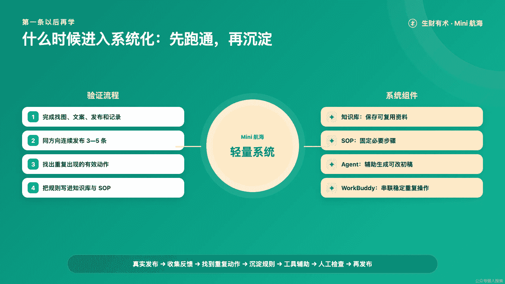

---

# 选修篇

## 一、关键环节进修

### 01. 【贴图选题】拆对标建立素材库

💡

**本章概要**

对标是为了让你先定一个方向，你可以结合我们的对标库，去找新的对标方向，看更多的赛道，然后再决定是否要做调整。

先看懂：贴图可能从哪些入口被看见

用户不一定从搜索页看到贴图，也可能从公众号或服务号的消息入口、搜一搜、看一看、内容详情页底部和相关推荐进入。

微信版本、账号状态和用户习惯不同，具体入口名称与呈现方式也可能变化。

判断是不是推荐内容，可以看账号是否为自己未关注的账号，以及它是否出现在推荐、相关推荐等入口。入口名称可能随微信版本变化，以当前页面显示为准。

在同一个赛道里持续查看相关内容后，推荐页可能逐步出现更多同类样本。这个过程没有固定次数，也不要机械点赞或批量操作。

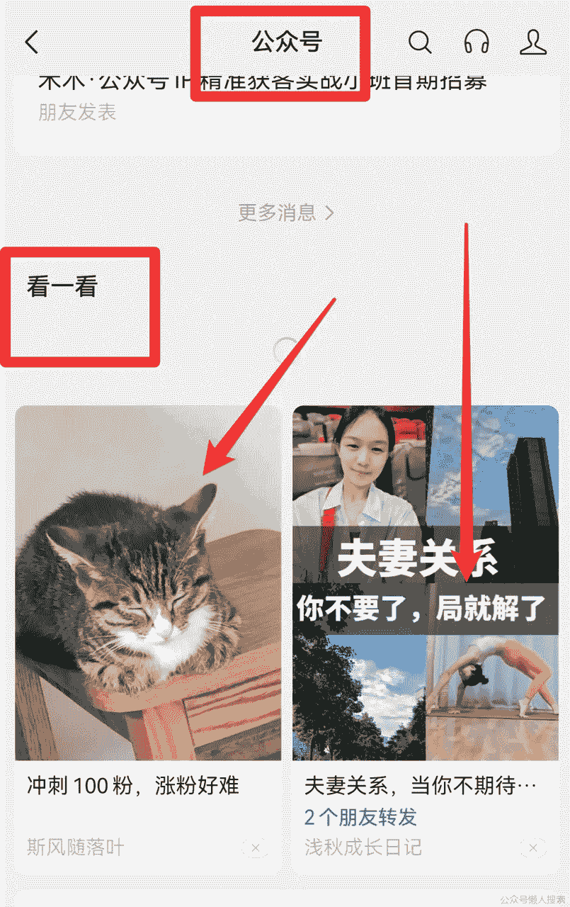

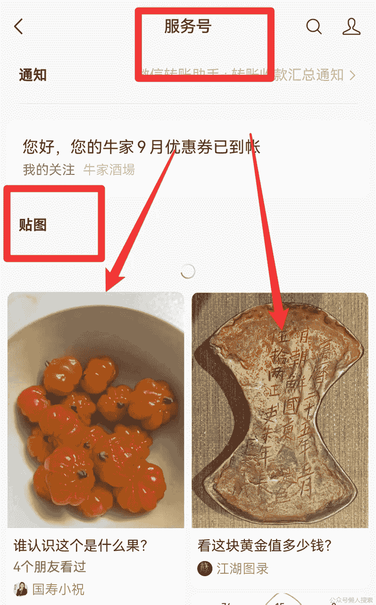


不同入口展示的是不同样本。消息入口更接近用户已经关注的账号；搜一搜更适合主动找关键词；看一看和相关推荐更容易发现平台正在反复呈现的内容。不要把自己的首页推荐页，当成整个平台的全部情况。

突破信息茧房，看 2—3 个候选方向

刚开始找对标时，先不要只追一个账号，也不要急着把推荐页刷成单一方向。你可以确认一下自己在做的赛道，然后来看知识库里面的一些对标，看看这些赛道到底长什么样子

1.  从对标库采样：每个候选赛道先看项目组已经整理的案例，不要求新手自己设计关键词。

1.  **保留 2—3 个候选方向：**每个方向先留 3—5 条近期仍有互动的内容，不急着下结论。

1.  **记录共同特征：**它在服务哪类人、触发什么情绪、标题怎样写、图片是什么调性、评论区在讨论什么。

1.  **再做横向比较：**看哪个方向近期内容更连续、真实互动更集中、素材更容易持续获得。


💡目标是扩大研究样本，不是机械点赞、收藏或“养号”。推荐页太窄时，回到 100 个对标库切换方向；推荐页太杂时，回到 2—3 个候选方向继续比较。

选定主方向后，再纵向深挖同行

比较完候选方向后，先选一个主方向，再保留一个备选方向。这里的“垂直”不是永远锁死，而是让一轮测试里的人群、场景和情绪保持相对一致，方便判断结果。

方法一：从 100 个对标库横向看

**【对标库】仅向本期学员开放，用于选择样本和拆解结构。**请勿外传，也不要直接搬运其中的原图原文。

先按赛道查看项目组整理的对标，再从每个候选方向各留 3—5 条样本。重点比较人群、场景、情绪、图片调性和评论区。

方法二：继续下拉，进入“更多相关贴图”和话题页

1.  先打开一条真正有参考价值的贴图，滑到内容末尾。

1.  留意“更多相关贴图”、话题标签、相关推荐或同类作者入口。

1.  进入相关列表后，连续查看 3—5 条，观察它们是否属于同一人群、同一情绪或同一种图片调性。

1.  结果开始重复时，不要机械继续刷；改换一个维度：同一赛道换人群、同一人群换场景，或回到 100 个对标库切换候选方向。


方法三：比较库内相邻案例的标题结构

看到高互动标题，不只收藏原句，要在库内继续比较同一结构的不同写法。例如“你们那边叫什么”“这种东西现在很少见了”“刚从某地回来，最想提醒的是……”重点看结构怎样变化，不照抄原句。


补充方法：搜一搜关键词＋标题反搜

1.  在微信“搜一搜”输入细分关键词，切换到贴图或相关内容入口，优先观察近期仍有更新和真实互动的样本。

1.  遇到高互动标题时，提取主题词或把标题放回搜一搜，继续比较 3—5 条同主题内容，看不同账号怎样调整人群、场景、标题结构和首图。

1.  只记录来源链接、发布时间、人群、主情绪、首图结构和评论区讨论点；不要把搜到的原图、原文直接放进发布文件夹。

入口名称和筛选项可能随微信版本变化，以当前页面显示为准。标题反搜是扩大研究样本的方法，不代表搜索结果里的内容都值得照做。

怎样判断哪些赛道和调性值得继续观察

不要用一条爆款替平台下结论。更值得记录的是一组内容是否反复出现以下信号：

• 同一方向在不同入口都能反复看到，而不只出现在自己的推荐页；

• 近期仍有作者持续更新，不是只剩很久以前的一条爆款；

• 评论区真的围绕主题回答、怀旧、站队、补经历或给建议；

• 标题、情绪和图片调性的共同点能够被说清，而不是只觉得“看起来很火”；

• 自己能够持续找到合规素材，并延展出相邻主题。

这些只是当前阶段的观察信号，不等于平台对某个赛道的官方结论，也不代表后续一定获得推荐

对标学习的二创边界

• 可以学习题材、构图、标题层级、组图顺序和互动机制；

• 不能直接搬运原图、原文、人物经历和独家事实；

• 发布时换成自己的素材、场景、观点和表达，并核对图片来源；

• 关掉参考内容后，自己的成品仍能独立成立，才算完成。

💡

**完成标准：明确了自己要做的赛道，能够定一个主要的方向和备选方**案，知道应该如何对标同行，并且创作内容。

### 02. 【贴图图片】贴图来源与制作

💡

**本章概要**

先过最低图片审美，再按本期 6 个赛道共用的判断顺序选路线：有自有或授权原图就优先用真实源图；没有可用原图但可以做画面示意时，再生成纪实无字底图；只有图片必须靠一句话才能成立时，才叠加标题或少量标注。Mini 航海只需选一条路线跑通。

这三条不是三种软件，而是三种处理方式：同一个赛道会随着题目和素材变化选择不同方式。交给 Skill 的参考图准备 1—2 张即可，第一条成品优先保留 1—3 张；首图负责让人看懂主题，后面的图必须补充新信息。

📌

**本期范围：**只使用怀旧回忆、美食特产、宠物萌宠、奇葩稀罕事、婚姻家庭、中年实拍 6 个赛道 Skill。六类样图和对应赛道入口已放在必修篇“六个赛道先看图”中，这里只讲通用的选图与作图逻辑。

1.第一步：了解图片素材有哪些来源

• **自己拍摄：**生活场景、城市、物件、绿植、美食和宠物。重点不是摄影技术，而是留下真实细节。

• **正规图库：**使用前确认授权和商用边界（pexels，pixabay），再按自己的主题重新组织。

• **跨平台案例：**只用来找题材、构图、标题和图片角色，不能原样搬运。

💡

**参考图不等于发布素材。**只有自己拍摄、明确授权或正规图库可用的图片，才进入发布文件夹；小红书截图和他人作品只作内部结构分析。

2.第二步：用小红书关键词和推荐流补充图片方向

💡

**什么时候使用：**第一条内容已经通过对标库＋WorkBuddy跑通，准备长期更新，或者对标库里的图片方向暂时不够时，再来小红书扩充题材和画面参考。不要让刷素材阻断第一条发布。

💡

**先记住：**小红书用来找题材、构图和图片吸引力，不等于图片可以直接搬走。没有明确授权时，只保存链接和截图作内部参考，最后仍交给 WorkBuddy 重新创作，或改用自己拍摄、授权素材。

2.1第 1 个动作：固定账号和一个赛道，再准备搜索词

📌

**前置条件：**固定使用一个小红书账号，先训练一个赛道。推荐页还很杂时，不要直接漫无目的地往下刷，也不要今天搜宠物、明天搜婚姻、后天又搜美食。先用关键词主动告诉平台“我现在持续关注什么”，再通过正常阅读和互动强化这个方向。

**关键词组合公式：**赛道核心词＋人群或场景词＋反差、动作或问题词。每次选 2—3 个词组合搜索，不要输入一大段完整句子。

| 赛道 | 先搜的核心词 | 可以搭配的场景／问题词 | 直接可用的搜索示例 |
| --- | --- | --- | --- |
| 怀旧回忆 | 老照片、老物件、80年代、90年代、童年回忆 | 供销社、老街、结婚照、粮票、农村生活 | 80年代 老物件；老照片 结婚照；小时候 农村生活 |
| 美食特产 | 家乡特产、地方小吃、农村美食、时令食材、冷门食材 | 怎么吃、怎么做、第一次见、老味道、采摘 | 地方小吃 老味道；冷门食材 怎么吃；农村美食 制作过程 |
| 宠物萌宠 | 猫咪日常、狗狗反应、胖猫、宠物第一次、救助成长 | 睡姿、表情、护崽、见到主人、前后变化 | 胖猫 奇怪睡姿；狗狗 第一次见；猫咪 表情反差 |
| 奇葩稀罕事 | 街头奇观、奇怪物件、没见过、神奇操作、民间手艺 | 车辆、玩偶、植物、农村、制作过程 | 街头 没见过；奇怪车辆 玩偶；民间手艺 神奇操作 |
| 婚姻家庭 | 夫妻相处、婆媳关系、家庭分工、育儿冲突、中年婚姻 | 家务、带娃、回娘家、过年、钱、沟通 | 夫妻 家务分工；婆媳 相处；中年夫妻 钱 |
| 中年实拍 | 40岁、50岁、退休生活、中年再就业、普通人生活 | 一个人、收入开支、摆摊、工地、照顾父母 | 50岁 退休生活；中年 再就业；普通人 一天生活 |

💡

**为什么要这样组合：**只搜“怀旧”或“宠物”太宽，容易混入大量无关内容；加入人群和场景后，才能找到可以直接看懂的具体画面；再加入反差、动作或问题词，更容易找到“首图有东西可看、正文有话题可写”的图文样本。

1.  从上表选择当前赛道的 3—5 组关键词，不跨赛道。

1.  每组先打开 3—5 条近期、主题清楚的图文笔记，优先看首图主体明确、组图顺序完整、评论区有真实讨论的内容。

1.  搜索结果太宽，就补场景词；结果太少，就先去掉问题词，只保留“核心词＋场景词”。

**操作图 ｜先用关键词主动搜索**


2.2第 2 个动作：在搜索结果里正常阅读和互动

找到符合当前赛道的笔记后，再做正常的阅读动作。这里不是机械刷赞，而是让账号持续表现出真实、稳定的同一类兴趣。

1.  **停留：**打开目标图文，读完标题和正文，左右滑完组图，再看一眼评论区。不要点开两秒就退出。

1.  **点赞或收藏：**只有确实值得作为选题、构图或情绪参考的内容才点赞、收藏；一轮保留 3—5 条即可。

1.  **互动：**确实有话可说时，再留下与内容有关的正常评论，或查看评论区里大家反复追问的问题。不要复制同一句评论，也不要批量操作。

1.  **继续关联阅读：**顺着同作者、同话题和相关推荐，再看 5—10 条同赛道内容；遇到无关内容直接划走，不点赞、不收藏。

💡

**为什么不是直接刷推荐流：**推荐页一开始承接的是账号过去的兴趣，内容通常很杂。先搜索相当于给出明确方向，再用停留、滑图、点赞、收藏和真实互动补充兴趣信号，之后回到推荐流，才更容易看到同赛道内容。没有哪一个动作能单独决定推荐结果，要看一段时间内的组合行为。

2.3第 3 个动作：回到推荐流验证是否逐步聚焦

1.  完成一轮搜索和互动后，回到“发现／推荐”页面刷新，观察前 10—20 条内容里，同赛道图文是否明显增加。

1.  如果仍然很杂，再换同赛道的另一组关键词重复一轮，不要立刻换赛道。

1.  推荐流出现较多同赛道内容后，只继续打开与账号方向一致的笔记；每轮留下 3—5 条高质量参考就停止。

1.  不要批量点赞、批量收藏、批量下载，也不要使用自动采集或模拟互动工具。我们的目标是建立稳定素材入口，不是制造虚假数据。

操作图 1｜先判断推荐流是否聚焦


**操作图 2｜打开目标笔记继续看**


2.4第 4 个动作：每条参考仍然只拆 3 点

1.  **话题：**这组图可以讲什么事？

1.  **图片吸引力：**首图靠什么让你停下来？是数量、反差、陌生物件、动作还是结果？

1.  **情绪切口：**它更适合写好奇、怀旧、心疼、治愈、选择还是共鸣？

保存时只记录：笔记链接、1—2 张内部参考截图、3 点拆解和可用关键词。作者关闭下载时不要绕过限制，带水印、账号名和平台标识的图片不直接发布。

2.5第 5 个动作：把新的图片方向交回 WorkBuddy

选出一条最接近当前账号方向的参考，上传截图，并在原来的赛道 Skill 对话中发送：

Plain Text

```
请继续调用当前赛道 Skill。下面是我从小红书找到的新图片方向，只学习题材、构图和反差，不照搬原图。\n\n话题：[填写]\n图片吸引力：[填写]\n情绪切口：[填写]\n参考截图：已经上传\n\n请沿用上一轮已经确认的文案和作图规则，重新生成 1 套标题、短文案、互动问题和 1—3 张新图。人物、场景、构图和画面细节必须重新创作，不保留原图水印、账号、品牌和文字。
```

💡

**这一轮完成标准：**留下 3—5 条同赛道参考，每条都能写出话题、图片吸引力和情绪切口；再选其中 1 条交回 WorkBuddy 重新生成，而不是直接把小红书图片拿去发布。

3.第三步：只按 3 个标准筛图

| 判断标准 | 怎样才算合格 |
| --- | --- |
| 一眼看懂 | 主体清楚，不糊、不乱，不需要解释半天。 |
| 同一个主题 | 1—3 张 图都在讲同一件事，不要旅行、美食、职场混在一起。 |
| 各有作用 | 信息不重复： 每张图都补充一个新信息。 |

**例 1：人物与标题情绪一致**


**例 2：生活素材简单直观**


4.第四步：排好 1—3 张图

1.  **第 1 张：**放最清楚、最能表达主题的一张，负责让人停下来。

1.  **中间：**补细节、过程或不同角度，不要每张都重复。

1.  **最后 1 张：**放结果、总结，或给评论区留下一个选择题。

💡

**20 分钟还没选完，就停。**第一条只要凑齐1—3 张合格图片即可，不需要一次把素材库建完。

**完成这一轮，你手里要有**

• 我有一个具体主题。

• 我保存了1—3 张同主题图片。

• 我已核对每张图的来源和授权范围，并保留必要记录。

💡

**提醒：**未经允许，不要使用别人的单张图片或整组图文。优先使用自己拍且可发布、授权范围允许当前用途、明确可商用或确认工具规则允许使用的生成图片。

5.第五步：再过图片最低线——清楚、干净、统一、有关

| 标准 | 手机端怎样判断 |
| --- | --- |
| 清楚 | 图片缩小后，主体和大字仍然看得清；不糊、不虚焦。 |
| 干净 | 没有大水印、广告角标、错误文字和一堆抢注意力的杂物。 |
| 统一 | 同一组的比例、字体、边距和主要色调不要忽大忽小、忽红忽绿。 |
| 有关 | 图片能证明或补充当前主题，不因为“好看”就硬塞进来。 |

**一秒测试：**把图片缩小到手机大小，给自己 1 秒。说不出主体是什么、这一张想表达什么，就删掉或重做。

活人感：让人看见具体生活正在发生

活人感不是故意拍糊，也不是把房间弄乱。它是图片里有具体的时间、场景、动作和一个可信细节，让人觉得“这件事真的发生在生活里”。人物不一定出镜。

例如：怀旧图里的掉漆和旧桌面；美食图里的锅气、焦痕和正在翻面的手；宠物图里的毛发和抓痕；中年实拍里的时钟、账单、凉掉的饭和反复修改的文件名。聊天记录、订单、证件和人物照片要脱敏；不是自己的经历，不写成“我亲身经历”。

信息增量：每往后划一张，多知道一件事

一组贴图不是同类图片合集。后一张要补充前面没有的新场景、新细节、新证据、新对比或新选择。遮住其中一张，如果整条内容完全不受影响，这张大概率只是装饰。

以“煎土豆”为例：第 1 张给成品和问题，第 2 张补切块厚度和翻面动作，第 3 张给焦黄细节、调味和结果。不是重复放三张土豆，而是每张多回答一个问题。


6.第六步：根据手里的素材，选择一种制作方式

💡先问素材来源，再问图片职责：有自有或授权原图，走逻辑一；

无可用原图、且允许用画面示意，走逻辑二；

底图已经成立但必须靠一句话解释，走逻辑三。

不要因为某个赛道常用一种样式，就把每个题目都套成同一张图。

6.1制作方式一｜真实原图优先：原创实拍或授权原图

1.  找到至少一个画面主体：人，物，异常值

1.  **每个角色拍两个版本：**擦镜头，靠近窗边或主光源；一个拍近景，一个拍带环境的远一点版本。画面本身足够说明时不要预留标题区；确认需要叠字时，再选择不会挡住主体的位置。

1.  **只做基础调整：**拉正、裁掉杂物、稍微调亮、统一色温，不用重滤镜磨掉真实质感。

1.  **按角色筛图：**同一个细节只留最清楚的一张，并检查隐私信息。

**实拍参考：一张图的爆点怎么找**

实拍图不一定要拍得像摄影作品。真正有用的首图，是用户缩小到手机大小后，1 秒能看见主体，2 秒能说出哪里不寻常，顺手还能问出一个问题。下面这些截图只作为选图练习，重点看画面为什么会让人停下来。

💡

**选图先问四句：**主体一眼能看懂吗？反常点能用一句话说清吗？有没有近景细节作证？能不能自然问出“你见过吗、你们那里怎么做、它到底是什么”？四句里答不上三句，这张图就不适合做首图。


这一组的爆点是“数量和密度反常”。画面本身已经成立，不需要先讲大道理。选图时要保留整体轮廓，也要准备一张近景，让用户看清密集细节，而不是连续放几张差不多的远景。


这一组的爆点是“看起来像另一个东西”。熟悉物件被陌生化，最容易触发好奇和求证。首图要选最像、最容易误认的角度；第二张再补结构、材质或使用痕迹，帮助用户得到答案。


这一组的爆点是“做法和地域差异”。美食图不要只拍最后一盘成品。首图负责让人想吃或觉得没见过，后面的图依次补食材、关键动作、火候和结果，每往后划一张都多知道一件事。


这一组的爆点是“熟悉东西里出现陌生细节”。越是日常的场景，反常细节越容易被看见。拍摄时不要把主体塞满整张图：保留一点环境，让人知道它出现在哪里；再补一张近景或比例参照，方便判断大小和材质。

💡

**转成自己的拍摄动作：**同一个题目至少准备 3 个画面角色——第 1 张拍整体和反常点，第 2 张拍近景证据，第 3 张补环境、过程或结果。

💡

**参考边界：**这些都是对标截图，只研究题材、构图和互动方式，不直接作为发布素材。截图里的阅读量只说明样本值得拆解，不代表其中的文物身份、年代、估值、民俗用途或食物做法已经核实；正式写文案前要另找可靠来源，发布时换成自己拍摄、明确授权或重新制作的图片。

6.2制作方式二｜无原图时做纪实画面示意：参考规律，不冒充现场

参考图不能直接变成发布图。没有授权时，只提取主体占比、动作、环境、光线、生活痕迹和第一眼爆点，再围绕自己的新主题重做。

参考图只放在内部分析区，不进入发布文件夹。

1.  **先确认素材能不能直接使用：**自己拍摄或明确授权的图片可以进入发布流程；只有参考价值、没有使用授权的图片，只能用来分析题材和构图，不能直接改一改就发布。

1.  **重新制作时只学习规律：**记录主体占比、动作、环境、光线、生活痕迹和第一眼吸引力，再换成新的主体、场景和细节。

1.  **生成时先出无字底图：**写清主体、一个动作、普通环境和一个可见细节；明确不要中文、数字、Logo 和水印。

1.  **完成后做事实检查：**人物、手部和物件不能畸形；生成图要标明“画面示意”，关掉参考图后仍能独立表达才算完成。


6.3制作方式三｜无字底图＋准确叠字：画面不够时再加标题

工具可以用 Canva 可画、稿定、醒图，也可以让 Skill 先生成无字底图，再交给排版工具叠加中文。关键是先把底图和文字分开处理，避免生图时直接出现乱码。只记住下面四个动作：

1.  **新建 3:4 竖版画布：**可用 1080 × 1440；同一组保持同一尺寸。

1.  **导入底图并裁切：**先保住主体，再找上方、下方或侧边的留白。

1.  **封面只放一个重点：**标题 1—3 行，只用两档字号和一个强调色；背景复杂用白底条，背景干净可用描边大字。

1.  **复制封面做正文页：**每张只讲一点，统一字体、主色和边距；缩到手机大小预览，确认可读后导出高清 PNG。


这一组就是逻辑三的完整前后关系：先验收底图中的搪瓷缸、旧日历和木桌环境，再决定要不要叠字；如果纯图已经能让人看懂主体，就不必硬加长标题。需要补充话题时，只叠一条简短、准确、不会遮挡主体的口语化标题。

**Mini 交付：**第一条先做 1 张封面＋0—2 张补充图。字体不超过 2 种，主要颜色不超过 3 种；字太多先删字，不先缩字。素材确实有更多信息时，再增加图片。

7.第七步：根据画面和标题选择版式

风格不同，不是因为哪一种更高级，而是四件事不同：原图哪里有留白、标题有多长、这一页要让用户做什么、内容本身是什么气质。

| 常用样式 | 适合什么素材 | 怎么做 |
| --- | --- | --- |
| 白底条标题 | 单张生活照、背景稍乱 | 用白色实底托住 1—3 行标题，阅读最稳。 |
| 顶部描边大字 | 主体在下，上方留白干净 | 标题放上方，不遮人脸、食物和关键物件。 |
| 四宫格＋超大字 | 多张细节、清单或前后对比 | 先让人看出“内容很多或差别明显”，标题必须短。 |
| 叠放标签 | 三个短判断、步骤或原则 | 每条只写一个重点，不把长段正文塞进标签。 |


真实案例：不同赛道怎样选择作图风格

本期选题仍然只从前面的 6 个赛道里选择。

下面个别截图如果出现其他内容方向，只看版式：图片数量怎么安排、哪里留白、标题放在哪里、主要情绪怎么突出；不要把它当成本期新增赛道，也不要照搬截图里的结论。


白底条适合单张生活照，四宫格适合多个场景。真人脸部、动作和环境是主要信息时，标题不能盖住人物；四宫格里每张图要承担不同角色，不能只是同一地点换角度。


拼贴强调信息量，单图大字强调一个结论。拼贴最好准备人物、环境、动作、细节四种画面；单图大字则只讲一个重点，正文再展开原因，不要把十个结论都塞在封面。


钱、年龄、存款和工作年限都属于强信息。画面里已经有钱或人物时，标题不要再堆太多装饰；数字必须有真实来源，不能为了让人停留随手编一个夸张金额。


婚姻家庭赛道示例：生活底图＋一句关系判断


这类内容靠“熟悉的生活场景＋一句容易站队的判断”让用户代入。选图要有人物关系或家庭生活感，标题要短；正文再补具体场景。不要把个别经历写成所有夫妻都适用的规律，也不要靠贬低某一方制造性别对立。

💡

**不会选版式时按这个顺序：**一张图已经很抓人，少放字；背景乱，用白底条；要同时交代多个场景，用四宫格；要讲一个强观点，用单图大字；要列 2—3 个判断，用叠放标签。同一赛道可以换版式，同一种版式也能服务不同赛道。

💡

**只学版式，不照搬结论。**截图里的存款金额、裁员经历、婚姻规律和行业趋势，都不能因为字大就自动变成事实。涉及数字、政策、行业判断和他人经历时，要有来源或真实材料；没有依据就换成可核验的问题与场景。

**不会选时先用白底条。**先看空位，再放字；标题太长先删字，不先缩字。同一账号先固定一种主样式完成一轮测试，数据和素材证明不合适，再换。

8.第八步：发布前检查这 5 项

首图在手机上 1 秒能看懂，主体、标题和账号方向一致。

图片清楚、干净，比例、字体和色调基本统一，没有大水印或错字。

后一张提供了前一张没有的新信息，没有重复图和纯装饰图。

至少有一个真实场景或可信细节，同时没有隐私、版权和错误信息。

正文不重复图上文字，结尾问题具体、自然、好回答。

💡

Mini 航海先掌握这套最低判断。不同赛道更细的图片审美和文案写法，会在对应项目群继续展开。现在先选一条制作方式，完成一次真实发布。

### 03. 备用工具：已有可用图片时，用课程 Agent 只补文案

📌

**使用说明：**课程文案 Agent 是本期配套工具，本节不放入口，也不展示授权码。实际使用时按课程通知进入；如果页面要求验证，使用课程提供的授权信息完成即可。

💡必修篇已经通过“对标库＋WorkBuddy＋赛道 Skill”完成文案和新图。本章只适用于已经有可用图片、不需要重新生图，想额外补一版标题、短文案和互动问题的情况；它不代替前面的主线流程。

💡

**进入本节前，你要准备好：**1—3 张可以发布的同主题图片、所属赛道、一个具体主题，以及“话题、图片吸引力、情绪切口”3 点拆解。

**完成本节后，你要拿到：**1 个可用标题＋1 段 80—180 字短文案＋1 个自然互动问题。图片不在这里重新生成。

第一步：确认图片主题和参考写法

为了让前后流程接得上，这一节不再换案例，继续使用前面那张“挂满玩偶的外卖车”图片。先确认图片可以发布，再把它归到前文 6 个赛道中的“奇葩稀罕事”。实际操作时也一样：只在 6 个赛道里选，不临时增加新赛道。

第二步：把同一张外卖车图片和 3 点拆解交给课程文案 Agent

1.  上传前面已经确认可用的 1—3 张图片。

1.  在输入页填写关键词或画面描述。外卖车案例可以写：“一辆外卖车上挂着大量玩偶，数量多、密度高，和普通外卖车明显不同。”

1.  人设或人物关键词只填写已经确认的信息；不知道身份、年龄和经历就留空。然后从前文 6 个赛道中选择 1 个。字数和补充要求拿不准时，可以先用默认设置。

1.  提交后检查结果页，从候选内容里选 1 个标题、1 段短文案和 1 个互动问题继续修改，不反复生成几十版。

**实际操作示例：从输入到生成结果**

外卖车案例中，画面描述写“外卖车挂满玩偶”；赛道选择“奇葩稀罕事”；人物身份、年龄和经历都没有可靠信息，所以不要填写。字数和补充要求没有特殊需要时，直接使用默认设置。


💡

**这次在输入页就这样填：**

图片：前面已经确认可用的“挂满玩偶的外卖车”图片

画面描述：一辆外卖车前后挂满大小不同的玩偶，数量多、密度高，和普通外卖车明显不同

赛道：奇葩稀罕事

人物信息：留空，因为图片看不出年龄、收入和个人经历

字数、补充要求：第一次先用默认设置

💡

**结果页至少要拿到这 3 项：**

**标题示例：**一辆挂满玩偶的外卖车，路过的人都忍不住多看两眼

**短文案示例：**今天路上碰到一辆很抢眼的外卖车，车前车后挂满了大大小小的玩偶，远看像一间会移动的小玩具店。平时见到的外卖车大多简简单单，这辆却让人忍不住多看几眼。忙碌的日子里，给身边的东西添点趣味，也挺好。

**互动问题示例：**你还见过哪些特别的外卖车？

这只是示例，不要求一字不差。重点是标题、正文和问题都围绕同一张图，也不要替外卖员编经历。


💡生成结果只是初稿。外卖车案例只写图片里看得见的车、玩偶和画面反差，不猜外卖员的年龄、收入和个人经历；图片不能证明的内容，直接删掉或改成普通观察。

第三步：人工只检查 4 项

标题包含本赛道常用的人群、场景或情绪词，读者能看懂在讲什么。

标题、正文和已经选好的图片属于同一个主题。

没有编造人物经历、时间、地点、价格和事实。

结尾问题自然、好回答，不强迫互动。

💡本章结果：1 个可用标题＋1 段短文案＋1 个互动问题。下一步直接进入发布。

### 04. 【数据复盘】数据复盘与迭代

💡

**本章概要**

发布后要留下记录，但不同账号能看到的数据不一样：还没开通流量主，先看阅读、来源和互动；已经开通流量主，再看广告曝光、收入和 eCPM。不要把内容曝光和广告曝光混成一个指标。

📌

**还没开通流量主：**先记录发布时间、主题、阅读量、流量来源和评论内容。等后台出现广告收入入口后，再补看广告曝光、收入和 eCPM。

已经开通流量主：再进入广告收入明细

广告曝光量是广告实际展示的次数；eCPM 可以理解为每千次广告展示带来的有效收入水平。它会随广告需求、用户和时间变化，不是账号固定单价，也不能单独代表内容好坏。


📌截图数据只用于说明后台怎么看，不代表所有账号的正常水平。复盘时优先比较自己同一账号、相近题材和相近发布时间的数据。

**先看自己现在能看到哪些数据**

📌

**看图顺序：**先确认主题、受众、信息增量和版权安全；然后同方向连续发布 3—5 条，每次只改变选题、首图、文案或节奏中的一个变量；最后再看连续表现，不用一条数据决定整个账号方向。

**先把“进池”说清楚**

“进池”是运营者常用的说法，不是后台里的官方开关，也没有固定阅读量门槛。更实用的判断是：流量来源中开始出现推荐、搜索等非订阅用户入口，而且不只发生在一条内容上。

**单条内容表现突出：**某一条内容获得的推荐或搜索流量明显高于账号里的其他内容，可以先记为一条表现较好的样本，但不能据此判断账号已经稳定。

**账号持续获得推荐：**连续多条内容都从相似入口获得分发，且用户讨论仍围绕同一人群和主题，才说明账号方向开始形成较稳定的内容信号。

一条数据不能说明整个方向。先在同一方向连续发布 3—5 条，再看类似反馈有没有重复出现，然后决定下一步改什么。

进池后，用 5 项连续判断决定下一步

1.  **看停留、评论和分享的组合：**不要只看阅读量。有人愿意停下来读、留言或转发，才说明图片和话题真正打中了人。

1.  **保持稳定更新，不靠短期爆更：**按自己能长期坚持的节奏发布。一天猛发很多条、后面又停更，数据很难放在一起判断。

1.  同方向连续发 3—5 条再复盘：人群和主题先不要乱跳。看这几条有没有重复出现的停留点、评论点和分享理由，再决定是否继续。

1.  **突然掉流量先排查：**先检查选题是否跑偏、标题和首图是否一致、素材有没有版权或敏感风险；不要一着急就删除、重发。

1.  **记录结果，下一条只改一个变量：**写清这条保留什么、下一条改什么。比如只换首图，或者只换标题，不要一次全部推翻。

这 5 项不是新的后台指标，而是一套连续发布后的运营判断。目的不是猜平台开关，而是避免因为一条数据高低就反复换赛道、删内容或重新发布。

每条内容至少留下这张复盘

| 记录项 | 用来判断什么 |
| --- | --- |
| 赛道与细分方向 | 哪一类题材的反馈更稳定 |
| 素材来源 | 自拍、知识库、对标延展还是AI辅助 |
| 选题与标题结构 | 哪种角度更容易让人停下来 |
| 阅读与推荐变化 | 内容是否进入了下一轮测试 |
| 评论数量与内容 | 用户真正对什么有话说 |
| 转发与收藏 | 内容偏传播、偏实用还是只有短暂情绪 |
| 人工修改记录 | Agent初稿到发布稿之间改了什么 |
| 下一条动作 | 延展、换标题、换首图、换角度或停止 |

别只盯阅读量，按“曝光—打开—互动”一步步找问题

如果后台显示曝光量和打开量，可以用“打开量 ÷ 曝光量”观察打开率。不要套用网上的固定优秀标准，优先与自己账号同类型、相近发布时间的内容比较。


这张图里，推荐来源占比较高，说明这条内容主要由陌生流量带来；但单篇数据不能直接证明账号已经稳定。还要看后续多条内容是否持续从相似入口获得推荐，以及评论是否仍围绕同一人群和主题。

• **曝光偏低：**先别急着换赛道。先看选题是不是太泛、最近几条方向有没有跳来跳去，素材主题是不是足够清楚。下一条先保留主方向，只换成一个更具体的场景或相邻选题。

• **曝光尚可，打开偏低：**先检查标题和首图是否清楚、是否与正文一致。下一条保留正文，只调整标题或首图中的一个变量。

• **打开尚可，互动偏低：**先检查正文是否缺少具体场景、结尾问题是否过大过空。下一条补一个真实细节，把问题改成用户能立即回答的选择或经历。

• **多条内容都有人点开、有人互动：**这时候别忙着换玩法。把这些内容里反复出现的人群、场景、情绪和标题写法找出来，保留已经验证有效的部分，再换相邻素材继续做成系列。

**三句话极简复盘卡**

1.  今天最好的数据或真实反馈是什么？

1.  当前最明显的问题是什么？

1.  下一条只准备修改哪个变量？

三句话写清楚即可。复盘的结果必须落到下一条动作，不把复盘写成长篇感想。

不要只看一个数字

阅读的变化，先用来判断内容有没有继续被推给更多人；评论区在聊什么，能看出用户究竟被哪一点打动；再结合转发和收藏，判断大家是有共鸣、愿意分享，还是觉得这条内容确实有用。

数据高但评论区与主题无关，不能直接证明方向有效；数据一般但评论集中、用户持续补充经历，也可能说明题材值得换标题或首图继续测试。

一次只调整少量变量

| 观察到的问题 | 优先检查 | 下一轮动作 |
| --- | --- | --- |
| 几乎没人点开或停留 | 选题是否具体、标题和首图是否清楚 | 保留素材，换标题或首图做相邻测试 |
| 有人阅读但很少互动 | 情绪是否明确、问题是否容易回答 | 保留主题，重写互动问题和正文场景 |
| 评论很多但方向发散 | 用户实际在讨论什么 | 从评论中提取下一条相邻选题 |
| 某类素材连续有反馈 | 共同人群、场景和标题结构 | 做系列延展，不急着切换赛道 |
| 连续测试仍无明显信号 | 素材条件、赛道宽度和表达方式 | 先调整一个层级，再决定是否更换细分方向 |

不要同时更换账号、赛道、标题、图片和文案。全部一起变化，下一轮即使数据变化，也不知道原因来自哪里。

每轮复盘把内容分成三类

**有效方向。**用户停留和互动都相对集中，可以继续做同类场景和相邻素材。

**待验证方向。**题材可能有价值，但标题、首图或互动问题存在明显问题。保留主题，只换一个主要变量继续测试。

**暂时停止。**素材很难持续、事实风险高，或者多次相邻测试都没有清楚反馈。停止并不等于失败，而是把时间留给更有依据的方向。

下一阶段会自然出现的三个问题

• 有了数据，但不知道哪些反馈值得继续跟；

• 找到了有效题材，但不知道怎样稳定延展成系列；

• 单号能够稳定更新，但不确定什么时候适合扩展矩阵、多平台或更长内容。

这些问题会在飞书选修文档和后续项目小组中继续展开。

主线阶段不需要提前执行，只要先带着自己的数据和案例走到这里。

💡

**完成标准：**每条发布内容都有记录；能够根据数据和评论决定下一条具体动作；知道什么时候应该延展、什么时候换变量、什么时候暂停。

7.百问百答-常见问题看这里

💡

**本章概要**

遇到数据低、互动少、AI 味重、赛道摇摆等问题，先按具体卡点查 FAQ。很多问题并不是方向一定错误，而是动作顺序或判断环节还没有对上。


**先按问题查答案**

09｜Skill内容工厂常见问题答疑合集