# 🛰️贴图号｜龙哥盟 Mini 航海实战手册（2026）

> 原文出处：[https://hk57gvlx7u.feishu.cn/docx/ZG7RdpnCOoDKLGx50SccHUS8nsc](https://hk57gvlx7u.feishu.cn/docx/ZG7RdpnCOoDKLGx50SccHUS8nsc)
> 同步文档：<https://my.feishu.cn/sync/Lj5sd8APisk896bxImEcYvjMnlF>

# 引言：出发之前，先把这些事讲清楚

## 开船第一课

### ⛵ 贴图号是什么项目

“贴图号”并不是一种新的账号类型，而是业内为了方便沟通而起的俗称。👸号后台里，这个功能可能显示为“贴图”，官方推荐的规范名称是“图片消息”。在哪里能见到？打开🛰️，订阅号消息的推荐流中，那些以图片为主、配几句短文案的内容就是。下图中红框是图片消息，蓝框是过去常见的👸号长文章。

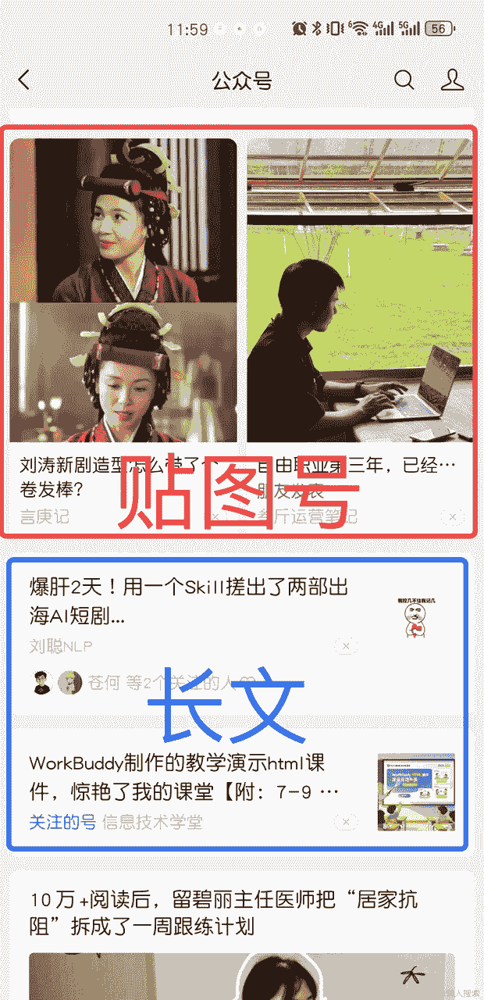

一条基础贴图内容通常由四部分组成：1 个标题、1—3 张图片、80—180 字的短文案，以及 1 个自然的互动问题。第一条内容先把主题说清楚，不必为了图片数量硬凑。补充一句：图片数量并不是平台强制要求。本课为了降低首条内容的上手难度，统一按 1—3 张成品图来准备；交给 WorkBuddy 的参考图，传 1—2 张就行。


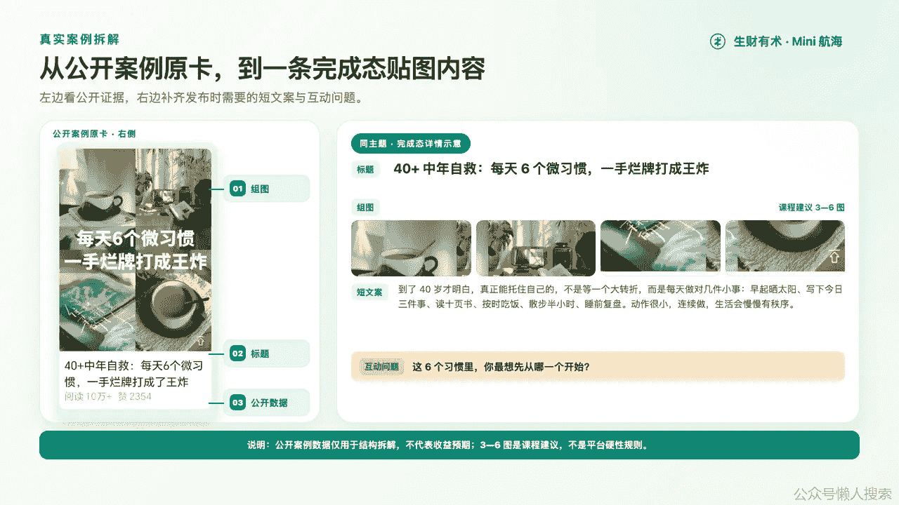

内容发出去后，阅读可能从订阅、推荐、搜索和分享等入口进来。账号开通流量主后，广告只有在真实用户看到时才有机会带来分成。收益受阅读量、广告需求、用户反馈、内容质量等多种因素影响，没有固定公式。所以我们先把内容做出来、推出去，再结合自己账号的真实数据做判断，不承诺任何阅读量或收益。

和长文章相比，贴图内容的负担小很多：标题清楚，配几张图，再来一段百来字的文案，第一条就能完成。起步阶段不用追求一天发很多，重点是先把“选题—出图—写文案—发布”这条链路完整跑通。

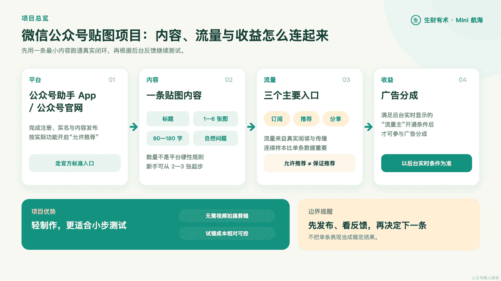

**为什么值得把它当成一个轻量项目来试？**

- 图片消息有被推荐的机会：内容可能进入🛰️的推荐和搜索入口，但能不能持续获得分发，还要看账号方向、内容质量和用户反馈。
- 创作和变现功能还在迭代：👸号助手持续优化贴图编辑、已发布内容的修改和广告相关设置，手机端也能完成轻量发布。
- AI 把执行成本压低了：整理素材和写初稿更快，但赛道判断、选图、真实性核对与复盘仍然需要人来做。

**整体操作链路**

选 1 个赛道 → 注册账号 → 从对标库取 1 条样本 → 拆 3 个重点 → 交给 WorkBuddy 生成 → 人工检查 → 发布并记录 → 进入选修篇

**课程为什么这样排？**

这套手册的核心目标，是先带你完成一次真实发布。第一条先跑通就行，不需要一次把对标库、素材库和所有工具都学完。做完之后，你会更清楚自己卡在选题、图片、文案还是发布环节。

1. 先定赛道和样本：在 6 个赛道中选一个方向，然后到对应的对标库里找 1 条主题清晰的近期样本。第一条暂时不用去📕扩充素材。
2. 把样本整理成可用输入：上传 1—2 张参考图，补上对标标题、原文、原文链接，以及“话题、图片吸引力、情绪切口”这 3 点拆解，再交给对应赛道的 Skill 重新创作。
3. 先发出去，再优化：没有真实阅读和评论，很难判断题材、图片和表达哪里要改。
4. 发布后再进入关键进修：根据真实结果，继续学习对标扩充、图片制作和数据复盘。

**内容出品人**

 ⃰辰风

手册出品方：龙哥盟团队

出品时间：2026 年 9 月

---

# 必修篇

## 一、赛道选择与账号注册

### 01. 选赛道

**赛道介绍：6 个赛道 + 100 个对标库**

💡 **本章概要**

打开[贴图号定位 Agent](https://chenfengai-tietu.pages.dev)，密钥：SCYS-TIETU-99A75D51E5。该密钥仅限赚钱社群内部使用，请勿把授权信息发到外部。

答完问卷，就可以先选一个方向。想看更细的赛道信息，直接翻 6 个赛道的介绍和对标，会更直观。

长期选赛道要满足三个条件：内容能成为系列、用户能产生情绪和互动、素材能持续找到。落到一句话就是：具体人群 + 高频场景 + 可重复素材 + 明确互动。

**1.1 贴图号定位 Agent 怎么用**

第一步：打开[贴图号定位 Agent](https://chenfengai-tietu.pages.dev)，按左图回答 5 道题，就能得到右图那样的定位推荐。

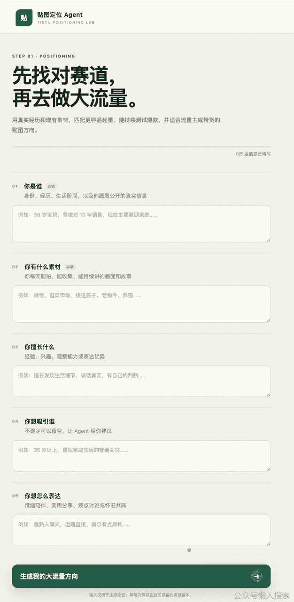

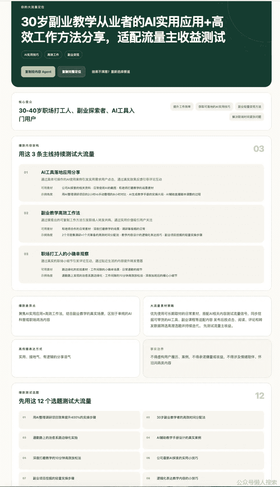

第二步：点击推荐赛道下方的【填写后续对接信息】。完成表单登记后，会把你分配到对应的赛道群。

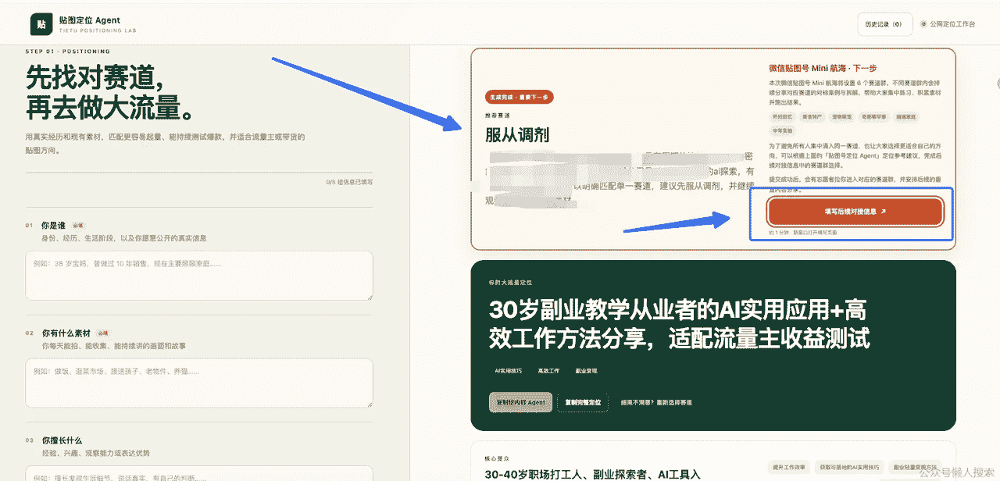

**1.2 本期 6 个主赛道一览**

主赛道内容已收录在 ima 知识库【贴图爆款学习库】：<https://ima.qq.com/wiki/?shareId=ff529677595dd004cafad7d97029e82cb6117b55cf12ee7c6f7a454ddfee563f>

| 赛道 | 人群与情绪 | 流量入口 | 常见对标 | 首条建议 |
| --- | --- | --- | --- | --- |
| 怀旧回忆 | 35 岁以上、对家乡或旧时光有记忆的人；核心是认出感、失去感和地域身份 | “小时候见过吗”“你们那里叫什么”“现在很少见了” | 老物件、旧证件、停产零食、老房子、过去的生活方式 | 选一个具体物件，写清使用场景和年代细节，再问地域叫法或个人经历 |
| 美食特产 | 本地人、做饭的人、吃货和在外生活的人；核心是食欲、乡愁和实用 | 锅里正在发生的变化、地方做法差异、“本地人才懂”的味道 | 菜市场、制作过程、地方特产、成品前后对比、家庭做法 | 只讲一道菜或一种特产，用“食材—过程—结果”组图，最后问大家的做法或叫法 |
| 宠物萌宠 | 养宠人和喜欢动物的人；核心是治愈、好笑，以及把人的情绪投射到宠物身上 | 意外反应、反差行为、回家瞬间、长期变化 | 宠物小习惯、前后对比、主人与宠物互动、带情节的连续照片 | 抓一个真实行为，补上发生前后，再问“你家也会这样吗” |
| 奇葩稀罕事 | 喜欢新鲜见闻和冷知识的人；核心是惊讶、怀疑和求证 | 反常现象、罕见物件、特殊职业、“不看不知道”的细节 | 近景证据、出处截图、前后对比、简短解释 | 选一个可核验现象，至少准备两张证据图和来源；无法核验的奇闻不要发 |
| 婚姻家庭 | 伴侣、父母和家庭责任较重的人；核心是委屈、站队、被理解和关系选择 | 一个具体冲突，比空泛的“婚姻真相”更容易让人代入 | 家务分工、婆媳、育儿、家庭开支、沟通场景 | 只写一个家庭场景，给出双方选择，结尾问用户会怎么处理 |
| 中年实拍 | 35 岁以上的普通人；核心是现实压力、自我重建、希望和“原来不只我这样” | 时间、账单、工作、家庭和重新学习中的具体细节 | 40+ 日常、下班后的第二生活、家庭责任、重新开始、小习惯 | 用一个真实细节讲清处境，再写你做了什么改变，最后问相似经历 |

**1.3 看图识赛道：一眼找到大方向**

贴图号最重要的就是图片，所以要从看图开始。把图缩到手机大小，看第一眼跳出来的是年代记忆、食欲、萌感、稀奇、家庭冲突，还是中年处境。用户第一眼接收到的情绪，基本就是这个赛道的入口。

你也可以看图猜一猜，下面这些截图分别属于哪个赛道：


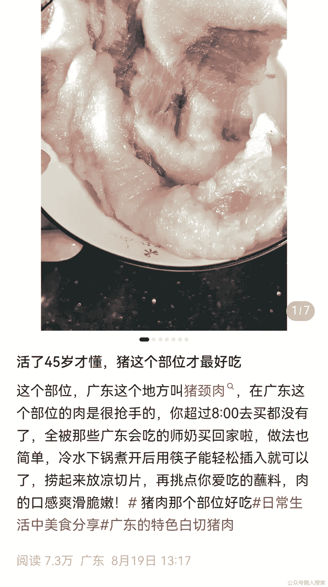

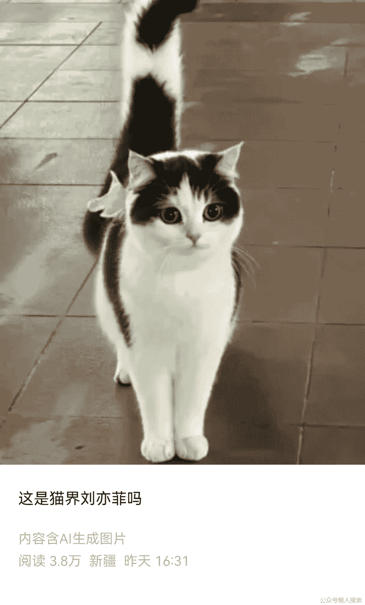


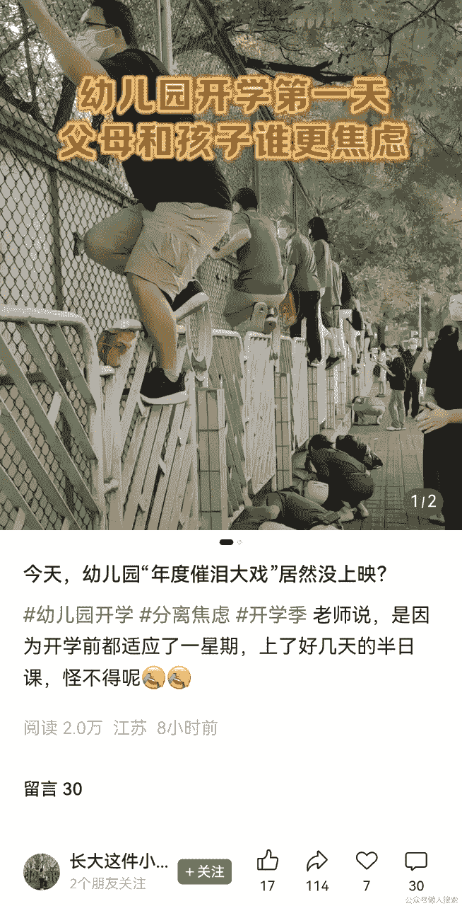


💡 **识别口诀：**怀旧看“认出”，美食看“想吃”，宠物看“反应”，稀罕事看“没见过”，婚姻家庭看“冲突与选择”，中年实拍看“具体处境”。一条内容只选一种主要情绪，不要把多个赛道硬塞进去。

💡 **图片说明：**这里的对标截图只用来帮助识别赛道和画面入口，不代表可以直接搬运。正式发布时，要换成自己拍摄、明确授权或重新制作的素材；涉及人物、旧照片和具体经历时，授权与事实核验尤其重要。

💡 **ima 知识库里还有其他方向。**职场、情绪、生活、旅游、民生等都可以测试，已经有持续素材优势的人可以选扩展方向。没有明显优势时，建议先从上述六个赛道中按推荐选一个。

**选赛道，要看方向能不能持续**

1. 素材要够多：不是只找到三五张图，而是能持续找到同类场景和相邻题材。
2. 情绪要够明确：认出、好奇、治愈、吐槽、选择、实用或共鸣，一条内容只打一种主要情绪。
3. 互动动作要够简单：用户能回答、站队、补经历、晒经验或提出问题。

赛道不是一个大词，而是具体人群 + 高频场景 + 可重复素材 + 明确互动。选方向的目的，不是赌哪个一定能爆，而是找到你能连续测试的内容。

**举个例子：“新奇、没见过”为什么可以持续做**

下面这 5 条样本：像宝石一样的石榴、手里拿不下的现金、落在宝宝手腕上的蚊子、长得很有记忆点的猫、很多人没见过的猪肉部位。它们不是同一种题材，但第一眼都会让人停一下：这是什么？真的假的？怎么会这样？

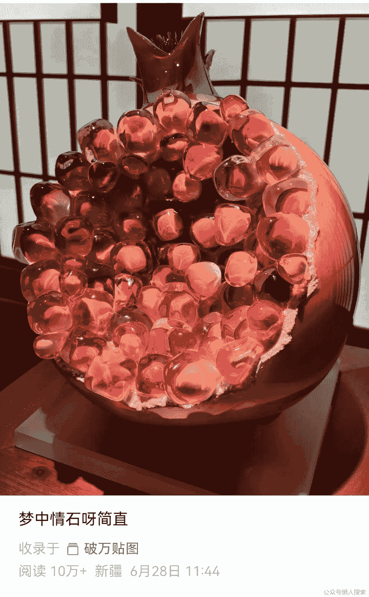

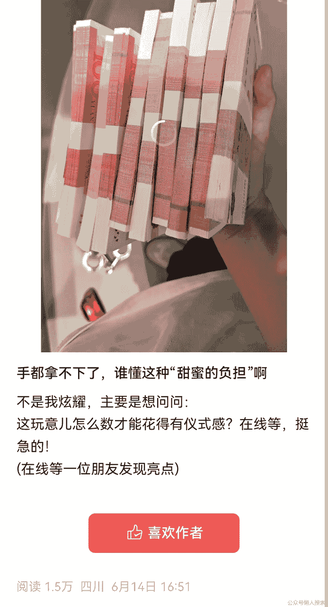

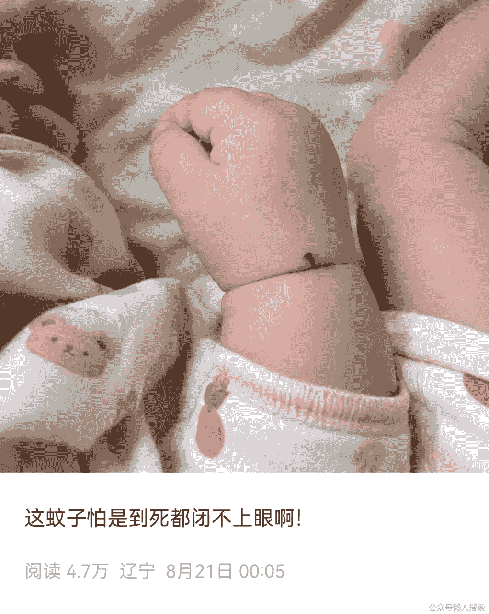


1. 素材要够多：新奇内容不只是“怪事”。少见物件、反常现象、动物瞬间、地方食材、特殊做法和生活巧合，都可以持续找。今天发一种没见过的东西，下一条可以换成“没见过的吃法”“没见过的动物反应”或“本地人才认识的物件”，题材能自然延展。
2. 情绪要够明确：核心不是吓人，而是先满足好奇和轻度猎奇，再带出惊讶、求证欲和分享欲。用户会想点开看清楚，也容易顺手转给朋友问一句：“你见过这个吗？”
3. 互动动作要够简单：别问大而空的问题，直接问“你见过吗”“这是真的吗”“你们那里叫什么”“这 5 张里哪一张你最想发给朋友”。用户不需要想很久就能回答。

💡 **把这个方向拆开来看就是：**喜欢新鲜见闻的人＋少见物件、反常现象和地方题材＋持续可找的相邻素材＋“你见过吗”这种低门槛互动。

💡 **边界提醒：**这类内容最容易把“新奇”做成“编故事”。图片和说法要先核验来源；这里的截图只用来观察选题和互动结构，正式发布时请换成自己拍摄、获得明确授权或重新制作的素材，不要直接搬原图原文。

### 02. 注册账号

💡 **本章概要**

个人👸号优先通过“👸号助手”App 完成注册和实名；🛰️内置的“👸号”入口和电脑官网只作为备选。注册完成后，先确认账号能正常管理和进入创作页，再继续设置昵称、简介与首批内容。

**推荐：通过“👸号助手”App 注册个人👸号**

💡 **这次航海优先推荐这条路径。**注册、实名校验和后续内容发布都可以在腾讯官方“👸号助手”App 内完成，手机操作更集中。请认准应用名称“👸号助手”，开发者/运营者为深圳市腾讯计算机系统有限公司，不要下载名称相似的第三方工具。

**完整流程：**应用商店安装 → 🛰️登录 → 创建👸号 → 设置头像和名称 → 实名校验 → 返回👸号助手 → 确认账号可管理。

**找到并安装应用**

打开手机应用商店或应用市场，搜索“👸号助手”，找到标注“🛰️官方提供的👸号管理工具”的应用，点击安装。安装完成后，回到手机桌面，点开👸号助手图标。

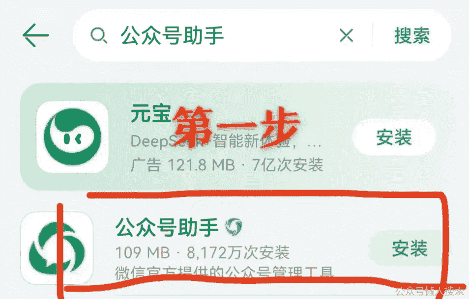

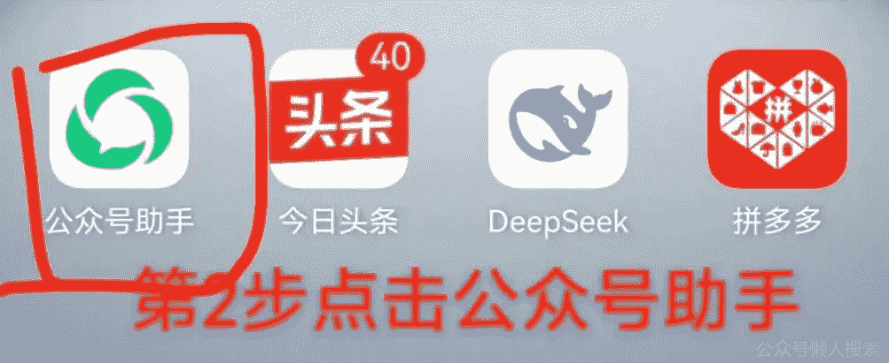

**同意协议并🛰️登录**

第一次打开 App 时，先勾选“我已阅读并同意用户协议和隐私政策”，再点“🛰️登录”。页面跳到🛰️后，按🛰️页面提示确认授权。

如果这个🛰️已经管理了👸号，会进入账号选择或管理页面；如果没有可管理的个人👸号，页面会继续进入“创建👸号”。

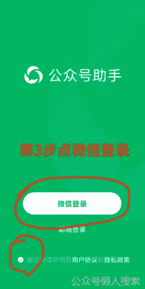

**填写资料并创建👸号**

进入创建页面后，先上传头像，再填写👸号名称，并按当前页面提示补充性别、地区等信息。名称不要临时乱填，优先用前面定好的赛道名称或备选名。

提交前检查：头像清晰、名称没有错字，并已勾选《🛰️公众平台服务协议》和《个人信息保护指引》，然后点击“创建”。

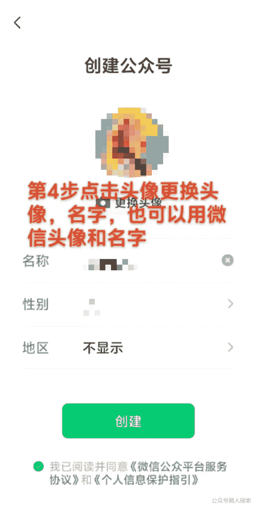

**创建完成后进入实名校验**

看到“已创建”页面后，不要直接退出。点击页面上的“实名校验”；出现“即将打开🛰️进行实名认证”的提示后，再点一次“实名认证”。

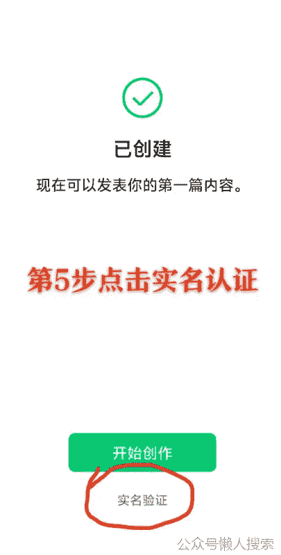

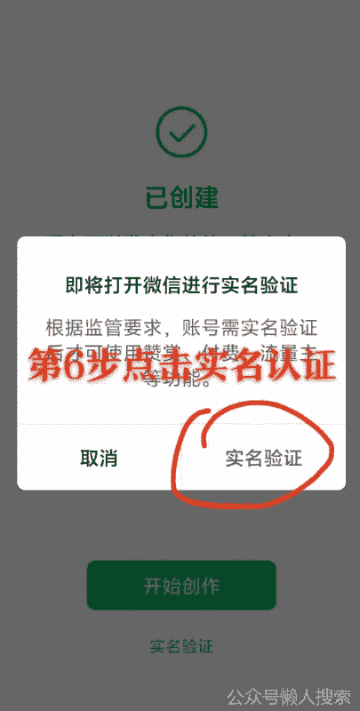

**在🛰️里完成实名验证**

页面跳到🛰️后，点击绿色“实名验证”按钮，按🛰️支付页面提示完成本人身份核验。需要输入支付密码时，只在🛰️官方支付页面输入，不要在任何第三方网页或聊天窗口提交密码。

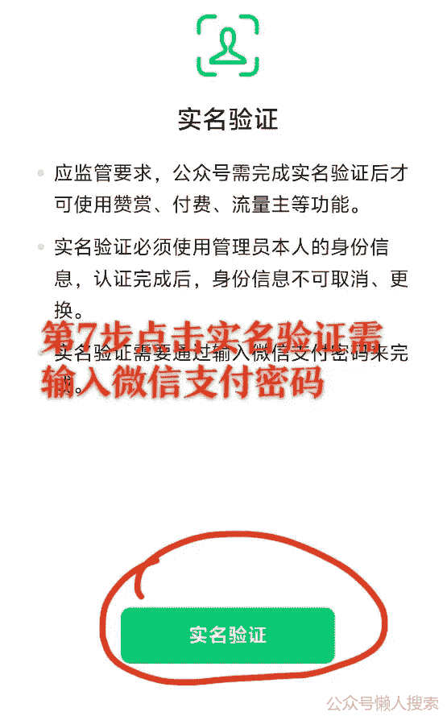

**返回👸号助手并确认结果**

实名完成后，🛰️会提示即将打开“👸号助手”，点击“允许”返回 App。进入账号主页后，确认能看到刚创建的👸号、头像和名称，并且能够进入创作页面。

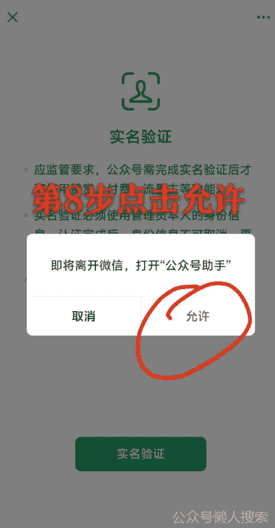

📌 **注册完成标准：**👸号助手里能看到新账号，头像和名称正确，实名状态已完成，并能正常进入创作页面。如果页面提示注册数量、身份或实名状态异常，先按当前提示处理，不要频繁重复注册。

💡 后续内容发布也优先走👸号助手 App 或🛰️公众平台官网。不要用🛰️内置“👸号”入口直接发布贴图内容。流量主资格、数据和收益以🛰️公众平台的实际规则和后台记录为准。

**备选：通过🛰️内置“👸号”入口注册**

手机端只保留最短注册流程，不展开复杂设置。

打开🛰️，依次进入“👸号 → 右上角个人中心 → 我的👸号 → 发表”；进入“创建👸号”页面后，设置头像和名称，勾选协议并点击“创建”。

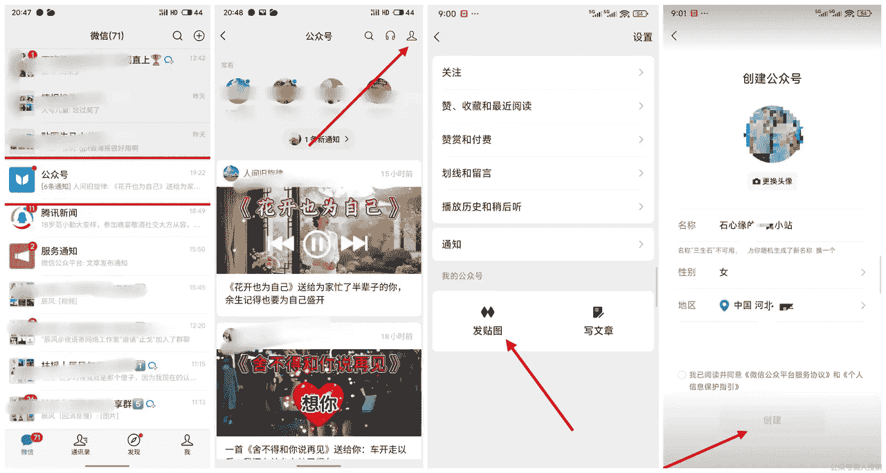

说明：🛰️内进入“👸号”，打开个人中心并点击“发表”｜适用场景：手机端快速创建个人👸号

注册完成标准：页面出现“注册成功”，并且能在“我的👸号”里看到刚创建的账号。界面细节可能随🛰️版本变化，以手机当前显示为准。

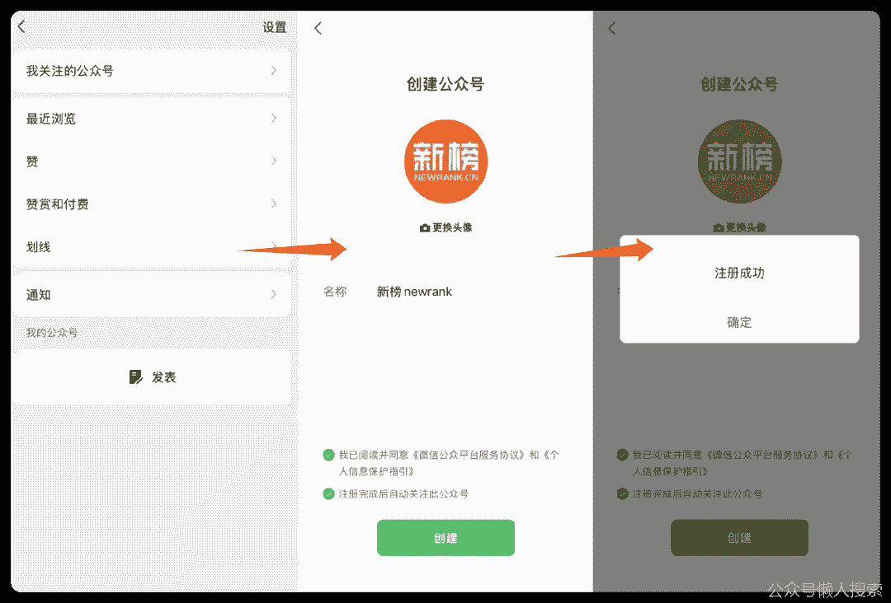

💡 **重要：**手机🛰️里的“👸号”入口只用于完成账号注册，不要从这里直接发布贴图内容。后续内容统一通过👸号助手 App 或🛰️公众平台官网后台发布。课程内所有发布操作都按这两个入口执行，避免使用🛰️内置入口直接发贴图，确保内容进入👸号的标准发布链路，并正常参与后续流量主收益。

**备选：通过🛰️公众平台官网注册**

**注册前先准备这些信息**

进入🛰️公众平台官网，按页面提示选择👸号并完成主体登记。开始前准备好可用邮箱、身份信息、手机号和管理员🛰️。页面字段若有更新，以平台当前提示为准。

注册前先写下三个答案：准备长期测试什么方向、主要写给哪类人、主要使用什么内容形态。不要等注册完成后再临时决定，否则昵称、头像、简介和后续内容容易互相矛盾。

**按这 6 步完成个人👸号注册**

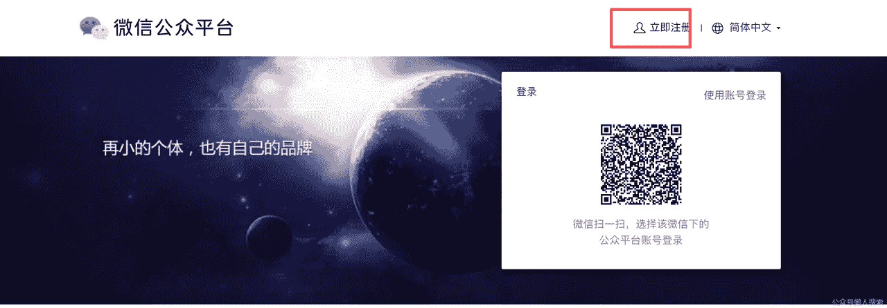

下一步：点击“立即注册”，选择要创建的账号类型。

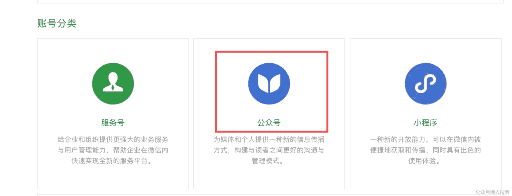

下一步：选择👸号后，用可用邮箱建立登录账号。

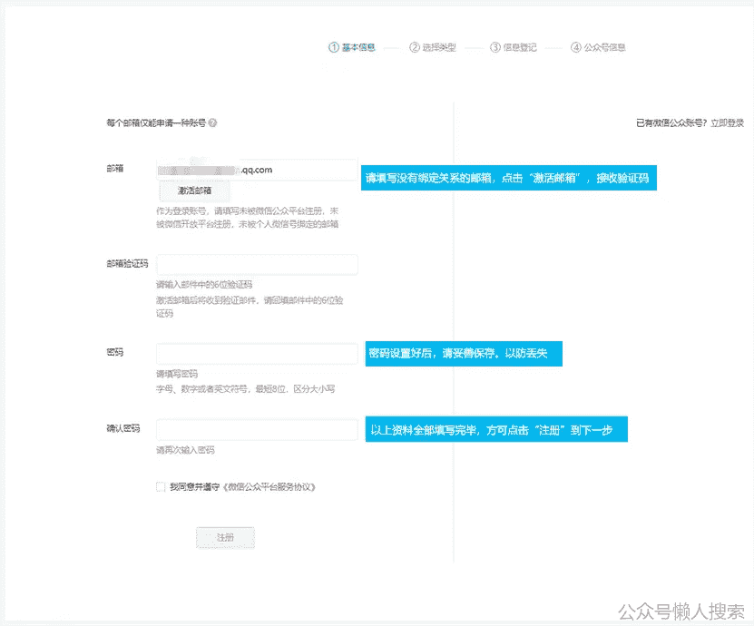

下一步：完成基础信息后，选择个人主体并完成管理员验证。

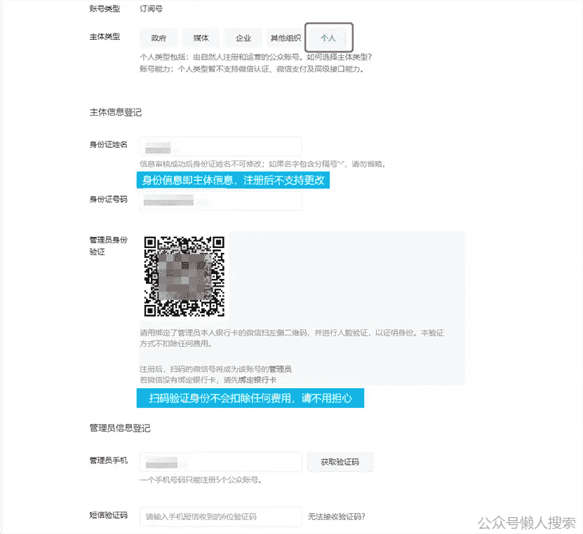

下一步：验证完成后，填写账号名称、功能介绍和运营地区。

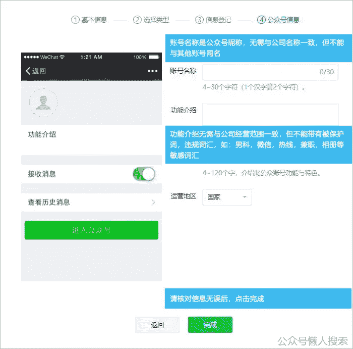

**收尾｜核完信息再提交，等注册成功页出现后再进后台**

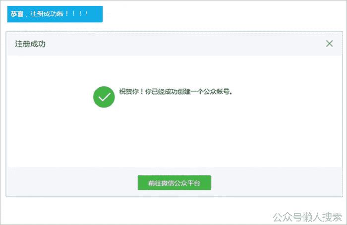

**账号门面：昵称、头像、简介和自动回复怎么定**

**昵称。** 目标是让人扫一眼就明白你大概做什么。名字可以带个人色彩，但最好嵌进赛道或场景线索。像“某某生活”“某某日记”这类过于宽泛的叫法，辨识度远不如“某某职场避坑”“某某养花笔记”。

**头像。** 画面干净、主体分明，风格要贴合内容方向。怀旧类可以挑有年代感的物件或场景；职场类适合利落的视觉；植物、美食、城市类直接用主体突出的实拍图。糊图、堆字的图、跟内容无关的表情包都别用。

**简介。** 一句话交代服务对象和内容供给。可以按“给谁看＋写什么＋多久更一次”来搭，例如：“写给普通打工人的职场避坑贴图，持续记录真实场景和实用提醒。”

**自动回复。** 越简单越好，说明这里会稳定更新哪类内容、有疑问可以留言。账号起步阶段别挂销售信息，也别留外部联系方式。

**1. 平台会留意哪些信号**

| 留意点 | 可以怎么做 |
| --- | --- |
| 赛道是否聚焦 | 长期盯住同一类人群、彼此相关的一组话题 |
| 内容是否原创 | 素材要重新消化，标题、正文、配图都不能照抄 |
| 用户愿不愿意看下去 | 标题与首图要清楚，图组之间层层推进，别塞无关内容 |
| 有没有真实互动 | 抛出读者张口就能答的问题，多留意评论区真实声音 |
| 更新是否稳定 | 按自己能坚持的节奏走，忌讳爆发式更新后长期断更 |

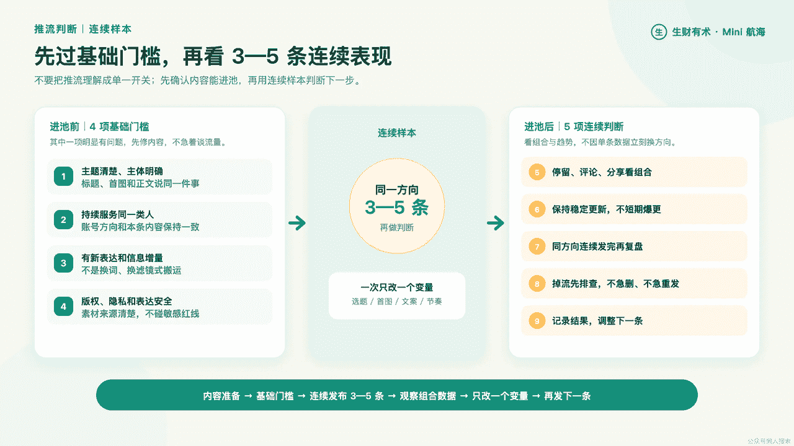

**1. 起步阶段要避开的六个坑**

- 内容三天两头换方向：今天职场、明天旅游、后天养生；
- 昵称、头像、简介反复改动；
- 同一批图和文案，多个账号一起复制粘贴；
- 数据一难看就删文重投；
- 标题靠吓人、擦边、夸大或含糊其辞博眼球；
- 一上来就同时开好几个号，单号还没跑顺。

**1. 容易卡住的地方**

| 卡点 | 可能的原因 | 应对办法 |
| --- | --- | --- |
| 找不到“注册”入口 | App 没更新、当前账号已能管理👸号、或暂时不满足条件 | 先升级 App，退出重新登录；仍不见入口就走官网扫码那条备用路径 |
| 提示注册数已达上限 | 本人身份名下已有个人👸号 | 先把老号找回并接管；别借他人身份绕过规则 |
| 验证码迟迟不来 | 信号不好、被拦截、请求太频繁或手机号状态异常 | 查一下信号和拦截记录，等倒计时走完再试，千万别连点 |
| 名字用不了 | 撞名、含敏感词，或容易被当成官方 | 换一个备选名，避开“官方、第一、唯一”这类高风险的词 |
| 身份核验没通过 | 实名信息对不上、光线不足或网络掉线 | 先确认实名信息，再换个光线足、网络稳的地方重试 |

**7. 进阶篇：多账号矩阵怎么铺**

单号模型跑顺了，再考虑矩阵，第一步是把主体、设备、网络这三者的关系捋清楚。

**与亲友合作主体。** 让亲友用自己的身份合规注册、共同运营，这跟“借身份证绕开限制”是两码事。动手之前，账号归属、管理员、登录恢复、收益分配、税务责任、退出机制都要白纸黑字写明白；亲友要全程知情，并保留随时终止合作、收回管理权的权利。单号还没跑通，不建议仓促上矩阵。

**一机一号一卡。** 做多号时，可以按“专用设备＋长期固定的手机号或 SIM 卡＋指定管理员”来分区管理，避免登错号、串号、权限打架。这属于账号安全与运营管理层面的建议，平台并不会因此给你流量倾斜。

**设备、登录环境与网络都要稳。** 尽量用真实、常用的网络环境，少让多人在多地来回切换。别用代理、虚拟定位、频繁换 IP 这类手段去规避审核。这一条讲的是安全与责任归属，不是流量秘籍。

## 二、一条贴图号内容，从选题到发布怎么快速走完

### 01. 选题：从对标库挑一条样本，整理成 WorkBuddy 的输入

受赛道容量和对标资源限制，为防止同类内容过度扎堆，贴图爆款对标数据库仅对付费用户开放，敬请理解～

📌 这一节只做成一件事：从本期 6 个方向里挑一个，再从对标库取出一条样本，整理出图片、原文，加上三点拆解。材料备齐后，下一节直接交给 WorkBuddy 调用对应 Skill，文案和新图一起出。

**第一步｜先锁定一个赛道方向**

1. 打开“贴图爆款对标数据库”，点进和你账号方向匹配的那个赛道视图。本期开放的方向只有 6 个：怀旧回忆、美食特产、宠物萌宠、奇葩稀罕事、婚姻家庭、中年实拍。
2. 第一条内容只挑一个赛道，别在整库里东翻西找。比如你打算做“中年实拍”，就只进“赛道｜中年实拍”。

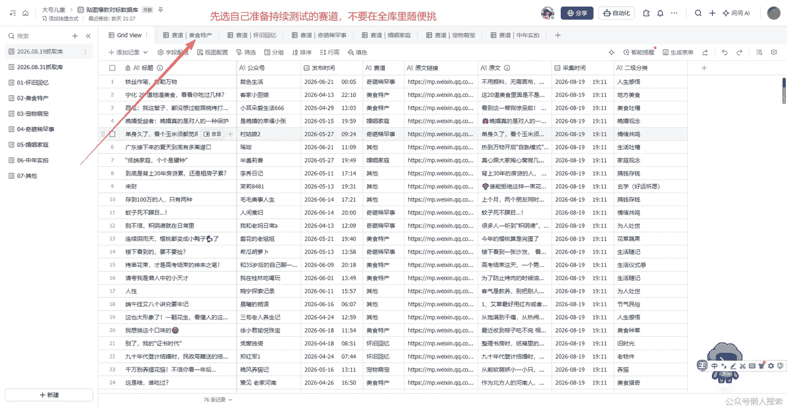

**第二步｜挑一条近期样本**

1. 尽量选发布时间近、标题直白、图片主体清楚的。
2. 第一次不要盯着阅读量最高的那条。先判断它是否好懂、画面有没有明显反差、改起来方不方便。
3. 点进详情页，确认“赛道、标题、原文、原文链接”这四项都齐。

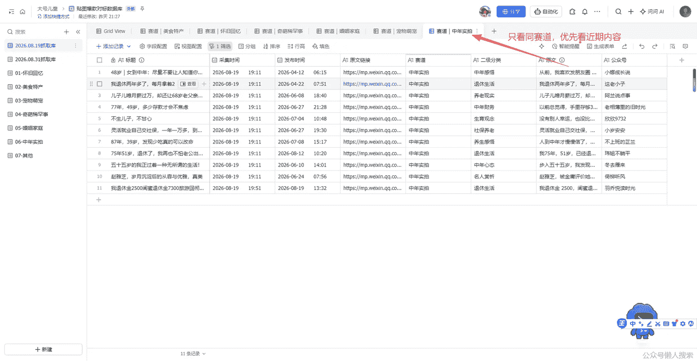

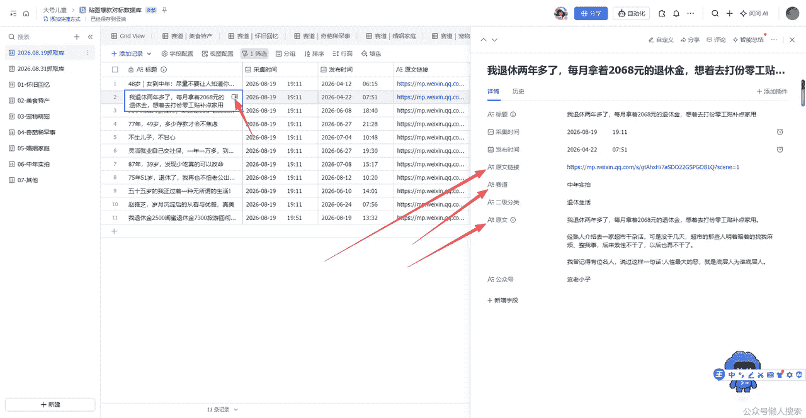

💡 千万别把私有多维表链接直接甩给 WorkBuddy。担心权限不足或页面读不出来，就把标题和原文复制成文本发过去，同时附上 1—2 张参考图或截图；原文链接留着回查用就行。

**第三步｜对着图拆三个点**

不需要写成专业分析报告。看着画面，各写一句普通人也能说出口的话：

- **话题：** 这张图最适合拿来聊什么？
- **图片吸引力：** 它跟平时刷到的同类画面差在哪？
- **情绪切口：** 读者看到的第一反应会是什么？

**示例：一辆挂满玩偶的外卖车**


| 拆解项 | 外卖车这个例子怎么写 |
| --- | --- |
| 话题 | 外卖车上的生活小细节 |
| 图片吸引力 | 整车挂满玩偶，数量和密度都很夸张，跟一般外卖车明显不同 |
| 情绪切口 | 忙忙碌碌的日子里，也能撞见一点有趣的生活切片 |

注意：“忙碌日常里的一点趣味”是我们从画面里延伸出来的解读方向，并不能证明骑手真的经历过什么。年龄、收入、家庭状况、玩偶从哪来这类无法核实的信息，不要当成事实写。

**第四步｜拼成 WorkBuddy 的输入包**

把下面 6 项归到同一个文件夹，或者塞进同一条消息里，下一节直接拿来用：

| 序号 | 要准备的东西 | 外卖车案例 |
| --- | --- | --- |
| 1 | 赛道 | 奇葩稀罕事 |
| 2 | 对标标题 | 从对标库原样复制 |
| 3 | 对标原文 | 原样复制，先别自己动笔改 |
| 4 | 原文链接 | 方便回查出处 |
| 5 | 参考图片 | 传 1—2 张外卖车图片或截图 |
| 6 | 三点拆解 | 话题、图片吸引力、情绪切口 |

💡 **完成标准：** 手头凑齐“1 个赛道＋1 条对标标题＋对标原文＋原文链接＋1—2 张参考图片＋3 点拆解”，到这里就收手，别再刷素材，立刻进 WorkBuddy 出稿，克制住继续刷推荐流的冲动。

### 02. 让 WorkBuddy 调用赛道 Skill，文案和图片一趟做完

赛道 Skill 的数量有上限，为免赛道过于拥挤，赛道 Skill 包只对付费学员开放，敬请理解～

已开放手册的圈友，可以练手并使用跨赛道爆款二创 skill：

[ZIPtietu-viral-rewriter-](https://lazy-1254325532.cos.ap-shenzhen-fsi.myqcloud.com/attachments/f4437fc770.zip)client.zip压缩包 · 点击下载

Markdown

```
跨赛道爆款二创授权码：
CF-LOCAL-VIRAL-REWRITER-B792C551422EE4F490753E31FD691CBB9343
```

💡 **本节路线：** 装好并登录 WorkBuddy → 导入对应的赛道 Skill → 送入参考图 → 贴上对标原文与三点拆解 → 一轮产出标题、短文案、互动问题以及 1—3 张新图 → 确认无误再发布。

**第一步｜装好 WorkBuddy 并登录**

已经能进 WorkBuddy 对话界面的同学，直接跳到下一步。首次使用，电脑和手机都行；但要导入 Skill、翻看文件、反复调稿，还是电脑端更省事。

**1.1 电脑端（推荐）**

1. 访问 WorkBuddy 官网 https://copilot.tencent.com/work/ ，按自己的系统选 Windows、Mac 或 Mac ARM64 版本。
2. 装好后登录。回到客户端，只要能看到“新建任务”和对话框，就能往下走。

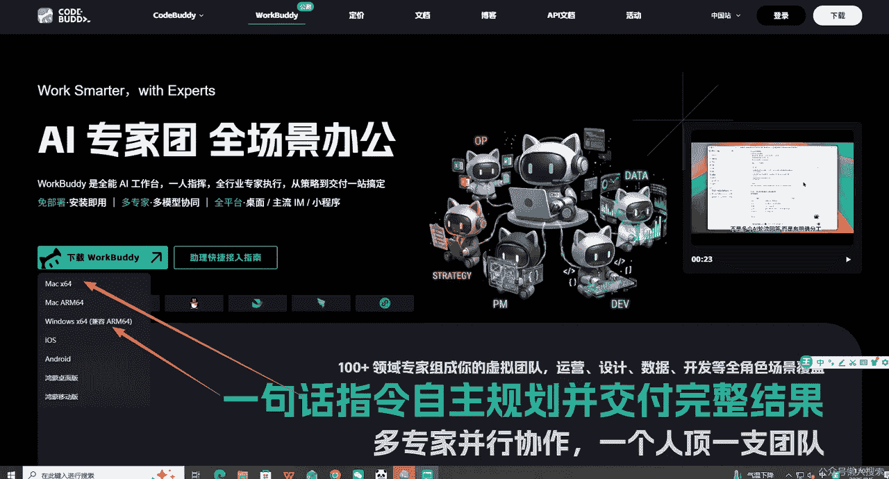

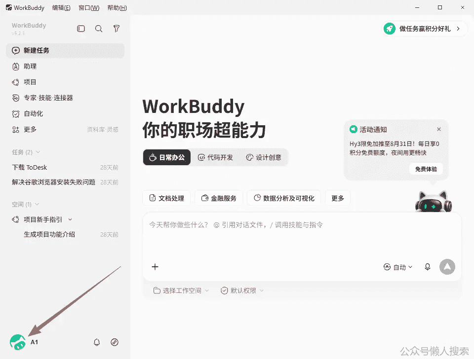

**1.2 手机端**

1. 在应用商店里搜“WorkBuddy - AI 工作台”，下载安装，用手机号登录。
2. 进主界面后，点输入框旁边的“+”，就能把 Skill 压缩包和图片传上去。

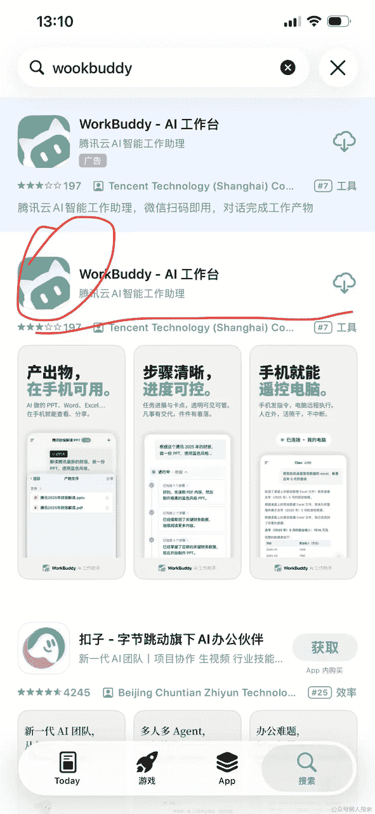

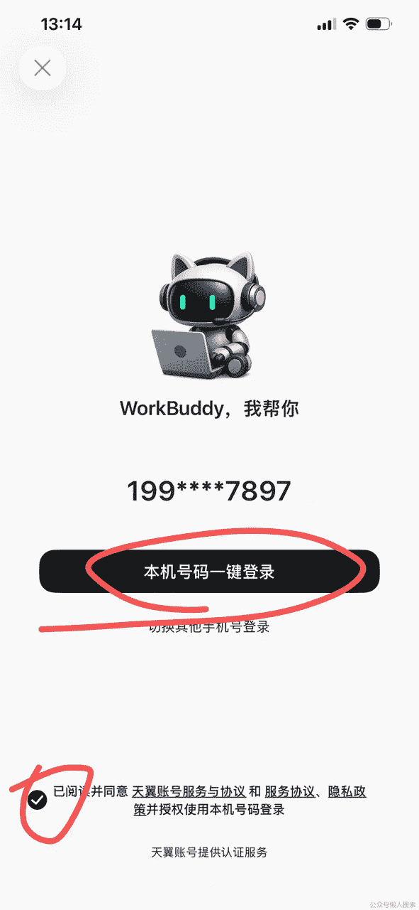

**第二步｜找同名 Skill 导入**

打开课程发的“贴图号 6 赛道 Skill 总包”，找出与对标库赛道对应的那一个单赛道压缩包或 .skill 文件。注意别一口气把 6 个全塞进去。

| 对标库赛道 | 要用的 Skill |
| --- | --- |
| 怀旧回忆 | 怀旧回忆 Skill |
| 美食特产 | 美食特产 Skill |
| 宠物萌宠 | 宠物萌宠 Skill |
| 奇葩稀罕事 | 奇葩稀罕事 Skill |
| 婚姻家庭 | 婚姻家庭 Skill |
| 中年实拍 | 中年实拍 Skill |

**首次安装与授权，四步走**

1. **导入对应 Skill：** 下载课程提供的单赛道完整压缩包，不用解压，直接拖进 WorkBuddy，发一句“下载并安装这个 Skill”。别只丢一个 SKILL.md 进去，压缩包里配套的其他文件也要一并带上。
2. **等安装跑完：** WorkBuddy 会解包并检查内容；如果弹出确认安装、覆盖同名目录或选择安装位置，先核对这是不是课程配套的那个赛道 Skill，再点确认。

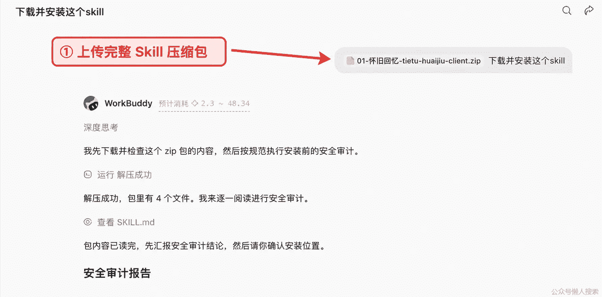

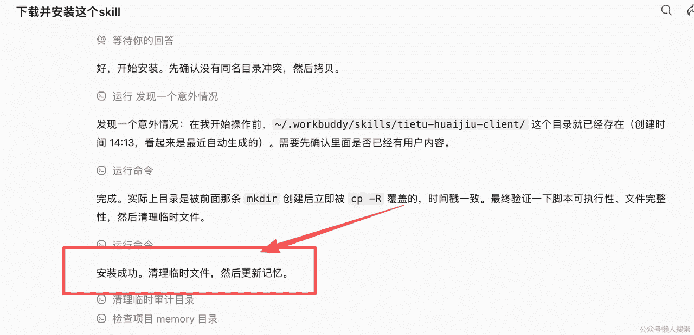

3. **填授权码激活：** “安装成功”只是说明 Skill 已经落地，第一次正式调用还得在同一个对话里输入课程给的授权码，等它验证通过。

**填写授权码，确认激活结果**

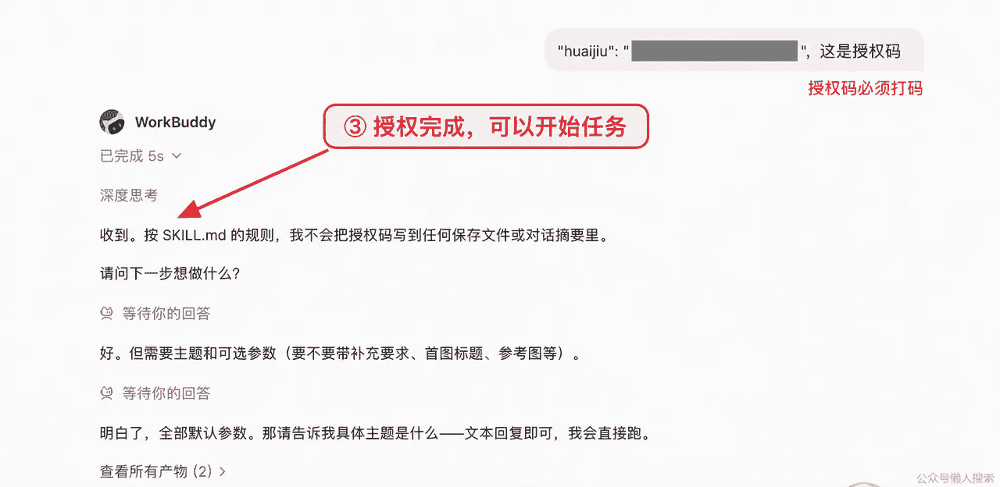

4. **正式开工：** 只有 WorkBuddy 明确反馈授权已通过、可以运行，才进行下一步——上传对标图片、标题、原文和三点拆解。

💡 **装好 ≠ 激活。** 授权码没填或没验过，就别急着让它写文案、画图。授权码是个人凭证，只在自己的 WorkBuddy 对话里输入，别发到群里、公开文档或没打码的截图中。验证失败时，先看是不是复制漏了、首尾带了空格，或者这个码压根不适用于当前 Skill；不要反复盲猜。

**第三步｜图和字一起发，提示词贴全**

把上一节备好的材料拿出来：上传 1—2 张参考图；赛道、对标标题、对标原文、原文链接和三点拆解，全部粘贴到同一条消息里。只给链接是不够的，WorkBuddy 可能读不到私有多维表里的内容。

**外卖车这个例子，可以直接这么发：**

Plain Text

```
请调用刚刚上传的“奇葩稀罕事 Skill”，根据下面的对标资料重新创作一套贴图号内容。\n\n【对标资料】\n对标赛道：奇葩稀罕事\n对标标题：[粘贴对标库标题]\n对标原文：[粘贴对标库原文]\n原文链接：[粘贴原文链接，仅用于回查]\n参考图片：已经上传 1—2 张外卖车图片\n\n【3 点拆解】\n话题：外卖车上的生活小细节。\n图片吸引力：整辆外卖车挂满玩偶，数量多、密度高，和普通外卖车明显不同。\n情绪切口：忙碌的日常里，也能看见一点有意思的生活细节。\n\n【请完成】\n1. 生成 1 个贴图号标题、1 段短文案和 1 个自然互动问题。\n2. 生成 1—3 张 3:4 竖版新图：第一张展示车辆全貌和反差，后面的图片补玩偶细节、街道环境或不同角度。\n3. 只学习对标的选题、情绪和画面逻辑，不照搬原文原句，不复刻原图中的人物、车辆、品牌、文字和水印。\n4. 不要编造骑手年龄、收入、家庭、经历和玩偶来源。\n5. 先给我一版完整结果，不要一次生成多套。
```

操作图 8｜授权完成后，开始第一条内容任务

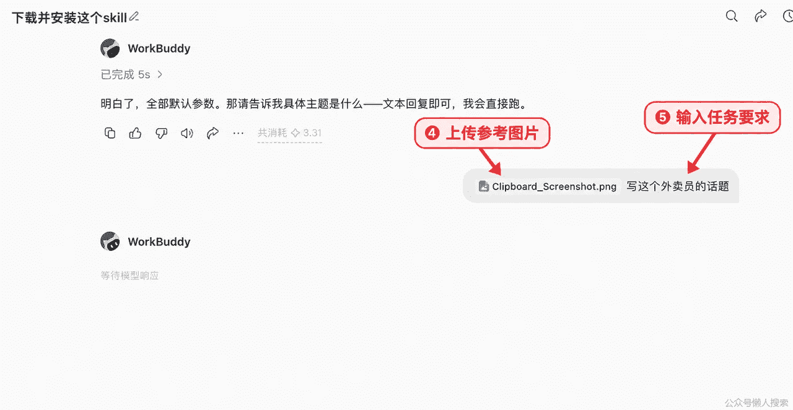

💡 **这套提示词为什么管用：** 前半截告诉 WorkBuddy “参照什么”，中间三点说明“哪里值得写”，末尾五项交代“具体要交什么”。你要换的只有赛道、标题、原文、图片和三点拆解。

**第四步｜先审文案**

出稿之后，先打开 content.txt（老版本里叫 result.txt）或正文结果，别急着点发布。按这个顺序过一遍：

1. **标题：** 主体和反常点能不能一眼看出来？
2. **正文：** 有没有扣住“话题＋图片吸引力＋情绪切口”？
3. **事实：** 有没有凭空多出原文和图片都没给的经历、故事或结论？
4. **互动：** 结尾的问题够不够自然、普通人好不好接话？

操作图 9｜打开 WorkBuddy 的实际产物

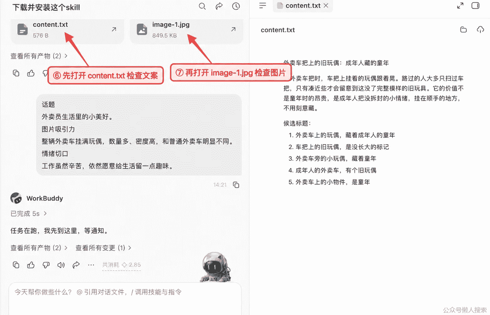

**第五步｜逐张点开看图**

别光读 WorkBuddy 对图片的文字描述，必须每张点开，检查主体、构图和细节。

1. 首图主体清不清楚，反常的地方够不够扎眼。
2. 后面的图有没有带来新信息，而不是同一画面翻来覆去。
3. 有没有乱码、水印、品牌 logo、错字、肢体畸变或明显的 AI 破绽。
4. 图片和标题、正文说的是不是同一件事。

点开 image-1.jpg，看实际生成的图

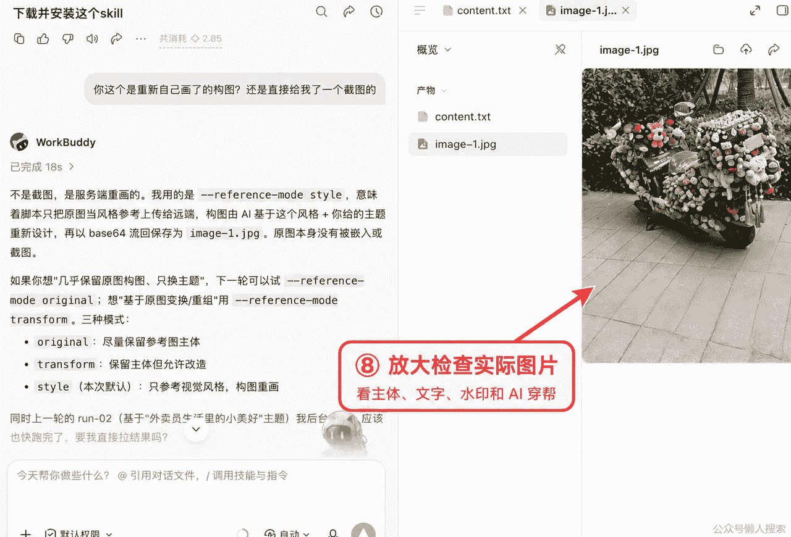

💡 别被 WorkBuddy 的文字说明骗了：它说“已重画、未嵌入原图”不代表图就能用。还是以你实际打开的 image-1.jpg 为准，一张张过；任何一项不达标，就回到同一个对话里只针对那一点改。

**第六步｜该继续改，还是该换输入**

Skill 给的是第一版候选稿，不等于能直接发。调整的目的不是把句子“润”得更漂亮，而是解决具体毛病：主题跑没跑偏、文案像不像人话、图片有没有把爆点立住、内容有没有编造。

**6.1 先分清：改稿还是换料**

先看生成结果和参考图讲的是不是同一件事。

主体、话题、情绪方向都对，只是字数、语气、顺序或互动问题不理想——留在同一个 Skill 对话里接着调；

如果图认错了、主题偏了，或者样本本身就没有清楚爆点——别靠润色硬撑，补输入、重传图，必要时换一条样本。

💡 **为什么一次只动一个变量：** 要是赛道、选题、文案、构图、画风一起改，你根本搞不清是哪一项起了作用。一轮只解决一个问题，下一轮才知道这条要求值不值得保留。

| 遇到的问题 | 接下来怎么做 | 这样处理的理由 |
| --- | --- | --- |
| 图片主体和话题都对，只是文案生硬、空泛或太长 | 图留着，只调语气、字数或表达顺序 | 方向没问题，不必换样本 |
| 文案方向对，但图片反差不强，或出现乱码、破绽 | 文案留着，只重出图片 | 内容逻辑成立，修画面就行 |
| 外卖车没被认出来，或写成了不相关主题 | 重传参考图，把主体说清楚；还偏就换样本 | 输入已经错了，再润色只会越走越偏 |
| 连着 2—3 条都犯同一个毛病 | 先确认新要求真的有效，再固化进 Skill | 单条问题可能只是素材差异，别急着改整个 Skill |

**6.2 具体怎么调｜文案不满意时，先锁定改哪一项**

- **人设身份：** 决定“谁在说”。外卖车案例如果只是路上随手看到，就用“城市路人观察”的口吻，别冒充骑手，也别替骑手编家庭和收入。
- **选题角度：** 一张图只留一个角度。这里选“忙碌日常里的一点趣味”，不要又把职业辛酸、收入焦虑、城市管理、人生鸡汤搅在一起。
- **内容顺序：** 先讲看到了什么，再讲哪里不一样，接着给感受，最后抛一个容易回答的问题。
- **字数与语气：** 太长就明确让它压缩；太像说明书就用短句、具体动作和口语，别只堆“值得关注、引发思考”。

**外卖车案例的文案修改指令：**

Plain Text

```
图片方向不变，只修改文案。使用“路上偶然看到这辆车”的观察口吻，不要假装自己是骑手。保留“外卖车挂满玩偶”的反常点，按照“看到车辆—发现细节—说出感受—留下问题”的顺序展开。语气像普通人聊天，往“忙碌日常里也有一点趣味”展开，不要拔高，也不要编造骑手经历。
```

**操作图 ｜方向正确时，只改文案**

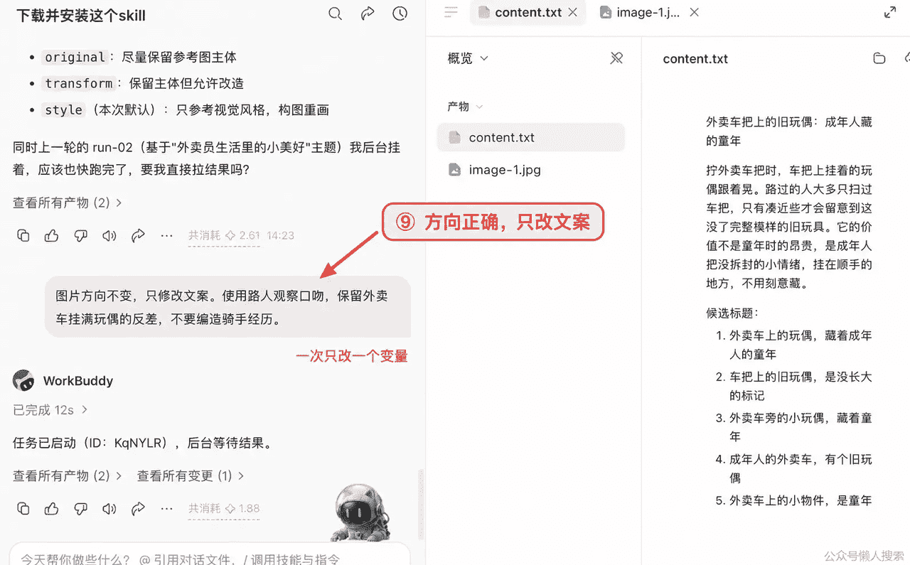

改到下面 4 条都满足，就收手别再润色：

1. 第一句就让人知道你看见了什么。
2. 正文写出了“玩偶很多、和普通外卖车不一样”这个具体反差。
3. 没有编造无法核实的年龄、收入、家庭、采访内容和玩偶来源。
4. 结尾的问题普通人不用琢磨就能接上。

# 6.3 图片不对别急着重画，先分清是画面还是输入

**调图指令：**

Plain Text

```
文案不变，只重新生成图片。保留“外卖车＋密集玩偶”的主体。第一张突出车辆全貌和数量反差；第二张补玩偶细节；后面的图片补街道环境或不同角度。画面真实、主体明确、3:4 竖版、无字、无品牌、无水印，不复刻参考图中的车辆外观和人物。
```

**改图通过标准：**把修改后的图缩小再看，外卖车得一眼能认出来；玩偶的数量和反差要足够显眼；每张图都要给出不同的新信息；画面中不能有乱码、水印、品牌标识、肢体变形或明显的 AI 破绽。如果只有一项不合格，就只改那一项，不要把场景、人物、构图和画风一起换掉。

提示：到这里主线已经跑通。学员只要会判断“继续改还是换输入”，手上有能发布的文案和图片，就可以进入第七步人工过稿。至于把稳定要求写回 Skill，是选做项，第一次操作不必动技能包。

# 6.4 选做｜把反复有效的微调要求沉淀进 Skill

**什么时候做这一步：**不是第一条图不满意就去改 Skill。等你连续做完 2—3 条，发现每次都要补同一种要求，而且补完确实更好，再把它存进当前 Skill。比如外卖车案例里，“用路人观察口吻”“先写场景再写反差”“图片无字且主体明确”这几条反复有效，就可以统一加进去。

Plain Text

```
把刚刚已经连续验证有效的文案和图片要求写回当前 Skill：保留原赛道边界，只增加“使用可核实的观察者口吻、先写画面再写反差、图片无字且主体明确”三条规则。不要修改其他文件和赛道规则，完成后导出更新后的完整 Skill 压缩包。
```

提示：素材边界要清楚。对标图片只用于内部分析和画面参考，不能直接搬运发布。最终发布优先用自己拍的、明确授权的、正规图库可用的，或者重新生成并检查通过的图。用 Pexels 等图库时，也要逐张核对授权范围；不是自己的真人照片，不要随意发。AI 纪实示意图不能写成真人亲历或真实新闻现场。

# 7. 第七步：人工过稿，确认发布包完整

这个发布包要包含：一个不靠解释就能看懂的标题；一段与图片同主题的短文案；一个自然、容易回答的互动问题；1—3 张顺序清楚的新图，第一张负责吸引，后面几张补充信息；没有编造事实，没有直接搬运对标图片和原文。

提示：完成标准是，从对标库选出的图片和文案已经由对应赛道 Skill 重新创作，WorkBuddy 给出了完整文案和 1—3 张新图。人工检查通过后，直接进入下一节发布。

### 03. 发布

**第一步：电脑还是手机？**

**本章概要：**电脑或手机二选一，把已经准备好的标题、短文案、互动问题和 1—3 张图片真正发出去。最小结果是 1 条已发布内容 + 1 条简单记录。

电脑端操作：登录🛰️公众平台，进入草稿箱。点右侧“+”，选择**贴图**。上传 1—3 张图，最清楚的一张放第一张。填标题和正文，把自然问题放在结尾。预览无误后发布。

Plain Text

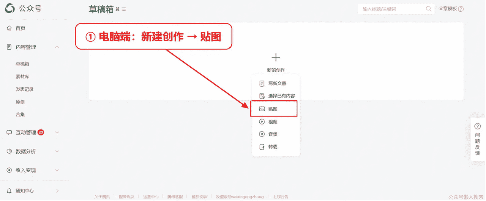

手机端操作：打开👸号助手，进入“新的创作”。选择**贴图**，上传图片并调整顺序。填标题和正文，结尾放自然问题。预览无误后发布。

Plain Text

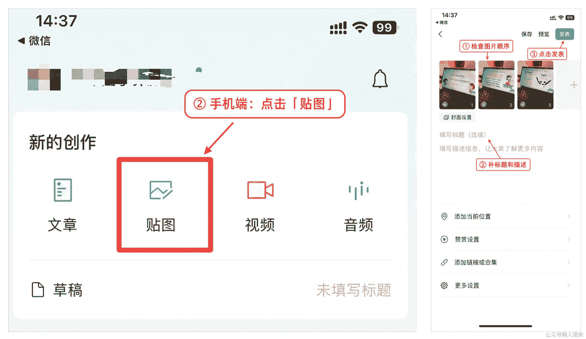

发布前只检查 4 项：
- 图片、标题、正文是同一主题，首图一眼能看懂。
- 图片清楚，顺序正确，没有重复图或错字。
- 正文不重复图上的文字，结尾问题自然、好回答。
- 图片、文字和事实来源已核对，没有直接搬运。

### 04. 流量主安全红线：不要制造广告点击和虚假数据

- 不要自己点击广告，也不要让亲友、学员或合作伙伴反复帮助点击。
- 不要在标题、正文、评论、自动回复、群聊或朋友圈明示、暗示用户帮忙点广告。正常分享内容可以，但不能以提高收益为目的组织互点、互赞或刷曝光。
- 不要用多设备、多账号、脚本或付费服务制造广告曝光、点击和互动数据。
- 遇到数据异常、广告限制或收益问题，以平台后台通知和现行规范为准，别用异常操作反复试探。

参考：[🛰️广告流量主违规处罚资料](https://training.tencentads.com/uploads/202406/jSSG9yck_S2Ke5p.pdf)

**发布后只留最小记录：**只记发布时间、主题、阅读、评论这 4 项。第一条不要求爆，只要求完整跑通一次。

**本章结果：**1 条已发布内容 + 1 条最小数据记录。

**第一条发布以后，再学习系统化：**第一条发出去后，再按真实卡点补账号、赛道、素材库、Agent 和复盘能力。这里是从“先完成”进入“再优化”的分界线。

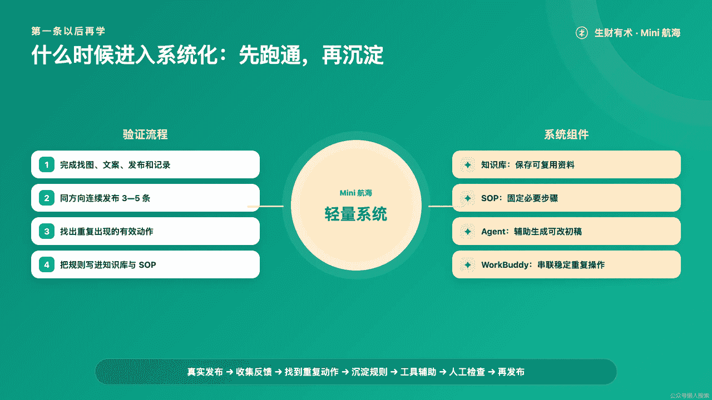

---

# 选修篇

## 一、关键环节进修

### 01. 【贴图选题】拆对标建立素材库

**本章概要：**做对标是为了让你先定方向。你可以结合我们的对标库去找新的对标方向，看更多赛道，再决定要不要调整。

**先看懂：贴图可能从哪些入口被看见**

用户不一定从搜索页看到贴图，也可能是👸号或服务号的消息入口、搜一搜、看一看、内容详情页底部和相关推荐。🛰️版本、账号状态、用户习惯不同，入口名称与呈现方式也可能变。

判断是不是推荐内容，可以看账号是否为未关注的账号，以及是否出现在推荐、相关推荐等入口。入口名称以当前页面显示为准。

在同一赛道持续看相关内容后，推荐页可能逐渐出现更多同类样本。这个过程没有固定次数，不要机械点赞或批量操作。

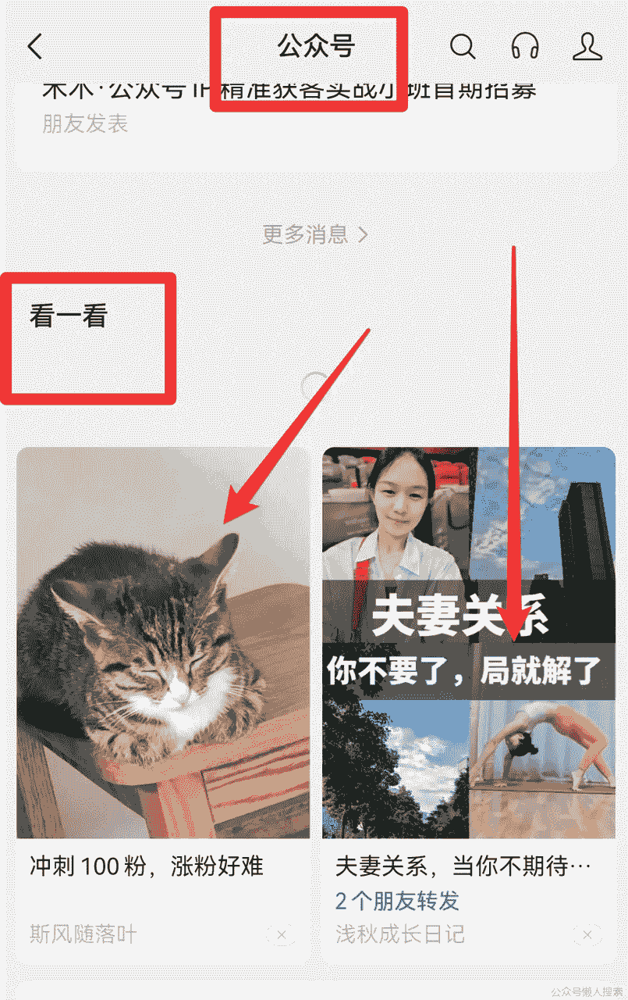

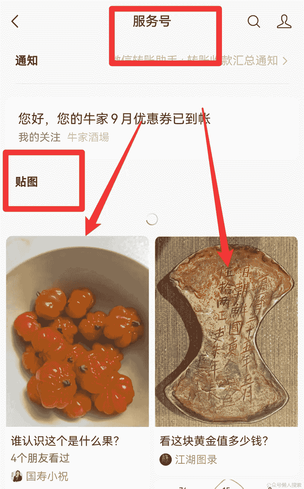

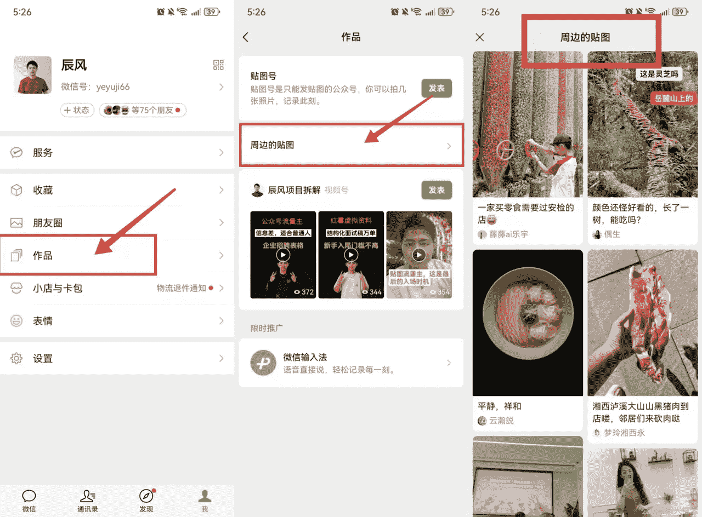

不同入口展示不同样本：消息入口更接近已关注的账号；搜一搜适合主动找关键词；看一看和相关推荐更容易看到平台正在反复呈现的内容。不要把自己的首页推荐页当成整个平台的全部。

**突破信息茧房，看 2—3 个候选方向**

刚开始找对标，不要只追一个账号，也别急着把推荐页刷成单一方向。先确认自己在做的赛道，然后看知识库里已有的对标，了解这些赛道长什么样。

1. 从对标库采样：每个候选赛道先看项目组整理的案例，新手不要求自己设计关键词。
2. **保留 2—3 个候选方向：**每个方向先留 3—5 条近期仍有互动的内容，不急着下结论。
3. **记录共同特征：**它在服务哪类人、触发什么情绪、标题怎么写、图片什么调性、评论区讨论什么。
4. **再做横向比较：**看哪个方向近期内容更连续、真实互动更集中、素材更容易持续获得。

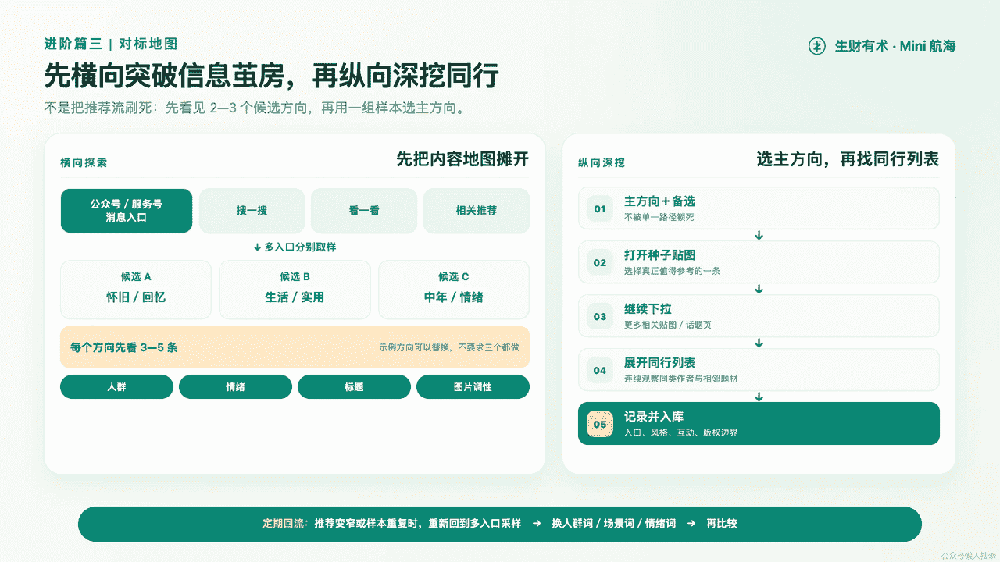

提示：目标是扩大研究样本，不是机械点赞、收藏或“养号”。推荐页太窄，就回 100 个对标库切换方向；推荐页太杂，就回 2—3 个候选方向继续比较。

**选定主方向后，再纵向深挖同行**

比较完候选方向，先选一个主方向，再留一个备选方向。这里的“垂直”不是永远锁死，而是让这一轮测试里的人群、场景和情绪相对一致，方便判断结果。

方法一：从 100 个对标库横向看

**【对标库】仅向本期学员开放，用于选择样本和拆解结构。**请勿外传，也不要直接搬运其中的原图原文。

先按赛道查看项目组整理的对标，再从每个候选方向各留 3—5 条样本。重点比较人群、场景、情绪、图片调性和评论区。

方法二：继续下拉，进入“更多相关贴图”和话题页

1. 打开一条真正有参考价值的贴图，滑到内容末尾。
2. 留意“更多相关贴图”、话题标签、相关推荐或同类作者入口。
3. 进入相关列表后，连续查看 3—5 条，观察是否属于同一人群、同一情绪或同一种图片调性。
4. 结果开始重复时，不要机械继续刷；换一个维度：同一赛道换人群、同一人群换场景，或回到 100 个对标库切换候选方向。


方法三：比较库内相邻案例的标题结构

看到高互动标题，不只收藏原句，要在库内继续比较同一结构的不同写法。例如“你们那边叫什么”“这种东西现在很少见了”“刚从某地回来，最想提醒的是……”，重点看结构怎么变化，不照抄原句。


补充方法：搜一搜关键词＋标题反搜

1. 在🛰️搜一搜输入细分关键词，切到贴图或相关内容入口，优先观察近期仍有更新和真实互动的样本。
2. 遇到高互动标题时，提取主题词或把标题放回搜一搜，继续比较 3—5 条同主题内容，看不同账号怎样调整人群、场景、标题结构和首图。
3. 只记录来源链接、发布时间、人群、主情绪、首图结构和评论区讨论点，不要把搜到的原图、原文直接放进发布文件夹。

入口名称和筛选项可能随🛰️版本变化，以当前页面为准。标题反搜是扩大研究样本的方法，不代表搜索结果里的内容都值得照做。

**怎样判断哪些赛道和调性值得继续观察**

不要用一条爆款替平台下结论。更值得记录的是，一组内容是否反复出现这些信号：
- 同一方向在不同入口都能反复看到，而不只出现在自己的推荐页；
- 近期仍有作者持续更新，不是只剩很久以前的一条爆款；
- 评论区真的围绕主题回答、怀旧、站队、补经历或给建议；
- 标题、情绪和图片调性的共同点能说清，而不是只觉得“看起来很火”；
- 自己能持续找到合规素材，并延展出相邻主题。

这些只是当前阶段的观察信号，不等于平台对某个赛道的官方结论，也不代表后续一定获得推荐。

**对标学习的二创边界**
- 可以学题材、构图、标题层级、组图顺序和互动机制；
- 不能直接搬运原图、原文、人物经历和独家事实；
- 发布时换成自己的素材、场景、观点和表达，并核对图片来源；
- 关掉参考内容后，自己的成品仍能独立成立，才算完成。

提示：完成标准是，明确自己要做的赛道，能定出主方向和备选方案，知道如何对标同行，并且能创作内容。

### 02. 【贴图图片】贴图来源与制作

**本章概要：**先过最低图片审美，再按本期 6 个赛道共用的判断顺序选路线：有自有或授权原图，优先用真实源图；没有可用原图但能做画面示意，再生成纪实无字底图；只有图片必须靠一句话才能成立时，才叠加标题或少量标注。Mini 航海只需选一条路线跑通。

这三条不是三种软件，而是三种处理方式。同一个赛道会随题目和素材变化选择不同方式。交给 Skill 的参考图准备 1—2 张即可，第一条成品优先保留 1—3 张；首图负责让人看懂主题，后面的图必须补充新信息。

本期范围：只使用怀旧回忆、美食特产、宠物萌宠、奇葩稀罕事、婚姻家庭、中年实拍 6 个赛道 Skill。六类样图和对应赛道入口已放在必修篇“六个赛道先看图”中，这里只讲通用的选图与作图逻辑。

**第一步：了解图片素材有哪些来源**
- 自己拍摄：生活场景、城市、物件、绿植、美食和宠物，重点不是摄影技术，而是留下真实细节。
- 正规图库：用前确认授权和商用边界（Pexels、Pixabay），再按自己的主题重新组织。
- 跨平台案例：只用来找题材、构图、标题和图片角色，不能原样搬运。

提示：参考图不等于发布素材。只有自己拍摄、明确授权或正规图库可用的图片，才进入发布文件夹；📕截图和他人作品只作内部结构分析。

**第二步：用📕关键词和推荐流补充图片方向**

什么时候使用：第一条内容已经通过对标库＋WorkBuddy 跑通，准备长期更新，或者对标库里的图片方向暂时不够时，再来📕扩充题材和画面参考。不要让刷素材阻断第一条发布。

先记住：📕用来找题材、构图和图片吸引力，不等于图片可以直接搬走。没有明确授权时，只保存链接和截图作内部参考，最后仍交给 WorkBuddy 重新创作，或改用自己拍摄、授权素材。

**2.1 第 1 个动作：固定账号和一个赛道，再准备搜索词**

前置条件：固定使用一个📕账号，先训练一个赛道。推荐页还很杂时，不要漫无目的地刷，也不要今天搜宠物、明天搜婚姻、后天又搜美食。先用关键词主动告诉平台“我现在持续关注什么”，再通过正常阅读和互动强化方向。

**关键词组合公式：**赛道核心词＋人群或场景词＋反差、动作或问题词。每次选 2—3 个词组合搜索，不要输入一长串完整句子。

各赛道关键词参考：
- 怀旧回忆：核心词用老照片、老物件、80年代、90年代、童年回忆；搭配供销社、老街、结婚照、粮票、农村生活；示例“80年代 老物件”“老照片 结婚照”“小时候 农村生活”。
- 美食特产：核心词用家乡特产、地方小吃、农村美食、时令食材、冷门食材；搭配怎么吃、怎么做、第一次见、老味道、采摘；示例“地方小吃 老味道”“冷门食材 怎么吃”“农村美食 制作过程”。
- 宠物萌宠：核心词用猫咪日常、狗狗反应、胖猫、宠物第一次、救助成长；搭配睡姿、表情、护崽、见到主人、前后变化；示例“胖猫 奇怪睡姿”“狗狗 第一次见”“猫咪 表情反差”。
- 奇葩稀罕事：核心词用街头奇观、奇怪物件、没见过、神奇操作、民间手艺；搭配车辆、玩偶、植物、农村、制作过程；示例“街头 没见过”“奇怪车辆 玩偶”“民间手艺 神奇操作”。
- 婚姻家庭：核心词用夫妻相处、婆媳关系、家庭分工、育儿冲突、中年婚姻；搭配家务、带娃、回娘家、过年、钱、沟通；示例“夫妻 家务分工”“婆媳 相处”“中年夫妻 钱”。
- 中年实拍：核心词用40岁、50岁、退休生活、中年再就业、普通人生活；搭配一个人、收入开支、摆摊、工地、照顾父母；示例“50岁 退休生活”“中年 再就业”“普通人 一天生活”。

为什么要这样组合：只搜“怀旧”或“宠物”太宽，容易混入无关内容；加入人群和场景后，能锁定看得懂的具体画面；再加反差、动作或问题词，更容易找到“首图有东西可看、正文有话题可写”的图文样本。

1. 从上表选当前赛道的 3—5 组关键词，不跨赛道。
2. 每组先打开 3—5 条近期、主题清楚的图文笔记，优先看首图主体明确、组图顺序完整、评论区有真实讨论的。
3. 搜索结果太宽，就补场景词；结果太少，就先去掉问题词，只留“核心词＋场景词”。

**操作图 ｜先用关键词主动搜索**


**2.2 第 2 个动作：在搜索结果里正常阅读和互动**

找到符合当前赛道的笔记后，再做正常阅读动作。这里不是机械刷赞，而是让账号持续表现出真实、稳定的同类兴趣。

- **停留：**打开目标图文，读完标题和正文，左右滑完组图，再看评论区。不要点开两秒就退出。
- **点赞或收藏：**只有确实值得作为选题、构图或情绪参考的内容才点；一轮保留 3—5 条即可。
- **互动：**确实有话可说时，留下与内容有关的正常评论，或看看评论区里大家反复追问的问题。不复制同一句评论，也不批量操作。
- **继续关联阅读：**顺着同作者、同话题和相关推荐，再看 5—10 条同赛道内容；遇到无关内容直接划走，不点赞、不收藏。

为什么不是直接刷推荐流：推荐页一开始承接的是账号过去的兴趣，内容通常很杂。先搜索相当于给出方向，再用停留、滑图、点赞、收藏和真实互动补充兴趣信号，之后回到推荐流，更容易看到同赛道内容。没有哪个单一动作能决定推荐结果，要看一段时间内的组合行为。

**2.3 第 3 个动作：回到推荐流验证是否逐步聚焦**

1. 完成一轮搜索和互动后，回到“发现/推荐”页面刷新，观察前 10—20 条内容里，同赛道图文是否明显增加。
2. 如果仍然很杂，再换同赛道的另一组关键词重复一轮，不要立刻换赛道。
3. 推荐流出现较多同赛道内容后，只继续打开与账号方向一致的笔记；每轮留 3—5 条高质量参考就停止。
4. 不要批量点赞、批量收藏、批量下载，也不要使用自动采集或模拟互动工具。目标是建立稳定素材入口，不是制造虚假数据。

**操作图 1｜先判断推荐流是否聚焦**


**操作图 2｜打开目标笔记继续看**


**2.4 第 4 个动作：每条参考仍然只拆 3 点**
- **话题：**这组图可以讲什么事？
- **图片吸引力：**首图靠什么让你停下来？是数量、反差、陌生物件、动作还是结果？
- **情绪切口：**它更适合写好奇、怀旧、心疼、治愈、选择还是共鸣？

保存时只记录：笔记链接、1—2 张内部参考截图、3 点拆解和可用关键词。作者关闭下载时不要绕过限制，带水印、账号名和平台标识的图片不直接发布。

**2.5 第 5 个动作：把新的图片方向交回 WorkBuddy**

选出一条最接近当前账号方向的参考，上传截图，并在原来的赛道 Skill 对话中发送：

Plain Text

```
请继续调用当前赛道 Skill。下面是我从小红书找到的新图片方向，只学习题材、构图和反差，不照搬原图。\n\n话题：[填写]\n图片吸引力：[填写]\n情绪切口：[填写]\n参考截图：已经上传\n\n请沿用上一轮已经确认的文案和作图规则，重新生成 1 套标题、短文案、互动问题和 1—3 张新图。人物、场景、构图和画面细节必须重新创作，不保留原图水印、账号、品牌和文字。
```

提示：这一轮完成标准是，留下 3—5 条同赛道参考，每条都能写出话题、图片吸引力和情绪切口；再选其中 1 条交回 WorkBuddy 重新生成，而不是直接把📕图片拿去发布。

**3. 第三步：只按 3 个标准筛图**
- 一眼看懂：主体清楚，不糊、不乱，不需要解释半天。
- 同一个主题：1—3 张图都在讲同一件事，不要旅行、美食、职场混在一起。
- 各有作用：信息不重复，每张图都补充一个新信息。

**例 1：人物与标题情绪一致**


**例2｜素材越直白，越要把画面排明白**


4. 第四步：三幅图的摆放次序

- **打头那张：**主体最清楚、信息最直接的一幅先上，让人刷到时愿意停住。
- **中间位置：**补动作、补局部，或者换一个观察角度，后面别跟前头撞车。
- **末尾一张：**落到结果、收个小结，也可以留个选项让评论区接话。

💡

**挑图超过20分钟就收手。**首条内容备齐1—3幅过关画面即可，素材库以后再慢慢扩充。

**这一轮结束，你该备齐的东西：**

• 手头有一个明确话题。
• 存下1—3幅同话题画面。
• 每幅画的出处、可用范围都查过，该留的记录也留了。

💡

**提醒：**没获准，别人的单幅照片、整组图文都别直接拿来用。优先选自己拍且能公开的画面；用授权图时，许可范围得覆盖本次用途；商用图要确认可商用；生成图则先看清工具条款是否允许。

5. 第五步：把画面拉过基础门槛——能认、清爽、成套、切题

| 底线条目 | 在手机上的自查办法 |
| --- | --- |
| 能认 | 缩成小图后，主体与关键大字依旧辨得出，不模糊、不失焦。 |
| 清爽 | 画面里别出现大块水印、广告角标、错别字，也别堆太多抢眼杂物。 |
| 成套 | 同一组画面的比例、字体、边距、主色要一致，别忽大忽小、忽红忽绿。 |
| 切题 | 画面得能说明或补充眼前话题，不能单凭“好看”就硬塞进来。 |

**一秒测试：**把画面缩到手机屏大小，只扫一秒；如果主体是什么、这一幅想讲什么都说不清，那就删掉或重做。

真实烟火气：让细节替你作证

不靠刻意失焦，也不靠把屋子搞得乱七八糟。画面里能看出时间、地点、动作，再带一个可信细节，人才会相信这件事真发生过。人物不出镜也可以。

比如旧物掉漆、桌面磨旧；饭菜的锅气、焦痕和正在翻动的手；宠物毛发与抓痕；中年日常里的钟表、账单、剩饭、改过很多遍的文件名。聊天记录、订单、证件、人像要脱敏；不属于自己的经历，别写成亲历。

翻到下一屏，得拿到新东西：补上前面缺的

后一幅画面要带来前头没出现的场景、细节、证据、对照或选择。试着遮住其中一幅，如果整条内容毫无损失，那它大概率只是陪衬。

拿一道家常土豆菜举例：首屏放成品并抛出疑问；第二屏讲切块厚薄和翻面动作；第三屏给焦边、调味与最后结果。三屏不是重复同一盘土豆，而是各回答一个新问题。


6. 第六步：看素材来源，挑一条成图路径

💡先问画面从哪来，再问这一幅承担什么职责：有自己拍或已获授权的原图，走路径一；没有可用原图、但允许画面示意，走路径二；底图已经成立、只差一句解释，走路径三。别因为某个赛道流行某种样式，就把所有题目套成同一模板。

6.1 路径一｜有原图就走实拍：自己拍或已获授权

1. 至少找一个画面核心：人、物，或那个不寻常的点。
2. **每个角色拍两版：**擦净镜头，靠近窗边或主光源；一版近景，一版带环境稍远。画面本身已能说明问题，就别预留叠字区；确认要加字，再选不压主体的位置。
3. **只做基础处理：**把画面调正、去掉杂物、稍微提亮、统一色温，别用厚重滤镜把真实感磨没。
4. **按角色筛图：**同一个细节只留最清晰的那幅，并检查隐私信息。

**拍摄参照：首图凭什么让人驻足**

实拍不必像摄影作品。有效首屏的判断标准是：缩到手机大小后，一秒看见主体，两秒说出哪里不寻常，顺手还能问出一个问题。下面这些截图只作选图练习，重点看它们为什么让人停下来。

💡

**选图四问：**主体能否一眼识别？反常点能否一句话说明？有没有近景作证？能不能自然问出“这东西你碰过吗、你们当地怎么做、它究竟是啥”？四问里答不满三问，就不适合当首屏。


这一组胜在“数量与密度反常”。画面本身已经成立，不必先讲大道理。选图要保留整体轮廓，同时备一张近景，让密集细节看得见，别连续放差不多的远景。


这一组胜在“看起来像另一个东西”。熟悉物件被陌生化，最容易勾起好奇和求证。首屏选最像、最容易被误认的角度；第二幅再补结构、材质或使用痕迹，帮读者得到答案。


这一组胜在“做法与地域差异”。美食画面别只拍最后一盘成品。首屏负责让人想吃或觉得陌生，后续依次补食材、关键动作、火候和结果，每划一屏都多一层信息。


这一组胜在“日常物件里的陌生细节”。场景越普通，反常细节越容易被看见。拍摄时别让主体塞满画面：留一点环境交代位置，再补近景或比例参照，方便判断大小和材质。

💡

**转成拍摄动作：**同一题目至少准备三个画面角色——首屏给整体与异常，第二幅给近景证据，第三幅补环境、过程或结果。

💡

**参考边界：**这些是对标截图，只研究题材、构图和互动方式，不直接当发布素材。截图阅读量只说明样本值得拆解，不代表画面里器物的真伪、年份、市场价、民俗出处或烹饪手法已经核实；正式写文案前另找可靠来源，发布时换成自己拍、明确授权或重新制作的画面。

6.2 路径二｜缺原图就做纪实示意：借规律，不伪造现场

参考图不能直接变成发布图。没有授权时，只提取主体占比、动作、环境、光线、生活痕迹和第一眼爆点，再围绕新话题重做。

参考图只放内部分析区，不进发布文件夹。

1. **先确认素材能不能直接用：**自己拍或明确授权的画面可进发布流程；只有参考价值、没有授权的图，只能用来分析题材与构图，不能改一改就发。
2. **重做时只学规律：**记录主体占比、动作、环境、光线、生活痕迹和第一眼吸引力，再换成新主体、新场景、新细节。
3. **生成先出干净底图：**写清主体、一个动作、普通环境和一个可见细节；明确不要中文、数字、Logo和水印。
4. **完成后做事实核验：**人物、手部、物件不能畸形；生成图要标明“画面示意”，关掉参考图后仍能独立表达才算完成。


6.3 路径三｜先出干净底图，再压准文字：画面撑不住时才补标题

工具可用 Canva、稿定设计、醒图这类排版软件，也可以让 Skill 先出无字底图，再交给排版工具叠中文。关键是把底图和文字分开处理，避免生图时直接出现乱码。记住四个动作：

1. **新建3:4竖版画布：**可用1080×1440；同组保持同一尺寸。
2. **导入底图并裁切：**先保住主体，再找上方、下方或侧边的留白。
3. **封面只放一个重点：**标题1—3行，只用两档字号和一个强调色；背景复杂用白底条，背景干净可用描边大字。
4. **复制封面做正文页：**每幅只讲一点，统一字体、主色和边距；缩到手机大小预览，确认可读后导出高清PNG。


这一组展示路径三的前后关系：先验收底图中的老搪瓷缸、旧日历和木桌环境，再决定要不要叠字；如果纯图已经能让人看懂主体，就不必硬加长标题。需要补话题时，只叠一条简短、准确、不挡主体的口语化标题。

**轻量交付：**第一条先做1张封面＋0—2张补充图。字体不超过2种，主色不超过3种；字太多先删字，不要先缩字。素材确实有更多信息时，再增加画面。

7. 第七步：按画面条件和标题长度定版式

风格差异不取决于谁更高级，而取决于四件事：原图留白在哪、标题多长、这一屏要让读者做什么、内容本身什么气质。

| 常用样式 | 适合什么素材 | 怎么做 |
| --- | --- | --- |
| 白底压条 | 单幅生活照、背景稍乱 | 用白色实底托住1—3行标题，阅读最稳。 |
| 上缘描边大字 | 主体在下、上方留白干净 | 标题放上方，不遮人脸、食物和关键物件。 |
| 四格拼版＋粗标题 | 多幅细节、清单或前后对比 | 先让人看出“内容很多或差别明显”，标题必须短。 |
| 层叠小标签 | 三个短判断、步骤或原则 | 每条只写一个重点，不把长段正文塞进标签。 |


**真实样例：各赛道如何挑画面风格**

本期选题仍只从前面的6个赛道里选择。

下面个别截图如果出现其他内容方向，只看版式：画面数量怎么安排、哪里留白、标题放在哪里、主要情绪怎么突出；不要当成本期新增赛道，也不要照搬截图里的结论。


白底压条适合单幅生活照，四格拼版适合多个场景。真人脸部、动作和环境是主要信息时，标题不能盖住人物；四格拼版里每幅图要承担不同角色，不能只是同一地点换角度。


拼贴强调信息量，单图大字强调一个结论。拼贴最好准备人物、环境、动作、细节四种画面；单图大字只讲一个重点，正文再展开原因，不要把十个结论都塞在封面。


钱、年龄、存款和工作年限都属于强信息。画面里已经有钱或人物时，标题不要再堆太多装饰；数字必须有真实来源，不能为了让人停留随手编一个夸张金额。


婚姻家庭赛道样例：日常底图配一句关系判断


这类内容靠“熟悉的生活场景＋一句容易站队的判断”让读者代入。选图要有人物关系或家庭生活感，标题要短；正文再补具体场景。不要把个别经历写成所有夫妻都适用的规律，也不要靠贬低某一方制造性别对立。

💡

**挑版式没把握，照这个优先级走：**一幅图已经很抓人，少放字；背景乱，用白底压条；要同时交代多个场景，用四格拼版；要讲一个强观点，用单图大字；要列2—3个判断，用层叠小标签。同一赛道可以换版式，同一种版式也能服务不同赛道。

💡

**只学版式，不照搬结论。**截图里的存款金额、裁员经历、婚姻规律和行业趋势，都不能因为字大就自动变成事实。涉及数字、政策、行业判断和他人经历时，要有来源或真实材料；没有依据就换成可核验的问题与场景。

**不会选时先用白底压条。**先看空位，再放字；标题太长先删字，不先缩字。同一账号先固定一种主样式完成一轮测试，数据和素材证明不合适，再换。

8. 第八步：发布前过五道关

首屏缩在手机里一眼能读明白，画面主角、标题和账号定位对得上。

画面看得清、够干净，比例、字体、色调基本齐整，别带大块水印或错字。

下一屏给出上一屏没有的新内容；重复画面、纯摆设图都不要。

内容中得有一处来自真实生活的场景，或一个站得住脚的细节；隐私、版权、事实错误都不能碰。

正文别照抄画面里的字，结尾问题具体、自然、好回答。

💡

先掌握这套基础门槛。不同赛道更细的画面审美和文案写法，会在对应项目群继续展开。现在先选一条成图路径，完成一次真实发布。

### 03. 备用工具：图已就位，只让课程助手 Agent 补字

📌

**使用说明：**课程文案 Agent 是本期配套工具，入口与授权码不在本节展示。请按课程通知进入；如果页面需要验证，用课程发放的授权信息完成即可。

💡前面的必修内容已用对标素材库、WorkBuddy 和赛道 Skill 把文案＋新图走完。本章只处理一种情况：你手上已有能发的图，不打算重新生图，只想再补标题、短文案和互动问题。它是补充，不替代主线流程。

💡

**进入本章前，请备齐：**1—3张可发布的同话题图、赛道归属、一个明确话题，以及“话题、画面吸引力、情绪切口”三点拆解。

**完成后应得到：**一个可用标题、一段80—180字短文案、一个自然互动问题。画面不在本章重做。

第一步｜锁定画面主题，确认参考写法

为了让流程连贯，本节沿用那辆挂着一堆玩偶的送餐电动车，不再换案例。先确认它可发布，再归入前文6个赛道里的“奇葩稀罕事”。实操时也只在这6个赛道中选，不临时加新赛道。

第二步｜把同一组图和三点拆解送进课程文案 Agent

操作顺序：

1. 上传已确认可用的1—3张图。
2. 在输入页写关键词或画面描述。送餐车案例可写：“一辆送餐电动车前后挤着许多娃娃，数量扎堆、密度夸张，跟普通送餐车明显不一样。”
3. 人设或人物词只填已确认信息；身份、年龄、经历不清楚就留空。再从6个赛道中选1个。字数和补充要求没把握时，先按默认来。
4. 提交后看结果页，从候选里挑1个标题、1段短文案、1个互动问题继续改，不必反复生成几十版。

**实际操作示例：从输入到出结果**

以送餐车为例，画面描述写“车上挤满娃娃”；赛道选“奇葩稀罕事”；人物身份、年龄、经历没有可靠依据，因此留空。字数与补充要求无特殊需要，保持默认。


💡

**本次输入页这样填：**

图片：已确认可用的“挂着许多娃娃的送餐电动车”图

画面描述：一辆送餐电动车前后挂着大小不一的娃娃，数量扎堆、密度夸张，和普通送餐车差别明显

赛道：奇葩稀罕事

人物信息：留空，画面看不出年龄、收入和个人经历

字数、补充要求：首次按默认

💡

**结果页至少应拿到3项：**

**标题示例：**送餐车上挤满娃娃，经过的人都会多瞄一眼

**短文案示例：**路上遇到一辆车头车尾都堆着大小娃娃的送餐车，远远看过去像一间会跑的小玩具铺。常见的送餐车大多很朴素，这一辆却格外抓眼。忙归忙，给日常添一点趣味，也挺好。

**互动问题示例：**你遇过哪些让人印象深刻的送餐车？

这些只是示例，不必一字不差。关键是标题、正文、问题都围绕同一张图，也不要替骑手编经历。


💡生成结果只是初稿。送餐车案例只写画面里看得见的车、娃娃和视觉反差，不猜骑手的年龄、收入和个人经历；画面不能证明的内容，直接删掉或改成普通观察。

第三步｜人只盯四项

标题包含本赛道常用的人群、场景或情绪词，读者能看懂在讲什么。

标题、正文和已经选好的画面属于同一话题。

没有编造人物经历、时间、地点、价格和事实。

结尾问题自然、好回答，不强迫互动。

💡本章结果：1个可用标题＋1段短文案＋1个互动问题。完成后即可进入发布。

### 04. 【数据复盘】先认清指标，再决定怎么调

💡

**本章要点**

发完要留记录，但各账号能看的数据不同：尚未拿到流量主权限，先盯阅读、来源、互动；已有流量主权限，再看广告曝光、收入和eCPM。内容曝光不等于广告曝光，别混为一谈。

📌

**尚未拿到流量主权限：**记录发布时间、话题、阅读、流量来源和评论。等后台出现广告收入入口，再补看广告曝光、收入和eCPM。

已有流量主权限：进入广告收入明细。

广告曝光量指广告实际展示次数；eCPM可理解为每千次展示带来的有效收入，会随广告需求、用户和时间变化，不是固定单价，也不能单独判断内容好坏。


📌截图数据只说明后台在哪看，不代表所有账号的正常水平。复盘时优先对比同一账号、相近题材、相近发布时间的数据。

**先弄清后台给了你哪些数字**

📌

**查看顺序：**先确认话题、受众、信息补充价值和版权安全；再同方向连发3—5条，每次只动选题、首屏、文案或节奏中的一个因素；最后看连续表现，别用一条数据定账号方向。

**把“进池”这件事讲明白**

“进池”是运营者口头说法，不是后台官方开关，也没有固定阅读门槛。更实用的判断是：流量来源里开始出现推荐、搜索等非订阅入口，而且不只出现在一条内容上。

**某条内容突然起量：**某条内容的推荐或搜索流量明显高于账号其他内容，可记为一条较好样本，但不能据此认定账号稳定。

**账号连续被推荐：**连续多条都从相似入口获得分发，且讨论仍围绕同一人群和主题，才说明账号方向开始形成较稳定信号。

一条数据说明不了整个方向。先同方向连发3—5条，再看类似反馈是否重复出现，然后决定接下来改什么。

被推荐之后，用五项连贯判断决定下一步。

**别让一个数字决定方向**

做内容的人常被后台结果牵着走：数字一高就松口气，一低就怀疑自己。可真正能说明作品是否命中的，不是单次展现，而是读者有没有停下来看、愿不愿意开口、肯不肯转给别人。这三类信号放在一起，才知道画面和议题是否真的对上了人。

更新也别靠一阵猛冲。前紧后松、发几天又断更，前后结果没法比较；更稳妥的是找一个自己长期扛得住的频率，按部就班地发。

主题和受众人群别频繁跳。先围绕同一个大类连做三到五篇，再回头看：这些作品里，读者反复在哪些地方停住、对什么内容开口、出于什么原因转出去。若同类信号反复冒出来，就顺线继续；若没有，再另找切口。

数据突然下滑，第一反应别是删掉重发。按顺序核对三处：命题是否离开了主线，题名与封面是否跟正文对得上，素材有没有版权问题或敏感隐患。排查清楚，再决定下一步。

每篇发布后留一份痕迹：这次哪些做法留着，下轮只动哪个环节。比如只换封面，或只改题名，别一口气把所有元素推翻。

这套做法不是要求后台新增什么考核数字，而是把连续发布的作品放在一起做判断。重点不在揣测平台的推荐机关，而在防止被某一条结果牵着鼻子走，今天换门类、明天删稿重来。

**每篇作品，至少留一张复盘表**

| 留档项目 | 能帮你确认什么 |
| --- | --- |
| 内容所属门类与细分切口 | 哪类题材回响更平稳 |
| 素材出处 | 自拍、资料积累、参考拆解，还是智能工具协助 |
| 切入角度与命名、封面思路 | 哪种入口更能让人驻足 |
| 展现与推送走势 | 能否得到更多分发机会 |
| 留言规模及内容 | 受众真正愿意讨论什么 |
| 转发与保存表现 | 偏扩散、偏工具价值，还是只有即时情绪 |
| 人机协作改动痕迹 | 从机器初稿到最终发布版有哪些调整 |
| 后续安排 | 继续延展、改题名、换封面、换角度，还是收手 |

**按展现、点入、回应三段往下查**

如果后台给出展现数和点入数，可以用“点入数 ÷ 展现数”看点击比例。别把网上流传的固定阈值当标尺，优先拿与自己账号类型接近、发布时段相近的作品做横向参照。


比如下面这张图：推荐入口占比较大，说明这篇作品更多由陌生访客带来。但一条内容不足以证明账号已经站稳。还需看后面多篇作品能否持续从相似入口拿到推送，以及留言是否仍聚在同一批受众和同一个议题上。

遇到具体状况，可以这样拆：

- **展现偏少**：先不要冲动换门类。看看命题是否铺得太宽，近期几篇有没有东一榔头西一棒子，素材主旨够不够聚焦。下一步先守住大方向，只把情境收窄一点，或换成邻近题目。
- **展现尚可、点入偏少**：核对题名和封面是否清楚、是否与全文相符。正文先别改，只调节题名或封面中的一处。
- **点入尚可、回应偏少**：检查正文有没有具体情境，收尾问题是不是太空泛。补一处真实细节，把提问改成受众能立刻作答的选项或亲历。
- **多篇既有点入又有回应**：这时别急着换玩法。找出反复出现的受众、场景、情绪和命名方式，保住已经奏效的部分，再用邻近素材做系列延伸。

**三行复盘卡**

1. 今天哪项结果或真实回响最值得记？
2. 眼下最突出的卡点是什么？
3. 下一轮只动哪个环节？

三行写完即可；结论要落到后面怎么安排，别写成情绪日记。

**单项结果不能当全部答案**

展现走势先用来判断作品有没有继续被分发；留言内容能反映受众被哪一处触动；再配合转发与保存，分辨是共鸣、愿意扩散，还是认为内容有实用价值。

结果亮眼却留言离题，不能说明方向就站得住；结果普通但留言聚焦、受众持续补充自己的经历，反倒提示这个题材可以换题名或封面再试。

**每轮只改一小处**

| 观察到的状况 | 先核对 | 之后怎么动 |
| --- | --- | --- |
| 点入和停留都极少 | 命题够不够具体，题名与封面是否清楚 | 素材不动，仅改题名或封面做邻近试验 |
| 有阅读但回应稀薄 | 情绪指向是否清楚，提问是否好接话 | 题旨不动，重做正文情境与互动提问 |
| 留言多但话题发散 | 受众实际在关注什么 | 从留言里提炼邻近题材 |
| 某类素材连续起反应 | 背后共有的受众、场景和命题方式 | 顺势做系列延展，先别改内容门类 |
| 邻近尝试数轮仍无起色 | 素材底子、内容宽度和呈现手法 | 先调整某一层级，再决定是否收窄切口 |

切忌一次把账号、门类、题名、封面、文案统统改掉；变量叠在一起，结果一波动，归因就断了。

**复盘时，给作品贴三种标签**

**可继续的方向**：受众愿意停、也愿意回应，相似场景与周边素材可以接着做。

**值得再试**：命题或许有潜力，但命名、封面或互动设计有明显短板。题旨不换，仅动一个关键环节再观察。

**先放一放**：素材难以持续供给、事实隐患偏高，或邻近尝试多次仍无清晰回响。放下不是认输，是把精力让给更有把握的切口。

**往后走，大概率会冒出三道坎**

- 手里有结果了，却分不清哪些回响值得继续追；
- 找到能起量的题材了，却不知怎么把它稳定做成系列；
- 单个账号更新稳住了，却拿不准何时适合铺矩阵、上多平台或做更长内容。

这些会在飞书选修文档以及后面的项目小组里接着聊。主线阶段不必提前动手，先带着自己的结果与案例走到此处即可。

💡

**完成标准：**每篇发布作品都留下记录；能依据结果与留言定出后续一步；清楚什么时候适合延展、什么时候该动某个环节、什么时候应当收手。

**7. 百问百答：卡住时先翻这里**

💡

**本节提要**

碰到结果不理想、回应稀疏、文本机器味明显、内容门类来回摆之类的情况，先按具体症结去 FAQ 找对应说明。许多时候并非方向一定错，而是操作次序或判断环节还没接上。


**先定位症结，再找对应解答**

09｜Skill 内容工场·高频疑问汇编