# 《AI 航海实战手册》图书细纲（全素材对齐版）

> 本书汇总并整理自 `docs/` 目录下 187 份“航海”实战手册中与 AI 密切相关的约 65 份手册（时间跨度 2023 年 5 月至 2026 年 9 月），覆盖 AI 绘画、AI 写作、AI 视频、AI 编程、AI 应用开发、AI 自动化工作流、AI Agent、AI 商业变现等方向。  
> 书中每一章均附配套小练习，建议读者边读边动手，以“出成品”为学习标准。  
> **素材对应说明**：每一小节末尾均标注了其内容主要来源的素材目录名及素材内小节标题，素材位于 `../*/README.md`，方便读者深入原文。本细纲已做到：素材 README 中的每一个二级、三级标题，在细纲中都有对应的小节位置。

---

## 目录

1. AI 认知与基础：从零开始理解人工智能  
   1.1 什么是 AI 与大模型  
   1.2 提示词工程：与 AI 对话的核心技能  
   1.3 AI 工具全景图与选型  
   1.4 AI 认知框架：能力、场景、工具  
2. AI 文字创作：高效写作与内容变现  
   2.1 AI 写作方法论与 21 天入门路径  
   2.2 常见文体的 AI 写作（小红书文案、读后感、商业计划书等）  
   2.3 AI 辅助公众号爆文写作与自动化放大  
   2.4 AI 小说与网文创作从写作到变现  
3. AI 视觉与绘画：从出图到商业变现  
   3.1 AI 绘画工具入门：MidJourney、Stable Diffusion、文心一格  
   3.2 提示词与 LoRA：控制出图风格与一致性  
   3.3 AI 绘画在插画、电商、IP 定制中的落地应用  
   3.4 ComfyUI 工作流与 AI 视频生成  
4. AI 视频制作：无拍摄剪辑基础的内容生产  
   4.1 AI 视频生态与主流工具（Runway、可灵、Gen-1/Gen-2 等）  
   4.2 文生视频与图生视频的实操流程  
   4.3 AI 视频在视频号分成计划、YouTube Shorts 等平台的变现  
   4.4 AI 数字人口播 IP 与口播内容量产  
5. AI 应用开发：零基础做软件与网站  
   5.1 Claude Code / Cursor 对话式编程入门  
   5.2 零基础上线 iOS App 与 Web 网站  
   5.3 AI 编程实战六场景：网站、游戏、办公提效、数据分析、营销工具、爬虫  
   5.4 微信小程序 AI 产品 0-1 打造与变现  
6. AI 自动化工作流：把重复劳动交给“数字员工”  
   6.1 AI 零代码自动化五类工具盘点  
   6.2 Coze 工作流与飞书多维表格实战  
   6.3 n8n 自动化工作流与 AI 智能集成  
   6.4 MCP：让大模型从“建议者”变“执行者”  
7. AI Agent 与内容自动化系统  
   7.1 AI Agent 架构师：搭建自动干活的 AI 员工  
   7.2 技能封装：把个人经验/SOP 变成 AI 可调用的 Skill  
   7.3 AI 第二大脑：内容创作系统与知识库搭建  
   7.4 内容工厂 Agent：选题、创作、分发全链路自动化  
8. AI 商业变现：从接单到产品出海  
   8.1 AI 电商与 AI 赋能 IP 定位  
   8.2 AI 服务接单：AI 视频、AI PPT、AI 剧本交付  
   8.3 AI 自媒体账号搭建与长期变现（小红书、视频号、X/推特、YouTube）  
   8.4 AI 产品出海：海外工具站、热词游戏站与 GEO  
9. AI 前沿与趋势：生成式引擎优化与出海新范式  
   9.1 GEO：让 AI 在回答问题时推荐你  
   9.2 Reddit 出海与 AI 时代信息源运营  
   9.3 2026 AI 航海家大会前瞻  
附录 A 参考手册索引  
附录 B 常用 AI 工具清单与替代方案  

---

## 第一章 AI 认知与基础：从零开始理解人工智能

本章为全书奠定 AI 认知基础，面向技术零基础读者，梳理“大模型是什么、能做什么、不能做什么”，避免被 AI 工具营销带偏，并建立“能力 + 场景 + 工具”的使用框架。

### 1.1 什么是 AI 与大模型

本节介绍 AI 的发展脉络与大模型核心概念，重点讲解 DeepSeek、ChatGPT、Claude 等主流模型的定位差异与访问方式（网页版、App、API、模型托管），以及“AI 一直崩溃”“回答太飘”等高频使用问题的应对方法。读者在本节结束后应能判断何时该用 AI、何时不该用 AI，并建立对 AI 能力边界的初步认知。

**大白话类比**：把大模型想象成一个“读过全世界书的超级记忆员”。它不懂真正的道理，只是根据概率猜测下一个字应该是什么，所以有时候会自信地说错话（这就是所谓的“AI 幻觉”或“回答太飘”）。

**Mermaid 图表：大模型回答问题的简单原理**

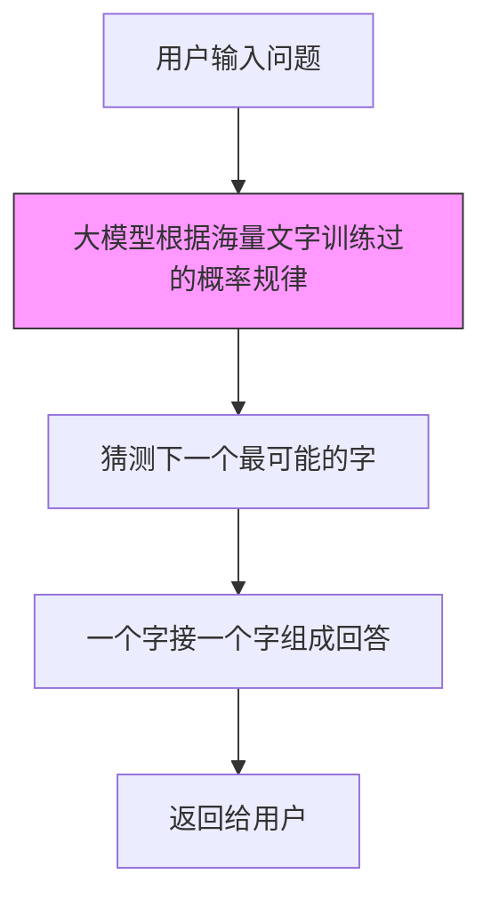

#### 1.1.1 DeepSeek 是什么？——素材：`202503-deepseek` > 一、什么是 DeepSeek？

DeepSeek 最早是一家搞金融的公司“幻方量化”里的技术极客，2015 年开始用 AI 预测股票，2023 年 5 月拆出来单干成立 DeepSeek 公司。他们发布的 DeepSeek R1 模型一出场就在数学、编程和逻辑推理方面跟 GPT-4 对打，甚至略胜一筹，但参数只用了 6710 亿（每次推理只用 370 亿），而 GPT-4 用了 1.76 万亿。开发成本仅 600 万美元，远低于其他公司的几千万甚至上亿美元。DeepSeek 走开源路线，模型、代码、训练方法全部免费公开，任何人都可以自由商业化使用。

**核心要点**：
- DeepSeek 的由来：幻方量化 AI 业务拆分独立
- 深度学习模型 DeepSeek R1：数学/编程/逻辑推理能力强
- 开源路线：免费商业化，研发过程写成论文公开
- 与 GPT-4 的定位差异：参数少、成本低、开源

#### 1.1.2 ChatGPT 是什么？——素材：`202403-cgpt-tixiao` > 一、【项目概述】了解 ChatGPT > 1.1 ChatGPT 是什么？

ChatGPT 不是无所不能的人工智能，也不是一点帮助都没有的小菜鸡，它是一个会模仿人类语言生成内容的机器人。它拥有顶尖的输出能力，但理解能力可能只有小学生水平；你需要有好的输入能力，它才能给到优质内容的输出。

书中用“打僵尸”场景做类比：你身边有个 8 岁小学生（ChatGPT）帮你，动手能力强但没有成年人默契。你有榴弹炮、子弹等弹药，100 个仓库，你需要小学生帮你补充弹药。你说“我要补充弹药”，它完全不知道要什么；你说“我要榴弹炮”，它会去找仓库再问你多少发；只有你说“我需要你去 097 仓库搬 10 发榴弹炮过来”，它才能高效配合。

**足够精准的指令，才能得到足够满足你需要的结果。** 如果你是 90 分的程序员，可以用 GPT 每天只干活一个小时；如果你不会写代码，GPT 写的代码你也用不明白。你需要知道什么样是 90 分的文案，GPT 才能给你输出 90 分的文案。

#### 1.1.3 ChatGPT 的底层原理：大语言模型 LLM ——素材：`202403-cgpt-tixiao` > 一、【项目概述】了解 ChatGPT > 1.2 ChatGPT 的底层原理

究竟是什么让 GPT 有如此强的能力？本质上是因为它的大语言模型（LLM）。

书中用“古诗词”来理解 LLM：我们知道“床前明月光”下一句是“疑是地上霜”，因为学过古诗词。如果没看过某首诗，但知道古诗词上下句字数一样，就能预测下一句是 7 个字。学习了更多古诗词后，就能模拟写出下一句。所谓大语言模型，就是通过学习人类现有的知识，按照规则来模仿生成内容。

ChatGPT 全名 Chat Generative Pre-trained Transformer，是基于生成式预训练深度学习技术打造的对话工具，能够模拟人类进行文字输出。

书中还介绍了常见 AI 词汇：
1. **PGC**：专业生成内容，如 CCTV、央视网、人民日报
2. **UGC**：用户生成内容，如抖音、bilibili、小红书
3. **AIGC**：人工智能生成内容，由 AI 系统创作或辅助创作
4. **提示词**：发送给 AI 让它生成内容的指令
5. **GPTs、GPT store**：自定义创建的 GPT 叫做 GPTs，汇集的地方叫 GPT store
6. **Token**：语言模型处理文本的基本单位，1 个英文字符 = 1 token，1 个汉字 = 2 token
7. **LLM**：Large Language Model 大语言模型
8. **Agent**：智能体 = LLM + Memory + Planning skill + Tool use

#### 1.1.4 我们该怎么看待 ChatGPT ——素材：`202403-cgpt-tixiao` > 一、【项目概述】了解 ChatGPT > 1.3 我们该怎么看待 ChatGPT

现有的 AI 研发还在第一步，是弱人工智能 ANI 时代，不具备真正意识，只是基于特定任务训练好的事情。ChatGPT 和短视频推荐算法、语音翻译工具、汽车自动驾驶本质上是一类产品，都是基于已有模型在某个赛道内解决人类需求。

ChatGPT 的不足之处：
1. **事实准确性问题**：可能生成错误信息或偏见内容
2. **生成幻觉**：创造出不存在的事实，因为它是“生成式语言”
3. **逻辑推理能力不稳定**：数学计算、物理公式计算等可能出错

OpenAI 2024 年 2 月发布文生视频软件 Sora，最高时长 60 秒，但算力成本高，不会颠覆视频行业。AI 工具更多是在工作流中的某个环节帮助人提升效率，而不是取代整个工作流。

#### 1.1.5 DeepSeek 快速入门：访问方式 ——素材：`202503-deepseek` > 二、DeepSeek 快速入门 > 2.1 DeepSeek 访问入口

- **网页端**：https://www.DeepSeek.com，注册或登录即可使用
- **手机端**：应用商店搜索“DeepSeek”，安装后随时对话

#### 1.1.6 DeepSeek 老是崩溃，怎么办？——素材：`202503-deepseek` > 二、DeepSeek 快速入门 > 2.2 DeepSeek 老是崩溃，怎么办？

官网过于火爆，很容易出现无法回应。解决办法：
1. **使用其他对话应用**：推荐 Chatbox（https://chatboxai.app/zh）和 Cherry Studio（https://cherry-ai.com/），通过 API 服务使用 DeepSeek R1
2. **自建 API**：通过火山云-DeepSeek 模型搭建，完成实名认证后获取 API

**避免崩溃的小贴士**：
- 保持最新版本：网页端或 App 提示升级时及时更新
- 火山云备选：实在崩溃频繁，可按官方教程把模型托管到“火山云”
- 多尝试/多模式：换个时间段、换个接口，或用深度思考模式、通用模式绕开高峰期
- 简化问题：问题过长过复杂会让模型“罢工”，先分段，让 AI 逐一回答

**对应素材**：
- `202503-deepseek` > 一、什么是 DeepSeek？（DeepSeek 的由来、开源路线、与 GPT-4 对比）
- `202403-cgpt-tixiao` > 一、【项目概述】了解 ChatGPT（1.1 ChatGPT 是什么？、1.2 ChatGPT 的底层原理 LLM、PGC/UGC/AIGC 概念、1.3 我们该怎么看待 ChatGPT，AI 能力边界与幻觉问题）
- `202503-deepseek` > 二、DeepSeek 快速入门（2.1 DeepSeek 访问入口、2.2 DeepSeek 老是崩溃怎么办）

**小练习**：在 DeepSeek 网页版或 App 中连续对话 5 轮，分别尝试“开放式提问”“要求分步推理”“要求给出具体示例”三种提问方式，观察并记录回答质量的差异，写下 200 字以内的复盘。

---

### 1.2 提示词工程：与 AI 对话的核心技能

本节系统讲解提示词编写方法，涵盖角色设定、直接提问、原子任务、任务拆解四大核心技巧，并以“1 原则 3 技巧”心法帮助读者让 AI 写作提速至少 3 倍。同时介绍提示词库的构建与复用，使读者从“随手试问”转向“可复制、可迭代的指令资产”。

**大白话**：提示词就是你对 AI 说的话。AI 像一个八岁的小学生，动手能力强但不懂你的潜台词，你说得越模糊，它做得越离谱。所以写提示词的核心就两点：**信息更精确**、**流程更缜密**。

**Mermaid 图表：BRTR 提示词框架**

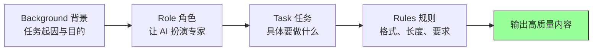

#### 1.2.1 提示词有哪些影响？——素材：`202403-cgpt-tixiao` > 三、【项目实操 2/4】写好提示词，让 GPT 高效工作 > 3.1 提示词有哪些影响？

提示词就是指我们在 AI 文本框输入的内容，它的质量决定了你的 GPT 是一个掉链子的机器人还是一个新时代的人工智能。

书中举了一个例子：写一份 2000 字左右的二战稿件。如果直接说“给我一份二战的稿件”，GPT 按照自己的理解生成，字数和结构都不符合要求。后来用 BRTR 指令优化后，效果不错但战争过程不够详细。再优化为分段输出（先开头、再中间、再结尾），就符合预期了。

**提示词调试心得**：能让 GPT 产生你预期质量输出的提示词就是好的提示词。不要纠结用 BRTR 还是 langGPT 模板，更多要关注：如何给到 GPT 更详细的信息让它了解真实诉求；如何设计一个好的输出流程。如果提示词调试失败了，可以问 GPT 这个提示词为什么没有好的输出结果，它自己会给你很多有用建议。

#### 1.2.2 提示词写作指南 ——素材：`202403-cgpt-tixiao` > 三、【项目实操 2/4】写好提示词，让 GPT 高效工作 > 3.2 提示词写作指南

基于 OpenAI 官方提示词指南，核心就两点：**更精确的信息**、**更缜密的流程**。

**如何提供更精确的信息：**
1. **尽可能多的增加细节**：更多细节能让 GPT 理解你的意图
2. **要求模型采用一个角色**：比如“扮演一个律师”，让 GPT 调整回答风格和专业性
3. **通过分隔符让各模块清晰明了**：用 XML 标签区分不同内容
4. **给到指定长度**：告诉 GPT 你希望输出多少字
5. **提供参考文本**：通过数据投喂增加信息源，让 GPT 更理解诉求

**如何提供缜密的流程：** 先明确目标和需求，然后倒推流程步骤。比如阅读书籍，目标是让 ChatGPT 带着你读书，需要 ChatGPT 把书看完总结重点，然后检索回答问题，所以提示词里要放入重点总结、内容检索、提问式回答。

#### 1.2.3 提示词写作模版 ——素材：`202403-cgpt-tixiao` > 三、【项目实操 2/4】写好提示词，让 GPT 高效工作 > 3.3 提示词写作模版

书中准备了两个提示词模板：**BRTR** 和 **langGPT**。

**BRTR 原则**（适合不需要复杂流程的内容生产）：
```
# 背景（Background） - 描述任务的背景信息，包括任务的起因、目的、相关的历史信息或当前状况。
# 角色（Role） - 定义 ChatGPT 在任务中所扮演的角色，例如专家、顾问、作家等。
# 任务（Task） - 描述具体的任务内容，包括任务的目标、主要活动和预期成果。
# Rules（规则） - 列出具体的执行要求，如内容标准、格式、长度、引用资料等。
```

**LangGPT 原则**（适合需要复杂流程的场景）：
```
# Role (角色)
# Profile (个人资料) - 姓名、ID、版本、语言、角色描述
## Background (背景) - 角色的背景知识、经验
## Goals (目标) - 主要目标和期望达成的成果
## Constraints (约束) - 必须遵守的规则和限制
## Skills (技能) - 关键技能和专长
## Examples (示例) - 输入输出示例
## Workflow (工作流程) - 完成任务的步骤和过程
## Initialization (初始化) - 角色如何介绍自己并引导用户
```

更多提示词模板可访问：https://www.aishort.top/、https://www.explainthis.io/zh-hans/chatgpt

#### 1.2.4 写提示词的一点心得 ——素材：`202403-cgpt-tixiao` > 三、【项目实操 2/4】写好提示词，让 GPT 高效工作 > 3.4 写提示词的一点心得

不要纠结模板，关注两点：1）如何给到 GPT 更详细的信息；2）如何设计一个好的输出流程。如果调试失败，问 GPT 为什么没有好的输出，它会给建议。

#### 1.2.5 AI 的终极调教心法：1 个原则 3 个技巧 ——素材：`202503-aixiezuo` > 二、一套方法论帮你搞定 AI 写作

书中详细讲解了 AI 的终极调教心法：**1 个原则和 3 个技巧**。

**1 个原则：角色扮演原则**
通过让 AI 扮演特定角色来生成更精准、专业的内容。

**3 个技巧：**
1. **直接提问法**：适用于简单任务的快速处理
2. **原子任务法**：将复杂任务拆解为最小单元，逐步完成
3. **任务拆解法**：每次让 GPT 聚焦于执行一个更小的任务，更精准地完成写作

**对应素材**：
- `202403-cgpt-tixiao` > 三、【项目实操 2/4】写好提示词，让 GPT 高效工作（3.1 提示词有哪些影响？、3.2 提示词写作指南、3.3 提示词写作模版 BRTR/langGPT、3.4 写提示词的一点心得）
- `202503-aixiezuo` > 二、一套方法论帮你搞定 AI 写作（1 个原则和 3 个技巧：角色扮演原则、直接提问法、原子任务法、任务拆解法）

**小练习**：选一个你近期需要完成的写作任务（如周报、产品介绍、邮件），用“角色设定 + 原子任务拆解”写一条提示词，让 AI 生成初稿，再用一条提示词让 AI 修改初稿，对比前后差异并保存两条提示词作为个人模板。

---

### 1.3 AI 工具全景图与选型

本节梳理文本生成（ChatGPT/Kimi/文心一言）、图像生成（MidJourney/Stable Diffusion/Flux/DALL·E）、视频生成（Runway/可灵/Gen）、代码生成（Claude Code/Cursor/Codex）等领域的主流工具，给出国内外平替方案与成本预估（航海期最低约 100 元），帮助读者按需选型、避免重复付费。

**大白话**：选 AI 工具就像选厨具，炒菜用炒锅、切菜用菜刀，没有一个锅什么都能做。先看你要做什么（写文案？画图？写代码？），再选对应的工具，不要全家桶都订阅，浪费钱。

**Mermaid 图表：AI 工具选型决策树**

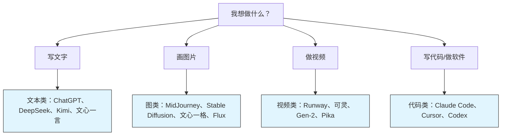

#### 1.3.1 如何选择 AI 写作工具？——素材：`202503-aixiezuo` > 二、一套方法论帮你搞定 AI 写作 > 2.1 如何选择 AI 写作工具？

ChatGPT 是目前最受欢迎的 AI 写作工具。ChatGPT 机器人由 OpenAI 公司创建，预先投喂了大量数据，互联网上能看到的信息都可能被投喂。

**ChatGPT 主要功能：**
- 问答：根据训练数据生成答案（科学、历史、文化等）
- 文本生成：写文章、故事、诗歌等
- 对话：模拟人类对话，用于客服、教育、娱乐、角色扮演
- 编程：理解编程语言，写代码
- 学习：解释复杂概念，学习新语言

**ChatGPT 核心原理**：ChatGPT 不具有人类思维和逻辑，无法知晓文章上下文真正逻辑，而是从知识库中通过算法猜测下一个字，一个字接着一个字生成文章。

#### 1.3.2 开通 ChatGPT ——素材：`202403-cgpt-tixiao` > 二、【项目实操 1/4】开通 ChatGPT，并和它进行一次对话 > 2.1 开通 ChatGPT

**免费版和付费 Plus 版的区别：**

| 功能 | GPT-3.5 (免费) | GPT-4.0 (Plus 20 美元/月) |
|------|---------------|--------------------------|
| 基础对话功能 | ✓ | ✓ |
| 语音对话（APP） | | ✓ |
| 图像处理 | | ✓ |
| 文件上传 | | ✓ |
| 联网搜索 | | ✓ |
| 画图 | | ✓ |
| 创建专属对话（GPTs） | | ✓ |
| 多 GPTs 联合作业 | | ✓ |
| Web 端 | ✓ | ✓ |
| 微信小程序 | | ✓ |
| APP 端 | | ✓ |

购买 Plus 需要国外信用卡，目前免税州会员价格 20 美元/月，折合人民币约 135.68 元。

#### 1.3.3 ChatGPT 的替代软件：国产大模型 Kimi ——素材：`202403-cgpt-tixiao` > 二、【项目实操 1/4】开通 ChatGPT，并和它进行一次对话 > 2.4 ChatGPT 替代软件

Kimi Chat 是由月之暗面科技有限公司（Moonshot AI）开发的智能助手，具备文件读取、联网查询等功能，能够一次性“消化”20 万字的文本。Kimi 在文本生成、搜索、翻译、读书等场景体验不错。如果不方便使用 ChatGPT，可以直接用 Kimi 完成航海。

Kimi 链接：https://kimi.moonshot.cn/

#### 1.3.4 DeepSeek 客户端推荐 ——素材：`202503-deepseek` > 二、DeepSeek 快速入门 > 2.2 DeepSeek 老是崩溃，怎么办？

推荐两个 AI 对话应用：
1. **Chatbox**：跨平台应用，支持多模型、本地存储、Markdown/LaTeX/Mermaid 渲染，内置提示词
2. **Cherry Studio**：跨平台（Windows/macOS/Linux），集成 300+ 预配置 AI 助手，RAG 技术驱动本地知识库，多模态文档处理

**对应素材**：
- `202503-deepseek` > 二、DeepSeek 快速入门（2.1 DeepSeek 访问入口、2.2 DeepSeek 老是崩溃怎么办，Chatbox、Cherry Studio 推荐）
- `202403-cgpt-tixiao` > 二、【项目实操 1/4】开通 ChatGPT，并和它进行一次对话（2.4 ChatGPT 替代软件：国产大模型 Kimi）
- `202503-aixiezuo` > 二、一套方法论帮你搞定 AI 写作（2.1 如何选择 AI 写作工具？ChatGPT 免费版 vs 会员版、核心原理）

**小练习**：列出你日常工作中重复次数最多的 3 个任务，为每个任务在本节工具全景图中找出 1 个可替代的 AI 工具，并标注该工具是免费、订阅还是按次付费。

---

### 1.4 AI 认知框架：能力、场景、工具

本节介绍从“跟工具学操作步骤”转向“底层能力与清晰思考”的认知升级，梳理提示词工程 → 上下文工程 → 指令工程（Harness Engineering）的演化路径，教读者建立个人 AI 认知框架，并明确 AI 提效不能替代自身判断力的边界。

**大白话**：很多新手只记住“怎么点哪个按钮”，工具一换就不会了。更好的办法是理解底层能力（比如“拆解任务”“给背景信息”），这样换任何 AI 工具都能用。

**AI 不能替代的边界：**
- AI 可以帮你起草方案，但不能替你拍板做决定
- AI 可以帮你写代码，但不能替你理解业务需求
- AI 可以帮你总结信息，但关键数据（金额、日期、人名）必须人工核对

**AI 是锦上添花，不是雪中送炭。** 你不懂业务的情况下，充其量能写出 60 分的东西，哪怕提示词水平再好；业务是核心，AI 是帮助业务，但不能代替业务。

#### 1.4.1 AI 提效场景 ——素材：`202403-cgpt-tixiao` > 四、【项目实操 3/4】掌握 AI 提效场景

书中挑选了 12 个适用性强的场景：

**提高工作效率：**
1. 用 AI 来做会议纪要（通义听悟）
2. 用 AI 来生成 PPT（ChatGPT 生成大纲 + Mindshow 制作）
3. 用 AI 来翻译外文（Kimi、GPT-4.0 读取网站、文件）
4. 用 AI 来撰写方案（BRTR 原则生成活动策划方案）
5. 用 AI 来备课（班主任期末评语、教育论坛、班会课备课、语文作文点评）

**提高生活效率：**
6. 用 AI 来搜索（秘塔搜索、360AI 搜索、Kimi 特定渠道检索）
7. 用 AI 来学习视频（通义听悟转录）
8. 用 AI 来听播客（获取 RSS 链接 + 通义听悟 + Kimi 学习）
9. 用 AI 来阅读长文（文章总结、提问讲解）

**提高创作效率：**
10. 用 AI 创作脚本（明确目标 → 输入案例学习 → 生成脚本）
11. 用 AI 做小红书定位（四维理论：爱好擅长、细分赛道、精准人群、价值变现）
12. 用 AI 来写小红书标题（二极管标题法、爆款标题库、爆款关键词修正）

#### 1.4.2 失败的 AI 提效案例 ——素材：`202403-cgpt-tixiao` > 五、【项目实操 4/4】定制自己的 AI 提效解决方案 > 5.1 失败的 AI 提效案例

失败场景共性：使用频率低、复杂度较高。

1. **中高阶岗简历场景**：AI 不了解 AI 产品经理和产品总监岗的核心知识，无法匹配，缺乏成熟知识库
2. **生财知识库 GPTs**：AI 没法评估帖子质量，没法评估精华在哪，需要带着认知去看
3. **编导出稿子提效**：编导自己没有把新开的短剧业务跑正，没有稳定的成功流程，0 的基础上提升不了效率
4. **不懂公众号爆文下的尝试**：不懂公众号爆文，就没法搞出 90 分的产品，60 分顶天了，剩下 30 分需要去业务上寻找

#### 1.4.3 拆解工作流找到核心卡点 ——素材：`202403-cgpt-tixiao` > 五、【项目实操 4/4】定制自己的 AI 提效解决方案 > 5.2 拆解工作流找到核心卡点

成功案例共性：有确定的工作流程。

1. **通义听悟的使用环节挖掘**：企业家采访转录，粗剪画稿，剪辑粗剪，基于时间戳快速完成长视频粗剪
2. **写公众号文章用 AI 提效**：Perplexity 调研外网资料 + Kimi 翻译成中文 + 整理初稿，大大提升对外网文献的调研速度

**对应素材**：
- `202403-cgpt-tixiao` > 四、【项目实操 3/4】掌握 AI 提效场景（4.1-4.3 工作/生活/创作效率场景）
- `202403-cgpt-tixiao` > 五、【项目实操 4/4】定制自己的 AI 提效解决方案（5.1 失败的 AI 提效案例，AI 是锦上添花不是雪中送炭；5.2 拆解工作流找到核心卡点）
- `202503-deepseek` > 三、DeepSeek 的应用场景（3.1-3.7 公众号、标题、小红书、知乎、PPT、读书卡片、海报）

**小练习**：画一张单页图，左侧列你工作中 5 个高频场景，中间对应需要的 AI 能力（写作/画图/编程/分析/自动化），右侧对应选定的工具，完成后拍照或截图保存为桌面背景。

---

## 第二章 AI 文字创作：高效写作与内容变现

本章聚焦 AI 文生文能力，教读者 21 天内掌握小红书文案、读后感、商业计划书等主流文体的 AI 写作方法，并延伸至公众号爆文自动化与 AI 小说变现，适合文笔不足但希望通过写作提效或副业变现的普通人。

### 2.1 AI 写作方法论与 21 天入门路径

本节给出 21 天 AI 写作学习路径：第一阶段约 5 天夯实 AI 写作基础（选工具、必备技巧、底层方法论），第二阶段约 12 天攻克常见文体。以“代写村庄”故事讲清顾客—村长—村民的变现角色分工，让读者明白 AI 写作不仅是自我使用，也是可接单变现的服务。

**大白话**：AI 写作就像一个“代写村庄”，你是村长（接单、定需求），AI 是村民（具体写文章），顾客付钱，你赚中间差价。前两周先练手，后两周开始接单。

**Mermaid 图表：21 天 AI 写作学习路径**

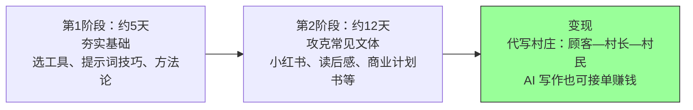

#### 2.1.1 项目分析：什么是 AI 写作？——素材：`202503-aixiezuo` > 一、了解 AI 写作项目 > 1.1 项目分析

AI 写作，就是一个利用人工智能技术生成文本内容的项目。它能帮我们快速生成各类文章写作的类型，只要掌握技巧就可以了。对于普通人不再担心文笔差了，现在可以通过 AI 轻松写作，甚至实现变现。

书中用文心一言以故事的形式讲清楚 AI 写作变现逻辑：有一个代写村庄，这里的村民以代写为生，村民擅长写类型都不一样。客户提出写作需求，村民接受任务并按照客户的要求完成写作，最后客户支付报酬。

这里面就有三个角色：
- **顾客**：提出要求并支付报酬
- **村长**：寻找顾客，并接到写作需求，招募村民入驻村庄
- **村民**：根据顾客要求，完成写作，获取报酬

本次航海就是让大家利用 AI 当好一位村民，后面选修也会给大家提供一个方案。

#### 2.1.2 新手从 0 到 1 的有效路径 ——素材：`202503-aixiezuo` > 一、了解 AI 写作项目 > 1.2 新手从 0 到 1 的有效路径

**1.2.1 第一阶段：掌握 AI 写作基础（约 5 天）**
- 选工具、必备技巧、底层方法论

**1.2.2 第二阶段：学习常见文体写作（约 12 天）**
- 攻克小红书文案、读后感、商业计划书等常见文体

**对应素材**：
- `202503-aixiezuo` > 一、了解 AI 写作项目（1.1 项目分析、代写村庄三个角色：顾客、村长、村民）
- `202503-aixiezuo` > 一、了解 AI 写作项目（1.2 新手从 0 到 1 的有效路径，第一阶段约 5 天、第二阶段约 12 天）

**小练习**：按本节路径，花 3 天时间分别用 AI 完成一条小红书种草文案、一篇读后感、一封商务邮件，每篇都用不同工具（如 ChatGPT、Kimi、文心一言）并记录耗时对比。

---

### 2.2 常见文体的 AI 写作（小红书文案、读后感、商业计划书等）

本节逐文体拆解 AI 写作模板与技巧：小红书笔记的起号打标签与爆款结构、读后感的观点提炼与个人化表达、商业计划书的逻辑框架与说服性写作。每个文体均配可复制的提示词手册，读者对照复制即可实战演练。

**大白话**：不同平台的文案就像不同口味的菜，小红书要“年轻、有 emoji、标题党”，读后感要“个人感悟为主”，商业计划书要“逻辑严谨、有数据”。套不同的模板，AI 出的东西才合适。

#### 2.2.1 小红书笔记的 AI 写作 ——素材：`202403-cgpt-tixiao` > 八、【案例展示】ChatGPT 的多种应用方向 > 8.2.1 案例一：用 ChatGPT 写一篇小红书旅游笔记

四个步骤用 ChatGPT 写一篇小红书旅游笔记：
1. **先通过 ChatGPT 来帮我们获取基础内容**（比如目的地的酒店、美食、景点信息）
2. **让它生成文案**（赋予角色——小红书的旅游博主，把信息生成一篇小红书旅游笔记）
3. **通过 ChatGPT 可以快速地插入 emoji 表情**（小红书文案的特点，每段开头和正文里插入合适的 emoji）
4. **让它帮我们生成爆款标题**（角色是爆款标题生成器，要求标题包含解决什么问题、笔记的解决方案是什么、解决后的结果是什么，以及标题的字数）

实战案例是写一篇邵阳隆回的旅游笔记。生成的标题至少能打 80 分的水平，在外面可能要花 4000-5000 请一个文案，有了 ChatGPT 这些钱都省下来了。

#### 2.2.2 读后感的 AI 写作 ——素材：`202403-cgpt-tixiao` > 八、【案例展示】ChatGPT 的多种应用方向 > 8.2.6 案例六：用 ChatGPT 写《活着》读后感

直接让 AI 完成读后感，内容会有很大概率泛泛而谈，或者有虚假信息。圈友 @Cheese 海盐芝士 分享了三种方法，让 ChatGPT 帮助更好的完成一篇读后感：
1. **直接让 ChatGPT 扮演资深读者**，产生一篇独树一帜的读后感内容
2. **将大纲中的每一个内容对应一个文章段落**，对应一次生成的动作，一步一段地生成直到生成完整的文章
3. **提示词中需要清晰的说明 ChatGPT 需要扮演的角色、要做的任务、需要完成的内容大纲、内容要求**。每一个大纲部分分别放到这个提示词模板中和 ChatGPT 对话，直到所有内容生成。

#### 2.2.3 商业计划书的 AI 写作 ——素材：`202403-cgpt-tixiao` > 八、【案例展示】ChatGPT 的多种应用方向 > 8.2.4 案例四：用 ChatGPT 完成百家号带货文章

写文章的时候要牢记：最好多次出现关键词，文章篇幅推荐在 1000-1400 字，关键词出现的次数尽量保持 8-12 次。

文章的基本框架：
- **第一部分：总述**，比如现在移动办公场景越来越多
- **第二部分：描述一下挑选适合办公用的笔记本，需要注意哪几点**
- **第三部分：产品推荐**，介绍 3-4 款产品即可
- **第四部分：总结一下**，比如以上就是推荐的几款适合办公用的笔记本，希望可以帮助到大家

在发表之前，通过网上的原创评估工具，看看文章能否通过原创审核。通常 1500 字的文章，原创检测出来的严重的重复次数小于 10 次，都没有问题。

**对应素材**：
- `202403-cgpt-tixiao` > 八、【案例展示】ChatGPT 的多种应用方向（8.2 ChatGPT + 文案内容创作：小红书笔记、知乎好物、百家号、读后感、公众号爆文）
- `202403-cgpt-tixiao` > 八、【案例展示】ChatGPT 的多种应用方向（8.2.1 案例一：用 ChatGPT 写一篇小红书旅游笔记、8.2.6 案例六：用 ChatGPT 写《活着》读后感）
- `202503-deepseek` > 三、DeepSeek 的应用场景（3.1 用 DeepSeek 写公众号文章、3.2 用 DeepSeek 写标题、3.3 用 DeepSeek 做小红书）

**小练习**：选一本你最近读过的书，用 AI 生成两版读后感（一版偏学术分析、一版偏小红书个人体验），对比两版的语言风格与适用场景，并修改其中一版发布到社交平台。

---

### 2.3 AI 辅助公众号爆文写作与自动化放大

本节介绍公众号拥抱算法后 0 粉丝也能进推荐流量池的机制，教读者跑通“选题 → 爆文写作 → 发布 → 变现”的最小可行性产品（MVP），再用 ChatGPT/Python 全自动化与多账号 AI 辅助放大产出。适合长期副业，包含流量主收款与收益案例拆解。

**大白话**：公众号现在不靠粉丝数，靠内容好不好。AI 帮你写，你负责选题和把关，发出去后有人读就有流量主收益。先跑通一篇，再想办法批量产出。

#### 2.3.1 用 DeepSeek 写公众号文章：选题规划 ——素材：`202503-deepseek` > 三、DeepSeek 的应用场景 > 3.1 用 DeepSeek 写公众号文章 @越越

给 DeepSeek（深度思考模式+联网模式）的完整写文提示词：

**生成选题规划：**
- 任务目标：生成[具体领域]的选题规划
- 背景信息：账号定位[填写定位]、目标用户[用户画像]、核心诉求[用户需求]
- 要求：(1) 生成10个选题方向 (2) 每个选题包含主标题、副标题、核心观点、价值主张 (3) 考虑时效性与持久性的平衡
- 输出格式：表格呈现

**3.1.1 选题爆破（30%精力）：**
- 明确目标用户：想象你的用户是什么样的人，他们每天会遇到什么问题，最需要什么帮助
- 结合热点：平时多刷微博、抖音、知乎，看看大家都在聊什么，找到和你领域相关的热点
- 制造情绪共鸣：在选题中加入情绪词，比如“震惊”“颠覆”“扎心”“终于”等
- 用问题式标题：多用“为什么”“如何”“怎样”等词开头

**3.1.2 结构设计（20%精力）：**
高质量的内容结构通常体现以下特点：证据链完整、逻辑递进、多维视角。

**设计金字塔结构：**
- 开头：吸引用户注意，告诉他们为什么要看这篇文章（设置悬念钩子、提出扎心问题、讲有趣故事、用数据制造反差）
- 中间：详细展开内容，解决用户的问题（分点论述、讲故事、列数据）
- 结尾：总结全文，引导用户行动（总结全文、引发思考、引导行动）

结构设计的模板：
1. 问题-分析-解决方案
2. 故事-道理-行动
3. 数据-分析-建议

**3.1.3 内容生成（30%精力）：**
- 开头：吸引用户注意（提出问题、讲故事、用数据）
- 中间：详细展开内容（分点论述、讲故事、列数据）
- 结尾：总结并引导行动（总结全文、引发思考、引导行动）

特别技巧：
- 热点新闻改写：将热点事件转化为话题角度的分析文章，重点关注核心观点，包含数据支撑和专家观点
- 原创内容创作：以主题为核心，从切入点展开讨论，结合案例和方法论，形成字数的深度文章
- 评论互动优化：基于用户反馈进行的内容创作，准确把握用户痛点，设计出更有针对性的解决方案

**3.1.4 人性化润色（20%精力）：**
- 加入口语化表达：用日常聊天的语气词和短句，让文章更亲切
- 插入互动提问：在文章中多问一些问题，让用户觉得你在和他们对话
- 制造情感共鸣：用能引发用户情绪的词句，让他们觉得你懂他们的感受
- 加入视觉化比喻：用形象的比喻，让抽象的概念更容易理解
- 用加粗、emoji、分段等方式，让文章更易读
- 设置信息锚点：每段文字不要太长，适当加入小标题、加粗、emoji 等

#### 2.3.2 用 DeepSeek 写标题 ——素材：`202503-deepseek` > 三、DeepSeek 的应用场景 > 3.2 用 DeepSeek 写标题 @越越

**爆款标题的核心：3 秒内戳中用户“情绪痛点”或“认知缺口”。**

**爆款标题 4 大核心要素：**
1. 情绪驱动：引发好奇、焦虑、共鸣或期待（如“震惊！”“为什么…”）
2. 痛点直击：明确指向特定群体的困境（如“30 岁未婚”“996 员工”）
3. 具体化：用数字、场景、细节增强真实感（如“凌晨 3 点”“月薪 5000”）
4. 冲突对比：制造对立感（理想 vs 现实、传统 vs 现代）

这基本是爆款标题必备的要素，一个好的爆款标题决定 70% 文章阅读量。

**3.2.1 六种高转化标题公式：**

| 公式 | 底层逻辑 | 示例 |
|------|---------|------|
| 公式1：为什么（现象）+ 却（反常识）？ | 利用“认知失调”激发点击欲 | 《为什么越懂事的女孩，越难被爱？》 |
| 公式2：数字/数据 + 反常识结论 | 数字具象化权威感，反常识结论打破预期 | 《90%的婚姻破裂，都是从这 3 件小事开始的》 |
| 公式3：（群体标签）的痛点 + 解决方案/警示 | 精准锁定群体，用“懂你”感降低心理防御 | 《“小镇做题家”的困局：会考试的人，正在被社会淘汰》 |
| 公式4：时间/场景 + 细节描写 + 情绪词 | 用具体场景触发用户“记忆闪回”，增强代入感 | 《凌晨 3 点，那个在厕所哭的二胎妈妈，终于上热搜了》 |
| 公式5：反传统结论 + 挑衅式反问 | 利用观点冲突引发站队，驱动转发讨论 | 《“不要彩礼的女生，婚后都后悔了”》 |
| 公式6：热点事件 + 隐藏视角/未曝光细节 | 借势流量池，用“内幕信息”满足窥探欲 | 《哪吒 2 票房破纪录背后，被删减的 30 分钟藏着最大阴谋》 |

**3.2.2 七大误区和避坑方案：**

1. **标题党化**：标题夸张但内容无关。解决：用 DeepSeek 对标题进行“标题党指数”评分（0-10分），给出去标题党化版本。
2. **缺乏痛点**：如《如何提升职场能力》→ 无具体场景/群体。解决：拆解为3个细分痛点场景，带具体身份标签。
3. **引发反感**：如《所有老板都害怕员工知道的秘密》。解决：识别绝对化词汇，提供软化方案，用“可能”“更容易”等缓冲词。
4. **缺乏可信**：如《年轻人都在逃离职场》，无数据事实支撑。解决：查找3组权威数据，数据前置且自然融合。
5. **忽视身份**：如《职场生存指南》，受众模糊。解决：根据用户画像生成标题，包含至少2个身份标签。
6. **情绪不当**：如《资本家都该下地狱》，违规风险。解决：分析情绪分布，调整到健康比例，增加解决方案导向。
7. **热点关联生硬**：如《哪吒 2 爆火！教你做西红柿炒蛋》。解决：用隐喻替代直接提及电影，突出身份认同困境。

**终极爆款标题心法：**
- 人性优先级：恐惧＞好奇＞贪婪＞认同感＞利他心
- 三秒法则：标题前 8 个字必须包含关键词（移动端显示约 16 字）
- 终极检验标准：用户看到标题后是否会想：“这说的不就是我吗？”/“到底怎么回事？”

**对应素材**：
- `202503-deepseek` > 三、DeepSeek 的应用场景（3.1 用 DeepSeek 写公众号文章：选题规划、生成标题、生成内容、人性化润色；3.2 用 DeepSeek 写标题：爆款标题4大核心要素、六种高转化标题公式、七大误区和避坑方案）
- `202403-cgpt-tixiao` > 八、【案例展示】ChatGPT 的多种应用方向（8.2.8 案例八：ChatGPT+公众号爆文案例合集）

**小练习**：在公众号注册并开通流量主（或准备注册），用 AI 生成一篇垂直领域爆文并排版发布，记录首 24 小时的阅读数与互动数据作为复盘基准。

---

### 2.4 AI 小说与网文创作从写作到变现

本节教读者用 AI 写网络小说并实现变现，覆盖市场行情、类型题材、平台收益模式（番茄小说、知乎盐选、百度付费专栏“短篇三巨头”），从注册番茄账号起步，解决无写作功底的普通人入局网文的问题。重点讲解选文四种方法与套路化改文技巧。

**大白话**：网文就像工厂流水线，选题是选产品，大纲是设计图，AI 负责扩写正文。新手建议从“番茄小说”短篇开始，门槛低，自动签约，不用先出名就能有收益。

**Mermaid 图表：AI 小说创作全流程**

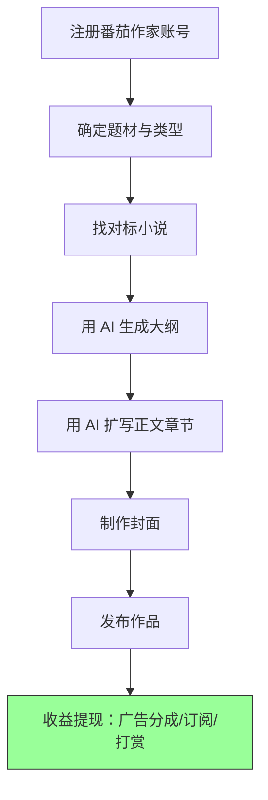

#### 2.4.1 市场规模和增长趋势 ——素材：`202503-aixiaoshuo` > 一、【项目概述】AI写小说基础认知 > 1.1 市场规模和增长趋势

2025年网络文学市场持续增长。中商产业研究院发布的《2025-2030年中国网络文学出版行业市场发展现状及潜力分析研究报告》显示，2023年中国网络文学市场规模达到404.3亿元，同比增长3.8%，作家、作品、读者数量呈稳健增长态势，作者规模达2405万，作品数量达3620万部，用户数量达5.37亿。

网络文学的社会影响力持续增强。中商产业研究院分析师预测，2024年中国网络文学市场规模将达到419.9亿元，2025年达到436.1亿元。

这正说明了网络小说的市场空间很大，值得去深耕。

#### 2.4.2 小说类型 ——素材：`202503-aixiaoshuo` > 一、【项目概述】AI写小说基础认知 > 1.2 小说类型

在网络文学领域，长短篇的划分更注重用户阅读习惯与商业模式，字数标准更为宽松：

**字数标准：**
- 短篇：1万～5万字（如知乎盐言故事、微博连载短篇）
- 长篇：50万字以上为主流，部分超长篇可达数百万字（如《斗破苍穹》超500万字）

**发布形式与更新节奏：**
- 短篇：单次发布（一次性完结，适合碎片化阅读）、微连载（分3-5章更新）
- 长篇：日更模式（每日更新2000-6000字，维持读者黏性）、IP衍生导向（长期连载为影视、游戏改编积累内容库）

#### 2.4.3 常见平台与收益模式 ——素材：`202503-aixiaoshuo` > 一、【项目概述】AI写小说基础认知 > 1.3 常见平台与收益模式

**1.3.1 短篇小说**

目前短篇小说平台三巨头是：番茄小说、知乎盐选、百度付费专栏。

收益模式：小说平台流量分成、编辑投稿独家买断。

对于从未接触过小说创作的新人来说，首先推荐发布番茄小说平台，因为现在该平台是采用自动签约模式，只要你的短篇小说没有违禁内容，一般都会被签约。只有签约的小说才会获得平台稿费。

同时一篇文章你可以同步到百度百家号上，因为新手还不具备开通付费专栏的资格，所以只能发布在百家号上。

当你写好100篇短篇小说后，并且有几部可以拿到流量后，可以考虑去自动投稿平台去投稿，这里有专门的手稿编辑，可以实现AI自动投稿。

**1.3.2 长篇小说**

目前长篇小说以收费模式来划分，分为免费小说与收费小说两种：
- 免费：看小说不需要花钱，但需要看穿插在小说中的广告；免费小说作者的主要收入是广告分成及打赏礼物
- 收费：看小说的付费章节需要订阅章节才能阅读；收费小说作者的主要收入是会员订阅收入

目前主流的小说网站有：17K小说网、七猫小说、起点中文网、晋江文学城、纵横中文网、红袖添香、潇湘书院、掌阅小说网、书旗小说、刺猬猫、飞卢小说网、创世中文网、云起书院、咪咕阅读

**番茄小说网** https://fanqienovel.com/
- 作家收益模式：全勤+广告分成+礼物分成+各类创作者计划
- 平台特点：免费阅读平台，拥有庞大用户基础，主要覆盖16-35岁用户群体，AI签约非常容易，签约门槛较低

**七猫中文网** https://www.qimao.com/
- 作家收益模式：全勤+广告分成+礼物分成+各类创作者计划
- 平台特点：真人编辑审核对作品要求质量比较高，一旦签约收益比较好，30到45岁的城市中年女性比较多

**起点中文网** https://www.qidian.com/
- 平台特点：男频小说证道之地！难度超级高，诞生过许多年入千万的作者

**晋江文学城** https://www.jjwxc.net/
- 平台特点：女频小说证道之地！难度超级高，诞生过许多年入千万的作者

#### 2.4.4 常用工具选择 ——素材：`202503-aixiaoshuo` > 一、【项目概述】AI写小说基础认知 > 1.4 常用工具选择

**1.4.1 常用AI网站：**

| 工具 | 优点 | 缺点 |
|------|------|------|
| Claude | 强大的上下文理解能力，对框架拆解流程、文字模仿能力较好 | 免费版每天只能发十几次对话，付费版20美元/月 |
| DeepSeek | - | - |
| 豆包 | 免费使用 | 需要掌握使用提示词能力，成文效果不可控 |
| ChatGPT | 可以用于AI写作，需要提示词辅助可以更好写 | 免费版可以使用GPT-3.5模型，有使用次数限制，付费版本20美元/月 |

**1.4.2 AI写作网站：**
- **星月** https://xingyuexiezuo.com/：拥有海量的专业提示词资源，可以从大纲到正文进行全流程写作，需要掌握使用网站方法，按字数收费

#### 2.4.5 短篇小说创作过程：找对标 ——素材：`202503-aixiaoshuo` > 二、短篇小说创作过程 > 2.1 找对标

我们可以在今日头条、知乎盐选等平台寻找优质的短篇故事，然后将小说下载到本地。大家可以找一些点赞数比较高，时间比较久的故事，这些故事一般都是有爆火因子的，所以我们复刻这些故事也会同样增加爆款的概率。

例如，我们找一篇现实情感的短篇，打开盐言故事 APP（知乎盐选小说平台）：
- 寻找方向一：点击主页上方的分类，选择“现实情感”分类，在这里找一些点赞数超过 1000 的文章
- 寻找方向二：还可以在首页的女频/男频找对应的文章，评论越正面越好

#### 2.4.6 获取文本 ——素材：`202503-aixiaoshuo` > 二、短篇小说创作过程 > 2.2 获取文本

**获取方式一**：知乎小说阅读网站 http://abcd7.top（优点是不要钱；缺点是流程有些繁琐，需要下载夸克，然后每天需要下载指定文件来获取一个免费看书的码）

**获取方式二**：开通盐言故事会员 + 长截图 + 图片压缩 + OCR 识别（优点是网站所有内容都可以获取到，缺点是要花点钱）
- 图片压缩：https://ai.danqingai.com/index/image/compressor.html
- OCR 识别：https://ocr.wdku.net/

#### 2.4.7 创作新大纲 ——素材：`202503-aixiaoshuo` > 二、短篇小说创作过程 > 2.3 创作新大纲

我们以 AI 写作网为例完成大纲创作。注册登录网站后 https://xingyuexiezuo.com/

**方法一：参考对标小说生成新大纲**
1. 新建：打开星月网站 点击+号
2. 命名：输入短篇小说名称即可提交，创建一部新作品
3. 复制：进入小说编辑页面，把我们找好的对标短篇全文复制进去
4. 拆书：对小说进行大纲分析，点击右上方的 AI 拆书，勾选第一章，选择拆书提示词，点击更多
5. 选提示词：搜索“盟主君”，可以看到“【盟主君】短篇小说一键拆书并重新生成新的情节，短篇爆款神器”
6. 添加提示词：返回到拆书页面选择刚刚添加的提示词
7. 进行拆书：勾选第一章，选择下方的“合并拆”或者“分章拆”，等待 30 秒钟，AI 就可以帮我们重新生成一份完整而详细的小说大纲，同时也会更换主人公的姓名
8. 迭代优化：如果对这个生成大纲不满意可以重新进行拆书，或者选择自定义，输入需要改变大纲的要求

**方法二：一键生成爆款大纲**
1. 首先登录后台，新建一本书
2. 回到后台点击创意中的 大纲生成器
3. 选择任意一个大纲生成器，比如“【短篇】男频一键生成10w+新大纲（盟主君）”
4. 输入提示词，按照我们所构思的小说内容填写下方的关键词
5. 点击右下角生成，等待AI为我生成一个全新的小说大纲
6. 生成好的大纲，如果不需要修改，可以直接点击“推送至备忘录”

这里需要注意几点：
1. 填全关于小说的所有信息，越完善的情况下生成的大纲效果越好
2. 大纲生成器的提示词可以选择不同老师的，这里只要搜索【短篇】就可以看到
3. 如果对大纲不满意，可以把整个大纲复制到AI大模型（或者使用AI拆书）对其进行二次修改

#### 2.4.8 生成具体章节内容 ——素材：`202503-aixiaoshuo` > 二、短篇小说创作过程 > 2.4 生成具体章节内容

**2.4.1 爆款短篇小说的特点分析：**
- 导语（50-200 字）：一定要写出虐点/爽点
- 正文（10000 字）：
  - 第 0-2000 字：写出爆点，把高能亮出来
  - 第 2000-4000 字：拉情绪，末尾卡点女主死
  - 第 4000-9000 字：高潮，后悔，男主发现自己爱的是女主，女主却已经死了
  - 第 9000-10000 字：让读者解气，把男主往死里写
- 整体节奏：拉仇恨（虐）+反转（女主死）+后悔

**爆款小说要点：**
- 让读者有充分的代入感
- 要充分地把控情绪拉扯
- 一定要有创新点
- 不要过分套路化

**2.4.2 利用AI创作具体章节：**
1. 复制大纲：把之前写好的大纲复制到新建的章节内
2. AI 扩写润色：选中大纲的章节，然后选择上方的 AI 扩写润色，先要把高级功能打开
3. 选择AI模型：细腻版（Claude3.5）写的比较没有AI味道，文字生成字数较少
4. 关联知识库：为了确保AI为我们可以生成连续性的章节，我们可以在关联章节时候，把正文和大纲都关联起来
5. 生成内容：如果不满意效果，可以重新生成新的内容；如果满意可以直接复制到新建的正文章节中
6. 重复书写：按此方法，把大纲其他章节逐步写出来，然后都放在正文的章节内，同样关联好正文已经写好的内容

#### 2.4.9 制作封面 ——素材：`202503-aixiaoshuo` > 二、短篇小说创作过程 > 2.5 制作封面

目前番茄小说封面可以直接AI生成了，可以在后台直接一键生成。你也可以制作封面自己上传到小说后台。

打开即梦网站平台，选择图片生成 https://jimeng.jianying.com/
- 输入提示词，选择图片 2.1 模型，尺寸选择 9:16 的小说封面
- 提示词如下：小说封面 + 小说主人公形象+ 小说标题文字“”，这里面要详细描写一下你要表达的场景和人物形象
- 反复抽卡，直到我们在生成的图片选择一张适合的来做小说封面

#### 2.4.10 长篇小说创作过程：选择题材 ——素材：`202503-aixiaoshuo` > 三、长篇小说创作过程 > 3.1 选择题材

**3.1.1 确定要写的小说题材：**
这里使用一款工具叫做网文大数据 https://www.wangwendashuju.com/，打开网文大数据，选择番茄男频/女频，选择新书风向标，打开榜单分析，统计时段选择——热门新书——全部——最近90天。

最近90天男频热门标签词：穿越、系统、都市、玄幻、衍生、开局、架空、重生、同人、多女主、无敌、东方、玄幻历史、魂穿、单女主、空间直播、天才反派、大佬、校花、打脸、四合院、诸天万界、都市异能、洪荒、无女主、升级流、乡村、异世大陆、搞笑轻松、女帝、悬疑、扮猪吃虎、影视、腹黑、奥特同人、争霸、明朝、现代言情、发家致富、娱乐圈、灵异、神豪

最近90天女频热门标签词：年代、豪门总裁、女频衍生、宫斗宅斗、现代言情、穿越、系统、甜宠、重生、古代言情、衍生、双洁、都市、同人、空间、总裁、大佬、豪门世家、现代、直播、打脸、穿书、反派、团宠、腹黑、1v1、娱乐圈、无敌、魂穿、二次元、单女主、四合院

**3.1.2 确定小说题材流派：**
假设这里选定的题材是男频末日题材（什么题材都行，最好是自己熟悉的题材！如果实在没有中意的题材，就选择当下热门的题材，男频女频皆是。也可以使用上文提到的网文大数据进行选择）

女频当下热门题材：“豪门总裁”“宫斗宅斗”“年代”“种田”“玄幻言情”“星光璀璨”“古言脑洞”“现言脑洞”“青春甜宠”“悬疑恋爱”“快穿”“医术”“职场婚恋”“科幻末世”“女频衍生”“悬疑脑洞”“游戏体育”“民国言情”

男频当下热门题材：“都市高武”“玄幻脑洞”“悬疑脑洞”“传统玄幻”“都市日常”“奇幻仙侠”“都市种田”“悬疑灵异”“都市脑洞”“历史古代”“都市修真”“抗战谍战”“科幻末世”“历史脑洞”“游戏体育”“动漫衍生”“战神赘婿”

打开番茄小说——选择分类——选择热门标签——选择要寻找的题材流派，接下来是开始筛选，这个需要自己在平台上去找。

#### 2.4.11 内容创作：对标书名与简介 ——素材：`202503-aixiaoshuo` > 三、长篇小说创作过程 > 3.2 内容创作

**3.2.1 对标书名：**
找5本成绩比较好的作为对标，不要选作品巅峰榜上的作品，不要选作者是金番茄的。最好选择作家等级在1~5之间，在读人数超过一万的书籍。

原因在于：作品巅峰榜上的作品很多是作家自带粉丝基础并且不一定按照商业化网文的写作套路。即便他的节奏非常非常的慢，依旧有粉丝在等他，但我们没有。这里还是推荐一开始使用一般化的网文写作思路，“先对标后赶超”先去对标低粉爆款。

有两个方向，一个是通过【推荐榜】大数据来给我们推荐，多看一会儿，【推荐榜】就会刷出很多同类型的书，另一个是通过【读这本书的人还在读】

**方式一：星月写作** ——这里使用星月写作的爆款书名生成器，填入大致思路，等待生成书名。一定要多试几次，多换几个模型，多换几个提示词找出一个自己满意的。

**方式二：提示词输出** ——使用提示词通过DeepSeek/kimi/阶跃星辰的阶跃 AI 进行书名输出

**3.2.2 对标简介：**
选五本同题材同流派的书进行对标，将他们的简介全部复制下来。直接对标他们的特点：标签词+基本故事概述。

**方式一：星月写作** ——打开星月写作官网——点击简介生成器，填入对标简介及大致思路，等待生成简介。一定要多试几次，多换几个模型，多换几个提示词找出一个自己满意的。

**方式二：提示词输出** ——使用提示词通过DeepSeek/kimi/跃问进行提问

#### 2.4.12 小说封面制作 ——素材：`202503-aixiaoshuo` > 三、长篇小说创作过程 > 3.2.3 小说封面制作

可以淘宝购买，几块钱可以买到，或者自己制作。

**3.2.4 黄金三章：**
“酒香也怕巷子深”是流量市场的真理，黄金三章最重要的事情是一开头就把读者留住，一定要把读者处于强情绪的事件当中，比如经常看男频小说，男频小说最经典的开头模板就是生死危机，或者女频小说经典一开局就是在争吵。

第一章，生死危机，第二章，点出金手指，前五章，通过金手指摆脱生死危机。

总之一开头，一定要让主角处于一种强情绪的事件当中。千万不要一开头抛出大量的设定或者出场人物过多。这样都可能对读者造成认知负担，选择放弃继续阅读。

在星月写作官网——选择创意——黄金开篇生成器，输入我们自己生成的标题、简介，以及我们自己大致的思路想法——点击生成。一定要多抽卡几次，多更换模写和提示词，找到相对最好的那一个。

或者使用Gemini/Claude，输入提示词。

**3.2.5 后续剧情架构：**
如何构思一部百万字级长篇小说，核心秘诀在于“套娃”。以热门末世小说《全球冰封：我打造了末世安全屋》举例：
- 第一层在整个居民楼内，为了物资发生冲突
- 第二层在整个小区内，为了物资发生冲突
- 第三层在整个本地城市中（市），为了物资发生冲突
- 第四层在风暴城（省），为了物资发生冲突
- 第五层和外国之间（国家），为了物资发生冲突
- 第六层和其他种族（文明），为了物资发生冲突

在每一层套娃之间，配合一些爱情支线、复仇支线、装逼打脸支线、学院去上学支线、拍卖会支线、帮派混战支线、拜师宗门支线、装备锻造线、秘境探索……等等支线。每一层写个30~40万字，绝对没有问题。

#### 2.4.13 发布作品 ——素材：`202503-aixiaoshuo` > 四、发布作品

**4.1 短篇小说发布：**
番茄小说网 https://fanqienovel.com/main/writer/home，点击短故事后，新建短故事，将标题和原文复制进去，上传封面，填写推荐标题，选择作品分类（最多5个），填好这些即可发布。试读比例建议设置在最精彩的情节那里，这里是提升完读率的关键。

另外其他平台也可以同步发布，实现一鱼多吃：
- 百家号平台：https://baijiahao.baidu.com/
- 公众号：https://mp.weixin.qq.com/
- 大鱼平台：https://mp.dayu.com/
- 每天读点故事：https://www.gushi.cn/

**4.2 长篇小说发布：**
打开番茄小说作家官网 https://fanqienovel.com/writer/zone/?enter_from=menu，选择——工作台，选择作品管理——小说，选择创建新书——创建书本，创建作品——相关信息依次填入。

#### 2.4.14 收益提现 ——素材：`202503-aixiaoshuo` > 五、收益提现

**5.1 短篇小说收益：**
1. 平台收益：一般平台收益是流量分成模式，比如番茄小说网的短篇，平台没有任何门槛，只要文章达到 6000 字，没有太大的问题都可以自动签约。只要签约就可以收到广告流量分成，也就是所谓的稿费。目前番茄的流量稿费属于盲盒状态，每个作者，甚至每个文章的流量单价都不一样，这还是取决于内容质量和展示的广告的单价，因为收益是作者与平台五五分成。另外番茄每个月都会有短篇活动，如果阅读量多，可以入选活动，一般奖金在 500 到 3000 左右。番茄小说稿费，每月第二个周二显示上个月的收益。可以【番茄作家助手】APP 直接提现。超过 800 的部分会扣 20%的个人所得税，这个所得税每年是可以参与退税的。

2. 一鱼多吃：目前对于短篇小说，平台的需求量都很多，没有那么严格的发布限制性。你只需把小说的标题和前三段内容重新利用AI生成一遍修改润色即可。这样即可让一篇小说的收益最大化。

3. 投稿收益：AI只是我们辅助写小说的工具，前期3分润色，7分AI；后期达到5分润色，5分AI，你就可以尝试给编辑进行投稿了。你在小红书搜索短篇投稿，可以找到很多手稿的编辑。专业术语 K10、K20 …… 这就是每千字10元，每千字20元。

**5.2 长篇小说收益：**
手机端下载番茄作家助手，登录后点击我的——提现中心。

**5.2.1 稿费发放时间：**
未签约作品不可享受平台作家福利，作品无稿费收益、无打赏收益等。完成实名认证后，作品创作满 2W 字时可申请签约。番茄小说于「每个自然月的第二个周四24点前」发放上个月的作家稿费，如第一个周四是节假日，则稿费发放时间「顺延一周」。作家稿费按月结算，因此每月稿费发放前，番茄小说稿费数据不更新；只有每月稿费结算后，相关数据才会更新。

**5.2.2 提现时间：**
稿费发放后，除稿费发放当日以外其他日期均可提现。

**5.2.3 提现要求：**
提现平台的结算金额满100元时支持提现。每次提现需要一次提走全部可提现金额。提现失败情况：如果提现失败，说明银行卡限额不够。

#### 2.4.15 常见问题汇总和复盘 ——素材：`202503-aixiaoshuo` > 六、常见问题汇总和复盘

**6.1 每月使用AI的成本：**
目前测试很多工具，比如windsurf 60美金/月，Cluade 20美金/月。这个大家根据自己的实际需求，使用对应的工具。

**6.2 创作的小说有时出现不连贯怎么办？：**
在使用大纲生成对应章节时候，会出现不同章节不连贯的问题。那么可以在大纲内容的末尾添加一句提示词：【保证这章开头情节与上一章自然过渡，逻辑清晰，没有突兀感】。这里的提示词不唯一，大家可以给 AI 提各种要求，来提高输出的效果。另外 AI 生成的内容末尾会莫名出现一些总结性话语或者与大纲情节不相符的内容，你只需要删减这些内容即可。目前我们一般一篇文章 70%靠 AI 生成，30%靠人工修改润色，如果想要优质内容，可以增加人工润色的比重，50%AI，50%人工润色。

**6.3 如何避免 AI 创作的小说风格相似？：**
如果使用同一套提示词，AI 所创作的内容风格是一致的。那么我们就需要不断修改提示词内容，按照自己的写作风格来修改。另外在星月平台可以选择不同的扩写提示词，这样就确保避免风格相似的问题了。我们还可以不断优化小说大纲，增加更多补充情节（脑洞），这样写出来的效果就完全不一样了。

**6.4 如何生产出爆款小说？：**
首先，AI 是提高生产力工具，人是核心竞争力。AI 拆解的文章大纲不一定一次性成型，你需要反复优化调整，适当增加一些精彩情节。你可以针对一个大纲反复与 AI 进行多轮对话，以保证调整到最满意的大纲。其次，要写好导语和前三个章节内容，把冲突、精彩情节前置，可以参考热门短剧的风格。最后，每天至少读10篇热门小说，总结出爆文开头的写作的风格，你再按照这个风格修改 AI 写的文章，达到爆文的基础条件。

**6.5 长篇小说在番茄平台有哪些流程？：**
以番茄小说平台为例，比如你写一本小说，从头写到尾，主要经过以下5个流程：
1. 申请签约：2万字（2万字签约，不签约没有稿费。机签，基本都会签约成功~ 保证每天更新4000字以上）
2. 验证期：8万字（作品进入推荐状态，首先进入为期7天的推荐验证期，会小规模给量，10w字后自动进入正式推荐状态，每天稳定更新即可）
3. 首秀：10万字（作品字数达到8万字并且在推荐节点前连续3天每日更新4000字以上即开始首秀，过程中会进行流量分发，首秀期大概是3个周左右，首秀每天更新6000字，稳定定时更新，千千万不要断更！不要大改！）
4. 全勤：10万字，听读≥200（每日打卡字数及对应月金额4000字/日-600元/月 6000字/日-800元/月，全勤要求：10万字，听读稿费过500，每天更新4000～6000必须三条同时满足才可以有全勤）
5. 多书名测试资格：20-50万字（准备5个书名和封面，推荐分发，测试不同书名的数据效果。留下数据最好的那个）

**对应素材**：
- `202503-aixiaoshuo` > 一、【项目概述】AI写小说基础认知（1.1 市场规模和增长趋势、1.2 小说类型、1.3 常见平台与收益模式、1.4 常用工具选择）
- `202503-aixiaoshuo` > 二、短篇小说创作过程（2.1 找对标、2.2 获取文本、2.3 创作新大纲、2.4 生成具体章节内容、2.5 制作封面）
- `202503-aixiaoshuo` > 三、长篇小说创作过程（3.1 选择题材、3.2 内容创作、3.2.4 黄金三章、3.2.5 后续剧情架构）
- `202503-aixiaoshuo` > 四、发布作品（4.1 短篇小说发布、4.2 长篇小说发布）
- `202503-aixiaoshuo` > 五、收益提现（5.1 短篇小说收益、5.2 长篇小说收益）

**小练习**：注册一个网文平台作者账号，用 AI 生成一个短篇故事大纲（含类型、题材、主要冲突），并写出前 500 字正文，保存为草稿备用。

---

## 第三章 AI 视觉与绘画：从出图到商业变现

本章聚焦 AI 图像生成，教读者从工具入门到提示词工程师，再到插画、电商、IP 定制等行业的应用与变现。覆盖 MidJourney、Stable Diffusion（秋叶整合包/LibLib 封装）、文心一格、ControlNet、ComfyUI 等工具，以及“AI 绘画 + 小红书笔记”的出图能力检测模板。

### 3.1 AI 绘画工具入门：MidJourney、Stable Diffusion、文心一格

本节手把手教零基础读者完成首张 AI 出图，涵盖国内简易工具（MEWX/Vega/文心一格）到进阶工具（MidJourney、Stable Diffusion）的全流程，以及文生图、图生图、LoRA 训练、ControlNet 插件的基础操作。

**大白话**：AI 绘画就是你打一段文字描述（提示词/咒语），AI 帮你画出图片。新手建议先从国内简单工具（如文心一格）开始，不用翻墙、不用配置，注册就能用；熟练后再尝试 MidJourney 或 Stable Diffusion。

**Mermaid 图表：AI 绘画常见工具对比**

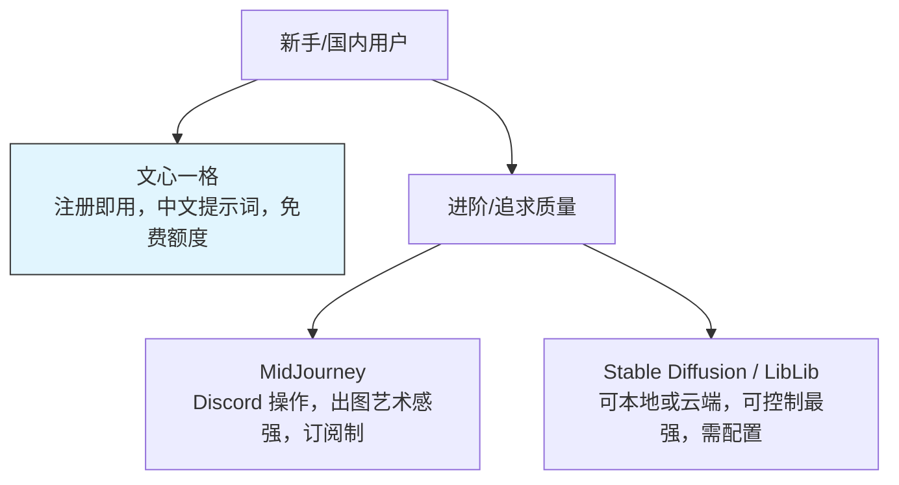

#### 3.1.1 什么是 AI 绘画？——素材：`202403-ai-huihua` > 一、【项目概述】了解 AI 绘画 > 1.1 什么是 AI 绘画？

AI 绘画目前的能力，能让一个没有专业绘画能力的人，也能挑战资深原画师，做出有设计感的图片。现在 AI 绘画在全球已经有了非常良好的开源生态。良好的开源生态，也就意味着能让更多 AI 从业者能够自由地探索、创新，打造出成熟的应用和盈利模式。而且这个速度只会越来越快。一句话来说，AI 绘画，来路清晰，前路已通。

#### 3.1.2 AI 绘画为什么现在那么火？——素材：`202403-ai-huihua` > 一、【项目概述】了解 AI 绘画 > 1.2 AI 绘画为什么现在那么火？

（素材中对应小节，具体内容请参阅原素材）

#### 3.1.3 如何选择 AI 绘画软件？——素材：`202403-ai-huihua` > 一、【项目概述】了解 AI 绘画 > 1.3 如何选择 AI 绘画软件？

（素材中对应小节，具体内容请参阅原素材）

#### 3.1.4 MidJourney 介绍及前期准备 ——素材：`202403-ai-huihua` > 二、【项目实操 1/4】学会 MidJourney 完成 AI 绘画 > 2.1 MidJourney 的介绍及前期准备

MidJourney 是一款基于 Discord 的 AI 绘画工具，出图艺术感强，适合进阶用户。前期准备包括注册 Discord 账号、加入 MidJourney 频道、订阅会员等。

#### 3.1.5 MidJourney 入门篇 ——素材：`202403-ai-huihua` > 二、【项目实操 1/4】学会 MidJourney 完成 AI 绘画 > 2.2 MidJourney（入门篇）

（素材中对应小节，具体内容请参阅原素材）

#### 3.1.6 MidJourney 进阶篇 ——素材：`202403-ai-huihua` > 二、【项目实操 1/4】学会 MidJourney 完成 AI 绘画 > 2.3 MidJourney（进阶篇）

（素材中对应小节，具体内容请参阅原素材）

#### 3.1.7 MidJourney 应用篇 ——素材：`202403-ai-huihua` > 二、【项目实操 1/4】学会 MidJourney 完成 AI 绘画 > 2.4 MidJourney（应用篇）

（素材中对应小节，具体内容请参阅原素材）

#### 3.1.8 LibLib AI 入门篇 ——素材：`202403-ai-huihua` > 三、【项目实操 2/4】学会 LibLib AI【云端 SD】完成 AI 绘画 > 3.1 LibLib AI（入门篇）

LibLib AI 是 Stable Diffusion 的云端封装，无需本地配置，打开网页即可使用。

**五个参数：** 模型选择、提示词、负面提示词、采样步数、CFG 系数等
**四个勾选框：** 高清修复、面部修复等选项
**8 个参数：** 图像尺寸、批次数量、随机种子等
**三个勾选框：** 其他辅助选项

#### 3.1.9 LibLib AI 进阶篇 ——素材：`202403-ai-huihua` > 三、【项目实操 2/4】学会 LibLib AI【云端 SD】完成 AI 绘画 > 3.2 LibLb AI（进阶篇）

（素材中对应小节，具体内容请参阅原素材）

#### 3.1.10 文心一格入门篇 ——素材：`202403-ai-huihua` > 四、【项目实操 3/4】学会 文心一格【手机端】完成 AI 绘画 > 4.1 文心一格（入门篇）

文心一格是百度推出的 AI 绘画工具，支持中文提示词，适合手机端操作。

**操作流程：** 注册登录 → 输入提示词 → 选择模型和尺寸 → 生成图片 → 保存或分享

**温馨提醒：** 注意提示词的描述要具体，生成的图片可能需要多次抽卡才能得到满意效果。

**对应素材**：
- `202403-ai-huihua` > 一、【项目概述】了解 AI 绘画（1.1 什么是 AI 绘画？、1.2 AI 绘画为什么现在那么火？、1.3 如何选择 AI 绘画软件？）
- `202403-ai-huihua` > 二、【项目实操 1/4】学会 MidJourney 完成 AI 绘画（2.1 MidJourney 的介绍及前期准备、2.2 MidJourney（入门篇）、2.3 MidJourney（进阶篇）、2.4 MidJourney（应用篇））
- `202403-ai-huihua` > 三、【项目实操 2/4】学会 LibLib AI【云端 SD】完成 AI 绘画（LibLib AI（入门篇）/ LibLib AI（进阶篇）/ 3.1 LibLib AI（入门篇）/ 3.2 LibLb AI（进阶篇））
- `202403-ai-huihua` > 四、【项目实操 3/4】学会 文心一格【手机端】完成 AI 绘画（4.1 文心一格（入门篇）、操作流程、温馨提醒）

**小练习**：在文心一格或 MidJourney 中生成一张与你职业相关的插图，尝试调整一次提示词再生成，对比前后两张图的差异并保存较满意的一张。

---

### 3.2 提示词与 LoRA：控制出图风格与一致性

本节深入讲解 AI 绘画的“咒语”编写，教读者成为提示词工程师，掌握风格一致性控制、角色一致性、构图调整等进阶技巧，并通过“AI 绘画 + 小红书笔记”模板检测出图能力。

**大白话**：画图提示词就像给点单，越详细越准确。想让同一个人物在不同照片里长得一样，就得在每张图的提示词里都固定写“角色特征+服装+发型”，这就叫“一致性控制”。

#### 3.2.1 提升 AI 绘图能力——描述词 ——素材：`202403-ai-huihua` > 五、【项目实操 4/4】提升 AI 绘图能力——描述词

（素材中对应小节，具体内容请参阅原素材）

#### 3.2.2 检测 AI 绘图能力 ——素材：`202403-ai-huihua` > 六、【复盘优化】检测 AI 绘图能力

书中提供了「AI 绘画+小红书笔记」的出图能力检测模板，这是本次「AI 绘画+自媒体航海」的重点。把图片发出来，检测自己是否已具备 AI 出图能力。

**对应素材**：
- `202403-ai-huihua` > 五、【项目实操 4/4】提升 AI 绘图能力——描述词（提示词优化，提升出图质量）
- `202403-ai-huihua` > 六、【复盘优化】检测 AI 绘图能力（「AI 绘画+小红书笔记」出图能力检测模板）

**小练习**：选定一个固定角色（如“穿红衣的女孩”），用同一组核心提示词生成 3 张不同场景下的图片，观察角色一致性，记录哪些关键词对一致性影响最大。

---

### 3.3 AI 绘画在插画、电商、IP 定制中的落地应用

本节展示 AI 绘画在包装、插画、电商图像、IP 定制等十余个行业的应用与变现方式，教读者将出图能力落地到商业场景，并引用行业预测（中文 AI 绘画将产生不少于 10 个年利润百万级小程序）作为方向参考。

**大白话**：画好图只是第一步，怎么赚钱才是关键。比如给电商店铺做主图、做 IP 表情包、做定制插画，这些都是普通人能接的单子，交付物明确，客户愿意付钱。

#### 3.3.1 学会更多 AI 绘图工具 ——素材：`202403-ai-huihua` > 七、学会更多 AI 绘图工具

（素材中对应小节，具体内容请参阅原素材）

#### 3.3.2 了解更多落地场景及变现 ——素材：`202403-ai-huihua` > 八、了解更多落地场景及变现

AI 绘画在插画、电商、IP 定制等行业的应用与变现方式，引用行业预测（中文 AI 绘画将产生不少于 10 个年利润百万级小程序）作为方向参考。

**对应素材**：
- `202403-ai-huihua` > 七、学会更多 AI 绘图工具
- `202403-ai-huihua` > 八、了解更多落地场景及变现（AI 绘画在插画、电商、IP 定制中的应用与变现方式）

**小练习**：为一个虚拟电商产品（如一款护肤品）用 AI 生成 3 张不同风格的主图，并写出每张图的使用场景说明，形成一份简单的视觉方案文档。

---

### 3.4 ComfyUI 工作流与 AI 视频生成

本节介绍 ComfyUI 节点式工作流，教读者无需本地高配置即可使用现成工作流一键运行（模特换装、真实人物写真、批量生成 AI 视频），并进阶到自己搭建工作流。覆盖腾讯混元、快手可图、Mochi、智谱 CogVideoX 等开源模型。

**大白话**：ComfyUI 像“搭积木”一样画图，把每个步骤（选模型、写提示词、出图、放大）变成一个个方块，连线后就能一键出图。好处是不用高配电脑，也可以直接用别人做好的“工作流”套用。

**Mermaid 图表：ComfyUI 工作流示意**

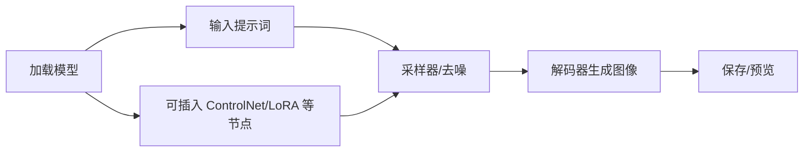

#### 3.4.1 ComfyUI 是什么？——素材：`202412-comfyui` > 一、ComfyUI 项目介绍 > 1.1 ComfyUI 是什么？

提到 ComfyUI 就要提到他之前的兄弟软件 Stable diffusion，生财有术之前开设过 AI 绘画的航海，航海手册的选修篇有详细介绍 Stable diffusion，完整名称叫 Stable diffusion Webui，简称为 WEBUI 或者 SD，是 AUTOMATIC1111 这位开发者为了大家方便使用 Stable diffusion 制作的，选项卡式界面的 AI 绘画软件。

而我们这次学习的 ComfyUI 是节点+工作流式的 AI 工具，ComfyUI 在之前可以简单理解为换了节点+工作流界面的 Stable diffusion，但是现在来说 ComfyUI 要比图形界面的 WebUI 强大的多，不仅仅可以用在 AI 绘画，还可以用在 AI 视频、AI 音频、AI 3D、AI 文本等等很多 AI 领域。是 Comfyanonymous 等其他开发者为了大家方便使用 AI 制作的。ComfyUI 通过将操作步骤拆分成工作流，实现了更加精准的定制工作流和完善的可复现性。

ComfyU 现在不仅可以使用 stability 研发的各种模型，stability 是研发 Stable diffusion 模型的公司，还能使用其他公司研发的 AI 开源模型，比如腾讯混元、快手可图、Mochi、智谱 CogVideoX 等很多优秀的 AI 模型。

**ComfyUI 的工作界面与 WebUI 的工作界面对比：**
1. 底层操作逻辑接近：都拥有模型选择区域，输入提示词区域，参数设置区域，图片生成区域
2. ComfyUI 界面简洁：空白画布，需自己通过节点搭建工作流，当然也可以下载别人现成的工作流使用，整体学习门槛比较高
3. WebUI 可视化界面：图形化选择操作，对新手相对友好

#### 3.4.2 ComfyUI 可以做什么？——素材：`202412-comfyui` > 一、ComfyUI 项目介绍 > 1.2 ComfyUI 可以做什么

ComfyUI 是一个多功能的 AI 工具箱，它不仅限于绘画，还能生成视频、音频和 3D 模型等多种类型的 AI 任务，为用户提供了一个强大的 AI 创意平台。

1. **AI 绘画**：ComfyUI 可以生成与提示词提示相匹配的图像，用户只需要输入描述性的文本，ComfyUI 就能根据这些文本生成相应的图像。ComfyUI 也可以根据现有图片生成不同风格的图片。
2. **AI 视频**：ComfyUI 能够根据图片生成视频，使用的模型是 SVD（Stable Video Diffusion），可以以静止图像作为条件帧，并从中生成视频。此外，ComfyUI 还支持其他很多 AI 视频模型，以及视频转视频的功能，这意味着你可以将一个视频转换成另一个风格或内容的视频。
3. **AI 音频**：ComfyUI 使用 Stable Audio Open 模型，可以根据文本提示生成立体声音频。这个模型能够生成音效和音乐，可以尝试各种不同的音乐风格和文化。
4. **AI 3D**：ComfyUI 支持将 2D 图片转换成 3D 模型，这在一些工作流中被称为“二渲三”，即从 2D 图像生成 3D 模型。

#### 3.4.3 ComfyUI 与 WebUI 的优劣势对比 ——素材：`202412-comfyui` > 一、ComfyUI 项目介绍 > 1.3 ComfyUI 与 WebUI 的优劣势对比

ComfyUI 和 WebUI 的优劣势对比，ComfyUI 的优势包括低显存要求等。

#### 3.4.4 云端部署 ComfyUI ——素材：`202503-aidianshang` > 一、云端部署 ComfyUI

使用 ComfyUI 时遇到的第一个问题就是：到底是选择本地部署，还是线上部署？

**本地部署：成本高、麻烦多**
- 首先得有一台高性能电脑，尤其是显卡，比如 RTX 4070 16G，甚至 RTX 4090 24G，才能流畅运行 ComfyUI
- 硬件贵：一张顶级显卡几万元，不是每个人都愿意花这个钱
- 性能要求高：普通显卡跑不动大模型，生成图片要么慢得让人崩溃，要么直接失败
- 维护麻烦：你还得自己下载模型、装插件、调试环境，网络一出问题就得折腾半天

**云端部署：省钱、省心、高效**
- 开箱即用：云端平台已经把模型、插件和工作流都准备好了。你不需要自己配置，打开网页就能用，省时省力。这对初学者尤其友好，不用头疼技术细节，直接上手创作
- 随时随地用：只要有网，就算用普通笔记本电脑，你都能随时登录云端平台开始工作。灵活性超强，不管在家、在学校还是出差，创作都不受限
- 顶级性能：云端提供的算力，比如 RTX 4090 级别，秒杀大部分本地设备。跑大模型、生成高清图完全无压力，告别卡顿，效率翻倍。而且平台会不断更新资源，你总是用最新的技术

云端部署也有一些小问题：
- 费用超低：租用 4090 算力，1 小时才 2 元左右，比买显卡便宜太多了，几万元的硬件钱够你在云端用好几年
- 排队可控：高峰期可能要等一下，但换个时间用就行，完全不影响大局
- 上手简单：界面稍微适应一下就习惯了，学习成本几乎为零

云端部署平台有很多，你可以选择自己认为合适的。

**对应素材**：
- `202412-comfyui` > 一、ComfyUI 项目介绍（1.1 ComfyUI 是什么？、1.2 ComfyUI 可以做什么、1.3 ComfyUI 与 WebUI 的优劣势对比）
- `202503-aidianshang` > 一、云端部署 ComfyUI（本地 vs 云端部署、平台选择）

**小练习**：在云端 ComfyUI 平台上运行一个现成的“图生图”工作流，生成一张风格化图片，记录操作步骤与云算力费用（如 4090 约 2 元/小时）。

---

## 第四章 AI 视频制作：无拍摄剪辑基础的内容生产

本章介绍 AI 视频生态与主流工具，让无拍摄剪辑经验的读者用文生视频/图生视频工具产出内容，同时讲解技术局限（时长短、一致性差、版权、备份工程文件）与避坑清单，并延伸至视频号分成计划、YouTube Shorts 变现及 AI 数字人口播 IP。

### 4.1 AI 视频生态与主流工具（Runway、可灵、Gen-1/Gen-2 等）

本节盘点 AI 视频生成工具与生态，介绍 Sora 等文生视频模型的上线进展与国内外竞品动态，帮读者尽早掌握信息差。提醒对市面 Sora 课程谨慎防骗，因 Sora 尚在内测无实操入口，定位为资讯认知而非即时实操。

**大白话**：AI 视频就是你打一段文字或上传一张图，AI 帮你生成视频片段。目前生成的视频比较短（几秒到几十秒），适合做短视频素材，不适合直接拍长片。新手先用一个工具熟练，不要贪多。

**Mermaid 图表：主流 AI 视频工具对比**

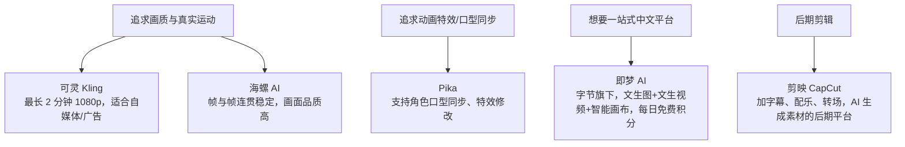

#### 4.1.1 认识 AI 视频生态 ——素材：`202506-aishipin` > 一、新手快速上手 AI 视频 > 1.1 认识 AI 视频生态

近年 AI 技术飞速发展，视频内容创作迎来了革命性的变化。从早期 AI 辅助剪辑、自动字幕等辅助创作功能，到如今能够直接生成视频内容的模型，AI 在视频生态中的地位不断提升。

这样的技术演进极大降低了视频创作门槛，提高了创作效率。现在，即使没有专业拍摄和剪辑经验，你也可以通过 AI 工具快速实现自己的创意。当脚本、拍摄甚至剪辑都不再是难题时，真正决定作品高度的反而是创意本身。

在内容创作层面，AIGC（AI 生成内容）浪潮正重塑短视频行业生态。2024 年，在抖音等 UGC 平台上涌现出大量 AI 特效视频，用户只需上传一张图片或输入文字，就能生成有趣的视频内容。比如，Remini 的“黏土动画”特效风靡全网，吸引了数百万用户参与；随后“毛毡娃娃风”“柯南动画风”“油画风”等 AI 滤镜接连走红，相关话题播放量高达数亿甚至数十亿。

借助这些 AI 特效和平台挑战赛的传播机制，普通用户的创作热情被激发，个性化的内容不断涌现。可以预见，AIGC 将成为短视频创作的新常态：创作者更专注于创意和脚本，具体画面由 AI 高效生成。与此同时，短视频平台内容产出呈指数级增长，也对内容审核和观众注意力分配提出了新的挑战。

**AI 视频的局限与避坑清单：**
1. 纯 AI 生成的视频长度往往较短（多数工具一次生成几秒到几十秒不等），画质和精细度相对专业拍摄还有差距
2. 复杂场景、多角色互动等，目前仍然可能出现瑕疵
3. 生成内容的可控性和一致性也是挑战（如视频帧的连续稳定、角色形象在不同场景的一致）
4. 不要盲目追求高级软件（先用好一个工具再扩展）
5. 不要忽视版权问题（商用需注意素材授权）
6. 不要过度依赖 AI（创意才是核心竞争力）
7. 千万记得，要备份工程文件（血泪教训：突然崩溃全白做）

#### 4.1.2 AI 视频用到的工具 ——素材：`202506-aishipin` > 一、新手快速上手 AI 视频 > 1.2 AI 视频用到的工具

当前市面上有众多 AI 视频创作工具，每款都有自身特色和适用场景：

**Runway（Runway Gen-1/Gen-2）：** 业界较早推出的 AI 视频生成工具。提供网页和 App 方便使用，功能包括文本生成视频（Gen-2）和视频风格迁移（Gen-1），还支持对视频进行实时涂抹编辑等高级操作。适合希望借助前沿模型快速试验创意的用户。不过 Runway 目前需要订阅付费才能充分使用高级生成功能。

**可灵 AI（Kling）：** 由快手团队自研的大模型视频生成工具，技术实力雄厚。采用类 Sora 的架构，生成的视频运动幅度大、物理效果真实，可生成情节丰富的动画或实拍风格片段。会员用户可生成最长 2 分钟、30 帧的 1080p 高清影片，支持多种画面比例，并提供高表现模式、视频续写等高级功能。非会员则可能需要排队等待生成。可灵非常适合追求高质量和真实运动效果的专业创作者，用于短片、自媒体视频乃至广告创意制作。

**海螺 AI（Hailuo）：** 国内另一款顶尖视频生成工具，以高画质和稳定性见长。其生成视频在色彩、光影和角色情绪表现上质量出色，在第三方测试中综合效果排名第一，尤其在帧与帧的连贯稳定上有绝对优势。海螺支持文字、图像、音频等多模态输入，界面简洁易上手，在海外市场也备受欢迎，用户遍及 180 多个国家。缺点是目前功能相对单一，缺少图像生成、对口型等扩展能力。非常适合注重画面品质的创作者，比如影视导演、编剧，用于概念影片、高质量短视频等。

**即梦 AI（DreamINA）：** 字节旗下推出的 AI 创作平台，提供一站式的文生图、智能画布和文生视频功能。用户可以用中文提示词生成所需画面，并能在智能画布上进一步编辑调整，从剧本大纲到成片都能在一个平台完成。即梦支持角色对口型动画生成，AI 配音自然逼真。每日登录赠送 60-100 积分供免费使用，即使非会员也足够日常创作需求。不过在复杂人物和场景上偶尔有细节瑕疵。适合追求功能全面、上手简单的用户，例如内容创作者、教育工作者，用于生成个性化短视频、教学动画、广告素材等。

**Pika：** 一款国外的文本生成视频工具，以动画和特效见长。支持用户上传语音或配音，实现视频中角色口型与声音同步。Pika 的可控性强，允许对生成视频中的角色、物体进行定点修改，甚至添加爆炸、融化等酷炫特效（最新的 Pika 1.5 版本已支持这些功能）。它还提供一定的视频编辑能力，生成的视频可以直接在其平台上做简单剪辑。适合用于制作卡通动画、MG 动画风格的视频，以及需要精确控制口型的角色对话场景。

**剪映：** 字节跳动推出的知名视频剪辑工具，国内称为剪映，海外版叫 CapCut。剪映本身不是文生视频模型，但因为功能全面、免费易用，被广泛用作 AI 生成素材的后期编辑平台。剪映内置了多项 AI 能力：例如自动字幕生成、一键智能剪辑、风格滤镜，以及 AI 配音功能。最新版本中甚至支持克隆配音（仿真特定人声的语音合成）。对于 AI 生成的视频素材，剪映可以方便地添加字幕、配乐、转场，调整节奏节拍，让成品更加完整专业。几乎所有初学者都可以从剪映起步来制作和完善 AI 短视频。

注：以上仅列举了一部分热门工具。市面上还有许多其他 AI 视频平台，如国内的智影、清影、Vidu，以及一些开源方案（如 Stable Diffusion 的动画生成插件等）。初学者可根据需求逐步探索，但建议先从主流成熟的平台入手，以获得更稳定的体验。

**对应素材**：
- `202506-aishipin` > 一、新手快速上手 AI 视频（1.1 认识 AI 视频生态、AI 视频技术局限与避坑清单）
- `202506-aishipin` > 一、新手快速上手 AI 视频（1.2 AI 视频用到的工具：Runway Gen-1/Gen-2、可灵 Kling、海螺 AI、即梦 AI、Pika、剪映）

**小练习**：列出你了解的 3 个 AI 视频工具，分别标注其支持的功能（文生图/图生视频/文生视频）、免费额度与付费价格，形成一张工具选型表。

---

### 4.2 文生视频与图生视频的实操流程

本节教读者用 AI 工具无拍摄剪辑基础地产出 60–80 秒视频，覆盖文生图 → 图生视频 → 简单剪辑的完整流程，强调“创意本身成为核心竞争力”，并列出勿过度依赖 AI、备份工程文件等避坑提醒。

**大白话**：做 AI 视频的常见流程是：先用 AI 生图（拿到关键画面），再把图片喂给 AI 视频工具变成动态视频，最后用剪映加上字幕和音乐。创意比技术更重要，工具只是帮你实现想法。

#### 4.2.1 文生图 → 图生视频 → 简单剪辑 ——素材：`202506-aishipin` > 二、学习 AI 热门视频玩法

（素材中对应小节，具体内容请参阅原素材）

**对应素材**：
- `202506-aishipin` > 二、学习 AI 热门视频玩法（文生视频与图生视频的实操流程）
- `202506-aishipin` > 一、新手快速上手 AI 视频（1.1 认识 AI 视频生态中的避坑清单：备份工程文件、勿过度依赖 AI）

**小练习**：用任一 AI 视频工具生成一条 15–30 秒短视频，配上背景音乐与字幕，导出并保存，记录生成次数与最终满意版本的尝试次数。

---

### 4.3 AI 视频在视频号分成计划、YouTube Shorts 等平台的变现

本节教读者用 AI 批量创作视频号热门原创内容，快速涨粉达标开通创作分成计划，靠评论区广告点击赚收益，目标是新手“赚到第 1 块钱”；并介绍 YouTube Shorts 冲刺 YPP 广告分成的路径（达标周期从约 2 年缩至最快 1–3 个月，建议按 3–6 个月长期主义准备）。

**大白话**：视频号有分成计划，视频播放有人看就有钱赚。AI 帮你批量做视频，你负责选垂直赛道和发布，先挣到第一块钱，再慢慢放大。YouTube Shorts 做得好，广告分成也是不错的美元收入。

**对应素材**：
- `202506-aishipinhao` > AI 赋能视频号分成（视频号分成计划实操）
- `202509-aiytb` > YouTube AI 视频（YouTube Shorts 变现路径）

**小练习**：选定一个垂直赛道，用 AI 生成 3 条短视频脚本并制作 1 条成片，发布到视频号或 YouTube，记录发布后 7 天的播放量与粉丝增量。

---

### 4.4 AI 数字人口播 IP 与口播内容量产

本节教读者打造 AI 数字人口播 IP：克隆真人形象与声音做口播内容，重点解决口型同步、人设一致性、避免“AI 味”等痛点，并对比国内外平台选性价比工具。适合镜头表现力差但需要量产带货视频的读者。

**大白话**：数字人就是用 AI 克隆一个“虚拟主播”，你不需要自己出镜，它帮你念稿子。适合不爱露脸但要做大量带货视频的人。关键是嘴巴要和声音同步，人设要统一，不然观众一眼就能看出是 AI。

#### 4.4.1 什么是数字人 IP？——素材：`202506-aishuziren` > 一、什么是数字人 IP？

在本次课程的语境下，“数字人”指的是主要由 AI 技术驱动的虚拟形象。它可以是根据真人形象生成的数字分身，也可以是完全独立设计的、具有独特外观的虚拟人物。其核心特征是 AI 驱动。这意味着通过人工智能技术，例如声音克隆或高质量的语音合成，赋予它声音；并通过算法驱动其面部表情和口型，使其能够模拟人类进行信息的表达和内容的播报。

接下来是“IP”。IP 是 Intellectual Property（知识产权）的缩写。在内容创作和品牌领域，我们可以将其理解为一个具有独特性和辨识度的“品牌形象”或“个人标识”。就像一个成功的自媒体账号、一位知名的公众人物，或者一个广受欢迎的品牌，它们都形成了自己独特的风格、定位和用户认知，这就是一种 IP。它代表了一种可识别的价值和影响力，并且通常具有潜在的商业价值。

**技术与质量挑战：**
1. 数字人有时看起来很像真人，但细节上（比如眼神、表情、动作）还是有点不自然。这会让观众觉得别扭。要让数字人更自然，往往需要更高的成本或者更先进的技术。
2. 口型同步和音频自然度：有时候我们用 AI 生成数字人口播，嘴型看起来和声音对不上，尤其是说得快或者有情绪变化时。这种情况就会让人觉得不自然。教程里会教你怎么录制一段口播视频，怎么调整说话节奏、怎么录素材，才能让 AI 生成的嘴型和你的声音更贴合，减少这种尴尬。

**制作成本与技术门槛：** 有同学可能会问，为什么不用市面上免费的 AI 工具？比如有的免费平台，虽然能一键生成数字人视频，但画质差、动作僵硬，声音也不太像自己，付费省时间。航海中，带大家对比了国内外多个平台，帮你选出性价比高、效果好的工具，避免你踩坑，也省下不少试错的时间和钱。

**特定场景表现力局限：** 目前的 AI 在模拟复杂情感、进行非常规或即兴互动、展现精细的肢体语言方面仍有局限，可能难以胜任所有类型的口播内容。所以在制作数字人本身原始视频上，航海给大家增加了如何自然的口播和拍摄的练习，让我们克隆出自己数字人也会更加自然和真实。

**维持“人设”的一致性与真实感：** 如何让 AI 生成的内容始终符合预设的人设、语气和状态？如何避免内容同质化、缺乏真情实感，让观众觉得“有灵魂”而不是“AI 味儿”很重？这需要强大的人类策略和精心的 Prompt 设计，航海中增加了用 AI 训练自己的智能体，让 AI 写出的内容、语气都更加符合我们自己的人设、语感。

#### 4.4.2 用 AI 智能体辅助 IP 定位 ——素材：`202506-aishuziren` > 二、用 AI 智能体辅助 IP 定位

**目标：** 帮你精准找到自己的内容定位，借助 Gemini 明确你的核心优势和沟通风格。

**2.1 工具推荐 Gemini：** 首先第一步是解决定位问题，我们这里用的工具是 Gemini。如果大家还没有还没有 Gemini 账号，可以看圈友这篇帖子进行注册，或者通过第三方平台购买，实在是解决不了，可以群里问举手提问教练。

为什么用 Gemini？之前我测试过 kimi、豆包、Claude、chatGPT，在其中一个部分，拿我的脚本文案和其他的博主的文案对比，再输出内容，只有 Gemini 的表现最好，所以大家有条件的情况下也可以试试看，当然如果有自己顺手喜欢使用 AI 也可以通用。

**2.2 明确价值与方向：** 思考你的独特价值是什么？目标受众是谁？初步的商业化想法？

可能有些圈友会想，我能不能直接开始玩工具、做数字人？我的建议是：先别急。就像建房子需要先有清晰的蓝图一样，打造一个成功的、可持续的数字人 IP，必须先有明确的战略思考。没有方向的努力，往往事倍功半。

在这一小节，我们的目标是引导大家进行初步的思考，帮你梳理清楚三个核心问题：你的 IP 要提供什么核心价值？你的目标受众是谁？以及你初步设想的内容方向和商业可能性是什么？这些初步思考将为你后续更深入的定位和 AI 辅助探索打下坚实基础。

**2.2.1 如何让 AI 知道你的个人经历？：** 之前大家接触到的很多 AI 相关的内容，但是读起来就是不像自己，仿佛没有参与到自己的人生，不懂自己，所以写的内容和自己就像贴了一层皮，没有融合性。所以为了让 AI 更懂我们，就要让 AI 来回答，ta 需要知道我们什么内容？以下的提问均来自 Gemini，核心是让 AI 更了解我们的方向、生活、找到突破口。

**对应素材**：
- `202506-aishuziren` > 一、什么是数字人 IP？（数字人定义、核心特征 AI 驱动、技术与质量挑战、口型同步与音频自然度）
- `202506-aishuziren` > 二、用 AI 智能体辅助 IP 定位（2.1 工具推荐 Gemini、2.2 明确价值与方向、人设一致性）

**小练习**：在一个 AI 数字人平台上使用公共模板生成一段 30 秒口播视频，替换为你自己的文案，观察口型同步效果并记录需要人工修正的地方。

---

## 第五章 AI 应用开发：零基础做软件与网站

本章面向不会编程的读者，教用 Claude Code / Cursor / Augment 等 AI 编程工具自然语言写代码，21 天内做出数字名片、批量改名/图片压缩等小工具，乃至预约管理、记账等小型业务系统，实现开发民主化。覆盖 iOS App、Web 网站、微信小程序及六大应用场景。

### 5.1 Claude Code / Cursor 对话式编程入门

本节教读者安装 Claude Code（或 Cursor），学习与 AI 高效对话的技巧（对话式编程而非独白式编程），理解代理的部分原理，从而更好地与 AI 协作。平替方案包括 DeepSeek、Qwen3-Coder、GLM-4.5。

**大白话**：对话式编程就是你用人话告诉 AI “我想做个什么”，它帮你写代码。你不需要懂语法，只需要描述清楚需求，出错了把报错贴给它让它修复。就像点外卖，你只需要说想吃什么，厨师（AI）负责做。

**Mermaid 图表：对话式编程工作流**

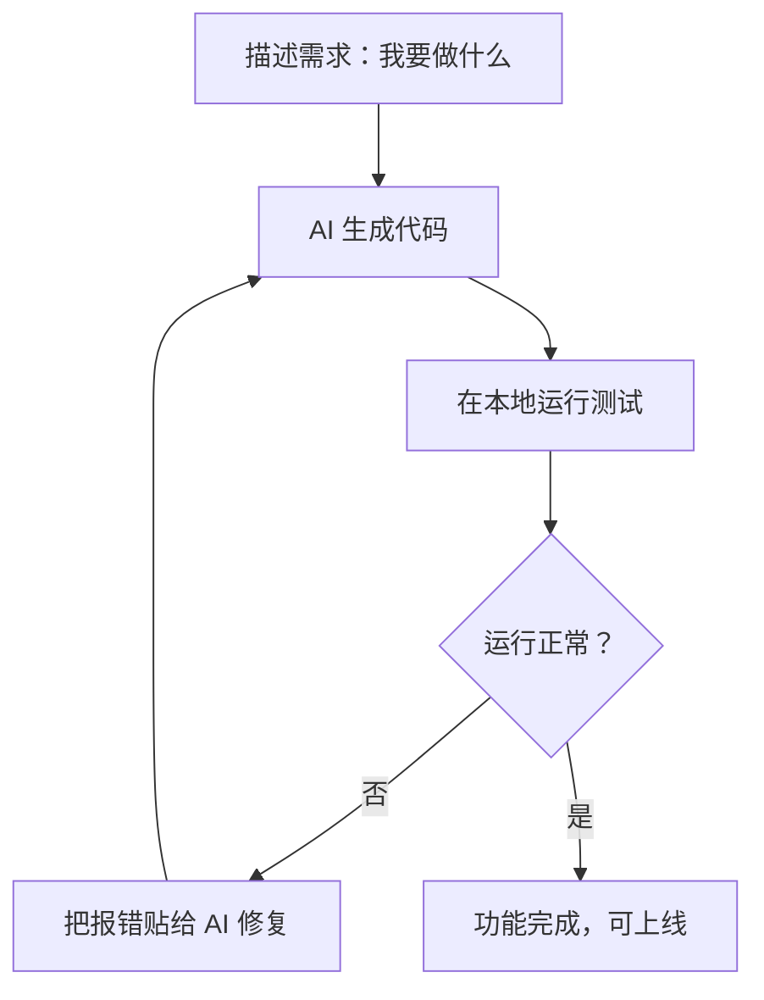

#### 5.1.1 什么是 Claude Code？——素材：`202509-claudecode` > 一、什么是 Claude Code

简单讲，它就是你电脑里的智能编程助手。你只要告诉它你想做什么，它就能帮你实现：
- “给我做个个人网页，放上我的照片和简介” → 几分钟后，你的网页上线了。
- “每天整理的这个表格，能自动完成吗？” → 它直接给你写好自动化程序。

你完全不用担心自己不懂技术。就像你用美图秀秀不需要懂 PS，用高德地图不需要懂 GPS，使用 Claude Code，你也不需要懂编程。你唯一要做的，就是把想要的东西描述清楚。

本次航海专为技术零基础的新手设计，全程没有复杂的编程术语，我们会教你如何通过对话，让 Claude Code 帮你轻松实现需求。

21 天后，你就能做出：
- 一张惊艳的个人数字名片
- 实用的小工具（比如批量改名、图片压缩）
- 简单的小型业务系统（预约管理、记账工具等）

#### 5.1.2 项目完整操作思路 ——素材：`202509-claudecode` > 二、项目完整操作思路

Claude Code 安装 > 学习与 Claude Code 高效对话的技巧（关键） > 实战开发效率工具与 Web 应用（关键） > 探索全栈开发与需求挖掘

**操作重点：** Claude Code 是一个生活在你终端中的代理式编码工具，能理解你的代码库，通过执行日常任务、解释复杂代码和处理 git 工作流来帮助你更快编码。但最关键是学会“对话式编程”而非“独白式编程”，所以就需要你自己能理解代理的部分原理，这样才能很好的和 AI 协作。

#### 5.1.3 新手入门建议&避坑指南 ——素材：`202509-claudecode` > 二、项目完整操作思路 > 2.3 新手入门建议&避坑指南

**完全不懂编程能学会吗？**
答：完全可以。Claude Code 的核心是自然语言交互，你只需要会清楚地描述需求。就像用美图秀秀不需要懂 PS 原理，用 Claude Code 也不需要懂编程原理。航海会提供大量对话模板和实例。

**Claude Code 和 Cursor 有什么区别？**
答：Claude Code 直接在终端运行，能理解整个代码库并自主执行任务，更像一个能干活的程序员；Cursor 更像代码补全工具。据实测反馈，Claude Code 在处理复杂任务时表现明显优于 Cursor。

**需要付费订阅吗？成本高吗？**
答：官方订阅 Pro 版 20 美元/月，Max 版 100 美元/月。国内也有 DeepSeek、Qwen 等平替方案。

**生成的代码质量如何？**
答：Claude Code 使用 Opus 4.1 模型，是目前编程能力最强的 AI 模型之一。关键是要学会正确的提问方式和任务拆解，航海会重点训练这些技巧。

#### 5.1.4 Vibe Coding 与 AI 编程新范式 ——素材：`202509-claudecode` > 1. 本章概要

你是否也曾有过一个绝妙的点子，却因为实现它的技术门槛太高而卡住，眼看着热情被各种复杂的规则和指令一点点消磨掉？

为了让“创造”这件事回归简单，一种全新的理念——Vibe coding，应运而生。它的核心很简单：让你不再需要死磕每一个技术细节，而是能专注于你的想法本身，成为一个真正的“创造者”。

在本章中，我们将一起弄明白几个有趣的问题：
- Vibe 到底是什么：它背后是一种怎样让“想法”轻松变成现实的思路？
- 它和传统方法有何不同：为什么说，你只需要告诉 AI “做什么”，而不用再操心“怎么做”？
- AI 在其中扮演的角色：AI 是如何从一个冷冰冰的工具，升级为能听懂你想法的“创意伙伴”的？

搞懂这些，能帮你为接下来的所有实践，打下一个全新的认知。这不仅仅是学个新东西，更是升级你用科技实现想法的方式。

**本章航线图：** 完成本章节的学习和实操，即可完成航线图第一阶段的第 1 部分。
- 第一阶段：快速上手 Claude Code（约 0.5 天）
- 理解 Vibe Coding 与 AI 编程新范式（约 0.5 天）

OpenAI 联合创始人 Andrej Karpathy 在 2025 年 2 月首次提出，他将其描述为“完全顺着 AI 的节奏去写代码，几乎把‘写代码’这件事本身忘掉”。

#### 5.1.5 传统编程和氛围编程对比 ——素材：`202509-claudecode` > 1. 本章概要 > 2. 传统编程和氛围编程对比

| 功能 | 传统编程 | 氛围编程 (vibe coding) |
|------|---------|----------------------|
| 代码创建 | 逐行手动编码 | AI 根据自然语言提示生成 |
| 开发者或用户角色 | 架构师、实现者、调试者 | 提示者、引导者、测试者、优化者 |

#### 5.1.6 Cursor 零基础做软件 ——素材：`202412-cursor` > 一、了解 cursor 工具 > 1.1 Cursor 简介与安装

Cursor 是一款 AI 编程产品，主要功能有代码生成、代码问答、代码运行、debug、插件等，你可以理解是一个一站式的 AI 编程工作台，可以帮助你从完成学习编程知识到写出一个完整的程序的所有流程。

安装步骤：
1. 打开官网 cursor.com，点击右上角的【download】按钮，下载 Cursor 的客户端
2. 下载好了之后，点击图标安装
3. 安装好之后，进到初始界面，在【Language for AI】那里输入中文，其它不用管，点击【continue】就行
4. 如果你的电脑之前安装过【VS Code】，可能会出现这个界面，直接点击【Use Extensions】
5. 同样，点击【允许】
6. 这个界面的意思是，你是否愿意贡献你的对话数据给 Cursor 的团队，来帮助他们改善 Cursor 这款产品。选左边的【Help Improve Cursor】；如果你比较介意自己的隐私，可以选择右边的【Privacy Mode】。选左边还是选右边，都不会影响你后面的正常使用
7. 注册你的 Cursor 账号：点击右边的【Sign UP】

**对应素材**：
- `202509-claudecode` > 一、什么是 Claude Code（智能编程助手、无需懂编程、对话式编程）
- `202509-claudecode` > 二、项目完整操作思路（Claude Code 安装 > 高效对话技巧 > 实战开发）
- `202509-claudecode` > 1. 本章概要（Vibe Coding 与 AI 编程新范式、传统编程和氛围编程对比）
- `202412-cursor` > 一、了解 cursor 工具（1.1 Cursor 简介与安装）

**小练习**：安装 Claude Code 或 Cursor，用自然语言让 AI 生成一个“批量重命名文件”的小脚本，在本地运行并验证能正确重命名测试文件夹中的文件。

---

### 5.2 零基础上线 iOS App 与 Web 网站

本节分两条路线：iOS 路线教 21 天从零基础上线首个 iOS App 并尝试付费/订阅变现（需 Apple 开发者账号 99 美元/年）；Web 路线主张“先上线一百个网站”，从游戏站、导航站入手，靠 Google AdSense 广告流量收益赚美元，出海网站是变现天花板最高领域之一。

**大白话**：做网站比做 App 简单很多，不需要审核，不用交 99 美元，代码丢到 GitHub Pages 或 Vercel 就能上线。新手建议先从“个人数字名片”单页网站开始，跑通“写代码 → 上线 → 访问”的全流程，再往复杂网站走。

**对应素材**：
- `202503-aiiosapp` > AI 应用-iOS App（iOS App 零基础上线）
- `202503-aiwebwangzhan` > AI 应用-Web 网站（Web 网站零基础上线）

**小练习**：用 AI 编程工具生成一个简单的个人数字名片单页网站，部署到 GitHub Pages 或 Vercel，并访问链接确认页面正常显示。

---

### 5.3 AI 编程实战六场景：网站、游戏、办公提效、数据分析、营销工具、爬虫

本节以 21 天六大场景实操为主线，教读者借助 AI 编程工具写出可运行的产品工具，路径为“认识 AI 编程 → 应用 AI 编程 → 借助 AI 理解编程理论”，分必修篇（应用 + 基础语法）与选修篇（高级语法、更多应用）。

**大白话**：不要试图一次学完所有编程知识，先选一个你最需要的场景（比如帮自己整理文件的办公工具），用 AI 把它做出来，用起来爽了，你自然就会想了解更多编程知识。

**对应素材**：
- `202409-aibiancheng` > 零基础 AI 编程做产品（六大场景：网站、游戏、办公提效、数据分析、营销工具、爬虫）

**小练习**：从六个场景中选一个（如办公提效工具），用 AI 生成可运行的原型，运行后记录该工具解决了什么具体问题、耗时多少。

---

### 5.4 微信小程序 AI 产品 0-1 打造与变现

本节教个人开发者借微信 13 亿月活生态与 2026 AI 小程序成长计划扶持（免费云开发 + 1 亿混元 Token），用 AI 低成本批量做小程序，走流量主广告分成或订阅制变现。案例包括某开发者 15 个小程序月入 2 万+、一篇笔记带来 650+ 用户。

**大白话**：微信小程序不用下载安装，搜一下就能用，用户基数巨大。现在微信还有 AI 小程序扶持计划，给免费服务器和 Token。新手可以做个“手电筒”“倒计时”这种极简工具，先跑通“注册 → 开发 → 上线 → 开流量主”的全流程。

**Mermaid 图表：微信小程序开发全流程**

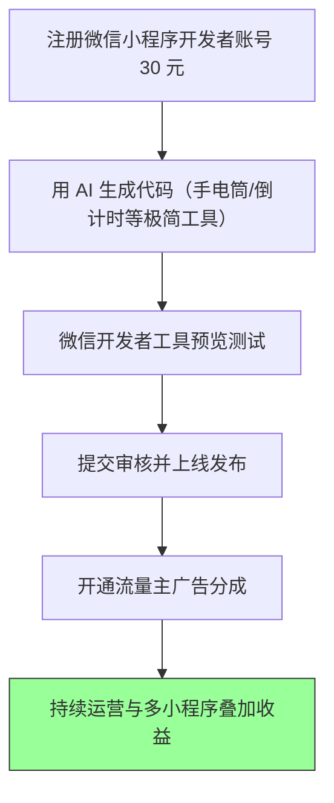

#### 5.4.1 开船第一课：为什么当下做微信小程序产品打造？——素材：`202603-xiaochengxu` > 引言 > 一、开船第一课 > 01. 新手怎么学习 > 1.1 为什么当下做微信小程序产品打造？

1. **亦仁老大的超级标：** 1 月底，亦仁老大发布的了新超级标，主要讲的是小红书产品打造养成系+微信小程序开发。我们可以看到，小红书搭配小程序，能够更高效地实现商业变现。尤其是在当下 AI 技术不断成熟、开发门槛持续降低的背景下，打造微信小程序产品可谓万事俱备，正是切入的最佳时机。

2. **微信小程序生态优势与激励计划：** 微信有 13 亿月活用户，小程序依托这个生态，天然拥有多个免费流量入口。微信搜索、首页下拉列表、发现页分类、好友分享、公众号和视频号导流——这些都是不花钱就能获得用户的渠道。和做 APP 不同，小程序不需要下载安装，用户搜一下就能用，用完就走，链路极短。

平台激励方面，目前有几个值得关注的政策。广告分成上，流量主可获得广告收入的 50%（创意类小程序 200 万以内可拿 70%）。AI 小程序成长计划是 2026 年新推出的官方扶持，报名后可以免费获得 6 个月云开发环境、1 亿混元 Token 和 1 万张生图资源包，活动持续到 2026 年 6 月 30 日，报名入口在微信公众平台→行业能力→AI 小程序成长计划（官方文档）。此外还有免开发智能接入——系统自动往你的小程序里插入广告组件，新手不用写广告代码也能变现。

平台在持续完善开发者变现通道，对个人开发者来说目前仍处于值得入场的窗口期。

3. **低技术门槛和上线成本，快速验证想法：** 做小程序的启动成本低到什么程度？个人主体注册费 30 元，服务器不需要（最简单的小程序纯前端，后端仍需要服务器），微信开发者工具免费，代码零基础友好——用 Trae、Cursor、ChatGPT 这类 AI 工具可以直接生成完整的小程序代码。

开发过程也不复杂。把需求告诉 AI（比如做一个手电筒小程序），AI 生成代码和页面，遇到报错直接复制给 AI 修复，最后用开发者工具预览测试，没问题就提交上线。以前要花一个月的事，现在一周搞定。这个效率意味着试错成本极低——想到一个需求就快速验证，做不起来就换下一个。把每个小程序当成一次低成本的需求实验，而不是一个要长期打磨的产品。

4. **小程序变现模式：**

**流量主变现：** 小程序上线后，只要有用户在使用、产生广告曝光，收益就自动结算到账。每天上午 8-10 点更新前日数据，腾讯代扣个税后 15 个工作日内打款。最关键的一点：不需要持续维护。实测停更半年以上的小程序，收入依然在跑。收益还能叠加——单个小程序每天赚 10 元看似不起眼，但做到 5 个、10 个效果就完全不同。单个收益难免有波动，多个账号叠加后，整体收入会更稳定、更平滑。

**订阅制变现：** 订阅制，用户通过付费开通小程序会员，主要按月或年收费，到期续费。做一个产品，持续收钱。优势：产品是一个品牌化的产品，不是一次性的内容。只要切中痛点，解决用户的需求，一个产品可以做很久，经历花在打磨产品和迭代，不需要做多个产品。产品好，会持续找到付费用户，喜欢的用户每年都会续费，用户越多，产品价值越高，是比较长期主义的方向。

参考：配音神奇小程序，免费会员每日有少量功能使用额度，额度使用完后会提醒升级会员，获取更高权限。

#### 5.4.2 项目完整操作思路 ——素材：`202603-xiaochengxu` > 引言 > 一、开船第一课 > 01. 新手怎么学习 > 1. 项目完整操作思路

整个项目的操作链路：**注册账号 > 挖掘与验证需求 > 产品开发 > 上线发布 > 推广引流 > 商业变现**

**2.2 新手入门建议&避坑指南：**
- 先完整跑通一个项目。不管多简单，先做一个小程序走完从注册到开通流量主的全流程。手电筒、倒计时、单位换算都行。目的是建立体感而不是做爆款，第一个跑完了后面再做就快很多。
- 先上线再优化。很多人总觉得还不够好，一拖就是一个月还没上线。先发出去，有了真实用户反馈再迭代，比自己闷头打磨高效得多。
- 善用 AI，但自己要做产品决策。整个开发过程就是自己当产品经理，AI 当程序员——自己提需求、做决策，AI 写代码、改 bug。你只需要在遇到报错以后直接复制给 AI 让它修复，不需要看懂代码。

几个容易踩的坑：
- 选了红海赛道——做之前先在微信里搜一下，有头部产品的类目不碰。
- 功能贪多——别搞全家桶，一个小程序只解决一个问题。
- 不主动推广——上线后必须主动引流，小红书是最快的渠道。
- 忘了开封面广告——开通流量主后第一时间确认，这个设置直接影响收入。
- 数据不好还死磕——2-3 个月没起色就果断放弃，做下一个。

#### 5.4.3 需求挖掘与定位 ——素材：`202603-xiaochengxu` > 一、需求挖掘与定位

**01. 需求挖掘方法：** （素材中对应小节，具体内容请参阅原素材）
**02. 明确功能与 MVP 构思：** （素材中对应小节，具体内容请参阅原素材）

#### 5.4.4 账号注册与环境搭建 ——素材：`202603-xiaochengxu` > 二、账号注册与环境搭建

**01. 微信小程序开发账号：** （素材中对应小节，具体内容请参阅原素材）
**02. 代码开发与云端存储账号：** （素材中对应小节，具体内容请参阅原素材）
**03. AI 编程辅助工具账号：** （素材中对应小节，具体内容请参阅原素材）

#### 5.4.5 小程序开发实战 ——素材：`202603-xiaochengxu` > 三、小程序开发实战

**01. 实战一：电子木鱼小程序：** （素材中对应小节，具体内容请参阅原素材）
**02. 实战二：消灭拖延症任务拆解小程序：** （素材中对应小节，具体内容请参阅原素材）

#### 5.4.6 备案与认证 ——素材：`202603-xiaochengxu` > 四、备案与认证

**01. 完整备案流程：** （素材中对应小节，具体内容请参阅原素材）

#### 5.4.7 上传、审核与发布 ——素材：`202603-xiaochengxu` > 五、上传、审核与发布

**01. 上传、审核与发布全流程：** （素材中对应小节，具体内容请参阅原素材）

#### 5.4.8 流量获取与商业变现 ——素材：`202603-xiaochengxu` > 一、流量获取与商业变现

**01. 流量获取-小红书引流：** （素材中对应小节，具体内容请参阅原素材）
**02. 小程序商业变现：** （素材中对应小节，具体内容请参阅原素材）

**对应素材**：
- `202603-xiaochengxu` > 引言、一、开船第一课（01. 新手怎么学习、1.1 为什么当下做微信小程序产品打造、1.2 微信小程序生态优势与激励计划、1.4 小程序变现模式、1.3 低技术门槛和上线成本）
- `202603-xiaochengxu` > 二、操作重点（项目完整操作思路：注册账号 > 挖掘与验证需求 > 产品开发 > 上线发布 > 推广引流 > 商业变现）

**小练习**：注册微信小程序开发者账号，用 AI 生成一个“手电筒/倒计时”级的极简小程序，完整跑通“开发 → 上线发布”的全流程，无需上架即可。

---

## 第六章 AI 自动化工作流：把重复劳动交给“数字员工”

本章教读者认识五类自动化工具（低代码平台、传统 RPA、AI 工作流平台、AI 编程、全自主 Agent）并搭建工作流，把“按关键词采集小红书/抖音爆款 → 存飞书表格 → AI 生成图片 → 多平台自动分发”等重复劳动交给数字员工，放大业务价值。

### 6.1 AI 零代码自动化五类工具盘点

本节系统介绍五类自动化工具及其适用场景，帮助读者判断“自己手头的重复工作该用哪一类工具”，并给出商业变现路径（做自动化服务、卖模板、接单交付）。

**大白话**：自动化工具就像“数字员工”，不同工具擅长不同的活。简单重复的用低代码平台，需要 AI 思考的用 AI 工作流平台，会写代码的用 AI 编程，最复杂的用全自主 Agent。先看你每周重复做几次什么工作，再对号入座。

**Mermaid 图表：五类自动化工具选型**

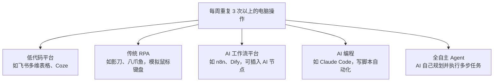

**对应素材**：
- `202506-aizidonghua` > AI 零代码自动化（五类工具盘点，适用场景与商业变现路径）

**小练习**：列出你每周重复做 3 次以上的电脑操作（如整理表格、发周报、备份文件），为每个操作标注归属的五类工具中的一种。

---

### 6.2 Coze 工作流与飞书多维表格实战

本节教用 Coze 工作流 + 飞书多维表格把重复性工作设计成自动运行的工作流，覆盖批量处理表格、监控竞品、生成周报、批量修图等案例。解决非程序员实现自动化的提效问题，每章配提示词手册与百问百答。

**大白话**：Coze 像搭积木一样拖拽模块，就能让 AI 自动帮你做重复工作。配合飞书多维表格，可以实现“新增任务时自动生成总结并填入表格”这种自动化，不用会编程。

**Mermaid 图表：Coze + 飞书多维表格工作流示例**

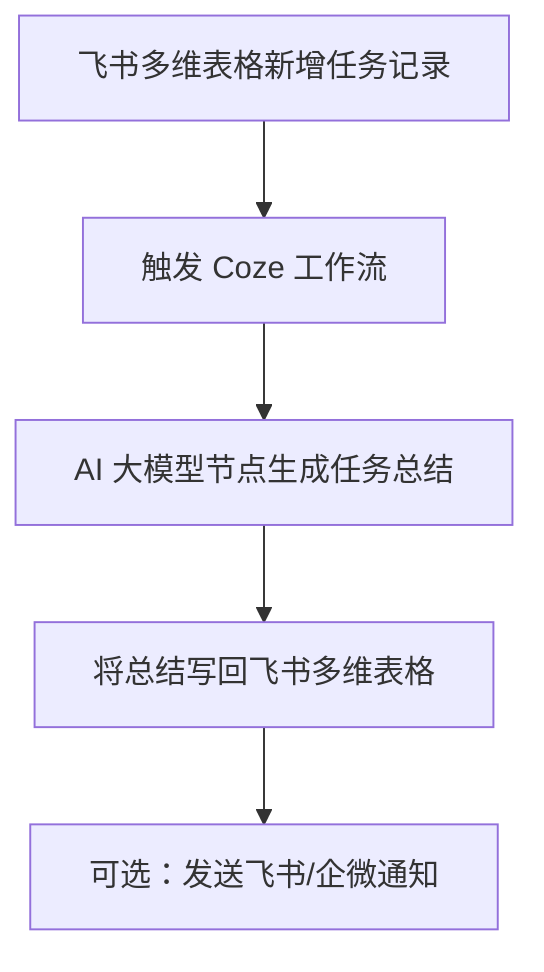

#### 6.2.1 什么是 Coze 工作流+飞书多维表格 ——素材：`202509-cozeduoweibiaoge` > 一、什么是 Coze 工作流+飞书多维表格

如果说 ChatGPT 的出现让 AI 能理解你的需求，那么 Coze 这样的工作流平台，则让 AI 真正能执行你的需求。你只需要在 Coze 上拖拽几个模块，连接几条线，就能让 AI 自动帮你完成原本需要花大量时间和精力才能搞定的重复性工作——批量处理飞书表格数据、监控竞品小红书动态、自动生成周报月报、批量修图去水印……

最关键的是：这些原本需要程序员才能实现的自动化，现在你通过简单的鼠标拖拽就能快速搭建。虽然不能完全替代复杂的开发工作，但对于大部分日常重复任务，已经足够应付。

本次航海会带你系统掌握 Coze 工作流+飞书多维表格的组合拳。不是教你用某个具体功能，而是教你一种思维方式：如何把任何重复性工作，设计成可以自动运行的工作流。

#### 6.2.2 项目完整操作思路 ——素材：`202509-cozeduoweibiaoge` > 二、项目完整操作思路

了解 AI 工作流原理 > 学习 coze、多维表格的操作方法 > 提效效案例实操演练（关键） > 搭建个性化工作流方案

**操作重点：**
1. 了解 AI 工作流原理：AI 工作流是利用人工智能技术，来优化和自动化工作流程的方法。它具有自动化任务执行、动态调整和优化、自主规划和执行、与外部工具集成等特点。
2. 学习 Coze、多维表格的操作方法：Coze 和多维表格都提供可视化界面，即使没有编程经验也能上手。重点在于熟悉其操作界面和基本功能。
3. 提效案例实操演练：通过实际案例，如内容创作、微信机器人、图像处理、职场工作等场景，学习如何应用 AI 工作流提高效率。
4. 搭建个性化工作流方案：学会将自己的思维融入工作流，并能够拆解自己的业务需求，搭建对应的工作流。

#### 6.2.3 Coze 是什么及其核心价值 ——素材：`202509-cozeduoweibiaoge` > 1. Coze 是什么及其核心价值

要构建复杂的自动化流程，得先了解平台的基础功能与核心概念。本章是 Coze 的入门介绍，也是后续项目的基础。我们会从零开始，带你掌握 Coze 的各项核心功能。

本章将向你展示如何通过可视化的界面，组合不同的功能模块，还会拆解工作流的创建过程，从而为你构建复杂的自动化应用打下坚实基础。

在本章中，你将系统地学会：
- 理解核心价值： Coze 不只是问答工具。它是一个能执行业务流程的强大助手。
- 掌握创建流程： 学会从注册账号到发布上线，完整地创建、管理和调试一个工作流。
- 精通三大核心模块： 学习如何运用“大模型节点”、“插件工具”和“逻辑节点”等模块。

学完本章，你就拥有了搭建任何自动化流程所必需的知识和技能。

**对应素材**：
- `202509-cozeduoweibiaoge` > 一、什么是 Coze 工作流+飞书多维表格（拖拽模块，自动完成重复性工作）
- `202509-cozeduoweibiaoge` > 二、项目完整操作思路（了解 AI 工作流原理 > 学习 Coze、多维表格操作方法 > 案例实操 > 搭建个性化工作流）
- `202509-cozeduoweibiaoge` > 3. 内容出品人 / 1. Coze 是什么及其核心价值（三大核心模块：大模型节点、插件工具、逻辑节点）

**小练习**：在飞书多维表格中建立一张简单的任务追踪表，用 Coze 工作流实现“新增任务时自动生成简要总结并填入表格”的自动化，运行一次并验证结果。

---

### 6.3 n8n 自动化工作流与 AI 智能集成

本节介绍开源可视化平台 n8n，教读者搭建客户管理、内容运营、智能通知、AI 助手等工作流，重点掌握 Webhook、HTTP Request、Set/Edit Fields、IF 等 5 个常用节点与数据流引用语法，实现跨应用手动“数字搬运工”自动化。

**大白话**：n8n 是开源的可视化自动化平台，像搭积木一样连接不同软件。比如“收到客户邮件 → 自动录入表格 → 发钉钉通知”，全程不用手动复制粘贴。重点掌握 5 个常用节点，90% 的问题都出在数据引用语法上。

**Mermaid 图表：n8n 工作流数据流向**


#### 6.3.1 什么是 n8n ——素材：`202509-n8n` > 一、什么是 n8n

简单来说：n8n 是一个开源的、可视化的自动化平台。它让你无需写代码，就能像搭积木一样连接不同的应用和服务（如邮件、表格、文档、数据库、AI 模型、甚至你公司的内部系统），创建自动执行任务的「工作流」（Workflow）。

想象一下：每天在不同软件之间切换——在企业微信收到客户咨询，手动复制到飞书记录，再打开腾讯文档更新状态，最后还得提醒自己用钉钉通知同事……这些重复的琐事，不仅耗费精力，还容易出错。

而 n8n 就是为了终结这种「数字搬运工」生涯而生的强大工具！

一旦你设置好了工作流，n8n 就会 24 小时监控触发条件。一旦条件满足，它会立刻启动，严格按照你的流程图，在后台高效完成所有串联的任务。

**n8n 能做什么：**
- 客户管理自动化：新客户注册后，自动发送欢迎邮件，同时录入 CRM（如 Notion 或 Airtable），并通过 Slack 通知销售团队
- 内容运营：订阅 RSS 获取最新文章后，自动生成摘要，并利用 AI 进行改写或翻译，最终发布到 Twitter 或 LinkedIn
- 智能通知：实时监控商品价格、股票行情或天气变化，当低于预期或出现异常时，自动通过短信或邮件提醒你
- 数据桥梁：收集 Google Form 提交的数据后，自动同步到 Google Sheets 和 Notion 数据库，并生成详细的 PDF 报告，通过邮件发送
- AI 助手集成：收到特定邮件时，让 AI 分析内容并草拟回复建议，你只需审核后发送即可
- 内部流程自动化：审批流程、报告生成、数据备份以及跨部门数据同步等繁琐任务

#### 6.3.2 项目完整操作思路 ——素材：`202509-n8n` > 二、项目完整操作思路

了解 n8n 核心概念 > 部署环境配置（关键） > 掌握节点操作 > 构建内容自动化生产线（关键） > 集成 AI 实现智能工作流（关键）

**操作重点：**

**重点 1：理解数据是怎么流动的（最重要）**
学习 n8n，需要理解每个节点输出的数据结构是什么样的。比如：
- 如何用 {{ $json.fieldName }} 引用上一个节点的数据？
- 如何用 {{ $node["节点名"].json.fieldName }} 引用任意节点的数据？
- 90%的 n8n 问题都是因为不理解数据结构或引用错误。

**重点 2：需要掌握这 5 个最常用的节点：**
1. Webhook - 接收外部数据
2. HTTP Request - 调用 API
3. Set/Edit Fields - 数据转换
4. IF - 条件判断
5. Code - 自定义逻辑

掌握这 5 个，你就能完成大部分自动化需求。其他节点都是锦上添花。

**重点 3：有调试思维：**
学会用“执行到此节点”功能查看每一步的数据。出错时先看错误信息，再检查数据结构。善用固定数据功能来测试。n8n 的本质就是：数据从一个节点流向另一个节点，你要做的就是控制这个流动过程。理解了数据流，其他都是细节。

**新手入门建议&避坑指南：**
- 完全不懂技术能学会吗？答：可以。n8n 采用可视化拖拽方式，像搭积木一样连接不同服务，无需编程基础。
- n8n 和 Zapier、Make 有什么区别？答：最大优势是可自托管、无限制执行、支持复杂逻辑和代码，核心功能完全免费。相比 Zapier 成本节省 40-60%，比 Make 有更强的代码集成能力。
- 部署会很复杂吗？答：提供多种部署方式：Docker（推荐，一条命令搞定）、npm 快速测试、n8n Cloud 零维护。

**对应素材**：
- `202509-n8n` > 一、什么是 n8n（开源可视化自动化平台，连接不同应用和服务）
- `202509-n8n` > 二、项目完整操作思路（了解 n8n 核心概念 > 部署环境配置 > 掌握节点操作 > 构建内容自动化生产线 > 集成 AI 实现智能工作流）
- `202509-n8n` > 2.2 操作重点（重点 2：5 个最常用节点 Webhook、HTTP Request、Set/Edit Fields、IF、Code；数据引用语法 {{ $json.fieldName }}）

**小练习**：在 n8n 中搭建一个最小工作流：定时触发 → 获取一个公开 API 数据 → 将结果写入飞书多维表格，运行成功并查看表格新增记录。

---

### 6.4 MCP：让大模型从“建议者”变“执行者”

本节教从零掌握 MCP（模型上下文协议）配置与使用，让 AI 调用外部工具执行跨应用任务（搜索、读写文件、调 API）。实战覆盖内容创作、信息整理、图像制作、职场提效、数据分析等场景，以 Trae/Cursor 为主要载体。

**大白话**：过去 AI 只能“出主意”，你还得自己动手执行。MCP 就像给 AI 装上了“手脚”和“万能 USB 接口”，让它能直接读写文件、调用 API、操作其他 App，真正从“建议者”变成“执行者”。

**Mermaid 图表：MCP 工作原理**

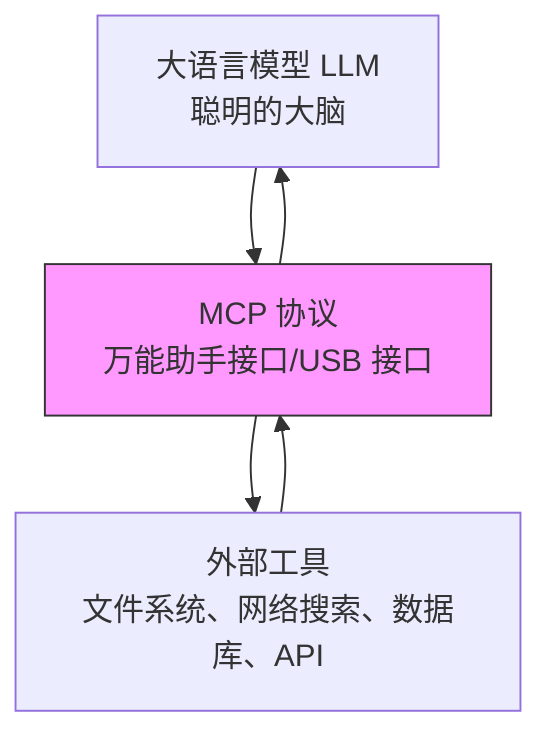

#### 6.4.1 项目概述 ——素材：`202506-mcpyingyong` > 一、项目概述

过去，我们和 AI 的互动，多半是“你说 AI 听，AI 说完你再照着做”。你是否也曾希望 AI 能更主动、更直接地帮你处理那些繁琐的、跨应用的复杂任务？

MCP（模型-上下文协议）的出现，就如同给 AI 大模型装上了一个灵活的“手脚”和“万能 USB 接口”。它让 AI 不再仅仅是一个聪明的“大脑”，而是能够直接调用外部工具、执行复杂任务、与真实世界交互的“智能体”。这意味着，AI 能帮你搜索最新信息、读写文件、调用 API、操作其他 App……真正实现从“建议者”到“执行者”的转变。

本期“MCP 应用探索”航海会带你从零开始，掌握配置和使用 MCP 的全流程。你将学习到：
1. 理解核心：深入浅出地了解 MCP 的核心价值、工作原理及其为 AI 带来的革命性能力。
2. 环境搭建：完成关键的环境准备工作，为 MCP 的顺畅运行打下坚实基础（我们会提供清晰指引，即便你是技术新手）。
3. 配置掌握：学习如何查找、获取 MCP 服务，并掌握简易配置流程，让 AI 连接上“手脚”。
4. 实战为王：实战应用 MCP 工作流，一起探索 MCP 如何赋能内容创作、信息整理、图像制作、职场提效、数据分析等关键场景，让效率倍增。

不过，在开始探索之前，也想温馨提示：MCP 的配置和调试可能遇到一些小挑战，这需要一些耐心和细致。手册会提供详尽指导，社群也会有教练和同学与你同行。学习 MCP 更像学习一项技能，需要你积极动手尝试，将其融入你的实际工作流中，才能真正发挥它的威力。

#### 6.4.2 第一阶段：掌握基础，配好环境 ——素材：`202506-mcpyingyong` > 一、项目概述 > 本航海项目的航线图

完成本章节的学习和实操，即可完成航线图第一阶段：
- 第一阶段：掌握基础，配好环境（共 3 天）
  1. 理解 MCP 核心概念、工作原理及其价值（约 1 天）
  2. 学习在 Trae、Cursor 基础操作与 MCP 管理界面（约 2 天）
  3. 学习如何查找 MCP 服务及获取配置信息（约 1 天）

#### 6.4.3 MCP 核心概念 ——素材：`202506-mcpyingyong` > 一、项目概述

2025 年是智能体的元年，也注定了是智能体集中爆发的一年。但是，在 AI 智能体的世界里，有两个互联领域的重大挑战。

**第一个挑战：** 智能体 Agent 如何与外部的工具进行交互：比如如何访问数据库，执行代码......

**第二个挑战：** 同一个平台的不同的 Agent 之间。以及不同平台的不同的 Agent 之间如何通过协作的方式共同来完成任务。

这两个挑战，就涉及到了标准化的协议。在计算机的世界里，标准化的协议是实现高效沟通的基础。这里 MCP 就是用来解决第一个挑战的。最近谷歌发布了 A2A 协议，它就是用来解决第二个问题的。

可以说！MCP 的出现必然的会大幅加快智能体普及的进程。甚至说大语言模型，尤其是像 DeepSeek + MCP 就约等于智能体。

如果大模型不能够使用外部的工具，那大语言模型其实就是一个简单的聊天机器人。甚至连查询天气，查询当前的时间的功能都做不到。所以调用工具是大模型进化为智能体的一个关键。

那 MCP 就是大语言模型连接万物的一个接口，我们只需要简单的几行代码就可以去接入这样的海量的外部的工具。那这样智能体的开发门槛大大的降低了。特别是现在还有 cursor、windsurf 这些 AI coding 工具的崛起。也可以让我们一些不是程序员的普通人，小白也可以通过代码去开发自己的智能体。

**如何理解 LLM 和 MCP：**
LLM 就是相当于你有一个超级聪明的机器人朋友，名字叫“语言大师”，它读了全世界的书和文章，能用中文、英文跟你聊天，帮你写文章、回答问题、编故事。这个“语言大师”就是 LLM（大语言模型）。它靠以前读过的东西，猜测你想说什么，帮你写出很合理的内容。今天你让它写一封请假邮件，它就会根据它学过的写邮件的套路，帮你写出一封很合适的请假邮件。但是现在你不只是想让它写邮件，你还想让它发邮件。可惜的是这个“语言大师”有个小问题：它只能用脑子里的知识回答问题。这时候，你需要一个“万能助手接口”，让“语言大师”可以去调用其他工具，比如帮你发邮件。这个“万能助手接口”就是 MCP（模型上下文协议）。

总之，LLM 就是那个聪明的机器人朋友，能用语言帮你写东西、回答问题。

**对应素材**：
- `202506-mcpyingyong` > 一、项目概述（MCP 核心概念、工作原理、从“建议者”到“执行者”的转变）
- `202506-mcpyingyong` > 一、项目概述（第一阶段：掌握基础，配好环境；Trae、Cursor 基础操作与 MCP 管理界面）
- `202506-mcpyingyong` > 实战为王（MCP 赋能内容创作、信息整理、图像制作、职场提效、数据分析等场景）

**小练习**：在 Trae 或 Cursor 中配置一个 MCP 服务（如文件系统或网络搜索），让 AI 读取本地一个文件的内容并基于内容回答问题，验证 AI 能“执行”而不仅是“建议”。

---

## 第七章 AI Agent 与内容自动化系统

本章进阶到 AI Agent 架构与内容自动化系统，教读者把个人经验/SOP 封装为 AI 可执行可调用的 Skill，搭建自动干活的 AI 员工，并建立“AI 可读、可复用、能持续迭代”的内容创作系统与内容工厂 Agent。

### 7.1 AI Agent 架构师：搭建自动干活的 AI 员工

本节教用 Codex + Hermes + 飞书 CLI 搭第一个 Agent，把每周重复 3 次以上的工作（周报、纪要、内容草稿、数据表）交给“AI 员工”自动执行，从最小可运行版到多 Agent 团队与企业 AI 服务。案例包括双 Agent YouTube 矩阵 130 万订阅、3 个 AI 员工月省 3000、写作 Agent 月产 30 篇。

**大白话**：Agent 是能“自动干活”的 AI 员工，不像普通 AI 只能一问一答。你把固定的工作流程（比如每周写周报）交给它，它按你的规则自动抓资料、写草稿、存表格，你只需要检查把关。

**Mermaid 图表：AI Agent 架构（以 Codex + Hermes + 飞书 CLI 为例）**

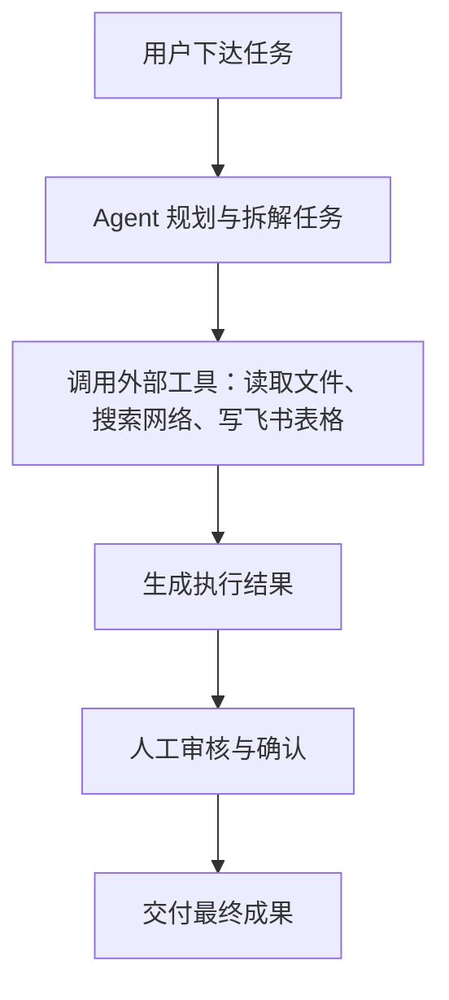

#### 7.1.1 关卡 0：开船第一课 ——素材：`202608-ai-agent` > 引言 > 关卡 0：开船第一课

**00. 本关任务卡：**
- 任务目标：知道本期要做什么、为什么做 Agent、准备好工具入口。
- 任务描述：
  - 读完本关，理解本期主线是用 Hermes + Codex + 飞书 CLI 搭一个能自动干活的 AI Agent。
  - 理解最终成果物是做出一个成功运行的、可公开的 Agent，需要三份材料去证明。
  - 对自己想交给 Agent 处理的重复工作形成初步想法，但不在本关强制定题。
  - 完成开工前准备：确认 Codex、Hermes、飞书 CLI 的入口和登录状态。

**01. 本期航海介绍：**

**1. 这个项目是什么**
很多人已经会用 AI 写文案、整理会议纪要、制作表格、撰写周报、优化客服回复话术，但大多数使用还停留在“问一句，答一句”。你想让它帮你做事，还是要自己复制资料、描述背景、提醒格式、检查结果，下一次又从头来一遍。

Agent 要解决的是更进一步的问题：把一段重复、规则明确的工作流程，交给 AI 自动执行。比如，每周都要整理行业信息、写周报、生成会议纪要、回复客户问题、更新数据表、产出内容初稿，这些工作本身不一定难，但很消耗时间。如果能把岗位、流程、判断标准和工具连接好，Agent 就可以像一个“AI 员工”一样，按你设定的规则接收任务、调用工具、输出结果，并留下可检查的运行记录。

本期航海要带你跑通的，就是用 Codex + Hermes + 飞书 CLI 这一套技术栈，搭出自己的第一个 Agent，将一项你每周重复做 3 次以上的工作，交给它去实现自动化。

你可以从一个简单但真实的场景开始，回忆一下你工作中高频出现的某项重复工作，比如自动整理飞书文档、读取评论生成回复、生成内容草稿、整理客户信息、汇总项目进度、做数据记录和复盘等等。将这个工作内容，做成一个最小可运行版本的 Agent，让它替你自动完成这件事。先做出一个能干活的 Agent 员工，逐步增加它的功能和稳定性，再理解多 Agent 团队和企业 AI 服务的可能性。

**2. 别人都如何使用 Agent**
在你动手之前，先看看别人用 Agent 做成了什么。你不是第一个吃螃蟹的人。

案例一：一个人 + 两个 AI 员工 = 4 个 YouTube 频道、130 万订阅、2.25 亿播放。生财圈友 @天才老师 搭建了“煤老板（策略）+ 翠花（执行）”的双 Agent 架构，一个人做到了 4 个 AI Shorts 频道、130 万订阅、2.25 亿播放。过去一条视频要 4-5 小时，后来压到约 20 分钟；2026 年 2 月产出 41 条视频，其中 14 条百万播放、1 条千万播放。起点不是“我会编程”，而是“我懂 YouTube AI Shorts 的爆款判断，让 AI 去拆解、生成、归档和执行”。

案例二：不懂技术 + 3 个 AI 员工 = 每月省下 3000 元。生财圈友 @瑾糖🍀🌊 把自己业务里的重复动作拆出来，做了 3 个 AI 员工：电商商品采集 Agent、闲鱼运营 Agent、小红书内容生产 Agent。原本准备招人做的机械活，现在变成“每天花几分钟交代任务，剩下交给 AI 跑流程”。AI 负责采集、整理、改写、生成图片、写回飞书表格，人负责判断、审核和最终拍板。

案例三：10 天搭出写作 Agent，月产从 10 篇提升到 30 篇。生财圈友 @小宝｜优势人生主理人 用 Claude 搭建了一套自动化写作系统。她不写代码，而是用文件夹、Markdown 配置文件和写作 SOP，让 Claude 按流程读取素材、讨论选题、生成初稿、审校、排版和分发。单篇文章从 3-4 小时降到 45-60 分钟，月产从 10 篇左右提升到 30 篇左右。起点不是“我懂技术”，而是“我能把写作流程讲清楚，并判断 AI 交付的结果对不对”。

**3. 航海期间需要交付什么**
21 天内，你需要完成必修关卡 1-6 的所有作业，并最终完成一个可运行、可展示的 Agent。它可以是资料整理 Agent、会议纪要 Agent、周报 Agent、客服回复 Agent、选题整理 Agent、内容初稿 Agent、数据更新 Agent，也可以是你自己业务里的某个小岗位。

你最终需要至少提交 3 样东西作为佐证：
| 你交什么 | 证明什么 | 是什么 |
|---|---|---|
| Agent 网址链接 | 它能被公开看见 | 一个别人点开就能访问的展示网页链接 |
| 1 次成功运行截图 | 它最近真的自动干过活 | 输入前 → 运行中 → 输出后的证据 |
| 使用说明书 | 别人知道它省了什么人工、怎么用 | AI 生成的一份说明文档 |

这里的 Agent 网址链接，指的是展示页，不是真正的在线调用页面。也就是说，别人可以访问、了解你的 Agent，但不能直接在网页里与你的 Agent 对话或调用它完成任务。

为什么本期采用展示页，而不是直接部署上线？因为真正让别人在线使用你的 Agent，通常还需要完成部署，并承担一定的运行成本，例如服务器、模型调用（Token）等费用。当其他人使用你的 Agent 时，也会持续消耗这些资源。对于大多数同学来说，现阶段更重要的是先完成一个能稳定工作的 Agent，而不是一开始就投入部署和运维。

#### 7.1.2 关卡 1：用模板跑通第一个最小 Agent Demo ——素材：`202608-ai-agent` > 关卡 1：用模板跑通第一个最小 Agent Demo

**00. 本关任务卡：** （素材中对应小节，具体内容请参阅原素材）
**01. 实操步骤：** （素材中对应小节，具体内容请参阅原素材）
**02. 本关常见卡点：** （素材中对应小节，具体内容请参阅原素材）
**03. 本关小结：** （素材中对应小节，具体内容请参阅原素材）

#### 7.1.3 关卡 2：定岗位，完成 Agent 岗位卡 ——素材：`202608-ai-agent` > 关卡 2：定岗位，完成 Agent 岗位卡

**00. 本关任务卡：** （素材中对应小节，具体内容请参阅原素材）
**01. 本关重点：** （素材中对应小节，具体内容请参阅原素材）
**02. 通用步骤与案例参考：** （素材中对应小节，具体内容请参阅原素材）

**Agent 岗位卡：**
- 岗位名称
- 一句话岗位定义
- 输入
- 处理动作
- 输出
- 成功标准
- 人工兜底
- 本期不做

Agent 岗位卡示例（周报 Agent）：
- 输入 1：本周飞书群聊记录（从飞书消息历史获取，文本格式）
- 处理动作 1：读取本周（周一至今天）的飞书对话记录
- 输出 1：周报文档（Markdown 格式，推送到飞书指定文件夹）

**对应素材**：
- `202608-ai-agent` > 引言、关卡 0 开船第一课（本期主线：Codex + Hermes + 飞书 CLI 搭能自动干活的 AI Agent；交付物：Agent 网址链接、1 次成功运行截图、使用说明书）
- `202608-ai-agent` > 2. 别人都如何使用 Agent（双 Agent YouTube 矩阵 130 万订阅、3 个 AI 员工月省 3000、写作 Agent 月产 30 篇案例）

**小练习**：用任一 Agent 框架（Codex/Hermes 或国内平替 WorkBuddy）搭建一个最小 Agent，让它自动生成一份本周工作周报草稿，输出内容后人工检查并保存。

---

### 7.2 技能封装：把个人经验/SOP 变成 AI 可调用的 Skill

本节教把业务经验/SOP 提炼成可复制、可调用、可共享的 Skill 能力包（以 SKILL.md 为核心），从体验现成 Skill 到做出解决自己真实问题的 Skill，把“我会做”变成“AI 能按我的方法做”。包含任务卡制与 Skill 黑客松。

**大白话**：Skill 就像给 AI 写一份“操作说明书”，把你擅长的工作（比如写周报、选爆款标题）写成标准步骤，以后 AI 就能照着你的方法做，不需要你每次都重新教。

**对应素材**：
- `202608-agent-skills` > Agent Skills 炼术营（技能封装、SKILL.md 核心、任务卡制）
- `202608-ai-agent` > 关卡 0 开船第一课（把重复工作流程交给 Agent 自动执行）

**小练习**：写一份 SKILL.md，把你擅长的一项具体工作（如“写周报”“选爆款标题”）封装为 Skill，包含任务目标、任务描述、作业交付模板，并尝试让 AI 按该 Skill 执行一次。

---

### 7.3 AI 第二大脑：内容创作系统与知识库搭建

本节教用 Obsidian + Codex 搭“AI 可读、可复用、能持续迭代”的内容创作系统：7 类模块知识库（个人背景、对标账号、热点素材、内容规律、选题库、草稿、发布复盘）+ 创作工作流（选题调研 → 对标拆解 → 创作 → 发布 → 复盘回流），解决每次创作从零开始的问题。同时介绍 AI 知识库在公众号智能客服、团队培训、行程规划等场景的应用。

**大白话**：每次写东西都从零开始太累了。建立“第二大脑”就是把你过去写过的文章、找过的对标、积累的选题都整理好，下次创作时 AI 能读取这些素材，直接帮你生成新内容，不再是“白纸写字”。

**Mermaid 图表：AI 第二大脑内容创作系统**

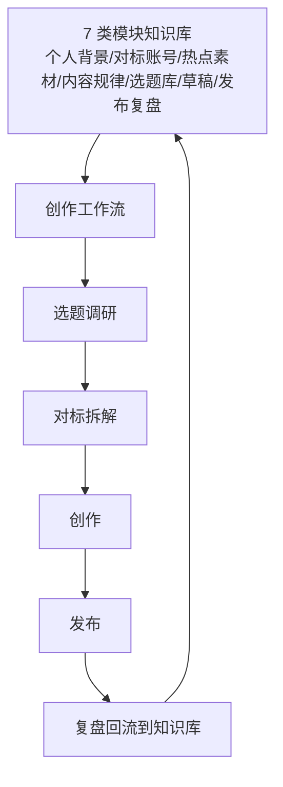

**对应素材**：
- `202506-aizhishiku` > AI 知识库（Obsidian + Codex 内容创作系统）
- `202509-xhszhishiku` > AI 知识库（如存在）
- `202512-neironggongchang` > 开船第一课（内容工厂 Agent 三个核心模块：选题中心、创作中心、发布模块）

**小练习**：在 Obsidian 中建立一个包含 7 个模块的个人知识库框架，向其中导入 3 篇你曾写过的文章作为“草稿”模块素材，尝试用 AI 基于现有素材生成一个新选题。

---

### 7.4 内容工厂 Agent：选题、创作、分发全链路自动化

本节教零基础读者用 Claude Code/Codex + Next.js + SQLite 开发“内容工厂”Agent，含选题中心（抓热点出分析报告）、创作中心（多平台风格生成）、分发链路（小红书扫码发、公众号推草稿箱）。人负责决策，AI 写代码，每章配提示词与视频教程，群里提供完整源代码。

**大白话**：内容工厂就是一套“自动化内容流水线”，选题、写作、发布都由 AI 辅助完成，你只需要负责拍板决策。适合想做自媒体矩阵、批量产出内容的读者。

**Mermaid 图表：内容工厂 Agent 系统架构**

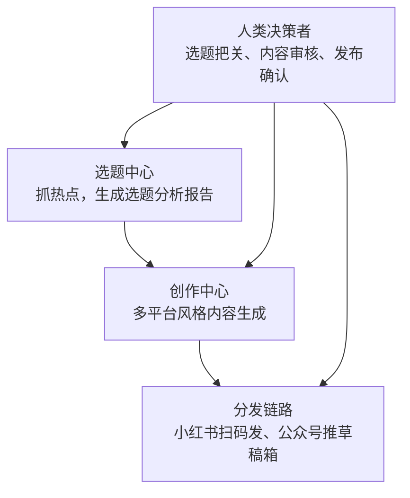

#### 7.4.1 什么是内容工厂 Agent ——素材：`202512-neironggongchang` > 开船第一课 > 1. 什么是内容工厂 Agent

大家好，我是钱塘江鲤，这次航海我将和大家一步步构建一个内容工厂 Agent，我们主要是使用 Next.js 和 SQLite 数据库，借助 Claude Code 或 Codex 等 AI 编程工具实现一个内容工厂的核心功能链路。

项目分为三个核心模块：内容采集与选题分析、内容创作、发布模块。

我们首先会讲解一些关于 AI 编程的基本背景知识，然后按章节逐步完成各个模块的开发，每章提供相应的 Claude/Codex 提示词和所有对话详情，本次航海中涉及到的所有提示词在手册中都有体现，方便大家更快地理解如何利用 AI 工具完整开发一个内容工厂。

另外为了让大家有更好的体验感，可以让不同基础不同行业的圈友都能在这次航海中有自己的收获，除了每章的提示词和视频教程外，我们还会在航海群中提供完整的源代码，让大家真正地把项目搭起来用起来。

我们本次航海构建的内容工厂 Agent 是一个高度灵活的自动化脚手架，它可以根据你的具体需求组合运用，适配多种内容创作场景，在本次航海的学习，你将拥有：
- 一个智能的“选题中心”（输入关键词，自动抓取热点，生成精准的选题分析报告）
- 一个高效的“创作中心”（一键生成适配小红书、公众号等不同平台风格的内容）
- 一个闭环的“分发链路”（小红书扫码即发，公众号自动推送草稿箱，实现一键发布）

#### 7.4.2 项目完整操作思路 ——素材：`202512-neironggongchang` > 开船第一课 > 2. 项目完整操作思路

**2.1 项目完整操作思路：**
本次航海使用 AI 编程方式构建内容工厂，核心思路是通过自然语言与 Claude Code 等 AI 工具对话完成开发。安装并配置 AI 编程工具后，与 AI 反复沟通明确需求并生成页面原型，接着按"数据采集-选题分析-内容创作-发布管理"四个模块逐步实现功能。每个模块都遵循"描述需求→AI 出方案→确认→AI coding→测试"的循环，遇到错误直接将浏览器控制台的报错信息交给 AI 修复，最终通过人机协作快速完成从 0 到 1 的产品开发。整个过程人负责产品方向和决策，AI 负责代码实现。

**2.2 操作重点：**
环境搭建与工具配置 > 构建选题采集与分析 agent > 开发 AI 内容二创与多平台适配功能 > 打通公众号与小红书官方发布接口与分发 > 系统集成与工作流优化

#### 7.4.3 快速上手 AI 编程工具 ——素材：`202512-neironggongchang` > 必修篇 > 一、快速上手 AI 编程工具

**01. 理解 AI 辅助编程与传统编程的区别：**
- 本章概要：恭喜你，正式开启内容工厂 Agent 的第一步。在这里，我们将从零开始，理解什么是 AI 辅助编程，它与传统编程的根本区别是什么，以及如何快速安装你的开发环境和 Claude Code 或/Codex 等 AI 编程工具。
- 第一：理解 AI 辅助编程的核心逻辑。我们会带你了解 AI 编程的原理，认识「人机协作」的新模式。你将明白：未来的编程，不再是死记语法，而是如何清晰地描述需求、引导 AI 生成最优解。掌握这一思维方式，你的生产力将呈指数级提升。
- 第二：准备开发环境与工具安装。我们将带你完成 VS Code 与 Node.js 的安装与配置，让你轻松建立起可以运行项目的本地环境。无论你使用 Mac 还是 Windows，只需照着步骤操作，就能顺利进入 AI 编程的世界。
- 第三：激活并配置 AI 编程助手。通过本章，你将完成 Claude Code 或 Codex 的安装、登录与配置。我们同时提供了国内模型（如 GLM4.6）的使用方案，让你可以顺利体验 AI 编程的全流程。

**02. 准备开发环境并安装 Claude Code/Codex：**
- 1. 开发环境介绍
- 2. 如何安装开发环境
- 3. 安装 Claude code
- 4. 安装 Codex

**03. 激活并配置你的 Claude Code/Codex 账号：**
- 1. Claude Code 登录与使用
- 2. Codex 的登录与使用

#### 7.4.4 内容工厂各模块开发 ——素材：`202512-neironggongchang` > 必修篇

**01. 页面原型设计：**
- 0. 本章概要
- 1. 视频版教程
- 2. 生成初版原型
- 3. 处理报错信息
- 4. 调试完成第一版原型

**02. 获取公众号数据：**
- 1. 视频版教程
- 2. 获取公众号数据
- 3. 处理项目报错信息
- 4. 对已有内容进行优化

**03. 新增选题分析功能：**
- 1. 视频版教程
- 2. ...

**对应素材**：
- `202512-neironggongchang` > 开船第一课（什么是内容工厂 Agent，Next.js + SQLite，三个核心模块：选题中心、创作中心、分发链路）
- `202512-neironggongchang` > 必修篇（一、快速上手 AI 编程工具；数据采集-选题分析-内容创作-发布管理四个模块）

**小练习**：用 AI 生成一个内容工厂的系统架构简图（文字描述即可），标注选题、创作、分发三个环节分别由哪些工具或 Agent 负责，并写下你作为人类决策者需要介入的节点。

---

## 第八章 AI 商业变现：从接单到产品出海

本章教读者如何将 AI 能力转化为收入，覆盖 AI 电商、AI 赋能 IP、AI 服务接单、AI 自媒体账号运营及 AI 产品出海，强调“别人不会用 AI 你会，你帮他做他付钱”，交付物明确、决策门槛低，无需粉丝人脉，出成品即可接单。

### 8.1 AI 电商与 AI 赋能 IP 定位

本节介绍用 AI 生图（ComfyUI 云端部署）做电商图像制作（风格转换、高清化、扩图），以及用 AI（尤其 DeepSeek）做个人 IP：梳理定位、梳理产品、提效内容创作，解决 AI 文案“AI 味”重的问题，效率提升 5–10 倍。

**大白话**：不会做电商图？用 AI 生图就能做主图、风格图。不会定位个人 IP？用 AI 帮你梳理“你是谁、解决谁的问题、凭什么被信任”。重点是让 AI 内容少一点“AI 味”，多一点人味。

**对应素材**：
- `202503-aidianshang` > AI 赋能电商（AI 生图做电商图像，ComfyUI 云端工作流）
- `202503-aifunengip` > AI 赋能 IP（DeepSeek 做个人 IP：定位、产品、内容创作）

**小练习**：用 ComfyUI 云端工作流为一件虚拟商品生成一张主图，并用 DeepSeek 为该商品写一份 IP 定位方案（你是谁/解决谁的问题/凭什么被信任）。

---

### 8.2 AI 服务接单：AI 视频、AI PPT、AI 剧本交付

本节聚焦三个确定性高方向：AI 视频、AI PPT、AI 剧本。教读者学会工具 → 找对标 → 产出作品 → 接单变现的共用链路，交付物明确、决策门槛低，适合无粉丝人脉的普通人快速赚到第一笔 AI 相关收入。

**大白话**：不用先积粉丝，直接做样品（5 页 PPT 或 30 秒短视频脚本），拿去找可能需要的客户（比如公司行政、培训机构、自媒体博主），出成品就能收钱。

**对应素材**：
- `202603-ai-fuwu` > AI 服务大航海（AI 服务接单，交付物明确，无需粉丝人脉）
- `202503-deepseek` > 三、DeepSeek 的应用场景（3.5 用 DeepSeek 设计一套完整 PPT）

**小练习**：用 AI 生成一份 5 页 PPT 或一个 30 秒短视频脚本，作为样本作品保存，并列出 3 个可能需要此类服务的潜在客户类型。

---

### 8.3 AI 自媒体账号搭建与长期变现（小红书、视频号、X/推特、YouTube）

本节教读者在小红书、视频号、X（推特）、YouTube 等平台做 AI 赛道自媒体，从定位差异化到起号打标签，再到运营体系与变现（商单/知识产品/AI 顾问）。强调长期主义：更新 30–50 条前数据可能惨淡，需坚持数月；X 平台主张每天 2 条、坚持发够 28 条。

**大白话**：自媒体是长期赛跑，刚开始数据不好很正常，先坚持发够 30–50 条。选一个平台，做一个垂直类目（比如“AI 工具测评”），别什么都发，账号才有标签，平台才会推流。

**对应素材**：
- `202503-aizimeiti` > AI 自媒体（自媒体账号搭建与变现）
- `202506-aizimeiti` > AI 自媒体（小红书、视频号、X、YouTube 长期变现）

**小练习**：选一个平台（小红书/视频号/X/YouTube），注册账号并确定 AI 垂类定位，发布首条 AI 相关内容并记录发布时间与初始数据。

---

### 8.4 AI 产品出海：海外工具站、热词游戏站与 GEO

本节教出海玩家挖掘正在上涨的热词，用 AI 快速做落地页建站承接搜索流量变现；围绕海外游戏玩家高频搜索问题（攻略、兑换码）做小网站承接 Google 流量，靠广告变现；并介绍 GEO（生成式引擎优化）让 AI 在回答问题时推荐你的品牌或独立站。

**大白话**：出海做网站，不要做大家都做的大网站，找个正在上涨的“热词”（比如某个新游戏的兑换码），快速做个落地页承接 Google 搜索流量，靠广告变现。这是出海里变现天花板最高的领域之一。

**对应素材**：
- `202409-chuhaigongjuzhan` > 出海工具站（海外工具站建站，承接搜索流量）
- `202608-ai-chanpin-chuhai` > AI 产品出海-热词游戏站（热词游戏站，攻略/兑换码，Google 流量广告变现）

**小练习**：用关键词挖掘工具找出 1–2 个正在上涨的海外热词，用 AI 快速生成一个落地页标题与简介，并标注该热词的搜索意图与变现方式。

---

## 第九章 AI 前沿与趋势：生成式引擎优化与出海新范式

本章介绍 2026 年的 AI 前沿话题，帮助读者提前布局下一波机会：GEO 生成式引擎优化、Reddit 出海运营、2026 AI 航海家大会等，适合已有基础、希望从跟随者变为布局者的读者。

### 9.1 GEO：让 AI 在回答问题时推荐你

本节应对“用户开始直接问 AI”的零点击搜索趋势，教品牌/独立站做 GEO（生成式引擎优化），否则在小红书、抖音发再多在 AI 入口面前也“查无此人”。含 GEO 规则与底层逻辑（vs SEO）、0-1 实操（写内容/铺渠道/验证）、落地案例（小红书搜搜薯、烧烤店），并提醒禁用隐藏文本/伪造数据作弊。

**大白话**：过去用户搜关键词，看到一堆链接自己点（SEO）；现在用户直接问 AI，AI 直接给答案并提到品牌名（GEO）。如果你的品牌没出现在 AI 答案里，就等于在新入口面前“查无此人”。

**Mermaid 图表：SEO 与 GEO 的核心区别**

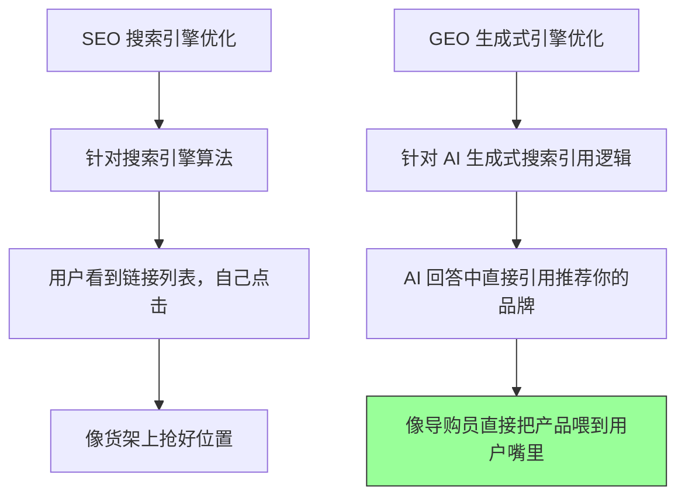

#### 9.1.1 GEO 是什么：从 SEO 到 GEO ——素材：`202602-geo` > 引言 / 一、GEO 是个什么新趋势？ > 1. 什么是 GEO？它和 SEO 有什么区别？

近几年，流量越来越贵，大家都有目共睹。但比变贵更麻烦的是，流量的“流向”开始变了。以前，用户买东西买服务，去百度、淘宝、小红书的搜索框，搜完关键词，还得在一堆链接、商品图或者笔记里，费劲巴拉地自己挑、自己辨别真假；现在，越来越多的用户开始直接问 AI：油皮怎么选粉底液、XX 品牌靠谱吗？、XX 方案怎么做？。

这就带来了一个残酷的新现实：如果你的品牌没出现在 AI 给出的答案里，无论你小红书发了多少笔记、抖音发了多少视频，在 AI 这个新入口面前，都是查无此人。这是新的挑战，更是新的机会！

这本手册主要跟大家分享，在 AI 搜索时代下，怎么通过优化内容和布局，让 AI 推荐你。就是我们说的 GEO（生成式引擎优化）。

**GEO（Generative Engine Optimization，生成式引擎优化）：** 简单讲，它的核心逻辑是：让你的内容能被 AI 看见、理解、引用，最后被推荐出去。（可能你还听过 AEO、AISEO，其实都是一回事，GEO 是最专业的叫法）

**GEO 和 SEO 的核心区别是：** 简单理解就是 G（生成式）与 S（搜索式）的区别，即生成引擎和搜索引擎区别。

- **SEO：针对搜索引擎算法。** SEO 是让你在搜索列表里排名靠前，像是在货架上抢个好位置，让用户一眼看到你，但不知道你好不好用；SEO 是授人以鱼竿（给你链接，你自己点）。
- **GEO：针对 AI 生成式搜索的引用逻辑。** GEO 是让 AI 在回答问题时，直接引用你的推荐语，像是让超市导购员（AI）直接把你的产品（内容）推荐给顾客。GEO 是直接喂到嘴里（直接给你答案，并说是从你这儿来的）。

AI 就像个懂行的导购，用户问哪家强，它直接报你的名字，还顺便说了你为啥强。

**适合人群：** 这本手册适合如果你的商品客单价比较高，用户决策复杂，喜欢在下单前“问一问”，比如 B2B 企业、SaaS 软件、卖工业设备、专业服务机构（律所/留学/咨询/医美/装修/旅游/3C 数码）、跨境独立站运营负责人。

**阅读前的提醒：**
1. GEO 是长效资产，需要持续维护，且维护成本并不低，想要入局的伙伴建议看完本手册再做决策。
2. 现在的 AI 模型具备极强的数据交叉验证能力，千万不要尝试“隐藏文本”、“伪造数据”等作弊手段。一旦被判定为低质量信源，域名的权重损失将难以挽回。

#### 9.1.2 为什么要关注 GEO？——素材：`202602-geo` > 一、GEO 是个什么新趋势？ > 2. 为什么要关注 GEO？

为什么说 GEO 是个值得关注的大趋势，主要基于两个层面的变化：资本的流向、真实的获客案例。

**变化一：资本的流向**
资本市场正在押注这个方向，最近有两个动作值得关注：
- 在美国，一家叫 Profound 的公司刚融了 2000 万美金，专门做 AI 搜索优化，背后的投资方包括 英伟达。
- 在中国，营销巨头蓝色光标，也投资了一家做同类业务的公司叫清蓝 AI。

#### 9.1.3 新趋势：“零点击”与新流量逻辑 ——素材：`202602-geo` > 一、GEO 是个什么新趋势？ > 3. 新趋势：“零点击”与新流量逻辑

用户开始直接问 AI，不再点击搜索链接，这就是“零点击搜索”。从搜索到 AI，流量逻辑发生了根本性变化。

#### 9.1.4 谁适合做 GEO？——素材：`202602-geo` > 二、谁适合做 GEO？

1. **第一类：卖复杂决策的**（B2B、SaaS、工业设备）
2. **第二类：卖专业知识的**（律师、医生、留学、咨询）
3. **第三类：卖服务与体验的**（医美、装修、旅游、3C 数码）
4. **谁不建议做 GEO？**（素材中对应小节，具体内容请参阅原素材）

#### 9.1.5 GEO 实操步骤（SOP）——素材：`202602-geo` > 三、GEO 实操步骤（SOP）

**1. 了解 GEO 的底层逻辑 —— AI 凭什么推荐你？**
- 1.1 AI 回答问题的核心机制：RAG**（检索增强生成）**
- 1.2 AI 筛选内容的三层漏斗
- 1.3 GEO 的工作公式

**2. 如何写出 AI 愿意搬运的内容：**
- 2.1 写作原则
- 2.2 四个必杀内容模板：
  - 模板一：定义式
  - 模板二：要点式
  - 模板三：结论式
  - 模板四：表格对比式
- 2.3 三个提升信任度的钩子
- 2.4 写作注意点：
  - ① 内容要保持更新
  - ② 全网口径统一
  - ③ 戒掉形容词（AI 只要名词和动词）
  - ④ 严禁瞎编数据（防幻觉反噬）

**3. 如何将内容铺到各个信息平台：**
- 3.1 国内战场：借势大平台
（后续内容请参阅原素材）

**对应素材**：
- `202602-geo` > 引言（GEO 是什么，从 SEO 到 GEO，零点击搜索，AI 推荐品牌）
- `202602-geo` > 一、GEO 是个什么新趋势？（1. 什么是 GEO？它和 SEO 有什么区别？、2. 为什么要关注 GEO、3. 新趋势：“零点击”与新流量逻辑）
- `202602-geo` > 二、谁适合做 GEO？（第一类：卖复杂决策的；第二类：卖专业知识的；第三类：卖服务与体验的；谁不建议做 GEO？）
- `202602-geo` > 三、GEO 实操步骤（SOP）（怎么写内容、怎么铺设内容渠道、怎么验证效果）
- `202602-geo` > GEO 落地案例（小红书搜搜薯打法、烧烤店怎么做 GEO）

**小练习**：选一个你熟悉的品牌或产品，在一个 AI 搜索工具中搜索相关问题，观察 AI 回答是否提及该品牌，记录被引用与未被引用的差异，写出 1 条可改进的 GEO 建议。

---

### 9.2 Reddit 出海与 AI 时代信息源运营

本节教出海者从 0 到 1 运营 Reddit：先解决风控封号（注册、养号、攒 Karma），再挖真实痛点、免费冷启动、借力打力拿搜索流量。Reddit 被定位为 AI 时代最重要信息源，强调硬门槛网络环境 + 软门槛真诚利他，配套 20+ 工具汇总。

**大白话**：Reddit 是海外的“全球最大兴趣社区”，也是 Google 的“亲儿子”，在上面发帖容易被搜索引擎收录。但它风控严，新号容易被封，先要养号、攒积分，不能硬广，要真诚提供价值，才能拿到流量。

**对应素材**：
- `202602-reddit` > 引言（Reddit 是什么，基础篇：风控与封号、注册养号积累 Karma；进阶篇：挖痛点、冷启动、借力打力搜索流量，20+ 工具汇总）
- `202602-reddit` > 基础篇：新手入局与运营指南（一、什么是 Reddit；二、为什么 Reddit 很重要：Google 亲儿子、AI 时代信息源、流量洼地、商业化红利期）

**小练习**：注册一个 Reddit 账号并完成养号前 3 步（完善个人资料、订阅 3 个相关社区、阅读社区规则），在个人主页上记录账号创建日期与初始 Karma。

---

### 9.3 2026 AI 航海家大会前瞻

本节介绍 2026 AI 航海家大会的背景与意义，作为全书的收尾，激励读者从“学习 AI 工具”迈向“参与 AI 社区与产业”。注：该手册 README 仅含标题，正文待后续补充。

**大白话**：学完这本书，不要只当“旁观者”，要参与进 AI 社区，认识更多人，才能抓住下一波机会。2026 AI 航海家大会就是一个认识同行、布局产业的机会。

**对应素材**：
- `2026-ai-hanghaijia` > 2026 AI 航海家大会（无正文，待补充）

**小练习**：写下你学完本书后 3 个月内要完成的 1 个 AI 相关目标（如“上线一个小程序”“做出一个 AI Agent”“赚到第一笔 AI 服务收入”），并设定复盘日期。

---

## 附录 A 参考手册索引

本附录列出 `../../docs/` 目录中参与本书编纂的 AI 相关手册清单（按时间排序），供读者深入原文。

| 时间 | 目录 | 主题 | AI 相关度 |
|------|------|------|-----------|
| 202305 | ai-huihua | AI 绘画实战手册 | 核心 AI |
| 202305 | cgpt-haiwai-gongju | ChatGPT+海外工具 | AI 赋能 |
| 202305 | cgpt-zimeiti | ChatGPT+自媒体 | AI 赋能 |
| 202307 | cgpt-gzh | ChatGPT+公众号 | AI 赋能 |
| 202308 | ai-huihua | AI 绘画变现案例 | 核心 AI |
| 202308 | ai-huihua-zimeiti | AI 绘画+自媒体 | 核心 AI |
| 202308 | cgpt-haiwai-gongju | ChatGPT+海外工具 | AI 赋能 |
| 202308 | cgpt-zimeiti | ChatGPT+自媒体 | AI 赋能 |
| 202312 | ai-huihua | AI 绘画特训 | 核心 AI |
| 202403 | ai-huihua | AI 绘画特训 | 核心 AI |
| 202403 | cgpt-tixiao | ChatGPT 提效 | 核心 AI |
| 202403 | rpa-tixiao | RPA 提效 | 非 AI（提效工具） |
| 202403 | sora | Sora 资讯 | 核心 AI |
| 202409 | aibiancheng | 零基础 AI 编程做产品 | 核心 AI |
| 202409 | aixiezuo | AI 写作 | 核心 AI |
| 202409 | coze | Coze AI 工作流 | 核心 AI |
| 202409 | chuhaigongjuzhan | 出海工具站 | AI 赋能 |
| 202412 | aixiezuo | AI 写作 | 核心 AI |
| 202412 | comfyui | ComfyUI 工作流 | 核心 AI |
| 202412 | cursor | Cursor 零基础做软件 | 核心 AI |
| 202412 | shipinhaodaihuo | 视频号带货-AI 数字人 | 核心 AI |
| 202503 | aidianshang | AI 赋能电商 | AI 赋能 |
| 202503 | aifunengip | AI 赋能 IP | AI 赋能 |
| 202503 | aiiosapp | AI 应用-iOS App | AI 赋能 |
| 202503 | aiwebwangzhan | AI 应用-Web 网站 | AI 赋能 |
| 202503 | aixiaoshuo | AI 小说 | AI 赋能 |
| 202503 | aixiezuo | AI 写作 | 核心 AI |
| 202503 | aizimeiti | AI 自媒体 | 核心 AI |
| 202503 | deepseek | DeepSeek 入门指南 | 核心 AI |
| 202506 | aifunengip | AI 赋能 IP 定位 | 核心 AI |
| 202506 | aiiosapp | AI 应用-iOS App | 核心 AI |
| 202506 | aikeshihua | AI 可视化 | 核心 AI |
| 202506 | aishipin | AI 视频制作 | 核心 AI |
| 202506 | aishipinhao | AI 赋能视频号分成 | 核心 AI |
| 202506 | aishuziren | AI 数字人口播 IP | 核心 AI |
| 202506 | aiwebwangzhan | AI 应用-Web 网站 | 核心 AI |
| 202506 | aixiezuo | AI 写作 | 核心 AI |
| 202506 | aizhishiku | AI 知识库 | 核心 AI |
| 202506 | aizidonghua | AI 零代码自动化 | 核心 AI |
| 202506 | aizimeiti | AI 自媒体 | 核心 AI |
| 202506 | mcpyingyong | MCP 应用探索 | 核心 AI |
| 202509 | aigongjuzhan | AI 工具站 | 核心 AI |
| 202509 | aiiosapp | AI 应用-iOS App | 核心 AI |
| 202509 | aishipin | AI 视频制作 | 核心 AI |
| 202509 | aishipinhao | AI 自媒体-视频号 IP | AI 赋能 |
| 202509 | aishipinzhan | AI 图片/视频站 | 核心 AI |
| 202509 | aitwi | AI 自媒体-X 推特 | AI 赋能 |
| 202509 | aixhs | AI 自媒体-小红书 | AI 赋能 |
| 202509 | aiyouxizhan | AI 应用-游戏站 | 核心 AI |
| 202509 | aiytb | YouTube AI 视频 | 核心 AI |
| 202509 | claudecode | Claude Code 编程指南 | 核心 AI |
| 202509 | cozeduoweibiaoge | Coze+多维表格工作流 | 核心 AI |
| 202509 | n8n | n8n 自动化工作流 | 核心 AI |
| 202512 | duoweibiaoge | 多维表格 AI 实战 | 核心 AI |
| 202512 | neironggongchang | 内容工厂 Agent | 核心 AI |
| 202512 | recikuaizhan | 热词快站 AI 产品 | AI 赋能 |
| 2026- | ai-hanghaijia | 2026 AI 航海家大会 | 无正文（待补充） |
| 202602 | geo | GEO 实操指南 | 核心 AI |
| 202603 | ai-biancheng | AI 编程入门 | 核心 AI |
| 202603 | ai-fuwu | AI 服务大航海 | 核心 AI |
| 202603 | xiaochengxu | 微信小程序 AI 产品 | AI 赋能 |
| 202605 | chaoji-ai | 超级 AI 大航海 | 核心 AI |
| 202608 | agent-skills | Agent Skills 炼术营 | 核心 AI |
| 202608 | ai-agent | AI Agent 架构师 | 核心 AI |
| 202608 | ai-chanpin-chuhai | AI 产品出海-热词游戏站 | AI 赋能 |
| 202608 | ai-chanpin-xiaochengxu | AI 产品-微信小程序 | AI 赋能 |
| 202608 | ai-neirongchuangzuo | AI 第二大脑-内容创作系统 | 核心 AI |
| 202609 | chuizhixiaohao | 垂直小号-内容自动化 | 核心 AI |
| 202609 | tietuhao | 微信贴图号 | AI 赋能 |

---

## 附录 B 常用 AI 工具清单与替代方案

| 类别 | 首选工具 | 国内平替/备选 | 典型费用 |
|------|----------|---------------|----------|
| 对话大模型 | ChatGPT / Claude | DeepSeek、Kimi、文心一言、豆包、Gemini | 免费层或月付 |
| 文生图 | MidJourney | Stable Diffusion（LibLib/秋叶）、文心一格、Flux | 订阅或云端按次 |
| 图生视频/文生视频 | Runway Gen-2、可灵 | Gen-1、腾讯混元、快手可图、Mochi、CogVideoX | 订阅或按次 |
| AI 编程 | Claude Code | Cursor、Augment、Codex、v0、Lovable、bolt.new | 订阅 |
| 自动化工作流 | n8n、Coze | Zapier、Make、影刀/八爪鱼 RPA、Dify | 免费层或月付 |
| 多维表格/知识库 | 飞书多维表格 | Notion、Airtable、Get 笔记、ima、Obsidian | 免费层或月付 |
| MCP 客户端 | Trae、Cursor | WorkBuddy（国内平替） | 免费层或月付 |

---

> 细纲说明：每章均已展开至 `x.y` 二级标题，每节配“一段话介绍章节主旨”“对应素材标注”与“配套小练习”。素材 README 中的每一个二级、三级标题，在细纲中都有对应的小节位置。建议读者按章顺序学习，以完成每节小练习的产出物为阶段验收标准。素材位于 `../*/README.md`，可通过目录名在 `docs/` 下定位到对应手册深入阅读。


