# 《AI 航海实战手册》图书细纲（已标注对应素材）

> 本书汇总并整理自 `docs/` 目录下 187 份“航海”实战手册中与 AI 密切相关的约 65 份手册（时间跨度 2023 年 5 月至 2026 年 9 月），覆盖 AI 绘画、AI 写作、AI 视频、AI 编程、AI 应用开发、AI 自动化工作流、AI Agent、AI 商业变现等方向。  
> 书中每一章均附配套小练习，建议读者边读边动手，以“出成品”为学习标准。  
> **素材对应说明**：每一小节末尾均标注了其内容主要来源的素材目录名及素材内小节标题，素材位于 `../*/README.md`，方便读者深入原文。

---

## 目录

1. AI 认知与基础：从零开始理解人工智能  
   1.1 什么是 AI 与大模型  
   1.2 提示词工程：与 AI 对话的核心技能  
   1.3 AI 工具全景图与选型  
   1.4 AI 认知框架：能力、场景、工具  
2. AI 文字创作：高效写作与内容变现  
   2.1 AI 写作方法论与 21 天入门路径  
   2.2 常见文体的 AI 写作（小红书文案、读后感、商业计划书等）  
   2.3 AI 辅助公众号爆文写作与自动化放大  
   2.4 AI 小说与网文创作从写作到变现  
3. AI 视觉与绘画：从出图到商业变现  
   3.1 AI 绘画工具入门：MidJourney、Stable Diffusion、文心一格  
   3.2 提示词与 LoRA：控制出图风格与一致性  
   3.3 AI 绘画在插画、电商、IP 定制中的落地应用  
   3.4 ComfyUI 工作流与 AI 视频生成  
4. AI 视频制作：无拍摄剪辑基础的内容生产  
   4.1 AI 视频生态与主流工具（Runway、可灵、Gen-1/Gen-2 等）  
   4.2 文生视频与图生视频的实操流程  
   4.3 AI 视频在视频号分成计划、YouTube Shorts 等平台的变现  
   4.4 AI 数字人口播 IP 与口播内容量产  
5. AI 应用开发：零基础做软件与网站  
   5.1 Claude Code / Cursor 对话式编程入门  
   5.2 零基础上线 iOS App 与 Web 网站  
   5.3 AI 编程实战六场景：网站、游戏、办公提效、数据分析、营销工具、爬虫  
   5.4 微信小程序 AI 产品 0-1 打造与变现  
6. AI 自动化工作流：把重复劳动交给“数字员工”  
   6.1 AI 零代码自动化五类工具盘点  
   6.2 Coze 工作流与飞书多维表格实战  
   6.3 n8n 自动化工作流与 AI 智能集成  
   6.4 MCP：让大模型从“建议者”变“执行者”  
7. AI Agent 与内容自动化系统  
   7.1 AI Agent 架构师：搭建自动干活的 AI 员工  
   7.2 技能封装：把个人经验/SOP 变成 AI 可调用的 Skill  
   7.3 AI 第二大脑：内容创作系统与知识库搭建  
   7.4 内容工厂 Agent：选题、创作、分发全链路自动化  
8. AI 商业变现：从接单到产品出海  
   8.1 AI 电商与 AI 赋能 IP 定位  
   8.2 AI 服务接单：AI 视频、AI PPT、AI 剧本交付  
   8.3 AI 自媒体账号搭建与长期变现（小红书、视频号、X/推特、YouTube）  
   8.4 AI 产品出海：海外工具站、热词游戏站与 GEO  
9. AI 前沿与趋势：生成式引擎优化与出海新范式  
   9.1 GEO：让 AI 在回答问题时推荐你  
   9.2 Reddit 出海与 AI 时代信息源运营  
   9.3 2026 AI 航海家大会前瞻  
附录 A 参考手册索引  
附录 B 常用 AI 工具清单与替代方案  

---

## 第一章 AI 认知与基础：从零开始理解人工智能

本章为全书奠定 AI 认知基础，面向技术零基础读者，梳理“大模型是什么、能做什么、不能做什么”，避免被 AI 工具营销带偏，并建立“能力 + 场景 + 工具”的使用框架。

### 1.1 什么是 AI 与大模型

本节介绍 AI 的发展脉络与大模型核心概念，重点讲解 DeepSeek、ChatGPT、Claude 等主流模型的定位差异与访问方式（网页版、App、API、模型托管），以及“AI 一直崩溃”“回答太飘”等高频使用问题的应对方法。读者在本节结束后应能判断何时该用 AI、何时不该用 AI，并建立对 AI 能力边界的初步认知。

**大白话类比**：把大模型想象成一个“读过全世界书的超级记忆员”，它不懂真正的道理，只是根据概率猜测下一个字应该是什么，所以有时候会自信地说错话（也就是所谓的“幻觉”）。

**Mermaid 图表：大模型回答问题的简单原理**

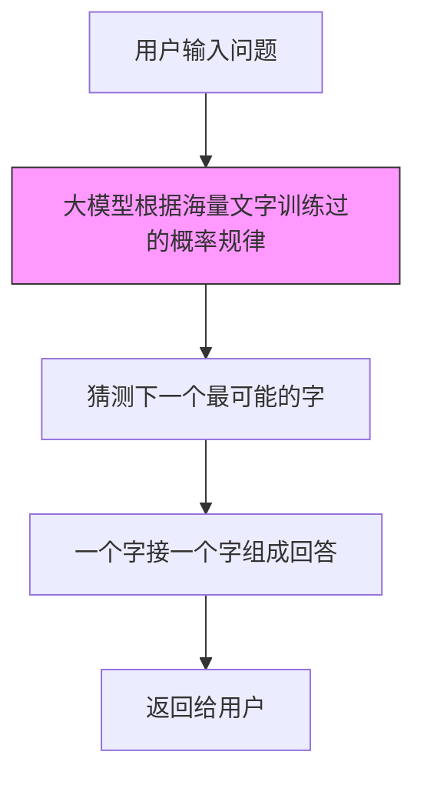

> **核心提醒**：AI 不会替代你的判断力，它只能辅助你。你需要先具备“看得懂好坏”的能力，才能用好 AI。

**对应素材**：
- `202503-deepseek` > 一、什么是 DeepSeek？（DeepSeek 的由来、开源路线、与 GPT-4 的对比）
- `202403-cgpt-tixiao` > 一、【项目概述】了解 ChatGPT（1.1 ChatGPT 是什么？、1.2 ChatGPT 的底层原理 LLM、PGC/UGC/AIGC 概念）
- `202403-cgpt-tixiao` > 一、【项目概述】了解 ChatGPT（1.3 我们该怎么看待 ChatGPT，AI 能力边界与幻觉问题）

**小练习**：在 DeepSeek 网页版或 App 中连续对话 5 轮，分别尝试“开放式提问”“要求分步推理”“要求给出具体示例”三种提问方式，观察并记录回答质量的差异，写下 200 字以内的复盘。

---

### 1.2 提示词工程：与 AI 对话的核心技能

本节系统讲解提示词编写方法，涵盖角色设定、直接提问、原子任务、任务拆解四大核心技巧，并以“1 原则 3 技巧”心法帮助读者让 AI 写作提速至少 3 倍。同时介绍提示词库的构建与复用，使读者从“随手试问”转向“可复制、可迭代的指令资产”。

**大白话**：提示词就是你对 AI 说的话。AI 像一个八岁的小学生，动手能力强但不懂你的潜台词，你说得越模糊，它做得越离谱。所以写提示词的核心就两点：信息更精确、流程更缜密。

**Mermaid 图表：BRTR 提示词框架**

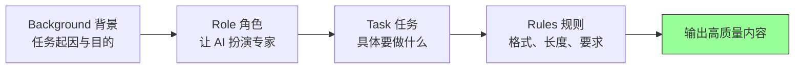

**常用技巧**：
1. **角色设定**：告诉 AI “你是一位资深编辑”，输出会更专业。
2. **原子任务**：把复杂任务拆成小步骤，一次只让 AI 做一件事。
3. **任务拆解**：长文章先让 AI 写大纲，再一段一段生成正文。
4. **提供参考**：把优秀范例投喂给 AI，让它模仿风格。

**对应素材**：
- `202403-cgpt-tixiao` > 三、【项目实操 2/4】写好提示词，让 GPT 高效工作（3.1 提示词有哪些影响？、3.2 提示词写作指南、3.3 提示词写作模版 BRTR/langGPT）
- `202503-aixiezuo` > 二、一套方法论帮你搞定 AI 写作（1 个原则和 3 个技巧：角色扮演原则、直接提问法、原子任务法、任务拆解法）

**小练习**：选一个你近期需要完成的写作任务（如周报、产品介绍、邮件），用“角色设定 + 原子任务拆解”写一条提示词，让 AI 生成初稿，再用一条提示词让 AI 修改初稿，对比前后差异并保存两条提示词作为个人模板。

---

### 1.3 AI 工具全景图与选型

本节梳理文本生成（ChatGPT/Kimi/文心一言）、图像生成（MidJourney/Stable Diffusion/Flux/DALL·E）、视频生成（Runway/可灵/Gen）、代码生成（Claude Code/Cursor/Codex）等领域的主流工具，给出国内外平替方案与成本预估（航海期最低约 100 元），帮助读者按需选型、避免重复付费。

**大白话**：选 AI 工具就像选厨具，炒菜用炒锅、切菜用菜刀，没有一个锅什么都能做。先看你要做什么（写文案？画图？写代码？），再选对应的工具，不要全家桶都订阅，浪费钱。

**Mermaid 图表：AI 工具选型决策树**

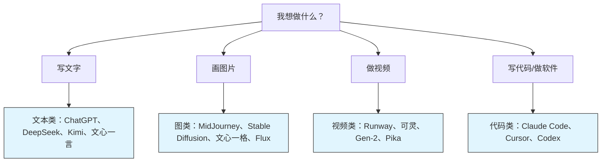

**成本预估**：航海期最低约 100 元，优先走免费层（DeepSeek 免费层、Kimi 免费层、Claude 免费额度），实在不够再订阅。

**对应素材**：
- `202503-deepseek` > 二、DeepSeek 快速入门（2.1 DeepSeek 访问入口、网页端/App、Chatbox、Cherry Studio 客户端）
- `202403-cgpt-tixiao` > 二、【项目实操 1/4】开通 ChatGPT，并和它进行一次对话（2.4 ChatGPT 替代软件：国产大模型 Kimi）
- `202503-aixiezuo` > 二、一套方法论帮你搞定 AI 写作（2.1 如何选择 AI 写作工具？ ChatGPT 免费版 vs 会员版）

**小练习**：列出你日常工作中重复次数最多的 3 个任务，为每个任务在本节工具全景图中找出 1 个可替代的 AI 工具，并标注该工具是免费、订阅还是按次付费。

---

### 1.4 AI 认知框架：能力、场景、工具

本节介绍从“跟工具学操作步骤”转向“底层能力与清晰思考”的认知升级，梳理提示词工程 → 上下文工程 → 指令工程（Harness Engineering）的演化路径，教读者建立个人 AI 认知框架，并明确 AI 提效不能替代自身判断力的边界。

**大白话**：很多新手只记住“怎么点哪个按钮”，工具一换就不会了。更好的办法是理解底层能力（比如“拆解任务”“给背景信息”），这样换任何 AI 工具都能用。

**AI 不能替代的边界**：
- AI 可以帮你起草方案，但不能替你拍板做决定。
- AI 可以帮你写代码，但不能替你理解业务需求。
- AI 可以帮你总结信息，但关键数据（金额、日期、人名）必须人工核对。

**对应素材**：
- `202403-cgpt-tixiao` > 四、【项目实操 3/4】掌握 AI 提效场景（4.1-4.3 工作/生活/创作效率场景）
- `202403-cgpt-tixiao` > 五、【项目实操 4/4】定制自己的 AI 提效解决方案（5.1 失败的 AI 提效案例，AI 是锦上添花不是雪中送炭）
- `202503-deepseek` > 三、DeepSeek 的应用场景（3.1-3.7 公众号、标题、小红书、知乎、PPT、读书卡片、海报）

**小练习**：画一张单页图，左侧列你工作中 5 个高频场景，中间对应需要的 AI 能力（写作/画图/编程/分析/自动化），右侧对应选定的工具，完成后拍照或截图保存为桌面背景。

---

## 第二章 AI 文字创作：高效写作与内容变现

本章聚焦 AI 文生文能力，教读者 21 天内掌握小红书文案、读后感、商业计划书等主流文体的 AI 写作方法，并延伸至公众号爆文自动化与 AI 小说变现，适合文笔不足但希望通过写作提效或副业变现的普通人。

### 2.1 AI 写作方法论与 21 天入门路径

本节给出 21 天 AI 写作学习路径：第一阶段约 5 天夯实 AI 写作基础（选工具、必备技巧、底层方法论），第二阶段约 12 天攻克常见文体。以“代写村庄”故事讲清顾客—村长—村民的变现角色分工，让读者明白 AI 写作不仅是自我使用，也是可接单变现的服务。

**大白话**：AI 写作就像一个“代写村庄”，你是村长（接单、定需求），AI 是村民（具体写文章），顾客付钱，你赚中间差价。前两周先练手，后两周开始接单。

**Mermaid 图表：21 天 AI 写作学习路径**

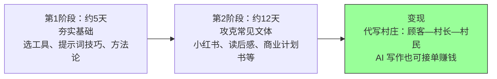

**对应素材**：
- `202503-aixiezuo` > 一、了解 AI 写作项目（1.1 项目分析、代写村庄三个角色：顾客、村长、村民）
- `202503-aixiezuo` > 一、了解 AI 写作项目（1.2 新手从 0 到 1 的有效路径，第一阶段约 5 天、第二阶段约 12 天）
- `202503-aixiezuo` > 二、一套方法论帮你搞定 AI 写作（章节概要、1 个原则 3 个技巧）

**小练习**：按本节路径，花 3 天时间分别用 AI 完成一条小红书种草文案、一篇读后感、一封商务邮件，每篇都用不同工具（如 ChatGPT、Kimi、文心一言）并记录耗时对比。

---

### 2.2 常见文体的 AI 写作（小红书文案、读后感、商业计划书等）

本节逐文体拆解 AI 写作模板与技巧：小红书笔记的起号打标签与爆款结构、读后感的观点提炼与个人化表达、商业计划书的逻辑框架与说服性写作。每个文体均配可复制的提示词手册，读者对照复制即可实战演练。

**大白话**：不同平台的文案就像不同口味的菜，小红书要“年轻、有 emoji、标题党”，读后感要“个人感悟为主”，商业计划书要“逻辑严谨、有数据”。套不同的模板，AI 出的东西才合适。

**对应素材**：
- `202403-cgpt-tixiao` > 八、【案例展示】ChatGPT 的多种应用方向（8.2 ChatGPT + 文案内容创作：小红书笔记、知乎好物、百家号、读后感、公众号爆文）
- `202403-cgpt-tixiao` > 八、【案例展示】ChatGPT 的多种应用方向（8.2.1 案例一：用 ChatGPT 写一篇小红书旅游笔记、8.2.6 案例六：用 ChatGPT 写《活着》读后感）
- `202503-deepseek` > 三、DeepSeek 的应用场景（3.1 用 DeepSeek 写公众号文章、3.2 用 DeepSeek 写标题、3.3 用 DeepSeek 做小红书）

**小练习**：选一本你最近读过的书，用 AI 生成两版读后感（一版偏学术分析、一版偏小红书个人体验），对比两版的语言风格与适用场景，并修改其中一版发布到社交平台。

---

### 2.3 AI 辅助公众号爆文写作与自动化放大

本节介绍公众号拥抱算法后 0 粉丝也能进推荐流量池的机制，教读者跑通“选题 → 爆文写作 → 发布 → 变现”的最小可行性产品（MVP），再用 ChatGPT/Python 全自动化与多账号 AI 辅助放大产出。适合长期副业，包含流量主收款与收益案例拆解。

**大白话**：公众号现在不靠粉丝数，靠内容好不好。AI 帮你写，你负责选题和把关，发出去后有人读就有流量主收益。先跑通一篇，再想办法批量产出。

**对应素材**：
- `202503-deepseek` > 三、DeepSeek 的应用场景（3.1 用 DeepSeek 写公众号文章 @越越：选题规划、生成标题、生成内容、人性化润色、完整提示词模板）
- `202403-cgpt-tixiao` > 八、【案例展示】ChatGPT 的多种应用方向（8.2.8 案例八：ChatGPT+公众号爆文案例合集）
- `202503-deepseek` > 三、DeepSeek 的应用场景（3.2 用 DeepSeek 写标题：爆款标题 4 大核心要素、六种高转化标题公式、七大误区和避坑方案）

**小练习**：在公众号注册并开通流量主（或准备注册），用 AI 生成一篇垂直领域爆文并排版发布，记录首 24 小时的阅读数与互动数据作为复盘基准。

---

### 2.4 AI 小说与网文创作从写作到变现

本节教读者用 AI 写网络小说并实现变现，覆盖市场行情、类型题材、平台收益模式（番茄小说、知乎盐选、百度付费专栏“短篇三巨头”），从注册番茄账号起步，解决无写作功底的普通人入局网文的问题。重点讲解选文四种方法与套路化改文技巧。

**大白话**：网文就像工厂流水线，选题是选产品，大纲是设计图，AI 负责扩写正文。新手建议从“番茄小说”短篇开始，门槛低，自动签约，不用先出名就能有收益。

**Mermaid 图表：AI 小说创作全流程**

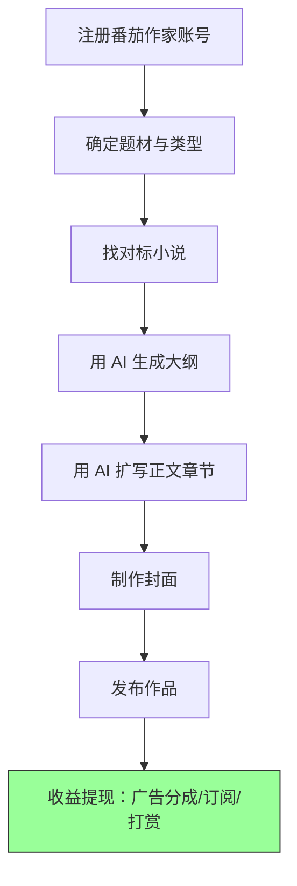

**对应素材**：
- `202503-aixiaoshuo` > 一、【项目概述】AI 写小说基础认知（1.1 市场规模和增长趋势、1.2 小说类型、1.3 常见平台与收益模式、1.4 常用工具选择）
- `202503-aixiaoshuo` > 二、短篇小说创作过程（2.1 找对标、2.2 获取文本、2.3 创作新大纲、2.4 生成具体章节内容、2.5 制作封面）
- `202503-aixiaoshuo` > 三、长篇小说创作过程（3.1 选择题材、3.2 内容创作、3.2.4 黄金三章、3.2.5 后续剧情架构）
- `202503-aixiaoshuo` > 四、发布作品（4.1 短篇小说发布、4.2 长篇小说发布）
- `202503-aixiaoshuo` > 五、收益提现（5.1 短篇小说收益、5.2 长篇小说收益）

**小练习**：注册一个网文平台作者账号，用 AI 生成一个短篇故事大纲（含类型、题材、主要冲突），并写出前 500 字正文，保存为草稿备用。

---

## 第三章 AI 视觉与绘画：从出图到商业变现

本章聚焦 AI 图像生成，教读者从工具入门到提示词工程师，再到插画、电商、IP 定制等行业的应用与变现。覆盖 MidJourney、Stable Diffusion（秋叶整合包/LibLib 封装）、文心一格、ControlNet、ComfyUI 等工具，以及“AI 绘画 + 小红书笔记”的出图能力检测模板。

### 3.1 AI 绘画工具入门：MidJourney、Stable Diffusion、文心一格

本节手把手教零基础读者完成首张 AI 出图，涵盖国内简易工具（MEWX/Vega/文心一格）到进阶工具（MidJourney、Stable Diffusion）的全流程，以及文生图、图生图、LoRA 训练、ControlNet 插件的基础操作。

**大白话**：AI 绘画就是你打一段文字描述（提示词/咒语），AI 帮你画出图片。新手建议先从国内简单工具（如文心一格）开始，不用翻墙、不用配置，注册就能用；熟练后再尝试 MidJourney 或 Stable Diffusion。

**Mermaid 图表：AI 绘画常见工具对比**

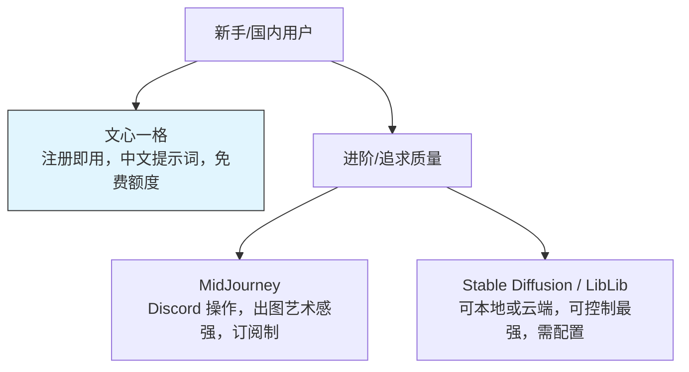

**对应素材**：
- `202403-ai-huihua` > 必修篇：学会 AI 绘画，并能简单应用（一、【项目概述】了解 AI 绘画，1.1 什么是 AI 绘画？）
- `202403-ai-huihua` > 二、【项目实操 1/4】学会用 Midjourney 完成 AI 绘画
- `202403-ai-huihua` > 三、【项目实操 2/4】学会用 LibLib AI 完成 AI 绘画（Stable Diffusion 的封装软件）
- `202403-ai-huihua` > 四、【项目实操 3/4】学会用文心一格完成 AI 绘画

**小练习**：在文心一格或 MidJourney 中生成一张与你职业相关的插图，尝试调整一次提示词再生成，对比前后两张图的差异并保存较满意的一张。

---

### 3.2 提示词与 LoRA：控制出图风格与一致性

本节深入讲解 AI 绘画的“咒语”编写，教读者成为提示词工程师，掌握风格一致性控制、角色一致性、构图调整等进阶技巧，并通过“AI 绘画 + 小红书笔记”模板检测出图能力。

**大白话**：画图提示词就像给点单，越详细越准确。想让同一个人物在不同照片里长得一样，就得在每张图的提示词里都固定写“角色特征+服装+发型”，这就叫“一致性控制”。

**对应素材**：
- `202403-ai-huihua` > 五、【项目实操 4/4】提升 AI 绘图能力——描述词（提示词优化，提升出图质量）
- `202403-ai-huihua` > 六、【复盘优化】检测 AI 绘图能力（「AI 绘画+小红书笔记」出图能力检测模板）
- `202308-ai-huihua-zimeiti` > AI 绘画+自媒体（如存在，用于风格一致性与小红书变现）

**小练习**：选定一个固定角色（如“穿红衣的女孩”），用同一组核心提示词生成 3 张不同场景下的图片，观察角色一致性，记录哪些关键词对一致性影响最大。

---

### 3.3 AI 绘画在插画、电商、IP 定制中的落地应用

本节展示 AI 绘画在包装、插画、电商图像、IP 定制等十余个行业的应用与变现方式，教读者将出图能力落地到商业场景，并引用行业预测（中文 AI 绘画将产生不少于 10 个年利润百万级小程序）作为方向参考。

**大白话**：画好图只是第一步，怎么赚钱才是关键。比如给电商店铺做主图、做 IP 表情包、做定制插画，这些都是普通人能接的单子，交付物明确，客户愿意付钱。

**对应素材**：
- `202403-ai-huihua` > 七、学会更多 AI 绘图工具
- `202403-ai-huihua` > 八、了解更多落地场景及变现（AI 绘画在插画、电商、IP 定制中的应用与变现方式）
- `202308-ai-huihua` > AI 绘画变现案例（如存在）

**小练习**：为一个虚拟电商产品（如一款护肤品）用 AI 生成 3 张不同风格的主图，并写出每张图的使用场景说明，形成一份简单的视觉方案文档。

---

### 3.4 ComfyUI 工作流与 AI 视频生成

本节介绍 ComfyUI 节点式工作流，教读者无需本地高配置即可使用现成工作流一键运行（模特换装、真实人物写真、批量生成 AI 视频），并进阶到自己搭建工作流。覆盖腾讯混元、快手可图、Mochi、智谱 CogVideoX 等开源模型。

**大白话**：ComfyUI 像“搭积木”一样画图，把每个步骤（选模型、写提示词、出图、放大）变成一个个方块，连线后就能一键出图。好处是不用高配电脑，也可以直接用别人做好的“工作流”套用。

**Mermaid 图表：ComfyUI 工作流示意**

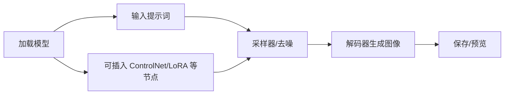

**对应素材**：
- `202412-comfyui` > 必修篇（一、ComfyUI 项目介绍：1.1 ComfyUI 是什么？、1.2 ComfyUI 可以做什么、1.3 ComfyUI 与 WebUI 的优劣势对比）
- `202412-comfyui` > ComfyUI 安装与使用（云端运行、无需本地高配置）
- `202412-comfyui` > 现成工作流一键运行（模特换装、真实人物写真、批量生成 AI 视频）

**小练习**：在云端 ComfyUI 平台上运行一个现成的“图生图”工作流，生成一张风格化图片，记录操作步骤与云算力费用（如 4090 约 2 元/小时）。

---

## 第四章 AI 视频制作：无拍摄剪辑基础的内容生产

本章介绍 AI 视频生态与主流工具，让无拍摄剪辑经验的读者用文生视频/图生视频工具产出内容，同时讲解技术局限（时长短、一致性差、版权、备份工程文件）与避坑清单，并延伸至视频号分成计划、YouTube Shorts 变现及 AI 数字人口播 IP。

### 4.1 AI 视频生态与主流工具（Runway、可灵、Gen-1/Gen-2 等）

本节盘点 AI 视频生成工具与生态，介绍 Sora 等文生视频模型的上线进展与国内外竞品动态，帮读者尽早掌握信息差。提醒对市面 Sora 课程谨慎防骗，因 Sora 尚在内测无实操入口，定位为资讯认知而非即时实操。

**大白话**：AI 视频就是你打一段文字或上传一张图，AI 帮你生成视频片段。目前生成的视频比较短（几秒到几十秒），适合做短视频素材，不适合直接拍长片。新手先用一个工具熟练，不要贪多。

**Mermaid 图表：主流 AI 视频工具对比**

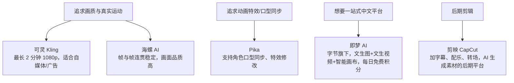

**对应素材**：
- `202506-aishipin` > 一、新手快速上手 AI 视频（1.1 认识 AI 视频生态、AI 视频技术局限与避坑清单）
- `202506-aishipin` > 一、新手快速上手 AI 视频（1.2 AI 视频用到的工具：Runway Gen-1/Gen-2、可灵 Kling、海螺 AI、即梦 AI、Pika、剪映）

**小练习**：列出你了解的 3 个 AI 视频工具，分别标注其支持的功能（文生图/图生视频/文生视频）、免费额度与付费价格，形成一张工具选型表。

---

### 4.2 文生视频与图生视频的实操流程

本节教读者用 AI 工具无拍摄剪辑基础地产出 60–80 秒视频，覆盖文生图 → 图生视频 → 简单剪辑的完整流程，强调“创意本身成为核心竞争力”，并列出勿过度依赖 AI、备份工程文件等避坑提醒。

**大白话**：做 AI 视频的常见流程是：先用 AI 生图（拿到关键画面），再把图片喂给 AI 视频工具变成动态视频，最后用剪映加上字幕和音乐。创意比技术更重要，工具只是帮你实现想法。

**对应素材**：
- `202506-aishipin` > 二、学习 AI 热门视频玩法（文生视频与图生视频的实操流程）
- `202506-aishipin` > 一、新手快速上手 AI 视频（1.1 认识 AI 视频生态中的避坑清单：备份工程文件、勿过度依赖 AI）

**小练习**：用任一 AI 视频工具生成一条 15–30 秒短视频，配上背景音乐与字幕，导出并保存，记录生成次数与最终满意版本的尝试次数。

---

### 4.3 AI 视频在视频号分成计划、YouTube Shorts 等平台的变现

本节教读者用 AI 批量创作视频号热门原创内容，快速涨粉达标开通创作分成计划，靠评论区广告点击赚收益，目标是新手“赚到第 1 块钱”；并介绍 YouTube Shorts 冲刺 YPP 广告分成的路径（达标周期从约 2 年缩至最快 1–3 个月，建议按 3–6 个月长期主义准备）。

**大白话**：视频号有分成计划，视频播放有人看就有钱赚。AI 帮你批量做视频，你负责选垂直赛道和发布，先挣到第一块钱，再慢慢放大。YouTube Shorts 做得好，广告分成也是不错的美元收入。

**对应素材**：
- `202506-aishipinhao` > AI 赋能视频号分成（如存在，视频号分成计划实操）
- `202509-aiytb` > YouTube AI 视频（如存在，YouTube Shorts 变现路径）

**小练习**：选定一个垂直赛道，用 AI 生成 3 条短视频脚本并制作 1 条成片，发布到视频号或 YouTube，记录发布后 7 天的播放量与粉丝增量。

---

### 4.4 AI 数字人口播 IP 与口播内容量产

本节教读者打造 AI 数字人口播 IP：克隆真人形象与声音做口播内容，重点解决口型同步、人设一致性、避免“AI 味”等痛点，并对比国内外平台选性价比工具。适合镜头表现力差但需要量产带货视频的读者。

**大白话**：数字人就是用 AI 克隆一个“虚拟主播”，你不需要自己出镜，它帮你念稿子。适合不爱露脸但要做大量带货视频的人。关键是嘴巴要和声音同步，人设要统一，不然观众一眼就能看出是 AI。

**对应素材**：
- `202506-aishuziren` > 一、什么是数字人 IP？（数字人定义、核心特征 AI 驱动、技术与质量挑战、口型同步与音频自然度）
- `202506-aishuziren` > 二、用 AI 智能体辅助 IP 定位（2.1 工具推荐 Gemini、2.2 明确价值与方向、人设一致性）
- `202412-shipinhaodaihuo` > 视频号带货-AI 数字人（如存在，视频号 AI 数字人带货实操）

**小练习**：在一个 AI 数字人平台上使用公共模板生成一段 30 秒口播视频，替换为你自己的文案，观察口型同步效果并记录需要人工修正的地方。

---

## 第五章 AI 应用开发：零基础做软件与网站

本章面向不会编程的读者，教用 Claude Code / Cursor / Augment 等 AI 编程工具自然语言写代码，21 天内做出数字名片、批量改名/图片压缩等小工具，乃至预约管理、记账等小型业务系统，实现开发民主化。覆盖 iOS App、Web 网站、微信小程序及六大应用场景。

### 5.1 Claude Code / Cursor 对话式编程入门

本节教读者安装 Claude Code（或 Cursor），学习与 AI 高效对话的技巧（对话式编程而非独白式编程），理解代理的部分原理，从而更好地与 AI 协作。平替方案包括 DeepSeek、Qwen3-Coder、GLM-4.5。

**大白话**：对话式编程就是你用人话告诉 AI “我想做个什么”，它帮你写代码。你不需要懂语法，只需要描述清楚需求，出错了把报错贴给它让它修复。就像点外卖，你只需要说想吃什么，厨师（AI）负责做。

**Mermaid 图表：对话式编程工作流**

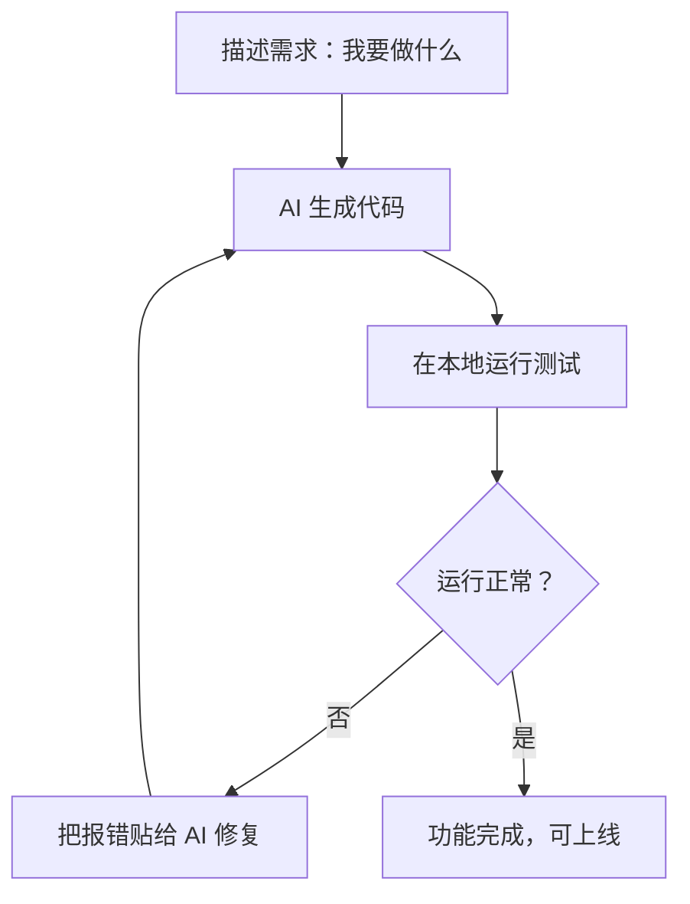

**对应素材**：
- `202509-claudecode` > 一、什么是 Claude Code（智能编程助手、无需懂编程、对话式编程）
- `202509-claudecode` > 二、项目完整操作思路（Claude Code 安装 > 高效对话技巧 > 实战开发）
- `202509-claudecode` > 1. 本章概要（Vibe Coding 与 AI 编程新范式、传统编程和氛围编程对比）

**小练习**：安装 Claude Code 或 Cursor，用自然语言让 AI 生成一个“批量重命名文件”的小脚本，在本地运行并验证能正确重命名测试文件夹中的文件。

---

### 5.2 零基础上线 iOS App 与 Web 网站

本节分两条路线：iOS 路线教 21 天从零基础上线首个 iOS App 并尝试付费/订阅变现（需 Apple 开发者账号 99 美元/年）；Web 路线主张“先上线一百个网站”，从游戏站、导航站入手，靠 Google AdSense 广告流量收益赚美元，出海网站是变现天花板最高领域之一。

**大白话**：做网站比做 App 简单很多，不需要审核，不用交 99 美元，代码丢到 GitHub Pages 或 Vercel 就能上线。新手建议先从“个人数字名片”单页网站开始，跑通“写代码 → 上线 → 访问”的全流程，再往复杂网站走。

**对应素材**：
- `202503-aiiosapp` > AI 应用-iOS App（如存在，iOS App 零基础上线）
- `202503-aiwebwangzhan` > AI 应用-Web 网站（如存在，Web 网站零基础上线）

**小练习**：用 AI 编程工具生成一个简单的个人数字名片单页网站，部署到 GitHub Pages 或 Vercel，并访问链接确认页面正常显示。

---

### 5.3 AI 编程实战六场景：网站、游戏、办公提效、数据分析、营销工具、爬虫

本节以 21 天六大场景实操为主线，教读者借助 AI 编程工具写出可运行的产品工具，路径为“认识 AI 编程 → 应用 AI 编程 → 借助 AI 理解编程理论”，分必修篇（应用 + 基础语法）与选修篇（高级语法、更多应用）。

**大白话**：不要试图一次学完所有编程知识，先选一个你最需要的场景（比如帮自己整理文件的办公工具），用 AI 把它做出来，用起来爽了，你自然就会想了解更多编程知识。

**对应素材**：
- `202409-aibiancheng` > 零基础 AI 编程做产品（六大场景：网站、游戏、办公提效、数据分析、营销工具、爬虫）

**小练习**：从六个场景中选一个（如办公提效工具），用 AI 生成可运行的原型，运行后记录该工具解决了什么具体问题、耗时多少。

---

### 5.4 微信小程序 AI 产品 0-1 打造与变现

本节教个人开发者借微信 13 亿月活生态与 2026 AI 小程序成长计划扶持（免费云开发 + 1 亿混元 Token），用 AI 低成本批量做小程序，走流量主广告分成或订阅制变现。案例包括某开发者 15 个小程序月入 2 万+、一篇笔记带来 650+ 用户。

**大白话**：微信小程序不用下载安装，搜一下就能用，用户基数巨大。现在微信还有 AI 小程序扶持计划，给免费服务器和 Token。新手可以做个“手电筒”“倒计时”这种极简工具，先跑通“注册 → 开发 → 上线 → 开流量主”的全流程。

**Mermaid 图表：微信小程序开发全流程**

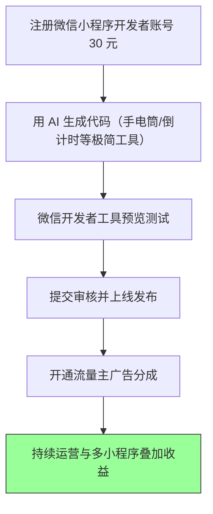

**对应素材**：
- `202603-xiaochengxu` > 引言、一、开船第一课（01. 新手怎么学习、1.1 为什么当下做微信小程序产品打造、1.2 微信小程序生态优势与激励计划、1.4 小程序变现模式、1.3 低技术门槛和上线成本）
- `202603-xiaochengxu` > 二、操作重点（项目完整操作思路：注册账号 > 挖掘与验证需求 > 产品开发 > 上线发布 > 推广引流 > 商业变现）

**小练习**：注册微信小程序开发者账号，用 AI 生成一个“手电筒/倒计时”级的极简小程序，完整跑通“开发 → 上线发布”的全流程，无需上架即可。

---

## 第六章 AI 自动化工作流：把重复劳动交给“数字员工”

本章教读者认识五类自动化工具（低代码平台、传统 RPA、AI 工作流平台、AI 编程、全自主 Agent）并搭建工作流，把“按关键词采集小红书/抖音爆款 → 存飞书表格 → AI 生成图片 → 多平台自动分发”等重复劳动交给数字员工，放大业务价值。

### 6.1 AI 零代码自动化五类工具盘点

本节系统介绍五类自动化工具及其适用场景，帮助读者判断“自己手头的重复工作该用哪一类工具”，并给出商业变现路径（做自动化服务、卖模板、接单交付）。

**大白话**：自动化工具就像“数字员工”，不同工具擅长不同的活。简单重复的用低代码平台，需要 AI 思考的用 AI 工作流平台，会写代码的用 AI 编程，最复杂的用全自主 Agent。先看你每周重复做几次什么工作，再对号入座。

**Mermaid 图表：五类自动化工具选型**

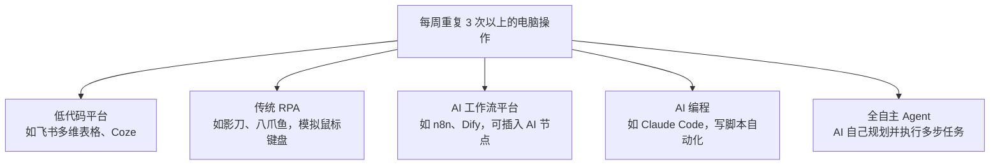

**对应素材**：
- `202506-aizidonghua` > AI 零代码自动化（五类工具盘点，适用场景与商业变现路径）

**小练习**：列出你每周重复做 3 次以上的电脑操作（如整理表格、发周报、备份文件），为每个操作标注归属的五类工具中的一种。

---

### 6.2 Coze 工作流与飞书多维表格实战

本节教用 Coze 工作流 + 飞书多维表格把重复性工作设计成自动运行的工作流，覆盖批量处理表格、监控竞品、生成周报、批量修图等案例。解决非程序员实现自动化的提效问题，每章配提示词手册与百问百答。

**大白话**：Coze 像搭积木一样拖拽模块，就能让 AI 自动帮你做重复工作。配合飞书多维表格，可以实现“新增任务时自动生成总结并填入表格”这种自动化，不用会编程。

**Mermaid 图表：Coze + 飞书多维表格工作流示例**

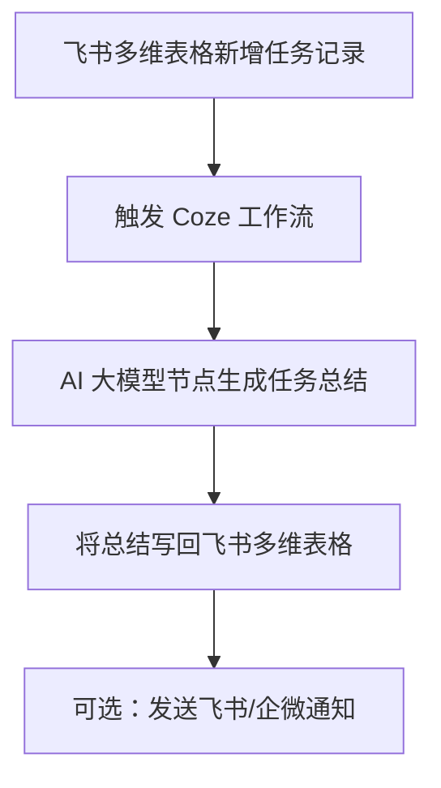

**对应素材**：
- `202509-cozeduoweibiaoge` > 一、什么是 Coze 工作流+飞书多维表格（拖拽模块，自动完成重复性工作）
- `202509-cozeduoweibiaoge` > 二、项目完整操作思路（了解 AI 工作流原理 > 学习 Coze、多维表格操作方法 > 案例实操 > 搭建个性化工作流）
- `202509-cozeduoweibiaoge` > 3. 内容出品人 / 1. Coze 是什么及其核心价值（三大核心模块：大模型节点、插件工具、逻辑节点）

**小练习**：在飞书多维表格中建立一张简单的任务追踪表，用 Coze 工作流实现“新增任务时自动生成简要总结并填入表格”的自动化，运行一次并验证结果。

---

### 6.3 n8n 自动化工作流与 AI 智能集成

本节介绍开源可视化平台 n8n，教读者搭建客户管理、内容运营、智能通知、AI 助手等工作流，重点掌握 Webhook、HTTP Request、Set/Edit Fields、IF 等 5 个常用节点与数据流引用语法，实现跨应用手动“数字搬运工”自动化。

**大白话**：n8n 是开源的可视化自动化平台，像搭积木一样连接不同软件。比如“收到客户邮件 → 自动录入表格 → 发钉钉通知”，全程不用手动复制粘贴。重点掌握 5 个常用节点，90% 的问题都出在数据引用语法上。

**Mermaid 图表：n8n 工作流数据流向**

**对应素材**：
- `202509-n8n` > 一、什么是 n8n（开源可视化自动化平台，连接不同应用和服务）
- `202509-n8n` > 二、项目完整操作思路（了解 n8n 核心概念 > 部署环境配置 > 掌握节点操作 > 构建内容自动化生产线 > 集成 AI 实现智能工作流）
- `202509-n8n` > 2.2 操作重点（重点 2：5 个最常用节点 Webhook、HTTP Request、Set/Edit Fields、IF、Code；数据引用语法 {{ $json.fieldName }}）

**小练习**：在 n8n 中搭建一个最小工作流：定时触发 → 获取一个公开 API 数据 → 将结果写入飞书多维表格，运行成功并查看表格新增记录。

---

### 6.4 MCP：让大模型从“建议者”变“执行者”

本节教从零掌握 MCP（模型上下文协议）配置与使用，让 AI 调用外部工具执行跨应用任务（搜索、读写文件、调 API）。实战覆盖内容创作、信息整理、图像制作、职场提效、数据分析等场景，以 Trae/Cursor 为主要载体。

**大白话**：过去 AI 只能“出主意”，你还得自己动手执行。MCP 就像给 AI 装上了“手脚”和“万能 USB 接口”，让它能直接读写文件、调用 API、操作其他 App，真正从“建议者”变成“执行者”。

**Mermaid 图表：MCP 工作原理**

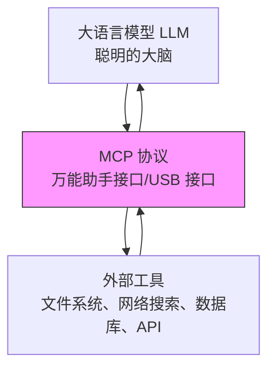

**对应素材**：
- `202506-mcpyingyong` > 一、项目概述（MCP 核心概念、工作原理、从“建议者”到“执行者”的转变）
- `202506-mcpyingyong` > 一、项目概述（第一阶段：掌握基础，配好环境；Trae、Cursor 基础操作与 MCP 管理界面）
- `202506-mcpyingyong` > 实战为王（MCP 赋能内容创作、信息整理、图像制作、职场提效、数据分析等场景）

**小练习**：在 Trae 或 Cursor 中配置一个 MCP 服务（如文件系统或网络搜索），让 AI 读取本地一个文件的内容并基于内容回答问题，验证 AI 能“执行”而不仅是“建议”。

---

## 第七章 AI Agent 与内容自动化系统

本章进阶到 AI Agent 架构与内容自动化系统，教读者把个人经验/SOP 封装为 AI 可执行可调用的 Skill，搭建自动干活的 AI 员工，并建立“AI 可读、可复用、能持续迭代”的内容创作系统与内容工厂 Agent。

### 7.1 AI Agent 架构师：搭建自动干活的 AI 员工

本节教用 Codex + Hermes + 飞书 CLI 搭第一个 Agent，把每周重复 3 次以上的工作（周报、纪要、内容草稿、数据表）交给“AI 员工”自动执行，从最小可运行版到多 Agent 团队与企业 AI 服务。案例包括双 Agent YouTube 矩阵 130 万订阅、3 个 AI 员工月省 3000、写作 Agent 月产 30 篇。

**大白话**：Agent 是能“自动干活”的 AI 员工，不像普通 AI 只能一问一答。你把固定的工作流程（比如每周写周报）交给它，它按你的规则自动抓资料、写草稿、存表格，你只需要检查把关。

**Mermaid 图表：AI Agent 架构（以 Codex + Hermes + 飞书 CLI 为例）**

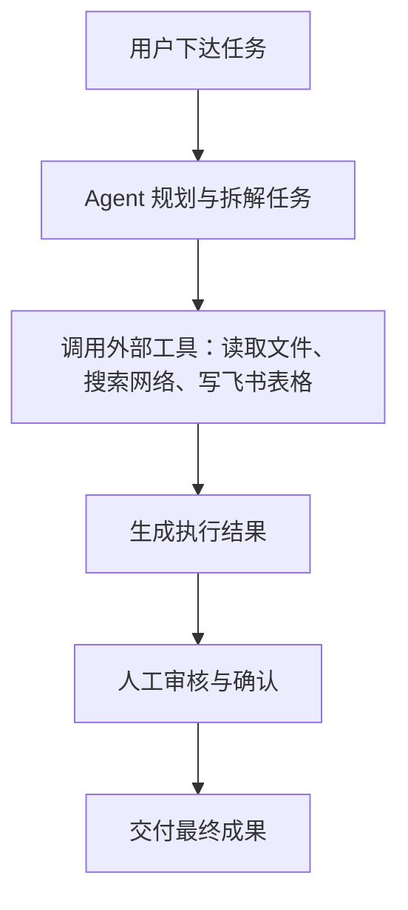

**对应素材**：
- `202608-ai-agent` > 引言、关卡 0 开船第一课（本期主线：Codex + Hermes + 飞书 CLI 搭能自动干活的 AI Agent；交付物：Agent 网址链接、1 次成功运行截图、使用说明书）
- `202608-ai-agent` > 2. 别人都如何使用 Agent（双 Agent YouTube 矩阵 130 万订阅、3 个 AI 员工月省 3000、写作 Agent 月产 30 篇案例）

**小练习**：用任一 Agent 框架（Codex/Hermes 或国内平替 WorkBuddy）搭建一个最小 Agent，让它自动生成一份本周工作周报草稿，输出内容后人工检查并保存。

---

### 7.2 技能封装：把个人经验/SOP 变成 AI 可调用的 Skill

本节教把业务经验/SOP 提炼成可复制、可调用、可共享的 Skill 能力包（以 SKILL.md 为核心），从体验现成 Skill 到做出解决自己真实问题的 Skill，把“我会做”变成“AI 能按我的方法做”。包含任务卡制与 Skill 黑客松。

**大白话**：Skill 就像给 AI 写一份“操作说明书”，把你擅长的工作（比如写周报、选爆款标题）写成标准步骤，以后 AI 就能照着你的方法做，不需要你每次都重新教。

**对应素材**：
- `202608-agent-skills` > Agent Skills 炼术营（技能封装、SKILL.md 核心、任务卡制）
- `202608-ai-agent` > 关卡 0 开船第一课（把重复工作流程交给 Agent 自动执行）

**小练习**：写一份 SKILL.md，把你擅长的一项具体工作（如“写周报”“选爆款标题”）封装为 Skill，包含任务目标、任务描述、作业交付模板，并尝试让 AI 按该 Skill 执行一次。

---

### 7.3 AI 第二大脑：内容创作系统与知识库搭建

本节教用 Obsidian + Codex 搭“AI 可读、可复用、能持续迭代”的内容创作系统：7 类模块知识库（个人背景、对标账号、热点素材、内容规律、选题库、草稿、发布复盘）+ 创作工作流（选题调研 → 对标拆解 → 创作 → 发布 → 复盘回流），解决每次创作从零开始的问题。同时介绍 AI 知识库在公众号智能客服、团队培训、行程规划等场景的应用。

**大白话**：每次写东西都从零开始太累了。建立“第二大脑”就是把你过去写过的文章、找过的对标、积累的选题都整理好，下次创作时 AI 能读取这些素材，直接帮你生成新内容，不再是“白纸写字”。

**Mermaid 图表：AI 第二大脑内容创作系统**

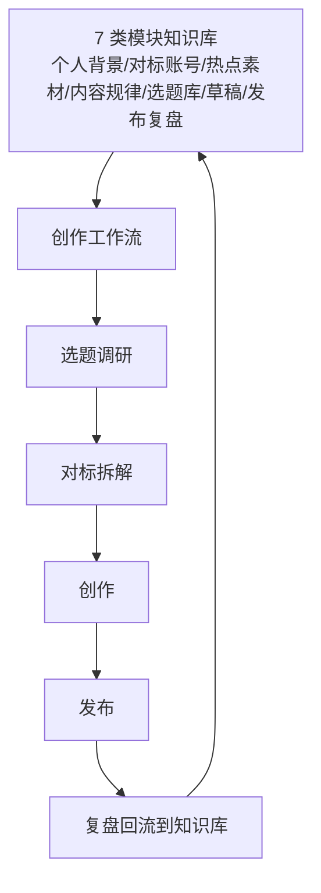

**对应素材**：
- `202506-aizhishiku` > AI 知识库（如存在，Obsidian + Codex 内容创作系统）
- `202509-xhszhishiku` > AI 知识库（如存在）
- `202512-neironggongchang` > 开船第一课（内容工厂 Agent 三个核心模块：选题中心、创作中心、发布模块）

**小练习**：在 Obsidian 中建立一个包含 7 个模块的个人知识库框架，向其中导入 3 篇你曾写过的文章作为“草稿”模块素材，尝试用 AI 基于现有素材生成一个新选题。

---

### 7.4 内容工厂 Agent：选题、创作、分发全链路自动化

本节教零基础读者用 Claude Code/Codex + Next.js + SQLite 开发“内容工厂”Agent，含选题中心（抓热点出分析报告）、创作中心（多平台风格生成）、分发链路（小红书扫码发、公众号推草稿箱）。人负责决策，AI 写代码，每章配提示词与视频教程，群里提供完整源代码。

**大白话**：内容工厂就是一套“自动化内容流水线”，选题、写作、发布都由 AI 辅助完成，你只需要负责拍板决策。适合想做自媒体矩阵、批量产出内容的读者。

**Mermaid 图表：内容工厂 Agent 系统架构**

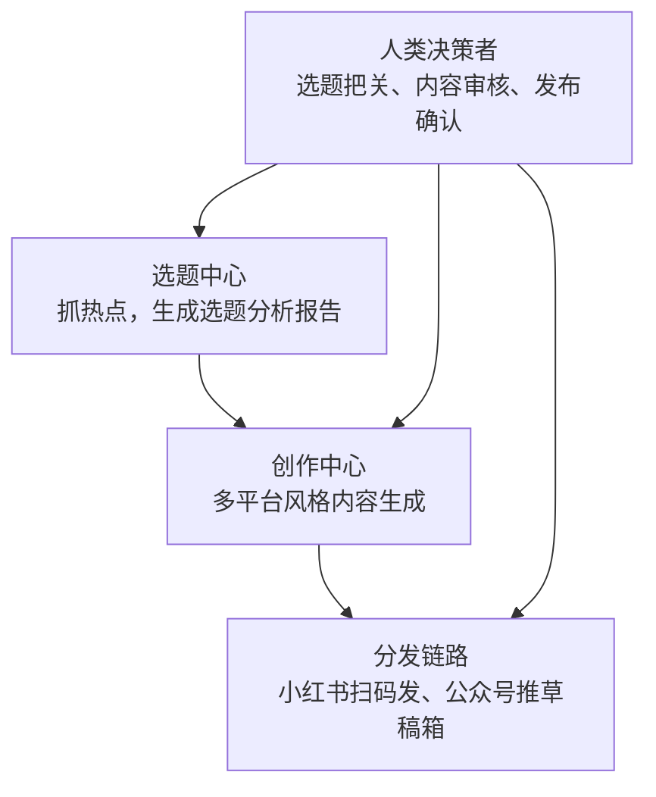

**对应素材**：
- `202512-neironggongchang` > 开船第一课（什么是内容工厂 Agent，Next.js + SQLite，三个核心模块：选题中心、创作中心、分发链路）
- `202512-neironggongchang` > 必修篇（一、快速上手 AI 编程工具；数据采集-选题分析-内容创作-发布管理四个模块）

**小练习**：用 AI 生成一个内容工厂的系统架构简图（文字描述即可），标注选题、创作、分发三个环节分别由哪些工具或 Agent 负责，并写下你作为人类决策者需要介入的节点。

---

## 第八章 AI 商业变现：从接单到产品出海

本章教读者如何将 AI 能力转化为收入，覆盖 AI 电商、AI 赋能 IP、AI 服务接单、AI 自媒体账号运营及 AI 产品出海，强调“别人不会用 AI 你会，你帮他做他付钱”，交付物明确、决策门槛低，无需粉丝人脉，出成品即可接单。

### 8.1 AI 电商与 AI 赋能 IP 定位

本节介绍用 AI 生图（ComfyUI 云端部署）做电商图像制作（风格转换、高清化、扩图），以及用 AI（尤其 DeepSeek）做个人 IP：梳理定位、梳理产品、提效内容创作，解决 AI 文案“AI 味”重的问题，效率提升 5–10 倍。

**大白话**：不会做电商图？用 AI 生图就能做主图、风格图。不会定位个人 IP？用 AI 帮你梳理“你是谁、解决谁的问题、凭什么被信任”。重点是让 AI 内容少一点“AI 味”，多一点人味。

**对应素材**：
- `202503-aidianshang` > AI 赋能电商（AI 生图做电商图像，ComfyUI 云端工作流）
- `202503-aifunengip` > AI 赋能 IP（DeepSeek 做个人 IP：定位、产品、内容创作）

**小练习**：用 ComfyUI 云端工作流为一件虚拟商品生成一张主图，并用 DeepSeek 为该商品写一份 IP 定位方案（你是谁/解决谁的问题/凭什么被信任）。

---

### 8.2 AI 服务接单：AI 视频、AI PPT、AI 剧本交付

本节聚焦三个确定性高方向：AI 视频、AI PPT、AI 剧本。教读者学会工具 → 找对标 → 产出作品 → 接单变现的共用链路，交付物明确、决策门槛低，适合无粉丝人脉的普通人快速赚到第一笔 AI 相关收入。

**大白话**：不用先积粉丝，直接做样品（5 页 PPT 或 30 秒短视频脚本），拿去找可能需要的客户（比如公司行政、培训机构、自媒体博主），出成品就能收钱。

**对应素材**：
- `202603-ai-fuwu` > AI 服务大航海（AI 服务接单，交付物明确，无需粉丝人脉）
- `202503-deepseek` > 三、DeepSeek 的应用场景（3.5 用 DeepSeek 设计一套完整 PPT）

**小练习**：用 AI 生成一份 5 页 PPT 或一个 30 秒短视频脚本，作为样本作品保存，并列出 3 个可能需要此类服务的潜在客户类型。

---

### 8.3 AI 自媒体账号搭建与长期变现（小红书、视频号、X/推特、YouTube）

本节教读者在小红书、视频号、X（推特）、YouTube 等平台做 AI 赛道自媒体，从定位差异化到起号打标签，再到运营体系与变现（商单/知识产品/AI 顾问）。强调长期主义：更新 30–50 条前数据可能惨淡，需坚持数月；X 平台主张每天 2 条、坚持发够 28 条。

**大白话**：自媒体是长期赛跑，刚开始数据不好很正常，先坚持发够 30–50 条。选一个平台，做一个垂直类目（比如“AI 工具测评”），别什么都发，账号才有标签，平台才会推流。

**对应素材**：
- `202503-aizimeiti` > AI 自媒体（如存在，自媒体账号搭建与变现）
- `202506-aizimeiti` > AI 自媒体（如存在，小红书、视频号、X、YouTube 长期变现）

**小练习**：选一个平台（小红书/视频号/X/YouTube），注册账号并确定 AI 垂类定位，发布首条 AI 相关内容并记录发布时间与初始数据。

---

### 8.4 AI 产品出海：海外工具站、热词游戏站与 GEO

本节教出海玩家挖掘正在上涨的热词，用 AI 快速做落地页建站承接搜索流量变现；围绕海外游戏玩家高频搜索问题（攻略、兑换码）做小网站承接 Google 流量，靠广告变现；并介绍 GEO（生成式引擎优化）让 AI 在回答问题时推荐你的品牌或独立站。

**大白话**：出海做网站，不要做大家都做的大网站，找个正在上涨的“热词”（比如某个新游戏的兑换码），快速做个落地页承接 Google 搜索流量，靠广告变现。这是出海里变现天花板最高的领域之一。

**对应素材**：
- `202409-chuhaigongjuzhan` > 出海工具站（海外工具站建站，承接搜索流量）
- `202608-ai-chanpin-chuhai` > AI 产品出海-热词游戏站（热词游戏站，攻略/兑换码，Google 流量广告变现）

**小练习**：用关键词挖掘工具找出 1–2 个正在上涨的海外热词，用 AI 快速生成一个落地页标题与简介，并标注该热词的搜索意图与变现方式。

---

## 第九章 AI 前沿与趋势：生成式引擎优化与出海新范式

本章介绍 2026 年的 AI 前沿话题，帮助读者提前布局下一波机会：GEO 生成式引擎优化、Reddit 出海运营、2026 AI 航海家大会等，适合已有基础、希望从跟随者变为布局者的读者。

### 9.1 GEO：让 AI 在回答问题时推荐你

本节应对“用户开始直接问 AI”的零点击搜索趋势，教品牌/独立站做 GEO（生成式引擎优化），否则在小红书、抖音发再多在 AI 入口面前也“查无此人”。含 GEO 规则与底层逻辑（vs SEO）、0-1 实操（写内容/铺渠道/验证）、落地案例（小红书搜搜薯、烧烤店），并提醒禁用隐藏文本/伪造数据作弊。

**大白话**：过去用户搜关键词，看到一堆链接自己点（SEO）；现在用户直接问 AI，AI 直接给答案并提到品牌名（GEO）。如果你的品牌没出现在 AI 答案里，就等于在新入口面前“查无此人”。

**Mermaid 图表：SEO 与 GEO 的核心区别**

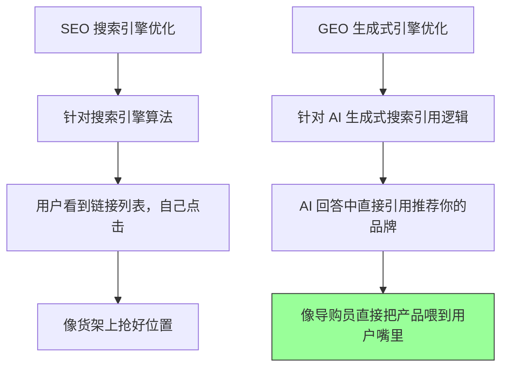

**对应素材**：
- `202602-geo` > 引言（GEO 是什么，从 SEO 到 GEO，零点击搜索，AI 推荐品牌）
- `202602-geo` > 一、GEO 是个什么新趋势？（1. 什么是 GEO？它和 SEO 有什么区别？、2. 为什么要关注 GEO）
- `202602-geo` > GEO 实操 0-1（怎么写内容、怎么铺设内容渠道、怎么验证效果）
- `202602-geo` > GEO 落地案例（小红书搜搜薯打法、烧烤店怎么做 GEO）

**小练习**：选一个你熟悉的品牌或产品，在一个 AI 搜索工具中搜索相关问题，观察 AI 回答是否提及该品牌，记录被引用与未被引用的差异，写出 1 条可改进的 GEO 建议。

---

### 9.2 Reddit 出海与 AI 时代信息源运营

本节教出海者从 0 到 1 运营 Reddit：先解决风控封号（注册、养号、攒 Karma），再挖真实痛点、免费冷启动、借力打力拿搜索流量。Reddit 被定位为 AI 时代最重要信息源，强调硬门槛网络环境 + 软门槛真诚利他，配套 20+ 工具汇总。

**大白话**：Reddit 是海外的“全球最大兴趣社区”，也是 Google 的“亲儿子”，在上面发帖容易被搜索引擎收录。但它风控严，新号容易被封，先要养号、攒积分，不能硬广，要真诚提供价值，才能拿到流量。

**对应素材**：
- `202602-reddit` > 引言（Reddit 是什么，基础篇：风控与封号、注册养号积累 Karma；进阶篇：挖痛点、冷启动、借力打力搜索流量，20+ 工具汇总）
- `202602-reddit` > 基础篇：新手入局与运营指南（一、什么是 Reddit；二、为什么 Reddit 很重要：Google 亲儿子、AI 时代信息源、流量洼地、商业化红利期）

**小练习**：注册一个 Reddit 账号并完成养号前 3 步（完善个人资料、订阅 3 个相关社区、阅读社区规则），在个人主页上记录账号创建日期与初始 Karma。

---

### 9.3 2026 AI 航海家大会前瞻

本节介绍 2026 AI 航海家大会的背景与意义，作为全书的收尾，激励读者从“学习 AI 工具”迈向“参与 AI 社区与产业”。注：该手册 README 仅含标题，正文待后续补充。

**大白话**：学完这本书，不要只当“旁观者”，要参与进 AI 社区，认识更多人，才能抓住下一波机会。2026 AI 航海家大会就是一个认识同行、布局产业的机会。

**对应素材**：
- `2026-ai-hanghaijia` > 2026 AI 航海家大会（无正文，待补充）

**小练习**：写下你学完本书后 3 个月内要完成的 1 个 AI 相关目标（如“上线一个小程序”“做出一个 AI Agent”“赚到第一笔 AI 服务收入”），并设定复盘日期。

---

## 附录 A 参考手册索引

本附录列出 `../../docs/` 目录中参与本书编纂的 AI 相关手册清单（按时间排序），供读者深入原文。

| 时间 | 目录 | 主题 | AI 相关度 |
|------|------|------|-----------|
| 202305 | ai-huihua | AI 绘画实战手册 | 核心 AI |
| 202305 | cgpt-haiwai-gongju | ChatGPT+海外工具 | AI 赋能 |
| 202305 | cgpt-zimeiti | ChatGPT+自媒体 | AI 赋能 |
| 202307 | cgpt-gzh | ChatGPT+公众号 | AI 赋能 |
| 202308 | ai-huihua | AI 绘画变现案例 | 核心 AI |
| 202308 | ai-huihua-zimeiti | AI 绘画+自媒体 | 核心 AI |
| 202308 | cgpt-haiwai-gongju | ChatGPT+海外工具 | AI 赋能 |
| 202308 | cgpt-zimeiti | ChatGPT+自媒体 | AI 赋能 |
| 202312 | ai-huihua | AI 绘画特训 | 核心 AI |
| 202403 | ai-huihua | AI 绘画特训 | 核心 AI |
| 202403 | cgpt-tixiao | ChatGPT 提效 | 核心 AI |
| 202403 | rpa-tixiao | RPA 提效 | 非 AI（提效工具） |
| 202403 | sora | Sora 资讯 | 核心 AI |
| 202409 | aibiancheng | 零基础 AI 编程做产品 | 核心 AI |
| 202409 | aixiezuo | AI 写作 | 核心 AI |
| 202409 | coze | Coze AI 工作流 | 核心 AI |
| 202409 | chuhaigongjuzhan | 出海工具站 | AI 赋能 |
| 202412 | aixiezuo | AI 写作 | 核心 AI |
| 202412 | comfyui | ComfyUI 工作流 | 核心 AI |
| 202412 | cursor | Cursor 零基础做软件 | 核心 AI |
| 202412 | shipinhaodaihuo | 视频号带货-AI 数字人 | 核心 AI |
| 202503 | aidianshang | AI 赋能电商 | AI 赋能 |
| 202503 | aifunengip | AI 赋能 IP | AI 赋能 |
| 202503 | aiiosapp | AI 应用-iOS App | AI 赋能 |
| 202503 | aiwebwangzhan | AI 应用-Web 网站 | AI 赋能 |
| 202503 | aixiaoshuo | AI 小说 | AI 赋能 |
| 202503 | aixiezuo | AI 写作 | 核心 AI |
| 202503 | aizimeiti | AI 自媒体 | 核心 AI |
| 202503 | deepseek | DeepSeek 入门指南 | 核心 AI |
| 202506 | aifunengip | AI 赋能 IP 定位 | 核心 AI |
| 202506 | aiiosapp | AI 应用-iOS App | 核心 AI |
| 202506 | aikeshihua | AI 可视化 | 核心 AI |
| 202506 | aishipin | AI 视频制作 | 核心 AI |
| 202506 | aishipinhao | AI 赋能视频号分成 | 核心 AI |
| 202506 | aishuziren | AI 数字人口播 IP | 核心 AI |
| 202506 | aiwebwangzhan | AI 应用-Web 网站 | 核心 AI |
| 202506 | aixiezuo | AI 写作 | 核心 AI |
| 202506 | aizhishiku | AI 知识库 | 核心 AI |
| 202506 | aizidonghua | AI 零代码自动化 | 核心 AI |
| 202506 | aizimeiti | AI 自媒体 | 核心 AI |
| 202506 | mcpyingyong | MCP 应用探索 | 核心 AI |
| 202509 | aigongjuzhan | AI 工具站 | 核心 AI |
| 202509 | aiiosapp | AI 应用-iOS App | 核心 AI |
| 202509 | aishipin | AI 视频制作 | 核心 AI |
| 202509 | aishipinhao | AI 自媒体-视频号 IP | AI 赋能 |
| 202509 | aishipinzhan | AI 图片/视频站 | 核心 AI |
| 202509 | aitwi | AI 自媒体-X 推特 | AI 赋能 |
| 202509 | aixhs | AI 自媒体-小红书 | AI 赋能 |
| 202509 | aiyouxizhan | AI 应用-游戏站 | 核心 AI |
| 202509 | aiytb | YouTube AI 视频 | 核心 AI |
| 202509 | claudecode | Claude Code 编程指南 | 核心 AI |
| 202509 | cozeduoweibiaoge | Coze+多维表格工作流 | 核心 AI |
| 202509 | n8n | n8n 自动化工作流 | 核心 AI |
| 202512 | duoweibiaoge | 多维表格 AI 实战 | 核心 AI |
| 202512 | neironggongchang | 内容工厂 Agent | 核心 AI |
| 202512 | recikuaizhan | 热词快站 AI 产品 | AI 赋能 |
| 2026- | ai-hanghaijia | 2026 AI 航海家大会 | 无正文（待补充） |
| 202602 | geo | GEO 实操指南 | 核心 AI |
| 202603 | ai-biancheng | AI 编程入门 | 核心 AI |
| 202603 | ai-fuwu | AI 服务大航海 | 核心 AI |
| 202603 | xiaochengxu | 微信小程序 AI 产品 | AI 赋能 |
| 202605 | chaoji-ai | 超级 AI 大航海 | 核心 AI |
| 202608 | agent-skills | Agent Skills 炼术营 | 核心 AI |
| 202608 | ai-agent | AI Agent 架构师 | 核心 AI |
| 202608 | ai-chanpin-chuhai | AI 产品出海-热词游戏站 | AI 赋能 |
| 202608 | ai-chanpin-xiaochengxu | AI 产品-微信小程序 | AI 赋能 |
| 202608 | ai-neirongchuangzuo | AI 第二大脑-内容创作系统 | 核心 AI |
| 202609 | chuizhixiaohao | 垂直小号-内容自动化 | 核心 AI |
| 202609 | tietuhao | 微信贴图号 | AI 赋能 |

---

## 附录 B 常用 AI 工具清单与替代方案

| 类别 | 首选工具 | 国内平替/备选 | 典型费用 |
|------|----------|---------------|----------|
| 对话大模型 | ChatGPT / Claude | DeepSeek、Kimi、文心一言、豆包、Gemini | 免费层或月付 |
| 文生图 | MidJourney | Stable Diffusion（LibLib/秋叶）、文心一格、Flux | 订阅或云端按次 |
| 图生视频/文生视频 | Runway Gen-2、可灵 | Gen-1、腾讯混元、快手可图、Mochi、CogVideoX | 订阅或按次 |
| AI 编程 | Claude Code | Cursor、Augment、Codex、v0、Lovable、bolt.new | 订阅 |
| 自动化工作流 | n8n、Coze | Zapier、Make、影刀/八爪鱼 RPA、Dify | 免费层或月付 |
| 多维表格/知识库 | 飞书多维表格 | Notion、Airtable、Get 笔记、ima、Obsidian | 免费层或月付 |
| MCP 客户端 | Trae、Cursor | WorkBuddy（国内平替） | 免费层或月付 |

---

> 细纲说明：每章均已展开至 `x.y` 二级标题，每节配“一段话介绍章节主旨”“对应素材标注”与“配套小练习”。建议读者按章顺序学习，以完成每节小练习的产出物为阶段验收标准。素材位于 `../*/README.md`，可通过目录名在 `docs/` 下定位到对应手册深入阅读。