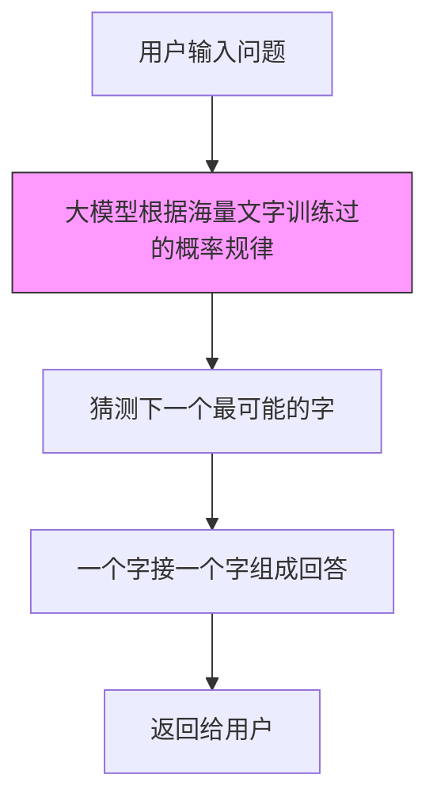

# 第1章 什么是 AI 与大模型

> 本章介绍 AI 的发展脉络与大模型核心概念，重点讲解 DeepSeek、ChatGPT、Claude 等主流模型的定位差异与访问方式（网页版、App、API、模型托管），以及"AI 一直崩溃""回答太飘"等高频使用问题的应对方法。读完本章，你能判断何时该用 AI、何时不该用 AI，并建立对 AI 能力边界的初步认知。

## 1.1 DeepSeek 是什么？

### 1.1.1 DeepSeek 的由来：从金融到 AI

你可能听说过 DeepSeek，但它的"前传"可能没听说过。DeepSeek 不是凭空冒出来的，它最早是一家叫**幻方量化**的公司里搞出来的。幻方量化是做金融的，2015 年就开始用 AI 预测股票涨跌，还开发了一个叫"萤火"的神经网络。

你可以理解为：一群原本做股票量化的人，攒下了很多技术底子，后来发现 AI 这个方向更有前途，干脆 2023 年 5 月把 AI 业务拆出来，单独成立了一家叫 DeepSeek 的公司，全力做 AI。

### 1.1.2 DeepSeek R1：参数少、成本低、开源

DeepSeek 公司 2023 年发布了他们的旗舰模型 **DeepSeek R1**，一出来就在数学、编程、逻辑推理方面跟 OpenAI 的 GPT-4 对打，甚至略胜一筹。

但最牛的是两个数字：

1. **参数少**：DeepSeek R1 只用了 6710 亿个参数（每次推理只用 370 亿个），而 GPT-4 用了整整 1.76 万亿个参数。也就是说，R1 用少得多的参数做到了不输 GPT-4 的效果。
2. **成本低**：整个 R1 的开发过程才花了 600 万美元，而其他公司做出同级别模型动辄要几千万甚至上亿美元。

> **大白话**：GPT-4 像用黄金打造的小轿车，性能强但贵得要命；DeepSeek R1 像用普通钢材打造的卡车，性能不输，但材料成本低得多。

还有一个特别重要的点：**DeepSeek 走开源路线**。模型、代码、训练方法全部免费公开，任何人都可以自由商业化使用。他们甚至把研发过程详细写成论文，供全球 AI 实验室学习和参考。

### 1.1.3 DeepSeek 的核心要点总结

| 要点 | 说明 |
|------|------|
| 由来 | 幻方量化 AI 业务拆分独立 |
| 旗舰模型 | DeepSeek R1，数学/编程/逻辑推理能力强 |
| 技术路线 | 开源，免费商业化使用，研发过程写成论文公开 |
| 与 GPT-4 对比 | 参数少、成本低，但效果不输 |

## 1.2 ChatGPT 是什么？

### 1.2.1 打僵尸的类比：AI 是能干但缺默契的"小学生"

要理解 ChatGPT 到底是什么，我们用打僵尸的游戏来类比。

你旁边有个 8 岁的小学生帮你，他很能干（动手能力很强），但没有成年人那种"一说就懂"的默契。你手边有榴弹炮、子弹等各种弹药，还有 100 个仓库。你要小学生帮你补充弹药：

- 你说"我要补充弹药"，他完全不知道你要什么；
- 你说"我要榴弹炮"，他会先去找哪个仓库有榴弹炮，然后再问你"需要多少发"；
- 只有你说"我需要你去 097 仓库搬 10 发榴弹炮过来"，他才能高效地配合你。

ChatGPT 就是这个小学生。它是超级人工智能，但也是"很幼稚的小学生"。**足够精准的指令，才能得到足够满足你需要的结果。**

### 1.2.2 90 分程序员 vs 不会写代码的人

这里有个很扎心的例子：

- 如果你是个 90 分的程序员，你可以用 GPT 每天只干 1 小时，因为它能帮你把活写明白。
- 如果你不会写代码，GPT 帮你写的代码你基本上也用不明白。

反过来也一样：你需要知道什么样是 90 分的文案，GPT 才能给你输出 90 分的文案。**这一切的前提是你得有基本的认知。**

> **记住**：AI 不会淘汰你，AI 只会淘汰不会使用它的人。但这不意味着你啥都不用学，AI 只是帮你提效的工具，你要有"判断好坏"的能力。

## 1.3 ChatGPT 的底层原理：大语言模型 LLM

### 1.3.1 用"古诗词"理解大语言模型

究竟是什么让 GPT 这么强？本质上是因为它的大语言模型（LLM，Large Language Model）。

我们用古诗词来理解它：

我们知道"床前明月光"下一句是"疑是地上霜"，因为学过这首古诗。如果有一首你没看过的诗，开头是"男儿立志出乡关"，你虽然不知道下一句是什么，但你知道下一句一定是 7 个字（因为古诗词上下句字数一样）。

学习了更多古诗词规律后，你甚至能"模拟"出下一句——虽然你并不知道这首诗的下半句，但你通过大量学习古诗词的规律，按规则"猜"出了下一句。

**所谓大语言模型，就是通过学习人类现有的知识，按照规则来模仿生成内容。**

ChatGPT 的全名是 Chat Generative Pre-trained Transformer，它基于生成式预训练深度学习技术打造，能够模拟人类进行文字输出。

### 1.3.2 常见的 AI 词汇

这里介绍一些经常见到的 AI 词汇，方便你更好地理解 AI。

| 词汇 | 含义 | 举例 |
|------|------|------|
| PGC | 专业生成内容，由专业创作者/机构制作 | CCTV、央视网、人民日报 |
| UGC | 用户生成内容，普通用户创建分享 | 抖音、bilibili、小红书 |
| AIGC | 人工智能生成内容，AI 创作或辅助创作 | 用 AI 写的文案、画的图 |
| 提示词 | 发送给 AI 让它生成内容的指令 | "写一份 2000 字的二战稿件" |
| GPTs / GPT store | 自定义创建的 GPT 叫 GPTs，汇集的地方叫 GPT store | 在 OpenAI 上创建专属对话 |
| Token | 语言模型处理文本的基本单位 | 1 个英文字符 = 1 token，1 个汉字 = 2 token |
| LLM | 大语言模型，通过大量数据训练最终得到可以生成文本的模型 | ChatGPT、DeepSeek |
| Agent | 智能体 = LLM + Memory + Planning skill + Tool use | 能自主规划并调用工具的 AI |

### 1.3.3 核心概念 Mermaid 图：大模型回答问题的简单原理

> **一句话理解**：大模型不是"真的懂"，它只是根据读过的海量文字，按概率猜下一个字最可能是什么。这就是为什么它有时候会自信地说错话（"幻觉"）。

## 1.4 我们该怎么看待 ChatGPT

### 1.4.1 弱人工智能 ANI 时代

虽然现在都说 AI 时代要来了，但其实现有的 AI 研发还在第一步，是**弱人工智能 ANI** 时代。它们并不具备真正的意识，只是基于特定任务做训练好的事情。

ChatGPT 和短视频推荐算法、语音翻译工具、汽车自动驾驶，本质上都是**一类产品**——基于已有模型在某个赛道内解决人类需求。

### 1.4.2 ChatGPT 的三大不足

ChatGPT 尽管在自然语言处理领域成就显著，但仍有一些不足之处：

1. **事实准确性问题**：它基于大量文本数据训练，可能生成包含错误信息或偏见的内容，尤其是在回答现实问题时，训练数据库的精准度会影响回答准确性。
2. **生成幻觉**：GPT 有时会生成与现实不符的信息，这种现象被称为"生成幻觉"，即模型创造出不存在的事实或信息。原因是它是"生成式语言"，按概率猜下一个字。
3. **逻辑推理能力不稳定**：GPT 在某些情况下展现出一定的逻辑推理能力，但推理过程可能不够稳定，有时会产生逻辑上不合理或不一致的结果。典型案例：数学计算、物理公式计算等。

### 1.4.3 Sora：文生视频的灯塔

2024 年 2 月 15 日，OpenAI 发布了文生视频软件 Sora，它能根据文本指令创造现实和富有想象力的场景，最高时长 60 秒。

Sora 是文生视频（Text-to-Video）路线的一个灯塔，再次验证了 Diffusion Transformer 能高质量跑出来这条路。但 Sora 的算力成本很高，按 Runway 和 Pika 现有视频成本预估，生成一分钟视频可能在 300-600 元之间。

**关键认知**：Sora 不会颠覆视频行业，就像 ChatGPT 没有颠覆文字行业，MidJourney、Stable Diffusion 也没有颠覆作图行业。AI 工具更多是在整个工作流中的某一个环节帮助人提升效率，而不是取代这个工作流。

我们无需过度焦虑，只要多学习跟得上工具使用就可以了。

> **核心提醒**：AI 是锦上添花，不是雪中送炭。你不懂业务的情况下，充其量能写出 60 分的东西，哪怕提示词水平再好；业务是核心，AI 是帮助业务，但不能代替业务。

## 1.5 DeepSeek 快速入门：访问方式

### 1.5.1 网页端和手机端

DeepSeek 的访问入口很简单：

- **网页端**：https://www.deepseek.com ，注册或登录即可使用
- **手机端**：在应用商店搜索"DeepSeek"，安装后随时对话

### 1.5.2 操作要点与核心技巧

很多圈友会说"AI 一直崩溃，好麻烦"，或者"AI 回答太飘怎么办"，这里给你几个核心技巧：

1. **用简洁问题聚焦**：先想清楚你到底想问啥，尽量避免"大而空"的提问。
2. **背景+目标一起说**：多给 AI 一点上下文，告诉它你的需求场景、目标用户、时间条件……回答会更贴合。
3. **分步走，不要一口气问到底**：遇到复杂问题，按逻辑分块提问，再把答案串起来。
4. **验证信息源**：别光信一句话，多角度追问"这数据或观点的来历如何？"避免 AI 帮你瞎编。
5. **动态微调**：如果回答跑偏了，可以追问或者补充条件，让 DeepSeek 纠正错误、完善思路。

### 1.5.3 避免崩溃的小贴士

- **保持最新版本**：网页端或 App 若提示升级，及时更新。
- **火山云备选**：实在崩溃频繁，可按官方教程把模型托管到"火山云"上，把推理服务跑通。
- **多尝试/多模式**：可以换个时间段、换个接口，或者用深度思考模式、通用模式来绕开高峰期。
- **简化问题**：问题过长过复杂，也会让模型"罢工"。先分段，让 AI 逐一回答。

## 1.6 DeepSeek 老是崩溃，怎么办？

### 1.6.1 使用其他对话应用

由于官网过于火爆，当前使用的时候，很容易出现无法回应的问题。

因此，我们可以通过其他云服务厂商提供的 API 服务来使用 DeepSeek R1 的 671B Q8 版本。这里推荐两个 AI 对话应用：

1. **Chatbox**
   - 官网：https://chatboxai.app/zh
   - 一款类似"智能聊天机器人"的跨平台应用，能通过文字对话帮你完成学习、工作和创作任务。
   - 核心特点：解读文件（直接发送 PDF/图片）、生成代码、联网搜索、图表生成、支持 Markdown/LaTeX/Mermaid 等多种格式渲染。
   - 支持网页端、电脑端、手机端。

   

2. **Cherry Studio**
   - 官网：https://cherry-ai.com/
   - 跨平台（支持 Windows、macOS、Linux）的多模型 AI 客户端，集成了 OpenAI、DeepSeek、硅基流动等云端大语言模型及本地模型（通过 Ollama 部署），支持自由切换并同时与多个模型对话对比输出结果。
   - 核心功能：内置 300+ 预配置 AI 助手（覆盖写作、编程等 30 多个行业）、RAG 技术驱动的本地知识库搭建、多模态文档处理。
   - 注意：仅包含电脑端，没有移动端支持。

   

### 1.6.2 自建 API：火山云-DeepSeek 模型

如果你希望更稳定地使用 DeepSeek，可以自建 API。步骤如下：

1. 打开"火山云-DeepSeek 模型"：https://console.volcengine.com/ark/region:ark+cn-beijing/model/detail?Id=deepseek-r1
2. 登录完毕之后，选择"推理"

   

3. 网页会自动创建 API，好了之后，选择"继续使用"

   

4. 获取 API 这里点默认操作即可，接着需要完成实名认证（选个人身份即可）

   

5. 认证结束后，回到之前那个 API 的页面，选择"我已认证"

   

   

   

   

## 小练习

在 DeepSeek 网页版或 App 中连续对话 5 轮，分别尝试"开放式提问""要求分步推理""要求给出具体示例"三种提问方式，观察并记录回答质量的差异，写下 200 字以内的复盘。

> **复盘参考**：
> - 开放式提问：如"谈谈 AI"，回答通常泛泛而谈，信息量大但不够聚焦。
> - 要求分步推理：如"先分析原因，再给方案，最后总结"，回答结构清晰，便于阅读。
> - 要求给出具体示例：如"用'写周报'为例说明"，回答更具体、可操作。
>
> 对比后你应该能体会到：提问越精准（有背景、有目标、有格式要求），AI 的输出越贴合需求。
