# 第1章 什么是 AI 与大模型

> 本章介绍 AI 的发展脉络与大模型核心概念，重点讲解 DeepSeek、ChatGPT、Claude 等主流模型的定位差异与访问方式（网页版、App、API、模型托管），以及"AI 一直崩溃""回答太飘"等高频使用问题的应对方法。读完本章，你能判断何时该用 AI、何时不该用 AI，并建立对 AI 能力边界的初步认知。

在正式开始之前，先说两句"废话"宽宽心：这一章不需要你有任何计算机专业知识，不需要会写代码，甚至不需要你以前碰过 AI。你只需要会用浏览器打开网页、会在应用商店下载 App，就足够读完并动手做完本章的全部内容了。我们会把每一个"听起来很吓人"的名词，都用大白话掰开揉碎讲清楚。

---

## 1.1 DeepSeek 是什么？

### 1.1.1 DeepSeek 的由来：从金融量化到 AI 独角兽

你可能听说过 DeepSeek，但它的"前传"可能没听说过。DeepSeek 不是凭空冒出来的，它最早是一家叫**幻方量化**的公司里搞出来的。

> **大白话**：什么是"量化"？简单说，就是用数学模型和计算机程序来炒股票，而不是靠股民盯着大盘拍脑袋做决定。幻方量化就是国内做这一行非常出名的一家私募基金公司。

故事要从 2015 年讲起。那一年，幻方量化里的一群技术极客，开始尝试用 AI 预测股票市场波动，还开发了一个叫"萤火"的神经网络（你可以把"神经网络"暂时理解为 AI 的大脑雏形，1.3 节我们会细讲）。

到 2021 年，他们已经豪气地囤积了一万张英伟达 A100 GPU——这是当时市面上最顶级的 AI 计算芯片，一张就要好几万块钱。有意思的是，这么大的算力，一开始并不是为了赚钱，而是团队纯粹出于好奇，想看看 AI 的极限究竟在哪里。

2023 年 5 月，幻方干脆把 AI 业务拆出来单干；2023 年 7 月，"杭州深度求索人工智能基础技术研究有限公司"正式注册成立，这就是 DeepSeek 的运营主体，全力进军 AI 领域。

> **大白话**：DeepSeek 就像是一家金融公司的"技术二部"独立出来创业，原来是用来炒股的 AI，现在转行做通用人工智能了。

顺便说一句，"DeepSeek"这个名字也很有讲究：**Deep** 是"深度"，对应深度学习这门核心技术；**Seek** 是"探索、追求"。中文名"深度求索"则取自屈原《离骚》里的名句"路漫漫其修远兮，吾将上下而求索"，象征着对知识、真理和理想的不懈追求。一家技术公司的名字里藏着两千年前的古诗，这大概就是理工科的浪漫吧。

DeepSeek 公司成立以来发展极快，我们用一张时间线图帮你把大事记串起来：

```mermaid
graph LR
    A[2015 年<br>幻方量化用 AI 预测股票<br>开发"萤火"神经网络] --> B[2021 年<br>囤积一万张<br>英伟达 A100 芯片]
    B --> C[2023 年 5-7 月<br>AI 业务拆分单干<br>深度求索公司成立]
    C --> D[2023 年 11 月<br>发布 DeepSeek LLM<br>67B 参数]
    D --> E[2024 年 5 月<br>发布 V2<br>获称"AI 界拼多多"]
    E --> F[2024 年 12 月<br>发布 V3<br>671B 参数]
    F --> G[2025 年 1 月<br>发布 R1<br>比肩 GPT-4 与 o1]
    style G fill:#9f9,stroke:#333
```

### 1.1.2 DeepSeek R1：参数少、成本低、开源

2025 年 1 月 20 日，DeepSeek 正式发布推理模型 **DeepSeek R1**，一出场就把全球 AI 圈子都震惊了。这个模型在数学、代码、自然语言推理等任务上的表现，能跟 OpenAI 的 GPT-4、o1 正面对打，甚至略胜一筹——比如在大模型竞技场（Arena）排行榜上，R1 拿到了 1357 分，略微超过 OpenAI o1 的 1352 分。

先解释一个词：**参数**。你可以把参数理解成 AI 大脑里"神经连接的旋钮数量"。旋钮越多，理论上这个大脑就越聪明、能记住和处理的细节就越多，但训练和使用起来也就越费电、越费钱。

而 DeepSeek R1 最牛的就是两个数字：

1. **参数少**：R1 总共用了 6710 亿个参数（写作 671B，B 就是"十亿"的意思），但每次回答问题时只激活其中 370 亿个。要知道，GPT-4 可是用了整整 1.76 万亿个参数。也就是说，R1 用少得多的"有效参数"做到了不输 GPT-4 的效果。
2. **成本低**：整个模型的研发才花了大约 600 万美元，而其他公司做出同级别模型，动辄要几千万甚至上亿美元。

> **大白话**：GPT-4 像用黄金打造的小轿车，性能强但贵得要命；DeepSeek R1 像用普通钢材打造的卡车，性能不输，但材料成本低得多。

R1 为什么能用"小参数"干"大活"呢？靠的是一种叫 **MoE（混合专家）** 的架构。听起来很玄乎，其实用医院来类比就懂了：一家医院不需要每次看病都把全院所有医生都叫过来会诊，而是前台分诊后，只请相关的几位专科医生出场。R1 内部就分了好多位"专科医生"（专家网络），你问数学题，就激活数学相关的参数；你问编程问题，就激活编程相关的参数。这样一来，虽然整个模型很大，但每次真正"上班"的参数只有一小部分，又省钱又高效。

2025 年 1 月 27 日前后，这波冲击甚至直接反映到了股市上：芯片巨头英伟达股价单日暴跌约 17%，一天之内市值蒸发了约 5900 亿美元，创下美股历史上单只股票单日损失纪录；博通、超威半导体等一众 AI 相关公司的股票也跟着大跌。市场用真金白银投票，表达了对"低成本也能做出顶级模型"这件事的震惊。

普通用户这边同样火爆：DeepSeek 的 App 上线仅一周，就登顶了 15 个国家和地区苹果应用商店免费榜，在美区更是超越了 ChatGPT 排到第一——这也是中国应用第一次同时在中国和美国的 App Store 免费榜占据榜首。

光说不练假把式，我们先感受一下 R1 的"文采"。有人在 DeepSeek 里输入了这样一个问题：

> **提问**：玄武门之变结束当天，李世民在深夜写下一段独白，你觉得他会写些什么？

DeepSeek 的回答（节选）：

> 夜已深，宫灯微明，烛影摇曳。
> 今日之事，终成定局。玄武门前，刀光剑影，血染宫墙。兄弟相残，非我所愿，然天命难违，大势所趋。……
> "水能载舟，亦能覆舟。"此言不虚。我李世民，今日虽登高位，然若不能以民为本，终将失去天下。

一个能写史书体独白、能解奥数题、能帮你看代码的模型，摆在你面前，还免费，这就是我们这本书选择从 DeepSeek 讲起的原因。

最后，也是最重要的一点：**DeepSeek 走的是开源路线**。

> **大白话**：什么是"开源"？一般软件只给你一个装好的成品，内部怎么做的你不知道，也不许你改动，就像餐厅只卖菜不给你菜谱。而开源就是把"菜谱"也全部公开——模型的文件、代码、训练方法全部免费公开，任何人都可以下载、研究，甚至拿去做商业产品赚钱。DeepSeek 还把研发过程详细写成论文，供全球的 AI 实验室学习和参考，遵循的 MIT 协议几乎不设任何限制。

明明有实力赚大钱，却偏偏不把赚钱放在第一位，这是 DeepSeek 最特别的气质。

为了帮你建立全貌，下面是 DeepSeek 主要模型家族的一览表：

| 模型 | 发布时间 | 特点 |
|------|---------|------|
| DeepSeek LLM | 2023 年 11 月 | 第一代通用大模型，670 亿参数，精通中文、数学、编程 |
| DeepSeek Coder / Math | 2023 年 11 月 / 2024 年 2 月 | 专攻写代码和数学的"专科模型" |
| DeepSeek VL | 2024 年 3 月 | 多模态模型，能"看图说话" |
| DeepSeek V2 | 2024 年 5 月 | 第二代 MoE 架构，性能比肩 GPT-4 Turbo，价格却低得多，因此获得"AI 界拼多多"的绰号 |
| DeepSeek V3 | 2024 年 12 月 | 671B 参数、每次激活 37B，R1 的"地基" |
| DeepSeek R1 | 2025 年 1 月 | 推理模型，数学/代码/逻辑推理对标 OpenAI o1，完全开源 |

其中 DeepSeek-R1 蒸馏出的 32B 小模型在权威数学测试 MATH-500 上拿到了 94.3% 的正确率，在美国数学邀请赛 AIME 2024 上首次作答正确率达 72.6%——这些成绩放在全球开源模型里都是第一梯队。

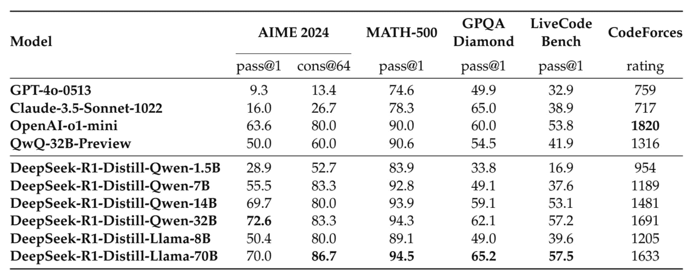

> **图片说明**：DeepSeek 官方公布的 R1 与各大主流模型的基准测试成绩对比图（图源：《这就是 DeepSeek：从原理到实践》）。横着看过去，你会发现 R1 系列在 AIME 2024（数学邀请赛）、MATH-500（竞赛数学）、LiveCodeBench（代码）等列上的分数，跟 GPT-4o、Claude-3.5 等国际顶尖模型排在一起毫不逊色。

### 1.1.3 DeepSeek 的核心要点总结

把 1.1 节的内容压缩成一张表，方便你随时翻回来查：

| 要点 | 说明 |
|------|------|
| 由来 | 幻方量化 AI 业务拆分独立，2023 年 7 月"深度求索"公司正式成立 |
| 旗舰模型 | DeepSeek R1（2025 年 1 月发布），数学/编程/逻辑推理能力强，与 GPT-4、o1 对打 |
| 技术路线 | MoE 混合专家架构：总参数 671B，每次只激活 37B，省钱又高效 |
| 成本 | 研发成本约 600 万美元，远低于同行的几千万甚至上亿美元 |
| 开源 | 模型、代码、训练方法全部免费公开（MIT 协议），任何人可自由商用 |
| 使用成本 | 官网对话完全免费，深度思考和联网搜索均不设次数限制 |

---

## 1.2 ChatGPT 是什么？

### 1.2.1 打僵尸的类比：AI 是能干但缺默契的"小学生"

聊完了国产之光 DeepSeek，我们再来说说它的老前辈、把这一轮 AI 热潮点燃的 ChatGPT。

ChatGPT 已经 1 岁多了（它 2022 年 11 月底发布），从发布到现在，有人觉得它很笨，有人和它天天黏在一起。这个大家熟悉的跨时代产物，到底是什么呢？

要理解 ChatGPT 到底是什么，我们用打僵尸的游戏来类比。

想象你在一款打僵尸的游戏里，你旁边有个 8 岁的小学生帮你。他很能干（动手能力很强），但没有成年人那种"一说就懂"的默契。你手边有榴弹炮、子弹等各种弹药，还有 100 个仓库。你要小学生帮你补充弹药：

- 你说"我要补充弹药"，他完全不知道你要什么，站在原地发呆；
- 你说"我要榴弹炮"，他会先去找哪个仓库有榴弹炮，然后再跑回来问你"需要多少发"；
- 只有你说"我需要你去 097 仓库搬 10 发榴弹炮过来"，他才能高效地配合你，一次到位。

ChatGPT 就是这个小学生。它拥有顶尖的输出能力，但理解能力可能只有小学生水平；你需要有好的输入能力，它才能给到优质内容的输出。

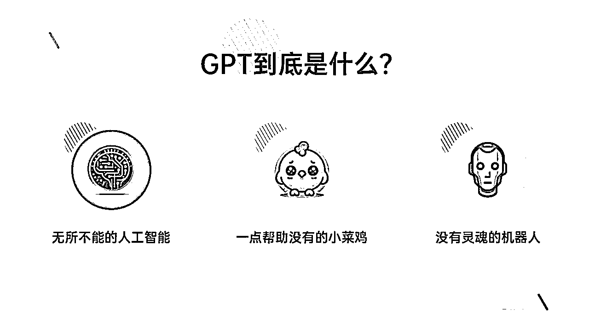

> **一句话总结**：AI 像个八岁小学生，动手能力强但不懂你的潜台词，你说得越模糊，它做得越离谱。**足够精准的指令，才能得到足够满足你需要的结果。**

这个类比也顺便回答了一个新手最常见的困惑："为什么我用 AI 觉得不好用，别人却用得飞起？"答案往往不在 AI 身上，而在你下达指令的方式上——这也是下一章"提示词工程"要专门讲的内容。

### 1.2.2 90 分程序员 vs 不会写代码的人

这里有个很扎心、但很真实的例子：

- 如果你是个 90 分的程序员，你可以用 GPT 每天只干 1 小时活，剩下的时间喝咖啡，因为它能听懂你把活写明白；
- 如果你完全不会写代码，GPT 帮你写的代码你基本上也看不明白、用不起来。

反过来，写作上也一样：**你需要知道什么样是 90 分的文案，GPT 才能给你输出 90 分的文案。**如果你自己都不知道一篇好文章长什么样，AI 给你一段文字，你连"它写得好不好"都判断不了，更别说改好了。

> **记住**：AI 不会淘汰你，AI 只会淘汰不会使用它的人。但这不意味着你啥都不用学——AI 只是帮你提效的工具，你得有"判断好坏"的基本认知。这也正是本章标题里"什么是 AI"要帮你建立的东西：先知道它是什么、擅长什么、不擅长什么，后面章节的所有实操才有地基。

---

## 1.3 ChatGPT 的底层原理：大语言模型 LLM

### 1.3.1 用"古诗词"理解大语言模型

究竟是什么让 GPT 有如此强的能力？本质上是因为它背后的**大语言模型**（LLM，Large Language Model）。

我们先用古诗词来理解它。

我们知道"床前明月光"下一句是"疑是地上霜"，因为学过这首古诗。现在给你一首你没看过的诗，开头是"男儿立志出乡关"，你不知道下一句是什么，但你敢肯定下一句一定是 7 个字——因为古诗词上下句字数一样。如果你读过成千上万首诗，掌握了大量"什么样的字后面接什么样的字"的规律，你甚至能"模拟"出一个像模像样的下一句。

**所谓大语言模型，就是通过学习人类现有的知识，按照规律来模仿生成内容。**它读过的"诗"，是几乎整个互联网的文字——网页、书籍、对话、论文，所以它的"模拟"能力远超人类。

而 ChatGPT 的全名是 **Chat Generative Pre-trained Transformer**（聊天生成式预训练变换器），从名字就能看出来：它是一个基于"生成式预训练"深度学习技术打造的对话工具，能够模拟人类进行文字输出。

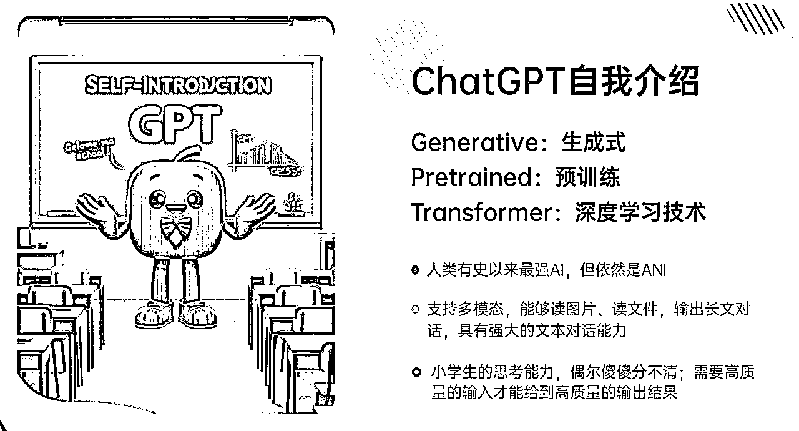

再往深一层说（放心，只深一层），ChatGPT 的工作方式出奇地简单：**它一次只添加一个词**。

当 ChatGPT 写一篇文章时，它实质上是在一遍又一遍地问自己："根据目前已有的文字，下一个词应该是什么？"每答一次，就往上添一个词，添完再问，如此循环，直到文章写完。

比如它读到"The best thing about AI is its ability to"（AI 最棒的地方在于它能），它会根据读过的海量文本，列出一串候选词和各自的概率：learn（学习）20%、predict（预测）15%、generate（生成）12%……


> **图片说明**：ChatGPT 内部对"下一个词"的概率排序示意（图源：《这就是 ChatGPT》）。图中列出了接在"The best thing about AI is its ability to"后面的候选词及概率，按从高到低排列。ChatGPT 每写一个词，都要经过一次这样的"投票"。

这里还有个有趣的小细节：它并不是每次都死板地选概率最高的词。如果永远选第一名，写出来的文章往往非常"平淡"，毫无创造力，有时甚至会一字不差地复读前文。所以工程师给它加了一个"温度"参数，允许它偶尔（随机地）选排名低一点的词——就像一个写作文的孩子，偶尔不用最保险的词，而用个新鲜词，文章立刻就有灵气了。实践发现"温度"设为 0.8 左右效果最好。这也解释了为什么**同一个问题你问两遍，AI 给的答案常常不一样**——不是它"变了"，而是随机性本来就在它的血液里。

有人可能会问：那这些概率又是从哪来的？早期的研究者真的做过最笨的办法——统计。比如拿维基百科"猫"的条目，统计每个字母出现的次数；再统计"字母 q 后面几乎 100% 跟着字母 u"这种字母对的规律。统计的字符串越长（字母对、三个字母、一整个词、两个词连用……），生成的文字就越像人话。但全世界的文本加起来，也不够统计"20 个词的所有组合"——那个数量比宇宙中的粒子还多。于是就有了今天的方案：**神经网络模型**。它不是死记硬背所有组合的概率，而是通过学习海量文本，自己"悟"出了一套能估计任意句子概率的本领。ChatGPT 内部就是这样一个拥有 1750 亿个参数（"旋钮"）的大语言模型。

看到这里你应该能明白 1.1 节 MoE 类比背后的道理了：不管架构怎么优化，大模型的底层逻辑都是"根据概率猜下一个词"。

### 1.3.2 常见的 AI 词汇

接下来介绍一些你会反复见到的 AI 词汇。第一次记不住没关系，这本书后面还会反复用到，混个脸熟即可。

| 词汇 | 含义 | 举例 |
|------|------|------|
| PGC | 专业生成内容（Professionally-generated Content），由专业机构制作 | CCTV、央视网、人民日报 |
| UGC | 用户生成内容（User-generated Content），普通用户创作分享 | 抖音、bilibili、📕 |
| AIGC | 人工智能生成内容（AI-generated Content），AI 创作或辅助创作 | 用 AI 写的文案、画的图、做的视频 |
| 提示词 | 发送给 AI 让它生成内容的指令（Prompt），你打在输入框里的每一句话都算 | "写一份 2000 字的二战稿件" |
| GPTs / GPT Store | 自定义创建的 GPT 叫 GPTs，汇集它们的应用商店叫 GPT Store | 在 OpenAI 平台上创建一个"周报助手" |
| Token | 语言模型处理文本的基本单位，可以理解成"字块" | 1 个英文字符 ≈ 1 token，1 个汉字 ≈ 2 token |
| LLM | 大语言模型（Large Language Model），通过海量文本训练出来的文字生成模型 | ChatGPT、DeepSeek |
| Agent | 智能体 = LLM + Memory（记忆）+ Planning skill（规划）+ Tool use（工具使用），能自主拆任务、调工具干活的 AI | 自动搜集资料并写周报的 AI 员工 |

> **大白话补充两个**：
> - **Token** 为什么重要？因为 AI 是按 token 计量工作量的——你问的问题有多长、它答的答案有多长，都按 token 数，很多产品的收费也是按 token 算的。可以粗糙地记：**100 个汉字 ≈ 200 个 token**。
> - **Agent** 为什么是"LLM+记忆+规划+工具"？纯聊天机器人只会说不会做；而 Agent 能记住上下文、把大任务拆成小步骤、还会调用搜索引擎和文件工具，就像一个真的员工。这是本书第七部分的主角，这里先埋个种子。

### 1.3.3 核心概念 Mermaid 图：大模型回答问题的简单原理

把 1.3 节的核心逻辑画成一张图，你再看一遍，应该就有"原来如此"的感觉了：

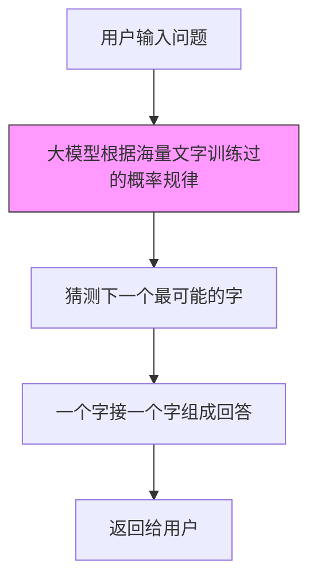

> **一句话理解**：大模型不是"真的懂"，它只是根据读过的海量文字，按概率猜下一个字最可能是什么。这就是为什么它有时候会一本正经地自信说错话——这个现象有个专门的名字，叫"幻觉"，1.4 节马上讲。

---

## 1.4 我们该怎么看待 ChatGPT

### 1.4.1 弱人工智能 ANI 时代

虽然现在铺天盖地都说"AI 时代来了"，但其实现有的 AI 研发还处在第一步，是**弱人工智能（ANI，Artificial Narrow Intelligence，狭义/弱人工智能）**时代。它们并不具备真正的意识，只是基于特定任务训练好的程序。距离科幻电影里那种有喜怒哀乐、什么都会的**通用人工智能（AGI）**，还有很长的路。

ChatGPT 和短视频推荐算法、语音翻译工具、汽车自动驾驶，本质上都是**一类产品**——基于已有模型，在某个赛道内解决人类需求。短视频算法的任务是"猜你想看哪个视频"，语音翻译的任务是"把一种语言变成另一种"，ChatGPT 的任务是"猜下一个词"。各管一摊，仅此而已。

如果你觉得 AI 是这两年的新鲜事物，那就小看它了。AI 这个词 1956 年就诞生了，到目前为止人类已经经历了**三次 AI 热潮**：

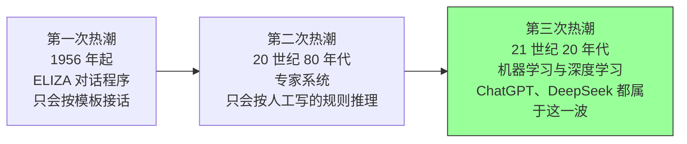

给你讲两段小历史，帮你理解"这一波为什么不一样"：

- **第一次热潮**里的明星叫"伊莉莎（ELIZA）"，是一台通过打字进行对话的计算机，最出名的是扮演心理医生跟病人聊天。听起来很厉害？其实它只是简单的"模式匹配"——你喊"我头疼"，它按预设模板回"为什么你会头疼呢"。业内戏称这类程序为"人工无脑"。当时人们还发明了**图灵测试**来判断机器对话水平：让测试者隔着屏幕跟对方（人或机器）聊天，如果分不清对面是人还是机器，机器就算通过。2014 年有一台计算机号称首次通过了图灵测试，但它靠的是扮演"住在乌克兰的 13 岁少年"，利用了"外国人外语说得很怪也情有可原"这个漏洞，所以并不能说真正达标。
- **第二次热潮**的主角是"专家系统"，比如"帮您订酒店的系统""辅助诊断某类疾病的系统"。它是把人类专家的经验一条条写成"如果 X 则 Y"的规则喂给计算机。规则没写过的情况，它就完全抓瞎，所以这股热潮也没能持续。
- **第三次热潮**的核心是**机器学习**——不再由人写规则，而是计算机自己从海量数据中归纳规律。前两次热潮没解决的"灵活应对"问题，这一次被解决了。你问 ChatGPT 一句它从没见过的怪话，它照样能接得住，靠的就是这个。

另外还有个冷知识：**AI 的实质是程序**。市面上常听到"AI 失控要毁灭人类"之类的说法，但 AI 再灵活也只是程序，除了依照程序行事，并不会做什么出格的事。它之所以显得"聪明得可怕"，只是因为它的功能超出了很多人的想象而已。所以面对铺天盖地的 AI 宣传，你也多留个心眼：看到"搭载 AI"的产品，不妨想一想它的 AI 功能到底体现在哪一步，是真能"自主判断"，还是只是套了个简单的固定规则。

### 1.4.2 ChatGPT 的三大不足

ChatGPT 尽管在自然语言处理领域成就显著，但仍有一些不足之处。了解不足，比了解优点更重要——因为你得知道什么时候不能信它。

1. **事实准确性问题**：它基于大量文本数据训练，可能生成包含错误信息或偏见的内容，尤其是回答现实问题时，训练数据的精准度会直接影响回答准确性。
2. **生成幻觉**：GPT 有时会生成与现实不符的信息，这种现象被称为"幻觉"——它会创造出不存在的事实，比如编造一个不存在的论文标题、一本不存在的书，而且语气特别笃定。根本原因还是 1.3 节讲的：它是"生成式语言"，按概率猜下一个字，它自己并不知道"真"和"假"的区别。
3. **逻辑推理能力不稳定**：GPT 在某些情况下展现出一定的逻辑推理能力，但推理过程可能不够稳定，有时会产生逻辑上不合理或不一致的结果。典型案例是数学计算、物理公式运算——它可以写得很像那么回事，但数字可能算错。


除了这三条，再补充一个更本质的弱点：**AI 只能推测，无法断定正解**。

举个例子：如果网上同时流传着"某位名人已婚"和"该名人未婚"两条信息，AI 能判断出这两条信息有矛盾，但它无法判断哪条是真的。它最多通过其他大量数据推测"哪条更接近真实"，但终究只是推测。想了解真相，只能去问本人或查权威部门的信息。

> **实操建议（很重要，请背下来）**：涉及**金额、日期、人名、法规条款**这类关键数据时，AI 的回答必须人工核对。一个简单的做法是追问 AI"这个数据的来源是什么？"，然后亲自去来源验证。记住这句话：**读者可能原谅你的观点，但不会原谅你的错误。**

### 1.4.3 Sora：文生视频的灯塔

2024 年 2 月 15 日，OpenAI 发布了文生视频软件 Sora，它能根据文字指令创造现实且富有想象力的场景，最高时长 60 秒。

Sora 是文生视频（Text-to-Video）路线的一座灯塔，再次验证了"Diffusion Transformer"这套技术能高质量地跑通。但 Sora 的算力成本很高——按 Runway 和 Pika 现有视频生成成本预估，生成一分钟视频可能在 300~600 元之间。


> **图片说明**：Sora 生成的东京街景视频画面截帧——一位女士漫步在霓虹灯映照的湿润街道上，这个视频当年在网络上广为流传。

**关键认知**：Sora 不会颠覆视频行业，就像 ChatGPT 没有颠覆文字行业，MidJourney、Stable Diffusion 也没有颠覆作图行业。AI 工具更多是在整个工作流中的某一个环节帮助人提升效率，而不是取代这个工作流。

所以，我们无需对"AI 抢饭碗"过度焦虑，多学习、跟得上工具的使用就可以了。这也提前剧透了本书反复出现的一个核心观点：

> **核心提醒**：AI 是锦上添花，不是雪中送炭。你不懂业务的情况下，充其量能写出 60 分的东西，哪怕提示词水平再好；业务是核心，AI 是帮助业务，但不能代替业务。

---

## 1.5 DeepSeek 快速入门：访问方式

### 1.5.1 网页端和手机端

说了这么多原理，现在动手把 DeepSeek 用起来。目前普通用户在官网使用 DeepSeek 的对话服务是**完全免费**的，包括最新的 R1 模型，深度思考和联网搜索功能也都不限次数——对比 ChatGPT Plus 每月 20 美元、Pro 每月 200 美元的订阅费，对新手来说这确实是个福利。

访问入口有两个：

- **网页端**：浏览器打开 https://www.deepseek.com ，点"开始对话"，用手机号或🛰️号注册/登录即可使用，无须下载任何软件。
- **手机端**：在应用商店（苹果 App Store 或各大安卓应用商店）搜索"DeepSeek"，认准官方应用安装，登录后随时对话。

**新手防坑指南**（这一段请务必看完，每年都有人踩坑）：

DeepSeek 爆火后，网络上的信息铺天盖地，有些广告打着 DeepSeek 的旗号引导点击，有的甚至挂羊头卖狗肉。一个典型的坑是：你用搜索引擎搜"DeepSeek"，排在前面的广告可能把你引向"DeepSeek 本地部署工具"的下载页——"本地部署"是把模型装到自己电脑上的高级玩法（对电脑显卡要求极高），新手点了只会下载一堆用不上的东西。

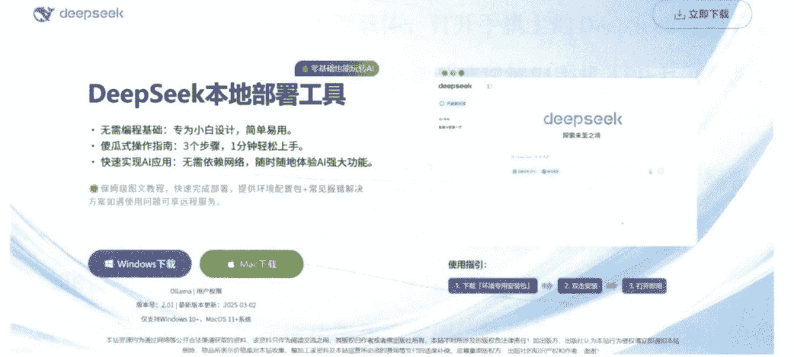

> **图片说明**：搜索引擎里的"李鬼"广告示意（图源：《深度探索 DeepSeek 从入门到精通》）。搜索结果里混进了第三方推广的"部署工具"链接，不了解术语的新手很容易误下载。图上标注了真假入口的区别。

**最稳妥的做法只有一个：在浏览器地址栏直接输入官方网址 www.deepseek.com。**

除了官方入口，你也可以经由一些大平台的"第三方入口"使用 DeepSeek，比如腾讯元宝、🛰️里的小程序、知乎直答、火山引擎等，数量还在持续增加。它们的内核都是 DeepSeek 模型，缺点是功能可能有一定限制、界面按各自平台的习惯来。应急使用完全够了。

### 1.5.2 操作要点与核心技巧

登录之后，你会看到一个非常简洁的对话框。别看它简单，输入框下方藏着两个重要开关——"深度思考 R1"和"联网搜索"，加上默认的基础模式，一共**三种模式**。很多新手不知道三种模式的区别，有的干脆不选，有的干脆全选，这都会影响体验。看下面这张表就懂了：

| 模式 | 怎么开启 | 它像什么 | 适合什么场景 |
|------|---------|---------|-------------|
| 基础模式（V3） | 两个开关都不选 | 知识渊博的百科全书，抢答速度快 | 日常问答、翻译、写文案、简单计算 |
| 深度思考（R1） | 打开"深度思考 R1"开关 | 逻辑推理专家，先打草稿再作答，会显示思考过程 | 数学证明、代码调试、复杂问题的多角度分析 |
| 联网搜索 | 打开"联网搜索"开关 | 实时信息的雷达，能翻阅最新网页 | 查新闻、股价、政策等"此时此刻"的信息 |

举三个例子帮你对号入座：

- 学生想知道"光合作用是什么"，用基础模式秒回定义和过程；
- 老师想让 AI"证明勾股定理"，打开深度思考模式，你会看到屏幕上出现"已深度思考（用时 58 秒）"，它像人一样先在草稿纸上推演，再给出完整证明步骤；
- 你想知道"今天的股市行情"，必须打开联网搜索——AI 的知识停留在训练截止那天，不联网它根本不知道"今天"发生了什么。

再说几个能立刻提升体验的小功能：

- **网页端隐藏菜单**：点击首页左上角 DeepSeek 标志旁边的灰色文字，会弹出菜单，里面有官方"提示库"——12 种场景（代码生成、内容分类、诗歌创作、文案大纲等）的提示词模板，新手照着改改就能用，强烈建议逛一逛；
- **手机端上传功能**：对话框下方发送键左边有个"+"号，点开有"拍照识文字""图片识文字""文件"三项，可以直接把 PDF、图片发给 AI 解读。上传文件时它会要求关闭联网搜索，这是保护你隐私的设计。

很多圈友还会说"AI 一直崩溃，好麻烦"，或者"AI 回答太飘怎么办"。除了崩溃问题（1.6 节专治），先给你几个核心提问技巧：

1. **用简洁问题聚焦**：先想清楚你到底想问啥，尽量避免"大而空"的提问。"谈谈 AI"就属于大而空，AI 只能给你一篇四平八稳的百科腔作文。
2. **背景+目标一起说**：多给 AI 一点上下文，告诉它你的需求场景、目标用户、时间条件……回答会更贴合。
3. **分步走，不要一口气问到底**：遇到复杂问题，按逻辑分块提问，再把答案串起来。一次问十个问题，AI 往往每个都答得浅。
4. **验证信息源**：别光信一句话，多角度追问"这数据或观点的来历如何？"避免 AI 帮你瞎编（回到 1.4.2 的"幻觉"问题）。
5. **动态微调**：如果回答跑偏了，可以追问或者补充条件，让 DeepSeek 纠正错误、完善思路。把它当成一个可以反复沟通的助手，而不是一台按一次按钮就出结果的自动售货机。

### 1.5.3 避免崩溃的小贴士

DeepSeek 太火了，高峰期服务器经常排队。下面几招能明显减少"服务器繁忙"的骚扰：

- **保持最新版本**：网页端或 App 若提示升级，及时更新。
- **火山云备选**：实在崩溃频繁，可按官方教程把模型托管到"火山云"上，把推理服务跑通（详见 1.6.2 节）。
- **多尝试/多模式**：可以换个时间段（比如避开晚上八九点的聊天高峰）、换个接口，或者用深度思考模式、基础模式绕开拥堵。
- **简化问题**：问题过长过复杂，也会让模型"罢工"。先分段，让 AI 逐一回答。

### 1.5.4 Mermaid 图：DeepSeek 使用决策树

把"想用 DeepSeek"之后的所有路径画成一张决策树图，崩溃的时候照着走一遍即可：

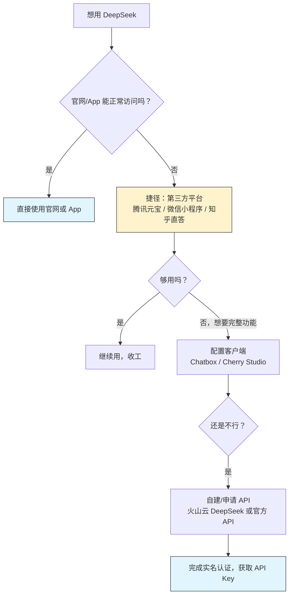

---

## 1.6 DeepSeek 老是崩溃，怎么办？

### 1.6.1 使用其他对话应用

由于官网过于火爆，高峰期使用时很容易出现"服务器繁忙，请稍后再试"的提示：

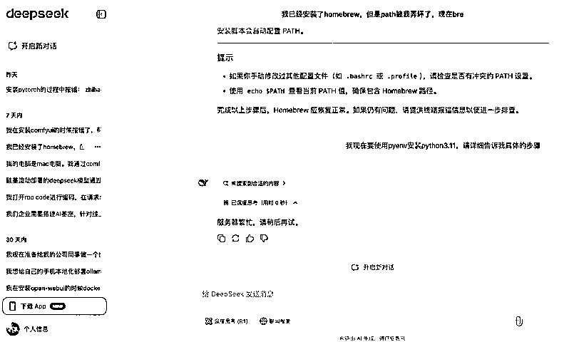

> **大白话**：如果官网用不了，就像去一家超市发现排队长到看不到头，你有三个选择：去隔壁便利店先应急（第三方平台）、去一家人少的大卖场（第三方客户端）、或者自己开个小卖部（自建 API）。本节把三条路都给你铺好。

**路线一（最省事）：第三方平台应急**

打开腾讯元宝、🛰️搜索 DeepSeek 小程序、或知乎直答，都能直接用上 DeepSeek 模型，注册都不用多注册一个账号，适合偶尔崩溃时应急。缺点是功能比官网少一些，界面也不是 DeepSeek 官方的。

**路线二（推荐）：安装第三方客户端 + API**

通过其他云服务厂商提供的 API 服务来使用 DeepSeek R1 的 671B 版本。这里推荐两个 AI 对话应用（先装好应用，1.6.2 节拿到的 API 密钥填进去就能用）：

**1. Chatbox**

- 官网：https://chatboxai.app/zh
- 一款类似"智能聊天机器人"的跨平台应用，能通过文字对话帮你完成学习、工作和创作任务。
- 核心特点：解读文件（直接发送 PDF/图片并总结内容）、生成代码、联网搜索、图表生成、支持 Markdown/LaTeX/Mermaid 等多种格式渲染。
- 隐私保障：所有聊天记录只存在你自己的设备里（本地存储），支持历史对话快速检索。
- 支持网页端、电脑端、手机端。

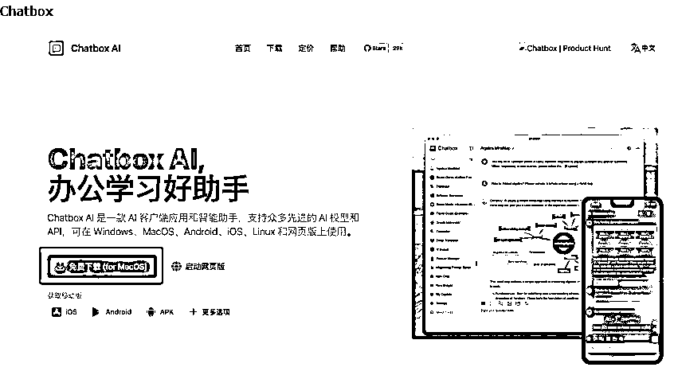

**2. Cherry Studio**

- 官网：https://cherry-ai.com/
- 跨平台（支持 Windows、macOS、Linux）的多模型 AI 客户端，集成了 OpenAI、DeepSeek、硅基流动等云端大模型及本地模型（通过 Ollama 部署），支持自由切换并同时与多个模型对话、对比输出结果。
- 核心功能：内置 300+ 预配置 AI 助手（覆盖写作、编程等 30 多个行业）、RAG 技术驱动的本地知识库搭建（把你的 PDF、网页资料喂给它，让 AI 基于你的资料回答问题）、多模态文档处理。
- 注意：仅包含电脑端，没有手机 App，需要用户自行配置 API 密钥。

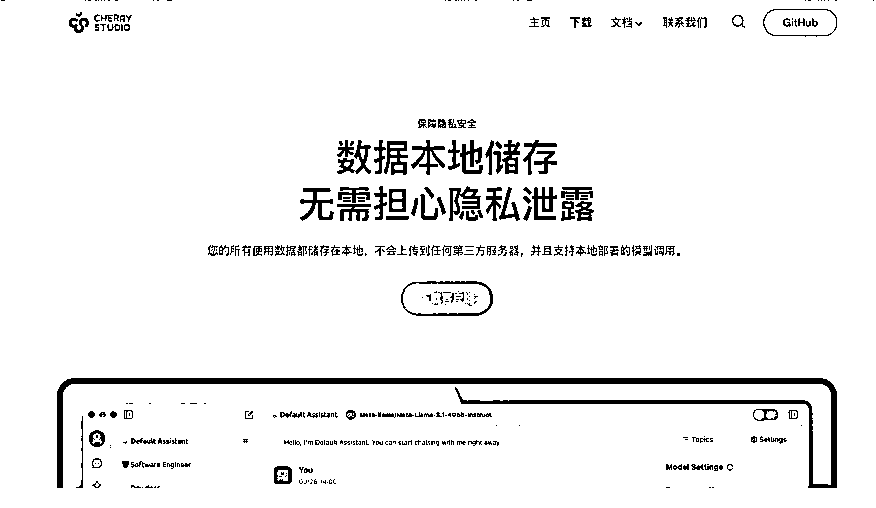

> **怎么选**：想在手机和电脑上都能用、界面简单就选 Chatbox；用电脑为主、想要多模型对比和知识库就选 Cherry Studio。两个都免费，装了不亏。

**路线三（进阶）：本地部署**

如果你对数据隐私要求极高，或者想在断网环境下使用，还可以把模型装到自己电脑上，工具一般用 Ollama 或 LM Studio。但要提前说明：R1 的满血版（671B）对显卡的要求是普通家用电脑完全跑不动的，个人只能部署"蒸馏版"小模型（几百亿参数的精简版），效果会打折扣，且下载模型要占几十 GB 硬盘空间。对本书读者来说，知道有这条路即可，日常用官网和客户端足够了。

### 1.6.2 自建 API：火山云-DeepSeek 模型

> **先解释"API"是什么**：API 的中文叫"应用程序接口"，你可以把它理解成一个"取餐口"。你（或者你用的软件）不用进后厨看大模型怎么做饭，只要按规定的方式到取餐口报上暗号（API 密钥）、说出你要什么，后厨就把结果递出来。所谓"自建 API"，就是绕开官网拥挤的前台，自己拿一个取餐口的号。

如果你希望更稳定地使用 DeepSeek，可以在火山云（字节跳动旗下的云服务平台）上托管模型。步骤如下：

**步骤 1：打开火山云 DeepSeek 模型页面**

浏览器打开"火山云-DeepSeek 模型"页面：https://console.volcengine.com/ark/region:ark+cn-beijing/model/detail?Id=deepseek-r1

**步骤 2：登录并选择推理**

登录完毕之后，选择"推理"。

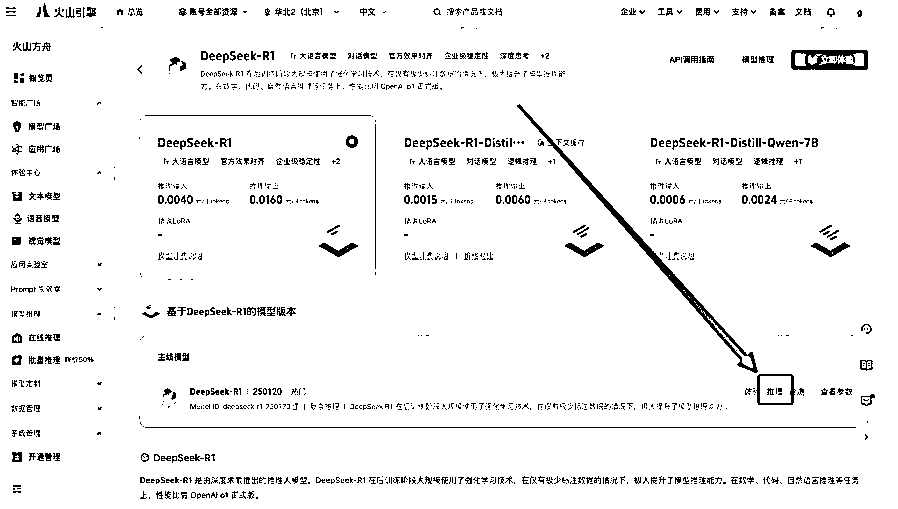

**步骤 3：创建 API**

网页会自动创建 API，好了之后，选择"继续使用"。

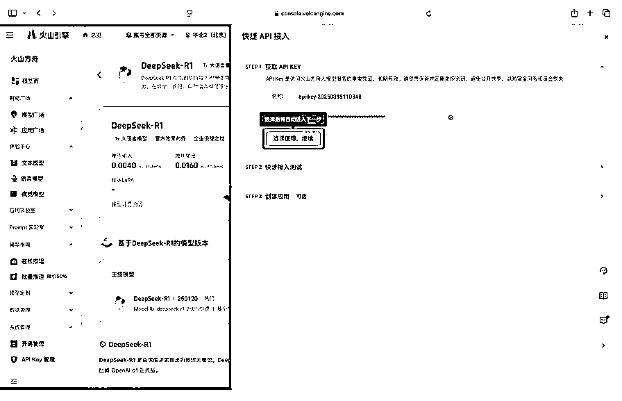

**步骤 4：获取 API 并实名认证**

获取 API 这里点默认操作即可，接着需要完成实名认证（选个人身份即可）。

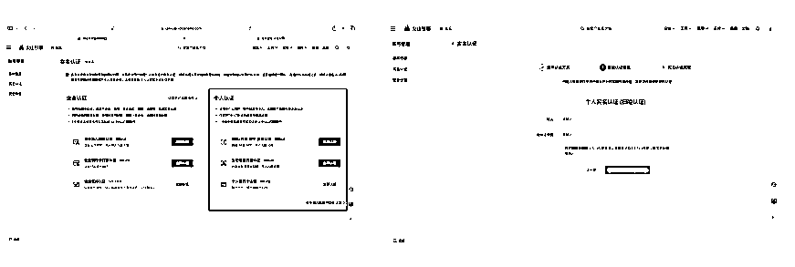

**步骤 5：确认已认证**

认证结束后，回到之前那个 API 的页面，选择"我已认证"。

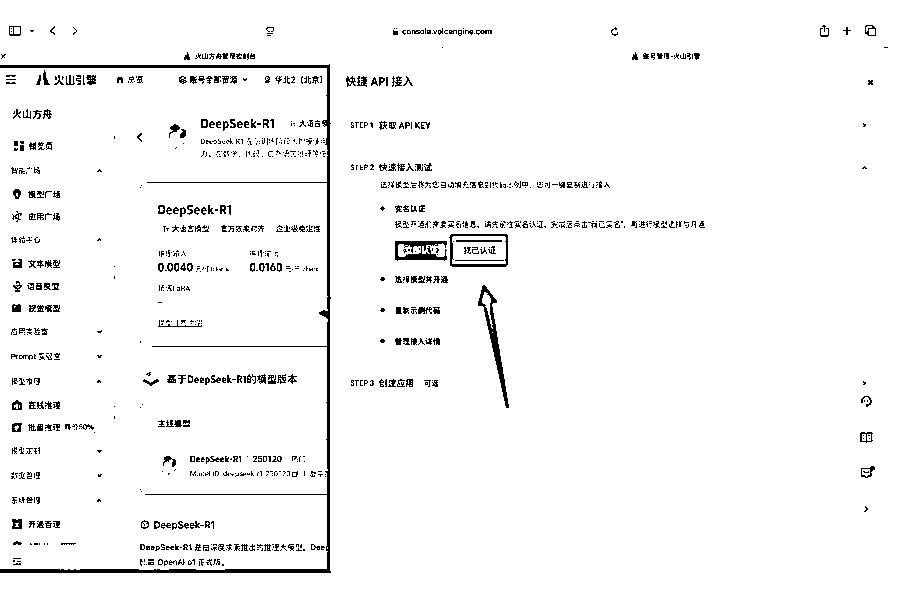

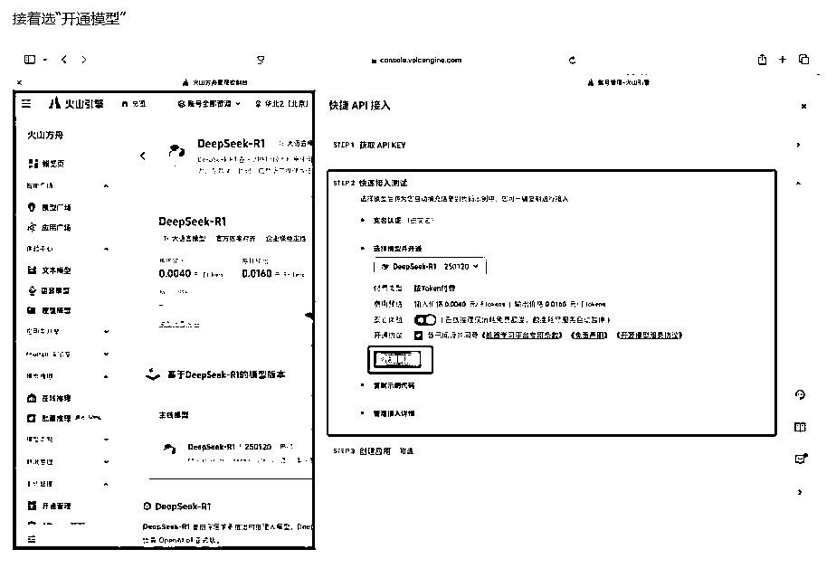

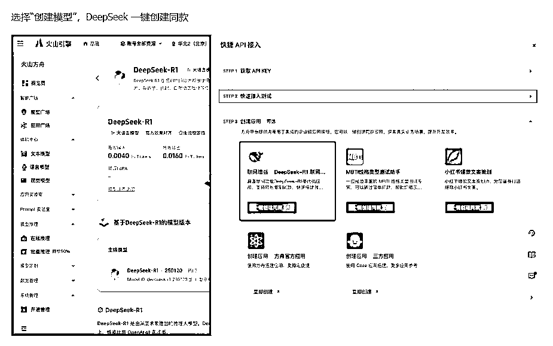

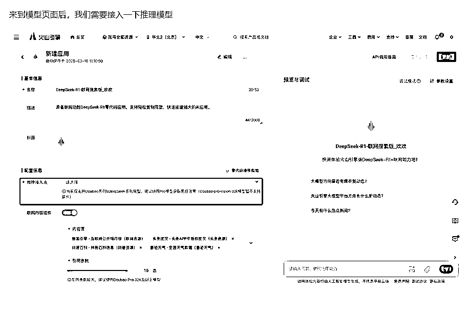

拿到 API 密钥（Key）之后，把它填进 1.6.1 节装的 Chatbox 或 Cherry Studio 的模型设置里，就能稳定对话了。

> **安全提醒**：API 密钥就是你的"取餐暗号"，千万别发到群里、贴到网上。别人拿到你的密钥，花的就是你的钱。

**进阶补充 1：官方 API 与费用**

除了火山云，你也可以直接在 DeepSeek 官网右上角进入"API 开放平台"申请官方 API（需要充值，按用量计费）。价格长这样（按"每处理 100 万个 token"计费）：

| 模型 | 输入价格 | 输出价格 | 说明 |
|------|---------|---------|------|
| deepseek-chat（V3） | 2 元/百万 token（缓存命中仅 0.5 元） | 8 元/百万 token | 日常对话够用，百万汉字大约 200 万 token，输出约 16 元 |
| deepseek-reasoner（R1） | 4 元/百万 token | 16 元/百万 token | 深度推理 |
| （对比）ChatGPT GPT-4o | ≈17.75 元/百万 token | ≈71 元/百万 token | 约 9 倍差价 |

另外每晚 0:30—8:30 的"优惠时段"还有五折甚至更低折扣。对个人用户来说，官网免费对话完全够用，API 主要是给程序、自动化工作流用的。

**进阶补充 2：用几行代码调用 DeepSeek（可选，不编程可直接跳过）**

如果你好奇"程序是怎么跟 AI 说话的"，下面是一段完整可运行的 Python 示例代码（DeepSeek 的 API 兼容 OpenAI 格式，所以用 OpenAI 的库就能调用）。每一行都写了注释，跟着看一遍就能懂。运行前需要在电脑上装好 Python，并在命令行执行 `pip install openai` 安装依赖库。

```python
# ===== 程序作用：向 DeepSeek 的 API 发送一句话，并把 AI 的回答打印到屏幕上 =====

# 第 1 步：导入 OpenAI 官方库（DeepSeek 接口与 OpenAI 格式兼容，直接用这个库即可）
from openai import OpenAI

# 第 2 步：创建客户端连接
#   - api_key：填你在平台创建的密钥（相当于你的取餐暗号，注意保密）
#   - base_url：告诉程序去哪找 DeepSeek 的服务器（而不是 OpenAI 的服务器）
client = OpenAI(
    api_key="sk-在这里填入你自己的API密钥",
    base_url="https://api.deepseek.com"
)

# 第 3 步：发起对话请求
#   - model="deepseek-chat"：指定用 V3 模型；想用推理模型可改为 "deepseek-reasoner"
#   - messages：对话内容列表，相当于聊天记录
#       * system：给 AI 的"人设说明"，规定它以什么身份回答
#       * user：你实际要说的话
response = client.chat.completions.create(
    model="deepseek-chat",
    messages=[
        {"role": "system", "content": "你是一个耐心的助手，用通俗的中文回答问题"},
        {"role": "user", "content": "你知道 DeepSeek 吗？用三句话介绍一下"}
    ]
)

# 第 4 步：从返回结果中取出 AI 的回答并打印
#   response.choices[0].message.content 是固定写法，表示"第一个回答的正文"
print(response.choices[0].message.content)
```

运行后，DeepSeek 会返回类似这样的回答：

> 当然知道！DeepSeek 是杭州深度求索公司推出的 AI 大模型，专注于人工智能领域的研发和创新。目前已推出多个强大的模型，支持超长上下文，能够处理复杂的文本理解、代码生成、逻辑推理等任务。

这就是一切 AI 应用开发的第一块积木：**程序把你的问题发给 API，AI 把回答递回来**。本书后面讲自动化工作流、AI Agent 时，本质上都是在反复使用这个动作。

---

## 小练习

在 DeepSeek 网页版或 App 中连续对话 5 轮，分别尝试"开放式提问""要求分步推理""要求给出具体示例"三种提问方式，观察并记录回答质量的差异，写下 200 字以内的复盘。

> **复盘参考**：
> - **开放式提问**：如"谈谈 AI"，回答通常泛泛而谈，信息量大但不够聚焦。
> - **要求分步推理**：如"先分析原因，再给方案，最后总结"，回答结构清晰，便于阅读。
> - **要求给出具体示例**：如"用'写周报'为例说明"，回答更具体、可操作。
>
> 对比后你应该能体会到：提问越精准（有背景、有目标、有格式要求），AI 的输出越贴合需求。这正好验证了 1.2 节的"打僵尸"类比——AI 是个能干的小学生，你说得越具体，它干得越好。

---

## 本章小结

通过本章，你应该已经了解：

1. **DeepSeek 的来头**：从幻方量化拆分出来的 AI 公司，用 MoE 混合专家架构做到了"参数少、成本低、效果强"，并且完全开源；2025 年 1 月发布的 R1 把这波热度推向顶点，甚至引发了英伟达市值单日蒸发 5900 亿美元。
2. **ChatGPT 的本质**：像个八岁小学生，动手能力强但不懂潜台词，需要精准指令；你的认知水平，决定了 AI 输出的上限。
3. **大模型的原理**：按概率一次猜一个词，不是真的"懂"，所以会有幻觉；"温度"参数带来的随机性，让同一个问题每次答案都不一样。
4. **AI 的边界**：现在仍是弱人工智能时代，AI 擅长分类和模仿，但无法断定正解、创造力也来自模仿；涉及金额、日期、人名的关键信息必须人工核对。AI 是锦上添花，不是雪中送炭。
5. **如何访问 DeepSeek**：官网、App、第三方平台（腾讯元宝/🛰️小程序/知乎直答）、第三方客户端（Chatbox/Cherry Studio）、自建 API（火山云），五条路径按需选择，崩溃时有的是退路。
6. **三种模式**：基础模式（V3）抢答快、深度思考（R1）会推理、联网搜索知时事，按场景切换才能物尽其用。

下一章，我们将学习如何写好提示词，让 AI 真正听懂你说的话——也就是把"打僵尸"里那个小学生，调教成你的得力干将。
