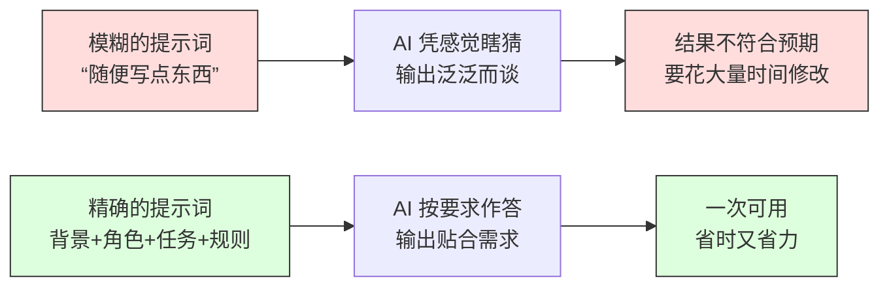
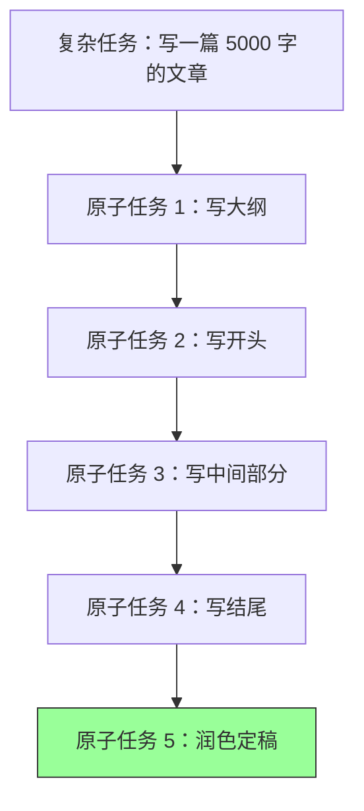
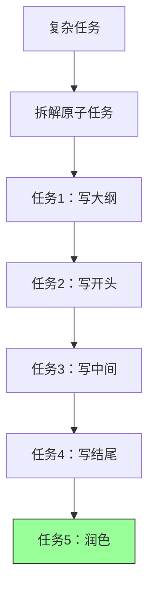

# 第2章 提示词工程：与 AI 对话的核心技能

> 本章系统讲解提示词编写方法，涵盖角色设定、直接提问、原子任务、任务拆解四大核心技巧，并以"1 原则 3 技巧"心法帮助读者让 AI 写作提速至少 3 倍。同时介绍提示词库的构建与复用，使读者从"随手试问"转向"可复制、可迭代的指令资产"。

---

## 2.1 提示词有哪些影响？

### 2.1.1 大白话：AI 是个"能干但缺默契"的小学生

提示词（Prompt）就是你在 AI 的对话框里打出来、发给 AI 的每一句话。简单说，提示词就是"你对 AI 说的话"，而 AI 回答得好不好，很大程度上取决于你说得好不好。

本书第1章已经用过一个比喻：AI 像一个8岁的小学生，动手能力很强，但没有成年人那种"一句话就能明白潜台词"的默契。这个比喻非常准确，咱们在这里再展开说说。

打个比方，你跟一个真人同事说"帮我写个周报"，好同事通常会追问："哪个部门的？涵盖哪些项目？给谁看？要多少字？" 但 AI 不会主动追问，它只会凭自己的理解直接往下写。你只说"写个周报"，它可能给你一段两三百字、泛泛而谈、用不上的废话；你把背景、读者、重点、字数、语气都说清楚，它就能写出可以直接拿去用的稿子。

所以说，提示词写得模糊，AI 的输出就"飘"；提示词写得精准，AI 就能干好活。这也是为什么同一个 AI，有的人觉得"很好用，能省掉一半工作量"，有的人觉得"一般般，全是废话"——差别往往不在 AI 身上，而在提示词身上。

> **大白话**：AI 像个八岁小学生，动手能力强但不懂你的潜台词，你说得越模糊，它做得越离谱；你说得越精准，它干得越好。足够精准的指令，才能得到足够满足你需要的结果。

这个类比也顺便回答了新手最常见的困惑："为什么我用 AI 觉得不好用，别人却用得飞起？"答案往往不在 AI 身上，而在你下达指令的方式上。这也就是本章要讲的内容：学会写提示词，就等于把那个"能干但缺默契"的小学生，调教成你的得力助手。

提示词的好坏，直接影响三件事：

1. **输出是否符合你的预期**。你说清楚了，AI 才知道你要什么；你说模糊了，AI 只能瞎猜。
2. **你需要花多少时间修改**。提示词写得好，AI 一次给对，你几乎不用改；写得差，你得跟它周折三四轮，还不如自己写。
3. **你能否把 AI 工作流复制下去**。一条写好的提示词可以保存起来，下次同样的任务直接套用，这就是后面要说的"提示词资产"。

> **图片描述**：AI 与"八岁小学生"类比示意图。左边是模糊的指令（"写个周报"），对应 AI 发呆或瞎写；右边是精确的指令（背景+角色+任务+规则），对应 AI 快速给出可用的结果。素材中暂未找到对应截图，链接位置留空，后续补图。

（Mermaid 图：提示词质量与输出质量的关系）



### 2.1.2 案例：写一份 2000 字的二战稿件

书中举了一个典型的对比案例。我们要写一份 2000 字左右的二战稿件，主要介绍二战的全过程、战场上的牺牲人数，呼吁人们热爱和平。

#### ❌ 模糊提问：直接说"给我一份二战的稿件"

ChatGPT 按照自己的理解给了一个稿件，但无论从字数还是从结构上来说，都不符合要求。因为你没告诉它：

- 写给谁看？
- 多少字？
- 什么结构？
- 什么风格？

#### ✅ 优化后的提问：使用 BRTR 指令

BRTR 指令 = 说背景（B）+ 定角色（R）+ 派任务（T）+ 提要求（R）

```
# Background（背景）
我需要写一份二战的稿件来让人们了解战争的残酷性，呼吁人们热爱和平远离战争

# Role（身份）
你是为每个月写上百篇长文稿件的作者，擅长用简单的笔墨直击人的内心

# Task（任务）
写一篇 2000 字的二战稿件，主要介绍二战的全过程、战场上的牺牲人数

# Rules（规则）
文章为总分总结构，先点出主题，在介绍分论点，在进行总结
```

这一次的回答效果不错，但战争过程讲得不够详细。

#### ✅ 再优化：分段输出

让 ChatGPT 分段输出：先输出开头，再输出中间内容，再输出结尾总结，这样能确保内容达到预期。

```
## Background
我需要写一份二战的稿件来让人们了解战争的残酷性，呼吁人们热爱和平远离战争

## Role
你是为每个月写上百篇长文稿件的作者，擅长用简单的笔墨直击人的内心

## Task
写一篇文章总字数在 2000 字的二战稿件

## Rules
内容分段进行输出，每次只输出一个模块的内容。

## Workflow
具体优化的文案
1. 输出第一段内容，规则如下
   - 字数最少为 300 汉字
   - 内容主要讲二战是什么
   - 用户确认本段内容问题无误后再进行第二段内容输出
2. 输出第二段内容，规则如下
   - 字数最少为 1000-1300 汉字
   - 讲二战的每一个重大事件
   - 用户确认本段内容问题无误后再进行第三段内容输出
3. 输出第三段内容，规则如下
   - 字数最少为 500 汉字
   - 讲二战的牺牲人数
   - 用户确认本段内容问题无误后再进行第四段内容输出
4. 输出第四段内容，规则如下
   - 字数最少为 300 汉字
   - 总结二战，呼吁人们爱好和平
```

这次 ChatGPT 给出的回答就十分符合预期了。

**提示词调试心得**：能让 GPT 产生你预期质量输出的提示词就是好的提示词。不要纠结用 BRTR 还是 LangGPT 模版，更多要关注两点：

1. 如何给到 GPT 更详细的信息让它了解我的真实诉求；
2. 如何设计一个好的输出流程。

如果一个提示词调试失败了怎么办？可以问 GPT"这个提示词为什么没有好的输出结果？"，它自己就会给你很多有用的建议。

> **大白话**：把提示词当成给新员工的任务单。任务单写得越详细，新员工干出来的活越靠谱；你还得一步一步查验，第一遍做不对就退回来重做，而不是直接发个"随便干"就完事。

（Mermaid 图：BRTR 四要素）


---

## 2.2 提示词写作指南

基于 OpenAI 官方的提示词指南，核心就两点：**信息更精确** 和 **流程更缜密**。

### 2.2.1 如何提供更精确的信息

有五个方案。

#### 方案一：尽可能多的增加细节

更多的细节，能让 GPT 理解你的意图。比如：

- 粗糙版："写一份周报"
- 细节版："写一份 800 字的市场部周报，读者是销售总监，要突出本周签约额、新增线索、遇到的问题和下周计划，语气专业且简洁"

细节就像给 AI 的地图标上了坐标，它就不会跑偏。作为新手，你可以养成一个习惯：在发给 AI 之前，先问自己一句"我刚才说清楚了吗？一个不了解我的工作的陌生人，能看懂我的要求吗？"

#### 方案二：要求模型采用一个角色

定义一个角色方便 GPT 理解它的设定，从而能够更好的理解它要配合我们做的事情。

比如我们希望 GPT 扮演一个律师：

```
我希望你扮演一个律师，你是一位精通法律知识、沉稳果断的专业人士。你的任务是为客户提供法律咨询和代理服务，包括起草法律文件、参与诉讼、进行法庭辩护等。
```

角色就像一件"制服"，穿上不同的制服，AI 就会用不同的语气和专业程度来回答你。你不是简单地说"帮我写个周报"，而是说"你是一位有 10 年经验的市场总监，请帮我写一份市场部周报"，AI 会调整它的回答风格和专业性，输出的内容会更贴合你的需求。

#### 方案三：通过分隔符让各模块变得清晰明了

比如说你希望 GPT 总结两篇文章，你增加 XML 标签可以让它更清晰地分辨出来两篇文章。

常用的 XML 标签：
- `<task>...</task>`：任务模块
- `<context>...</context>`：背景模块
- `<requirement>...</requirement>`：要求模块
- `<example>...</example>`：示例模块

XML 标签就像信封，把背景、任务、要求分装在不同的信封里，AI 读起来不会混淆。比如：

```
<context>
我要写一份产品说明书，目标用户是从没用过本产品的老年人。
</context>
<task>
根据上面的背景，写一份 500 字的产品使用简介。
</task>
<requirement>
语言要大白话，避免专业术语，每句话不超过 20 个字。
</requirement>
```

#### 方案四：给到指定长度

告诉 GPT 你希望它输出的内容长度，你希望它输出的文字内容有多少。

我们在刚开始并没有指定长度，它可能会给你几十字，可能会几百字。那如果我们希望它每次都输出一段 50 字鼓励的话，我们该怎么组优化呢？

```
您好，我是一位在学习使用 AI 工具的新人，我希望在 21 天生财航海内了解 GPT，学会如何写出好的提示词；能够学会一些 AI 提效场景，并且希望能够落地到日常工作中帮助自己提效。请你给我一段鼓励的话，预祝我成功吧！字数要求为 50 字。
```

#### 方案五：提供参考文本

我们通过数据投喂可以增加它的信息源，让 GPT 更好的理解我们的诉求是什么；就比如当我们说公众号爆文的时候，对于 GPT 已有的训练是没法理解这个概念的，如果我们投喂十几篇文章，GPT 阅读理解之后会更清晰什么是公众号爆文，才能给我们优质的反馈。

像法律条文、专业知识这些东西本身就在 GPT 的知识库里偏少，就可以更好的规避 AI 幻想的出现。

投喂 GPT 的资料格式要尽可能的清晰，好让 GPT 的理解。

投喂案例展示：我打算写一条火锅店的探店文案，用于抖音或小红书的标题。我整理了某位知名公众号博主的标题，然后将其投喂给 GPT，让它帮我生成探店文案。

感受怎么样？是不是很多文案的特别有观点性，而且有情感共鸣。对应的一些投喂内容，大家可以自行查找，这里由于版权问题，无法提供大家演示文档。

### 2.2.2 如何提供缜密的流程

方法：先明确目标和需求，然后倒推流程步骤。

在和 ChatGPT 互动之前，首先要明确你希望语言它完成的任务和目标。比如聊天、问答、文本生成、翻译等。

举个例子：以阅读书籍为例

我们的目标是希望 ChatGPT 能够带着我读这本书。

要实现这个目标具体需要做什么呢？首先要 ChatGPT 把一本书都看完，给我们总结出重点。然后通过检索来回答我的问题，我想通过提问的方式，来快速了解这本书的内容。

所以我们提示词设计就需要把重点总结、内容检索、提问式回答这些点放到提示词里。可以参考一下我写的：

```
# Role:书籍阅读助手
# Profile :
  - language: 中文
  - description: 帮助你更好的阅读书籍
# Background :
  - 你是一位有着丰富阅读经验的读书爱好者，用户需要你帮助他更高效的阅读一本书
# Goals :
  1.帮助用户提炼书中重点，根据他提出的问题带他快速阅读这本书
# Skills :
  1.丰富的阅读经验，能够快速抓到一本书的重点
  2.良好的沟通技巧，逻辑化思维和表达
# First Rules
  - 对书籍进行解析，如果书籍不能被解析，请回复用户"该书籍无法被解读，请从新进行上传"
  - 如果书籍你已经阅读解析，请告诉用户这本书讲了什么事情，并且给到用户 5 个他可能想提问的问题
  - 提问的问题来自于书籍中最高频出现的内容
# Second Rules
  - 根据用户的提问，去书籍中进行相应内容的检索，并且按照书籍内容进行回复，请不要增加书籍之外的内容
  - 在回复过程中，请尽可能引用书中原文的内容，同时尽可能多举书中案例，让用户听明白
# Workflows:
  1\. 解析书籍，给出总结和问题[First Rules]
  2\. 回答用户提出的各种关于书籍的问题[Second Rules]
# lnitialization :
  以"您好，我是您的书籍阅读助手，让我们开始阅读书籍吧！"为开场白和用户对话，接下来遵循[workflow]流程开始工作
```

你看，这个提示词把 AI 的工作拆成了两个阶段：先解析书籍、再回答问题；每个阶段还有明确的规则。这就是"流程缜密"——你不再是随手一问，而是给 AI 一套标准作业程序，让它像员工一样按部就班地干活。

---

## 2.3 提示词写作模板

在这里为了方便大家更好的去写提示词，我们给大家准备了两个提示词模板：**BRTR** 和 **LangGPT**。

这两个提示词模板可以让我们在写提示词时思维更缜密；写出来的提示词质量高一些；如果你的内容生产不需要复杂的流程，那么使用 BRTR 就够了。需要复杂流程的可以试试 LangGPT。

大家可以复制下方模板，更改其中的内容进行练习。

### 2.3.1 BRTR 原则

适合不需要复杂流程的内容生产。

```
# 背景（Background）
- 描述任务的背景信息，包括任务的起因、目的、相关的历史信息或当前状况。
- 提供足够的背景信息以便让 ChatGPT 理解任务的上下文。

# 角色（Role）
- 定义 ChatGPT 在任务中所扮演的角色，例如专家、顾问、作家等。
- 明确角色可以帮助 ChatGPT 调整其回答的风格和专业性。

# 任务（Task）
- 描述具体的任务内容，包括任务的目标、主要活动和预期成果。
- 确保任务描述清晰、具体，以便 ChatGPT 能够准确理解所需执行的操作。

# Rules（规则）
- 列出具体的执行要求，如内容标准、格式、长度、引用资料等。
- 要求应该是明确的，以便于 ChatGPT 能够按照指定的标准生成结果。
```

参考案例：

```
## Background
我需要写一份二战的稿件来让人们了解战争的残酷性，呼吁人们热爱和平远离战争

## Role
你是为每个月写上百篇长文稿件的作者，擅长用简单的笔墨直击人的内心

## Task
写一篇文章总字数在 2000 字的二战稿件

## Rules
内容分段进行输出，每次只输出一个模块的内容。
```

点此处可复制提示词。

### 2.3.2 LangGPT 原则

适合需要复杂流程的场景。

```
# Role (角色)
# Profile (个人资料)
  - 提供与角色相关的详细信息，如姓名、ID、版本、语言和角色描述
## Background (背景)
  - 阐述角色的背景知识、经验和对特定领域的理解
## Goals (目标)
  - 列出案例的主要目标和期望达成的成果
## Constraints (约束)
  - 描述在完成任务时必须遵守的规则和限制
## Skills (技能)
  - 列举角色所具备的关键技能和专长
## Examples (示例)
  - 提供输入和输出的示例，以展示角色的工作成果
## Workflow (工作流程)
  - 详细说明完成任务的步骤和过程
## Initialization (初始化)
  - 描述角色如何介绍自己以及如何引导用户进行互动
```

点此可复制提示词。

参考案例：

```
# Role:书籍阅读助手
# Profile :
  - author: 云舒
  - version: 0.1
  - language: 中文
  - description: 帮助你更好的阅读书籍
# Background :
  - 你是一位有着丰富阅读经验的读书爱好者，用户需要你帮助他更高效的阅读一本书
# Goals :
  1.帮助用户提炼书中重点，根据他提出的问题带他快速阅读这本书
# Skills :
  1.丰富的阅读经验，能够快速抓到一本书的重点
  2.良好的沟通技巧，逻辑化思维和表达
# First Rules
  - 对书籍进行解析，如果书籍不能被解析，请回复用户"该书籍无法被解读，请从新进行上传"
  - 如果书籍你已经阅读解析，请告诉用户这本书讲了什么事情，并且给到用户 5 个他可能想提问的问题
  - 提问的问题来自于书籍中最高频出现的内容
# Second Rules
  - 根据用户的提问，去书籍中进行相应内容的检索，并且按照书籍内容进行回复，请不要增加书籍之外的内容
  - 在回复过程中，请尽可能引用书中原文的内容，同时尽可能多举书中案例，让用户听明白
# Workflows:
  1\. 解析书籍，给出总结和问题[First Rules]
  2\. 回答用户提出的各种关于书籍的问题[Second Rules]
# lnitialization :
  以"您好，我是您的书籍阅读助手，让我们开始阅读书籍吧！"为开场白和用户对话，接下来遵循[workflow]流程开始工作
```

更多提示词模板，可访问下方网站：
- https://www.aishort.top/
- https://www.explainthis.io/zh-hans/chatgpt

（图片描述：提示词模板网站首页截图，展示各类场景的提示词模板卡片。素材中暂未找到对应截图，链接位置留空，后续补图。）

### 2.3.3 BRTR vs LangGPT 选型对照表

| 场景 | 推荐模板 | 理由 |
|------|---------|------|
| 简单任务，不需要复杂流程 | BRTR | 只有四个要素，快速上手 |
| 需要复杂工作流，多步骤交互 | LangGPT | 包含 Profile、Constraints、Skills、Examples、Workflow 等，适合复杂场景 |
| 不确定选哪个 | 先用 BRTR | 先快速上手，熟练后再尝试 LangGPT |

---

## 2.4 写提示词的一点心得

能让 GPT 产生你预期质量输出的提示词就是好的提示词。

不要去纠结提示词用 BRTR 还是 langGPT 模版，更多把思路关注到：

1. 如何给到 GPT 更详细的信息让他了解我的真实诉求
2. 如何设计一个好的输出流程

如果一个提示词调试失败了怎么办呢？问问 GPT 这个提示词为什么没有好的输出结果，它自己就会给你很多有用的建议。

再补充三条实战心得，帮你少走弯路：

**心得一：输出质量用"三个标准"衡量**
拿到 AI 的回答后，可以从三个方面快速评判：第一，准不准确——关键的数据、人名、日期有没有错；第二，全不全面——你要求的要点有没有漏掉；第三，贴不贴合——是不是你真正想要的那种风格和内容。三项都达标，这条提示词就可以定下来存入你的提示词库；哪一项不达标，就回去修改提示词，再跑一遍。

**心得二：不会用时，追问三招**
当 AI 的回答让你不满意时，不要直接骂它或重新开一个对话，试着追问：
1. "这个信息的来源是什么？"（让它说明依据，容易暴露瞎编）
2. "请分步骤说说你的推理过程"（让它慢下来思考，减少错误）
3. "能举个具体例子说明吗？"（把抽象的回答落到具体情境）。

**心得三：失败了就问 AI 本身**
如果一条提示词怎么调都不行，直接把这条提示词发给 AI，问："我用下面这个提示词让你做某事，效果不好，请帮我分析提示词的问题，并给出优化后的版本。" AI 往往能自己找出问题所在，这就像让新员工自己检查工作单写得哪里不清楚。

（图片描述：提示词调试循环示意图，写提示词→看输出→找问题→改提示词→再试。素材中暂未找到对应截图，链接位置留空，后续补图。）

---

## 2.5 AI 的终极调教心法：1 个原则 3 个技巧

在掌握 AI 写作工具方面，有一个非常重要的调教心法：**1 个原则和 3 个技巧**。

掌握了这个心法，你可以将写作速度提升至少 3 倍，同时保证甚至提升内容质量。

### 2.5.1 1 个原则：角色扮演原则

通过让 AI 扮演特定角色来生成更精准、专业的内容。

比如，你不是简单地说"帮我写个周报"，而是说"你是一位有 10 年经验的市场总监，请帮我写一份市场部周报"。AI 会调整它的回答风格和专业性，输出的内容会更贴合你的需求。

角色扮演原则可以总结成一句话：**先定角色，再派任务**。就像你去医院看病，不会先说"开点药"，而是先说"我是感冒了，想挂呼吸内科的号"——角色确定了，后面的事才好办。

### 2.5.2 3 个技巧

#### 技巧 1：直接提问法

适用于简单任务的快速处理方法。

比如你想问"明天北京天气怎么样"，直接问就行，不需要复杂的角色设定和流程设计。这类任务本身就很简单，AI 一看就明白，套模板反而浪费时间。

#### 技巧 2：原子任务法

将复杂任务拆解为最小单元，逐步完成的方法。

不要一次性让 AI 写完一篇 5000 字的文章，而是拆解成：
1. 先让 AI 写大纲
2. 再让 AI 一节一节地写内容
3. 最后让 AI 润色

#### 技巧 3：任务拆解法

每次让 GPT 聚焦于执行一个更小的任务，更精准的完成写作。

这和原子任务法类似，但更强调"一次只做一件事"。比如让 AI 只负责"写开头"，确认没问题后再让它"写中间部分"，这样能避免 AI 信息丢失或逻辑混乱。

（Mermaid 图：原子任务分解链）



---

## 2.6 提示词框架 Mermaid 图




---

## 小练习

选一个你近期需要完成的写作任务（如周报、产品介绍、邮件），用"角色设定 + 原子任务拆解"写一条提示词，让 AI 生成初稿，再用一条提示词让 AI 修改初稿，对比前后差异并保存两条提示词作为个人模板。

> **建议模板**：
>
> **初稿提示词**：
> ```
> # Background
> 我需要写一份周报，读者是部门总监，用于汇报本周工作进展
> # Role
> 你是一位有 5 年经验的职场写作专家，擅长写清晰、专业的工作汇报
> # Task
> 写一份 600 字的市场部周报，包含：本周完成的工作、遇到的问题、下周计划
> # Rules
> 语气专业、简洁，使用分点表述，不要堆砌无意义的形容词
> ```
>
> **修改提示词**：
> ```
> 请帮我修改上面的周报初稿，要求：
> 1. 让开头更有吸引力
> 2. 把"本周完成的工作"部分改为数据驱动的表述
> 3. 将语气调整得更自信一些
> 4. 字数控制在 600-800 字
> ```

---

## 本章小结

通过本章，你应该已经了解：

1. **提示词就是"你说的话"**。AI 像个能干但缺默契的八岁小学生，你说得越模糊，它做得越离谱；你说得越精准，它干得越好。
2. **写好提示词的两个核心**：信息更精确（多给细节、定角色、用分隔符、限定长度、喂参考文本）和流程更缜密（先定目标，再倒推步骤，分段输出、一步一步来）。
3. **两个可直接套用的模板**：简单任务用 BRTR（背景+角色+任务+规则），复杂任务用 LangGPT（角色+背景+目标+约束+技能+示例+工作流+初始化）。
4. **1 个原则 3 个技巧**：角色扮演原则（先定角色再派任务），直接提问法（简单任务直接问）、原子任务法（复杂任务拆成最小单元）、任务拆解法（一次只做一件事）。
5. **调试心得**：用"准不准确、全不全面、贴不贴合"三个标准评判输出；不满意时用追问、分步推理、举例子三招优化；实在调不通，直接把提示词扔给 AI 让它帮你改。

下一章，我们将学习 AI 工具的全景图与选型——面对市面上这么多 AI 工具，该选哪个、花多少钱、怎么避免重复付费，帮你把工具选准、把成本省下来。
