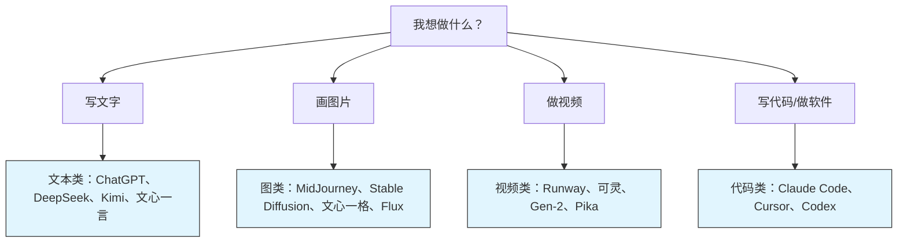
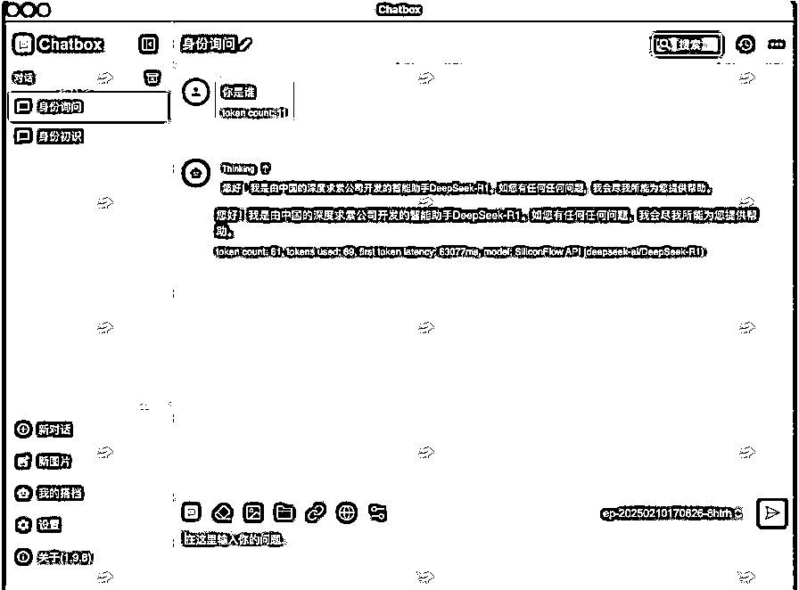
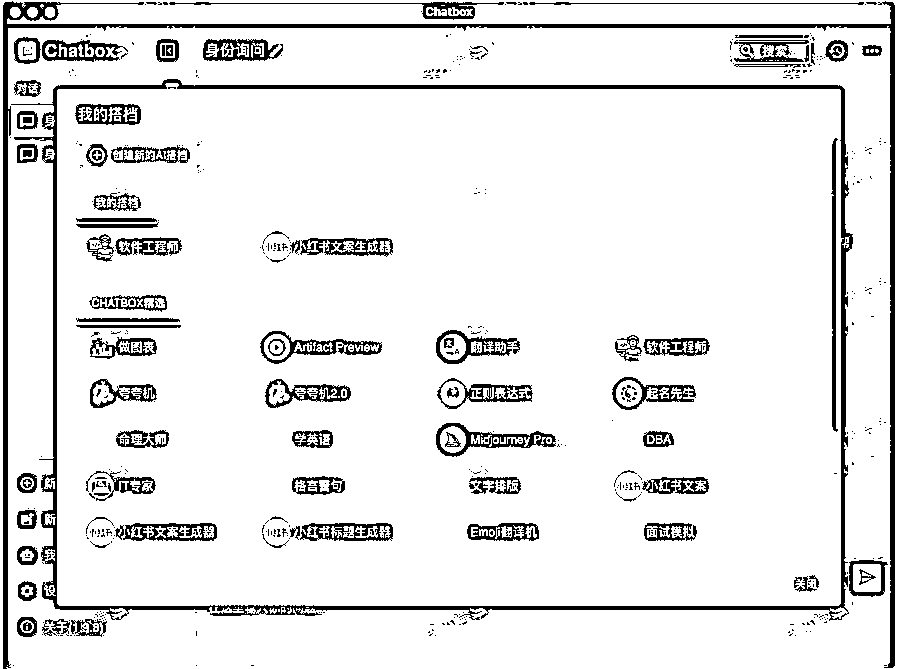
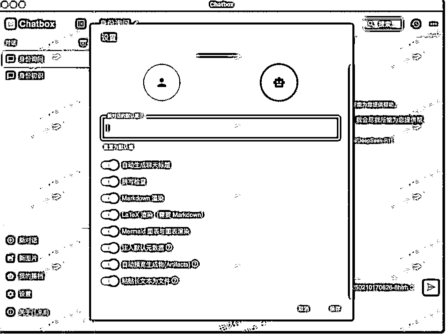
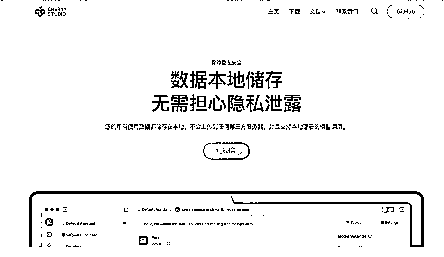
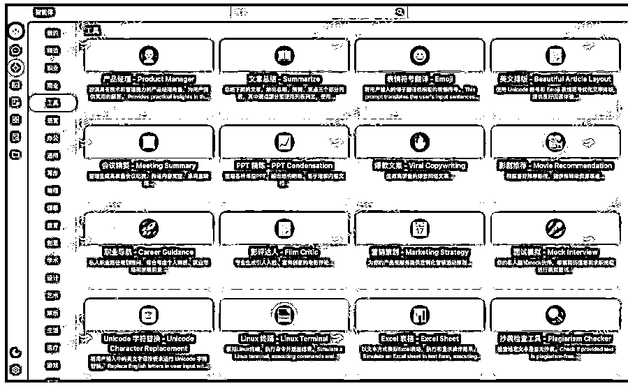
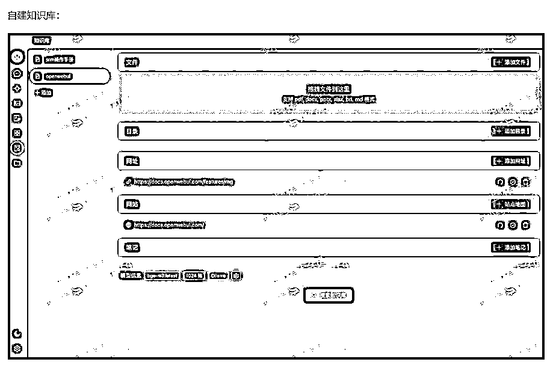
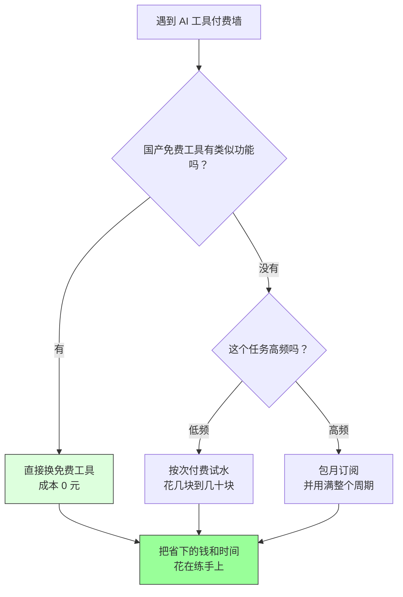

# 第3章 AI 工具全景图与选型

> 本节梳理文本生成（ChatGPT/Kimi/文心一言）、图像生成（MidJourney/Stable Diffusion/Flux/DALL·E）、视频生成（Runway/可灵/Gen）、代码生成（Claude Code/Cursor/Codex）等领域的主流工具，给出国内外平替方案与成本预估（航海期最低约 100 元），帮助读者按需选型、避免重复付费。

---

## 3.1 大白话：选 AI 工具就像选厨具

选 AI 工具就像选厨具，炒菜用炒锅、切菜用菜刀，没有一个锅什么都能做。先看你要做什么（写文案？画图？写代码？），再选对应的工具，不要全家桶都订阅，浪费钱。

> **大白话**：不同的 AI 工具擅长不同的事情，就像不同的厨具适合不同的烹饪任务。不要试图用一个工具解决所有问题，也不要把所有工具都买一遍。

展开说说这个比喻。你家里做饭，大概会有这么几样东西：炒锅负责炒菜，电饭煲负责焖饭，微波炉负责热剩菜，烤箱负责烤面包。你要炒个青菜，不会把米扔进炒锅里；你想热个馒头，也不会开烤箱等半小时。工具用对了，事就办得又快又好；工具用错了，费时费力还不讨好。

AI 工具也是一样。市面上 AI 产品成百上千，但按"能干什么"来分，其实就四大类：

| 你想做的事 | 工具类别 | 像家里的哪件厨具 | 代表工具 |
|-----------|---------|----------------|---------|
| 写文字（文案、周报、翻译、总结） | 对话大模型 | 万能炒锅，日常用得最多 | ChatGPT、DeepSeek、Kimi、文心一言 |
| 画图片（海报、配图、头像） | 文生图工具 | 烤箱，专门做"烤"这门手艺 | MidJourney、Stable Diffusion、文心一格 |
| 做视频（宣传片、短视频） | 视频生成工具 | 料理机，专门处理"影像"这种食材 | Runway、可灵、Pika |
| 写代码（做网页、做小软件） | AI 编程工具 | 厨师机，专业后厨才常用 | Claude Code、Cursor、Codex |

对绝大多数新手来说，日常用得最多的是第一类——对话大模型，就像炒锅是厨房里使用频率最高的厨具一样。所以本章也会把重点放在文本生成工具上，其他三类先混个脸熟，用到的时候再回来查。

下面这个决策树能帮你快速找到对应的工具类别。

## 3.2 AI 工具选型决策树 Mermaid 图

> **图片描述**：AI 工具选型决策树截图，从"我想做什么"分出写文字、画图片、做视频、写代码四大分支，每个分支对应推荐工具。素材中暂未找到对应截图，链接位置留空，后续补图。

---

## 3.3 文本生成工具：如何选择 AI 写作工具？

### 3.3.1 ChatGPT 是干啥的？

说到 AI 写作，咱们使用的工具就是那个无人不知、无人不晓的 ChatGPT 了！不过呢，今天我还是要给大家科普下，让咱们对这个神奇的工具有个更全面的认识。理解工具的原理，能提高我们后续写作的效率。

ChatGPT 机器人由 OpenAI 公司创建，预先投喂了大量数据，互联网上能看到的信息都可能被投喂给 ChatGPT。当你问他问题的时候，它就像一个知晓天下事的小秘书，可以回答它知道的一切。

### 3.3.2 ChatGPT 主要功能

ChatGPT 的主要功能是理解和生成人类语言，可以在许多不同的场景中被应用：

| 功能 | 说明 | 举例 |
|------|------|------|
| 问答 | 根据训练数据生成答案 | 问科学、历史、文化等问题 |
| 文本生成 | 写文章、故事、诗歌等 | 给出开头或主题，生成相应文字 |
| 对话 | 模拟人类对话 | 客服、教育、娱乐、角色扮演 |
| 编程 | 理解编程语言，写代码 | 提问编程相关问题，帮写代码 |
| 学习 | 作为学习工具 | 解释复杂概念，学习新语言 |

### 3.3.3 ChatGPT 核心原理

ChatGPT 并不具有人类的思维和逻辑，他无法知晓一篇文章中上下文真正的逻辑。

而是从他脑子里的知识库中，通过一定的算法，猜测这个字的后边，更大概率会出现哪一个字，这样一个字接着一个字的生成一篇文章或一个回答给你。

> **关键点**：ChatGPT 是按概率"猜"下一个字的，不是真的"懂"。这就是为什么它有时候会说得很有道理，但实际上是错的（"幻觉"）。

### 3.3.4 免费版和付费 Plus 版的区别

ChatGPT 提供了免费版和付费的 Plus 版供大家选择使用。下面结合一张表格，展示一下它们的区别。

| 功能 | GPT-3.5 (免费) | GPT-4.0 (Plus 20 美元/月) |
|------|---------------|--------------------------|
| 基础对话功能（写文案、角色扮演、代码生成等） | ✓ | ✓ |
| 语音对话（APP） | | ✓ |
| 图像处理 | | ✓ |
| 文件上传 | | ✓ |
| 联网搜索 | | ✓ |
| 画图 | | ✓ |
| 创建专属对话（GPTs） | | ✓ |
| 多 GPTs 联合作业 | | ✓ |
| Web 端 | ✓ | ✓ |
| 🛰️小程序 | | ✓ |
| APP 端 | | ✓ |

购买 Plus 需要国外信用卡，目前免税州会员价格是 20 美金/月，折合人民币约 135.68 元，支付会员需要使用国外的信用卡。

目前有部分虚拟信用卡被封禁，无法正常进行支付，如果你用的是虚拟信用卡，请提前了解清楚相关的最新情况和风险。

**在国内怎么订阅 ChatGPT Plus？** 根据网上的攻略汇总，目前国内用户常用的几种方式包括：

1. **苹果内购**：在 iPhone 上打开 ChatGPT App，进入 Settings → Upgrade to ChatGPT Plus，用苹果余额支付。优点是走苹果官方内购渠道，账户风险较低，无需境外信用卡，适合 iPhone 用户。
2. **美区 App Store 礼品卡**：先给美区 Apple ID 充值余额，再通过 App Store 完成订阅。适合持有 iPhone/iPad 且愿意折腾美区 Apple ID 的用户。
3. **虚拟信用卡**：办理一张支持海外支付的虚拟美元卡（如 WildCard、Nobepay 等平台），充值美元后在 ChatGPT 官网绑定付款。适合同时订阅多个海外服务的用户，但不同平台对卡片的接受政策各异，充值前建议先确认。
4. **代充/卡密**：通过第三方平台购买 Plus 激活卡密或代充服务，用支付宝或🛰️付款。操作便捷、门槛低，但费用较高（通常至少比官方价贵 5-10 元/月），且需要提供账号密码，违反 OpenAI 服务条款，账号风险较高。

四种方式放在一起对比一下：

| 方式 | 门槛 | 额外费用 | 主要风险 |
|------|------|---------|---------|
| 苹果内购 | 需要 iPhone + 支持地区的 Apple ID | 礼品卡可能有折扣损耗 | 较低 |
| 美区礼品卡 | 需要美区 Apple ID | 礼品卡买卡差价 | 较低 |
| 虚拟信用卡 | 需要实名开卡、充值美元 | 开卡费、充值手续费 | 平台政策变动、卡片被封 |
| 代充/卡密 | 几乎无门槛 | 每月贵 5-10 元起 | 需提供账号密码，违反服务条款，账号可能被封 |

> **新手建议**：航海期（刚开始学习的阶段）先用免费层跑通流程，完全不需要立刻订阅 Plus。等你熟悉了 AI 工具，确实觉得付费模型能带来明显提升，再考虑订阅。千万不要一上来就花几百元买各种工具的会员。

（图片描述：ChatGPT Plus 升级页面截图，显示左下角"升级到 Plus"按钮和订阅价格。素材中暂未找到对应截图，链接位置留空，后续补图。）

### 3.3.5 如何购买 ChatGPT Plus 版

账号登录之后，左下角会提示升级到 Plus：

点击【Upgrade】，会出现会员选择界面，点击"plus"，按照相关指引，就能完成升级了。

如果你是在 iOS 移动端上进行的升级，且是美区用户，可以走苹果内购的方式来开通 Plus 会员。具体的开通方式请看圈友分享的操作步骤。

如果国内信用卡无法支付，可以参考 3.3.4 节中的替代方案（虚拟信用卡、美区礼品卡、苹果内购等），选择一个门槛较低、风险可控的方式尝试。

### 3.3.6 ChatGPT 的替代软件：国产大模型 Kimi

在过去的 1 年里，国产大模型也涌现出很多优秀的产品，今天来给大家介绍其中一款 **Kimi**。

Kimi Chat 是由月之暗面科技有限公司（Moonshot AI）开发的智能助手，具备文件读取、联网查询等功能；它能够一次性"消化"20 万字的文本，这相当于一部《三体》的全文。无论是复杂的合同、长篇的学术论文，还是你想要整理的旅行日记，Kimi 都能迅速帮你梳理出重点。

在背后，是月之暗面科技的顶尖团队在默默支持。他们的创始人杨植麟，不仅在清华大学有着辉煌的学术背景，还在卡内基梅隆大学和 Meta 的人工智能研究院取得了卓越的成就。他的研究成果，让 Kimi 在 AI 领域独树一帜，成为了处理长文本的佼佼者。

而且，Kimi Chat 得到了红杉中国、📕、美团和阿里等业界巨头的青睐和投资，这不仅是对 Kimi 技术的认可，也是对其未来潜力的肯定。这些大厂的背书，让 Kimi Chat 的可靠性和实用性更加值得信赖。

GPT3.5 具备的功能，Kimi 都具备；它在文本生成、搜索、翻译、读一本书这些场景能给你带来非常不错的体验。如果你不方便使用 ChatGPT，也可以直接用 Kimi 来完成咱们本次航海。

**Kimi 链接**：https://kimi.moonshot.cn/

> **大白话**：Kimi 像是一个读过整本《三体》的助手，能一次性处理非常长的文本，特别适合处理长合同、长论文等场景。

Kimi 的使用方法和 DeepSeek、ChatGPT 基本一样，三步就能上手：

1. 浏览器打开 https://kimi.moonshot.cn/ ，用手机号注册/登录（也支持🛰️登录）；
2. 在对话框里输入你的问题，或者点输入框旁的"上传"按钮，把 PDF、Word、网页链接发给它；
3. 它会先阅读你给的材料，再按照你的要求输出总结、翻译或分析结果。

Kimi 免费使用，下面这些场景最值得一试：

| 场景 | 怎么用 |
|------|--------|
| 读长文档 | 上传一份几十页的合同或报告，让它总结要点、列出风险条款 |
| 联网查资料 | 打开联网搜索开关，问它最新的事件和政策 |
| 长文翻译 | 把整章外文资料粘给它，要求"逐段翻译并保留原文结构" |
| 仿写文案 | 投喂十几条你觉得好的标题，让它照着风格仿写 |

## 3.4 DeepSeek 客户端推荐

DeepSeek 官网过于火爆，很容易出现无法回应的问题。我们可以通过其他云服务厂商提供的 API 服务来使用 DeepSeek R1。这里推荐两个 AI 对话应用：

> **大白话：什么是 API？** 第1章 1.6.2 节打过比方：API 就像餐厅的"取餐口"。你不用挤在官网大厅排队，而是拿着自己的取餐暗号（API 密钥，Key）到取餐口报单，后厨（DeepSeek 的服务器）把结果递出来。第三方客户端（Chatbox、Cherry Studio）就是一个漂亮的"点餐界面"，帮你把点单、取餐、摆盘全包了，你只管说话。

不管用哪个客户端，套路都一样，就三步：

1. **拿到 API 密钥**：去 DeepSeek 官方 API 平台或火山云等云服务商申请，按官网指引完成实名认证后创建密钥（第1章 1.6.2 节有火山云的详细步骤）；
2. **把密钥填进客户端**：打开客户端的"设置"，找到"模型服务/API"一栏，选择 DeepSeek，把密钥粘贴进去保存；
3. **开始对话**：回到聊天界面，就能稳定地使用 DeepSeek 了。

> **安全提醒**：API 密钥就是你的"取餐暗号"，别发到群里、别贴到网上。别人拿到你的密钥，花的就是你的钱。

### 3.4.1 Chatbox

- 官网：https://chatboxai.app/zh
- Chatbox 是一款类似"智能聊天机器人"的跨平台应用，能通过文字对话帮你完成学习、工作和创作任务。

**核心特点有：**

1. **多面手能力**
   - 解读文件：直接发送 PDF/图片，它会总结内容
   - 生成代码：描述需求即可生成代码并预览效果
   - 联网搜索：实时获取最新资讯（天气/新闻/数据）
   - 图表生成：将复杂数据转化为可视化图表
   - 学术支持：处理数学公式/LaTeX/学术写作

2. **隐私保障**
   - 所有聊天记录只存在你的设备里（本地存储）
   - 支持历史对话快速检索
   - 多端支持：支持网页端、电脑端、手机端。

3. **创作神器**
   - 文字转图片：输入描述生成创意图像
   - 支持 20+ 艺术风格转换
   - 文档/PPT 内容智能优化

主页面：

> 图片说明：Chatbox 主页面截图，展示对话框、文件上传与代码预览等功能入口。

支持提示词内置：

> 图片说明：Chatbox 支持提示词内置，常用提示词模板可一键插入对话框。

支持 Markdown、LaTex、Mermaid 等多种格式渲染：

> 图片说明：Chatbox 支持 Markdown、LaTeX、Mermaid 等多种格式渲染，展示标题、公式与流程图的显示效果。

**把 DeepSeek API 填进 Chatbox 的具体操作**：

1. 打开 Chatbox，点击左侧边栏最下方的齿轮图标（设置）；
2. 在"模型提供方"下拉列表里选择"DeepSeek API"（或"OpenAI API 兼容"模式）；
3. 把你申请到的 API 密钥粘贴到 API Key 输入框，选择模型（如 deepseek-chat 或 deepseek-reasoner），点击保存；
4. 回到聊天窗口，输入一句话测试，能正常回复就配置成功了。

（图片描述：Chatbox 模型设置界面截图，展示模型提供方选择和 API Key 填写位置。链接位置暂留空，后续补图。）

### 3.4.2 Cherry Studio

- 官网：https://cherry-ai.com/
- Cherry Studio 是一款跨平台（支持 Windows、macOS、Linux）的多模型 AI 客户端，集成了 OpenAI、DeepSeek、硅基流动等云端大语言模型及本地模型（通过 Ollama 部署），支持用户自由切换并同时与多个模型对话以对比输出结果。

**核心功能：**
- 内置 300+ 预配置 AI 助手（覆盖写作、编程等 30 多个行业）
- RAG 技术驱动的本地知识库搭建（支持 PDF、网页等多源数据检索增强问答）
- 多模态文档处理（含代码高亮、流程图可视化等工具）
- WebDAV 数据同步。

该工具兼顾开发者的高效编程需求与企业的知识管理场景，提供高度可定制化服务，但需用户自行配置第三方 API 密钥使用。

该工具仅包含电脑端，没有移动端支持。

> 图片说明：Cherry Studio 主界面截图，展示模型选择与多模型同时对话、对比输出结果的功能。

海量 Agent 调用：

> 图片说明：Cherry Studio 内置 300+ 预配置 AI 助手，覆盖写作、编程等 30 多个行业（海量 Agent 调用界面，第 1 幅）。

> 图片说明：Cherry Studio 内置助手库继续展示（第 2 幅），可按行业筛选不同的预配置 AI 助手。

**Chatbox 和 Cherry Studio 怎么选？** 两个都免费，放在一起对比一下：

| 对比项 | Chatbox | Cherry Studio |
|-------|---------|---------------|
| 支持平台 | 网页端、电脑端、手机端 | 仅电脑端（Windows/macOS/Linux） |
| 上手难度 | 很低，装好就能用 | 略高，需自行配置 API 密钥 |
| 多模型对比 | 支持 | 支持，且可同时与多个模型对话 |
| 知识库 | 无 | 有（RAG 本地知识库，可喂 PDF/网页） |
| 内置助手 | 常用提示词模板 | 300+ 预配置 AI 助手，覆盖 30 多个行业 |
| 适合人群 | 想在手机和电脑都能用、界面简单的用户 | 以电脑为主、想搭知识库、对比多模型输出的用户 |

> **怎么选**：想在手机和电脑上都能用、界面简单就选 Chatbox；用电脑为主、想要多模型对比和本地知识库就选 Cherry Studio。两个都免费，装了不亏。

---

## 3.5 航海期成本预估

航海期最低约 **100 元**。优先走免费层（DeepSeek 免费层、Kimi 免费层、Claude 免费额度），实在不够再订阅。

| 工具类别 | 首选工具 | 国内平替 | 典型费用 |
|---------|---------|---------|---------|
| 对话大模型 | ChatGPT / Claude | DeepSeek、Kimi、文心一言、豆包、Gemini | 免费层或月付 |
| 文生图 | MidJourney | Stable Diffusion（LibLib/秋叶）、文心一格、Flux | 订阅或云端按次 |
| 图生视频/文生视频 | Runway Gen-2、可灵 | Gen-1、腾讯混元、快手可图、Mochi、CogVideoX | 订阅或按次 |
| AI 编程 | Claude Code | Cursor、Augment、Codex | 订阅 |

> **大白话**：航海期（刚开始学习的阶段）不需要大把花钱，先用免费层跑通流程，等熟悉了再根据需要订阅付费工具。

**免费层使用三原则**：

1. **先免费后付费**：每个工具都先摸清它的免费额度有多少、够干什么。DeepSeek 官网对话完全免费，Kimi 免费使用，豆包、文心一言也都是免费的，光这些免费工具就能覆盖 80% 的日常任务。
2. **一类别只订阅一个**：文本类如果真要付费，选一个用得最顺手的订阅就够，不要 ChatGPT、Claude、Kimi 会员全买一遍——它们干的事高度重叠。
3. **按次付费优先于包月**：图像、视频类工具按次计费的（比如生成一张图多少钱），适合先买一小包试试水，确认真的高频使用再转包月。

（Mermaid 图：航海期付费决策流程）

> **一句话总结**：航海期的钱应该花在"跑通流程"上，而不是"囤工具"上。工具够用就好，熟练度才是你最值钱的资产。

---

## 小练习

列出你日常工作中重复次数最多的 3 个任务，为每个任务在本节工具全景图中找出 1 个可替代的 AI 工具，并标注该工具是免费、订阅还是按次付费。

> **参考模板**：
>
> | 重复任务 | 对应 AI 工具 | 费用类型 |
> |---------|-------------|---------|
> | 每周写周报 | DeepSeek / Kimi（免费层） | 免费 |
> | 整理产品图片背景 | 文心一格 / MidJourney | 按次或订阅 |
> | 每周生成短视频脚本 | 可灵 / Gen-2 | 按次或订阅 |

---

## 本章小结

通过本章，你应该已经了解：

1. **选工具就像选厨具**，没有万能锅，先看你要做什么（写文字、画图片、做视频、写代码），再选对应的工具类别，不要全家桶都订阅。
2. **文本类工具**：ChatGPT 是老牌大模型，免费版够基础使用，Plus 版约 20 美元/月（约 135.68 元）解锁更多功能；国内不方便订阅时，可以用 Kimi、DeepSeek 等国产大模型替代，它们的免费层对新手已经足够好用。
3. **DeepSeek 客户端**：官网太火容易挤不进去，可以用 Chatbox 或 Cherry Studio 等第三方客户端搭配 API 使用，Chatbox 支持手机和电脑，Cherry Studio 适合电脑端多模型对比和本地知识库。
4. **航海期成本**：最低约 100 元即可起步，原则是先用免费层跑通流程，熟悉了再根据需要订阅付费工具，避免一上来就买全家桶浪费钱。

下一章，我们将进入实战阶段，学习如何把选好的 AI 工具真正用起来，完成第一个实际的 AI 辅助任务。
