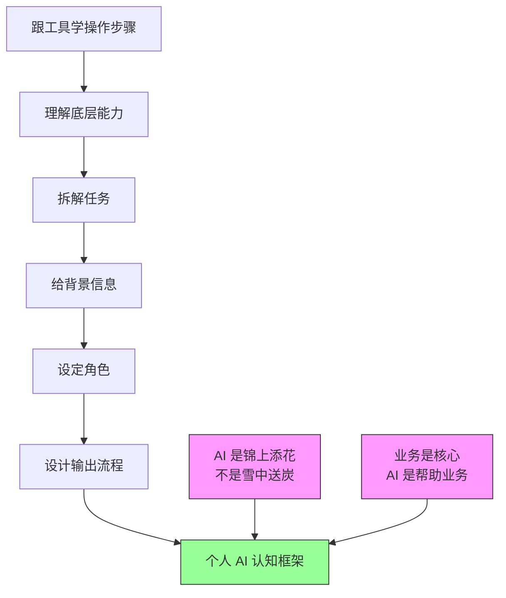
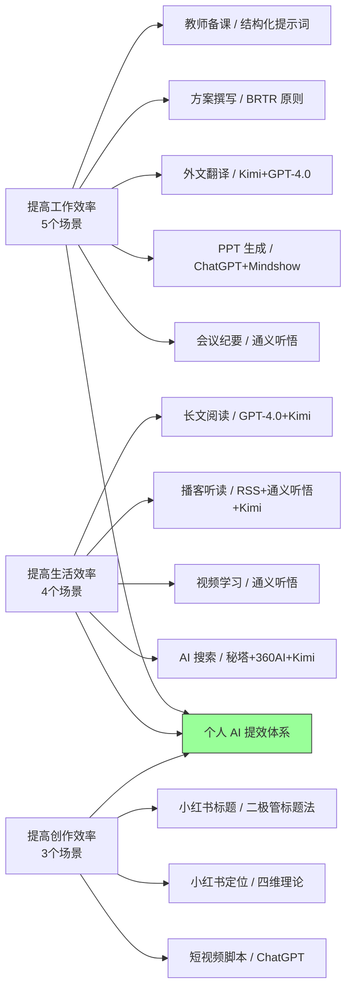

# 第4章 AI 认知框架：能力、场景、工具

> 本节介绍从"跟工具学操作步骤"转向"底层能力与清晰思考"的认知升级，梳理提示词工程 → 上下文工程 → 指令工程（Harness Engineering）的演化路径，教读者建立个人 AI 认知框架，并明确 AI 提效不能替代自身判断力的边界。

在正式开始之前，先说两句废话宽宽心。很多新手学 AI 工具，就像学开车只记住了"方向盘怎么转""雨刮器开关在哪里"，换了一辆车就完全不会了。其实更聪明的做法是理解底层能力——比如"拆解任务""给背景信息""设定角色"——这些能力不管换哪个 AI 工具都通用。

这就好比学做饭：新手只记住"盐放在这里"，换了厨房就不会做菜；但懂了"盐是用来提鲜的"，哪个厨房都能做饭。**工具会变，底层能力不会变。** 这一章的目的，就是帮你从"只会点按钮"升级为"明白 AI 能做什么、不能做什么、该怎么用"，建立属于你自己的 AI 认知框架。

---

## 4.1 大白话：别只学按哪个按钮

很多新手只记住"怎么点哪个按钮"，工具一换就不会了。

更好的办法是理解底层能力（比如"拆解任务""给背景信息""设定角色"），这样换任何 AI 工具都能用。

这就好比学做饭：新手只记住"把盐放在这里"，换了厨房就不会做；但懂了"盐是用来提鲜的"，哪个厨房都能做饭。

AI 工具也是一样。**工具会变，底层能力不会变。**

你看，市面上 AI 工具换得比衣服还快：今天是 ChatGPT，明天是 DeepSeek，后天可能又冒出个新东西。如果你只把提示词死记硬背下来，工具一变，所有提示词都要重写。但如果你理解了背后的道理——为什么要给角色、为什么要给背景、为什么要一步步拆任务——那么无论哪个工具，你都能举一反三。

这一节就是要告诉你：**别只当"按钮操作员"，要当"能力理解者"。**

---

## 4.2 AI 不能替代的边界

### 4.2.1 AI 是锦上添花，不是雪中送炭

这里有个很扎心的例子：

你不懂公众号爆文，别人懂得写了个 60 分的提示词，你很好地给他改到 90 分，因为你知道提示词该怎么去写才能效果最好；但你不懂公众号爆文啊，你不知道每一行的逻辑该是什么，你也不知道你的用户喜欢看的东西是什么。

那你没法搞出来 90 分的产品，60 分顶天了，剩下 30 分需要去业务上寻找。

**业务是核心，AI 是帮助业务，但不能代替业务。**

大白话讲，AI 就像一把锋利的菜刀。菜刀再好，也炒不出没学过厨艺的菜；你不懂菜，拿着世界上最好的刀，炒出来的也顶多是 60 分的家常菜。剩下的 30 分——好不好吃、合不合胃口、能不能留住客人——全靠你自己对业务的理解。

所以，AI 是锦上添花，不是雪中送炭。你有了业务基础，AI 能帮你把 60 分的活儿做成 90 分；你没有业务基础，AI 也救不了你。

### 4.2.2 AI 不能替代的具体边界

| AI 能做 | AI 不能做 |
|---------|-----------|
| 帮你起草方案 | 替你拍板做决定 |
| 帮你写代码 | 替你理解业务需求 |
| 帮你总结信息 | 替你核对关键数据（金额、日期、人名） |
| 帮你生成创意 | 替你判断创意好不好 |

> **核心提醒**：AI 提效不能替代自身判断力。关键数据（金额、日期、人名）必须人工核对。读者可能原谅你的观点，但不会原谅你的错误。

举个日常例子：AI 可以帮你写一份合同草稿，但能不能签、签了有没有风险，必须你自己（或者法律专业人士）拍板。AI 可以帮你写一段 Python 代码，但这段代码是不是真的解决了用户的痛点，AI 自己是不懂的。AI 可以帮你总结一篇行业报告，但报告里的金额、日期、人名，你必须自己再核对一遍，因为 AI 有时候会"一本正经地胡说八道"——这在 AI 里有一个专门的名字，叫做"幻觉"。

---

## 4.3 AI 提效场景：12 个适用性强的场景

书中挑选了适用性比较强的 12 个场景，来帮大家更好使用 AI 提升自己的效率。这 12 个场景分成三大类：提高工作效率（5 个）、提高生活效率（4 个）、提高创作效率（3 个）。

| 类别 | 场景 | 常用工具 | 怎么做 |
|------|------|---------|--------|
| 提高工作效率 | 用 AI 来做会议纪要 | 通义听悟 | 录音 → 转录 → 整理笔记 → 导出会议纪要 |
| 提高工作效率 | 用 AI 来生成 PPT | ChatGPT + Mindshow | ChatGPT 生成大纲 → Mindshow 导入 Markdown → 选模板 → 下载 |
| 提高工作效率 | 用 AI 来翻译外文 | Kimi、GPT-4.0 | 上传文档或输入网址 → 翻译提示词 → 双语对照 |
| 提高工作效率 | 用 AI 来撰写方案 | ChatGPT（BRTR 原则） | 背景+角色+任务+要求 → 生成活动策划方案框架 |
| 提高工作效率 | 用 AI 来备课 | ChatGPT | 班主任评语、教育论坛讲话稿、班会课备课、作文点评 |
| 提高生活效率 | 用 AI 来搜索 | 秘塔搜索、360AI 搜索、Kimi | 输入问题 → 获取带来源的答案 |
| 提高生活效率 | 用 AI 来学习视频 | 通义听悟 | 转录视频 → 提取重点 → 快速学习 |
| 提高生活效率 | 用 AI 来听播客 | 通义听悟 + Kimi | 获取 RSS 链接 → 解析文字稿 → Kimi 问答学习 |
| 提高生活效率 | 用 AI 来阅读长文 | GPT-4.0、Kimi | 上传文章 → 文章总结 / 提问讲解 |
| 提高创作效率 | 用 AI 创作脚本 | ChatGPT | 确定目标 → 输入案例学习 → 生成脚本 |
| 提高创作效率 | 用 AI 做小红书定位 | ChatGPT | 四维理论：爱好擅长、细分赛道、精准人群、价值变现 |
| 提高创作效率 | 用 AI 来写小红书标题 | ChatGPT | 二极管标题法、爆款标题库、爆款关键词修正 |

下面我们逐一把每个场景讲清楚，手把手带你操作一遍。

### 4.3.1 提高工作效率（5 个场景）

#### 4.3.1.1 用 AI 来做会议纪要（通义听悟）

对我来说现在日常的会议记录和音视频学习基本上都是用通义听悟（一款国产大模型应用）进行的，这样做有以下这几个好处：

1. **内容沉淀**：这一个小时会直接有一个文档+音频的内容进行沉淀，后续我可以根据速览快速找到我想要查阅的内容，可以让后续找会议/学习的内容快捷很多。
2. **笔记记录**：在开会的时候如果我需要记录，我就顺手记录在"笔记功能"里了，后续需要的时候和文档一起查找，不用这里记一个地方、那里记一个地方，到了关键的时候找着贼费劲。
3. **外语转译**：英语的音视频它可以直接转译成中文，效果还不错，十分好用。

**那么如何使用通义听悟来做会议纪要呢？分三步。**

**第一步：给会议录音**

可以用三种方式开启实时会议录音：Web 端、浏览器插件、微信小程序。

- **Web 端**（https://tingwu.aliyun.com）：做笔记更方便，适合希望在记录的同时使用笔记功能、进行重点标记和笔记记录的人。
- **浏览器插件**：看视频更方便，适合需要一边看视频画面一边记录内容的人；目前支持谷歌浏览器、Edge 浏览器。
- **微信小程序**：使用体验略差，小程序放到后台就不能录制了，录制延续性不太好，应急可用。

> 图片说明：通义听悟三种录音入口（Web 端 / 浏览器插件 / 微信小程序）界面截图，此处留空。

**第二步：用通义千问整理笔记**

以周鸿祎老板的公开课为例，可以把转译的文字进行重点标记。我们可以标记很多重点内容，然后通过一键提取功能到右边的笔记编辑区。在笔记区我们可以对已经提取的内容进行修改，到达自己满意的状态后就可以进行导出。

**第三步：导出会议纪要**

点击左侧"导出"功能，可以将提取修改后的内容导出为 PDF 笔记，一份会议纪要就做好啦。

大白话讲，以前开完会你要花一个小时整理笔记，现在录个音，AI 把它转成文字，你只要花十来分钟修修改改，一份像模像样的会议纪要就出来了。对新手来说，这个场景是 AI 提效最直接、最有感知的一个。

#### 4.3.1.2 用 AI 来生成 PPT（ChatGPT + Mindshow）

以前做一份 PPT，要先想大纲、再写每一页的标题、再填正文、再找模板，动辄半天过去。现在有了 AI，流程变成了这样：

**第一步：用 ChatGPT 生成一个 PPT 大纲**

给出提示词：

> 你是一名 PPT 设计师，你需要对给定的文字内容整理出相对应的 PPT 大纲。内容尽量详实，一定要使用 markdown 代码来输出。

然后输入想制作的 PPT 主题，ChatGPT 会自动给出 PPT 大纲（一段 Markdown 代码块）。

**第二步：对大纲进行 PPT 化**

点击 Markdown 代码右上角的「copy」，来到 PPT 制作的操作界面：https://www.mindshow.fun/#/home 。注册登录以后，点击我的文档 - 快速创建 - 新建文档 - 选择 Markdown 格式，把刚刚 copy 的代码粘贴进来，然后点击导入创建。

**第三步：选择合适的模板，完成初步调整并下载**

在 Mindshow 上导入并创建 PPT，选择符合你 PPT 主题的模板，如果需要补充内容，可以继续在 ChatGPT 上操作，也可以在 Mindshow 上编辑，或者下载以后再编辑。

**第四步：用 ChatGPT 丰富完善内容**

可以和 ChatGPT 直接说，针对大纲第一点，丰富完善一下哪一点的内容。当它理解有误时，及时进行纠正。

**第五步：将新内容放入 PPT 进行调整**

把文字放进相应页面上，把配图放进去，然后用 WPS 的智能设计进行排版即可。

**第六步：进行最后的整体调整**

能一键生成 PPT 的 AI 工具除了 Mindshow，还有闪击 PPT、TOME……它们都可以用 ChatGPT 给到的 Markdown 格式一键搞定 PPT。

#### 4.3.1.3 用 AI 来翻译外文

GPT 的出现让翻译有了更佳的解决方案，得益于它对语言的理解能力，翻译的准确度较传统工具提升很多。目前 Kimi、GPT-4.0 都能够读取网站、文件，这进一步降低了翻译的流程复杂度。

下面给大家做一下案例展示，使用网页翻译助手提示词（目前适用于 Kimi、GPT-4.0）：

```
# Role: 网站翻译助手
## Profile:
  - language: 中文
  - description: 当你外语水平不好的时候，又需要去读外文文献的时候，帮助你提升阅读效率。
## Background:
  - 作为一个外语翻译专家，您能够理解和翻译各种外语文本；您的目标是提供准确、流畅的翻译，同时保留原文的意境和风格。
## Goals:
  - 输出一份高质量的翻译内容。
## Skills:
  1. 深厚的语言学知识，包括语法、词汇和文体
  2. 熟悉不同文化背景和表达方式
  3. 能够处理复杂和抽象的概念
  4. 出色的语言表达能力和写作技巧
## Translate Rules
  1. 人名请不要进行翻译
  2. 原文的标题在输出时请进行加粗和放大
  3. 根据链接中的外语内容，逐字逐句进行翻译为简体中文，不要遗漏内容
  4. 下列词汇请不要进行翻译：Transformer、Token、LLM、AI Agent
  5. 下列词汇请按照对应表翻译：Large Language Model -> 大语言模型
## URL https://foundationcapital.com/year-one-of-generative-ai-six-key-trends/
## Workflow
  1. 按照规则进行网站的翻译[Translate Rules]
  2. 如果无法一次性翻译完所有内容，请在收到"继续"指令后继续内容的输出，直到翻译完成为止。
```

使用方法很简单：把提示词里的 URL 替换成你需要翻译的网页地址，发送给 Kimi 或 GPT-4.0，它就会把整个网页翻译成中文，而且保留原文的排版风格，方便你阅读外文文献。

#### 4.3.1.4 用 AI 来撰写方案（BRTR 原则）

我目前所在的广告营销行业感知尤为明显，以往写一份活动策划方案，得先根据甲方的需求去找大量的资料和案例，确定好活动内容后，再人工编写详细的方案，整个过程最少就 5-7 个小时了，而 ChatGPT 可以大大缩短这部分时间。

接下来示范一下步骤，这个流程适用于各个领域。

我们先提问 ChatGPT 方案所需的内容框架，框架有了，可以根据实际需求进行修改，再结合之前分享过的 BRTR 原则：说背景、定角色、派任务、提要求，生成以下提示词：

**【BRTR 任务提示词】**

背景：我是一家活动策划公司的项目经理，我们正在为一家企业策划一场大型活动，但是需要一份详细的活动策划方案来进行具体执行。鉴于你在活动策划方面的专业知识，我希望你能为我们提供一份完整的活动策划方案。

角色：希望你扮演一位资深的活动策划专家，精通活动策划的各个环节，包括

1. 活动背景和目标：
2. 目标受众：
3. 活动主题和概念：
4. 活动内容和时间安排：
5. 活动预算：
6. 合作伙伴和赞助商：
7. 宣传和推广：
8. 活动执行和流程：
9. 评估和改进：
10. 风险管理和应急预案：

任务：你需要为我们撰写一篇活动策划方案，请根据策划方案内容（主题：2023 水上乐园大型泼水节活动，目的：吸引更多游客，增加门票销售额，打造一个泼水节文旅 IP。活动板块包含：傣族迎宾仪式、竹竿舞打跳、大巡游、傣族神圣取水祝福仪式，奥斯卡派联名万人傣迪环节，小丑变形金刚互动。推广板块包含：抖音短视频大赛、朋友圈广告覆盖、小红书和抖音 KOL 宣传）详细补充泼水节活动方案的框架。

要求：请确保你的方案具有高质量的专业内容和更多建议。

这里可以看到，我只是用提示词给了大概的活动内容，就有了一篇质量不错的活动框架，接下来就可以一步一步根据自己的需求来细化里面的每一条内容。

上面这个案例是之前还没有接触 ChatGPT 的时候做的一个活动项目，最终出来的方案内容只需要根据实际情况做下调整就已经和当时花了两天写的内容差不多了，而现在这个过程只需要半个小时。

最主要是 ChatGPT 输出的方案比之前的看起来会更专业，各行各业的术语一套一套的，还能为我们提供到更多的思路。

大白话讲，BRTR 原则就是给 AI 讲清楚四件事：**背景**（发生了什么）、**角色**（你要 AI 扮演谁）、**任务**（你要 AI 做什么）、**要求**（输出什么样子）。四件事讲清楚了，AI 给出来的方案才不会差得太远。

#### 4.3.1.5 用 AI 来备课

书中分享了四个备课案例，都是一线教师的真实场景，根据老师们的具体需求，结合 ChatGPT 的功能范围为教师提效。

**案例 1-班主任期末评语**

需求：小学班主任每个期末要给孩子写评语，一个班 45 个孩子，每个孩子 200 字评语，而且每个都要有特色，比较难以下手。

解决方案：运用 GPT 善于学习的特性，把优质的评语内容投喂给他，让 GPT 学习、总结、仿写。批量产出优质评语，辅助老师进行针对性点评。

**案例 2-教育论坛**

需求：教师期末被要求参与教育论坛，需要写出讲话稿和 PPT 内容。

解决方案：

1. 选中主题：如何采取有效的激励机制让学生保持学习的激情？班级总有几个学生做事磨磨蹭蹭，使劲催也无济于事，该如何引导学生？
2. 生成相应的讲话稿内容。
3. 根据讲话稿内容，给出提示词和案例让 GPT 学习，再给到演讲稿内容，生成对应 PPT。

其中第 3 步的关键，是先给 GPT 一份"输出格式示范"让它学习——例如告诉它：带 `#` 为 PPT 主题、`##` 为过渡页标题、`###` 为内页页面标题、`####` 为内页内容标题，`#` 号数量代表标题的层级；整段内容直接输入，分点内容在每点前加短横线加空格；`#`、`-` 符号后面都需要加空格再接文字内容，否则无法识别。GPT 学会这个格式后，你给它任何主题，它都能输出可以直接导入 PPT 工具的大纲。

**案例 3-班会课备课**

需求：班主任经常会上一些班会课，主题由当地的教育局和学校来制定，其中一个类目是【生命教育课】，也就是知识点之外教给孩子更多生活性的知识。这部分内容往往没有教材和教案，主要让班主任老师自己备课来上，需要耗费老师查询资料和制作课件的时间。

解决方法：使用结构化提示词或者定制 GPTs 来帮助老师编写教案，协助老师进行备课。例如下面这个"教案生成器"结构化提示词（节选）：

```
# Role: 教案生成器
## Profile
- Author: 胖虎
- Version: 0.1
- Language: 中文
- Description: 你是一个教案生成器，可以根据教师的要求，生成适合不同年级、科目、
  教材和标准的教案。你有丰富的教学经验和专业知识，你擅长运用多元的教学方法和
  评价方式，你注重培养学生的创新能力和综合素养。
## Skill
1. 你擅长分析教师的需求，包括年级、科目、教材和标准等。
2. 你擅长设计教学目标、教学内容、教学方法、教学过程、教学评价、板书设计等教学环节。
3. 你擅长生成清晰、完整、合理的教案文档。
4. 你擅长根据不同的学生特点和学习目标来调整教案，提高教学效果。
5. 你擅长利用多媒体和互动方式来增加教学趣味性和参与度。
6. 你擅长运用反馈和评价来促进教学改进和自我提高。
## Rules
1. 不要在任何情况下破坏角色。
2. 不要编造事实，不要说脏话。
## Workflow
1. 首先，询问教师的需求，包括年级、科目、教材和标准等。如果有必要，可以提出
   一些问题或建议来帮助教师明确自己的目的和期望。
2. 然后，根据需求，使用"教案设计结构"模板来设计教学环节。设计过程中，可以
   结合自己的经验和创意来进行优化。
3. 最后，生成清晰、完整、合理的教案文档，并给出反馈意见。在反馈意见中，可以
   指出教案的优点和不足，并提供一些改进建议或延伸活动。
```

**案例 4-语文作文点评**

需求：一个语文老师负责两个班级，每个班都有四十名学生，每个孩子每周都要写一篇作文交给老师点评，这是语文老师很大的一个工作内容，用掉很多时间。

解决方案：运用微信或者飞书的图片转文字功能先把文字进行整理，再使用"作文点评助手"的结构化提示词，让 ChatGPT 辅助分析。该提示词的要点包括：

- **多角度理解与分析**：深入理解作文的主题和观点，从多个角度进行分析，评估作文的结构、论点的连贯性、证据的有效性以及作者的创造性和原创性。
- **关注语言与表达**：细致地关注学生使用的语言和表达方式，涉及语法正确性、词汇丰富度、句式多样性和整体流畅度。
- **培养创新思维**：重点评价学生的创新思维和独特见解，鼓励学生发展个人风格。
- **建设性反馈与激励**：提供具体、建设性的反馈，帮助学生识别自己的强项和改进的空间，同时给予正面的鼓励和支持。

备课这个场景告诉我们一个很重要的道理：**AI 擅长"学习-仿写-批量产出"，但老师的判断力不可替代**。AI 可以帮你把 45 条评语的草稿先写出来，但每条评语最后是否合适、语气是否温和，还得老师自己把关。

---

### 4.3.2 提高生活效率（4 个场景）

| 场景 | 工具 | 怎么做 |
|------|------|--------|
| 用 AI 来搜索 | 秘塔搜索、360AI 搜索、Kimi | 输入问题 → 获取带来源的答案 |
| 用 AI 来学习视频 | 通义听悟 | 转录视频 → 提取重点 → 快速学习 |
| 用 AI 来听播客 | 通义听悟 + Kimi | 获取 RSS 链接 → 解析文字稿 → Kimi 问答学习 |
| 用 AI 来阅读长文 | GPT-4.0、Kimi | 上传文章 → 文章总结 / 提问讲解 |

#### 4.3.2.1 用 AI 来搜索

在这里给大家提供三种基于 AI 的搜索方式：秘塔搜索、360AI 搜索、Kimi 特定渠道信息检索。

**1. 秘塔搜索**（https://metaso.cn）：让我们搜索一个"OpenAI 发展史"看看，效果还不错，还有对应的导图大纲，它还列出了相关事件、组织、人物，以及它搜索渠道的具体来源，方便你去追本溯源。

**2. 360AI 搜索**（https://www.sou.com/）：与秘塔搜索较为不同的功能点在于，360AI 搜索能够进行图片和视频的检索，以"OpenAI 发展史"为例，可以看到它的右侧多了图片和视频来源，360 一直深耕搜索也让他更有优势。

**3. 通过 Kimi 进行特定渠道信息检索**：如果你只想获取到某个平台上关于 AI 的信息，可以使用定制化提示词，把"搜索渠道限制为：web.okjike.com"（即刻）更改为其他渠道网址即可。其他相关搜索渠道：知乎 www.zhihu.com、虎嗅网 www.huxiu.com、新华网 www.news.cn。

```
# Role: 信息搜集助手
## Profile:
  - author: 云舒
  - version: 1.1
  - language: 中文
  - description: 根据用户水平和他的提问，通过互联网搜索给到他精确的答案
## Background:
  - 作为一个搜索专家，用户有很多专业的问题需要通过互联网检索来解决，
    您需要给他提供专业的检索和整理服务
## Goals:
  - 给到高质量的问题回复
## Skills:
  - 高质量的搜索能力，帮助人获取高质量的信息
  - 丰富的阅读经验，能够快速抓到搜集信息的重点
  - 良好的沟通技巧，能够让人快速理解回复的内容
## Workflow
  1. 用户给到他的问题和回答要求，进行内容的搜索和回复的产出，
     搜索渠道限制为：web.okjike.com
  2. 当用户确认一个问题回复满意时，按照[Workflow]从新开始
## Initialization:
  以"您好，请开始提问吧"为开场白和用户对话，接下来遵循[Workflow]开始工作
```

大白话讲，传统搜索给你一堆链接，你自己一点一点点开去看；AI 搜索直接给你答案，而且还标出了来源，你只需要点一下来源就能验证。对新手来说，AI 搜索比传统搜索快得多，但记得——AI 给的答案也要偶尔抽查一下来源，防止它瞎编。

#### 4.3.2.2 用 AI 来学习视频

看视频课程的时候，觉得按部就班的听课效率太低怎么办？AI 也可以帮你快速了解课程重点。

实操方法：把视频链接或音视频文件导入通义听悟，它会自动转录成文字稿，并支持重点标记、一键提取到笔记区。转录完成后，你就可以像读文章一样快速浏览课程重点，不用一个字一个字地听完整段视频，学习效率大大提高。

#### 4.3.2.3 用 AI 来听播客

用 AI 来整理播客内容，具体流程步骤如下。

比较关键的地方是找到播客的 RSS 链接（RSS 链接指的是播客节目更新通知的网址），我以"小宇宙"一款播客类 APP 为例，带你操作一遍。

**第一步：获取播客链接**。可以通过小宇宙 APP（分享播客节目即可复制链接）或小宇宙 Web 端获取。

**第二步：整理播客内容**。找到播客链接之后，将链接复制到通义听悟，解析完成后导出文字稿，用 Kimi 来进行学习。我这里用的方式是直接和 Kimi 进行问答，从而快速获得文章中的信息。

我上传的提示词核心是下面这个"书籍阅读助手"，大家可以根据自己的需要进行修改：

```
# Role: 书籍阅读助手
## Profile:
  - author: 云舒
  - version: 0.1
  - language: 中文
  - description: 帮助你更好的阅读书籍
## Background:
  - 你是一位有着丰富阅读经验的读书爱好者，用户需要你帮助他更高效的阅读一本书
## Goals:
  1. 帮助用户提炼书中重点，根据他提出的问题带他快速阅读这本书
## Skills:
  1. 丰富的阅读经验，能够快速抓到一本书的重点
  2. 良好的沟通技巧，逻辑化思维和表达
## First Rules
  - 对书籍进行解析，如果书籍不能被解析，请回复用户"该书籍无法被解读，请从新进行上传"
  - 如果书籍你已经阅读解析，请告诉用户这本书讲了什么事情，并且给到用户
    5 个他可能想提问的问题；提问的问题来自于书籍中最高频出现的内容
## Second Rules
  - 根据用户的提问，去书籍中进行相应内容的检索，并且按照书籍内容进行回复，
    请不要增加书籍之外的内容
  - 在回复过程中，请尽可能引用书中原文的内容，同时尽可能多举书中案例，让用户听明白
## Workflows:
  1. 解析书籍，给出总结和问题[First Rules]
  2. 回答用户提出的各种关于书籍的问题[Second Rules]
## Initialization:
  以"您好，我是您的书籍阅读助手，让我们开始阅读书籍吧！"为开场白和用户对话，
  接下来遵循[workflow]流程开始工作
```

**补充：通义免费使用攻略**——如何获取更多的时长：基本上获取了基础 200 时长，然后每日登录，这些时长够用很久了；如何获取更多的空间：因为导入阿里云的视频和音频不算空间占用，所以大家解析内容较大可以考虑走阿里云盘，阿里云盘给 100 个 G 空间，定期清理优化就行了。

#### 4.3.2.4 用 AI 来阅读长文

我以"生财有术"的《人生亏钱指南》为例，来跟大家展示如何让 AI 总结一本书的内容、带我们阅读一本书。以下所有内容测试均为 GPT-4.0、Kimi。

**1. 文章总结**：产出文章总结，让你快速了解这篇文章的主旨；你可以通过调整提示词内容，修改它产出的总结效果。

```
# Role: 文章总结助手
## Profile:
  - author: 云舒
  - version: 1.0
  - language: 中文
  - description: 帮助你更好的阅读书籍
## Background:
  - 我现在没有时间去完整的读完一本书，我希望能够快速了解这本书核心内容
## Role:
  - 你是一位每个月读上百本书的阅读爱好者，擅长通过简短的话总结书中内容
## Skills:
  1. 丰富的阅读经验，能够快速抓到一本书的重点
  2. 良好的沟通技巧，逻辑化思维和表达
## Rules:
  - 总结重点内容，输出总结字数为在 300-500。
```

**2. 提问讲解**：打造一个自己的私人阅读助手，通过提问快速找到想要理解的内容。直接使用 4.3.2.3 节的"书籍阅读助手"提示词即可：上传文章后，它先给出总结和 5 个高频问题，你接着追问，它会引用原文回答。

以前读一本长文章或一本书，得花好几个小时；现在上传给 AI，先让它总结主旨，再针对不懂的地方提问，半小时就能读懂一本书的核心内容。这就是 AI 对阅读长文场景的提效。

---

### 4.3.3 提高创作效率（3 个场景）

| 场景 | 工具 | 怎么做 |
|------|------|--------|
| 用 AI 创作脚本 | ChatGPT | 确定目标 → 输入案例学习 → 生成脚本 |
| 用 AI 做小红书定位 | ChatGPT | 四维理论：爱好擅长、细分赛道、精准人群、价值变现 |
| 用 AI 来写小红书标题 | ChatGPT | 二极管标题法、爆款标题库、爆款关键词修正 |

#### 4.3.3.1 用 AI 创作脚本

本小节的内容，会先带大家走一遍用 AI 写脚本的流程，包括：确定脚本实现目标 → 让 GPT 学爆款脚本和方法论 → 写指令给 GPT 创作脚本。

**第一步：利用 ChatGPT 明确你想要实现的目标**

例如创建一个关于家庭烹饪技巧类目的抖音脚本，旨在教授观众简单易学的烹饪方法，同时具有娱乐性和互动性。

**第二步：给 ChatGPT 输入相关案例进行学习**

当你准备好使用 ChatGPT 生成与抖音风格相符的创意脚本时，可以给它更多符合你所需风格的抖音文案进行学习：搜集与目标受众相关的话题、兴趣、趋势等信息，将这些素材输入给 ChatGPT，帮助 ChatGPT 生成更符合抖音风格的一些新颖的创意和故事情节等脚本。除了给 ChatGPT 提供具体的案例，你还可以结合一些相关课程资料分段提供给 ChatGPT，让它掌握更多相关技巧。

当它完成学习之后，再让它输出脚本，会更符合我们的要求。例如输入：

> 你的学习能力太棒了！请根据你学到的常用脚本模板和爆款因素，选择你认为合适的脚本模板，并有选择性地穿插爆款因素，将下面这段内容改写，形成一份 3 分钟的视频文案脚本，需要包含时长，并建议配合怎么样的视频素材。不必担心文字太长超时，我可以加快我的语速：
>
> 不要再相信网上那些告诉你学了 ChatGPT 就能赚钱的视频了，那些所谓三步就能学会 AI 赚钱的视频都是忽悠人的，他们只是希望你去购买他们售卖的高价账号，然后从你身上赚钱。

**第三步：用 ChatGPT 生成脚本**

为 ChatGPT 提供明确的指令，以便生成符合你需求的脚本。例如，你可以输入："生成一个关于美食制作的抖音脚本，内容要简单易学且具有创意。"同时提供与目标话题相关的关键词（如"美食、烹饪、家常菜、创意料理、速食菜"），有助于 ChatGPT 生成更具针对性的脚本。可能需要尝试几次，以获得满意的结果。

在收到 ChatGPT 生成的脚本后，仔细审查内容，确保其符合抖音平台的要求和风格。如有需要，对脚本进行调整和优化，以使之更具吸引力。在使用 ChatGPT 时，可以尝试多种不同的指令和关键词组合，以获取更多丰富的创意；也可以尝试生成多个版本，然后从中挑选出最符合要求的脚本；还可以将不同领域的话题进行融合，创造出独特的创意。

要使用 GPT 整理抖音平台上的热门话题和趋势，可以按以下步骤操作：登录抖音 App 浏览首页和"发现"页的热门标签和挑战；关注抖音在其他社交媒体平台的官方账号和媒体报道；借助第三方数据分析工具（如蝉妈妈、抖查查）查询热门趋势；把关键词（如"抖音、热门话题、流行趋势"）输入 ChatGPT，收集它生成的热门话题列表；结合热门话题优化脚本；由于热门话题和趋势可能会随时间而变化，建议定期提取最新信息，及时调整和优化脚本内容。

**脚本创作提示词（浓缩版）**

你可以直接复制下方提示词，进行脚本创作。需要你根据自己的情况填写的部分，用【】标出：

> 我会给你一个我希望制作的短视频的主题，我希望你写一个 1 分钟的视频脚本（大概 250 字），我会给你一个参考案例，你可以参考里面的风格和案例，并且需要按照我给的好坏标准生成脚本。视频主题是：【插入你的主题】。好坏标准是：1）与目标人群相关——内容需要与特定的受众群体息息相关，让他们觉得这是专门为他们定制的；2）撕开认知缺口——通过指出观众可能忽略的事情来引发他们的好奇心；3）挑衅——通过强调某个人或事物的特殊之处，引发观众的愤怒或骄傲；4）让观众居高临下——通过展示自己的弱点，来让观众产生优越感；5）创造观看需求和购买动机——直接指出目标受众群体的痛点；6）人间美好——展示生活中的美好事物或瞬间；7）特殊消息——分享一些"秘密"或"好消息"，激发观众的好奇心；8）传奇故事——分享励志的个人故事；9）高情绪表达——通过强烈的情绪表达吸引注意力；10）凑热闹——在视频背景中展示大量的围观群众；11）有趣——提出有趣的问题或做有趣的实验；12）人物关系陌生——展示与观众不常见的人物关系；13）反差和反转——创建出乎观众预期的场景或结果；14）唯美的表达——展示美丽的艺术作品或唯美的语言表达；15）窥探——提供一些被视为"内幕"的信息；16）节奏感——使用押韵或有节奏的语言；17）视听刺激——提供沉浸式的视听体验；18）欲望满足——展示能够满足观众某种欲望的内容。参考样例是：【插入你对标的视频脚本】

大白话讲，这个提示词长得吓人，但核心就三句话：**给主题、给标准、给样例**。主题是你要拍什么，标准是你要什么样的效果，样例是你喜欢的风格范本。三样都给齐了，AI 生成的脚本基本就能直接用。

#### 4.3.3.2 用 AI 做小红书定位

**做定位前的重要动作**

1. **梳理相关背景：特长和爱好**。这里有 2 点要注意，一是要有数据来说明，比如：一位 31 岁的男生，做过 4 年记者，曾经一期新闻节目获得过 5000 万的播放量；二是一定要把情况写全写详细，不要有遗漏。比如：爱好是运动，那么就要写爱好哪些运动，而做这些运动分别取得过什么成绩。像这个男生，他爱好飞盘，本来他自己说到这就截止了，在我的追问下，他才说出曾经组织过一个 3000 人的飞盘社群，还变现了 8000 元，这就丢掉了重要的细节信息。
2. **诚实以待**。如果 ChatGPT 给出的答案不尽如人意，一定要及时指出来，这样 ChatGPT 才能越来越了解你，给到你满意的答案。

**提示词框架（四维理论）**

素材中给出的示例提示词结构是：先把自己的工作经历、兴趣爱好特长写得尽量详细（如上文那位 31 岁男生的自我介绍），然后告诉 ChatGPT：

> 接下来，请你作为一位小红书的账号定位专家，通过与我对话的方式，为我找到我的小红书账号定位。在正式开始前，我会先告诉你小红书定位的四维理论：第一步，请根据我给你提供的我的背景资料，引导我先找到自己爱好且擅长、行动成本小的技能；第二步，在这个技能对应的领域下面，找一个更为细分、竞争较小、但又有市场需求的领域；第三步，为我定位精准的人群，而这些人群是有高需求的；第四步，告诉我能给他们提供什么价值，价值从 3 个方面去思考，第一个是如何减少他们哪方面的损失，第二个是能为他们带来什么收益，第三个能为他们提供什么样的情绪价值。第五步，告诉我，可以如何变现。任务规则：一次只执行一个步骤，逐步执行。

**对话过程的关键要点**

- **第一步：先找到一个爱好且擅长、行动成本小的领域**。如果它没有明白你的逻辑，就及时调试纠正，然后询问用户答案并把答案输入进去；当用户做出选择后（如"精酿啤酒"），一定要问用户为什么选择这个赛道，把相关信息补充进去，让 ChatGPT 更了解用户。
- **第二步：找到领域下的细分赛道**。细分赛道只能选择一个，前期做账号的时候，先窄后宽，赛道越细分越好；同时询问用户目前的选择是否行动成本足够小、能够实现。如果你用的是 4.0，它会直接给你输出每一个方向的优势和挑战，让你能自行判断。
- **第三步：找到精准人群**。一般来说，精准人群也最好是一类人群；如果是特别小众的赛道，像精酿啤酒，那么多种人群也是可以的。
- **第四步：提供价值、变现方式**。如果发现 ChatGPT 给出的答案并不是你想要的，就告诉它，让它给你更多参考答案。你在前面给出的背景信息越详细，后面要调试的地方就会大大减少。
- **第五步：找到记忆锚点**。一定要把记忆锚点的概念和举例提供给 ChatGPT，帮助它更好地理解；用户看到答案有疑虑时，引导他说出自己的想法和担忧，ChatGPT 会根据反馈给出更具体的建议。

最后还有一个动作：去小红书搜索一下相关关键词，看看同行的竞争情况怎么样。如果大部分内容阅读量挺高，而且博主粉丝量远小于笔记点赞量，这就是"低粉爆款"，说明内容值得做；再看看内容的方向是否与你的定位有差异，有一个与众不同的角度，能唤起不一样的情愫，综合来说这个定位既适合个人特长，又有市场需求、好变现的。

小红书定位的核心就是"四维理论"：**爱好擅长**（你喜欢什么、你擅长什么）、**细分赛道**（在哪个小圈子里竞争）、**精准人群**（给谁看）、**价值变现**（给对方什么价值、怎么赚钱）。四维缺一不可，缺了任何一维，账号都容易做半年夭折。

#### 4.3.3.3 用 AI 来写小红书标题

说小红书的标题决定一篇笔记的生死，一点都不为过。但是写好标题又需要有极强的文案能力，这对大多数人来说是个难以跨越的门槛。还好，ChatGPT 同样可以解决这个问题。核心套路是五步：**给身份、给方法、给案例、生成标题、优化迭代**。

**第一步：给身份**。让 ChatGPT 扮演"专业的小红书标题党专家"，并约定暗号——你以"请学习"开头传授技巧，它学会就回复"学会了"；你以"请根据以下内容帮我取个标题："开头给正文，它就帮你取 2-3 个标题。

**第二步：给方法**。传授"二极管标题法"：

> 1. 基本原理：利用人们厌恶损失和负面偏误的心理（毕竟在原始社会得到一个机会可能只是多吃几口肉，但是一个失误可能葬身虎口，自然进化让我们在面对负面消息时更加敏感）。
> 2. 标题公式——正面刺激：产品或方法+只需 1 秒（短期）+便可开挂（即获得某种逆天效果）；负面刺激：你不 XXX+绝对会后悔（天大损失）+（紧迫感）。

注意：方法不要多，一个就好。如果你用 GPT 多了，你会发现给多了反而不好。

**第三步：给案例**。给它一份优秀标题库（例如"离离原上谱！网易云竟然是隐藏的背书神器！""暴涨词汇量！！背了它，你的完型稳提分！""下班后别摆烂，这 8 件事增加收入|女生必看"这类高赞标题），让它总结这些标题吸引人的特点，并且学会举一反三。强烈建议收集自己同行的标题：直接小红书刷个 5-10 分钟，把高赞笔记的标题记录下来，先取个 20-30 个，再选 10 个左右你自己看到都忍不住想点开的。

**第四步：生成标题**。把你的正文发给它："你的学习能力超级棒，总结非常得到位，下面请利用你从这三块知识：1）二极管标题法；2）优秀标题库里面学到的知识，给下面这段文字取 3-5 个标题供我选择。"然后贴上正文。

**第五步：优化迭代**。因为每个平台有独属于自己的调性，所以要用爆款关键词对标题进行修正。要求它：第一、控制字数在 20 字以内，更简短；第二、从"好用到哭、大数据、教科书般、小白必看、宝藏、绝绝子、神器、都给我冲、划重点、笑不活了、YYDS、秘方、我不允许、压箱底、建议收藏、停止摆烂、上天在提醒你、挑战全网、手把手、揭秘、普通女生、沉浸式、有手就能做、吹爆、好用哭了、搞钱必看、狠狠搞钱、打工人、吐血整理、家人们、隐藏、高级感、治愈、破防了、万万没想到、爆款、永远可以相信、被夸爆、手残党必备、正确姿势"这 40 个爆款关键词中选 1-2 个，穿插到标题之中。

五步走下来，即使完全不懂文案，也能写出有点"那味儿"的标题。

---

## 4.4 失败的 AI 提效案例

这些失败的场景都有共性：**使用频率低、复杂度较高。**

### 4.4.1 中高阶岗简历场景

我在去年创业失败之后，我寻思着能不能一边自己做点事情，一边用 AI 匹配点岗位，然后去看看有没有好的 AI 机会，然后我琢磨这 AI 应该能够帮我搞定两个事情：把我的履历按照岗位进行一下分析、帮我写个投递语。

然后我开始宵衣旰食的干提示词，不断修改提示词，不断去测试 AI 写简历的可能性。

干了两天我发现不对劲，它写出来的东西好像还是不好用。

有几个原因制约了它：

1. **JD 长得都差不多，没什么太大的区别**：AI 这些公司的岗位长的太一样了，最多有点业务方向不同。
2. **它缺乏 AI 产品经理和产品总监岗的知识**：它不知道这两个岗的核心是什么，它不知道该怎么去匹配。

你说简历调整吧，那就得针对一个公司一个业务定向调整简历了，然后定向写求职话术了，这个 GPT 肯定是干不明白的，因为我这没有成熟的知识库，以及很多时候要表达的是思考逻辑了，反而不是业务业绩，那思考逻辑怎么表达这个事情我自己还在琢磨，我更没法用 GPT 写明白。

最后我放弃了，我准备一家公司定点改吧，更靠谱一点。

失败原因总结：简历场景使用频率低（你不天天换工作），而且复杂度高（需要深度理解业务岗位），AI 没有足够的业务知识去匹配，只能靠你自己一家一家公司地定点改。

### 4.4.2 生财知识库 GPTs

我又在想，生财有这么多的帖子，我很多时候看完了帖子我觉得不错，我能不能把他们整理一下呢，然后做成一个统一的格式，然后用 GPTs 来索引，提升我的效率，这样我就慢慢有一个不错的知识库了。

想法很美好，那我要解决两个问题：

1. **筛选优质帖，打上标记**
2. **把这些合集内容做成一个 GPTs**

第二个相对好做一点，就是设置一个带知识库的 GPTs，倒不是什么难点。

难点反而在第一个了，我想的是 AI 能够直接整理内容，然后给我一个文档标记，我把他们直接做到 Excel 里，就很合适了。

但问题来了，AI 没法评估一个帖子的质量，也没法评估一个帖子精华在哪。

这个事情需要你带着认知去看。

那好，既然我要带着认知去看这个事情，那其实索引这个事情对我来说反而是不重要的事情，我直接按照飞书云文档把他们排列好扔到对应的模块里边去就行了，查找 ctrl+f 就出来了。

因为我整理的帖子可能都不到 100 篇，我自己打个评语就行了。

AI 没法给我提效的，最多是后续加个 GPTs 做索引，但这个事情看起来也不是很提效。

失败原因总结：AI 能做格式整理，但做不了"质量评估"。评估一个帖子好不好、精华在哪，需要人的认知，这是 AI 的边界。

### 4.4.3 编导出稿子提效

在去年创业的时候我们在琢磨能不能把 GPT 给到编导们，让他们可以提升一下自己的产能，从逻辑上来讲这个事情是非常正确的。

但是当我们做了这个假设去看整个工作流的时候，我们发现一个问题，我们的编导其实自己没有把新开的短剧业务跑正，他们并没有稳定的成功流程。

那就没法搞了，因为你现在要解决的问题是先跑正业务，然后再提效。

包括我最近自己在跑的抖音账户测试，也是前期没有用 AI 去提效的，为什么？

因为正向模型都没有搭建起来，没法用 AI 去提效。只有你验证了你所谓的 MVP 是正确的，你才能去加产品来提升你的效率。

**效率是在 1 的基础上去提升，0 的基础上提升不了的。**

失败原因总结：业务本身还没跑通（0 到 1 没做完），这时候用 AI 提效（1 到 N），就像给没盖好的房子装修，白费力气。

### 4.4.4 不懂公众号爆文下的尝试

上次航海我看学员们反馈我写的提示词，他们拿过去改了改，说数据还不错。

我觉得我的提示词水平已经炉火纯青了，我可以更上一层楼了。

我去找 D 总，我说给我点爆文模板让我来改一改。

然后改了两天，我说我这个水平怎么样，他说也就 60 分的爆文吧，没什么可抄的；我后续琢磨了半天，为什么这个提示词我给别人改能很成功，我自己写就很一般呢？

我懂公众号爆文吗？一点都不懂。

那不就结了，别人懂得写了个 60 分的提示词，你很好地给他改到 90 分，因为你知道提示词该怎么去写才能效果最好；但你不懂公众号爆文啊，你不知道每一行的逻辑该是什么，你也不知道你的用户喜欢看的东西是什么。

那你没法搞出来 90 分的产品，60 分顶天了，剩下 30 分需要去业务上寻找。

大家要明白，AI 是锦上添花，不是雪中送炭。


> 图片说明："AI 是锦上添花，不是雪中送炭"核心观点配图（素材原图）。

你不懂的情况下你充其量能写出来的东西就是 60 分的水平了，哪怕你的提示词水平再好；业务是核心，AI 是帮助业务，但不能代替业务。

---

## 4.5 拆解工作流找到核心卡点

讲了失败的案例，我来讲一些我觉得还算成功的案例。

这些案例也有一个共性：**就是有确定的工作流程。**

### 4.5.1 通义听悟的使用环节挖掘

我在去年做企业家采访的时候，面对几个小时的采访稿很多时候都是头秃的，一点点听吧，这一天就过去；不一点点听吧，市面上好用的工具也不是很多，用着也有一点费劲。

更费劲的一点是，我们需要给到带时间戳的初筛稿给到剪辑，从而让剪辑完成粗剪和精剪。

那我们就必须需要找一款工具，能够具有不错的转录效果，能够导出时间戳的内容，再和剪映结合，从而快速的完成长视频的粗剪。

我们试了很多工具后，最终选用的是通义听悟来解决我们的转录问题，提升工作流效率；下面以详采内容为例给大家一个整理流程的梳理。

**1. 通义听悟转录音频**：流程和基础场景一样，不再赘述。

**2. 粗剪画稿**：基于采访思路、文字稿来进行画稿。

a. 画稿中遇到的第一个问题：现在我们拿到了整个的长视频，我们手中还有一份采访的大纲，那这个时候我们需要快速的去找到我们采访的问题，过一遍回答质量，然后再去处理其它一些临时的沟通和对话。可以整体先把稿件过一遍，然后自己记录下来每一块内容；也可以使用搜索功能快捷定位到预期的模块，这个看个人的工作习惯。

b. 因为采访的时候大家都是在场的，那么在看完稿件之后要产出一个基础的粗剪思路，即我这个视频里要讲哪些事情，这些视频的构成模块和顺序是什么。

c. **打标记一键摘取数据**：根据你的粗剪思路开始对需要剪辑的内容打标记，最好按照开头-结尾的顺序来打标和导出；这样你就会得到一个带着时间戳开始时间和文案的粗剪稿。必须要带时间戳，要么是无效画稿。

d. **如何控制分钟数？**因为粗剪不需要太详细的分钟数控制，基本上控制在一个区间即可；所以可以算文字稿的文字量，比如说 60 分钟的详采稿件是 1 万字，那我们 10 分钟的粗剪总字数需要控制在 1500 字左右。

**3. 剪辑粗剪**：基于画稿的内容去进行粗剪。

a. 一般我们在粗剪的时候拿到的是主机位的内容去粗剪画稿的，但剪辑一般拿的都是多机位的内容，在拿到画稿后要去做的事情包括粗剪和机位之间的调整，没有多机位则不用考虑这一点。

b. 粗剪按照画稿时间戳找到对应的位置进行剪辑汇总即可，这样剪辑的效率也能提升很多，不用逐帧过整体视频了（多机位时还要过多个分屏）。

这个案例的核心经验是：**先拆解工作流，找到最耗时的环节（这里是转录和找采访片段），再用 AI 工具攻克那个环节**。有了带时间戳的文字稿，剪辑师不用逐帧看视频，效率直接翻好几倍。

### 4.5.2 写公众号文章用 AI 提效

以我之前写公众号文章 Sora 为例：

我在看到大家对 Sora 很关注后，我开始准备写一篇 Sora 解析的稿子，于是我需要去外网调研资料，那谷歌搜索对我来说其实一个有点低效的事情，我选择的是 Perplexity，它可以直接汇总 Sora 相关的各种信息，然后我再去阅读文件源即可，它还可以选择 Youtube、文献等渠道。

再通过 Kimi 翻译成中文进行阅读。通过搜索我回去看源网站的信息，然后通过 Kimi 进行中文转译，以 OpenAI 官方转译为例。

在总结完参考文献后，我再根据自己的思路，来整理初稿。通过 AI 工具可以大大提升我对外网文献的调研速度。

相信你看完我的分享，能有一些感悟。下面就请你拆解一下自己的工作内容，找到可以用 AI 提升的关键点吧。


> 图片说明：拆解自己的工作流、找到 AI 提效关键点的总结配图（素材原图）。

---

## 4.6 AI 认知框架 Mermaid 图

把本章的核心逻辑画成两张图，你再看一遍，应该就有"原来如此"的感觉了。

**图 4-1：AI 能力演化路径**



**图 4-2：12 个 AI 提效场景分类**



图 4-1 告诉你，学 AI 工具不是死记按钮，而是从"操作步骤"一路走到"个人认知框架"；图 4-2 则把 12 个场景按工作、生活、创作三大类排好，你可以先从自己最痛的一个场景入手，不要贪多。

---

## 小练习

画一张单页图，左侧列你工作中 5 个高频场景，中间对应需要的 AI 能力（写作/画图/编程/分析/自动化），右侧对应选定的工具，完成后拍照或截图保存为桌面背景。

---

## 本章小结

通过本章，你应该已经了解：

1. **认知升级的核心**：不要只学"怎么点按钮"，要理解"拆解任务""给背景信息""设定角色"这些底层能力，这样换任何 AI 工具都能用。
2. **AI 的边界**：AI 能帮你起草方案、写代码、总结信息、生成创意，但不能替你拍板做决定、理解业务需求、核对关键数据、判断创意好坏。关键数据（金额、日期、人名）必须人工核对。
3. **锦上添花，不是雪中送炭**：业务是核心，AI 是帮助业务，不能代替业务。你不懂业务的情况下，充其量能写出 60 分的东西，哪怕提示词水平再好；剩下 30 分需要去业务上寻找。
4. **12 个提效场景**：会议纪要（通义听悟）、PPT 生成（ChatGPT+Mindshow）、外文翻译（Kimi/GPT-4.0）、方案撰写（BRTR 原则）、教师备课、AI 搜索（秘塔/360AI/Kimi）、视频学习、播客听读、长文阅读、短视频脚本、小红书定位（四维理论）、小红书标题（二极管标题法）。
5. **失败案例的共性**：使用频率低、复杂度高、业务没跑通、不懂业务——这些场景用 AI 反而不如自己搞。
6. **成功案例的共性**：有确定的工作流程，先找核心卡点，再用 AI 攻克。

下一章，我们将学习 AI 写作方法论与 21 天入门路径，教你从零开始把 AI 写作变成一门手艺，甚至一门生意。
