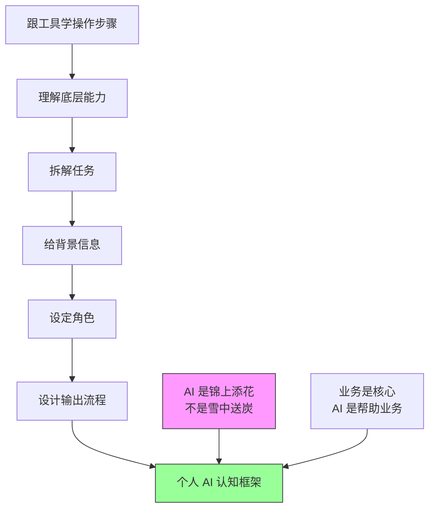

# 第4章 AI 认知框架：能力、场景、工具

> 本节介绍从"跟工具学操作步骤"转向"底层能力与清晰思考"的认知升级，梳理提示词工程 → 上下文工程 → 指令工程（Harness Engineering）的演化路径，教读者建立个人 AI 认知框架，并明确 AI 提效不能替代自身判断力的边界。

## 4.1 大白话：别只学按哪个按钮

很多新手只记住"怎么点哪个按钮"，工具一换就不会了。

更好的办法是理解底层能力（比如"拆解任务""给背景信息""设定角色"），这样换任何 AI 工具都能用。

这就好比学做饭：新手只记住"把盐放在这里"，换了厨房就不会做；但懂了"盐是用来提鲜的"，哪个厨房都能做饭。

AI 工具也是一样。**工具会变，底层能力不会变。**

## 4.2 AI 不能替代的边界

### 4.2.1 AI 是锦上添花，不是雪中送炭

这里有个很扎心的例子：

你不懂公众号爆文，别人懂得写了个 60 分的提示词，你很好给他改到 90 分，因为你知道提示词该怎么去写才能效果最好；但你不懂公众号爆文啊，你不知道每一行的逻辑该是什么，你也不知道你的用户喜欢看的东西是什么。

那你没法搞出来 90 分的产品，60 分顶天了，剩下 30 分需要去业务上寻找。

**业务是核心，AI 是帮助业务，但不能代替业务。**

### 4.2.2 AI 不能替代的具体边界

| AI 能做 | AI 不能做 |
|---------|-----------|
| 帮你起草方案 | 替你拍板做决定 |
| 帮你写代码 | 替你理解业务需求 |
| 帮你总结信息 | 替你核对关键数据（金额、日期、人名） |
| 帮你生成创意 | 替你判断创意好不好 |

> **核心提醒**：AI 提效不能替代自身判断力。关键数据（金额、日期、人名）必须人工核对。读者可能原谅你的观点，但不会原谅你的错误。

## 4.3 AI 提效场景：12 个适用性强的场景

书中挑选了适用性比较强的 12 个场景，来帮大家更好使用 AI 提升自己的效率。

### 4.3.1 提高工作效率（5 个场景）

| 场景 | 工具 | 怎么做 |
|------|------|--------|
| 用 AI 来做会议纪要 | 通义听悟 | 录音 → 转录 → 整理笔记 → 导出会议纪要 |
| 用 AI 来生成 PPT | ChatGPT + Mindshow | ChatGPT 生成大纲 → Mindshow 导入 Markdown → 选模板 → 下载 |
| 用 AI 来翻译外文 | Kimi、GPT-4.0 | 上传文档或输入网址 → 翻译提示词 → 双语对照 |
| 用 AI 来撰写方案 | ChatGPT（BRTR 原则） | 背景+角色+任务+规则 → 生成活动策划方案框架 |
| 用 AI 来备课 | ChatGPT | 班主任评语、教育论坛讲话稿、班会课备课、作文点评 |

#### 4.3.1.1 用 AI 来做会议纪要（通义听悟）

对我来说现在日常的会议记录和音视频学习基本上都是用通义听悟进行的，这样做有以下好处：

1. **内容沉淀**：这一个小时会直接有一个文档+音频的内容进行沉淀，后续我可以根据速览快速找到我想要查阅的内容，可以让后续找会议/学习的内容快捷很多。
2. **笔记记录**：在开会的时候如果我需要记录我就顺手记录在"笔记功能"那了，后续需要的时候和文档一起查找，不用这里记一个地方、那里记一个地方，到了关键的时候找着贼费劲。
3. **外语转译**：英语的音视频它可以直接转译成中文，效果还不错，十分好用。

**操作流程**：
1. 第一步：给会议录音（Web 端、浏览器插件、微信小程序）
2. 第二步：用通义千问整理笔记（重点标记 → 一键提取到笔记编辑区 → 修改）
3. 第三步：导出会议纪要（点击"导出"功能，导出为 PDF 笔记）

#### 4.3.1.2 用 AI 来生成 PPT（ChatGPT + Mindshow）

1. 第一步：用 ChatGPT 生成一个 PPT 大纲

   给出提示词：
   > 你是一名 PPT 设计师，你需要对给定的文字内容整理出相对应的 PPT 大纲。内容尽量详实，一定要使用 markdown 代码来输出。

   然后输入想制作的 PPT 主题，ChatGPT 会自动给出 PPT 大纲。

2. 第二步：对大纲进行 PPT 化

   点击 markdown 代码右上角的"copy"，来到 PPT 制作的操作界面：https://www.mindshow.fun/#/home

   注册登录以后，点击我的文档 - 快速创建 - 新建文档 - 选择 Markdown 格式，把刚刚 copy 的代码粘贴进来，然后点击导入创建。

3. 第三步：选择合适的模板，完成初步调整并下载

   在 Mindshow 上导入并创建 PPT，选择符合你 PPT 主题的模板，如果需要补充内容，可以继续在 ChatGPT 上操作，也可以在 Mindshow 上编辑，或者下载以后再编辑。

4. 第四步：用 ChatGPT 丰富完善内容

   可以和 ChatGPT 直接说，针对大纲第一点，丰富完善一下哪一点的内容。当它理解有误时，及时进行纠正。

5. 第五步：将新内容放入 PPT 进行调整

   把文字放进相应页面上，把配图放进去。然后用 WPS 的智能设计进行排版即可。

6. 第六步：进行最后的整体调整

   能一键生成 PPT 的 AI 工具除了 MindShow，还有闪击 PPT、TOME……它们都可以用 ChatGPT 给到的 markdown 格式一键搞定 PPT。

#### 4.3.1.3 用 AI 来翻译外文

GPT 的出现让翻译有了更佳的解决方案，得益于它对语言的理解能力，翻译的准确度较传统工具提升很多。目前 Kimi、GPT-4.0 都能够读取网站、文件，这进一步降低了翻译的流程复杂度。

下面给大家做一下案例展示：

**提示词示例**：
```
# Role: 网站翻译助手
## Profile:
  - language: 中文
  - description: 当你外语水平不好的时候，又需要去读外文文献的时候，帮助你提升阅读效率。
## Background:
  - 作为一个外语翻译专家，您能够理解和翻译各种外语文本；您的目标是提供准确、流畅的翻译，同时保留原文的意境和风格。
## Goals:
  - 输出一份高质量的翻译内容。
## Skills:
  1. 深厚的语言学知识，包括语法、词汇和文体
  2. 熟悉不同文化背景和表达方式
  3. 能够处理复杂和抽象的概念
  4. 出色的语言表达能力和写作技巧
## Translate Rules
  1. 人名请不要进行翻译
  2. 原文的标题在输出时请进行加粗和放大
  3. 根据链接中的外语内容，逐字逐句进行翻译为简体中文，不要遗漏内容
  4. 下列词汇请不要进行翻译：Transformer、Token、LLM、AI Agent
  5. 下列词汇请按照对应表翻译：Large Language Model -> 大语言模型
## URL https://foundationcapital.com/year-one-of-generative-ai-six-key-trends/
## Workflow
  1. 按照规则进行网站的翻译[Translate Rules]
  2. 如果无法一次性翻译完所有内容，请在收到"继续"指令后继续内容的输出，直到翻译完成为止。
```

#### 4.3.1.4 用 AI 来撰写方案

我目前所在的广告营销行业感知尤为明显，以往写一份活动策划方案，得先根据甲方的需求去找大量的资料和案例，确定好活动内容后，再人工编写详细的方案，整个过程最少就 5-7 个小时了，而 ChatGPT 可以大大缩短这部分时间。

**BRTR 任务提示词示例**：

```
背景：我是一家活动策划公司的项目经理，我们正在为一家企业策划一场大型活动，但是需要一份详细的活动策划方案来进行具体执行。鉴于你在活动策划方面的专业知识，我希望你能为我们提供一份完整的活动策划方案。

角色：希望你扮演一位资深的活动策划专家，精通活动策划的各个环节，包括
1. 活动背景和目标：
2. 目标受众：
3. 活动主题和概念：
4. 活动内容和时间安排：
5. 活动预算：
6. 合作伙伴和赞助商：
7. 宣传和推广：
8. 活动执行和流程：
9. 评估和改进：
10. 风险管理和应急预案：

任务：你需要为我们撰写一篇活动策划方案，请根据策划方案内容（主题：2023 水上乐园大型泼水节活动，目的：吸引更多游客，增加门票销售额，打造一个泼水节文旅 ip。

活动板块包含：傣族迎宾仪式、竹竿舞打跳、大巡游、傣族神圣取水祝福仪式，奥斯卡派联名万人傣迪环节，小丑变形金刚互动。

推广板块包含：抖音短视频大赛、朋友圈广告覆盖、小红书和抖音 KOL 宣传）详细补充泼水节活动方案的框架。

要求：请确保你的方案具有高质量的专业内容和更多建议。
```

上面这个案例是之前还没有接触 ChatGPT 的时候做的一个活动项目，最终出来的方案内容只需要根据实际情况做下调整就已经和当时花了两天写的内容差不多了，而现在这个过程只需要半个小时。

最主要是 ChatGPT 输出的方案比之前的看起来会更专业，各行各业的术语一套一套的，还能为我们提供到更多的思路。

#### 4.3.1.5 用 AI 来备课

书中分享了四个备课案例：

**案例 1-班主任期末评语**
需求：小学班主任每个期末要给孩子写评语，一个班 45 个孩子，每个孩子 200 字评语，而且每个都要有特色，比较难以下手。
解决方案：运用 GPT 善于学习的特性，把优质的评语内容投喂给他，让 GPT 学习、总结、仿写。批量产出优质评语，辅助老师进行针对性点评。

**案例 2-教育论坛**
需求：教师期末被要求参与教育论坛，需要写出讲话稿和 PPT 内容。
解决方案：
1. 选中主题：如何采取有效的激励机制让学生保持学习的激情？
2. 生成相应的讲话稿内容。
3. 根据讲话稿内容，给出提示词和案例让 GPT 学习，再给到演讲稿内容，生成对应 PPT。

**案例 3-班会课备课**
需求：班主任经常会上一些班会课，主题由当地的教育局和学习来制定，其中一个类目是【生命教育课】，也就是知识点之外交给孩子更多生活性的知识。
解决方法：使用结构化提示词或者定制 GPTs 来帮助老师编写教案，协助老师进行备课。

**案例 4-语文作文点评**
需求：一个语文老师负责两个班级，每个班都有四十名学生，每个孩子每周都要写一篇作文交给老师点评，这是语文老师很大的一个工作内容，用掉很多时间。
解决方案：运用微信或者飞书的图片转文字功能先把文字进行整理，再使用做出作文点评助手的提示词，让 ChatGPT 辅助分析。

### 4.3.2 提高生活效率（4 个场景）

| 场景 | 工具 | 怎么做 |
|------|------|--------|
| 用 AI 来搜索 | 秘塔搜索、360AI 搜索、Kimi | 输入问题 → 获取带来源的答案 |
| 用 AI 来学习视频 | 通义听悟 | 转录视频 → 提取重点 → 快速学习 |
| 用 AI 来听播客 | 通义听悟 + Kimi | 获取 RSS 链接 → 解析文字稿 → Kimi 问答学习 |
| 用 AI 来阅读长文 | GPT4.0、Kimi | 上传文章 → 文章总结 / 提问讲解 |

### 4.3.3 提高创作效率（3 个场景）

| 场景 | 工具 | 怎么做 |
|------|------|--------|
| 用 AI 创作脚本 | ChatGPT | 确定目标 → 输入案例学习 → 生成脚本 |
| 用 AI 做小红书定位 | ChatGPT | 四维理论：爱好擅长、细分赛道、精准人群、价值变现 |
| 用 AI 来写小红书标题 | ChatGPT | 二极管标题法、爆款标题库、爆款关键词修正 |

## 4.4 失败的 AI 提效案例

这些失败的场景都有共性：**使用频率低、复杂度较高**。

### 4.4.1 中高阶岗简历场景

我在去年创业失败之后，我寻思着能不能一边自己做点事情，一边用 AI 匹配点岗位，然后去看看有没有好的 AI 机会，然后我琢磨这 AI 应该能够帮我搞定两个事情：把我的履历按照岗位进行一下分析、帮我写个投递语。

然后我开始宵衣旰食的干提示词，不断修改提示词，不断去测试 AI 写简历的可能性。

干了两天我发现不对劲，它写出来的东西好像还是不好用。

有几个原因制约了它：

1. **JD 长得都差不多，没什么太大的区别**：AI 这些公司的岗位长的太一样了，最多有点业务方向不同。
2. **它缺乏 AI 产品经理和产品总监岗的知识**：它不知道这两个岗的核心是什么，它不知道该怎么去匹配。

你说简历调整吧，那就得针对一个公司一个业务定向调整简历了，然后定向写求职话术了，这个 GPT 肯定是干不明白的，因为我这没有成熟的知识库，以及很多时候要表达的是思考逻辑了，反而不是业务业绩，那思考逻辑怎么表达这个事情我自己还在琢磨，我更没法用 GPT 写明白。

最后我放弃了，我准备一家公司定点改吧，更靠谱一点。

### 4.4.2 生财知识库 GPTs

我又在想生财有这么多的帖子，我很多时候看完了帖子我觉得不错，我能不能把他们整理一下呢，然后做成一个统一的格式，然后用 GPTs 来索引，提升我的效率，这样我就慢慢有一个不错的知识库了。

想法很美好，那我要解决两个问题：

1. **筛选优质帖，打上标记**
2. **把这些合集内容做成一个 GPTs**

第二个相对好做一点，就是设置一个带知识库的 GPTs，倒不是什么难点。

难点反而在第一个了，我想的是 AI 能够直接整理内容，然后给我一个文档标记，我把他们直接做到 Excel 里，就很合适了。

但问题来了，AI 没法评估一个帖子的质量，也没法评估一个帖子精华在哪。

这个事情需要你带着认知去看。

那好既然我要带着认知去看这个事情，那其实索引这个事情对我来说反而是不重要的事情，我直接按照飞书云文档把他们排列好扔到对应的模块里边去就行了，查找 ctrl+f 就出来了。

因为我整理的帖子可能都不到 100 篇，我自己打个评语就行了。

AI 没法给我提效的，最多是后续加个 GPTs 做索引，但这个事情看起来也不是很提效。

### 4.4.3 编导出稿子提效

在去年创业的时候我们在琢磨能不能把 GPT 给到编导们，让他们可以提升一下自己的产能，从逻辑上来讲这个事情是非常正确的。

但是当我们做了这个假设去看整个工作流的时候，我们发现一个问题，我们的编导其实自己没有把新开的短剧业务跑正，他们并没有稳定的成功流程。

那就没法搞了，因为你现在要解决的问题是先跑正业务，然后再提效。

包括我最近自己在跑的抖音账户测试，也是前期没有用 AI 去提效的，为什么？

因为正向模型都没有搭建起来，没法用 AI 去提效。只有你验证了你所谓的 MVP 是正确的，你才能去加产品来提升你的效率。

**效率是在 1 的基础上去提升，0 的基础上提升不了的。**

### 4.4.4 不懂公众号爆文下的尝试

上次航海我看学员们反馈我写的提示词，他们拿过去改了改，说数据还不错。

我觉得我的提示词水平已经炉火纯青了，我可以更上一层楼了。

我去找 D 总，我说给我点爆文模板让我来改一改。

然后改了两天，我说我这个水平怎么样，他说也就 60 分的爆文吧，没什么可抄的；我后续琢磨了半天，为什么这个提示词我给别人改能很成功，我自己写就很一般呢？

**我懂公众号爆文吗？一点都不懂。**

那不就结了，别人懂得写了个 60 分的提示词，你很好给他改到 90 分，因为你知道提示词该怎么去写才能效果最好；但你不懂公众号爆文啊，你不知道每一行的逻辑该是什么，你也不知道你的用户喜欢看的东西是什么。

那你没法搞出来 90 分的产品，60 分顶天了，剩下 30 分需要去业务上寻找。

大家要明白，AI 是锦上添花，不是雪中送炭。

你不懂的情况下你充其量能写出来的东西就是 60 分的水平了，哪怕你的提示词水平再好；业务是核心，AI 是帮助业务，但不能代替业务。


## 4.5 拆解工作流找到核心卡点

讲了失败的案例，我来讲一些我觉得还算成功的案例。

这些案例也有一个共性：**就是有确定的工作流程。**

### 4.5.1 通义听悟的使用环节挖掘

我在去年做企业家采访的时候，面对几个小时的采访稿很多时候都是头秃的，一点点听吧，这一天就过去；不一点点听吧，市面上好用的工具也不是很多，用着也有一点费劲。

更费劲的一点是，我们需要给到带时间戳的初筛稿给到剪辑，从而让剪辑完成粗剪和精剪。

那我们就必须需要找一款工具，能够具有不错的转移效果，能够导出时间戳的内容，再和剪映结合，从而快速的完成长视频的粗剪。

我们试了很多工具后，最终选用的是通义听悟来解决我们的转译问题，提升工作流效率；下面以详采内容为例给大家一个整理流程的梳理。

**1. 通义听悟转录音频**：流程和基础场景一样，不再赘述。

**2. 粗剪画稿**：基于采访思路、文字稿来进行画稿。

a. 画稿中遇到的第一个问题：现在我们拿到了整个的长视频，我们手中还有一份采访的大纲，那这个时候我们要需要快速的去找到我们采访的问题，过一遍回答质量怎么办，然后再去处理其它一些临时的沟通和对话。

可以整体先把稿件过一遍，然后自己记录下来每一块内容；也可以使用搜索功能快捷定位到预期的模块，这个看个人的工作习惯。


a. 因为采访的时候大家都是在场的，那么在看完稿件之后要产出一个基础的粗剪思路，即我这个视频里要讲那些事情，这些视频的构成模块和顺序是什么。

a. 打标记一键摘取数据

根据你的粗剪思路开始对需要剪辑的内容打标记，最好按照开头-结尾的顺序来打标和导出；这样你就会得到一个带着时间戳开始时间和文案的粗剪稿。

必须要带时间戳，要么是无效画稿。


b. 如何控制分钟数？

可因为粗剪不需要太详细的分钟数控制，基本上控制在一个区间即可；所以可以算文字稿的文字量，比如说 60 分钟的详采稿件是 1 万字，那我们 10 分钟的粗剪总字数需要控制在 1500 字左右。

**3. 剪辑粗剪**：基于画稿的内容去进行粗剪。

a. 一般我们在粗剪的时候拿到的是主机位的内容去粗剪画稿的，但剪辑一般拿的是多机位的内容，在拿到画稿后要去做的事情包括粗剪和机位之间的调整，没有多机位则不用考虑这一点。

b. 粗剪按照画稿时间戳找到对应的位置进行剪辑汇总即可，这样剪辑的效率也能提升很多，不用逐帧过整体视频了（多机位时还要过多个分屏）。

### 4.5.2 写公众号文章用 AI 提效

以我之前写公众号文章 Sora 为例：

我在看到大家对 Sora 很关注后，我开始准备写一篇 Sora 解析的稿子，于是我需要去外网调研资料，那谷歌搜索对我来说其实一个有点低效的事情，我选择的是 Perplexity，它可以直接汇总 Sora 相关的各种信息，然后我再去阅读文件源即可，它还可以选择 Youtube、文献等渠道。


再通过 kimi 翻译成中文进行阅读。

通过搜索我回去看源网站的信息，然后通过 kimi 进行中文转译，以 OpenAI 官方转译为例：


在总结完参考文献后，我再根据自己的思路，来整理初稿。通过 AI 工具可以大大提升我对外网文献的调研速度。

相信你看完我的分享，能有一些感悟。下面就请你拆解一下自己的工作内容，找到可以用 AI 提升的关键点 吧。


## 4.6 AI 认知框架 Mermaid 图



## 小练习

画一张单页图，左侧列你工作中 5 个高频场景，中间对应需要的 AI 能力（写作/画图/编程/分析/自动化），右侧对应选定的工具，完成后拍照或截图保存为桌面背景。
