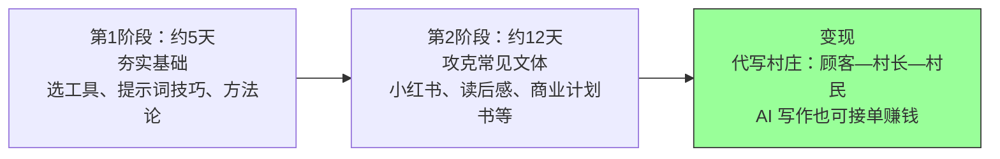

# 第5章 AI 写作方法论与 21 天入门路径

> 本节给出 21 天 AI 写作学习路径：第一阶段约 5 天夯实 AI 写作基础（选工具、必备技巧、底层方法论），第二阶段约 12 天攻克常见文体。以"代写村庄"故事讲清顾客—村长—村民的变现角色分工，让读者明白 AI 写作不仅是自我使用，也是可接单变现的服务。

在正式开始之前，先说两句废话宽宽心。很多人听到"AI 写作"四个字，第一反应是"我文笔差，写不出来"，或者"AI 能写出的东西，我凭什么看得上"。这两个顾虑都太重了。

事实上，AI 写作不是让你变成大文豪，也不是让你卖弄文采，它更像一个随时待命的代笔小助手。你不需要会写华丽丽的辞藻，只需要会用电脑、会打字、会跟 AI 对话，就能写出像模像样的文章，甚至还能接单赚钱。这一章就带你从零开始，用 21 天的时间，把 AI 写作从"听说过"变成"能上手"，再变成"能变现"。

---

## 5.1 项目分析：什么是 AI 写作？

### 5.1.1 大白话：AI 写作就是"代写村庄"

AI 写作，就是一个利用人工智能技术生成文本内容的项目。它能帮我们快速生成各类文章写作的类型，我们只要掌握它的技巧就可以了。

对于普通人不再担心文笔差了，现在可以通过 AI 轻松来来写作，甚至实现变现。

让文心一言以故事的形式，讲清楚 AI 写作变现逻辑：

**有一个代写村庄，这里的村民以代写为生，村民擅长写类型都不一样。客户提出写作需求，村民接受任务并按照客户的要求完成写作，最后客户支付报酬。**

这里面就有三个角色：

| 角色 | 职责 |
|------|------|
| **顾客** | 提出要求并支付报酬 |
| **村长** | 寻找顾客，并接到写作需求，招募村民入驻村庄 |
| **村民** | 根据顾客要求，完成写作，获取报酬 |

> 图片说明：代写村庄三角色分工示意图（素材中另一张配图缺失，此处留空）

本次航海就是让大家利用 AI 当好一位**村民**，后面选修也会给大家提供一个方案。

你可以这样理解：

- 你不会写文案没关系，AI 是村民，帮你写
- 你不懂怎么找客户没关系，你先当村民练手，写出成品再说
- 等你熟练了，可以当村长，接单之后再分给 AI 做，赚中间差价

大白话讲，传统写作里，你既是策划，也是写手，还是编辑，一肩挑三个角色，累得要命。而 AI 写作把"写手"这个角色交给了 AI，你只需要扮演好"村长"（接单、拆需求、把关成品）或者"顾客"（明确自己想要什么、愿意付多少报酬）。AI 当村民，负责把具体的文字磨出来。你不再需要自己一字一句憋出来，而是变成"出题人"和"验收员"。

这也就是为什么 AI 写作对新手友好：你不需要先成为一个好作家，你只需要成为一个"会下指令、会验收"的雇主，AI 替你扛起写作的重活。

---

## 5.2 新手从 0 到 1 的有效路径

本节给出 21 天 AI 写作学习路径，分为两个阶段。

### 5.2.1 第一阶段：掌握 AI 写作基础（约 5 天）

第一阶段大约 5 天，主要夯实 AI 写作基础，包括：

1. **选工具**：知道该用什么 AI 工具写作（ChatGPT、DeepSeek、Kimi、文心一言等）
2. **必备技巧**：掌握提示词工程（BRTR 框架、角色设定、原子任务、任务拆解）
3. **底层方法论**：明白 AI 的能力边界，知道什么能用 AI，什么不能用 AI

其中第 3 点"底层方法论"值得单独展开讲，因为它是整个 21 天路径里最容易被新手跳过、却又最影响上限的一环。

**用好 AI 的底层逻辑只有 2 点：**

1. **对 AI 的深度理解**（理解＝掌握 AI 的核心原理＋调教 AI 的技巧）
2. **垂类行业经验**

即 AI＋领域。二者，缺一不可。素材中用 2 个通俗易懂的小故事，来帮助大家更好地理解这个逻辑。

**故事一：AI 小白公众号大牛罗飞**

罗飞是一名十年的资深公众号编辑，经常写出 10w+阅读量的文章，写一篇公众号要花 2 天时间。罗飞想自己出来做工作室，批量运营 10 个公众号，接触了 AI，但是并不太会和 AI 沟通，一直觉得 AI 写出来的东西，像小学生的口水文一样，根本没法用。招人又觉得还没赚到钱，成本高，不值得，就放弃了。

如果罗飞掌握了 AI 的底层原理和终极调教技巧，凭借罗飞在公众号领域资深的垂类行业经验，他调教出来的 AI，将是一个分分钟能写 10 篇 10w+文章的小弟。同时拥有了罗飞的经验和机器人的速度。一个 AI 罗飞就是一个团队。

所以，一个 AI 领域的大神，必须具备【对 AI 的深度理解】（AI 的底层原理和终极调教技巧）。

**故事二：自媒体小王苦学 AI，仍难写爬虫代码**

小王每天花 2h 学习 AI，在网上看了各种 AI 使用的教程，好像学了很多内容。有一天，老板让小王采集 10 个媒体网站的数据，来做分析。小王想到有一篇教程教了如何用 AI 写一个爬虫，爬取数据。就去着手开工了，可是 AI 生成的爬虫代码，小王都不知道在哪运行，不知道这个代码能不能用。

小王只好放弃，手工的去收集数据了。

问题的重点出现在，就算小王会使用了 AI，这个 AI 也具备强大的写爬虫代码的能力，但由于小王自己不懂爬虫，通过 AI 写的代码遇到了问题，小王根本不知道如何正确的引导 AI 给出正确的解决方案。甚至不知道这个代码在哪里运行。

如果小王原本就是一个爬虫程序员，他可以搭建环境运行一下代码，就知道 AI 生成的代码能不能用了。代码万一有问题，小王本身就懂编程，有解决思路，那他只需要正确的引导 AI，告诉 AI 一些思路，就能调取出 AI 相应的知识，让 AI 来解决问题。小王在旁边喝茶看报等着就好了。

所以，一个领域的 AI 大神，只会 AI 是没用的，他首先必须具备这个领域的【垂类行业经验】，至少你要大概的懂一些相关知识，大概知道什么样是对的，什么样的错的。这样，AI 输出内容后，你才知道，这东西对不对，能不能用，合不合格，如果不合格，你要会挑错，告诉他哪里不对，最好能告诉他可以修改的方向。这样，你才能让 AI 这个高智商的小弟，使出浑身解数给你干活。

听完这两个故事，你还会觉得有了 AI 后，一个小白也可以跨行业秒杀程序员大神吗？结论显而易见：只会使用 AI，但是连垂类专业领域经验都没有，你把 AI 用在何处？人家沟通说的专有名词你都听不懂。反过来，只在传统垂类专业领域是大神、不会 AI 的人，也会在这两年快速被学了 AI 的大神同事干掉，人家一个人已经通过 AI 提效 10 倍产出了，你还在手工慢悠悠的干活……

未来，只属于：垂类行业大牛＋AI 应用大牛，合二为一的人。普通人要提升自己的行业专业度＋AI 应用能力。

> 图片说明：AI 底层认知方法论示意图（素材图）

大白话讲，用 AI 写作就像开一辆高档车：方向盘（调教技巧）你得会转，路线图（垂类行业经验）你也得看得懂。只会转方向盘不看路线，车开得再快也跑偏；懂路线但不会开车，你只能干看着。两样都会，才能把 AI 开到目的地。

### 5.2.2 第二阶段：学习常见文体写作（约 12 天）

第二阶段大约 12 天，攻克常见文体写作，包括：

- 小红书种草文案
- 读后感
- 商务邮件
- 公众号文章
- 其他常见文体

大白话讲，这个阶段就像学做菜练"招牌菜"：小红书种草文案是"轻食"（短平快、带情绪、要 emoji），读后感是"家常菜"（观点加个人感悟），商务邮件是"商务套餐"（逻辑严谨、语气得体），公众号文章是"宴席大菜"（选题、标题、正文结构一样不能少）。每练熟一道菜，你就多一门接单的手艺；常见的文体练完了，遇到没练过的文体，你也能照着套路举一反三。

### 5.2.3 21 天学习路径 Mermaid 图

把上面两个阶段画成一张路径图，你一眼就能看清学习的先后顺序：

> 图片说明：21 天 AI 写作学习路径示意图（素材图）

大白话讲，这条路径就像修路：第 1 阶段是打地基，地基不牢，后面盖楼（写各种文体）就会歪；第 2 阶段是盖楼，把常见的文体一个个攻克；最后一步是变现，把写出来的文章变成实际收入。整个 21 天，平均每天只需要投入 1-2 小时，完全是业余时间就能完成的。

---

## 5.3 为什么 21 天就能上手？

### 5.3.1 门槛很低

以前写作需要文笔，现在只需要会用电脑，会打字，会跟 AI 对话。

以前想写一篇像样的文章，你得先积累词汇、练习结构、琢磨开头结尾，动辄几个月才能入门。现在有了 AI，你不需要文笔，只需要清楚地告诉 AI 你想要什么，AI 就能帮你把文字组织好。哪怕你以前从没写过一篇完整的文章，跟着本章的路径走一遍，也能写出第一篇成品。

### 5.3.2 见效快

AI 写作不像学编程要几个月，AI 写作你今天学，明天就能出成品。

学编程要装环境、写代码、调 Bug，可能半年才能做出一个能用的小软件；而 AI 写作不需要安装任何东西，打开浏览器、注册个账号，就能开始。你今天学会怎么给 AI 下指令，明天就能生成第一条小红书种草文案、第一篇读后感，或者第一封商务邮件。见效快，是 AI 写作最大的吸引力之一。

### 5.3.3 可变现

写出成品之后，可以发布到公众号、小红书、知乎等平台，或者接单变现。

AI 写作不只是自我娱乐，写出来的东西可以直接派上用场：发在公众号上可能有阅读量和广告收益，发在小红书上可能带来粉丝和品牌合作，或者直接在闲鱼、小红书上接代写单子，帮客户写文案收费。也就是说，AI 写作是一门可以直接产生收入的技能，不是空谈。

---

## 5.4 21 天学习建议

下面给出逐天的学习安排，你可以照着日程表，一天一天推进。

### 第 1-5 天：夯实基础

- 第 1 天：选一个 AI 写作工具（如 DeepSeek 或 Kimi），注册并熟悉界面
- 第 2 天：学习提示词工程基础（角色设定、直接提问）
- 第 3 天：学习原子任务和任务拆解（把复杂任务拆成小步骤）
- 第 4 天：练习写一篇简单的文章（如 500 字读后感）
- 第 5 天：复盘前 4 天的作品，找出提示词可以优化的地方

第 2-3 天要学的"提示词工程基础"，核心就是素材中反复强调的【终极调教心法：1 个原则和 3 个技巧】，这里展开讲清楚。

**一个原则：角色扮演法。** 这是 OpenAI 官方基于 AI 原理给出的让 AI 听话的技巧。所有 GPT 的使用玩法，都跑不出角色扮演，只要你学会了这个原理，一切市面上的 GPT 玩法，你就都可以理解并知道它来源于此。

作用：角色扮演的目的让 GPT 从大脑中浩瀚的知识海洋里精准的调取到你需要的垂类知识，并且以你要求的角色口吻，和你对话。使用场景：适用于任何场景。

原理推论：ChatGPT 是一个知识渊博的智能小助理，如果你直接问他一个广泛的问题，他会在自己浩瀚的知识海洋里广泛的搜索，给出一个较为通用的答案。这样的答案，很表面，很粗略，没有思考，没有情感，几乎没有什么具体的价值。

但如果你的问题更加聚焦一个领域，即【给 GPT 限定一个角色】（给它一个身份），让 GPT 去 Cosplay（扮演）一个特定的角色，它就会只去相关领域知识库中搜素答案，答案也就更加的精准和专业。

如果你的问题更加明确，能【清晰的给 GPT 一个具体的任务】（你的目标是什么），它会将注意力全部放在这一个任务上，答案会更加准确，而不是特别发散的思维，让你感觉说的不痛不痒，没什么营养。

如果你的问题中，能【加上一些限制条件】（给出具体的要求），告诉 GPT 能做什么，不能做什么，它输出的答案将更加精准，更加符合你的预期。

AI 世界和人类世界一样，一个好的答案来自于一个好的问题。基于以上三点使用经验，可以总结出用【角色扮演法】调教提示词的 3 大原则：

1. **角色**
2. **任务**
3. **要求**

每一次提问时，都套用这 3 大原则，可事半功倍。注意，这 3 大原则不是独立的，而是相互作用，贯穿始终的。比如，在设定角色时，给出具体的要求，会让角色设定的效果更精准。"请你扮演一个老师" VS "请你扮演一个实战经验丰富的资深的英语口语老师"，显然后者是更精确的表达出了你的需求，让你和 GPT 沟通起来更加高效。

**先来感受一下。** 请你扮演《狮子王》的辛巴，你必须了解辛巴的所有知识。现在，请你用辛巴的语气和我打招呼。请使用辛巴的说话方式、思维、词汇和我沟通。只能像辛巴那样回答，不要写任何解释。

这个提示词，请大家先什么都不想的单纯去理解一下，不需要考虑任何模版和套路。你会发现，这就是一个正常的人与人对话的直接沟通。是先有的大量优秀实战案例，也就是经验，然后我们为了便于复制，总结出的理论性特征，也就是原则。

**结构化模板。** 把角色、任务、要求都写到一起，非常不方便修改，耦合度很高。特别是当提示词的字数非常多时，人类阅读都很麻烦，何况 AI 了，AI 理解起来效果也很不好。这时，我们将角色、任务、要求分成 3 个模块，来写提示词，就得到了结构化的【角色扮演法】提示词。以辛巴为例：

【角色】

请你扮演《狮子王》的辛巴，你必须了解辛巴的所有知识。

【任务】

现在，请你和我打招呼。

【要求】

1. 请使用辛巴的说话方式、思维、词汇和我沟通。
2. 只能像辛巴那样回答，不要写任何解释。

由此推导出最基础的角色扮演法结构化提示词模板，当你写任何提示词时，都可以套用：

**【提示词模板：角色扮演法】**

【角色】

请你扮演一个 XXX，你必须了解 XX 的所有知识。

【任务】

现在，请你 XXX

【要求】

1. XXX

2. XXX

3. XXX

大白话讲，写提示词就像给新员工下任务：你得告诉他他是谁（角色）、要干什么（任务）、要达到什么标准（要求）。三样都讲清楚了，AI 干出来的活才对胃口。结构化模板的好处是，每一部分可以单独修改，互不干扰，方便你不断调试、优化，最终积累出自己的一套"永久复用"的提示词模板。

### 第 6-17 天：攻克常见文体

- 第 6-8 天：小红书种草文案（学习起号、打标签、爆款结构）
- 第 9-11 天：读后感（学习观点提炼、个人化表达）
- 第 12-14 天：商务邮件（学习逻辑框架、说服性写作）
- 第 15-17 天：公众号文章（学习选题、标题、正文结构）

练每种文体时，建议遵循同一个节奏：第一天先看范文、拆结构（这篇文章凭什么好）；第二天用你学过的【角色】【任务】【要求】结构化提示词让 AI 生成初稿；第三天对照范文找差距、修改提示词再跑一遍。三天一轮，一轮比一轮快。

### 第 18-21 天：变现实战

- 第 18-19 天：写出 3 篇成品，发布到平台
- 第 20 天：尝试接单（如在闲鱼、小红书发布写作服务）
- 第 21 天：总复盘，制定后续学习计划

大白话讲，前 5 天是"练内功"，不急着出成品，只求把工具用顺、提示词写明白；中间 12 天是"练招式"，把常见的几种文体各练一遍，摸清每种文体的套路；最后 4 天是"上战场"，把文章发出去，尝试接第一单，看看自己的文字能不能换到真金白银。这三个阶段缺一不可，跳过任何一阶段，都会让后面的学习变得吃力。

---

## 小练习

按本节路径，花 3 天时间分别用 AI 完成一条小红书种草文案、一篇读后感、一封商务邮件，每篇都用不同工具（如 ChatGPT、Kimi、文心一言）并记录耗时对比。

> **参考模板**：
>
> | 文体 | AI 工具 | 耗时 | 难点 | 优化方向 |
> |------|---------|------|------|---------|
> | 小红书种草文案 | Kimi | 30 分钟 | 标题不够吸引人 | 加入 emoji 和爆款关键词 |
> | 读后感 | ChatGPT | 45 分钟 | 容易泛泛而谈 | 加入个人感悟 |
> | 商务邮件 | DeepSeek | 20 分钟 | 语气不够专业 | 设定资深职场专家角色 |

---

## 本章小结

通过本章，你应该已经了解：

1. **AI 写作的本质**：AI 写作就是利用人工智能技术生成文本内容的项目，普通人不再需要担心文笔差，通过 AI 可以轻松写作，甚至实现变现。
2. **代写村庄三个角色**：顾客（提出要求并支付报酬）、村长（寻找顾客、接需求、招募村民）、村民（根据要求完成写作、获取报酬）。21 天学习的目标，就是让你先用 AI 当好一位**村民**。
3. **21 天学习路径**：第 1 阶段约 5 天夯实基础（选工具、提示词技巧、方法论）；第 2 阶段约 12 天攻克常见文体（小红书种草文案、读后感、商务邮件、公众号文章）；第 18-21 天进行变现实战（发布成品、尝试接单、总复盘）。
4. **为什么 21 天就能上手**：门槛低（只需要会用电脑、打字、跟 AI 对话）、见效快（今天学明天就能出成品）、可变现（发布到平台或接单赚钱）。
5. **用好 AI 的底层逻辑只有 2 点**：对 AI 的深度理解（掌握核心原理＋调教技巧）＋ 垂类行业经验（AI＋领域）。二者缺一不可，只有业务是核心，AI 才能真正提效。
6. **Prompt 终极调教心法**：1 个原则（角色扮演法）＋ 3 个技巧（角色、任务、要求）。每次提问都套用结构化模板【角色】、【任务】、【要求】，可事半功倍。

下一章，我们将深入学习常见文体的 AI 写作实战，逐个攻克小红书文案、读后感、商业计划书等主流文体。
