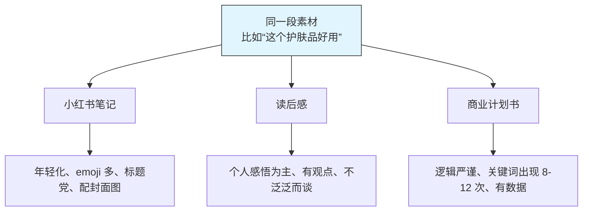
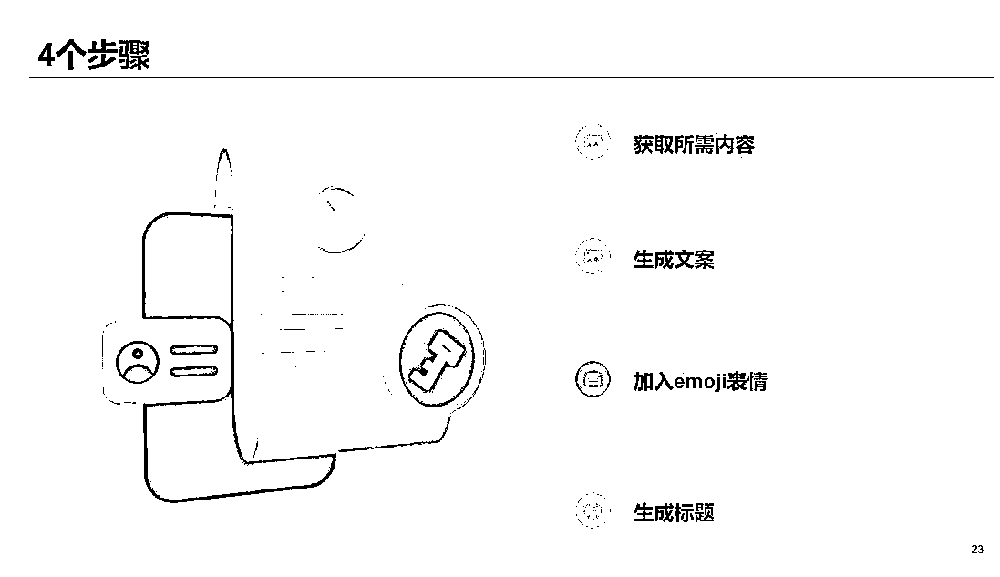
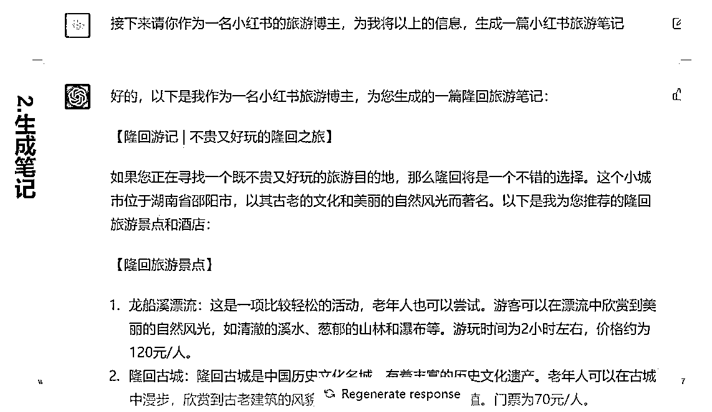
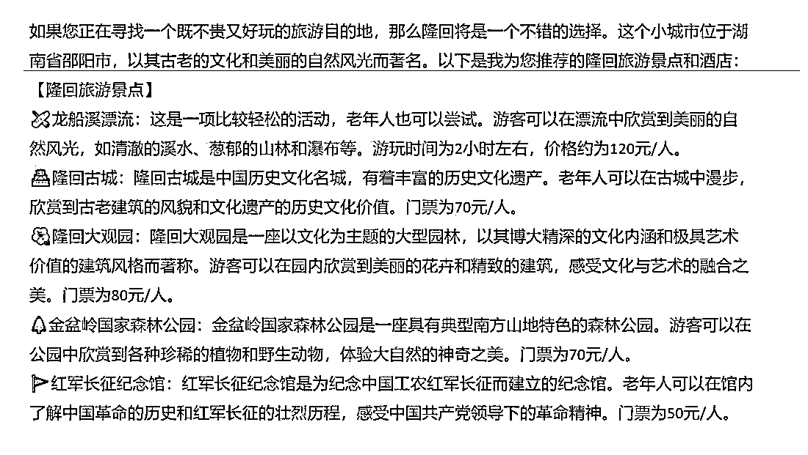
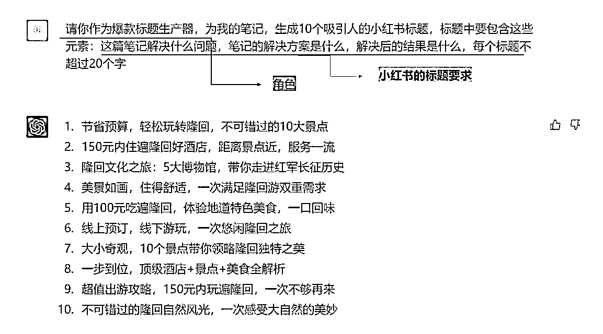
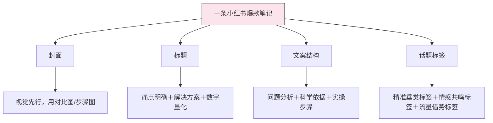
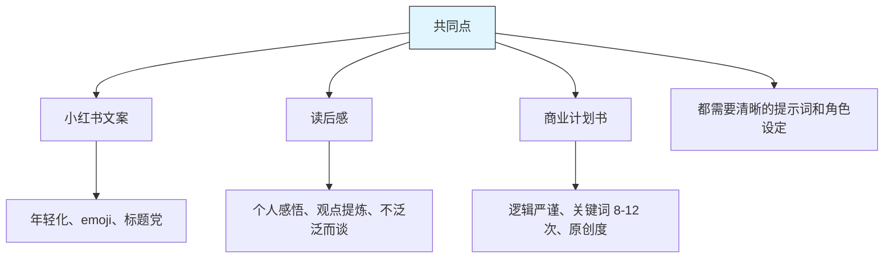

# 第6章 常见文体的 AI 写作（📕文案、读后感、商业计划书等）

> 本章逐文体拆解 AI 写作模板与技巧：📕笔记的起号打标签与爆款结构、读后感的观点提炼与个人化表达、商业计划书的逻辑框架与说服性写作。每个文体均配可复制的提示词手册，读者对照复制即可实战演练。

在前面的章节里，我们已经学会了怎么跟 AI 说话，也就是怎么写一条让 AI 听得懂的提示词。有了这把“钥匙”，接下来自然就会问：那我到底能用 AI 写点什么呢？别担心，本章不要求你有任何写作功底，甚至不要求你以前写过作文。你只需要会打字、会复制粘贴，就能跟着本章的模板，直接生成可以发出来的内容。

再说两句“废话”宽宽心：AI 写东西的速度很快，但它不懂你平台的规矩，也不懂你读者喜欢什么。在📕发一篇像👸号那样长篇大论的文章，没人会看；写读后感时如果只堆书里的名句，又读起来像书评集，没有灵魂。所以本章的核心思路是：**先搞懂平台是什么脾气，再让 AI 对症下药**，而不是指望 AI 一次性吐出完美成品。下面我们就逐个文体拆开来看。

---

## 6.1 大白话：不同平台的文案就像不同口味的菜

不同平台的文案就像不同口味的菜，📕要“年轻、有 emoji、标题党”，读后感要“个人感悟为主”，商业计划书要“逻辑严谨、有数据”。套不同的模板，AI 出的东西才合适。

举个生活中的例子：同一家店的招牌菜“红烧肉”，在快餐店里可能是配白饭的单道菜，在婚宴上可能是摆在桌中央的大菜，在养生馆里可能改成少油少盐的版本。主料一样，但做法、摆盘、配菜都得根据“吃饭的场合”来调整。写文案也是一样的：你手里有一段关于“某款护肤品很好用”的素材，发到📕上要加上“亲测好用✨快来冲！”，发到读书群里变成读后感就要写“我读完这本书想到了……”，写成商业计划书就要加上市场规模、目标用户和盈利预测。

为了让你一眼看懂三种文体的区别，下面做了一个对比表：

| 文体 | 发在哪里 | 读者是谁 | 最在意什么 | 忌讳什么 |
|------|---------|---------|-----------|---------|
| 📕笔记 | 📕 App | 喜欢逛笔记、找攻略的年轻人 | 标题吸睛、有 emoji、分点清晰、有真实感 | 长篇大论、官方腔、没有封面图配套 |
| 读后感 | 朋友圈、读书群、👸号 | 同好读者、可能读过同一本书的人 | 个人感受真挚、有具体观点、不泛泛而谈 | 只复述情节、编造书里没有的内容 |
| 商业计划书/带货文章 | 百家号、👸号、创业平台 | 消费者、投资人、合作伙伴 | 关键词命中搜索、逻辑严实、数据支撑、原创 | 标题党与内容不符、堆砌关键词、抄袭 |

**一句话记住**：AI 是厨师，平台是餐厅，你是掌舀勺子的人。你得先告诉厨师今天开的是哪家店，它才能炒出合口味的菜。

下面这张图把“同一段素材变成三种文体”的过程画出来，帮你建立整体感觉：



---

## 6.2 📕笔记的 AI 写作

### 6.2.1 四个步骤用 ChatGPT 写一篇📕旅游笔记

书中以写一篇邵阳隆回的旅游笔记为例，分享了四个步骤。下面我们把每一步都讲透，并把操作顺序摆在你面面，你照着做一遍就能掌握。

#### 第一步：先通过 ChatGPT 来帮我们获取基础内容

在动笔写笔记之前，你得先有“素材”：目的地有哪些好玩的景点、哪些当地美食值得尝试、住宿推荐去哪里。这些信息你本来可能要在📕、携程、大众点评上翻好久，现在直接问 ChatGPT 就能一次性拿到一批。

你可以问 ChatGPT：

> "邵阳隆回有哪些好玩的景点？推荐几家当地特色餐馆，住宿推荐哪些？"

把获取到的内容整理好，作为后续生成文案的素材。

> **大白话**：这步相当于出发前“搜集攻略”。AI 读过互联网上大量的旅游攻略，它知道哪些景点出名、哪些餐馆当地人爱去，你不需要一个一个网页去翻，只需要把 AI 想象成一个走过很远路的导游，让它把笔记本掏出来给你抄下来就行。



> **图片说明**：四个步骤用 ChatGPT 写一篇📕旅游笔记的流程图（图源：《ChatGPT 提效 实战手册 202403》）。图上依次标出了：获取基础内容、生成文案、插入 emoji 表情、生成爆款标题。

#### 第二步：让它生成文案

有了景点、美食、住宿的素材，下一步就是把这些信息变成一篇适合发在📕上的笔记。这时候不要直接说“写一篇旅游笔记”，那样 AI 写出来的东西往往像导游手册，又干又没个性。关键在于**给它赋予一个角色**——📕的旅游博主，让它用📕博主的语气来写。

**提示词示例**：

```
你是一位小红书的旅游博主，擅长写吸引人的旅游笔记。
请根据以下信息，写一篇邵阳隆回的旅游笔记：
景点：[填入景点信息]
美食：[填入美食信息]
酒店：[填入酒店信息]
要求：语言年轻化，多用 emoji 表情，分点排版，适合小红书发布。
```



> **图片说明**：给 ChatGPT 赋予“📕旅游博主”角色并生成旅游笔记的对话截图（图源：《ChatGPT 提效 实战手册 202403》）。可以看到，设定角色后生成的内容更年轻化，更像真人博主在分享。

#### 第三步：通过 ChatGPT 可以快速地插入 emoji 表情

📕文案的一个显著特点，就是 emoji 表情多。一篇没有表情的笔记，放在📕的信息流里就像一堆文字墙，用户滑过去就不会停下来。所以在文案生成之后，你还可以专门给 AI 下一道指令，让它在每段开头和正文里插入合适的表情。

**指令示例**：

```
请在每段开头插入合适的 emoji 表情，文章内容里也要插入表情，让笔记更生动活泼。
```



> **图片说明**：插入 emoji 表情后的笔记效果（图源：《ChatGPT 提效 实战手册 202403》）。可以看到 AI 配得比较贴切，比如龙船溪漂流对应船的表情，隆回大观园对应花的表情，红军长征纪念馆对应红旗表情。

> **大白话**：emoji 在📕里起的是“断句”和“抓眼”的作用。手机屏幕小，用户习惯扫读而不是细读，一段文字里偶尔冒出个🍜、🏨、🚌，相当于在文字路面上装了减速带和路标，读者的眼睛会被带着走，读起来也不那么累。

#### 第四步：让它帮我们生成爆款标题

最后一步是给笔记起标题。📕用户大多是在“发现”页随机刷笔记，标题决定了别人会不会点进来。所以起标题的时候，不能只写“邵阳隆回旅游”，得告诉 AI：标题要包含解决什么问题、笔记的解决方案是什么、解决后的结果是什么，并且控制字数（建议 20 字以内，方便手机端完整显示）。

**指令示例**：

```
你是一位爆款标题生成器。请为上面的邵阳隆回旅游笔记生成 3-5 个标题，要求：
1. 包含解决什么问题、笔记的解决方案是什么、解决后的结果是什么
2. 标题字数控制在 20 字以内
3. 适合小红书传播，有吸引力
```

可以看到，生成的标题还是挺不错的，至少能打 80 分的水平。这样的水平，我们在外面可能要花 4000-5000 去请一个文案，但是有了 ChatGPT，这些钱都省下来了。



> **图片说明**：用 ChatGPT 生成的邵阳隆回旅游笔记爆款标题（图源：《ChatGPT 提效 实战手册 202403》）。

下面这张图总结了一条📕笔记由哪四个要素组成，每个要素都可以用 AI 来分析和复制：



### 6.2.2 📕文案提示词模板

下面是书中给出的可直接复制的📕文案提示词模板，采用 Role/Profile/Background/Goals/Rules/Workflow 结构，你把方括号里的内容换成你自己的需求就能用：

```
# Role: 小红书旅游博主
# Profile:
  - language: 中文
  - description: 擅长写吸引人的小红书旅游笔记
# Background:
  - 用户需要写一篇[目的地]的旅游笔记，发布到小红书平台
# Goals:
  - 生成一篇适合小红书的旅游笔记，语言年轻化，多用 emoji，分点排版
# Rules:
  1. 每段开头插入合适的 emoji 表情
  2. 正文内容里也要插入表情
  3. 分点排版，适合手机端阅读
  4. 标题控制在 20 字以内
# Workflow:
  1. 根据用户提供的景点、美食、酒店信息，生成旅游笔记正文
  2. 生成 3-5 个爆款标题供选择
```

> **大白话**：这个模板里的每一部分都有它的作用。Role 是告诉 AI“扮演谁”，相当于给它穿上📕博主的衣服；Goals 是告诉 AI“要写出什么”，Rules 是设定“写作禁忌和格式要求”，Workflow 则规定“先做什么、后做什么”，防止 AI 一次性把所有东西都往一堆里倒。你以后写其他主题的笔记（比如美食探店、护肤测评、穿搭分享），只需要把 Role 里的“旅游博主”换成“美食博主”，把 Background 里的[目的地]换成你的店名或产品，照着这个结构改改就能用。

除了上面的模板，再补充两个在📕上很实用的 AI 用法，来自《AI+📕一本通：爆款提示词+10大模板+视频课》：

**第一，用 AI 拆解“爆款因子”，精准复制爆款笔记。** 当你看到一条点赞量很高的爆款笔记时，可以把它的链接发给 AI，让它从四个维度拆解：封面、标题、文案结构、话题标签。拆解完成后，你就得到了一套可以直接套用的“爆款公式”。比如一条育儿类爆款笔记的标题拆解结果是“为什么+育儿核心痛点+情感化解决方案”，文案结构是“提问制造焦虑 → 名人金句降维解答 → 用户故事共鸣 → 价值升华引流”。你把自己的内容填进同样的结构里，就能写出同样有爆款潜质的笔记。

**第二，掌握标题和文案的通用特点。** 《AI+📕一本通》中给出的 15 条 AI 生成的📕标题共有这些特点：1）痛点明确＋解决方案；2）数字量化增强可信度；3）专业背书提升权威性；4）emoji 点睛不喧宾夺主；5）悬念式引发好奇心；6）实用干货导向。正文建议采用“问题分析＋科学依据＋实操步骤”结构，结尾可以加上“更多育儿问题评论区见”来增加互动。

**第三，了解📕的四大流量入口。** 写好笔记发出去之后，用户能通过哪些途径看到它？根据《玩透📕：素人博主从-0-到-1-实战手册》，一篇笔记主要有四个流量入口：

| 流量入口 | 含义 | 运营建议 |
|---------|------|---------|
| “发现”页面 | 兴趣流量的主战场，平台根据用户兴趣推荐笔记 | 做好封面和标题，提高点击率和完读率 |
| “关注”页面 | 粉丝流量的稳定来源，关注你的人会看到你的新笔记 | 稳定更新，维护粉丝关系 |
| “搜索”页面 | 精准流量的转化高地，用户主动搜关键词 | 标题和正文里自然植入关键词，话题标签要精准 |
| “同城”页面 | 同城流量，适合本地生活类笔记 | 发布时选择同城定位，适合餐饮、酒店、本地服务 |

> **新手避坑**：在📕刚起号的时候，建议养号一两周，像正常用户一样刷笔记、点赞、收藏，让系统给你打上标签；发布笔记时避免在正文里留联系方式或引导加🛰️，否则容易被限流。这些是平台规则，AI 替你写好文章，但账号怎么养还得你自己留意。

---

## 6.3 读后感的 AI 写作

### 6.3.1 直接让 AI 写读后感的问题

我们如果直接让 AI 来完成这篇读后感，内容会有很大概率泛泛而谈，或者有虚假信息。

> **大白话**：读后感最忌讳的是“只有感叹没有看法”，比如读完《活着》只写“福贵的人生真不幸，我们要珍惜当下”——这段话谁都能写，读完也没什么感觉。AI 如果直接生成，很容易陷入这个陷阱，写出一大段大家都同意、又没人记得的大白话；更糟糕的是，AI 可能会把书里的情节、人物关系、甚至引用的名句记混，编造出书里根本不存在的内容。这就是 1.4 节讲的“幻觉”问题，在写读后感时尤其容易出现，因为 AI 没有真的“读”过这本书，它只是根据概率在拼凑文字。

所以写读后感时，不能指望“一次指令搞定”，需要分步引导，让 AI 扮演“资深读者”，把你的个人阅读感受混进去。

### 6.3.2 圈友 @Cheese 海盐芝士 分享的三种方法

圈友 @Cheese 海盐芝士 分享了三种方法，让 ChatGPT 帮助更好的完成一篇读后感：

#### 方法一：直接让 ChatGPT 扮演资深读者

直接让 ChatGPT 扮演资深读者，产生一篇独树一帜的读后感内容。不再是“ AI 总结书情”，而是“资深读者结合自己的阅读经验谈感受”。

#### 方法二：将大纲中的每一个内容对应一个文章段落

对应一次生成的动作，一步一段地生成直到生成完整的文章。不要指望 AI 一次性吐出一篇 1000 字的读后感，那样容易泛泛而谈；应该先定大纲，再让 AI 按大纲里的每一个部分分别写，最后把段落拼起来。

#### 方法三：提示词中需要清晰的说明

提示词中需要清晰的说明 ChatGPT 需要扮演的角色、要做的任务、需要完成的内容大纲、内容要求。每一个大纲部分分别放到这个提示词模板中和 ChatGPT 对话，直到所有内容生成。

**读后感提示词模板**：

```
# Role: 资深读者
# Profile:
  - language: 中文
  - description: 擅长写有深度、有个人感悟的读后感
# Background:
  - 用户需要写一本《书名》的读后感
# Goals:
  - 生成一篇有个人观点、有深度、不泛泛而谈的读后感
# Rules:
  1. 不要泛泛而谈，要有具体的观点
  2. 结合个人阅读感受，避免虚假信息
  3. 每个大纲部分分别生成，不要一次性生成完整文章
# Workflow:
  1. 先确认读后感的大纲
  2. 按照大纲每个部分，分别生成对应段落
  3. 合并所有段落，形成完整读后感
```

> **大白话**：这个模板的关键在第 3 条规则——“每个大纲部分分别生成”。你可以把它理解为“盖房子先打地基，再砌墙，最后装修”。先让 AI 把读后感的大纲列出来（比如开篇介绍书名和作者、写印象最深的人物、谈一个具体情节的感受、结尾升华到自己的生活），然后你每确认好一部分，再让 AI 写下一部分。这样生成出来的文章，有你的个人痕迹，也不会出现 AI 瞎编情节的问题。

**实战示范（以《活着》为例）**：

第一步，让 AI 先列大纲：

> 请帮我拟定一篇《活着》读后感的大纲，包含 4-5 个部分，每部分简要说明写什么。

拿到大纲后，按顺序把每个部分交给 AI 生成，比如对“印象最深的人物”这一部分，你可以说：

> 我正在写《活着》的读后感，现在要写关于“福贵”这个人物的部分。请用资深读者的身份，结合福贵失去家人的经历，谈谈你对“活着”本身的理解，800 字左右，要有个人观点，不要只复述情节。

重复这个动作，直到所有部分都生成，最后合并成完整文章，再通读一遍，把书里的情节细节（比如人物名字、事件顺序）核对一遍，确保没有虚假信息。

---

## 6.4 商业计划书的 AI 写作

### 6.4.1 写文章要牢记的关键点

写文章的时候要牢记：最好多次出现关键词，文章篇幅推荐在 1000-1400 字，关键词出现的次数尽量保持 8-12 次。

> **大白话**：这里说的“商业计划书”，在书中的素材里对应的是一类带货型商业文章，比如《办公笔记本电脑推荐：适合办公用的笔记本电脑推荐》。这类文章的目的不是给投资人看的融资计划书，而是通过搜索被读者找到，然后种草产品、促成购买。所以写的时候要想着“搜索”：读者在搜索框里输入什么词（“办公笔记本电脑推荐”“办公笔记本电脑哪个品牌好”），你的文章里就要多次出现这些词，搜索引擎才更容易把你的文章推给读者。但也不能无脑堆砌，8-12 次是一个比较稳妥的区间，太少容易被忽略，太多又会被判定为作弊，影响原创和推荐。

### 6.4.2 文章的基本框架

书中以办公室电脑推荐的选题为例，文章标题为《办公笔记本电脑推荐：适合办公用的笔记本电脑推荐》或者《办公笔记本电脑推荐：办公笔记本电脑哪个品牌好》。

文章的基本框架是这样的：

| 部分 | 内容 |
|------|------|
| 第一部分：总述 | 比如现在移动办公场景越来越多，介绍选题背景和读者痛点 |
| 第二部分：选购要点 | 描述一下挑选适合办公用的笔记本，需要注意哪几点（屏幕、续航、性能、价格等） |
| 第三部分：产品推荐 | 介绍 3-4 款产品即可，每款简单说明优缺点和适合人群 |
| 第四部分：总结 | 比如以上就是推荐的几款适合办公用的笔记本，希望可以帮助到大家 |

这个框架也可以套用到其他商业计划或带货文章上，只需要把“办公笔记本电脑”换成你的产品或项目名称。写的时候，围绕核心关键词展开，每部分都自然带出关键词，控制在 8-12 次左右，全文保持在 1000-1400 字，这样既有搜索曝光的机会，又不会让读者读得疲劳。

### 6.4.3 原创度检测

在发表之前，通过网上的原创评估工具，看看文章能否通过原创审核。通常 1500 字的文章，原创检测出来的严重的重复次数小于 10 次，都没有问题。

> **大白话**：AI 写出来的东西，大概率是“改写”过的网上内容，如果你直接复制粘贴发布，平台的原创检测工具很容易查出重复，文章可能不被推荐，甚至被判定抄袭。所以发布前，先把文章丢到一个免费的原创检测网站跑一遍，看“严重重复次数”是否小于 10 次。如果重复太高，把重复的句子改成自己的话、调换一下段落顺序、加入自己的真实案例，再检测一次，直到通过为止。

### 6.4.4 商业计划书提示词模板

下面是可直接复制的商业计划书（带货型商业文章）提示词模板：

```
# Role: 商业计划书撰写专家
# Profile:
  - language: 中文
  - description: 擅长撰写逻辑严谨、有说服力的商业计划书
# Background:
  - 用户需要写一份商业计划书，用于[具体用途，如融资、项目申报]
# Goals:
  - 生成一篇 1000-1400 字的商业计划书，关键词出现 8-12 次
# Rules:
  1. 文章结构：总述、选购要点/方案要点、产品/方案推荐、总结
  2. 关键词多次出现，保持 8-12 次
  3. 逻辑清晰，有说服力
# Workflow:
  1. 先确认商业计划书的主题和关键词
  2. 按照四部分结构分别生成内容
  3. 检查关键词密度和原创度
```

使用时，把[具体用途]替换成你的实际场景（比如“用于融资”“用于项目申报”“用于📕带货”），把核心关键词（比如你的产品名）告诉 AI，要求它按照四部分结构分段生成，生成后再用原创度工具检测，修改重复率高的句子，最后发表。

---

## 6.5 三种文体对比 Mermaid 图

把本章三种文体的核心差异和共同点画成一张图，写完这一章后你再看一遍，应该能对“用 AI 写不同类型的文章”有一个完整的认识：



> **大白话**：无论写哪种文体，AI 都不会替你“拍板”。你得先知道什么样的📕笔记叫爆款、什么样的读后感叫有感触、什么样的商业计划书叫有说服力——这些判断标准来自你自己多看几篇优秀作品，AI 只负责帮你把文字生成得更快。掌握了本章的三个模板，再配合前面章节的提示词技巧，你就能在不同平台上快速量产内容了。

---

## 小练习

选一本你最近读过的书，用 AI 生成两版读后感（一版偏学术分析、一版偏📕个人体验），对比两版的语言风格与适用场景，并修改其中一版发布到社交平台。

> **参考模板**：
>
> **学术版提示词**：
> ```
> 你是一位文学评论家，请为《书名》写一篇学术风格的读后感，1000 字左右，重点分析主题、人物形象、艺术手法，语言严谨。
> ```
>
> **📕版提示词**：
> ```
> 你是一位小红书读书博主，请为《书名》写一篇读后感，800 字左右，语言年轻化，多用 emoji，分点排版，结合个人感悟，适合小红书发布。
> ```

---

## 本章小结

通过本章，你应该已经了解：

1. **不同平台的文案口味不同**：📕要年轻、有 emoji、标题党；读后感要个人感悟为主；商业计划书要逻辑严谨、关键词出现 8-12 次、字数 1000-1400 字，发布前用原创度工具检测，严重重复次数小于 10 次。
2. **📕笔记的四步走**：先用 AI 获取基础内容（景点、美食、酒店等），再给它赋予“📕博主”角色生成文案，接着插入 emoji 表情，最后生成 20 字以内的爆款标题。一条笔记由封面、标题、文案结构、话题标签四个要素组成，每个要素都可以用 AI 拆解爆款因子并复制。
3. **读后感不能一次性生成**：直接让 AI 写容易泛泛而谈或出现虚假信息。推荐三种方法：扮演资深读者、按大纲逐段生成、提示词中清晰说明角色、任务、大纲和要求。
4. **商业计划书/带货文章写作要点**：先确定主题和关键词，按“总述→选购/方案要点→产品推荐→总结”四部分结构写作，关键词控制在 8-12 次，发表前通过原创度检测。
5. **通用原则**：AI 是厨师，平台是餐厅，你是掌舀勺子的人。无论写什么文体，都要先搞懂平台规矩和读者口味，再让 AI 对症生成内容，最后由你人工把关、修改和发布。

下一章，我们将进入👸号领域，学习如何用 DeepSeek 写👸号爆文，从选题、标题、正文到润色，再聊聊如何靠流量主变现，甚至用自动化工作流批量产出。
