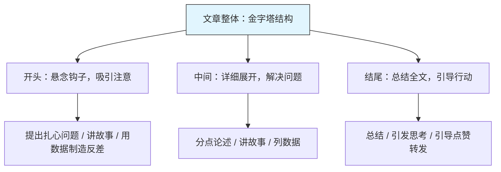
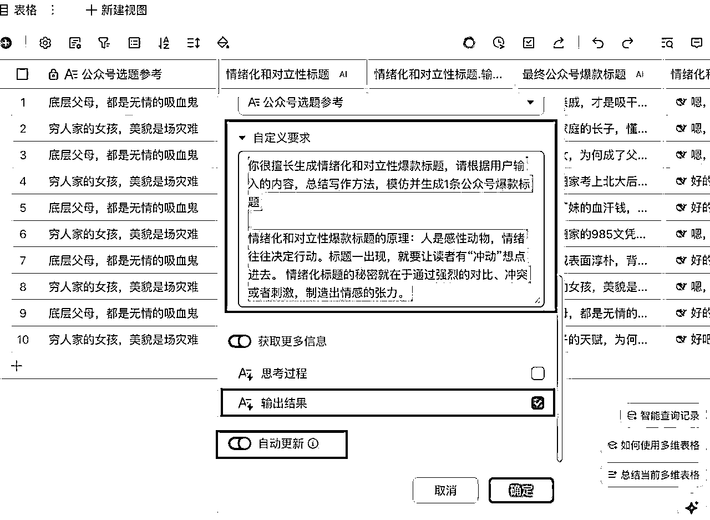
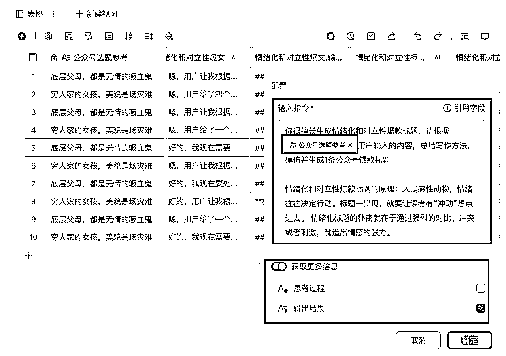

# 第7章 AI 辅助公众号爆文写作与自动化放大

> 本节介绍公众号拥抱算法后 0 粉丝也能进推荐流量池的机制，教读者跑通"选题 → 爆文写作 → 发布 → 变现"的最小可行性产品（MVP），再用 ChatGPT/Python 全自动化与多账号 AI 辅助放大产出。适合长期副业，包含流量主收款与收益案例拆解。

公众号现在不靠粉丝数，靠内容好不好。AI 帮你写，你负责选题和把关，发出去后有人读就有流量主收益。先跑通一篇，再想办法批量产出。

---

## 7.1 大白话：公众号现在不靠粉丝数，靠内容好不好

过去很多人觉得公众号“只有粉丝多才有读数”，于是花大力气买粉、刷粉，结果粉丝有了，推送出去却没人看，最后账号沉睡。现在的公众号不一样了：平台推开“推荐流量池”，一篇内容质量好的文章，哪怕账号是 0 粉丝新号，也有机会被推送给感兴趣的陌生人，获得几万甚至几十万的阅读量。这就意味着，普通人没有资源、没有粉丝基础，也能靠一篇好的文章起步。AI 可以帮你写文章、起标题、润色语言，但选什么题、说什么观点、发不发出来，还是要你自己拿主意。建议的做法是“先跑通一篇，再想办法批量产出”：先用 AI 写一篇垂直领域的爆文，发布并记录首 24 小时的阅读数、点赞数、评论数作为复盘基准；验证这个领域和写法可行之后，再用同样的流程批量产出。简单来说，公众号写作现在更接近“小红书笔记”那种兴趣流推荐逻辑：好内容才是入场券，AI 是帮你把文章写得更快、更好用的助手。

---

## 7.2 用 DeepSeek 写公众号文章：完整提示词

书中给 DeepSeek（深度思考模式+联网模式）的完整写文提示词，分为选题规划、生成标题、生成内容三个部分。

### 7.2.1 生成选题规划

```
任务目标：生成[具体领域]的选题规划

背景信息：
* 账号定位：[填写定位]
* 目标用户：[用户画像]
* 核心诉求：[用户需求]

要求：
（1）生成 10 个选题方向
（2）每个选题包含：
    * 主标题
    * 副标题
    * 核心观点
    * 价值主张
（3）考虑时效性与持久性的平衡

输出格式：表格呈现
```

> **大白话**：这个提示词的作用是让 AI 一次性给你列出 10 个可写的方向，每个方向都带主标题、副标题、核心观点和价值主张，方便你直接挑一个写。方括号里的内容要替换成你自己的账号情况：账号定位是什么（比如“职场新人成长”），目标用户是谁（比如“0-3 年职场新人，一二线城市”），核心诉求是什么（比如“快速成长、避免职场陷阱”）。替换完后，把整段发给 DeepSeek，要求它以表格形式输出，你就能一眼挑出最想写的那个选题。

### 7.2.2 生成文章标题

```
请基于以下要素生成文章标题:

主题：[主题]
核心观点：[观点]
目标用户：[用户群体]
价值类型：分析型/方法型/经验型
表达基调：专业/犀利/温和
必要元素：数据点/行业洞察/专家引用

差异化要求：
* 竞品分析：[3—5 个同主题标题]
* 创新角度：[具体说明]

生成要求：
* 提供 3 个方案
* 每个方案说明亮点
```

> **大白话**：标题决定读者会不会点开，所以这一步专门用来产出标题。你需要告诉 AI：这篇文章讲什么（主题），你要表达什么观点，面向哪些人，走什么风格，要不要带数据或专家引用。竞品分析那栏可以列 3-5 个同主题的已有标题，让 AI 在了解同行的同时避免撞车；创新角度则是告诉 AI 从哪个新视角切入，避免写出千篇一律的标题。AI 会给出 3 个方案，并分别说明每个方案的亮点，你再从中挑一个最顺眼的。

### 7.2.3 生成文章内容

```
任务描述：创作一篇深度分析类文章

主题：[主题]
目标：[写作目的]

一、结构设计要求：
（1）开篇模块（800 字以内）
    * 问题背景：从[数据/现象/热点]切入
    * 现状分析：点明行业痛点与挑战
    * 核心观点：提出独特视角与解决思路
（2）主体部分（2500 字左右）
    * 分论点展开：3—4 个核心论点
    * 每个论点要求：
        * 观点陈述（150 字左右）
        * 原理解析（300 字左右）
        * 案例佐证：2 个典型案例
        * 数据支撑：权威来源数据
        * 专家观点：引用领域专家验证
（3）结尾部分（700 字以内）
    * 观点总结：呼应开篇
    * 趋势判断：前瞻性洞察
    * 行动建议：3—5 点可执行建议

二、互动设计节点：
（1）开篇互动：设置情境思考问题
（2）主体互动：每个论点后设置观点讨论区
（3）结尾互动：邀请用户分享经验与观点

三、内容节奏控制：
（1）信息密度分配：
    * 开篇：以叙事为主，重在引发兴趣
    * 主体：论证为主，配比为 论述 40% + 案例 30% + 数据 20% + 专家观点 10%
    * 结尾：以洞察和建议为主，突出实操价值
（2）段落节奏：
    * 重点论述段：250—300 字
    * 案例描述段：200—250 字
    * 数据分析段：150—200 字
    * 过渡段落：100 字左右

四、高级要求：
（1）逻辑展开：
    * 论点之间：递进/并列/转折关系明确
    * 论据支撑：多维度佐证，避免单一类型证据
（2）思维深度：
    * 表层：现象描述与问题呈现
    * 中层：原因分析与逻辑推导
    * 深层：本质洞察与规律总结
（3）风格把控：
    * 语言基调：专业中立
    * 专业术语：核心术语解释到位
    * 表达方式：逻辑严谨，生动易懂

注意事项：
1. 避免观点过于绝对
2. 确保数据来源可靠
3. 案例选择需要具有代表性
4. 互动设计要自然融入文脉
```

> **大白话**：这是最核心的一步，AI 根据你给定的主题和目的，按“开头-中间-结尾”的完整结构写出正文。提示词里把字数、论点数量、案例数量、数据比例、互动位置都规定得很细，目的是防止 AI 写得太泛、太短，或者全是空话没有实操价值。使用时只需把[主题]和[写作目的]换成你自己的内容，其余结构可以先照抄，写得多了再根据自己的风格调整。

---

## 7.3 选题爆破（30% 精力）

### 7.3.1 明确目标用户

**小白技巧**：想象你的用户是什么样的人，他们每天会遇到什么问题，最需要什么帮助——把用户想成一个具体的人，越具体越好，选题就越准。

**指令示例**：

```
方案一：我的公众号文章主题是'职场 Pua'，请帮我罗列出'10'个可能受用户欢迎的细分选题，并进行验证。
方案二：请你满足用户的'用户需求'，生成 10 个高价值的爆款选题，并进行验证。
方案三：如果我的用户是'用户画像'，他们可能最关心什么？请列举 10 个当前最受用户欢迎的选题，并进行验证。
```

### 7.3.2 结合热点

平时多刷微博、抖音、知乎，看看大家都在聊什么，找到和你领域相关的热点。

**指令示例**：

```
方案一：账号定位是'某'，请结合'节假日'时间节点，帮我罗列出适合公众号用户的 10 个细分爆款选题，并验证。
方案二：账号定位是'某'，请结合'社会热点'，帮我罗列出适合公众号用户的 10 个细分爆款选题，并验证。
方案三：账号定位是'某'，请帮我'采集最近一周热点前十榜单'，罗列出适合公众号的 10 个细分爆款选题并验证。
```


> **图片说明**：选题实操截图（图源：《DeepSeek：从原理到实践》）。展示了如何把热点事件转化为适合公众号的细分选题。

### 7.3.3 制造情绪共鸣

在选题中加入情绪词，比如"震惊""颠覆""扎心""终于"等。

**指令示例**：

```
方案一：请你结合'细分选题'，优化情绪共鸣，生成爆款选题。
方案二：请你提炼出'细分选题'中，用户能够感受到的情绪，并给出后续的优化建议。
```

### 7.3.4 用问题式标题

多用"为什么""如何""怎样"等词开头，让用户觉得你的文章能解决他们的疑问。

---

## 7.4 结构设计（20% 精力）

高质量的内容结构通常体现以下特点：证据链完整、逻辑递进、多维视角。

### 7.4.1 设计金字塔结构

金字塔结构是最常用的文章结构，分为三部分：

1. **开头**：吸引用户注意，告诉他们为什么要看这篇文章。
2. **中间**：详细展开内容，解决用户的问题。
3. **结尾**：总结全文，引导用户行动（比如点赞、转发、留言）。

**开头：设置悬念钩子**

开头的目的是吸引用户继续看下去。你可以：

- 提出一个扎心的问题：比如"为什么你工作 3 年，工资却不如别人 1 年？"
- 讲一个有趣的故事：比如"昨天我朋友因为不会说话，被领导骂了一顿……"
- 用数据制造反差：比如"90% 的职场新人都在犯这 3 个错误，你呢？"

**中间部分是文章的主体，用来解决用户的问题。你可以：**

- 分点论述：比如"职场新人必须掌握的 3 个技能"，然后分别展开。
- 讲故事：用真实案例或故事来说明你的观点。
- 列数据：用数据增强说服力，比如"根据 XX 调查，80% 的职场新人都有这个问题"。

**结尾：促成行动**

结尾的目的是让用户有所收获，并引导他们行动。你可以：

- 总结全文：比如"总之 职场新人要想快速成长 必须掌握这 3 个技能"
- 引发思考：比如"你是不是也遇到过类似的问题？欢迎留言分享。"
- 引导行动：比如"如果你觉得这篇文章有用，欢迎点赞、转发给更多朋友。"

**小白技巧**：结尾要简洁有力，不要拖泥带水。

下面这张图把金字塔结构画出来，帮你记住文章的三层关系：



### 7.4.2 结构设计的模板

直接套用这些模板，快速设计文章结构：

**模板 1：问题-分析-解决方案**

1. 开头：提出一个用户关心的问题。比如"为什么你工作 3 年，工资却不如别人 1 年？"
2. 中间：分析问题的原因。比如"原因 1：你没有掌握核心技能；原因 2：你不懂职场规则……"
3. 结尾：给出解决方案。比如"要想快速升职加薪，你可以这样做……"

**模板 2：故事-道理-行动**

1. 开头：讲一个有趣的故事。比如"昨天我朋友因为不会说话，被领导骂了一顿……"
2. 中间：从故事中提炼出道理。比如"职场中，沟通能力比工作能力更重要……"
3. 结尾：引导用户行动。比如"如果你想提升沟通能力，可以试试这 3 个方法……"

**模板 3：数据-分析-建议**

1. 开头：用数据吸引注意。比如"根据 XX 调查，80% 的职场新人都有这个问题……"
2. 中间：分析数据背后的原因。比如"为什么会出现这种情况？原因 1……原因 2……"
3. 结尾：给出建议。比如"如果你想避免这个问题，可以这样做……"

---

## 7.5 内容生成（30% 精力）

### 7.5.1 开头：吸引用户注意

你可以用以下方法：

1. 提出问题：比如"为什么你工作 3 年，工资却不如别人 1 年？"
2. 讲故事：比如"昨天我朋友因为不会说话，被领导骂了一顿……"
3. 用数据：比如"根据 XX 调查，80% 的职场新人都有这个问题……"

**小白技巧**：开头一定要短小精悍，直接切入主题，不要啰嗦。

### 7.5.2 中间：详细展开内容

你可以用以下方法：

4. 分点论述：比如"职场新人必须掌握的 3 个技能"，然后分别展开。
5. 讲故事：用真实案例或故事来说明你的观点。
6. 列数据：用数据增强说服力，比如"根据 XX 调查，80% 的职场新人都有这个问题"。

每一部分都要有逻辑衔接，不要让用户觉得跳跃。

### 7.5.3 结尾：总结并引导行动

你可以用以下方法：

7. 总结全文：比如"总之，职场新人要想快速成长，必须掌握这 3 个技能。"
8. 引发思考：比如"你是不是也遇到过类似的问题？欢迎留言分享。"
9. 引导行动：比如"如果你觉得这篇文章有用，欢迎点赞、转发给更多朋友。"

**小白技巧**：结尾要简洁有力，不要拖泥带水。

---

## 7.6 特别技巧

### 7.6.1 热点新闻改写

热点事件在公众号平台的传播需要注意差异化视角和深度价值挖掘。

**指令示例**：

```
将'热点事件'转化为'话题角度'的分析文章，重点关注'核心观点'，需要包含数据支撑和专家观点。
```

### 7.6.2 原创内容创作

原创内容是公众号的核心竞争力。

**指令示例**：

```
以'主题'为核心，从'切入点'展开讨论，结合案例和方法论，形成'字数'的深度文章。
```

### 7.6.3 评论互动优化

基于用户反馈进行的内容创作，准确把握用户痛点，设计出更有针对性的解决方案。

**指令示例**：

```
分析'用户评论'中的关键问题，整理成'主题'的解答文章，包含实践建议。
```


> **图片说明**：特别技巧效果截图（图源：《DeepSeek：从原理到实践》）。展示了利用 AI 改写热点新闻、生成原创内容和优化评论互动的效果。

---

## 7.7 人性化润色（20% 精力）

### 7.7.1 加入口语化表达

用一些日常聊天的语气词和短句，让文章更亲切。

**原文**：“职场新人应该掌握沟通技巧。”
**润色后**：“说真的，职场新人最该学的就是怎么好好说话，你发现没？”

**小白技巧**：写完文章后，自己读一遍，看看哪些地方可以改成更口语化的表达。

**指令示例**：

```
把生硬的句子改成聊天的语气。
```

### 7.7.2 插入互动提问

在文章中多问一些问题，让用户觉得你在和他们对话。

**原文**：“很多人都有拖延症。”
**润色后**：“你是不是也经常拖延？明明有一堆事要做，却总是拖到最后一刻？”

**小白技巧**：在每一部分的结尾加一个问题，引导用户思考。

**指令示例**：

```
在每一部分的结尾加一个问题。
```

### 7.7.3 制造情感共鸣

用一些能引发用户情绪的词句，让他们觉得你懂他们的感受。

**原文**：“职场新人压力很大。”
**润色后**：“刚入职那会儿，我也经常焦虑到睡不着，总觉得自己做得不够好，你是不是也这样？”

### 7.7.4 加入视觉化比喻

用一些形象的比喻，让抽象的概念更容易理解。

**原文**（时间管理很重要）
**润色后**：“时间就像一块蛋糕，你切得越合理，吃得越香。”

**小白技巧**：把复杂的概念用日常生活中的事物来比喻。

**指令示例**：

```
用形象的比喻解释抽象的概念。
```

### 7.7.5 用加粗、emoji、分段等方式，让文章更易读

**原文**：“职场新人要掌握三个技能：沟通、时间管理、情绪管理。”
**润色后**：

```
职场新人最该掌握的 3 个技能：

💬 沟通：怎么说话才能让人舒服？
⏰ 时间管理：怎么把 24 小时用出 48 小时的效果？
😌 情绪管理：怎么不被工作压力压垮？
```

**指令示例**：

```
用加粗、emoji、分段等方式让文章更易读。
```

### 7.7.6 设置信息锚点

每段文字不要太长，适当加入小标题、加粗、emoji 等，让文章更有层次感。

**指令示例**：

```
给每部分加上小标题，重点句子加粗，每段控制在 3-4 行以内，段落之间留出空行。
```

---

## 7.8 用 DeepSeek 写标题

### 7.8.1 爆款标题的核心：3 秒内戳中用户"情绪痛点"或"认知缺口"

用户在公众号推荐页刷文章，大概只给标题 3 秒的时间：要么标题戳中了他的痛点或好奇心，他点开；要么滑过去，永远不再看到。所以标题的核心不是"文笔多好"，而是**3 秒内戳中用户的情绪痛点，或者制造认知缺口**。

- **情绪痛点**：读者身上真实存在的焦虑、委屈、挫败感。比如"30 岁还没结婚""每天加班到晚上九点""孩子不听话"。读者看到后会觉得"说的就是我自己"，产生强烈共鸣，点进去寻找答案。
- **认知缺口**：读者知道这件事跟自己有关，但不知道内情。比如"为什么越懂事的女孩越难被爱""985 毕业 5 年，为什么我成了公司最"便宜"的人？"标题里留了一个信息差，读者为了填补这个空白会忍不住点开。

**前三秒规则**：在手机端，标题前 8 个字最显眼（整个标题大约能显示 16 个字）。所以把最核心的关键词、情绪词放在标题开头，不要藏到后面。

举个对比，你会立刻感受到区别：

- 乏味版：《怎么提升职场沟通能力》
- 爆款版：《不会说话真的会吃亏：30 岁职场新人的 3 句话生存法》

乏味版只说"提升能力"，又泛又远，读者判断不出跟自己有没有关系；爆款版用了"吃亏"的痛点，加了"30 岁职场新人"的身份标签，还有"3 句话"的具体承诺，一眼就能判断出是否与自己相关。

**小白技巧**：写标题前先问自己一个问题——"我的读者最近最烦什么事？"把那个烦心事写进标题，就已经成功了一半。

**指令示例**：
```
请帮我写 3 个公众号爆款标题，主题是[主题]，要求每个标题都要戳中用户的情绪痛点或制造认知缺口，把关键词放在前 8 个字里，并说明每个标题的理由。
```

### 7.8.2 爆款标题 4 大核心要素

| 要素 | 说明 | 示例 |
|------|------|------|
| 情绪驱动 | 引发好奇、焦虑、共鸣或期待 | 《震惊！》《为什么…》 |
| 痛点直击 | 明确指向特定群体的困境 | 《30 岁未婚》《996 员工》 |
| 具体化 | 用数字、场景、细节增强真实感 | 《凌晨 3 点》《月薪 5000》 |
| 冲突对比 | 制造对立感（理想 vs 现实、传统 vs 现代） | 《程序员 vs 产品经理》 |

这基本是爆款标题必备的要素，一个好的爆款标题决定 70% 文章阅读量。

### 7.8.3 六种高转化标题公式

| 公式 | 底层逻辑 | 示例 |
|------|---------|------|
| 公式 1：为什么（现象）+ 却（反常识）？ | 利用"认知失调"激发点击欲 | 《为什么越懂事的女孩，越难被爱？》《985 毕业 5 年，为什么我成了公司最"便宜"的人？》 |
| 公式 2：数字/数据 + 反常识结论 | 数字具象化权威感，反常识结论打破预期 | 《90% 的婚姻破裂，都是从这 3 件小事开始的》《看了 100 个离婚案例，我发现有钱人最怕妻子做这件事》 |
| 公式 3：（群体标签）的痛点 + 解决方案/警示 | 精准锁定群体，用"懂你"感降低心理防御 | 《"小镇做题家"的困局：会考试的人，正在被社会淘汰》《全职妈妈崩溃实录：我年薪 50 万，却买不起一杯奶茶》 |
| 公式 4：时间/场景 + 细节描写 + 情绪词 | 用具体场景触发用户"记忆闪回"，增强代入感 | 《凌晨 3 点，那个在厕所哭的二胎妈妈，终于上热搜了》《领导说"辛苦了"千万别回"应该的"！高情商都懂这 3 句话》 |
| 公式 5：反传统结论 + 挑衅式反问 | 利用观点冲突引发站队，驱动转发讨论 | 《"不要彩礼的女生，婚后都后悔了"》《我支持孩子不结婚：90 后父母正在颠覆中国式家庭》 |
| 公式 6：热点事件 + 隐藏视角/未曝光细节 | 借势流量池，用"内幕信息"满足窥探欲 | 《哪吒 2 票房破纪录背后，被删减的 30 分钟藏着最大阴谋》《董宇辉离职真相：俞敏洪不敢说的 3 个潜规则》 |

### 7.8.4 七大误区和避坑方案

**误区 1：标题党化**
标题夸张但内容无关（如《惊天秘密！不转不是中国人》）。阅读量虽然高，但是风险也高。
> **解决**：用 DeepSeek 对标题进行"标题党指数"评分（0-10 分），并按此标准分析，给出 3 个去标题党化版本。

**误区 2：缺乏痛点**
如《如何提升职场能力》→ 无具体场景/群体。
> **解决**：将笼统主题拆解为 3 个细分痛点场景，要求带具体身份标签（如"空降主管""35 岁技术岗"）。

**误区 3：引发反感**
如《所有老板都害怕员工知道的秘密》。
> **解决**：识别绝对化词汇，提供软化方案，替换词需保留原意但更严谨。如《80% 老板不愿透露的涨薪潜规则》。

**误区 4：缺乏可信**
如《年轻人都在逃离职场》，无数据事实支撑。
> **解决**：为关键词查找 3 组权威数据，数据前置且自然融合。如《智联招聘：35 岁以上员工晋升概率仅为 28-35 岁群体的 43%》。

**误区 5：忽视身份**
如《职场生存指南》→ 受众模糊，忽视用户身份。
> **解决**：根据用户画像生成 5 个标题，要求包含至少 2 个身份标签。如《26 岁杭漂运营的觉醒：做小红书副业后，我不再怕领导 PUA》。

**误区 6：情绪不当**
如《资本家都该下地狱》，违规风险。
> **解决**：分析标题的情绪分布（愤怒/焦虑/希望占比），并调整到健康比例。如《00 后整顿职场：这 3 招让过度加班企业主动认怂》。

**误区 7：热点关联生硬**
如《哪吒 2 爆火！教你做西红柿炒蛋》。
> **解决**：用隐喻替代直接提及"电影"，突出身份认同困境，包含解决方案关键词。如《被贴上"团队毒瘤"标签后，我用了 3 步完成哪吒式逆转》。

### 7.8.5 终极爆款标题心法

- **人性优先级**：恐惧＞好奇＞贪婪＞认同感＞利他心
- **三秒法则**：标题前 8 个字必须包含关键词（移动端显示约 16 字）
- **终极检验标准**：用户看到标题后是否会想："这说的不就是我吗？"/"到底怎么回事？"

---

## 7.9 公众号变现：流量主

公众号开通流量主后，阅读量有人看就有收益。适合长期副业，包含流量主收款与收益案例拆解。

**变现路径**：
1. 注册公众号并开通流量主（或准备注册）
2. 用 AI 生成一篇垂直领域爆文并排版发布
3. 记录首 24 小时的阅读数与互动数据作为复盘基准

**批量生成与发布（进阶可选）**

如果你想把单篇写作放大成批量产出，可以用 Python 调用 DeepSeek API，按选题列表一次性生成多篇文章草稿，再人工挑选、润色、发布。下面是一个完整可运行的示例（不编程的读者可以跳过，直接用 DeepSeek 网页版逐篇生成即可）：

```python
# ===== 完整示例：用 Python 批量生成公众号文章（可选进阶；前提：已申请 API Key，pip install openai）=====

import os
from openai import OpenAI

# 第 1 步：读取 API 密钥（建议放在环境变量里，不要写死在代码中，避免泄露被他人盗用额度）
api_key = os.getenv("DEEPSEEK_API_KEY")
if not api_key:
    raise ValueError("请先设置环境变量 DEEPSEEK_API_KEY")

# 第 2 步：创建客户端。base_url 指向 DeepSeek API，它与 OpenAI 接口格式兼容，直接用 openai 库调用
client = OpenAI(api_key=api_key, base_url="https://api.deepseek.com")

def 生成一篇文章(主题, 关键词):
    """根据主题和关键词生成一篇公众号文章草稿"""
    # 第 3 步：拼装提示词，把主题和关键词填进模板
    提示词 = f"""
    你是一位公众号爆款写作专家。请围绕主题“{主题}”写一篇公众号文章，要求：
    1. 关键词自然出现 8-12 次：{关键词}
    2. 结构：开头悬念钩子 + 中间分论点展开 + 结尾引导互动
    3. 字数 1000-1400 字，语言专业中立，适合手机端阅读
    """
    # 第 4 步：发起请求；想用推理模型可把 model 改为 "deepseek-reasoner"
    response = client.chat.completions.create(
        model="deepseek-chat",
        messages=[
            {"role": "system", "content": "你是一个耐心的公众号写作助手，用通俗的中文回答问题。"},
            {"role": "user", "content": 提示词}
        ]
    )
    # 第 5 步：从返回结果中取出正文（choices[0] 是第一条回复，message.content 是正文）
    return response.choices[0].message.content

# 第 6 步：定义待生成的选题列表，按需增减
选题列表 = [
    {"主题": "职场新人沟通技巧", "关键词": "职场沟通"},
    {"主题": "远程办公时间管理", "关键词": "时间管理"},
    {"主题": "Excel 常用函数快速入门", "关键词": "Excel 函数"},
]

# 第 7 步：遍历选题，逐篇生成并打印前 200 字供预览
for 选题 in 选题列表:
    文章 = 生成一篇文章(选题["主题"], 选题["关键词"])
    print(f"=== {选题['主题']} ===")
    print(文章[:200] + "……")
    print()
```



> **图片说明**：多维表格选题列截图（图源：《DeepSeek：从原理到实践》）。展示了如何用多维表格整理待生成的选题，配合 API 实现批量产出。

> **重要提醒**：AI 生成的文章只能当作草稿，发布前必须由你人工通读一遍，重点核对金额、日期、人名、法规条款等关键数据（见 1.4 节“幻觉”问题），并加入自己的真实案例和观点，再通过原创度检测，最后才能发布。AI 是厨师，你是掌舀勺子的人，发布按钮必须由你自己按。



> **图片说明**：生成的爆文开头截图（图源：《DeepSeek：从原理到实践》）。展示了 AI 生成文章开头的效果，供参考润色。

---

## 小练习

在公众号注册并开通流量主（或准备注册），用 AI 生成一篇垂直领域爆文并排版发布，记录首 24 小时的阅读数与互动数据作为复盘基准。

> **参考模板**：
>
> **选题规划提示词**：
> ```
> 任务目标：生成[职场领域]的选题规划
> 背景信息：
> * 账号定位：职场新人成长
> * 目标用户：0-3 年职场新人，一二线城市
> * 核心诉求：快速成长、避免职场陷阱
> 要求：
> （1）生成 10 个选题方向
> （2）每个选题包含主标题、副标题、核心观点、价值主张
> （3）考虑时效性与持久性的平衡
> 输出格式：表格呈现
> ```
>
> **标题生成提示词**：
> ```
> 请基于以下要素生成文章标题：
> 主题：职场沟通技巧
> 核心观点：不会说话会吃亏
> 目标用户：职场新人
> 价值类型：方法型
> 表达基调：专业
> 必要元素：数据点
> 差异化要求：
> * 竞品分析：《不会说话真的会吃亏》《职场沟通避坑指南》
> * 创新角度：结合哪吒 2 反抗主题
> 生成要求：
> * 提供 3 个方案
> * 每个方案说明亮点
> ```

---

## 本章小结

通过本章，你应该已经了解：

1. **公众号现在靠内容不靠粉丝**：平台推开推荐流量池，0 粉丝新号也有机会获得大量阅读，AI 写文章、你负责选题和把关，先跑通一篇再批量产出。
2. **用 DeepSeek 写文章分三步**：用完整提示词生成选题规划（10 个方向、主副标题、核心观点、价值主张）、生成标题（3 个方案并说明亮点）、生成正文（按开头-主体-结尾的完整结构，带互动节点和节奏控制）。
3. **选题爆破占 30% 精力**：明确目标用户、结合热点、制造情绪共鸣、用问题式标题，多从用户实际遇到的问题出发。
4. **结构设计占 20% 精力**：采用金字塔结构（开头悬念钩子、中间详细展开、结尾引导行动），可套用“问题-分析-解决方案”“故事-道理-行动”“数据-分析-建议”三个模板。
5. **内容生成占 30% 精力**：开头吸引注意、中间分点论述/讲故事/列数据、结尾总结并引导行动；再用热点改写、原创创作、评论互动优化等特别技巧提升质量。
6. **人性化润色占 20% 精力**：加入口语化表达、互动提问、情感共鸣、视觉化比喻，用加粗、emoji、分段设置信息锚点，让文章更易读更亲切。
7. **爆款标题心法**：4 大核心要素（情绪驱动、痛点直击、具体化、冲突对比）配合 6 种高转化公式，避开 7 大误区，终极检验是用户看到标题后想“这说的不就是我吗”。
8. **变现与自动化**：开通流量主后阅读量即有收益；进阶可用 Python 调用 DeepSeek API 批量生成文章草稿，但发布前务必人工核对关键数据并通过原创度检测。

下一章，我们将进入网文创作领域，学习如何用 AI 写网络小说并实现变现——从市场行情、类型题材，到番茄小说、知乎盐选、百度付费专栏等平台的收益模式，再到选文方法与套路化改文技巧，带你从零开始入局网文写作。
