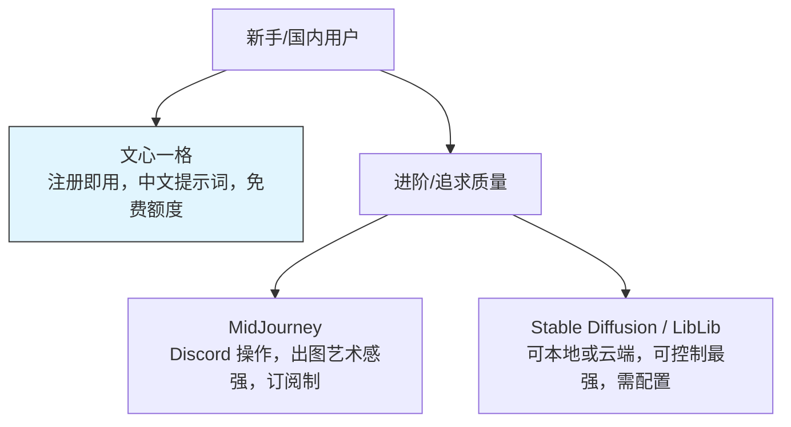

# 第9章 AI 绘画工具入门：MidJourney、Stable Diffusion、文心一格

> 本节手把手教零基础读者完成首张 AI 出图，涵盖国内简易工具（文心一格）到进阶工具（MidJourney、Stable Diffusion）的全流程，以及文生图、图生图、LoRA 训练、ControlNet 插件的基础操作。

---

## 9.1 大白话：AI 绘画就是打字出图

AI 绘画就是你打一段文字描述（提示词/咒语），AI 帮你画出图片。新手建议先从国内简单工具（如文心一格）开始，不用翻墙、不用配置，注册就能用；熟练后再尝试 MidJourney 或 Stable Diffusion。

---

## 32.2 什么是 AI 绘画？

AI 绘画目前的能力，能让一个没有专业绘画能力的人，也能挑战资深原画师，做出有设计感的图片。

现在 AI 绘画在全球已经有了非常良好的开源生态。良好的开源生态，也就意味着能让更多 AI 从业者能够自由地探索、创新，打造出成熟的应用和盈利模式。而且这个速度只会越来越快。一句话来说，AI 绘画，来路清晰，前路已通。

---

## 32.3 AI 绘画为什么现在那么火？

AI 绘画的门槛极低，不需要美术基础，不需要会用 PS，只需要会写提示词，就能出图。而且出图速度快，一张图只要几秒到几十秒，成本极低。

---

## 32.4 如何选择 AI 绘画软件？

新手建议先从国内简单工具（如文心一格）开始，不用翻墙、不用配置，注册就能用；熟练后再尝试 MidJourney 或 Stable Diffusion。

| 工具 | 适用人群 | 特点 | 费用 |
|------|---------|------|------|
| 文心一格 | 新手/国内用户 | 注册即用，中文提示词，免费额度 | 免费层 |
| MidJourney | 进阶/追求质量 | Discord 操作，出图艺术感强 | 订阅制 |
| Stable Diffusion / LibLib | 进阶/可控制最强 | 可本地或云端，可控制最强，需配置 | 订阅或云端按次 |

---

## 32.5 MidJourney 介绍及前期准备

### 32.5.1 MidJourney 是什么？

MidJourney 是一款基于 Discord 的 AI 绘画工具，出图艺术感强，适合进阶用户。

### 32.5.2 前期准备

1. 注册 Discord 账号
2. 加入 MidJourney 频道
3. 订阅会员

---

## 32.6 MidJourney 入门篇

MidJourney 的基本操作是在 Discord 频道中使用 `/imagine` 命令输入提示词，AI 就会生成四张图片供选择。

---

## 32.7 MidJourney 进阶篇

进阶技巧包括：
- 使用参数（如 `--ar` 控制宽高比，`--v` 指定模型版本）
- 图生图（上传参考图片）
- 混合图片（`/blend` 命令）
- 放大和变体（U1-U4, V1-V4）

---

## 32.8 MidJourney 应用篇

MidJourney 可应用于：
- 海报设计
- 插画创作
- 电商主图
- 角色设定
- 场景概念图

---

## 32.9 LibLib AI 入门篇

LibLib AI 是 Stable Diffusion 的云端封装，无需本地配置，打开网页即可使用。

### 五个参数：
模型选择、提示词、负面提示词、采样步数、CFG 系数等

### 四个勾选框：
高清修复、面部修复等选项

### 8 个参数：
图像尺寸、批次数量、随机种子等

### 三个勾选框：
其他辅助选项

---

## 32.10 LibLib AI 进阶篇

进阶功能包括：
- LoRA 模型加载（控制角色一致性、风格一致性）
- ControlNet 插件（控制构图、姿态）
- 工作流保存和复用
- 模型训练

---

## 32.11 文心一格入门篇

文心一格是百度推出的 AI 绘画工具，支持中文提示词，适合手机端操作。

### 操作流程：

1. 注册登录
2. 输入提示词
3. 选择模型和尺寸
4. 生成图片
5. 保存或分享

### 温馨提醒：

注意提示词的描述要具体，生成的图片可能需要多次抽卡才能得到满意效果。

---

## 32.12 AI 绘画常见工具对比 Mermaid 图

---

## 小练习

在文心一格或 MidJourney 中生成一张与你职业相关的插图，尝试调整一次提示词再生成，对比前后两张图的差异并保存较满意的一张。
