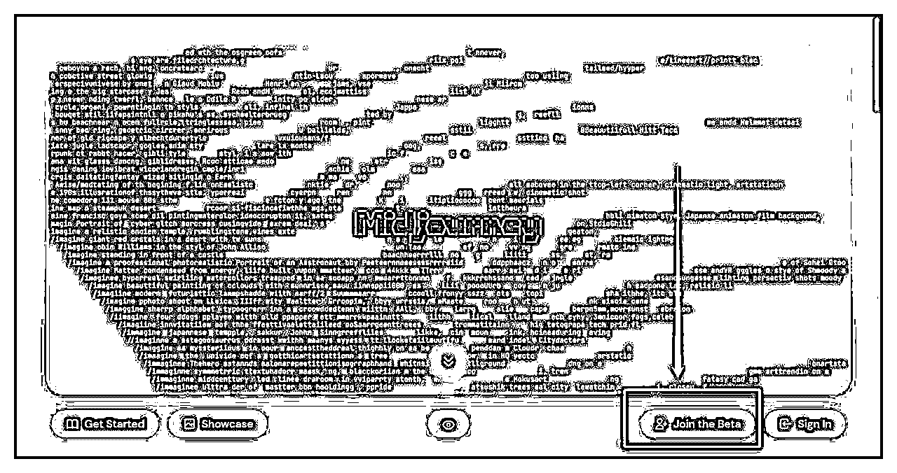
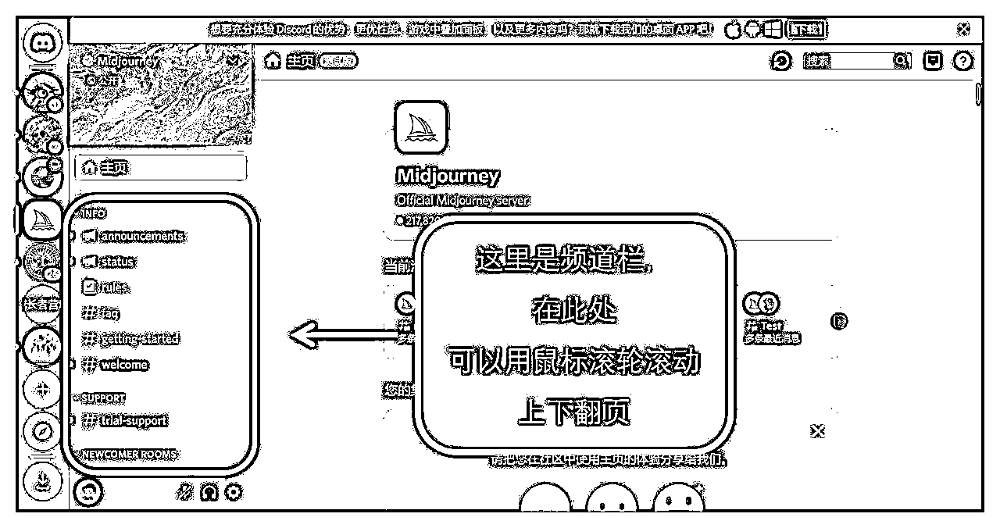
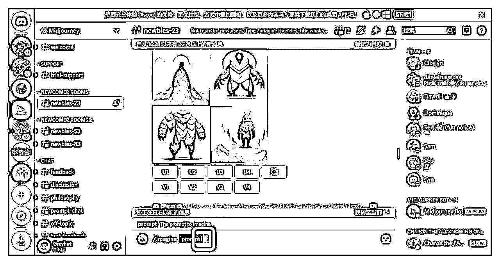
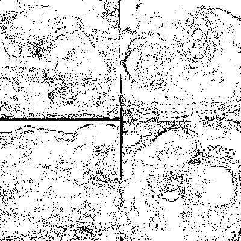
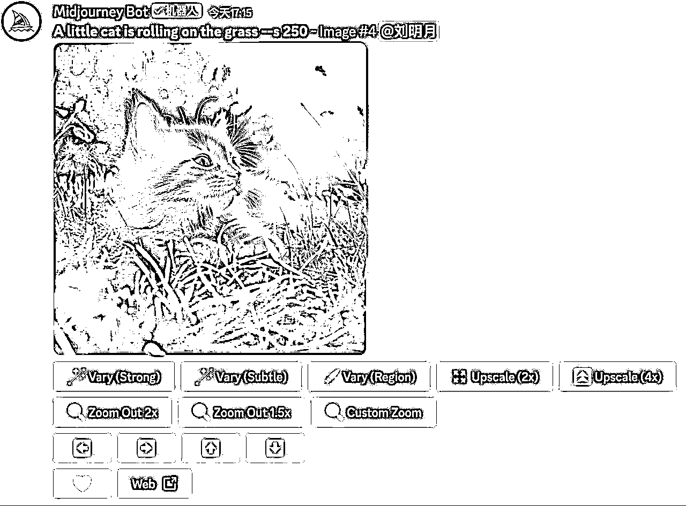
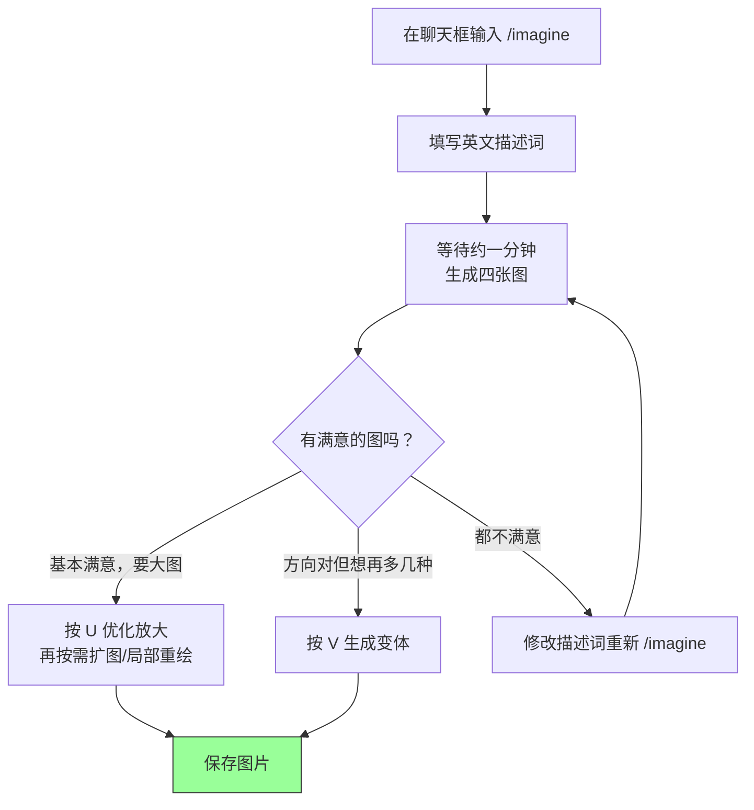
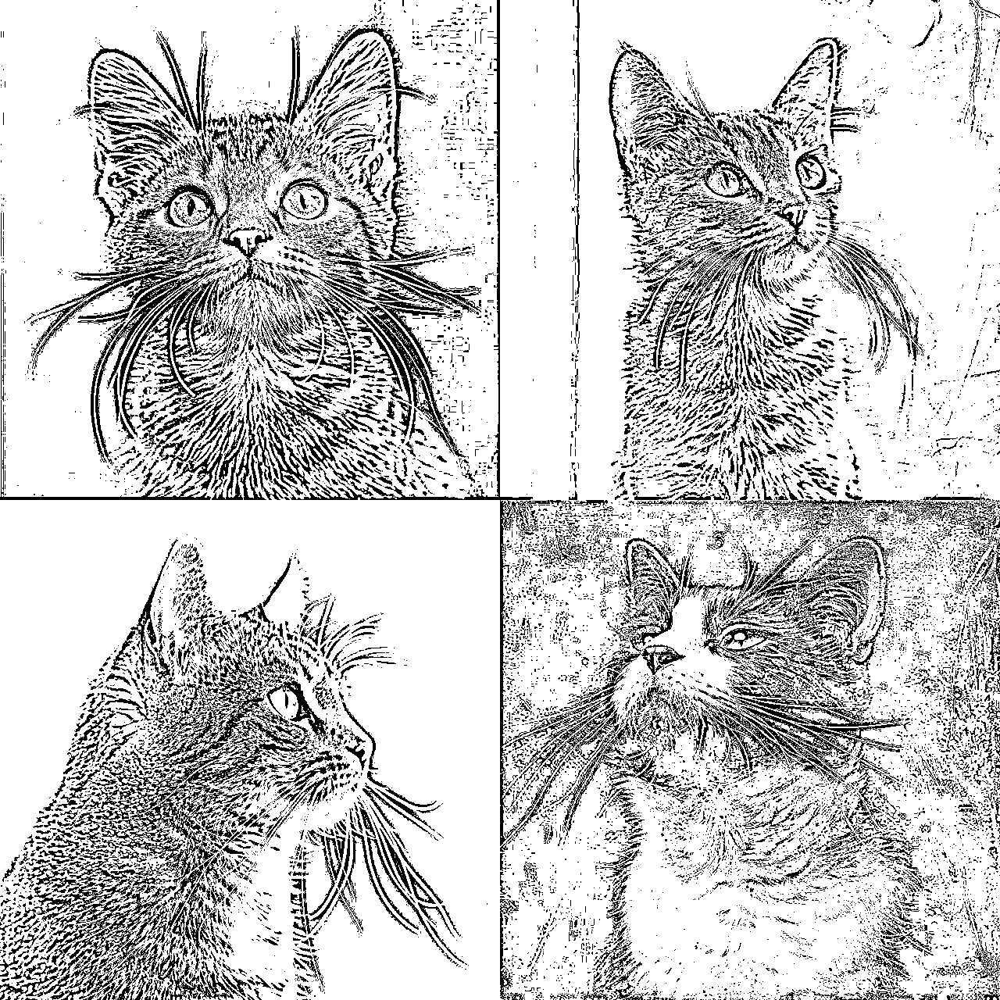
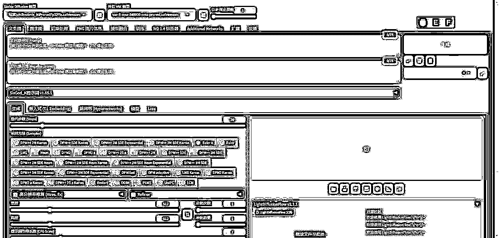
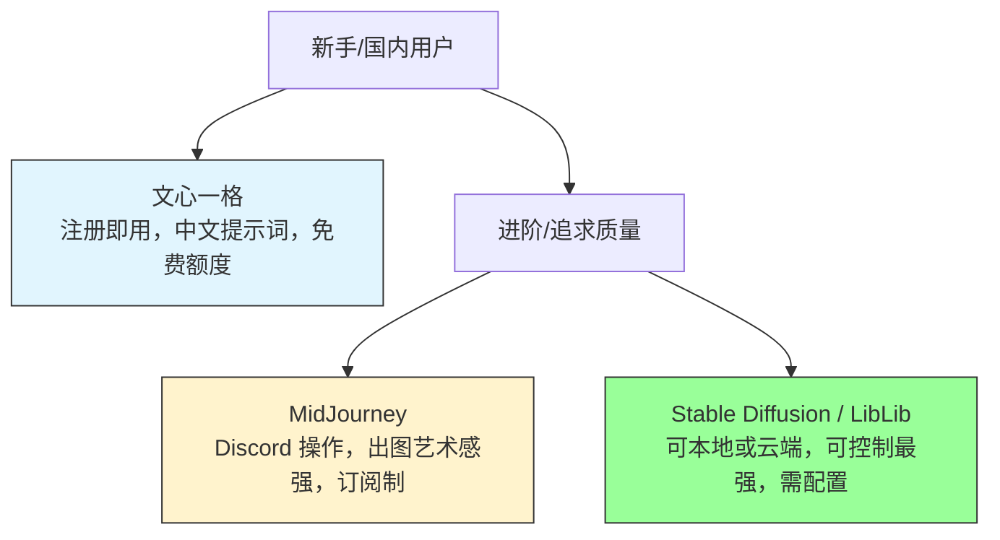

# 第9章 AI 绘画工具入门：MidJourney、Stable Diffusion、文心一格

> 本章手把手教零基础读者完成首张 AI 出图，涵盖国内简易工具（文心一格）到进阶工具（MidJourney、Stable Diffusion）的全流程，以及文生图、图生图、LoRA 训练、ControlNet 插件的基础操作。读完本章，你能独立完成从注册账号到出第一张图的全过程，并知道哪款工具适合自己。

从这一章开始，我们进入本书第三部分——AI 视觉与绘画。先给你吃一颗定心丸：这一章不需要你有任何美术基础，不需要你会用 Photoshop，甚至不需要你有一台高配置的电脑。你只需要会打字、会注册账号、会点鼠标，就能跟着本章的步骤，亲手画出人生第一张 AI 图画。我们会把每一款工具都掰开揉碎，从"它是什么、怎么注册、怎么出第一张图"一路讲到"怎么进阶提高"。本章（以及第 10、11 章）的实操内容，主要参考自生财有术团队 2024 年 3 月航海的《AI 绘画特训 实战手册》：


> **图片说明**：《AI 绘画特训 实战手册》封面（图源：生财有术团队《AI 绘画特训 实战手册 202403》）。这本手册把当时国内外最主流的三款工具——MidJourney、Stable Diffusion（云端封装 LibLib AI）和文心一格——的用法全部过了一遍，本章的工具讲解框架即来源于此。

---

## 9.1 大白话：AI 绘画就是打字出图

AI 绘画就是你打一段文字描述（提示词/咒语），AI 帮你画出图片。新手建议先从国内简单工具（如文心一格）开始，不用翻墙、不用配置，注册就能用；熟练后再尝试 MidJourney 或 Stable Diffusion。

> **大白话**：你可以把 AI 绘画想象成"网上约稿"。以前你想画一张图，要么自己学画画，要么花钱找画师，沟通半天还不一定满意。现在呢？你把需求写成一段文字发给 AI，比如"一只戴帽子的橘猫，坐在窗台上看夕阳，水彩风格"，几十秒后它就给你交稿，而且一次交四张，不满意还能让它重画。你打的这段文字，就是行话说的"提示词"（Prompt），也有人形象地叫它"咒语"——念对了咒语，魔法才会生效。

这里先划一个重点：**提示词写得好不好，直接决定图画得好不好**。同样一只猫，你写"一只猫"和写"一只戴帽子的橘猫，坐在窗台上看夕阳，水彩风格，高清细节"，出来的效果是天差地别的。怎么把咒语"念"好，是第 10 章要专门讲的内容，这一章我们先把工具用起来。

---

## 9.2 什么是 AI 绘画？

AI 绘画目前的能力，能让一个没有专业绘画能力的人，也能挑战资深原画师，做出有设计感的图片。

还记得第 1 章词汇表里的 AIGC（人工智能生成内容）吗？AI 绘画就是 AIGC 在图像领域的代表：AI 创作或辅助创作图片。你在网上看到的很多插画、海报、电商主图、头像、表情包，背后可能都是 AI 画的。

现在 AI 绘画在全球已经有了非常良好的开源生态。良好的开源生态，也就意味着能让更多 AI 从业者能够自由地探索、创新，打造出成熟的应用和盈利模式。而且这个速度只会越来越快。一句话来说，AI 绘画，来路清晰，前路已通。所以，此时不下场，更待何时呢？

> **大白话**：什么叫"开源生态"？回到第 1 章那个餐厅的类比：一般软件只卖菜不给你菜谱，而开源就是把菜谱全部公开。AI 绘画领域最有名的 Stable Diffusion 就是完全开源的——模型的文件、代码全部免费公开，于是全世界的开发者都跑来给它"加装备"：有人做风格模型，有人做控制插件，有人做训练工具……工具箱越来越满，后来者（也就是你）上手就越来越容易。

把 AI 绘画能做什么先摆出来给你看看，本书第三部分会逐一讲到：

| 能生成的作品类型 | 典型用途 |
|----------------|---------|
| 海报 | 活动宣传、公众号封面、AI 配图 |
| 插画 | 书籍配图、小红书笔记配图 |
| 电商图 | 商品主图、详情页图 |
| 头像 / 情侣头像 | 社交账号头像、定制服务 |
| 表情包 | 微信表情、IP 运营 |
| 艺术字 | 节日祝福图、标题配图 |
| 壁纸 | 手机壁纸、电脑壁纸 |
| IP 形象 | 盲盒设计、周边图案 |

---

## 9.3 AI 绘画为什么现在那么火？

AI 绘画的门槛极低，不需要美术基础，不需要会用 PS，只需要会写提示词，就能出图。而且出图速度快，一张图只要几秒到几十秒，成本极低。

我们把"火"的原因拆成三层来看：

1. **门槛低了三个数量级**。以前画一张像样的图，你要么苦练十年画功，要么花几百上千元约稿。现在你只需要会打字。一个从没拿过画笔的人，今天注册、今天出图。
2. **速度和成本同时碾压**。传统插画师画一张图可能需要几天，AI 几分钟就能出十几张供你挑选；外包一张商业插画报价几百到几千元，AI 生成一张图的电费成本可以忽略不计。第 11 章会看到，这种"速度差"正是普通人接单变现的机会所在。
3. **开源生态滚雪球**。前面说过，Stable Diffusion 开源带动了全球开发者共建工具箱，模型数量以万计，风格应有尽有。你想要的任何风格，大概率已经有人训练好了现成的模型放在那里等你用。

> **大白话**：打个比方，AI 绘画就像自动挡汽车。以前学开车（画画）要考驾照苦练换挡（素描、色彩、构图），现在自动挡（AI）把最难的部分替你做了，你只需要掌握"往哪儿开"（提示词）。

---

## 9.4 如何选择 AI 绘画软件？

新手建议先从国内简单工具（如文心一格）开始，不用翻墙、不用配置，注册就能用；熟练后再尝试 MidJourney 或 Stable Diffusion。

| 工具 | 适用人群 | 特点 | 费用 |
|------|---------|------|------|
| 文心一格 | 新手/国内用户 | 注册即用，中文提示词，免费额度 | 免费层（电量制） |
| MidJourney | 进阶/追求质量 | Discord 操作，出图艺术感强 | 订阅制（30 美元/月起） |
| Stable Diffusion / LibLib | 进阶/可控制最强 | 可本地或云端，可控制最强，需配置 | 云端按次/会员，本地免费但吃显卡 |

三款工具各适合什么人，展开说一说：

- **文心一格**：百度推出的 AI 作画产品，中文提示词直接用，微信扫码就能画，适合零基础第一步。缺点是可控性有限，精细调整不如另外两款。
- **MidJourney**：出图艺术感公认最强，一句简单描述就能出惊艳大片，适合追求画面质量的用户。但它部署在国外聊天软件 Discord 上，需要付费订阅，描述词要写英文——这三道门槛决定了它适合作为你的"第二站"。
- **Stable Diffusion（云端封装：LibLib AI）**：开源系统，可玩性、可控性最强——换模型、装插件、训练专属角色都行，是专业玩家的主力工具。本地部署对电脑显卡要求很高，好在有 LibLib AI 这样的云端封装版，打开网页就能用，新手也能驾驭。

> **大白话**：文心一格像共享单车，扫码就骑，便宜省事，但想飙车不行；MidJourney 像一辆调校好的跑车，颜值高速度快，但租金贵还得会开；Stable Diffusion 像一辆改装潜力无限的车，能加涡轮能换引擎，就是得学点改装技术。本书的建议路线是：先用文心一格建立信心，再上 MidJourney 出好图，最后用 LibLib AI 玩精玩深。

---

## 9.5 MidJourney 介绍及前期准备

### 9.5.1 MidJourney 是什么？

MidJourney 是一款基于 Discord 的 AI 绘画工具，出图艺术感强，适合进阶用户。

> **大白话**：先解释 Discord。Discord 是国外非常流行的一款聊天软件，你可以把它理解成"国外版 QQ 群"：它的"服务器"就是一个个大群，群下面还分若干"频道"，比如"新友频道""作品展示频道"。MidJourney 没有独立的画图界面，它整个"住"在 Discord 里——你在聊天框里打字下指令，一个叫 Midjourney Bot 的机器人就把图回给你。第一次见会觉得有点绕，用两次就习惯了。

顺便交代一个现实问题：MidJourney 和 Discord 都是国外的服务，打开官网、注册账号需要先自行解决网络访问问题。这也是我们在 9.4 节的对比表里把它归为"进阶"工具的原因之一。

### 9.5.2 前期准备

1. 注册 Discord 账号
2. 加入 MidJourney 频道
3. 订阅会员

下面一步步来。

**第一步：注册并登录**

浏览器打开 www.MidJourney.com，注册按钮就是页面上的"Join the Beta"：



> **图片说明**：MidJourney 官网的"Join the Beta"注册按钮（图源：《AI 绘画特训 实战手册》）。点击它会先引导你注册 Discord 账号，再接受邀请进入 MidJourney 服务器。

进入 Discord 界面后，如果你之前没有注册过 Discord 账号，会出现注册界面：输入用户名，点继续，按提示完成人机验证和邮箱验证即可。如果已经有账号，点击"接受邀请"按钮，就能进入 MidJourney 的服务器。

**第二步：进入频道**

进入 Discord 界面后，最左侧有一排图标，你可以简单理解成一个又一个的群聊。"小帆船"这个图标，对应的就是 MidJourney 的群聊，点一下。接着把鼠标放在频道列表处往下滑动，找到一个叫"newbies-XX"的频道（后面的"XX"是一个不固定的数字）——这是专为新用户设计的频道，能帮助我们更容易地开始使用 MidJourney：



> **图片说明**：Discord 左侧服务器列表中的"newbies-XX"新用户频道（图源：《AI 绘画特训 实战手册》）。每个人的数字编号不一定相同，随便选一个进入即可。在频道里你还能看到别人出的图和他们的描述词，是很好的学习素材。

**第三步（建议）：创建自己的服务器**

在公共频道做图有个明显的缺点：大家都在一个聊天室里出图，你的指令经常会被别人的消息流刷走，找自己的图要往上翻半天。解决办法是搭建自己的频道：点击 Discord 左侧的"添加服务器"（一个圆形加号），按提示创建一个仅自己使用的服务器；然后回到 newbies 频道，找到 Midjourney Bot 这个机器人，点击它的头像，选择"添加应用"，把它添加到你自己刚建的服务器里，授权通过即可。以后出图都在自己的服务器里进行，清净又好找。

**第四步：订阅会员**

想要出图，添加了机器人还不够，还需要给 MidJourney 进行付费。MidJourney 官方给出了四个不同档位的收费方式，每个档位的功能各有差异。如果是个人使用，30 美元档位是最具性价比的，可以选择和几个朋友一起共用一个账户，均摊下来每人几十块钱。包年付费的话还有八折优惠。

充值流程不复杂：进入自己服务器的设置页，点击 Subscribe 按钮进入充值页面，按流程操作即可。这里有两个要点：

- **可以直接用支付宝充值**。很多人潜意识里觉得国外软件必须用国外银行卡，实际上 MidJourney 支持支付宝付款，按实时汇率结算，没有中间商赚差价。选择支付宝支付后，按流程填写邮箱和个人信息即可完成充值。
- **千万别买"便宜账号"**。市面上那些一百多元就卖的个人独享账号，99% 是"黑卡充值"（用违法方式充值）的产物，非常容易被官方封禁。建议大家找朋友拼账号、正规充值，更安全，使用体验也最佳。

---

## 9.6 MidJourney 入门篇

MidJourney 的基本操作是在 Discord 频道中使用 `/imagine` 命令输入提示词，AI 就会生成四张图片供选择。

完整流程是这样的：在聊天框打一个"/"字符，在弹出的命令列表里选择 `/imagine`，然后在一个叫 prompt 的输入框里填入描述词，回车发送：



> **图片说明**：在频道聊天框输入"/imagine"后填写描述词（图源：《AI 绘画特训 实战手册》）。注意：MidJourney 目前不支持中文描述词，需要用英文输入。

第一次尝试，你可以随便写一句话，比如"a cute cat in the park"（一只在公园里的可爱小猫）。发送后等一分钟左右，Midjourney Bot 就会返回四张图。它的出图能力极强，发展到现在，很简单的描述就可以有很不错的效果。比如输入描述词"充满活力的加利福尼亚花田"（用英文写），就能得到这样一组图片：



> **图片说明**：输入一句简单描述后 MidJourney 生成的一组图（图源：《AI 绘画特训 实战手册》）。哪怕描述词很朴素，它也能画出像模像样的作品——这正是它"艺术感强"的体现。

### 9.6.1 认识 U 和 V 按钮

四张图生成后，图下方会出现两排按钮：U1、U2、U3、U4 和 V1、V2、V3、V4。它们是什么意思？

> **大白话**：有个简单的记法：**U 代表优化**（Upscale，简写正好是"U 优"），**V 代表微调**（Variation，简写正好是"V 微"）。数字 1-4 对应四张图的位置——MidJourney 生成结果按从左到右、从上往下排序，1 是左上，2 是右上，3 是左下，4 是右下。

所以"U4"就是对第 4 张图进行优化放大，"V2"就是基于第 2 张图生成变体。实际操作中，先从四张里挑出最接近你想法的一张，再决定按 U 还是按 V。

我们点击 U4，代表对第 4 张图进行优化。点完之后，图下方会多出很多新选项：



> **图片说明**：点击 U4 之后，图片下方多出的操作选项行（图源：《AI 绘画特训 实战手册》）。

这些选项从上到下分三行，给你逐个说明：

- **第一行**：带"星星"标志的是调整画面——Vary（Strong）是较大幅度调整，Vary（Subtle）是较小幅度调整；中间的画笔图标是局部重绘；后面两个是扩图功能；Upscale（2X）是放大两倍像素，Upscale（4X）是放大四倍像素。
- **第二行**：画面缩放——分别是缩放 2 倍、1.5 倍，以及自定义缩放倍数。
- **第三行**：扩展画面——四个箭头代表向四个不同方向扩展画面，很有趣的功能。

再看 V 的效果：选择 V4 以后，MidJourney 会给你一组与第 4 张图相似的四张新图。它能在保持原始图像基本风格的同时，探索一些不同的变体——比如对颜色、光线、纹理、形状等元素做轻微调整。想"在同一张图附近再挖挖宝"，就用 V。

把入门篇的完整流程画成一张图：



---

## 9.7 MidJourney 进阶篇

入门篇是"能出图"，进阶篇是"出好图、出对图"。这一节讲四件事：换模型、加参数、图生图、命令。

### 9.7.1 切换模型：V 系列与 Niji 系列

MidJourney 默认使用 V6 模型。如果你想切换其他模型，需要在描述词末尾加参数，比如 `--niji 5` 就是切换到 Niji 5 模型。这里的"--"，代表的就是调用参数，后面还会反复用到。

V 系列和 Niji 系列的画风取向完全不同：

- **V 系列**：走精致写实路线。从发展史看，V1 的出图非常抽象，不看描述词都不知道画的是什么；V2、V3 勉强能看出主体轮廓；V4 发生质变，真实度和细节大幅提升；V5 画风更多元、质感更强；V6 相较前几代提升非常明显，画面细节和真实感更强。
- **Niji 系列**：以大量优质插画和动漫作品为基底训练而成，画风更艺术、更偏向动漫卡通，适合画二次元角色、插画。Niji 还有几种预设风格，适合不同场景。



> **图片说明**：V6 模型的出图效果（图源：《AI 绘画特训 实战手册》）。和 V1 时代的"抽象画"相比，V6 在细节和真实感上已经发生质变。

### 9.7.2 常用参数

参数位于描述词末尾，用来改变图像的生成方式。先把最常用的几个用表格给你讲清楚：

| 参数 | 作用 | 示例与说明 |
|------|------|-----------|
| `--ar` | 调整画面宽高比 | `--ar 9:16` 手机壁纸、`--ar 16:9` 电脑壁纸、`--ar 4:3` 平板。做壁纸时先想好设备比例 |
| `--seed` | 指定随机种子 | 相同描述词 + 相同种子，会生成非常相似的图，适合做系列图（第 10 章细讲） |
| `--iw` | 控制参考图权重 | 范围 0-2：`--iw 0` 完全不考虑参考图，`--iw 2` 最大程度模仿参考图 |
| `--r` | 同一组图生成多批 | `--r 4` 就是同样的描述词连跑 4 组，省得一遍遍重新发送 |
| `--no` | 负面提示 | `--no plants` 表示画面中不要出现植物 |
| `--s` | 风格化程度 | 数值越高艺术化越强，默认即可，初期不用动 |
| `--tile` | 生成无缝平铺图案 | 做壁纸、包装花纸时用 |
| `--q` | 生成质量 | 影响出图质量与耗时，初期用默认值 |

其中 `--ar` 是大家使用最多的参数。常见的屏幕比例：手机屏幕以 9:16 为主，平板电脑以 4:3 为主，电脑显示器以 16:9 为主。做壁纸前先想清楚这张图要用在什么设备上，再配上对应的 `--ar` 参数。

除此之外，MidJourney 还有很多参数（如 `--chaos` 控制随机性、`--stop` 控制生成进度、`--weird` 控制怪异程度、`--stylize` 风格化等），初期不必全部记住，用的时候翻回来查即可。

### 9.7.3 图生图

MidJourney 不只能"文生图"，还能"图生图"——给它一张参考图，让它参考着画。操作顺序是：先把参考图片上传到 Discord，复制图片链接；然后在 `/imagine` 的描述词里按这个顺序填写：

```
[图片链接] 空格 [描述词] 空格 [--iw 参数] 空格 [--v 参数]
```

图生图有两个典型玩法：

1. **个人形象换风格**：把自己或朋友的人物照片换成幼年版、动漫版等风格，靠的就是图生图 + 风格描述词。
2. **参考图控风格**：找一张构图、色调都喜欢的图作参考，用 `--iw` 控制它的影响力——数值越大越像原图。

### 9.7.4 两个实用命令

- **/blend：混合图片**。`/blend` 可以将 2-5 张不同内容的图片进行融合。输入 `/blend` 命令后默认出现两个图片上传选项，点击对应方块上传图片即可。想把两种风格"揉"在一起时，它最快。
- **/describe：反推描述词**。这是让 MidJourney 帮我们优化描述词的"偷懒"方法：输入 `/describe` 后上传一张图片，MidJourney 会根据这张图编写四个示例提示。很多时候 AI 反推出来的描述词，比我们自己写的更准确。看到好图想复现风格，就找它。

> **进阶提示**：MidJourney 的参数和命令远不止这些（如 `/setting` 设置面板、remix 混合模式等），本节只挑了日常使用频率最高的一小部分。更多的参数大全、命令大全，用到时直接翻《AI 绘画特训 实战手册》或官方文档即可，不必死记硬背。

---

## 9.8 MidJourney 应用篇

学会了基本功，MidJourney 能用在哪些地方？这一节把常见应用方向铺开，帮你建立"它到底能干什么"的全貌。具体的商业落地和变现，第 11 章还会系统展开。

1. **海报设计**：结合 `--ar` 设置海报比例，一句描述词 + 风格词就能出多版海报背景，从中挑选后再加文字排版。
2. **插画创作**：配书的插图、公众号配图、小红书笔记配图。想要动漫风就切 Niji 模型，想要油画感就在描述词里加油画相关的风格词。
3. **电商主图**：商品场景图、卖点背景图。AI 最擅长"造场景"——让商品出现在大理石台面、花园、实验室等任意环境里。
4. **角色设定**：游戏、小说、短视频的虚拟角色立绘。用 Vary 和 V 按钮保持角色相似，衍生出不同姿势和表情。
5. **场景概念图**：小说封面背景、游戏场景、舞台美术的"氛围草稿"，几秒钟看到脑中的画面。

> **核心提醒**：AI 是锦上添花，不是雪中送炭。工具出图只是第一步，图要"用对地方"才有价值——这也是为什么本章只做工具入门，而把"提示词怎么写"（第 10 章）和"图怎么卖钱"（第 11 章）单独成章。

---

## 9.9 LibLib AI 入门篇

### 9.9.1 LibLib AI 是什么？

前面说过，Stable Diffusion 本地部署对显卡要求极高，普通家用电脑跑不动。而 LibLib AI（哩布哩布 AI）就是 Stable Diffusion 的云端封装，无需本地配置，打开网页即可使用。

打开 LibLib 的在线生图页面（https://www.liblib.ai/sd），你会发现它的界面和本地 Stable Diffusion 界面基本一致——这也是它的好处：你在云端学会的操作，以后迁移到本地版完全通用。



> **图片说明**：LibLib AI 的生图界面，与本地 Stable Diffusion 界面基本一致（图源：《AI 绘画特训 实战手册》）。学会云端版，就等于学会了 Stable Diffusion 的操作逻辑。

### 9.9.2 文生图：六步出图

文生图就是通过文字提示词生成图片。我们以"极简主义室内设计的餐厅"为例，完整走一遍流程。

**第一步：使用提示词描述画面内容。**提示词分两种：正向提示词是画面中需要出现的内容描述，负向提示词是画面中不需要出现的内容描述。

> **大白话**：正向提示词是"我要什么"，负面提示词是"我不要什么"。举个例子：生成人物形象时，画面里经常出现三根或四根手指的"鬼手"，这时在负面提示词里输入"no 3 fingers, no 4 fingers"，就能有效避免这种尴尬。负面提示词就像跟画师提前打招呼："别的都行，这几样千万别画。"

打开 https://www.liblib.ai/sd 选择"文生图"，想生成极简风餐厅，提示词可填写 Minimalist Interior Design Restaurant（可用界面右侧的"翻译为英文"功能）；不希望画面中出现人，就在负面提示词写上 human。

**第二步：选择合适大模型。**可以优先选择基础模型 XL，是目前比较优质的大模型。也可以回到 LibLib 首页挑选自己喜欢的建筑、人物摄影、二次元、国风等模型——记住一个要点：**勾选 CHECKPOINT 类型的才是大模型**。找到心仪的模型后，打开模型介绍页面点击"加入模型库"，回到生图页面的 CHECKPOINT 大模型下拉框就能选到它。

**第三步：设置参数。**界面上的参数分成红色和绿色两个区域：红色区域是必须设置的参数，按本节下面的说明设置即可；绿色区域的随机数种子和两个插件，初期学习可无需设置。

**第四步：生成图片。**参数设置完毕，点击画面右上角的"开始生图"。非会员需要排队等候，耐心等待一会图片就会生成完毕。生成结果页里：缩略图区域可以切换查看不同的图；下载区域可以下载图片或发送到 SD 的各个功能；参数区域记录了这张图用到的全部提示词、模型和参数——**以后看到好图，把这串参数抄下来就能复现**。

**第五、六步：优化图片。**如果对结果不满意，可以修改模型、提示词、参数三个中的任意一个，对比效果：

- 细化提示词：把"极简客厅"扩写成明确的元素描述（灯、窗户、窗帘等），画面内容会更具体；
- 更换模型：保持参数和提示词不变，切换不同大模型，检测不同模型的出图风格；
- 调整参数：保持模型和提示词不变，修改采样方法和迭代步数的数值，观察两个参数对画面的影响。

给你一份完整的室内设计提示词参考（英文为正面提示词，附带中文翻译）：

> （（最佳质量）），（杰作），（逼真），创造一个现代极简主义客厅设计，展示简洁的线条。画面应描绘住宅环境中的内部空间，特别是客厅区域。灯光应柔和、环境优美，增强整体宁静的氛围。风格应体现极简主义，注重功能和美学。配色方案应由中性和单色色调组成，创造出连贯和谐的视觉构图……

负面提示词：裁剪的图像、扭曲的面部、模糊、颗粒状、低分辨率、艺术性差、解剖结构差、画框外、水印。

（实际使用时请填入对应的英文，如 ((Best quality)), ((masterpiece)), ((realistic))…… / Cropped image, distorted face, blurry, low-res, watermark 等。）

### 9.9.3 五个参数

这是文生图页面上必须掌握的五个参数：

| 参数 | 含义 | 建议 |
|------|------|------|
| 采样方法 | 模型生成图片使用的算法 | 规律是字母越长效果越好 |
| 迭代步数 | 模型迭代生成的步骤数量，范围 1~60 | 建议 30 |
| 宽度和高度 | 输出图片的尺寸 | 建议是 64 的倍数 |
| 图片数量 | 一次性生成图片张数，范围 1~3 | 按需设置，4、8、16 仅会员可用 |
| 提示词引导系数 | 提示词相关性，数值越大图越贴提示词，范围 1~30 | 建议 7 |

> **大白话**：迭代步数好比"画草稿的遍数"——遍数太少画面糊成一团，遍数太多费时间收益还不大，30 步是性价比之选。提示词引导系数好比"听话程度"——调太高，AI 会生硬地堆砌你写的元素；调太低，它就开始自由发挥不听指挥，7 左右最平衡。

### 9.9.4 四个勾选框

| 勾选框 | 作用 |
|--------|------|
| 面部修复 | 画面中有人物时，自动修复面部细节 |
| 平铺图 | 生成无缝拼接的图案 |
| 高分辨率修复 | 生成图片的同时，把图片放大相应倍数 |
| LCM 极速生图 | 使用 LCM 采样算法，较少步数就能出高质量图。勾选后采样方法自动改为 LCM，步数范围自动改为 4~8，推荐用 5 |

### 9.9.5 图生图：多出的参数

图生图就是根据参考图生成接近风格的图片，操作流程和文生图相比，就是**多了一个上传参考图的环节**：上传参考图 → 使用提示词描述画面内容 → 选择大模型 → 设置参数 → 生成图片 → 优化图片。

举个实际例子：参考图是一位"华丽的夏日女孩在雨中行走"的霓虹朋克风格插画，我们想以此风格生成一个男性，只需把提示词里的女孩换成男孩（Gorgeous man of summer...），保持风格词不变，出图就还是那股霓虹朋克味。

图生图页面的参数比文生图多——共 8 个参数：采样方法、迭代步数、图片数量、提示词引导系数这 4 个和文生图一样，新增的 4 个是：

| 参数 | 含义 | 建议 |
|------|------|------|
| 缩放模式 | 放大图片的方法 | 选择"拉伸和填充" |
| resize to | 重新设定输出尺寸 | 可以用小图获得原图尺寸，建议 64 的倍数 |
| resize by | 按倍数放大 | 默认 1 为原图尺寸，改成 2 输出就是原图的 2 倍 |
| 重绘幅度 | 与原始参考图的相似程度 | 数值越小越像原图，越大 AI 自由发挥越多；建议 0.7~0.8 |

三个勾选框（面部修复、平铺图、LCM 极速生图）与文生图相同，不再重复。

> **大白话**：重绘幅度是图生图的灵魂旋钮。设 0.3，AI 基本只给原图"修修补补"；设 0.9，AI 就"参考着重新创作"了。想要"保持构图换个画风"，就往低调；想要"借个感觉重新画"，就往高调。

---

## 9.10 LibLib AI 进阶篇

入门篇学会"出图"，进阶篇的四个方向，让你从"会出图"走到"出好图、出指定的图"：

- **图生图进阶使用**：结合重绘幅度、多种模型的组合，实现"换风格不换构图""换人物不换场景"等精细化操作。
- **解析图片**：拿到一张别人的好图，想知道它是用什么提示词生成的？LibLib 提供图片解析功能——读取图片内嵌的生成参数（PNG 信息），或者用 CLIP 反推、DeepBooru 反推，让 AI 替你"猜"出描述词。配合 9.9.2 讲过的"参数区域"，看到好图就能学到好咒语。
- **放大图片**：后期处理功能可以把满意的图无损放大，适合需要印刷尺寸或高清交付的场景。
- **模型加载与训练**：在生图时加载 LoRA 模型锁定特定风格或角色；更进一步，还能用平台工具训练属于自己的 LoRA——这是第 10 章的主角，本章先埋个种子。

除此之外，ControlNet 插件（精确控制构图、姿态）也是 LibLib 进阶玩法的重头戏，同样放到第 10 章详细拆解。

---

## 9.11 文心一格入门篇

### 9.11.1 文心一格是什么？

"文心一格"是百度推出的 AI 作画产品。依托飞桨、文心大模型的技术创新，只需输入文字描述，就能快速生成各种风格的精美画作。它既能为画师、设计师等视觉内容创作者启发灵感、辅助艺术创作，又能为媒体、作者等文字内容创作者提供高质量、高效率的配图，更能让每一个人都展现个性化格调。即使完全没有绘画经验，也可以在文心一格画出无限创意。

它支持二次元、艺术创想、国风、油画、水彩、水粉等多种不同风格高清画作的生成，支持不同画幅。你可以在电脑网页端、微信小程序端访问。手机端仅有 AI 创作功能，支持输入中文和英文描述词，可以实现文生图、图生图、海报、艺术字制作——**大家前期可以先使用中文提示词**，这是它对新手最友好的地方：


> **图片说明**：文心一格手机端界面（图源：《AI 绘画特训 实战手册》）。手机微信扫码即可使用，支持中英文描述词。

### 9.11.2 操作流程

文心一格的核心操作流程就五步：

1. **注册登录**：微信扫码或百度账号登录即可，无须额外下载软件；
2. **输入提示词**：先用中文把想画的画面写清楚；
3. **选择模型和尺寸**：挑选风格模型，设置方图/竖图/横图等画幅；
4. **生成图片**：点击生成，等待出图；
5. **保存或分享**：满意就保存，不满意就改提示词重画。

其中"AI 绘画"和"二次元画室"是两个常用入口，区别要记住：**二次元画室支持风格选择、不支持灵感模式；AI 绘画支持灵感模式、不支持风格选择**。可以调整的参数只有两个：尺寸和灵感模式，默认生成 4 张。灵感模式开启后，有概率增加画作风格的多样性，但不可和参考图同时使用——想让风格统一（比如做表情包）时，建议关掉它。

**文生图**：输入提示词、设置参数，两步即可，适合小红书封面、公众号配图等一切需要"配图"的场景，竖图、方图、横图它都能搞定。

**图生图**：上传参考图，输入提示词，设置参数，三步即可。核心参数是"影响比重"——数值越大，生成图片与原始参考图就越像，建议设为 10。经典玩法"真人变动漫"用的就是它。

**AI 配图（海报）**：进阶玩法，需要同时输入**主体和背景两段描述词**。操作上先选择排版布局（竖图 9:16 和横图 16:9 两种比例），再选择 4 种布局之一——布局代表画面主体的位置，比如选"海报-底部布局"，主体就会出现在画面底部。

**AI 艺术字**：输入文字生成带艺术效果的字体图，做节日祝福图、标题图很好用。

> **电量小知识**：文心一格采用"电量"计费。生成预览图基本免费，但**提高分辨率需要消耗电量**；相应地，把作品公开、分享、投稿会适当赠送电量。创作数量少，直接充值电量即可；生成数量多，办会员更划算。

### 9.11.3 温馨提醒

注意提示词的描述要具体，生成的图片可能需要多次抽卡才能得到满意效果。

> **大白话**："抽卡"是 AI 绘画圈的行话，源自抽卡游戏——每次生图像抽一次卡，出不出"金卡"（满意图）有运气成分。应对方法很简单：多抽几次、微调提示词再抽。别指望第一次就出神图，这是所有 AI 绘画玩家的日常。

---

## 9.12 AI 绘画常见工具对比 Mermaid 图

最后把本章三款工具的选择逻辑画成一张图，迷茫时照着走：



> **一句话总结**：先用文心一格"零成本上路"，再用 MidJourney"出惊艳大片"，最后用 LibLib AI"精确控制每一根线条"。三款工具不是三选一，而是进阶路上的三站。

---

## 小练习

在文心一格或 MidJourney 中生成一张与你职业相关的插图，尝试调整一次提示词再生成，对比前后两张图的差异并保存较满意的一张。

> **复盘参考**：
> - 第一次生成时，故意把提示词写得很简短（如"一杯咖啡"），观察出图效果；
> - 第二次在提示词里补上**主体细节 + 风格 + 光照 + 构图**（如"一杯拿铁咖啡，木桌上，柔光，俯拍，水彩风格"），再生成一次；
> - 对比两张图，你应该能直观感受到：描述越具体，画面越贴合你的预期。这正是第 10 章"提示词工程"要系统解决的问题。

---

## 本章小结

通过本章，你应该已经掌握：

1. **AI 绘画的本质**：打字出图。提示词写得越具体，出图越可控；门槛极低、速度快、成本低，加上开源生态滚雪球，是它爆火的三大原因。
2. **工具选择**：文心一格（新手、中文、免费）→ MidJourney（艺术感强、英文、订阅制）→ Stable Diffusion/LibLib（可控性最强、进阶）。三站进阶，不是三选一。
3. **MidJourney 全流程**：注册 Discord → 进 newbies 频道（建议自建服务器）→ 订阅（30 美元档性价比最高，支持支付宝，远离黑卡账号）→ /imagine 出四张图 → U 优化 / V 微调。
4. **MidJourney 进阶**：V 系列写实、Niji 系列动漫；常用参数 --ar（比例）、--seed（复现）、--iw（参考图权重）、--no（负面提示）等；/blend 融图、/describe 反推描述词。
5. **LibLib AI（云端 Stable Diffusion）**：正向/负面提示词、CHECKPOINT 大模型、五个参数（采样方法、迭代步数、宽高、图片数量、提示词引导系数）、四个勾选框（面部修复、平铺图、高分辨率修复、LCM 极速生图）、图生图的重绘幅度（建议 0.7~0.8）。
6. **文心一格**：中文提示词、微信扫码即用；AI 绘画与二次元画室两个入口的区别；图生图"影响比重"建议 10；AI 配图要分主体、背景两段描述词；电量制计费。

下一章，我们专门解决本章反复预告的那个问题——怎么把提示词写好，以及怎么用 LoRA 和 ControlNet 把风格、角色牢牢"锁"住，让 AI 真正按你的想法出图。
