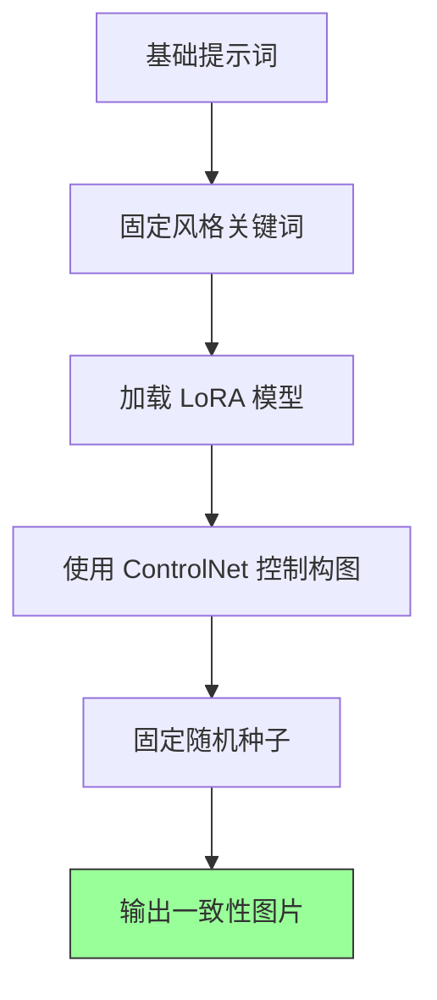

# 第10章 提示词与 LoRA：控制出图风格与一致性

> 本节深入讲解 AI 绘画的"咒语"编写，教读者成为提示词工程师，掌握风格一致性控制、角色一致性、构图调整等进阶技巧，并通过"AI 绘画 + 小红书笔记"模板检测出图能力。

## 10.1 大白话：画图提示词就像给点单

画图提示词就像给餐厅点单，越详细越准确。想让同一个人物在不同照片里长得一样，就得在每张图的提示词里都固定写"角色特征+服装+发型"，这就叫"一致性控制"。

## 10.2 提示词编写基础

### 10.2.1 提示词的结构

一张好的 AI 绘画提示词通常包含：

| 模块 | 说明 | 示例 |
|------|------|------|
| 主题 | 画什么 | 穿红衣的女孩 |
| 媒介 | 什么形式 | 油画、摄影、插画、3D 渲染 |
| 环境 | 在哪里 | 室内、室外、森林、城市 |
| 光照 | 光线效果 | 柔光、逆光、霓虹灯、日落 |
| 颜色 | 色调 | 暖色、冷色、单色、鲜艳 |
| 心情 | 氛围感 | 平静、喧闹、神秘、温馨 |
| 构成 | 拍摄角度 | 人像、特写、鸟瞰图、大头照 |
| 画家 | 风格参照 | 梵高、莫奈、宫崎骏 |

### 10.2.2 提示词写作公式

```
主题 + 媒介 + 环境 + 光照 + 颜色 + 心情 + 构成 + 画家
```

**示例**：
> 穿红衣的女孩，油画，森林室内，柔光，暖色，温馨，特写，莫奈风格

## 10.3 风格一致性控制

### 10.3.1 什么是风格一致性

风格一致性是指生成的多张图片在视觉风格上保持统一，比如都用同一套色调、同一种光影、同一种画笔触感。

### 10.3.2 如何控制风格一致性

**方法一：固定核心关键词**

在每张图的提示词里都保留相同的风格关键词，比如"油画、柔光、暖色、莫奈风格"。

**方法二：使用 LoRA**

LoRA（Low-Rank Adaptation）是一种轻量级模型插件，可以专门用来锁定某种风格或角色。加载对应的 LoRA 后，生成的图片会自动带有该风格。

**方法三：固定随机种子（Seed）**

相同的种子 + 相同的提示词，会生成非常相似的图片，适合做系列图。

## 10.4 角色一致性控制

### 10.4.1 什么是角色一致性

角色一致性是指同一个角色在不同场景、不同角度下，长相、服装、发型保持基本一致，让观众一眼就能认出"这是同一个人"。

### 10.4.2 如何控制角色一致性

**方法一：在提示词中固定角色描述**

每张图的提示词都包含相同的角色特征：
- 外貌：穿红衣的女孩，长卷发，蓝眼睛，白皙皮肤
- 服装：红色连衣裙，白色围裙
- 配饰：银色项链

**方法二：使用角色 LoRA**

训练或加载专门的角色 LoRA，可以锁定特定人物的长相特征。

**方法三：图生图 + 局部重绘**

先生成一张满意的角色图，然后用图生图功能改变背景，保持角色不变。

## 10.5 构图调整

### 10.5.1 常见构图类型

| 构图 | 适用场景 | 效果 |
|------|---------|------|
| 特写 | 人物表情、细节 | 强调情感和细节 |
| 人像 | 半身像、全身像 | 展示人物和服装 |
| 鸟瞰图 | 建筑、场景全貌 | 展示空间关系 |
| 大头照 | 社交头像 | 突出面部 |
| 远景 | 风景、宏大场景 | 展示环境氛围 |

### 10.5.2 构图提示词示例

```
穿红衣的女孩，油画，森林室内，柔光，暖色，温馨，**特写**，莫奈风格
```

将"特写"改为"鸟瞰图"，画面就会从人物特写变成森林全貌。

## 10.6 LoRA 基础操作

### 10.6.1 什么是 LoRA

LoRA（Low-Rank Adaptation）是一种轻量级的模型微调技术，文件通常只有几十 MB 到几百 MB，可以加载到 Stable Diffusion 或 LibLib AI 中，用来锁定特定风格、特定角色或特定服装。

### 10.6.2 如何使用 LoRA

1. 在 LibLib AI 或本地 Stable Diffusion 中找到 LoRA 模型库
2. 选择想要的风格 LoRA 或角色 LoRA
3. 在提示词中加载该 LoRA（格式通常为 `<lora:模型名称:权重>`）
4. 调整权重（通常 0.7-1.2 之间），生成图片

### 10.6.3 常见 LoRA 类型

| 类型 | 用途 | 示例 |
|------|------|------|
| 风格 LoRA | 锁定绘画风格 | 宫崎骏风格、迪士尼风格、油画风格 |
| 角色 LoRA | 锁定特定人物 | 某位动漫角色、某位真人 |
| 服装 LoRA | 锁定特定服装 | 和服、汉服、西装 |
| 道具 LoRA | 锁定特定物品 | 古剑、魔法书、现代手机 |

## 10.7 ControlNet 插件基础

### 10.7.1 什么是 ControlNet

ControlNet 是 Stable Diffusion 的一个插件，可以精确控制生成图片的构图、姿态、边缘、深度等信息，让 AI 出图更可控。

### 10.7.2 常见 ControlNet 模型

| 模型 | 用途 | 示例 |
|------|------|------|
| Canny | 边缘检测 | 保持线稿轮廓，重新上色 |
| Depth | 深度图 | 保持空间深度关系 |
| OpenPose | 姿态检测 | 保持人物动作姿势 |
| Scribble | 草图涂鸦 | 根据简单草图生成精细图 |
| Segmentation | 分割图 | 保持物体分区位置 |

## 10.8 "AI 绘画 + 小红书笔记"出图能力检测模板

书中提供了「AI 绘画 + 小红书笔记」的出图能力检测模板，这是本次「AI 绘画+自媒体航海」的重点。把图片发出来，检测自己是否已具备 AI 出图能力。

### 检测标准

| 维度 | 优秀 | 合格 | 需改进 |
|------|------|------|--------|
| 构图 | 主体突出，留白合理 | 主体居中，构图普通 | 主体模糊，构图混乱 |
| 风格 | 风格统一，有辨识度 | 风格基本一致 | 风格杂乱，无辨识度 |
| 角色 | 多张图角色一致 | 角色基本一致 | 角色每张都不同 |
| 画质 | 清晰细腻，无明显瑕疵 | 基本清晰，有小瑕疵 | 模糊，有严重瑕疵 |

## 10.9 提示词与 LoRA Mermaid 图



## 小练习

选定一个固定角色（如"穿红衣的女孩"），用同一组核心提示词生成 3 张不同场景下的图片，观察角色一致性，记录哪些关键词对一致性影响最大。
