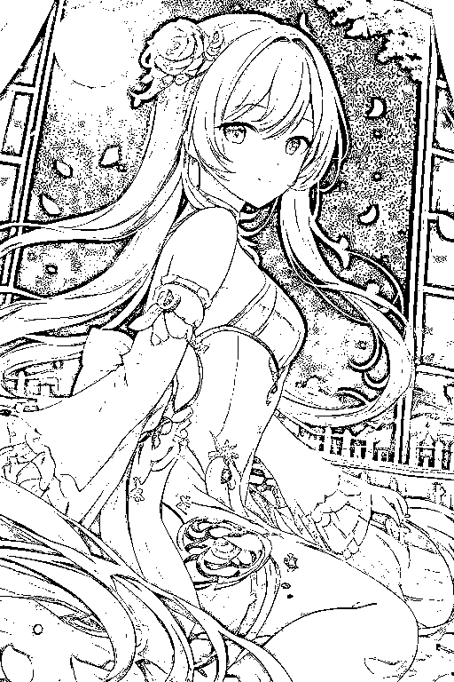
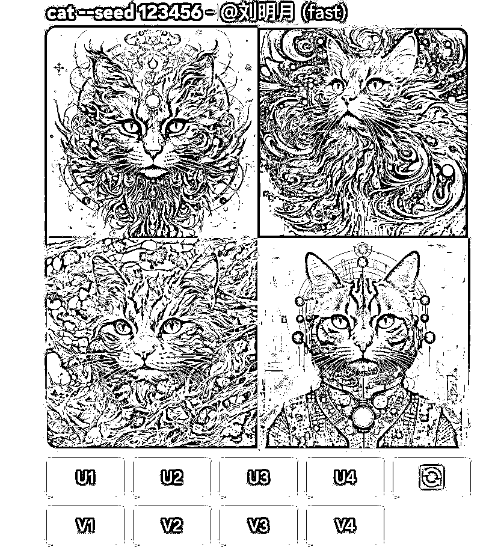
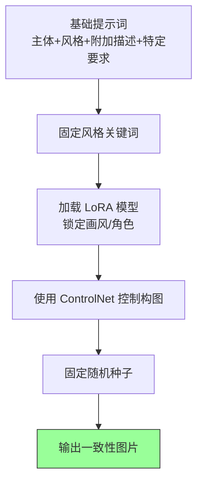

# 第10章 提示词与 LoRA：控制出图风格与一致性

> 本章深入讲解 AI 绘画的"咒语"编写，教读者成为提示词工程师，掌握风格一致性控制、角色一致性、构图调整等进阶技巧，并通过"AI 绘画 + 小红书笔记"模板检测出图能力。读完本章，你能让 AI 稳定输出"你脑海中那个画面"，而不是听天由命地抽卡。

上一章我们把三款工具都用起来了，你也亲手出了图。但你可能很快发现一个新问题：AI 出图像开盲盒——同一句提示词，今天出个绝世美图，明天出个"抽象艺术"；好不容易出一张满意的，想再画几张同款，却发现怎么也回不去了。这一章就专治这个：**怎么写提示词，让 AI 听懂你；怎么用 LoRA 和固定种子，把风格和角色牢牢"锁"住。**

---

## 10.1 大白话：画图提示词就像给点单

画图提示词就像给餐厅点单，越详细越准确。想让同一个人物在不同照片里长得一样，就得在每张图的提示词里都固定写"角色特征+服装+发型"，这就叫"一致性控制"。

> **大白话**：你在餐厅说"来点吃的"，服务员只能随便端一个；你说"一碗牛肉面，不要香菜，多放辣"，端上来的八九不离十。AI 绘画一模一样——描述词就是你的点单小票，写得越具体（什么主体、什么风格、什么光线、什么构图），AI 上错菜的几率就越低。

早期阶段的提升只有四个字：**对标模仿**。具体可以按两种方式进行：找好看图片的描述词，照搬出图；换其中部分字词，体会修改创作的乐趣。前期快乐最重要，什么生涩难懂的术语和复杂参数统统不要，对标提质量，随机出奇迹。

去哪里找优质描述词？你在手机上随便刷到的漂亮图片，并不是都带描述词的，得去专门的描述词网站（很多支持一键复制描述词直接使用）。如果觉得搜索挑选太费事，这里直接给你几句可以直接复制使用的示例描述词：

> A beautiful painting of a map of the city of Atlantis（一幅好看的图画，亚特兰蒂斯城市地图）
>
> Rustic interior of an alchemy shop（质朴的炼金店内部）
>
> Cyberpunk city in the night seen from below, cityscape, mist, rain, artstation（赛博朋克城市夜晚，下方视角，城市景观，雾，雨，艺术站风格）

照搬出图之后，你一定会体会到一个小规律：**优质的描述词，都很具体**。接下来我们就系统学习"具体"怎么写。

---

## 10.2 提示词编写基础

### 10.2.1 提示词的结构

一张好的 AI 绘画提示词通常包含：

| 模块 | 说明 | 示例 |
|------|------|------|
| 主题 | 画什么 | 穿红衣的女孩 |
| 媒介 | 什么形式 | 油画、摄影、插画、3D 渲染 |
| 环境 | 在哪里 | 室内、室外、森林、城市 |
| 光照 | 光线效果 | 柔光、逆光、霓虹灯、日落 |
| 颜色 | 色调 | 暖色、冷色、单色、鲜艳 |
| 心情 | 氛围感 | 平静、喧闹、神秘、温馨 |
| 构成 | 拍摄角度 | 人像、特写、鸟瞰图、大头照 |
| 画家 | 风格参照 | 梵高、莫奈、宫崎骏 |

这个表格和上一章提到的描述词四要素是一脉相承的：**【主体】+【风格】+【附加描述】+【特定要求】**。主体就是描述你想要 AI 绘制的主要对象或场景（比如"一棵大树"）；风格指作品的艺术风格（比如"梵高风格"）；附加描述是对主体的具体化描述，可以包括颜色、情绪、环境等细节（比如"秋天的黄叶"）；特定要求用于添加特别的要求或限制条件，比如特定的光线、角度或特效（比如"使用日落的暖色调"）。组合起来就是：

> 一棵大树，梵高风格，秋天的黄叶，使用日落的暖色调

主体很容易写，它属于你的自由发挥区域，天马行空，无拘无束——"一只戴着墨镜的猫""飞船落在玉米地上""乡间田野的小村庄"，你想要什么画面，主体就是什么。但风格、附加描述、特定要求，新手一开始往往脑子里没词。给你一些可以直接复制使用的内容：

**常用【风格】**：赛博朋克、抽象表现主义、现实主义、超现实主义、极简主义、印象派、立体主义、浪漫主义、巴洛克、水彩风格、油画风格、扁平化设计、未来派、浮世绘、矢量艺术、低多边形、手绘风格、3D 建模、漫画风格、照片写实、蒸汽波、童话风格、宫崎骏风格、朋克风格、极致细节、电影截图风格……

**常用【附加描述】**：闪耀的反光、古董纹理、柔和的光晕、戏剧性的阴影、复古的棕褐色调、茂盛的绿意、霓虹光泽、雾蒙蒙的氛围、闪光的金属质感、空灵的光线、鹅卵石街道、星空夜景、阳光下的亮点、暖色的烛光、闪烁的城市灯光、明暗对比强烈的效果、金色时刻的光辉……

**常用【特定要求】**：超高清、8K 高清、细节刻画、微距效果、软焦点效果、3D 效果、手绘效果、水墨效果、锐化处理、暗角效果、色彩调整……

再用一张实战拆解图加深理解——一句看似随意的提示词，拆开来其实每个模块都各就各位：



> **图片说明**：提示词拆解示意（图源：《AI 绘画特训 实战手册》）。图中这句"绝美壁纸，古装少女，月亮夜晚，祥云，古典纹样，月光柔美，花瓣飘落，多彩炫光，镭射光，浪漫色调，浅粉色，几何构成，丰富细节，唯美二次元"被拆成：【主体】古装少女；【风格】唯美二次元；【附加描述】月亮夜晚、祥云、古典纹样、花瓣飘落；【特定要求】多彩炫光、镭射光、浪漫色调、浅粉色、几何构成。

### 10.2.2 提示词写作公式

```
主题 + 媒介 + 环境 + 光照 + 颜色 + 心情 + 构成 + 画家
```

**示例**：

> 穿红衣的女孩，油画，森林室内，柔光，暖色，温馨，特写，莫奈风格

**进阶技巧一：画师替换法**。在各种描述词模块中，画家风格对出图影响很大，而且通用性极强。比如这句：

> Spaceship about to landing on a cornfield, steampunk, clouds in the sky, by Greg Rutkowski, concept art.（即将降落在玉米地上的飞船，蒸汽朋克，云浮于空，Greg Rutkowski 画师风格，概念艺术）

Greg Rutkowski 是一位波兰大神级原画师，曾为《巫师 3》等大作担任艺术指导，画风以中世纪魔幻为主、十分细腻。保持其他词不动，只把画师名字换掉，就能得到完全不同的画面：换成 by Vincent van Gogh（梵高）是浓烈的油画笔触，换成 by Qi Baishi（齐白石）是水墨意趣，换成 by Akira Toriyama（鸟山明）是七龙珠味，换成 by Miyazaki Hayao（宫崎骏）是吉卜力暖风。不会的英文人名用翻译软件查一下即可。

**进阶技巧二：权重调整（Stable Diffusion 进阶）**。在 Stable Diffusion 里，各关键词的分量还可以手动调节：用半角小括号包裹的关键词权重增加（默认增加 10%），用半角中括号包裹的权重减少（默认减少 10%）。比如生成"A cat, flower, photo"时觉得花太少，改成"A cat, (flower:1.2), photo"，花在画面中的比重就会上升。这对"主体被背景抢戏"的画面特别管用。

---

## 10.3 风格一致性控制

### 10.3.1 什么是风格一致性

风格一致性是指生成的多张图片在视觉风格上保持统一，比如都用同一套色调、同一种光影、同一种画笔触感。

什么时候需要它？做系列壁纸、出一整套小红书配图、给一本书画统一风格的插画——凡是"多张图放在一起看"的场景，风格跳来跳去就会显得很业余。

### 10.3.2 如何控制风格一致性

**方法一：固定核心关键词**

在每张图的提示词里都保留相同的风格关键词，比如"油画、柔光、暖色、莫奈风格"。这是最简单的方法：把你的"风格咒语"存在一个记事本里，每次出图都原样贴上，只换主体部分。

**方法二：使用 LoRA**

LoRA（Low-Rank Adaptation）是一种轻量级模型插件，可以专门用来锁定某种风格或角色。加载对应的 LoRA 后，生成的图片会自动带有该风格。10.6 节会专门细讲。

**方法三：固定随机种子（Seed）**

相同的种子 + 相同的提示词，会生成非常相似的图片，适合做系列图。

> **大白话**：回忆第 1 章讲过，AI 出图自带随机性，所以同一个问题问两遍答案不一样。种子（seed）就是这个"随机数"的编号——MidJourney 里 --seed 代表了种子值，你可以把它理解成每张图片独一无二的编号。使用同样的描述词加上 --seed 值，就会得到相同的图像：



> **图片说明**：相同描述词 + 相同 --seed 值生成的两组图像（图源：《AI 绘画特训 实战手册》）。看起来就像同一组图像生成了两次——这就是"复现"的力量。

那 --seed 值怎么获取呢？在 MidJourney 里：把鼠标移到生成图片上方，点右上角的"···"，找到"添加反应"，点"显示更多"，在表情搜索框输入"en"，点击信封表情；随后到私信里找 Midjourney Bot，它会把这张图的种子值（如 seed 3291407012）发给你。下次出图时在描述词末尾加上 --seed 这个数字，就能大幅复现同一画面。

三种方法可以叠加使用：核心关键词保证"方向不跑偏"，LoRA 保证"画风统一"，固定种子保证"画面细节稳定"。实际做系列图时，我们通常三个一起上。

---

## 10.4 角色一致性控制

### 10.4.1 什么是角色一致性

角色一致性是指同一个角色在不同场景、不同角度下，长相、服装、发型保持基本一致，让观众一眼就能认出"这是同一个人"。

做表情包、绘本主角、个人 IP 形象，全都绕不开它——主角今天圆脸明天方脸、这集红发下集绿发，观众直接出戏。角色一致性是 AI 绘画从"玩具"走向"生产力"的关键一步。

### 10.4.2 如何控制角色一致性

**方法一：在提示词中固定角色描述**

每张图的提示词都包含相同的角色特征：

- 外貌：穿红衣的女孩，长卷发，蓝眼睛，白皙皮肤
- 服装：红色连衣裙，白色围裙
- 配饰：银色项链

把这三行存成你的"角色档案"，每次出图原样引用。方法简单，但缺点也明显：AI 只保证"大体像"，发型卷度、脸型细节还是会有波动，适合要求不高的场景。

**方法二：使用角色 LoRA**

训练或加载专门的角色 LoRA，可以锁定特定人物的长相特征。这是效果最好的方法，原理我们在 10.6 节展开。

**方法三：图生图 + 局部重绘**

先生成一张满意的角色图，然后用图生图功能改变背景，保持角色不变。上一章讲过 LibLib 的重绘幅度（建议 0.7~0.8）；如果只想改背景、一点不动角色，就把重绘幅度调得更低，或者用局部重绘功能只在背景区域涂蒙版。

> **怎么选**：随手画画用方法一；做正式 IP 用方法二（一次投入，长期受益）；临时换背景用方法三。三招不冲突，大型项目里经常组合使用。

---

## 10.5 构图调整

### 10.5.1 常见构图类型

| 构图 | 适用场景 | 效果 |
|------|---------|------|
| 特写 | 人物表情、细节 | 强调情感和细节 |
| 人像 | 半身像、全身像 | 展示人物和服装 |
| 鸟瞰图 | 建筑、场景全貌 | 展示空间关系 |
| 大头照 | 社交头像 | 突出面部 |
| 远景 | 风景、宏大场景 | 展示环境氛围 |

### 10.5.2 构图提示词示例

```
穿红衣的女孩，油画，森林室内，柔光，暖色，温馨，特写，莫奈风格
```

将"特写"改为"鸟瞰图"，画面就会从人物特写变成森林全貌。

> **大白话**：构图词就是给 AI 的"取景器指令"。同一套描述词，只动构图词，就能从同一场景里"拍"出远景、中景、特写等一组镜头——做绘本分镜、短视频封面时特别好用，等于你一个人指挥了一个摄制组。

---

## 10.6 LoRA 基础操作

### 10.6.1 什么是 LoRA

LoRA（Low-Rank Adaptation）是一种轻量级的模型微调技术，文件通常只有几十 MB 到几百 MB，可以加载到 Stable Diffusion 或 LibLib AI 中，用来锁定特定风格、特定角色或特定服装。

> **大白话**：如果把 Stable Diffusion 比喻成一本空白的画册，模型就可以看成不同的画师——大模型（底模）是"全科画师"，决定整体画风；LoRA 则是在大模型基础上"拜师学专攻"的小模型，是对某种画风、人物、物品、风景训练得比较专一的小模型。它小（几十到几百 MB，而大模型动辄 2G、4G、7G），所以加载快、切换方便，一个底模可以配无数个 LoRA，像给手机装 App 一样。

LoRA 从哪里来？主要两个来源：一是 C 站（Civitai，一个专为 Stable Diffusion 打造的模型网站）等平台下载别人炼好的；二是自己训练（俗称"炼丹"），本节末尾会给你指条路。

### 10.6.2 如何使用 LoRA

1. 在 LibLib AI 或本地 Stable Diffusion 中找到 LoRA 模型库
2. 选择想要的风格 LoRA 或角色 LoRA
3. 在提示词中加载该 LoRA（格式通常为 `<lora:模型名称:权重>`）
4. 调整权重（通常 0.7-1.2 之间），生成图片

展开讲几个实操细节：

- **权重怎么理解**：`<lora:文件名:1>` 表示全额生效；权重设为 0 表示不使用；数值过大反而可能毁图（画面崩坏、色彩溢出），所以一般从 0.7 左右开始往上试，找到"效果明显又不崩"的甜蜜点。也可以同时使用多个 LoRA，效果会叠加——比如一个管画风、一个管人物细节。
- **触发词**：一些 LoRA 只要有 `<lora:文件名:权重>` 语法就能生效；也有一些 LoRA 带有"触发词"，除了调用语法外，还必须在提示词里写上指定的触发词才能激活。触发词在 LoRA 的下载页面或描述文档里一般有说明，下载时记得看一眼。
- **找不到文件名也没关系**：本地 WebUI 里点"生成"按钮下方的"显示/隐藏额外网络"按钮，在提示词下方展开 Lora 面板，单击某个 LoRA 卡片，就会自动往提示词输入框里填好引用（如 `<lora:add_detail:1>`），你只需手动微调数字。

当使用基础模型总是得不到理想效果时，不妨试一试各种 LoRA——合适的 LoRA 可能会给图像效果带来惊人的提升。

### 10.6.3 常见 LoRA 类型

| 类型 | 用途 | 示例 |
|------|------|------|
| 风格 LoRA | 锁定绘画风格 | 宫崎骏风格、迪士尼风格、油画风格 |
| 角色 LoRA | 锁定特定人物 | 某位动漫角色、某位真人 |
| 服装 LoRA | 锁定特定服装 | 和服、汉服、西装 |
| 道具 LoRA | 锁定特定物品 | 古剑、魔法书、现代手机 |

**想自己炼一个？**自己训练 LoRA（圈内叫"炼丹"）已经有一套成熟的傻瓜流程：下载 B 站 UP 主"秋葉 aaaki"整理的 LoRA 训练整合包（自带 Python 3.10.8 安装包和文本编辑器），安装 Python 时勾选"Add Python to PATH"；在 PowerShell 里执行 `Set-ExecutionPolicy -ExecutionPolicy RemoteSigned` 清除脚本签名校验；然后运行训练包里的 `install-cn.ps1` 安装依赖。之后的核心步骤是：挑选 20~50 张目标人物/风格的图片 → 用 WebUI 预处理并自动打标 → **打标时删掉关于长相的通用描述词（大眼睛、高鼻子等），换成一个专属触发词（比如 jessie），让 AI 把"没对应的特征"都归到这个词上** → 按目录规则摆放图片和参数 → 右键运行 `train.ps1` 开始训练 → 用触发词测试出图效果。

上面这段流程每一步都有界面截图和参数细节，文字说不完；如果你只想"用"不想"炼"，直接去 C 站下载现成的 LoRA 就够了。想炼专属模型时，搜索"秋葉 aaaki LoRA 训练"跟着视频一步步做即可。

### 10.6.4 还原他人生成的图

学会 LoRA 后，还有个实用技巧：在 C 站看到某个模型出图很好看，怎么"抄作业"？**把作者图片上的参数，包括种子，都放到你的出图参数里，大小模型都选择一样的**，就会有比较高的还原度。有些细节不同也是正常的——毕竟不是同一台电脑。

---

## 10.7 ControlNet 插件基础

### 10.7.1 什么是 ControlNet

ControlNet 是 Stable Diffusion 的一个插件，可以精确控制生成图片的构图、姿态、边缘、深度等信息，让 AI 出图更可控。

为什么有了提示词还需要它？因为**文字的表现力有限**——一些姿势很难用提示词精确描述，或者即使描述了 AI 也不能完全理解。想让人物摆出指定的姿势，靠"写词" often 不行，得靠 ControlNet"喂图"：它从你给的参考图里提取线稿、骨骼、深度等信息，再让 AI 按这些骨架重新作画。

ControlNet 通过线稿、动作识别、深度信息等对生成的图像进行控制，目前已经更新到 1.1 版本，控制更精准（比如人物骨骼图中的手部识别更准、可以识别面部表情）。它有很多专用模型，安装插件后还需按需下载对应模型文件（.pth 结尾），放到 Stable Diffusion 的 `extensions/sd-webui-controlnet/models` 文件夹。日常最常用的两个是 OpenPose 和 Canny。

**以 OpenPose 为例走一遍流程**：在文生图界面的 ControlNet 设置区上传一张包含期望姿势的参考图 → 预处理器选"openpose"，点旁边的预览按钮，AI 会自动识别并生成一张黑色背景的人物骨架图 → 勾选"以预览图作为输入"，模型下拉框选对应的 openpose 模型 → 点"生成"，新图里人物的姿势就会与参考图基本一致。找不到合适姿势的参考图？可以加装 OpenPose 编辑器插件，直接拖动骨架关节摆出任意姿势，甚至添加多个人物骨架定制多人场景。

### 10.7.2 常见 ControlNet 模型

| 模型 | 用途 | 示例 |
|------|------|------|
| Canny | 边缘检测 | 保持线稿轮廓，重新上色 |
| Depth | 深度图 | 保持空间深度关系 |
| OpenPose | 姿态检测 | 保持人物动作姿势 |
| Scribble | 草图涂鸦 | 根据简单草图生成精细图 |
| Segmentation | 分割图 | 保持物体分区位置 |

除此之外还有几个特色模型值得一提：

- **MLSD 线条图**：提取画面中的直线，主要用于室内设计——给 AI 一张房间照片，它能按同样的墙线、门窗位置重新装修；
- **Lineart 线稿**：把真实照片转成线稿再重新上色，漫画工作者最爱；
- **Normal 法线图**：用三维法线信息控制物体的立体起伏，适合精确复刻雕塑、产品形态。

> **注意**：ControlNet 对显卡性能要求较高，显存不足可能导致引导效果不佳；即使显存充裕，生成的图像和指定姿势也可能不完全一致——多试几次、调整参数或换个模型即可。

---

## 10.8 "AI 绘画 + 小红书笔记"出图能力检测模板

书中提供了「AI 绘画 + 小红书笔记」的出图能力检测模板，这是本次「AI 绘画+自媒体航海」的重点。把图片发出来，检测自己是否已具备 AI 出图能力。

为什么要发小红书？因为要快速了解自己的 AI 绘图水平，最直接的方法就是把作品发到社交平台上，通过观察大家的反馈和作品的数据表现，知道自己哪里做得好、哪里要改进。小红书对比抖音更简单，更适合新手。

具体发什么？"记录型"笔记是个不错的选择——简单理解就是用小红书写日记："记录自己每天用 AI 画一幅画""记录自己每天写一个 AI 描述词"。这类笔记数据随机性很大，前期不要对数据抱太高期待，重在持续作图、发图。操作上分四步：

1. **搭建小红书账号**：确保账号能正常发布；
2. **生成图片**：把每章的练习作业都作为笔记发出去；
3. **写笔记文案**：标题参考"拒绝摆烂｜AI 绘画练习打卡 Day1"，正文一句话点出亮点，比如"你敢相信这是 AI 画的圣诞树？"；
4. **写标签**：标签就是"#+文案"，帮系统把内容推给感兴趣的人。常用标签：#AI 绘画、#AIGC、#MidJourney、#StableDiffusion、#描述词、#Prompt、#构图、#国风、#壁纸、#插画、#每日练习 等。

### 检测标准

| 维度 | 优秀 | 合格 | 需改进 |
|------|------|------|--------|
| 构图 | 主体突出，留白合理 | 主体居中，构图普通 | 主体模糊，构图混乱 |
| 风格 | 风格统一，有辨识度 | 风格基本一致 | 风格杂乱，无辨识度 |
| 角色 | 多张图角色一致 | 角色基本一致 | 角色每张都不同 |
| 画质 | 清晰细腻，无明显瑕疵 | 基本清晰，有小瑕疵 | 模糊，有严重瑕疵 |

发笔记时还有个小技巧：在文案中附上你的描述词，并在标题写上"附 AI 咒语"等字样——很多人刷小红书就是来抄咒语的，这类笔记互动率往往更高。如果笔记数据没起色，一方面优化 AI 绘图、提升图片质量，另一方面结合平台运营思路调整（比如换主题、蹭节日热点）。

---

## 10.9 提示词与 LoRA Mermaid 图

把本章的知识串成一张流程图：



> **一句话理解**：提示词管"画什么"，LoRA 管"长什么样"，ControlNet 管"摆在哪"，种子管"细节稳不稳"。四层控制叠满，AI 就从"开盲盒"变成了"按单生产"。

---

## 小练习

选定一个固定角色（如"穿红衣的女孩"），用同一组核心提示词生成 3 张不同场景下的图片，观察角色一致性，记录哪些关键词对一致性影响最大。

> **复盘参考**：
> - 先写出角色的固定描述（外貌+服装+配饰），三张图只有"环境/光照/构图"部分不同；
> - 对比三张图，你会发现：**服装和发型的描述词保留得越完整，角色越稳定**；只写"一个女孩"这种泛化词时，角色最容易走样；
> - 如果效果仍不满意，尝试给这组图统一加上固定的随机种子，或到 LibLib AI 上加载一个角色 LoRA 再对比一次——你应该能明显感觉到三层控制的叠加效果。

---

## 本章小结

通过本章，你应该已经掌握：

1. **提示词的公式**：【主体】+【风格】+【附加描述】+【特定要求】，对应主题、媒介、环境、光照、颜色、心情、构成、画家八个模块；提升最快的方法是对标模仿——照搬优质描述词，再逐词替换体会变化。
2. **画师替换法**：只换描述词里的画家名字（梵高、齐白石、宫崎骏……），就能批量切换画面风格；Stable Diffusion 里还能用括号语法调整关键词权重。
3. **风格一致性三法**：固定核心关键词、加载风格 LoRA、固定随机种子（--seed 可复现图片）。
4. **角色一致性三法**：提示词固定角色描述（适合随手画）、角色 LoRA（效果最好）、图生图+局部重绘（适合换背景）。
5. **LoRA**：轻量级小模型，锁定风格/角色/服装/道具；写法 `<lora:模型名称:权重>`，权重 0.7-1.2 之间试起；注意触发词；C 站下载现成的，"炼丹"找秋葉 aaaki 整合包。
6. **ControlNet**：用参考图控制构图与姿态的插件；OpenPose 控制人物姿势、Canny 保持轮廓、Depth 保持空间关系、Scribble 草图生图；对显卡有一定要求。
7. **能力检测**：把作品发成小红书"记录型"笔记，用构图/风格/角色/画质四维标准自检，用真实反馈代替自我感觉。

下一章，我们带着这套"精准出图"的本领去赚钱——AI 绘画在插画、电商、IP 定制中的落地应用与变现路径。
