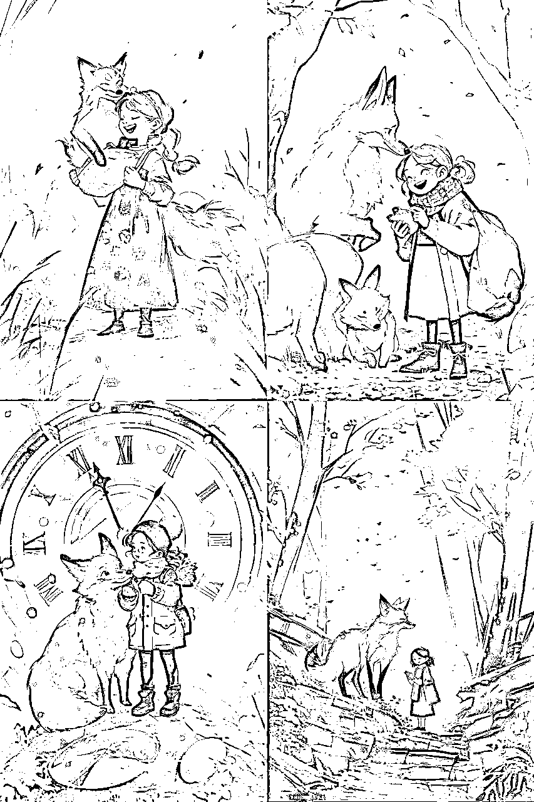
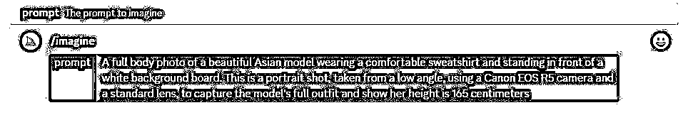
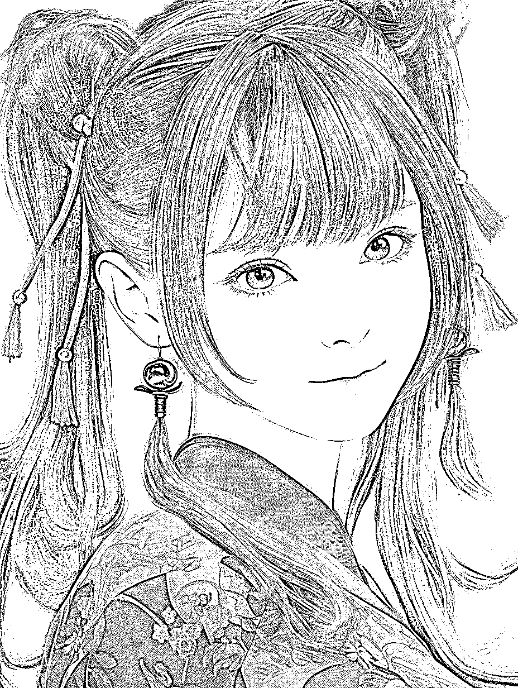
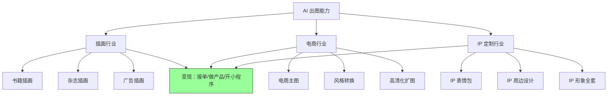

# 第11章 AI 绘画在插画、电商、IP 定制中的落地应用

> 本章展示 AI 绘画在包装、插画、电商图像、IP 定制等十余个行业的应用与变现方式，教读者将出图能力落地到商业场景，并引用行业预测（中文 AI 绘画将产生不少于 10 个年利润百万级小程序）作为方向参考。读完本章，你能知道自己手里的出图技能可以接什么单、怎么交付、钱从哪里来。

前两章我们把工具用熟了，也学会了精准控制。但请你始终记住本书反复强调的那句话：AI 是锦上添花，不是雪中送炭——**图本身不是钱，图能解决别人的问题才是钱。**这一章我们就来看，AI 绘画到底能落地到哪些行业、每个行业的客户要什么、以及普通人怎么从中赚到第一桶金。

---

## 11.1 大白话：画好图只是第一步，怎么赚钱才是关键

画好图只是第一步，怎么赚钱才是关键。比如给电商店铺做主图、做 IP 表情包、做定制插画，这些都是普通人能接的单子，交付物明确，客户愿意付钱。

> **大白话**：客户买的从来不是"一张 AI 图"，而是"一张能放在商品详情页里的图""一套能让店铺看着高级的图"。所以这一章的每一个应用场景，我们都会讲清楚三件事：客户是谁、交付什么、用什么方法做。方法层面，全部是前两章学过的内容——提示词公式、图生图、LoRA、构图控制，现在它们终于要"变现"了。

先给你一张总览表，本章内容全在里面，读完正文你再回头看它会有完全不同的感受：

| 行业方向 | 典型交付物 | 谁会付钱 |
|---------|-----------|---------|
| 插画 | 书籍内页/封面插画、杂志配图、广告海报 | 出版社、作者、杂志社、品牌方 |
| 电商 | 商品主图、场景图、模特图、详情页图 | 淘宝/拼多多/抖音商家 |
| IP 定制 | 表情包、盲盒形象、周边图案 | 品牌方、文创公司、平台广告分成 |
| 包装 | 产品包装贴图、样机效果图 | 有定制需求的小商家 |
| 其他 | 壁纸、头像、艺术字、动态视频 | 平台流量分成、个人用户 |

---

## 11.2 AI 绘画在插画行业的应用

### 11.2.1 书籍插画

用 AI 生成书籍内页插画和封面插画，适合绘本、小说、教材等出版场景。

**操作流程**：
1. 确定书籍主题和风格（如童话风、写实风、极简风）
2. 根据章节内容写提示词，生成对应插画
3. 统一色调和风格，确保全书视觉一致性
4. 后期排版，输出印刷文件

> **呼应第 10 章**：第 3 步的"全书视觉一致性"，用的就是第 10 章讲的三板斧——固定核心关键词 + 风格 LoRA + 固定随机种子。一本绘本几十张图，风格跳了读者立刻能感觉到，所以"锁风格"是书籍插画的生死线。

### 11.2.2 杂志插画

为杂志、报刊生成配图，快速出稿，满足紧急出版需求。

**优势**：传统插画师画一张图可能需要几天，AI 几分钟就能出十几张供选。杂志行业的痛点恰恰是"急"——临时加稿、封面重做、热点配图，AI 的速度优势在这里就是竞争力。

### 11.2.3 广告插画

为品牌广告生成视觉创意，用于海报、横幅、社交媒体配图。

### 11.2.4 插画实操：一个公式吃遍所有插画

根据插画设计的种类，我们可以有一个快速出图的基础公式：

```
【插画设计种类】+【你想要的画面】
```

比如用 niji 模型（它可以直接用中文）出图：

```
手绘插画，一个可爱的小女孩和狐狸 --ar 2:3 --niji 5 --style scenic
```



> **图片说明**：用 niji 模型生成"手绘插画，一个可爱的小女孩和狐狸"的出图效果（图源：《AI 绘画特训 实战手册》）。提示词就是基础公式的直接套用：插画种类是"手绘插画"，画面是"一个可爱的小女孩和狐狸"，比例用 --ar 2:3 竖构图。

把"手绘插画"换成"素描插画""文字插画""3D 打印插画""现代艺术插画"，同一画面立刻呈现完全不同的画风。想更精细，公式还可以继续扩展：

```
【插画设计种类】+【插画风格】+【你想要的画面】+【by 艺术家姓名】+【其他】
```

再教你一个"文字插画"的独门技巧：AI 绘画目前识别不了字母，但它对文字的排版还是可以的。我们可以根据图片上的文字排版，把图片上原有的文字消除掉、输入我们想要的文字，这样就可以作为图片封面使用——对电影海报插画和绘本封面插画来说，非常方便快捷。消除文字+打新字，不会 Photoshop 的话，用"稿定设计"或"美图秀秀"的消除笔+文字功能就能完成。

> **版权提醒（接商单必看）**：AI 绘画难以应对复杂场景、依赖训练数据、缺乏创意和个性，但最主要的风险是版权问题。在接商单的创作中，如果用了知名艺术家的名字生成的画，需要注意版权问题的处理，避免侵权和纠纷——当然，最好是别触及版权问题。

---

## 11.3 AI 绘画在电商行业的应用

### 11.3.1 电商主图制作

给电商店铺（淘宝、天猫、拼多多、抖音小店）生成商品主图。

**常见需求**：
- 商品白底图（纯白背景，突出商品）
- 商品场景图（商品在使用场景中的样子）
- 商品卖点图（突出商品特殊功能）
- 商品对比图（使用前后对比）

**提示词示例**：
```
一瓶护肤品，白色背景，高清产品摄影，柔光灯，玻璃材质，水滴特写，电商主图，8K，超清
```

**进阶玩法：AI 服装模特**。服装类目的痛点是请真人模特拍摄成本高（一次拍摄几百到几千元）。用 AI 可以批量生成模特图，流程如下：

1. 写一个符合要求的中文文案，例如："一张亚洲美女模特的全身照片，穿着舒适的运动衫，站在白色背景板前。这是一张人像照片，采用低角度拍摄，使用佳能 EOS R5 相机和标准镜头，拍摄模特整套服装，并展示她 165 厘米的身高。"
2. 将这句话放入 ChatGPT 或其他翻译软件中，翻译成适合 AI 绘画的英文描述词；
3. 将英文放到 Discord 中，输入 /imagine + 英文提示文案，等待 AI 绘图完成；
4. AI 直接生成 4 个模特，对满意的点击 U1、U2、U3、U4 打开大图；四张都不满意就点刷新，某张接近但需调细节就点 V1-V4；
5. 将符合要求的图片下载下来，与准备好的衣服照片通过 Photoshop 等修图软件简单叠加放在一起；
6. 把处理后的图片上传回 MidJourney 获取图片链接，还能继续用图生图给模特换背景、换姿势。



> **图片说明**：用 /imagine 命令一次生成 4 位服装模特（图源：《AI 绘画特训 实战手册》）。提示词里写清"全身照、白色背景板、低角度、相机型号"等细节，AI 出的图就能直接用于电商换装。

> **适用范围提醒**：这个玩法适用于纯色简单款衣服，如卫衣、T 恤、衬衫；不适用于复杂花色、花纹类衣服——花纹经不起"贴图合成"的细节拷问，容易穿帮。

### 11.3.2 风格转换

将同一款商品生成不同风格的图片，适应不同平台和人群。

- 年轻人向：潮流、亮色、动漫风
- 中年人向：稳重、暖色、写实风
- 高端人向：极简、黑金、奢华风

操作上就是第 10 章的"固定核心关键词"反过来用：**商品描述词不动，风格词整套替换**，一份商品图立刻裂变成三套视觉方案，这在 11.6 的实操案例里你会亲手做一遍。

### 11.3.3 高清化与扩图

用 AI 将低分辨率商品图高清化，或将小图扩展为大尺寸海报。

商家手里经常只有一张几百像素的商品小图，印成海报就糊了。用上一章讲过的工具就能救：LibLib AI 的高分辨率修复勾选框（生成的同时放大相应倍数）、后期处理的放大功能，MidJourney 的 Upscale（2X/4X）和扩图功能（向四个方向扩展画面）。"帮小商家把小图变大片"，本身就是一种可以收费的服务。

---

## 11.4 AI 绘画在 IP 定制中的应用

IP 定制是指将知名的影视、漫画、游戏等 IP 进行二次开发，将其应用于其他领域，如文化创意、广告、游戏等，从而创造新的商业价值。知名 IP 定制角色你一定都见过：Hello Kitty、皮卡丘、哆啦 A 梦、史努比、马力欧、米老鼠、小黄人、海绵宝宝……这些形象每年创造的商业价值以十亿计。在追求个性化和新颖的年轻群体中，AI 定制 IP 的潜力和吸引力是巨大的。

### 11.4.1 IP 表情包

设计固定角色的表情包系列，用于🛰️、🧣、📕等社交平台。

**一致性控制要点**（全部来自第 10 章）：
- 固定角色外貌（发型、服装、配饰）
- 固定角色表情（开心、难过、生气、惊讶）
- 固定色调（品牌主色调）

> **实操提示**：做表情包系列时，建议关掉文心一格的"灵感模式"（它会增加风格多样性，导致生成图片风格不一致），并用角色 LoRA 或固定角色描述词锁脸。

**表情包的变现路径很直接**：广告分成——在抖音、快手等平台发布表情包相关的图文或视频，注册小程序作者，上传表情包，用户通过观看广告获取表情包，你就可以获得广告收入。这是少有的"零门槛、平台自动结算"的变现方式。

### 11.4.2 IP 周边设计

为 IP 设计周边商品的图案，如 T 恤、马克杯、手机壳、贴纸。

以产品包装为例，推荐的组合是 **MidJourney 画图 + 包小盒贴图**：先用 MidJourney 画出 IP 形象（比如用"一个合马尾辫女孩的头像，黑发，中国女孩，可爱的女孩，高度详细的 3D CG"配 niji 5 的表现力风格），选中最满意的一张；然后打开包小盒官网，登录后选择智能样机库，挑选你需要的产品样机（瓶体、纸杯、礼盒等），把 IP 图贴上去，一个完整的包装效果图就出来了。



> **图片说明**：用 MidJourney 画出的 3D 风格女孩头像，选作产品包装的贴图（图源：《AI 绘画特训 实战手册》）。这类"AI 出图 + 样机工具贴图"的组合拳，一个人半天就能做出过去设计公司几天的工作量。

### 11.4.3 IP 形象全套

为个人 IP 或品牌 IP 设计完整的视觉系统，包括：
- IP 形象立绘
- IP 三视图
- IP 不同场景图
- IP 不同表情图

目前较为流行的 IP 玩法是**盲盒系列**。以 POPMART 风格的盲盒为例，核心咒语模板是：

```
Blind Box style, POPMART, chibi, dynamic pose, [角色与服装描述],
white background, lumen reflection, C4D, CGI, VFX, HD --niji 5 --style expressive
```

> **大白话**：Blind Box style 是"盲盒风格"，POPMART 指泡泡玛特那种潮玩质感，chibi 是"Q 版二头身"，dynamic pose 是"动态姿势"，后面填入你的角色设定——比如"魔术师萌妹，可爱俏皮姿势，全身，PVC，反光衣"或"弓箭手，披风，绿色服装"。只要角色描述词固定、风格词不动，你就能产出一整套风格统一的盲盒家族。

把盲盒角色延展成表情包、三视图、周边图案，一个完整的"IP 全套"交付物就成型了。第 10 章的角色一致性三法在这里全部派上用场。

---

## 11.5 行业预测与变现

### 11.5.1 行业预测

中文 AI 绘画将产生不少于 10 个年利润百万级小程序。

这意味着 AI 绘画不仅是工具，更是商业机会。普通人可以通过 AI 绘画接单、做产品、开小程序来变现。这个预测背后的逻辑不难理解：中文用户需要中文提示词、简单界面的出图工具（文心一格、MEWX 这类产品就是这个方向的先行者），谁把"简单好用的中文 AI 绘画"做到某个细分人群心里，谁就有机会吃下这份红利。

### 11.5.2 变现方式

先看一张按"客户类型 × 交付物"整理的对照表：

| 变现方式 | 适用人群 | 交付物 | 客户类型 |
|---------|---------|--------|---------|
| 电商主图制作 | 电商店主、设计师 | 商品主图、详情页图 | 淘宝/拼多多商家 |
| IP 表情包设计 | 插画师、自媒体人 | 表情包系列、IP 立绘 | 品牌方、个人 IP |
| 书籍插画 | 出版社、作者 | 内页插画、封面 | 出版社、自出版作者 |
| 广告插画 | 广告公司、设计师 | 海报、横幅、社媒图 | 品牌方、代理商 |
| IP 周边设计 | 文创从业者 | 周边图案文件 | 文创公司、品牌方 |

除了接商单，还有一批"自己干"的变现思路，它们更像小生意，适合先跑起来攒经验：

- **动态视频 + 图文平台分成**：用 AI 绘画工具绘制美女图等图片，搭配腾讯智影这类工具做成动态视频（数字人播报，文案让 ChatGPT 按人设生成）。有圈友在今日头条发布这类内容，展现量 57 万+、阅读量 5.9 万+，单篇收益 22.46 元；收益公式是"基础千次阅读单价 × 作者系数（原创内容系数 × 优质作者系数 × 用户偏好系数 × 涨粉系数）"。类似的平台还有百家号、知乎想法等。**优点**是看的人多则收益没有上限、创作成本极低；**缺点**是同质化严重、没有爆款时收益可能只有几分钱，需要好的网感和对平台用户的了解。
- **IP 定制接单与授权**：目前 IP 定制的变现方法还不是很明确，大部分账号会发布自己创作的 IP 作品，一边积累流量，一边探索变现；部分账号可能会接到一些定制商单，或者授权变现，但都未成体系——感兴趣的话，你可以做个先驱者。
- **其他方向**：AI 创意字、私人定制头像、十二星座系列图、👸号流量主配图、资料引流/知识付费、网盘拉新、动画制作……AI 绘画的变现思路远不止本章列出的这些，它们共同的特点是：**出图能力是入口，真正的收入来自你选定的细分场景。**

> **执行提醒**：我们鼓励大家积极下场，多尝试、多做图、多发布。与其在观众席等待比赛结果，不如先行下场。新手就是靠执行力，在找准方向后，执行力到位，是可以收获自己第一桶金的。

---

## 11.6 实操案例：为虚拟护肤品生成 3 张主图

现在把本章知识合成一套完整动作。案例背景：为一款虚拟护肤品生成 3 张不同风格的主图，并写出每张图的使用场景说明——这正是电商主图接单时最常见的需求形态。

### 11.6.1 主图 1：清新自然风（适合📕、年轻用户）

**提示词**：
```
一瓶护肤品，花园室外，自然光，绿色植物背景，清新色调，水滴特写，电商主图，8K，超清，小红书风格
```

**使用场景**：📕种草笔记配图、年轻护肤品牌首图。

### 11.6.2 主图 2：专业医美风（适合电商详情页、中年用户）

**提示词**：
```
一瓶护肤品，实验室背景，冷光，蓝白色调，玻璃材质，专业产品摄影，电商详情页，8K，超清，医美风格
```

**使用场景**：淘宝/天猫商品详情页、功能性护肤品主图。

### 11.6.3 主图 3：奢华高端风（适合高端电商、礼品市场）

**提示词**：
```
一瓶护肤品，大理石背景，暖光灯，黑金色调，金属材质，奢华产品摄影，电商主图，8K，超清，高端风格
```

**使用场景**：高端电商平台、节日礼品促销、品牌形象图。

### 11.6.4 视觉方案文档模板

| 图片 | 风格 | 提示词关键词 | 使用场景 | 目标人群 |
|------|------|-------------|---------|---------|
| 主图 1 | 清新自然 | 花园、自然光、绿色植物、水滴 | 📕种草、年轻品牌 | 18-30 岁女性 |
| 主图 2 | 专业医美 | 实验室、冷光、蓝白、玻璃材质 | 电商详情页、功能性护肤 | 25-45 岁女性 |
| 主图 3 | 奢华高端 | 大理石、暖光、黑金、金属材质 | 高端电商、节日礼品 | 30-55 岁高净值人群 |

> **注意观察**：三段提示词里，"一瓶护肤品""电商主图""8K，超清"这三块始终没变——这就是第 10 章讲的"固定核心关键词"；变的只有环境、光照、色调、风格四块。客户拿到的除了三张图，还有这张方案文档——**交付"方案"而不只是"图"，你的报价就能上一个台阶。**

---

## 11.7 AI 绘画落地应用 Mermaid 图

最后把本章的落地地图画成一张图：



> **一句话总结**：插画、电商、IP 定制是三条最容易上手的赛道，殊途同归地汇入"变现"这个终点。选一条赛道做深，胜过三条都浅尝辄止。

---

## 小练习

为一个虚拟电商产品（如一款护肤品）用 AI 生成 3 张不同风格的主图，并写出每张图的使用场景说明，形成一份简单的视觉方案文档。

> **复盘参考**：
> - 直接套用 11.6 节的提示词结构：固定"商品描述 + 电商主图 + 8K 超清"，替换环境/光照/色调/风格四块；
> - 检查三张图时用第 10 章的四维标准（构图、风格、画质、角色/商品一致性）——商品瓶身在三张图里形状颜色是否一致？不一致就把商品描述词写得更细，或降低图生图的重绘幅度；
> - 最后把三张图 + 方案文档整理成一页 PDF，这就是你将来给真实商家交付的样品雏形。

---

## 本章小结

通过本章，你应该已经掌握：

1. **变现的底层逻辑**：客户买的不是"AI 图"，而是"能解决问题的图"；交付物明确、客户愿意付钱的三个主赛道是插画、电商、IP 定制。
2. **插画落地**：公式"【插画设计种类】+【你想要的画面】"，可扩展插画风格和艺术家姓名；文字插画可用消除笔替换文字做封面；接商单注意艺术家名字的版权风险。
3. **电商落地**：白底图/场景图/卖点图/对比图四类需求；AI 服装模特适合纯色简单款，流程是中文文案 → ChatGPT 翻译 → /imagine 出 4 位模特 → U/V 挑图 → Photoshop 合成；高清化和扩图能救商家的小图。
4. **IP 定制落地**：表情包（关灵感模式保风格统一，广告分成可直接变现）；周边（MidJourney 出图 + 包小盒样机贴图）；盲盒（Blind Box style + POPMART + chibi + niji 5 expressive 咒语模板）。
5. **行业判断**：中文 AI 绘画将产生不少于 10 个年利润百万级小程序；IP 定制变现尚未成体系，正是先驱者的机会窗口。
6. **完整交付**：三风格主图案例演示了"固定商品词 + 替换风格词"的批量出图法，以及"交付方案而非单图"的报价升级思路。

至此，本书第三部分（AI 视觉与绘画）的三章全部结束。回顾一下这三章的脉络：第 9 章让你"会出图"，第 10 章让你"出准图"，本章让你"用图赚钱"。工具会不断更迭，但"把需求描述清楚 + 把视觉质量锁住 + 把交付做到位"这三件事，在任何一款新工具上都通用。
