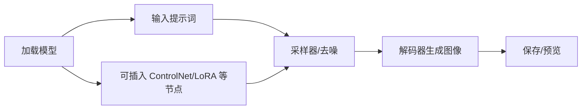

# 第12章 ComfyUI 工作流与 AI 视频生成

> 本节介绍 ComfyUI 节点式工作流，教读者无需本地高配置即可使用现成工作流一键运行（模特换装、真实人物写真、批量生成 AI 视频），并进阶到自己搭建工作流。覆盖腾讯混元、快手可图、Mochi、智谱 CogVideoX 等开源模型。

## 12.1 大白话：ComfyUI 就像"搭积木"画图

ComfyUI 像"搭积木"一样画图，把每个步骤（选模型、写提示词、出图、放大）变成一个个方块，连线后就能一键出图。好处是不用高配电脑，也可以直接用别人做好的"工作流"套用。

## 12.2 ComfyUI 是什么？

### 12.2.1 ComfyUI 与 WebUI 的对比

提到 ComfyUI 就要提到他之前的兄弟软件 Stable Diffusion，完整名称叫 Stable Diffusion WebUI，简称为 WEBUI 或 SD，是 AUTOMATIC1111 这位开发者为了大家方便使用 Stable Diffusion 制作的，选项卡式界面的 AI 绘画软件。

而我们这次学习的 ComfyUI 是节点+工作流式的 AI 工具，ComfyUI 在之前可以简单理解为换了节点+工作流界面的 Stable Diffusion，但是现在来说 ComfyUI 要比图形界面的 WebUI 强大的多，不仅仅可以用在 AI 绘画，还可以用在 AI 视频、AI 音频、AI 3D、AI 文本等等很多 AI 领域。是 Comfyanonymous 等其他开发者为了大家方便使用 AI 制作的。ComfyUI 通过将操作步骤拆分成工作流，实现了更加精准的定制工作流和完善的可复现性。

ComfyUI 现在不仅可以使用 Stability 研发的各种模型，Stability 是研发 Stable Diffusion 模型的公司，还能使用其他公司研发的 AI 开源模型，比如腾讯混元、快手可图、Mochi、智谱 CogVideoX 等很多优秀的 AI 模型。

**ComfyUI 的工作界面与 WebUI 的工作界面对比：**

1. **底层操作逻辑接近**：都拥有模型选择区域，输入提示词区域，参数设置区域，图片生成区域
2. **ComfyUI 界面简洁**：空白画布，需自己通过节点搭建工作流，当然也可以下载别人现成的工作流使用，整体学习门槛比较高
3. **WebUI 可视化界面**：图形化选择操作，对新手相对友好

### 12.2.2 ComfyUI 可以做什么

ComfyUI 是一个多功能的 AI 工具箱，它不仅限于绘画，还能生成视频、音频和 3D 模型等多种类型的 AI 任务，为用户提供了一个强大的 AI 创意平台。

1. **AI 绘画**：ComfyUI 可以生成与提示词提示相匹配的图像，用户只需要输入描述性的文本，ComfyUI 就能根据这些文本生成相应的图像。ComfyUI 也可以根据现有图片生成不同风格的图片。
2. **AI 视频**：ComfyUI 能够根据图片生成视频，使用的模型是 SVD（Stable Video Diffusion），可以以静止图像作为条件帧，并从中生成视频。此外，ComfyUI 还支持其他很多 AI 视频模型，以及视频转视频的功能，这意味着你可以将一个视频转换成另一个风格或内容的视频。
3. **AI 音频**：ComfyUI 使用 Stable Audio Open 模型，可以根据文本提示生成立体声音频。这个模型能够生成音效和音乐，可以尝试各种不同的音乐风格和文化。
4. **AI 3D**：ComfyUI 支持将 2D 图片转换成 3D 模型，这在一些工作流中被称为"二渲三"，即从 2D 图像生成 3D 模型。

## 12.3 ComfyUI 工作流示意 Mermaid 图

## 12.4 云端部署 ComfyUI

使用 ComfyUI 时遇到的第一个问题就是：到底是选择本地部署，还是线上部署？

### 12.4.1 本地部署：成本高、麻烦多

如果你选择本地部署，首先得有一台高性能电脑，尤其是显卡，比如 RTX 4070 16G，甚至 RTX 4090 24G，才能流畅运行 ComfyUI。但问题来了：

- **硬件贵**：一张顶级显卡几万元，不是每个人都愿意花这个钱。
- **性能要求高**：普通显卡跑不动大模型，生成图片要么慢得让人崩溃，要么直接失败。
- **维护麻烦**：你还得自己下载模型、装插件、调试环境，网络一出问题就得折腾半天。

简单来说，本地部署虽然能自己掌控，但对大多数圈友来说，性价比太低，时间和精力成本也太高。

### 12.4.2 云端部署：省钱、省心、高效

相比之下，云端部署就有很大优势：

**开箱即用**

云端平台已经把模型、插件和工作流都准备好了。你不需要自己配置，打开网页就能用，省时省力。这对初学者尤其友好，不用头疼技术细节，直接上手创作。

**随时随地用**

只要有网，就算用普通笔记本电脑，你都能随时登录云端平台开始工作。灵活性超强，不管在家、在学校还是出差，创作都不受限。

**顶级性能**

云端提供的算力，比如 RTX 4090 级别，秒杀大部分本地设备。跑大模型、生成高清图完全无压力，告别卡顿，效率翻倍。而且平台会不断更新资源，你总是用最新的技术。

有人可能会说，云端部署有费用、可能要排队，或者界面不太熟悉。但这些问题真的很小：

- **费用超低**：租用 4090 算力，1 小时才 2 元左右，比买显卡便宜太多了，几万元的硬件钱够你在云端用好几年。
- **排队可控**：高峰期可能要等一下，但换个时间用就行，完全不影响大局。
- **上手简单**：界面稍微适应一下就习惯了，学习成本几乎为零。

云端部署平台有很多，你可以选择自己认为合适的。

## 12.5 现成工作流一键运行

### 12.5.1 什么是现成工作流

现成工作流就是别人已经搭建好的 ComfyUI 节点连线，你只需要下载导入，修改提示词和参数，就能一键出图。不用自己从零开始搭节点。

### 12.5.2 常见现成工作流

| 工作流类型 | 适用场景 | 效果 |
|-----------|---------|------|
| 模特换装 | 电商模特图、服装试穿 | 换衣服、换背景 |
| 真实人物写真 | 个人形象照、证件照 | 写真级质感 |
| 批量生成 AI 视频 | 短视频素材、动画 | 多帧连贯视频 |
| 图生图 | 风格化改图、局部重绘 | 保持构图，改变风格 |

## 12.6 进阶：自己搭建工作流

当你熟练使用现成工作流后，可以进阶到自己搭建工作流，实现更个性化的定制。

**自搭建工作流的步骤**：
1. 了解各个节点的作用（加载模型、CLIP 文本编码器、K 采样器、VAE 解码器等）
2. 按照逻辑连接节点
3. 保存工作流为 JSON 文件
4. 分享或复用工作流

## 12.7 覆盖的开源模型

ComfyUI 支持多种开源模型，包括：

- **腾讯混元**：腾讯研发的图像生成模型
- **快手可图**：快手研发的图像生成模型
- **Mochi**：AI 视频生成模型
- **智谱 CogVideoX**：智谱 AI 研发的视频生成模型

## 小练习

在云端 ComfyUI 平台上运行一个现成的"图生图"工作流，生成一张风格化图片，记录操作步骤与云算力费用（如 4090 约 2 元/小时）。
