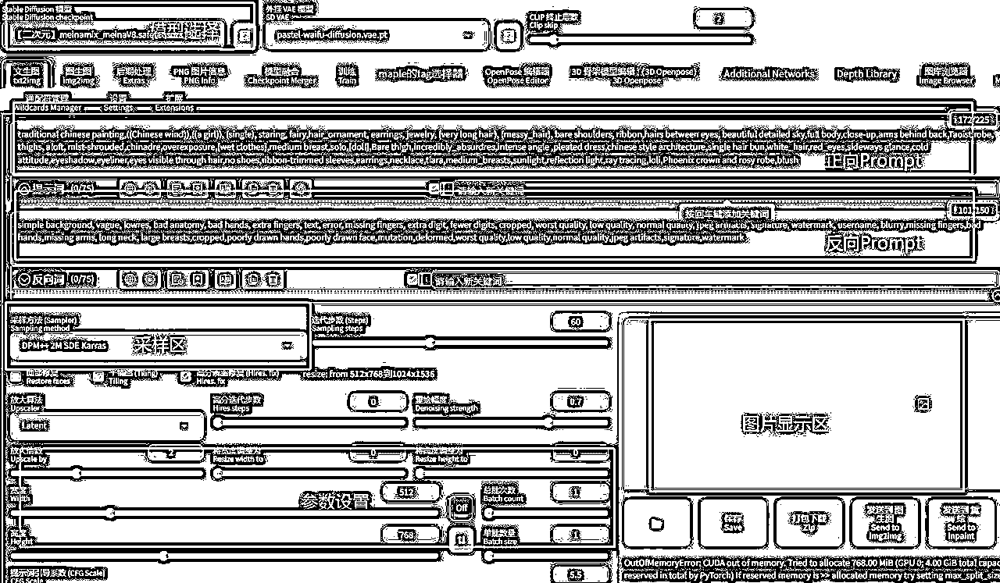
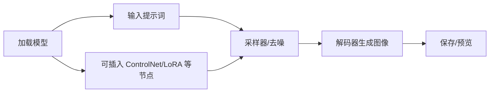
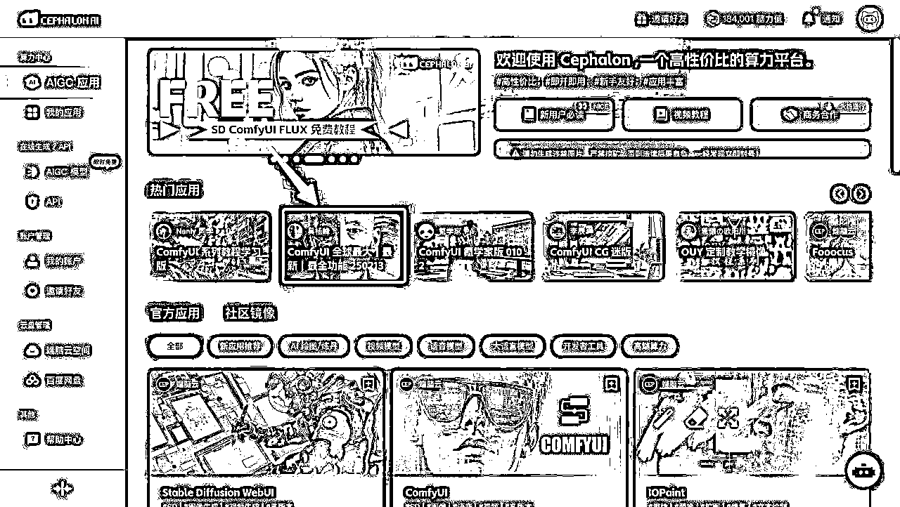
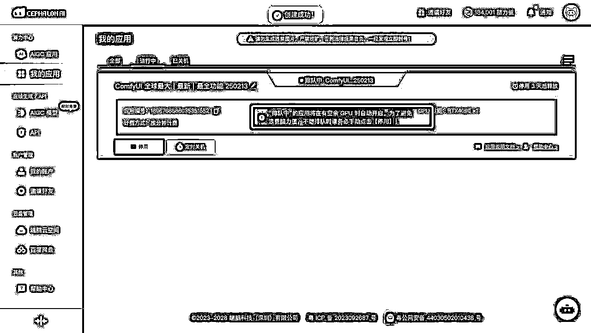
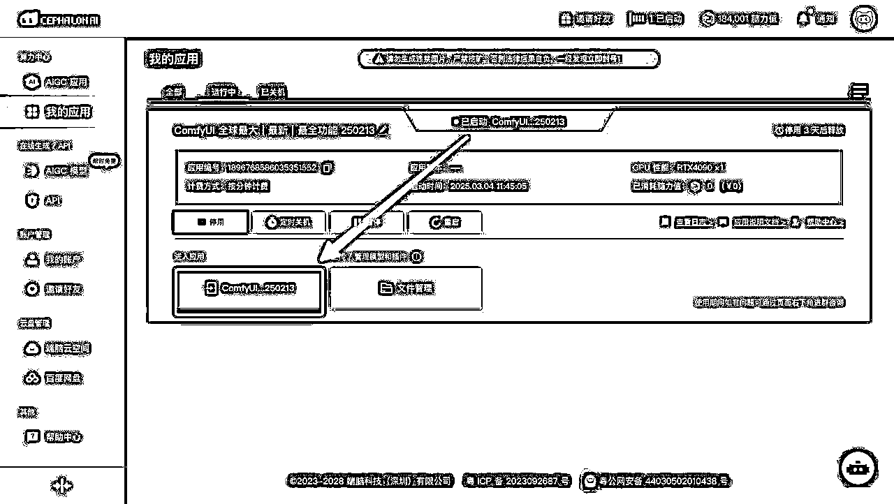
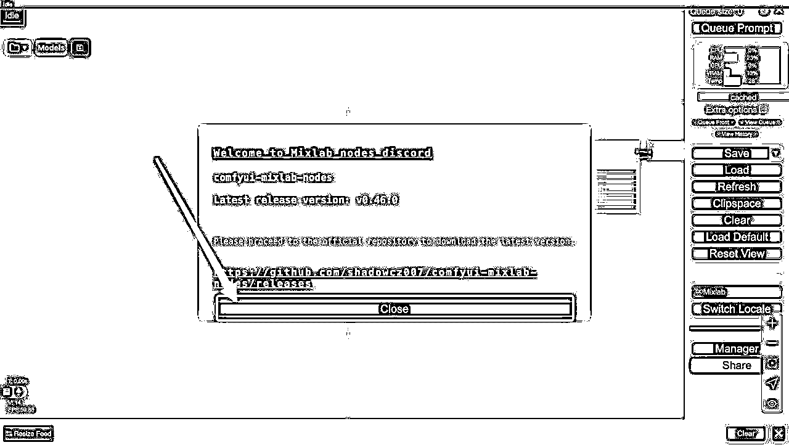
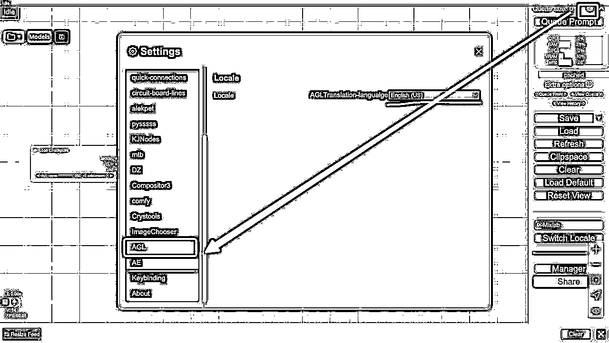

# 第12章 ComfyUI 工作流与 AI 视频生成

> 本节介绍 ComfyUI 节点式工作流，教读者无需本地高配置即可使用现成工作流一键运行（模特换装、真实人物写真、批量生成 AI 视频），并进阶到自己搭建工作流。覆盖腾讯混元、快手可图、Mochi、智谱 CogVideoX 等开源模型。

## 12.1 大白话：ComfyUI 就像"搭积木"画图

ComfyUI 像"搭积木"一样画图，把每个步骤（选模型、写提示词、出图、放大）变成一个个方块，连线后就能一键出图。好处是不用高配电脑，也可以直接用别人做好的"工作流"套用。

你可以把 ComfyUI 想象成一家流水线工厂。传统的 AI 绘画软件（比如 WebUI）更像一个"黑箱"：你在界面上填几个参数，点一下生成，中间发生了什么你完全看不到。而 ComfyUI 把整个生成过程拆成了一个个小方块，每个方块只负责一件事：

- 有一个方块负责"加载模型"，相当于进厂的原材料；
- 有一个方块负责"输入提示词"，相当于下达制作指令；
- 有一个方块负责"采样去噪"，相当于流水线上的加工工序；
- 有一个方块负责"解码器生成图像"，相当于产品下线；
- 有一个方块负责"保存/预览"，相当于把成品装进包装箱。

把这些方块用线连起来，就构成了一条完整的"工作流"（Workflow）。你下次想做同样的事，只需要把这条工作流保存下来，下次直接加载，修改一下提示词，就能一键出图。这就是 ComfyUI 的核心优势：**可复现、可复用、可定制**。

## 12.2 ComfyUI 是什么？

### 12.2.1 ComfyUI 与 WebUI 的对比

提到 ComfyUI 就要提到他之前的兄弟软件 Stable Diffusion，完整名称叫 Stable Diffusion WebUI，简称为 WEBUI 或 SD，是 AUTOMATIC1111 这位开发者为了大家方便使用 Stable Diffusion 制作的，选项卡式界面的 AI 绘画软件。

而我们这次学习的 ComfyUI 是节点+工作流式的 AI 工具，ComfyUI 在之前可以简单理解为换了节点+工作流界面的 Stable Diffusion，但是现在来说 ComfyUI 要比图形界面的 WebUI 强大的多，不仅仅可以用在 AI 绘画，还可以用在 AI 视频、AI 音频、AI 3D、AI 文本等等很多 AI 领域。是 Comfyanonymous 等其他开发者为了大家方便使用 AI 制作的。ComfyUI 通过将操作步骤拆分成工作流，实现了更加精准的定制工作流和完善的可复现性。

ComfyUI 现在不仅可以使用 Stability 研发的各种模型，Stability 是研发 Stable Diffusion 模型的公司，还能使用其他公司研发的 AI 开源模型，比如腾讯混元、快手可图、Mochi、智谱 CogVideoX 等很多优秀的 AI 模型。

**ComfyUI 的工作界面与 WebUI 的工作界面对比：**

1. **底层操作逻辑接近**：都拥有模型选择区域，输入提示词区域，参数设置区域，图片生成区域
2. **ComfyUI 界面简洁**：空白画布，需自己通过节点搭建工作流，当然也可以下载别人现成的工作流使用，整体学习门槛比较高
3. **WebUI 可视化界面**：图形化选择操作，对新手相对友好



> 图片说明：ComfyUI 与 WebUI 的工作界面对比截图，左侧是 ComfyUI 的节点式空白画布，右侧是 WebUI 的选项卡式可视化界面。

ComfyUI 的优势可以用一张表格来概括：

| 维度 | WebUI（Stable Diffusion WebUI） | ComfyUI |
|------|--------------------------------|---------|
| 界面风格 | 选项卡式图形界面，按钮和滑块多 | 节点式空白画布，线连方块 |
| 上手难度 | 较低，新手友好 | 较高，需要理解节点连线逻辑 |
| 显存占用 | 较高，运行大模型较吃配置 | 较低，同等模型下显存占用更少 |
| 工作流保存 | 难以完整保存整个生成过程 | 工作流可完整保存为 JSON，一键复用 |
| 可定制程度 | 有限，主要靠扩展插件 | 极高，每个步骤都可以自由拆分重组 |
| 适用场景 | 快速试验、新手入门 | 复杂流程定制、工作流共享、批量生成 |
| 适用模型 | 主要是 Stable Diffusion 系列 | Stable Diffusion 及腾讯混元、快手可图、Mochi、智谱 CogVideoX 等 |

用大白话总结：WebUI 像一台带很多旋钮的微波炉，你调几个旋钮就能加热食物，适合新手快速上手；ComfyUI 像一条可以随意重新接线的工厂流水线，你可以决定原材料先去哪个车间、再去哪个车间，最后怎么打包，适合想要精准控制每一步、并且想把流程保存下来反复使用的用户。

再把 ComfyUI 自身的优劣势摊开说清楚，帮你判断它适不适合你：

**ComfyUI 的优势**：

- **低显存要求**：ComfyUI 相对 WebUI 来说需要的显存占用要小，启动使用更少的显存，方便硬件配置较差的用户也能上手操作 AI。
- **灵活的工作流定制**：ComfyUI 允许用户自定义工作流程，调整节点连接以获得你想要的更灵活的功能和效果。
- **一个界面完成完整流程**：ComfyUI 可以同时文生图并同步图片生成视频，是一个完整的工作流程；而 WebUI 需要在不同的操作界面跳转，先完成文生图后，再图片生成视频。
- **工作流可复现**：用户构建自己的 ComfyUI 工作流，保存工作流文件后可很方便地与他人分享，他人使用你的工作流可以复现工作流想实现的功能。
- **图像可还原工作流**：ComfyUI 生成的图片可还原整个工作流，模型选择也会被保存——也就是说，你拿到别人一张 ComfyUI 生成的图，可以把当时用的节点、参数、模型全部"还原"出来。
- **插件丰富性**：ComfyUI 的节点等同于 WebUI 的插件，但 ComfyUI 的节点开发相对容易，所以 ComfyUI 的生态非常丰富，可以实现各种特殊的功能。

**ComfyUI 的不足**：

- 如果只是使用别人创建好的工作流，操作门槛就不高；但如果学习自己从头开始搭建工作流，需要具备清晰的逻辑理解和操作能力，有一定的学习门槛。
- ComfyUI 的空白画布用户界面对普通用户有一定的使用门槛，WebUI 的可视化操作界面对用户友好，可以很快找到需要的插件，使用方便。

### 12.2.2 ComfyUI 可以做什么

ComfyUI 是一个多功能的 AI 工具箱，它不仅限于绘画，还能生成视频、音频和 3D 模型等多种类型的 AI 任务，为用户提供了一个强大的 AI 创意平台。

1. **AI 绘画**：ComfyUI 可以生成与提示词提示相匹配的图像，用户只需要输入描述性的文本，ComfyUI 就能根据这些文本生成相应的图像。ComfyUI 也可以根据现有图片生成不同风格的图片。

2. **AI 视频**：ComfyUI 能够根据图片生成视频，使用的模型是 SVD（Stable Video Diffusion），可以以静止图像作为条件帧，并从中生成视频。此外，ComfyUI 还支持其他很多 AI 视频模型，以及视频转视频的功能，这意味着你可以将一个视频转换成另一个风格或内容的视频。

3. **AI 音频**：ComfyUI 使用 Stable Audio Open 模型，可以根据文本提示生成立体声音频。这个模型能够生成音效和音乐，可以尝试各种不同的音乐风格和文化。

4. **AI 3D**：ComfyUI 支持将 2D 图片转换成 3D 模型，这在一些工作流中被称为"二渲三"，即从 2D 图像生成 3D 模型。

用大白话解释：ComfyUI 不仅仅是一把"画图刀"，更像一台多功能加工中心。你给它一段文字，它可以帮你出图；你给它一张图，它可以帮你生成动态视频；你给它一段描述，它可以帮你生成背景音乐；你给它一张 2D 照片，它甚至可以帮你还原成 3D 模型。对于初学者来说，不用一开始就掌握所有功能，先从 AI 绘画和 AI 视频这两个最常用的入手即可。

## 12.3 ComfyUI 工作流示意 Mermaid 图

把 ComfyUI 生成图像的核心流程画成一张图，你再看一遍，应该就有"原来如此"的感觉了：



> **图表说明**：这是 ComfyUI 最基础的工作流示意。加载模型决定用什么"大脑"作画，输入提示词告诉 AI 要画什么内容，采样器/去噪负责把噪点逐步还原成图像，解码器把处理后的结果生成成可见图片，最后保存或预览。如果你想增加额外控制（比如指定人物姿势、风格参考），可以插入 ControlNet、LoRA 等辅助节点，它们会介入采样环节，让生成结果更贴合你的要求。

ComfyUI 真正强大的地方在于"工作流"这个概念。你可以把上面这张图保存成一个 JSON 文件，发给朋友，朋友导入后就能得到完全一样的生成流程。这就像你把一道菜的做法写成精确到克数的食谱，别人照着做，做出的菜味道和你的一模一样。

## 12.4 云端部署 ComfyUI

使用 ComfyUI 时遇到的第一个问题就是：到底是选择本地部署，还是线上部署？

### 12.4.1 本地部署：成本高、麻烦多

如果你选择本地部署，首先得有一台高性能电脑，尤其是显卡，比如 RTX 4070 16G，甚至 RTX 4090 24G，才能流畅运行 ComfyUI。但问题来了：

- **硬件贵**：一张顶级显卡几万元，不是每个人都愿意花这个钱。
- **性能要求高**：普通显卡跑不动大模型，生成图片要么慢得让人崩溃，要么直接失败。
- **维护麻烦**：你还得自己下载模型、装插件、调试环境，网络一出问题就得折腾半天。

简单来说，本地部署虽然能自己掌控，但对大多数圈友来说，性价比太低，时间和精力成本也太高。

### 12.4.2 云端部署：省钱、省心、高效

相比之下，云端部署就有很大优势：

**开箱即用**

云端平台已经把模型、插件和工作流都准备好了。你不需要自己配置，打开网页就能用，省时省力。这对初学者尤其友好，不用头疼技术细节，直接上手创作。

**随时随地用**

只要有网，就算用普通笔记本电脑，你都能随时登录云端平台开始工作。灵活性超强，不管在家、在学校还是出差，创作都不受限。

**顶级性能**

云端提供的算力，比如 RTX 4090 级别，秒杀大部分本地设备。跑大模型、生成高清图完全无压力，告别卡顿，效率翻倍。而且平台会不断更新资源，你总是用最新的技术。

有人可能会说，云端部署有费用、可能要排队，或者界面不太熟悉。但这些问题真的很小：

- **费用超低**：租用 4090 算力，1 小时才 2 元左右，比买显卡便宜太多了，几万元的硬件钱够你在云端用好几年。
- **排队可控**：高峰期可能要等一下，但换个时间用就行，完全不影响大局。
- **上手简单**：界面稍微适应一下就习惯了，学习成本几乎为零。

云端部署平台有很多，你可以选择自己认为合适的。这里把几个主流平台放在一起对比，方便你对号入座：

**主流云端 ComfyUI 平台对比**：

| 平台 | 网址 | 特点 | 适合人群 |
|------|------|------|---------|
| LiblibAI | www.liblib.art | 提供 ComfyUI 在线版本，不用本地部署就能玩转节点式操作，集成了 LoRA、ControlNet 等常用组件，生成图像和视频都很方便；模型和插件都配好了，登录就能直接用；内置一些免费工作流（比如古人画像、一键换脸） | 新手试玩，登录就能玩，省心 |
| 端脑云 | cephalon.cloud | 国内云平台，按需付费，可按分钟、小时或包月付费；有 RTX 4090 这类高配 GPU 可选，重度任务也不卡；一键打开 ComfyUI 界面 | 电脑配置不行但又想体验高性能生成的朋友 |
| 仙宫云 | www.xiangongyun.com | 一键部署，开箱即用；RTX 4090 算力每小时仅需 1.89 元，价格低；覆盖 AI 绘画（SD、Flux）、数字人、AI 语音、换脸等应用，内置插件众多 | 追求性价比的用户 |
| AutoDL | www.autodl.com | 跟端脑云差不多，但主打便宜，按分钟收费，ComfyUI 环境都装好了 | 短期尝鲜或实验性玩法 |
| 阿里云函数计算（FC） | www.aliyun.com/product/fc | 通过阿里云一键部署自己的 ComfyUI 平台，随用随扩，稳定靠谱，有安全和存储保障 | 有技术背景的玩家或企业 |

> **选择建议（原素材的推荐）**：新手试玩，直接上 LiblibAI，登录就能玩，省心；高端玩家，端脑云或仙宫云更合适，尤其是要搞复杂效果的时候；专业团队，考虑 AutoDL 或阿里云函数计算，可定制性强，但最好有个懂技术的同事帮忙。

当然，云端平台也不是十全十美的，各有各的小毛病，提前知道免得踩坑：

- **LiblibAI**：某些高级插件可能不支持，也不一定能上传自己的模型；新功能只有等平台官方更新才能用，自己想折腾新玩法时会比较受限。
- **端脑云**：高配置用多了，账单会让你肉疼；每次开启时需要几分钟排队等待。
- **仙宫云**：出图略慢，其 RTX 4090 在生成 512x768 分辨率图像时，平均耗时约 20 秒/张，略慢于部分竞品；操作流程会多一点点。
- **AutoDL**：社区镜像内置的高级功能或炫酷插件较少，需要自行安装，模型内置也不多；教程和指导不多，新手多半要自己摸索。
- **阿里云函数计算**：需要懂点云服务配置，小白慎入；插件和模型要自己配，维护起来有点费事。

用大白话总结：本地部署像自己买一台昂贵的工业设备放在家里，随时可以用，但买设备、装电线、修机器都得你自己操心；云端部署像去印刷店复印，不用买设备，随到随用，按次付费，印完就走。如果你只是偶尔做几张 AI 图，或者是完全的新手，强烈建议先从云端部署开始，等熟悉了再考虑是否要买显卡本地跑。

**云端平台实操演示（以端脑云为例）**

我们本次航海演示用的是端脑云，下面把完整流程走一遍，其他平台的操作大同小异：

**第 1 步：打开平台，找到 ComfyUI 应用**

打开网页（https://cephalon.cloud/aigc）后，点击"热门应用"。



> 图片说明：端脑云的热门应用页面，ComfyUI 应用就在应用列表里。

**第 2 步：选择服务器**

在应用里，我们选择一下服务器，这里推荐用 4090，出图会快一些。

**第 3 步：排队等待**

服务器选择完之后，会有一个排队的时间，大概 1-2 分钟，大家可以起来活动一下脖子。



> 图片说明：排队等待界面，显示当前排队状态。

**第 4 步：进入工作流**

排队结束后，就可以直接点击工作流使用了。



> 图片说明：排队结束后的工作流入口页面。

**第 5 步：打开 ComfyUI 界面**

打开 ComfyUI，直接点击"Close"，就能看到 ComfyUI 的页面了。



> 图片说明：ComfyUI 启动提示弹窗，点击 Close 关闭后进入主界面。

**第 6 步：切换中文界面（可选）**

进去之后，可以点击设置按钮（一个小齿轮），然后点击 AGL，把界面文字调成中文。



> 图片说明：ComfyUI 设置界面，通过 AGL 选项把界面文字切换为中文。

到这里，你就拥有了一台"云端的顶级画图机器"，接下来的所有操作，都和本地部署的 ComfyUI 一模一样。

## 12.5 现成工作流一键运行

### 12.5.1 什么是现成工作流

现成工作流就是别人已经搭建好的 ComfyUI 节点连线，你只需要下载导入，修改提示词和参数，就能一键出图。不用自己从零开始搭节点。

对于初学者来说，从零开始搭建 ComfyUI 工作流需要理解每个节点的作用、每条连线的含义，学习成本较高。而现成工作流就像"半成品菜"，别人已经把洗切配炒的步骤都安排好了，你只需要把自己的食材（提示词、模型、参数）放进去，按一下开关，就能出成品。

去哪里找现成工作流？主要有三个渠道：

- **云端平台内置**：比如 LiblibAI 内置了一些免费工作流（古人画像、一键换脸等），登录后在对应模型页面点"在线运行工作流"即可，需要本地使用再点击下载（前提是你本地已经安装 ComfyUI）。
- **航海配套资料**：本期航海会分享一些好用的工作流，比如给模特换装、用提示词生成真实细腻的人物写真、批量生成 AI 视频……这些内容你都不需要自己搭建步骤，用航海提供的工作流就好，一键就可以运行。
- **社区分享**：ComfyUI 生成的图片可以还原整个工作流，所以社区里流传的很多示例图，本身就是一个"活的教程"——把图片拖进 ComfyUI，工作流就回来了。

顺便说一句，现成工作流不只是"省事"，它还是一门小生意：ComfyUI 的工作流可以根据用户要求实现特定功能，用户会购买这些定制工作流以提升工作效率。也就是说，你先学会用别人的工作流，进阶后学会改和搭，就可以把搭好的工作流卖给有需要的人——这也是 ComfyUI 常见的变现方式之一。

### 12.5.2 常见现成工作流

| 工作流类型 | 适用场景 | 效果 |
|-----------|---------|------|
| 模特换装 | 电商模特图、服装试穿 | 换衣服、换背景 |
| 真实人物写真 | 个人形象照、证件照 | 写真级质感 |
| 批量生成 AI 视频 | 短视频素材、动画 | 多帧连贯视频 |
| 图生图 | 风格化改图、局部重绘 | 保持构图，改变风格 |

用大白话解释这些工作流能帮你做什么：

- **模特换装**：你有一张模特穿着衣服的照片，想把衣服换成另一款，或者把模特放到不同的背景里（比如从工作室换到海边）。传统做法需要抠图、合成、调光影，非常麻烦。用模特换装工作流，只需要上传原图和目标衣服图片，AI 就能自动完成换装，衣服的褶皱、光影都会自动匹配。

- **真实人物写真**：你只需要几张自己的生活照，用真实人物写真工作流，就能生成各种风格的个人形象照，甚至可以生成证件照。不用去照相馆，在家就能拿到写真级质感的照片。

- **批量生成 AI 视频**：如果你需要大量短视频素材（比如做自媒体、做广告），批量生成工作流可以一次性处理多张图片，生成多帧连贯的动画视频，省去逐张制作的麻烦。

- **图生图**：你有一张已经画好的图，想要保持原来的构图，但把风格改成水墨画、油画、动漫风，或者在图片的局部进行重绘（比如把人物的衣服颜色改掉）。图生图工作流可以在保持原图整体结构的前提下，灵活调整风格和细节。

使用现成工作流的基本步骤：

1. 在 ComfyUI 平台（云端或本地）找到合适的现成工作流模板，下载或导入。
2. 把工作流加载到画布上，你会看到已经连好的节点和线。
3. 找到"加载模型"节点，选择你想用的模型（比如腾讯混元、快手可图等）。
4. 找到"输入提示词"节点，把你想要生成的内容描述填进去。
5. 找到"保存/预览"节点，点击生成，等待图片出来。
6. 如果不满意，修改提示词或调整参数，重新生成即可。

## 12.6 进阶：自己搭建工作流

当你熟练使用现成工作流后，可以进阶到自己搭建工作流，实现更个性化的定制。

**自搭建工作流的步骤**：

1. 了解各个节点的作用（加载模型、CLIP 文本编码器、K 采样器、VAE 解码器等）
2. 按照逻辑连接节点
3. 保存工作流为 JSON 文件
4. 分享或复用工作流

用大白话解释几个常见节点：

- **加载模型节点**：相当于选大脑。不同的模型擅长不同的东西，有的擅长写实照片，有的擅长动漫，有的擅长油画。你要先决定用哪个大脑，后面的步骤才知道该怎么工作。

- **CLIP 文本编码器节点**：相当于翻译官。你输入的提示词是人类能看懂的自然语言，但 AI 模型看不懂自然语言。CLIP 的作用是把你的提示词翻译成模型能理解的数学向量，让模型知道你要画什么。

- **K 采样器节点**：相当于画师。它根据翻译好的指令，在噪点图像中逐步"雕刻"出最终图片。采样步数越多，雕刻得越细致，但生成时间也越长。

- **VAE 解码器节点**：相当于冲印工。采样器处理完后得到的是一个模型内部的隐空间表示，不是直接能看的图片。VAE 把它解码成你可以在屏幕上看到的普通图片。

自己搭建工作流时，建议先从简单的流程开始：加载模型 → 输入提示词 → 采样器 → 解码器 → 保存。等这个基本流程跑通了，再尝试加入 ControlNet（控制构图）、LoRA（风格微调）、放大节点等更高级的功能。

保存好的工作流是一个 JSON 文件，你可以把它发给朋友，朋友导入后就能得到完全相同的生成效果。这就是 ComfyUI 工作流最强大的地方：**一次搭建，处处可用**。

下面给出一个简单的 Python 脚本示例，演示如何通过代码加载并运行一个 ComfyUI 工作流文件（假设你已经部署了 ComfyUI 并开启了 API 服务）：

```python
# ===== 程序作用：向本地 ComfyUI 发送工作流 JSON，触发图片生成，并保存结果 =====
# 前提：你的电脑上已安装 ComfyUI 并启动了 API 服务（默认端口 8188）
# 运行前需要安装依赖：pip install requests

import json
import requests

# 第 1 步：定义 ComfyUI 的 API 地址
# 默认本地运行，端口是 8188；如果是云端部署，把地址换成云端地址
COMFYUI_URL = "http://127.0.0.1:8188"

# 第 2 步：加载工作流 JSON 文件
# 这个文件是你在 ComfyUI 界面里搭建好并保存的工作流，扩展名通常是 .json
with open("workflow.json", "r", encoding="utf-8") as f:
    workflow = json.load(f)

# 第 3 步：修改工作流中的提示词（可选）
# 找到工作流中负责输入文本的节点，把提示词替换成你想要的内容
# 实际的节点 ID 需要根据你保存的工作流文件来确定
for node_id, node in workflow.items():
    if isinstance(node, dict) and node.get("class_type") == "CLIPTextEncode":
        node["inputs"]["text"] = "一只穿着黄色卫衣的橘猫在刷牙，卡通风格，高清"

# 第 4 步：向 ComfyUI 发送生成请求
# prompt 字段就是工作流本身，ComfyUI 会按照工作流里的节点连线依次执行
response = requests.post(
    f"{COMFYUI_URL}/prompt",
    json={"prompt": workflow}
)

# 第 5 步：检查返回结果
if response.status_code == 200:
    result = response.json()
    prompt_id = result.get("prompt_id")
    print(f"生成任务已提交，任务 ID：{prompt_id}")
    print("你可以在 ComfyUI 界面里查看生成进度，或通过 /history 接口查询结果")
else:
    print(f"请求失败，状态码：{response.status_code}")
    print(response.text)
```

代码注释说明：

- `requests.post` 向 ComfyUI 的 `/prompt` 接口发送工作流，相当于点击了"生成"按钮。
- `workflow` 是一个 JSON 对象，里面包含了所有节点和它们之间的连线关系，ComfyUI 会按照这个关系图依次执行每个节点。
- 如果你使用的是云端部署的 ComfyUI，只需要把 `COMFYUI_URL` 改成云端服务的地址即可，代码其余部分不需要改动。
- 实际使用时，`workflow.json` 的节点结构需要你先在 ComfyUI 界面里搭建好并保存，然后再用代码加载修改。

## 12.7 覆盖的开源模型

ComfyUI 支持多种开源模型，包括：

- **腾讯混元**：腾讯研发的图像生成模型
- **快手可图**：快手研发的图像生成模型
- **Mochi**：AI 视频生成模型
- **智谱 CogVideoX**：智谱 AI 研发的视频生成模型

用大白话解释：模型就像 ComfyUI 里的"大脑"，不同的大脑擅长不同的事情。腾讯混元和快手可图主要用来生成图片，Mochi 和智谱 CogVideoX 主要用来生成视频。你在 ComfyUI 工作流里的第一步通常就是"加载模型"，也就是决定用哪个大脑来处理你的任务。你可以根据自己的需求自由切换模型，甚至在同一个工作流里用多个模型分工协作。

再把两个前面提到过、但你可能还没完全搞懂的模型展开讲一下：

- **SVD（Stable Video Diffusion）**：ComfyUI 做 AI 视频最常用的模型。它的工作方式是"以静止图像作为条件帧"——你先给它一张图，它以这张图为"第一帧"，往后脑补出连续的动态画面，变成一段视频。它支持多种分辨率和视频时长的生成。所以"图生视频"的标准流程就是：先用文生图模型出一张满意的图，再交给 SVD 让它动起来。
- **Stable Audio Open（SAO）**：ComfyUI 做 AI 音频的模型，能根据文字提示词生成音效和音乐。比如你给视频配乐时不想费劲找素材，直接描述"轻快的古风背景音乐"，它就能帮你生成一段。

理解了这两个模型，你就能看懂很多 ComfyUI 视频工作流的结构了：前半段是文生图（加载图像模型 + 提示词 + 采样器），后半段是图生视频（加载 SVD 模型 + 动态描述 + 采样器），两段一拼，就是一条完整的"从文字到视频"流水线。

## 小练习

在云端 ComfyUI 平台上运行一个现成的"图生图"工作流，生成一张风格化图片，记录操作步骤与云算力费用（如 4090 约 2 元/小时）。

## 本章小结

通过本章，你应该已经了解：

1. **ComfyUI 是什么**：一个节点+工作流式的 AI 工具，比传统的 WebUI 更强大，不仅能 AI 绘画，还能做 AI 视频、AI 音频、AI 3D 等多种任务。
2. **ComfyUI 与 WebUI 的区别**：WebUI 是图形化界面，新手友好；ComfyUI 是节点式空白画布，学习门槛较高，但显存占用更低、工作流可完整保存复用、定制程度更高。
3. **ComfyUI 的核心流程**：加载模型 → 输入提示词 → 采样器/去噪 → 解码器生成图像 → 保存/预览，每个步骤都是一个节点，用线连起来就是工作流。
4. **本地 vs 云端部署**：本地部署需要高配显卡（RTX 4070 16G/4090 24G），维护麻烦；云端部署打开网页即用，RTX 4090 算力约 2 元/小时，更适合初学者和偶尔使用的用户。
5. **现成工作流**：别人搭建好的节点连线，导入后修改提示词就能一键出图，适合模特换装、真实人物写真、批量生成 AI 视频、图生图等场景。
6. **自己搭建工作流**：了解各个节点作用（加载模型、CLIP 文本编码器、K 采样器、VAE 解码器等），按逻辑连接节点，保存为 JSON 文件，即可复用和分享。
7. **常见开源模型**：腾讯混元、快手可图（图像生成）；Mochi、智谱 CogVideoX（视频生成），可在 ComfyUI 中自由切换。

下一章，我们将学习 AI 视频生态与主流工具，包括 Runway、可灵、Gen-1/Gen-2 等，帮你把 AI 视频创作从"会用工具"提升到"能选对工具"的水平。
