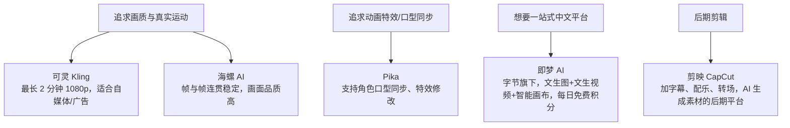

# 第13章 AI 视频生态与主流工具（Runway、可灵、Gen-1/Gen-2 等）

> 本节盘点 AI 视频生成工具与生态，介绍 Sora 等文生视频模型的上线进展与国内外竞品动态，帮读者尽早掌握信息差。提醒对市面 Sora 课程谨慎防骗，因 Sora 尚在内测无实操入口，定位为资讯认知而非即时实操。

## 13.1 大白话：AI 视频就是打字或传图出视频

AI 视频就是你打一段文字或上传一张图，AI 帮你生成视频片段。目前生成的视频比较短（几秒到几十秒），适合做短视频素材，不适合直接拍长片。新手先用一个工具熟练，不要贪多。

## 13.2 认识 AI 视频生态

### 13.2.1 AI 视频技术的演进

近年 AI 技术飞速发展，视频内容创作迎来了革命性的变化。从早期 AI 辅助剪辑、自动字幕等辅助创作功能，到如今能够直接生成视频内容的模型，AI 在视频生态中的地位不断提升。

这样的技术演进极大降低了视频创作门槛，提高了创作效率。现在，即使没有专业拍摄和剪辑经验，你也可以通过 AI 工具快速实现自己的创意。当脚本、拍摄甚至剪辑都不再是难题时，真正决定作品高度的反而是创意本身。

### 13.2.2 AIGC 浪潮重塑短视频行业

在内容创作层面，AIGC（AI 生成内容）浪潮正重塑短视频行业生态。2024 年，在抖音等 UGC 平台上涌现出大量 AI 特效视频，用户只需上传一张图片或输入文字，就能生成有趣的视频内容。

比如，Remini 的"黏土动画"特效风靡全网，吸引了数百万用户参与；随后"毛毡娃娃风""柯南动画风""油画风"等 AI 滤镜接连走红，相关话题播放量高达数亿甚至数十亿。

借助这些 AI 特效和平台挑战赛的传播机制，普通用户的创作热情被激发，个性化的内容不断涌现。可以预见，AIGC 将成为短视频创作的新常态：创作者更专注于创意和脚本，具体画面由 AI 高效生成。与此同时，短视频平台内容产出呈指数级增长，也对内容审核和观众注意力分配提出了新的挑战。

### 13.2.3 AI 视频的局限与避坑清单

不过，尽管 AI 视频生成技术发展迅猛，但目前仍有一些局限，以及做这个项目时，也会存在一些"坑"：

1. **纯 AI 生成的视频长度往往较短**（多数工具一次生成几秒到几十秒不等），画质和精细度相对专业拍摄还有差距。
2. **复杂场景、多角色互动等，目前仍然可能出现瑕疵**。
3. **生成内容的可控性和一致性也是挑战**（如视频帧的连续稳定、角色形象在不同场景的一致）。
4. **不要盲目追求高级软件**（先用好一个工具再扩展）。
5. **不要忽视版权问题**（商用需注意素材授权）。
6. **不要过度依赖 AI**（创意才是核心竞争力）。
7. **千万记得，要备份工程文件**（血泪教训：突然崩溃全白做）。

不过，这些问题正随着技术进步逐步改善——新模型不断涌现，支持更长时长、更高分辨率的视频生成，允许在生成过程中加入参考图像或预设风格来提高一致性。总的来说，AI 视频生态正处于从早期探索走向实用化的阶段：创作者拥抱新工具，内容形式更加丰富，但也需要理解技术的优劣，才能更好地驾驭 AI 进行创造。

### 13.2.4 Sora 防骗提醒

OpenAI 发布文生视频软件 Sora，它具备理解世界并生成多角度、最高时长达 60 秒视频的能力。Sora 其实就是文生视频（Text-to-Video）路线的一个灯塔。

**但目前 OpenAI 官方尚未公布 Sora 的算力成本，Sora 尚在内测无实操入口，定位为资讯认知而非即时实操。**

市面上很多"Sora 课程"都是割韭菜，不要轻易付费购买。Sora 相关信息只需作为资讯关注，不需要急着去学习操作。

## 13.3 AI 视频用到的工具

当前市面上有众多 AI 视频创作工具，每款都有自身特色和适用场景。以下总结一些主流 AI 视频工具的功能亮点和典型用途，供初学者参考：

### 13.3.1 Runway（Runway Gen-1/Gen-2）

业界较早推出的 AI 视频生成工具。

- **网址**：https://runwayml.com/
- **功能**：提供网页和 App 方便使用，功能包括文本生成视频（Gen-2）和视频风格迁移（Gen-1），还支持对视频进行实时涂抹编辑等高级操作。
- **适用人群**：适合希望借助前沿模型快速试验创意的用户。
- **注意**：Runway 目前需要订阅付费才能充分使用高级生成功能。

### 13.3.2 可灵 AI（Kling）

由快手团队自研的大模型视频生成工具，技术实力雄厚。

- **网址**：https://app.klingai.com/cn/
- **功能**：采用类 Sora 的架构，生成的视频运动幅度大、物理效果真实，可生成情节丰富的动画或实拍风格片段。会员用户可生成最长 2 分钟、30 帧的 1080p 高清影片，支持多种画面比例，并提供高表现模式、视频续写等高级功能。非会员则可能需要排队等待生成。
- **适用人群**：可灵非常适合追求高质量和真实运动效果的专业创作者，用于短片、自媒体视频乃至广告创意制作。

### 13.3.3 海螺 AI（Hailuo）

国内另一款顶尖视频生成工具，以高画质和稳定性见长。

- **网址**：https://hailuoai.com/
- **功能**：其生成视频在色彩、光影和角色情绪表现上质量出色，在第三方测试中综合效果排名第一，尤其在帧与帧的连贯稳定上有绝对优势。海螺支持文字、图像、音频等多模态输入，界面简洁易上手，在海外市场也备受欢迎，用户遍及 180 多个国家。缺点是目前功能相对单一，缺少图像生成、对口型等扩展能力。
- **适用人群**：非常适合注重画面品质的创作者，比如影视导演、编剧，用于概念影片、高质量短视频等。

### 13.3.4 即梦 AI（Dreamina）

字节旗下推出的 AI 创作平台，提供一站式的文生图、智能画布和文生视频功能。

- **网址**：https://jimeng.jianying.com/
- **功能**：用户可以用中文提示词生成所需画面，并能在智能画布上进一步编辑调整，从剧本大纲到成片都能在一个平台完成。即梦支持角色对口型动画生成，AI 配音自然逼真。每日登录赠送 60-100 积分供免费使用，即使非会员也足够日常创作需求。不过在复杂人物和场景上偶尔有细节瑕疵。
- **适用人群**：适合追求功能全面、上手简单的用户，例如内容创作者、教育工作者，用于生成个性化短视频、教学动画、广告素材等。

### 13.3.5 Pika

一款国外的文本生成视频工具，以动画和特效见长。

- **网址**：https://pika.art/about
- **功能**：支持用户上传语音或配音，实现视频中角色口型与声音同步。Pika 的可控性强，允许对生成视频中的角色、物体进行定点修改，甚至添加爆炸、融化等酷炫特效（最新的 Pika 1.5 版本已支持这些功能）。它还提供一定的视频编辑能力，生成的视频可以直接在其平台上做简单剪辑。
- **适用人群**：适合用于制作卡通动画、MG 动画风格的视频，以及需要精确控制口型的角色对话场景。注意 Pika 目前主要通过官网提供服务，注册登录即可有限度免费使用。

### 13.3.6 剪映（CapCut）

字节跳动推出的知名视频剪辑工具，国内称为剪映，海外版叫 CapCut。

- **网址**：https://www.capcut.cn/
- **功能**：剪映本身不是文生视频模型，但因为功能全面、免费易用，被广泛用作 AI 生成素材的后期编辑平台。剪映内置了多项 AI 能力：例如自动字幕生成、一键智能剪辑、风格滤镜，以及 AI 配音功能。最新版本中甚至支持克隆配音（仿真特定人声的语音合成）。对于 AI 生成的视频素材，剪映可以方便地添加字幕、配乐、转场，调整节奏节拍，让成品更加完整专业。
- **适用人群**：几乎所有初学者都可以从剪映起步来制作和完善 AI 短视频。

注：以上仅列举了一部分热门工具。市面上还有许多其他 AI 视频平台，如国内的智影、清影、Vidu，以及一些开源方案（如 Stable Diffusion 的动画生成插件等）。初学者可根据需求逐步探索，但建议先从主流成熟的平台入手，以获得更稳定的体验。

## 13.4 主流 AI 视频工具对比 Mermaid 图

## 小练习

列出你了解的 3 个 AI 视频工具，分别标注其支持的功能（文生图/图生视频/文生视频）、免费额度与付费价格，形成一张工具选型表。

> **参考模板**：
> 
> | 工具名称 | 支持功能 | 免费额度 | 付费价格 | 适用场景 |
> |---------|---------|---------|---------|---------|
> | 可灵 Kling | 文生视频、图生视频 | 每日免费额度 | 会员制 | 自媒体视频、广告 |
> | 即梦 AI | 文生图、文生视频、图生视频 | 每日 60-100 积分 | 会员制 | 一站式中文创作 |
> | 剪映 CapCut | 后期剪辑、字幕、配乐 | 免费基础功能 | 部分高级功能付费 | AI 素材后期编辑 |
