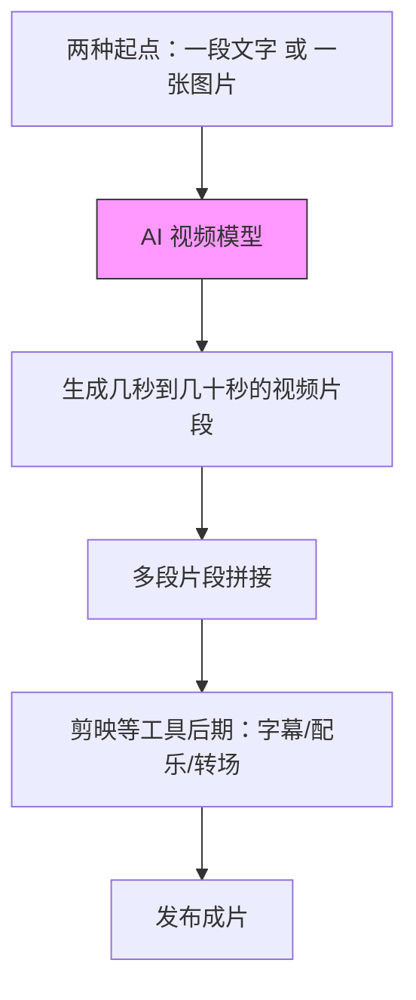
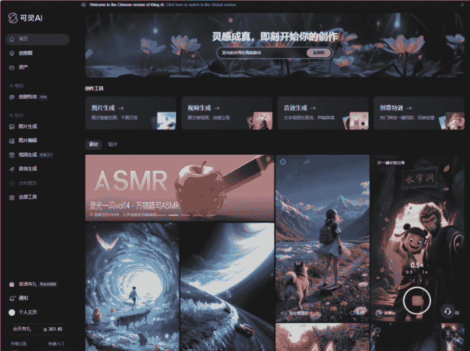
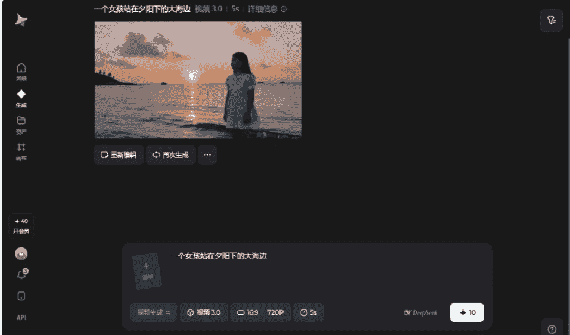
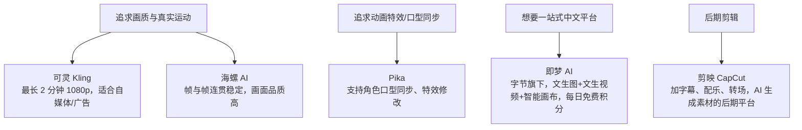

# 第13章 AI 视频生态与主流工具（Runway、可灵、Gen-1/Gen-2 等）

> 本节盘点 AI 视频生成工具与生态，介绍 Sora 等文生视频模型的上线进展与国内外竞品动态，帮读者尽早掌握信息差。提醒对市面 Sora 课程谨慎防骗，因 Sora 尚在内测无实操入口，定位为资讯认知而非即时实操。

先说两句"废话"宽宽心：这一章不需要你懂摄影、懂剪辑，也不需要高配电脑——本章介绍的主流 AI 视频工具全部是"打开网页就能用"的在线服务。你只需要会打字、会上传图片，就能跟着本章把 AI 视频的门道摸清楚。这一章的定位是"认工具、选工具"：先建立对 AI 视频生态的全貌认知，知道每个工具擅长什么、免费额度有多少、适合什么场景，下一章再进入具体的实操流程。

## 13.1 大白话：AI 视频就是打字或传图出视频

AI 视频就是你打一段文字或上传一张图，AI 帮你生成视频片段。目前生成的视频比较短（几秒到几十秒），适合做短视频素材，不适合直接拍长片。新手先用一个工具熟练，不要贪多。

用大白话拆开说，AI 视频目前主要有两种"玩法"：

- **文生视频**（打字出视频）：你写一段描述文字，比如"一位女士漫步在霓虹灯映照的湿润街道上"，AI 就根据这段文字"脑补"出一段动态画面。这就像你给一位看不见的导演口述剧本，它自己兼任摄影、灯光和演员，拍一段小片给你。
- **图生视频**（传图出视频）：你上传一张静态图片，AI 让这张图"动起来"——人物眨眼、云朵飘动、镜头缓缓推进。这就像给一张照片施了魔法，让它变成几秒钟的小动画。第 12 章讲的 SVD 模型（以静止图像作为条件帧往后生成动态画面），走的就是这条路。

这两种玩法殊途同归，最后都产出几秒到几十秒的视频片段。想做一条完整的短视频，通常是"多段拼接"：先生成好几段素材，再拿到剪映这类剪辑软件里配上音乐、字幕，串成成片。整个流程画成图是这样的：

> **图表说明**：AI 视频创作的完整链路。注意中间那步"生成几秒到几十秒的视频片段"——这就是当前 AI 视频的常态：单次生成的片段很短，长片要靠多段拼接。所以本章选工具时，你会看到我们反复强调两个指标：一次能生成多长、画面稳不稳。

**写 AI 视频提示词的一条小原则**。在 AI 视频里，提示词不是"打个招呼"，而是"下达拍摄指令"。一段合格的提示词最好写清楚三样东西：画面里是谁（或什么）、在什么场景下、在做什么动作，再加上镜头运动要怎么走。比如可灵 AI 的实操素材里就给过一个提示词例子："狐头人身，青绿长袍轻扬，奇幻仙侠韵味浓，古风雅致，眼神灵动，穿梭于云雾缭绕的仙境之中。"——你可以看到，它先定角色（狐头人身、青绿长袍），再定风格（仙侠、古风雅致），再定动作（穿梭于云雾缭绕的仙境）。照着这个套路写提示词，出的片子离你想要的就更近。初期不必追求多么华丽，先写清楚"谁在哪干什么"，再在生成结果里慢慢调整措辞。

还有一个新手最容易犯的错误要提前打预防针：**别贪多**。市面上的 AI 视频工具多到眼花缭乱，本章会带你认识十来款，但那是为了让你"会选"，不是为了让你"全学"。正确的姿势是：根据自己的需求选一款主力工具，把它用熟练，遇到它确实干不了的活，再来查本章的对比表换工具。工具在精不在多。

---

## 13.2 认识 AI 视频生态

### 13.2.1 AI 视频技术的演进

近年 AI 技术飞速发展，视频内容创作迎来了革命性的变化。从早期 AI 辅助剪辑、自动字幕等辅助创作功能，到如今能够直接生成视频内容的模型，AI 在视频生态中的地位不断提升。

这样的技术演进极大降低了视频创作门槛，提高了创作效率。现在，即使没有专业拍摄和剪辑经验，你也可以通过 AI 工具快速实现自己的创意。当脚本、拍摄甚至剪辑都不再是难题时，真正决定作品高度的反而是创意本身。

为了帮你理解"革命性的变化"到底革了什么，我们把 AI 在视频创作里的角色演变分成三步来看：

- **第一步：AI 当助手（辅助剪辑）**。这个阶段 AI 只帮你干杂活——自动剪辑、自动加字幕、智能配音。素材还是要你自己拍，AI 只是让后期快一点。剪映的自动字幕就是这一阶段的典型代表。
- **第二步：AI 当工人（辅助生成素材）**。这个阶段 AI 开始帮你"造素材"——根据文字生成一张图、一段音乐，你再把素材组装成视频。第 12 章讲的 ComfyUI 文生图，就是这个阶段的产物。
- **第三步：AI 当导演（直接生成视频）**。这个阶段就是你输入一段文字或一张图，AI 直接产出动态视频，Sora、可灵、Runway 这些工具都属于这一波。这也是本章的主角。

每往前走一步，人的角色就从"干活的人"往"出主意的人"退一步。所以本章开头那句话值得再读一遍：当脚本、拍摄甚至剪辑都不再是难题时，**真正决定作品高度的反而是创意本身**。工具会越来越便宜、越来越强，但"想拍什么、想表达什么"这件事，永远得你来。

### 13.2.2 AIGC 浪潮重塑短视频行业

在内容创作层面，AIGC（AI 生成内容）浪潮正重塑短视频行业生态。2024 年，在抖音等 UGC 平台上涌现出大量 AI 特效视频，用户只需上传一张图片或输入文字，就能生成有趣的视频内容。

比如，Remini 的"黏土动画"特效风靡全网，吸引了数百万用户参与；随后"毛毡娃娃风""柯南动画风""油画风"等 AI 滤镜接连走红，相关话题播放量高达数亿甚至数十亿。

> **大白话**：还记得第 1 章词汇表里的三个词吗？PGC 是专业机构做的内容，UGC 是普通用户做的内容，AIGC 是 AI 生成的内容。这一波浪潮的本质，是 AIGC 把"做视频"的门槛降到了 UGC 用户人人够得着的位置——你不用学剪辑，上传一张自拍就能得到一段黏土动画风的视频，所以才能"数百万用户参与""播放量数十亿"。

借助这些 AI 特效和平台挑战赛的传播机制，普通用户的创作热情被激发，个性化的内容不断涌现。可以预见，AIGC 将成为短视频创作的新常态：创作者更专注于创意和脚本，具体画面由 AI 高效生成。与此同时，短视频平台内容产出呈指数级增长，也对内容审核和观众注意力分配提出了新的挑战。

在实际操作层面，"AI 视频"很少是一个工具包打尽的事，它通常是一个短链路：用 DeepSeek 或 ChatGPT 写脚本、写提示词（第 1 章和第 2 章会讲到），用本章介绍的工具生成视频片段，最后用剪映加字幕配乐拼成成片。这也是本书在前面章节一直强调的"全链路"思路——AI 是环环相扣的小积木，你只负责把它们拼起来就好。

最后半句值得展开说一下，因为它和你的"机会窗口"直接相关：内容产出呈指数级增长，意味着单纯"能用 AI 生成视频"很快就不稀奇了——就像今天没人会因为"你会用美图秀秀"而关注你。稀奇的是**你能想出别人想不出的创意、做出别人做不出的内容**。早入场的人吃的是"信息差"和"熟练度"的红利，这也是本书反复强调"尽早掌握工具"的原因。

### 13.2.3 AI 视频的局限与避坑清单

不过，尽管 AI 视频生成技术发展迅猛，但目前仍有一些局限，以及做这个项目时，也会存在一些"坑"：

1. **纯 AI 生成的视频长度往往较短**（多数工具一次生成几秒到几十秒不等），画质和精细度相对专业拍摄还有差距。
2. **复杂场景、多角色互动等，目前仍然可能出现瑕疵**。
3. **生成内容的可控性和一致性也是挑战**（如视频帧的连续稳定、角色形象在不同场景的一致）。
4. **不要盲目追求高级软件**（先用好一个工具再扩展）。
5. **不要忽视版权问题**（商用需注意素材授权）。
6. **不要过度依赖 AI**（创意才是核心竞争力）。
7. **千万记得，要备份工程文件**（血泪教训：突然崩溃全白做）。

前 3 条是技术本身的局限，后 4 条是使用者自己能控制的"坑"。给你一张表，把每一条的应对办法也写清楚：

| 序号 | 局限/坑 | 大白话解释 | 应对办法 |
|------|---------|-----------|---------|
| 1 | 视频长度短 | 一次只出几秒到几十秒，画质比专业拍摄差一截 | 靠"多段拼接"组成长片；重要镜头多生成几次挑最好的 |
| 2 | 复杂场景有瑕疵 | 多个角色互动、打斗等复杂画面容易"露馅"，手指、肢体偶尔会崩 | 复杂场景拆成简单镜头分别生成；生成后逐帧检查 |
| 3 | 可控性一致性差 | 同一个角色换个镜头可能就"换了张脸"，帧与帧之间可能跳动 | 用支持参考图/角色一致功能的工具；同一场景的素材尽量一次批量生成 |
| 4 | 盲目追求高级软件 | 工具囤了一堆，一个都不熟 | 先用一款免费额度充足的工具练到熟练（本章 13.3 节帮你选） |
| 5 | 忽视版权 | 生成的素材拿去商用，可能侵犯他人权益 | 商用前确认工具的授权条款；素材留好生成记录 |
| 6 | 过度依赖 AI | 什么都让 AI 决定，作品千篇一律没有灵魂 | 创意、脚本、审美自己把关，AI 只负责执行 |
| 7 | 不备份工程文件 | 软件/平台一旦崩溃或数据丢失，全部重做 | 每完成一个阶段就导出备份，本地和云端各存一份 |

不过，这些问题正随着技术进步逐步改善——新模型不断涌现，支持更长时长、更高分辨率的视频生成，允许在生成过程中加入参考图像或预设风格来提高一致性。总的来说，AI 视频生态正处于从早期探索走向实用化的阶段：创作者拥抱新工具，内容形式更加丰富，但也需要理解技术的优劣，才能更好地驾驭 AI 进行创造。

### 13.2.4 Sora 防骗提醒

OpenAI 发布文生视频软件 Sora，它具备理解世界并生成多角度、最高时长达 60 秒视频的能力。Sora 其实就是文生视频（Text-to-Video）路线的一个灯塔。

我们在第 1 章 1.4.3 节已经介绍过它：2024 年 2 月 15 日发布，能根据文字指令创造现实且富有想象力的场景；它验证了"Diffusion Transformer"这套技术路线能高质量地跑通，后来的可灵等国产工具，走的也是类似的技术路线。当时还提过一个参考数字：按 Runway 和 Pika 现有视频生成成本预估，生成一分钟视频可能在 300~600 元之间——这个成本水平也解释了为什么它迟迟没有全面开放。

**但目前 OpenAI 官方尚未公布 Sora 的算力成本，Sora 尚在内测无实操入口，定位为资讯认知而非即时实操。**

市面上很多"Sora 课程"都是割韭菜，不要轻易付费购买。Sora 相关信息只需作为资讯关注，不需要急着去学习操作。

给你三条防骗自查标准，看到任何"Sora 相关机会"时先过一遍：

1. **凡是宣称"付费带你玩转 Sora 实操"的课程，直接拉黑**。Sora 尚在内测、没有公开实操入口，一个连入口都没有的产品，哪来的"实操课程"？课程里教的顶多是网上随处可查的资讯。
2. **凡是宣称"内部渠道开通 Sora 账号"的，直接拉黑**。OpenAI 官方尚未公布算力成本和开放计划，所谓"内部渠道"大概率是拿其他工具冒充，或者干脆就是骗局。
3. **正确的姿势**：把 Sora 当作"技术风向标"关注——它证明了这个方向的天花板有多高。等它正式开放、或国产平替成熟时，你再带着已经熟练的工具经验入场，才是最划算的时机。

---

## 13.3 AI 视频用到的工具

当前市面上有众多 AI 视频创作工具，每款都有自身特色和适用场景。以下总结一些主流 AI 视频工具的功能亮点和典型用途，供初学者参考：

### 13.3.1 Runway（Runway Gen-1/Gen-2）

业界较早推出的 AI 视频生成工具。

- **网址**：https://runwayml.com/
- **功能**：提供网页和 App 方便使用，功能包括文本生成视频（Gen-2）和视频风格迁移（Gen-1），还支持对视频进行实时涂抹编辑等高级操作。
- **适用人群**：适合希望借助前沿模型快速试验创意的用户。
- **注意**：Runway 目前需要订阅付费才能充分使用高级生成功能。

再补充一些背景，帮你理解它在行业里的位置。Runway 是一家 2018 年成立于美国纽约的生成式人工智能公司，专注于图像和视频编辑领域。它的模型已经迭代到了 Gen-3 Alpha：这是一款经过视频和图像混合训练的新模型，与前一代 Gen-2 相比，在细节丰富度、画面连贯性以及动作表现上都有了显著提升；支持文本转视频、图像转视频、文本转图像等多种功能，还提供高级相机控制和导演模式等多样化的控制方式。生成速度是它的一大亮点——一段 10 秒的视频，大约 90 秒就能生成完，这在业界保持了领先态势。

> **图片说明**：Runway 生成的视频画面截图（图源：《AI+短视频创作全能一本通》）。可以看到画面已经接近实拍质感——这正是"业界较早推出"的选手应有的水准。

另一个值得一提的特色是"笔刷控制"：Runway 允许你通过多种笔刷控制视频中物体的运动，比如用笔刷涂抹画面中的某个区域，指定它往哪个方向动。这对需要精确控制画面运动的创作者非常友好，也是它和"纯输入提示词碰运气"类工具最大的差别。

> **大白话总结**：Runway 像视频工具里的"专业单反"——功能全、控制细、更新快，但要订阅付费，而且界面和概念对纯新手有一点学习成本。如果你预算有限、只想先试试水，可以先看后面几款国产工具；如果你愿意为更强的控制力付费，Runway 值得列入候选。

### 13.3.2 可灵 AI（Kling）

由快手团队自研的大模型视频生成工具，技术实力雄厚。

- **网址**：https://app.klingai.com/cn/
- **功能**：采用类 Sora 的架构，生成的视频运动幅度大、物理效果真实，可生成情节丰富的动画或实拍风格片段。会员用户可生成最长 2 分钟、30 帧的 1080p 高清影片，支持多种画面比例，并提供高表现模式、视频续写等高级功能。非会员则可能需要排队等待生成。
- **适用人群**：可灵非常适合追求高质量和真实运动效果的专业创作者，用于短片、自媒体视频乃至广告创意制作。

补充一些"为什么它效果这么好"的背景：可灵 AI 是快手推出的新一代 AI 创意生产力平台，通过深度学习技术，特别是 3D 时空联合注意力机制和 Diffusion Transformer 架构，能够生成高质量、逼真且符合物理规律的视频内容。听不懂没关系，你只需要记住：**它和 Sora 属于同一技术流派**，所以才能做到"运动幅度大、物理效果真实"。

> **图片说明**：可灵 AI 的创作界面（图源：《AI+短视频创作全能一本通》）。界面采用简洁的设计风格，无论是专业用户还是初学者，都能在短时间内找到所需的功能和工具。

它的操作流程也很适合新手，走一遍你就明白了：

1. **登录官网，切换到"AI 视频"页面**。首页就能看到"文生视频""图生视频""对口型"三个选项卡，对应本章开头讲的两种玩法加一个口型功能。
2. **输入创意描述**。在"创意描述"文本框里写清楚你想要的画面。旁边还有"灵感词库"，不知道怎么写提示词时可以点开参考。
3. **填"不希望呈现的内容"**。这是可灵的贴心设计：比如你不想要"模糊、变形"，就填进去，生成时会主动避开。
4. **设置参数**。包括创意想象力和创意相关性（两个滑块，控制 AI 发挥的空间和贴合你描述的程度）、生成模式（标准模式便宜快、高品质模式效果好）、生成时长、视频比例等。
5. **点击"立即生成"**。生成会消耗"灵感值"（平台的积分，每日登录有免费赠送），然后等待出片即可。

此外，可灵还提供视频编辑、一键同款和创意圈社区等功能：一键同款可以把别人爆款视频的参数直接套用过来，创意圈可以浏览其他创作者的作品获取灵感——对新手来说，这两个功能是很好的"抄作业"入口。

### 13.3.3 海螺 AI（Hailuo）

国内另一款顶尖视频生成工具，以高画质和稳定性见长。

- **网址**：https://hailuoai.com/
- **功能**：其生成视频在色彩、光影和角色情绪表现上质量出色，在第三方测试中综合效果排名第一，尤其在帧与帧的连贯稳定上有绝对优势。海螺支持文字、图像、音频等多模态输入，界面简洁易上手，在海外市场也备受欢迎，用户遍及 180 多个国家。缺点是目前功能相对单一，缺少图像生成、对口型等扩展能力。
- **适用人群**：非常适合注重画面品质的创作者，比如影视导演、编剧，用于概念影片、高质量短视频等。

> **大白话总结**：还记得 13.2.3 节说的"帧与帧的连贯稳定"难题吗？海螺就是把这个难题解决得最好的那一个——画面不跳、不抖，情绪表达到位。如果你要做对画面连续性要求高的内容（比如有人物出镜、有情绪戏的短片），海螺是第一梯队的选择。代价是它功能专一：只管生成视频，不会帮你画图、对口型，这些活得交给别的工具。可以把它理解成"专科医生"——只看一种病，但看得特别好。

### 13.3.4 即梦 AI（Dreamina）

字节旗下推出的 AI 创作平台，提供一站式的文生图、智能画布和文生视频功能。

- **网址**：https://jimeng.jianying.com/
- **功能**：用户可以用中文提示词生成所需画面，并能在智能画布上进一步编辑调整，从剧本大纲到成片都能在一个平台完成。即梦支持角色对口型动画生成，AI 配音自然逼真。每日登录赠送 60-100 积分供免费使用，即使非会员也足够日常创作需求。不过在复杂人物和场景上偶尔有细节瑕疵。
- **适用人群**：适合追求功能全面、上手简单的用户，例如内容创作者、教育工作者，用于生成个性化短视频、教学动画、广告素材等。

先说它的"出身"：即梦 AI 是字节跳动旗下剪映团队研发的一站式智能创作平台（开发团队为深圳市脸萌科技有限公司），具有"以图生动"或"文字变视频"功能，适合想快速把文案转成视频场景的人使用。你可以输入一句话，比如"一个女孩站在夕阳下的大海边"，即梦 AI 就能生成相应风格的动态画面。如果你有一段脚本，它还能根据剧情生成配图、配乐，甚至自动拼接段落，完成一段完整的视频。该平台非常适合做 Vlog 配景、情绪视频背景、短剧场景过渡等。

> **图片说明**：即梦 AI 的使用界面（图源：《AI+短视频创作全能一本通》）。输入一句"一个女孩站在夕阳下的大海边"这样的中文描述，就能生成相应风格的动态画面——对中文用户非常友好。

它的"运镜控制"功能值得单独介绍：允许用户通过控制镜头的移动方式（平移、旋转、摇镜、变焦等）及运镜幅度（小、中、大三档），增强视频创作的灵活性和动态效果。简单说，就是你不但能让画面"动起来"，还能指定摄像机怎么动——是缓缓推近，还是左右横移。这在以前是需要专业摄像师才能干的事。

它的典型使用流程是"先图后视频"：

1. **先用"图片生成"功能出图**：输入中文提示词，设置图片比例（如 16:9），系统会一次生成 4 张图片供你挑选；
2. **挑一张满意的图，切换到视频生成**：把选中的图片作为起点，设置运镜方式和幅度，让静态图变成动态视频；
3. **不满意就回去换图重来**：因为出图是免费的积分消耗，先用图打底可以大大降低试错成本。

这套"文生图 → 图生视频"的两步流程，正是 13.1 节讲的图生视频玩法的标准操作，也和第 12 章 ComfyUI 里"文生图 + SVD 图生视频"的思路完全一致——工具不同，套路相通。

### 13.3.5 Pika

一款国外的文本生成视频工具，以动画和特效见长。

- **网址**：https://pika.art/about
- **功能**：支持用户上传语音或配音，实现视频中角色口型与声音同步。Pika 的可控性强，允许对生成视频中的角色、物体进行定点修改，甚至添加爆炸、融化等酷炫特效（最新的 Pika 1.5 版本已支持这些功能）。它还提供一定的视频编辑能力，生成的视频可以直接在其平台上做简单剪辑。
- **适用人群**：适合用于制作卡通动画、MG 动画风格的视频，以及需要精确控制口型的角色对话场景。注意 Pika 目前主要通过官网提供服务，注册登录即可有限度免费使用。

> **大白话总结**：Pika 的绝活是"改"。别的工具生成视频后，不满意只能整个重来；Pika 允许你"定点修改"——视频里有个物体不喜欢，圈出来让它改，甚至给它加个爆炸特效。再加上口型同步功能，做卡通动画、角色说话的场景，它是一把好手。注意它是国外工具，界面是英文，对纯新手有一点门槛，且免费额度有限。

### 13.3.6 剪映（CapCut）

字节跳动推出的知名视频剪辑工具，国内称为剪映，海外版叫 CapCut。

- **网址**：https://www.capcut.cn/
- **功能**：剪映本身不是文生视频模型，但因为功能全面、免费易用，被广泛用作 AI 生成素材的后期编辑平台。剪映内置了多项 AI 能力：例如自动字幕生成、一键智能剪辑、风格滤镜，以及 AI 配音功能。最新版本中甚至支持克隆配音（仿真特定人声的语音合成）。对于 AI 生成的视频素材，剪映可以方便地添加字幕、配乐、转场，调整节奏节拍，让成品更加完整专业。
- **适用人群**：几乎所有初学者都可以从剪映起步来制作和完善 AI 短视频。

展开说一下剪映里和 AI 视频创作最相关的几个能力：它内置丰富滤镜、转场、音乐库和字幕样式，支持智能识别语音并自动添加字幕，一键成片功能强大；还有智能分割、自动卡点、滤镜匹配等 AI 功能——简单几步操作，就能把手机里的素材变成像模像样的短视频。放在本章的语境里，剪映的角色就是 13.1 节流程图里的最后两步："多段拼接"和"字幕/配乐/转场"——**AI 工具负责生成素材，剪映负责把素材变成作品**。

> **大白话总结**：如果把 AI 视频工具比作"食材供应商"，剪映就是你的"厨房"。不管食材是可灵买的、海螺买的还是即梦买的，最后都要进这个厨房加工上桌。而且它免费、中文界面、手机电脑都能用，是本书推荐的默认后期工具。

注：以上仅列举了一部分热门工具。市面上还有许多其他 AI 视频平台，如国内的智影、清影、Vidu，以及一些开源方案（如 Stable Diffusion 的动画生成插件等）。初学者可根据需求逐步探索，但建议先从主流成熟的平台入手，以获得更稳定的体验。

顺便把几款"注"里提到的同类工具也简单列一下，混个脸熟即可，等主力工具用熟了再探索：

| 工具 | 背景 | 特色 |
|------|------|------|
| 一帧秒创（秒创） | 智能视频创作平台 | 内置自动剪辑、智能配乐、字幕生成，上传素材可一键生成短视频 |
| 腾讯智影 | 腾讯推出的智能视频创作工具 | 支持智能剪辑、文字转语音、智能配音，可自动分析素材并给出剪辑建议 |
| 艺映 AI | 专注 AI 视频领域 | 提供文生视频、图生视频、视频转漫等服务 |
| 快影 / 快剪辑 | 面向大众的短视频编辑 App | 配备 AI 智能剪辑、自动字幕、特效模板，适合手机端快速出片 |

最后，把本章介绍的主力工具放进一张总对比表，方便你直接对号入座（信息都来自上文各工具的介绍）：

| 工具 | 类型 | 亮点 | 免费情况 | 适合谁 |
|------|------|------|---------|--------|
| Runway | 国外综合平台 | Gen-3 生成快（10 秒视频约 90 秒出片）、笔刷控制运动、相机控制 | 高级功能需订阅 | 愿意付费、追求控制力的进阶玩家 |
| 可灵 AI | 国产专业生成 | 类 Sora 架构、最长 2 分钟 1080p、一键同款、创意圈 | 非会员排队，会员解锁完整功能 | 追求高质量真实运动的专业创作者 |
| 海螺 AI | 国产专业生成 | 帧间连贯稳定第一、多模态输入、180 多个国家用户 | 有免费额度（功能相对单一） | 注重画面品质的创作者 |
| 即梦 AI | 国产一站式 | 文生图+文生视频+智能画布、运镜控制、对口型 | 每日送 60-100 积分 | 新手首选，一站式中文创作 |
| Pika | 国外特效工具 | 定点修改、爆炸融化特效、口型同步 | 注册可有限度免费使用 | 卡通动画、口型同步场景 |
| 剪映 | 后期剪辑平台 | 自动字幕、一键成片、克隆配音 | 基础功能免费 | 所有初学者的默认后期工具 |

## 13.4 主流 AI 视频工具对比 Mermaid 图

把"你想要什么"和"该选哪个工具"的关系画成一张图，选工具的时候照着走：

> **图表说明**：五个出发点对应五条选型路径。注意最底下的剪映和其他四个不是并列竞争关系——无论你用哪个工具生成素材，最后基本都要进剪映做后期。所以一个典型的新手组合是：**即梦 AI（生成，每日免费积分）+ 剪映（后期，免费）**，零成本起步，熟练后再按需升级到可灵、Runway。

---

## 小练习

列出你了解的 3 个 AI 视频工具，分别标注其支持的功能（文生图/图生视频/文生视频）、免费额度与付费价格，形成一张工具选型表。

> **参考模板**：
>
> | 工具名称 | 支持功能 | 免费额度 | 付费价格 | 适用场景 |
> |---------|---------|---------|---------|---------|
> | 可灵 Kling | 文生视频、图生视频 | 每日免费额度 | 会员制 | 自媒体视频、广告 |
> | 即梦 AI | 文生图、文生视频、图生视频 | 每日 60-100 积分 | 会员制 | 一站式中文创作 |
> | 剪映 CapCut | 后期剪辑、字幕、配乐 | 免费基础功能 | 部分高级功能付费 | AI 素材后期编辑 |
>
> 完成后对照 13.3 节各工具的介绍自查一遍：免费额度写的是不是"每日登录赠送"这类确切来源？付费价格是不是去官网核实过的？这张表以后就是你自己的选型手册，工具更新了就回来改。

---

## 本章小结

通过本章，你应该已经了解：

1. **AI 视频的两种玩法**：文生视频（打字出视频）和图生视频（传图出视频），目前单次生成只有几秒到几十秒，完整作品靠多段拼接加后期。
2. **AI 在视频创作中的三步演进**：辅助剪辑（剪映自动字幕）→ 辅助生成素材（AI 文生图）→ 直接生成视频（Sora、可灵等）；人越往后越只负责创意。
3. **AIGC 正在重塑短视频行业**：黏土动画等 AI 特效动辄数亿播放，AIGC 将成为短视频创作新常态；内容产出指数级增长后，创意才是稀缺品。
4. **技术局限与七个避坑点**：视频短、复杂场景有瑕疵、一致性难；对应的不贪多、重版权、不依赖、常备份。
5. **Sora 的定位**：文生视频路线的灯塔（最高 60 秒），但尚在内测无实操入口，市面"Sora 付费课程"多为割韭菜，当资讯关注即可。
6. **六款主流工具的分工**：Runway 控制力强但需订阅；可灵画质真实、最长 2 分钟；海螺帧间最稳；即梦一站式且每日免费积分；Pika 擅长特效和口型；剪映是所有人的免费后期厨房。新手推荐组合：即梦 AI + 剪映，零成本起步。
7. **选工具的心法**：工具在精不在多——先用一款练熟，遇到干不了的活再回来查对比表。

下一章，我们将进入文生视频与图生视频的实操流程，手把手带你把本章选好的工具真正用起来。
