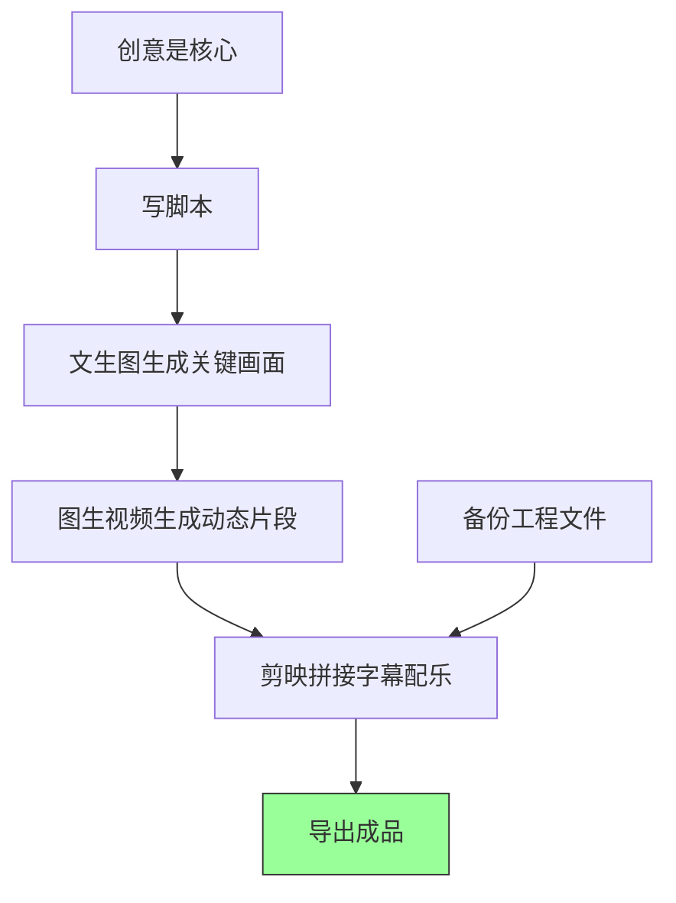

# 第14章 文生视频与图生视频的实操流程

> 本节教读者用 AI 工具无拍摄剪辑基础地产出 60–80 秒视频，覆盖文生图 → 图生视频 → 简单剪辑的完整流程，强调"创意本身成为核心竞争力"，并列出勿过度依赖 AI、备份工程文件等避坑提醒。

## 14.1 大白话：做 AI 视频的常见流程

做 AI 视频的常见流程是三步走：

1. **先用 AI 生图**：拿到关键画面（文生图）
2. **再把图片喂给 AI 视频工具**：变成动态视频（图生视频）
3. **最后用剪映加上字幕和音乐**：导出成品

创意比技术更重要，工具只是帮你实现想法。

## 14.2 认识文生视频与图生视频

### 14.2.1 文生视频（Text-to-Video）

输入一段文字描述，AI 直接生成视频片段。适合从零创作，不用先找图片。

**适用场景**：
- 有创意但没有素材图片
- 快速试错不同的视觉效果
- 生成抽象或难以拍摄的场景

### 14.2.2 图生视频（Image-to-Video）

上传一张图片，AI 让它动起来。适合让已有画面活起来。

**适用场景**：
- 已经有好看的图片，想让它动起来
- 需要保持画面构图和风格的一致性
- 产品展示、人物动作等需要精确控制的场景

## 14.3 60–80 秒视频产出实操流程

做一条 60–80 秒的 AI 视频，完整流程如下：

### 第一步：写脚本

确定视频主题、时长、分镜内容。每个分镜对应一个画面提示词。

**脚本模板**：
| 分镜 | 时长 | 画面内容 | 提示词 | 音频 |
|------|------|---------|-------|------|
| 1 | 5 秒 | 开场，产品特写 | 产品特写，柔光，背景虚化 | 背景音乐 |
| 2 | 10 秒 | 使用场景 | 人物使用产品，室内，自然光 | 解说词 |
| 3 | 15 秒 | 细节展示 | 产品细节特写，纹理清晰 | 音效 |
| 4 | 10 秒 | 结尾，行动号召 | 产品全貌，品牌Logo，渐隐 | 背景音乐 |

### 第二步：文生图（生成关键画面）

用即梦、MidJourney 等工具根据脚本里的关键画面生成静态图片。

**操作建议**：
1. 为每个分镜写一个详细的图片提示词
2. 生成多张备选图，选出最满意的一张
3. 保存图片，记录使用的提示词和参数（方便后续修改）

### 第三步：图生视频（让图片动起来）

把生成的图片喂给可灵、海螺、即梦等 AI 视频工具，生成动态视频片段。

**操作建议**：
1. 上传图片
2. 输入运动提示词（如"人物缓慢走动""镜头缓慢推近"）
3. 设置视频时长（通常 3-10 秒一段）
4. 生成多个版本，选出最流畅自然的一段

### 第四步：简单剪辑（拼接成完整视频）

用剪映把多段视频拼接，加上字幕、配乐、转场，导出成品。

**操作建议**：
1. 导入所有视频片段
2. 按脚本顺序排列
3. 添加转场效果
4. 添加字幕和配音
5. 添加背景音乐
6. 导出 1080p 或 4K 视频

## 14.4 创意本身成为核心竞争力

当脚本、拍摄甚至剪辑都不再是难题时，真正决定作品高度的反而是创意本身。

**创意来源**：
- 生活观察：身边有趣的现象
- 热点话题：结合社会热点，快速制作相关视频
- 对标分析：研究同行爆款视频，找出可复制的创意点
- AI 辅助：用 AI 出主意，再由人筛选和优化

## 14.5 避坑提醒

### 14.5.1 勿过度依赖 AI

AI 是工具，不是替代品。创意、选题、把关都需要人来做。不要指望 AI 一键生成爆款，人工的创意和判断不可或缺。

### 14.5.2 备份工程文件

血泪教训：突然崩溃全白做。务必备份所有工程文件、生成的图片、视频片段，避免丢失。

### 14.5.3 注意版权问题

商用需注意素材授权，不要随意使用可能涉及版权的图片、音乐、视频片段。

### 14.5.4 先用好一个工具

不要盲目追求高级软件，先用好一个工具再扩展。工具多了反而容易分散精力。

## 14.6 实操流程 Mermaid 图

## 小练习

用任一 AI 视频工具生成一条 15–30 秒短视频，配上背景音乐与字幕，导出并保存，记录生成次数与最终满意版本的尝试次数。

> **参考模板**：
> 
> | 工具 | 生成次数 | 满意版本尝试次数 | 总耗时 | 心得 |
> |------|---------|----------------|--------|------|
> | 可灵 | 8 次 | 3 次 | 40 分钟 | 运动幅度大，但有时会变形 |
> | 即梦 | 5 次 | 2 次 | 25 分钟 | 中文提示词友好，免费积分够用 |
