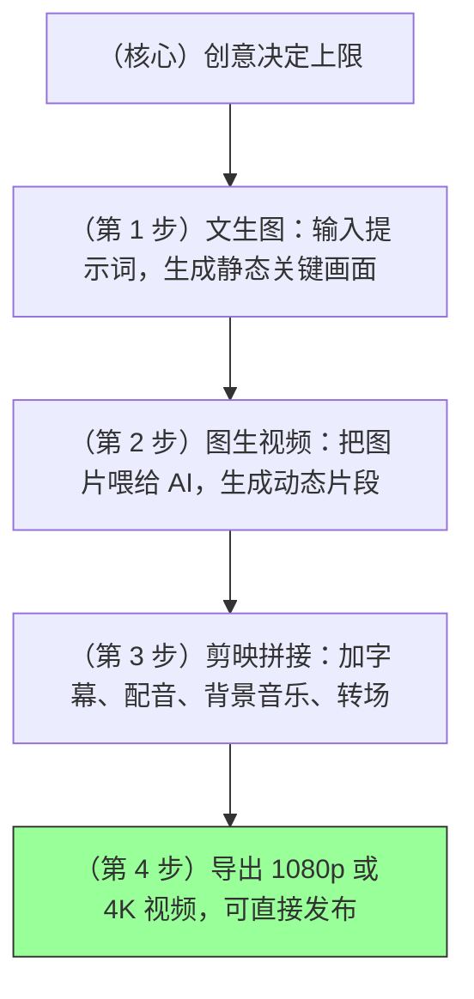
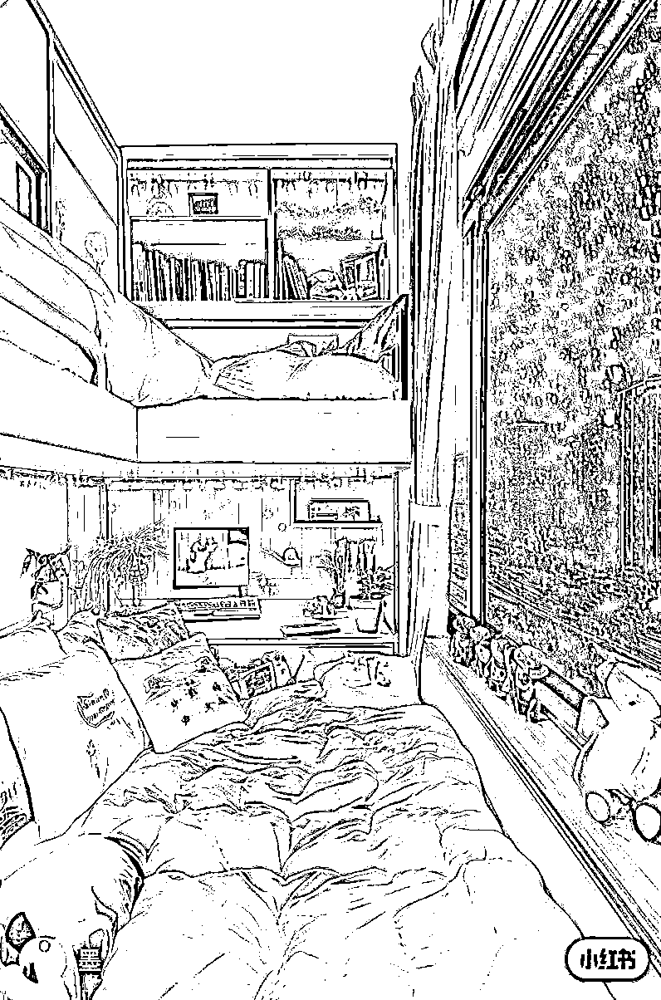
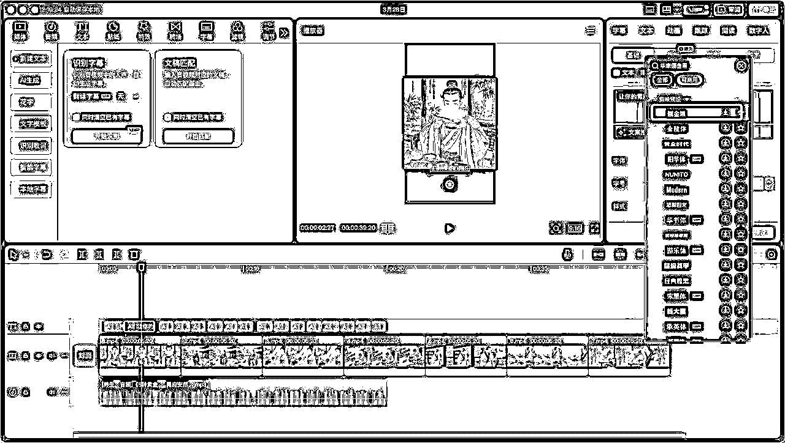
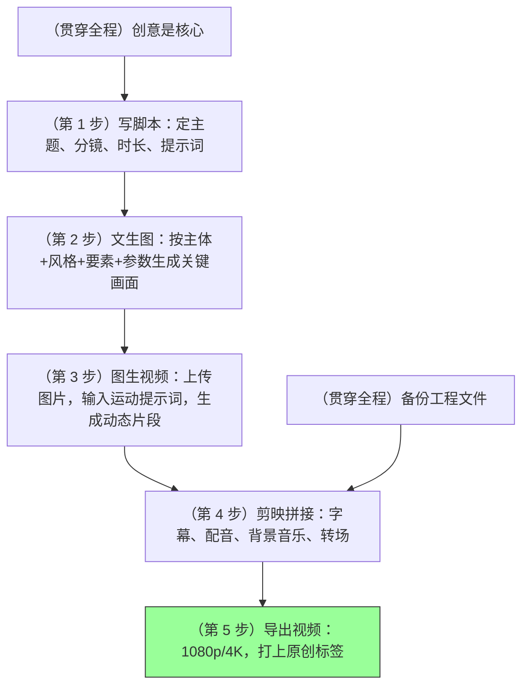

# 第14章 文生视频与图生视频的实操流程

> 本节教读者用 AI 工具无拍摄剪辑基础地产出 60–80 秒视频，覆盖文生图 → 图生视频 → 简单剪辑的完整流程，强调“创意本身成为核心竞争力”，并列出勿过度依赖 AI、备份工程文件等避坑提醒。读完本章，哪怕你从未拍过视频、也不会剪辑，也能做出一条可以发布的 AI 原创短视频。

---

## 14.1 大白话：做 AI 视频的常见流程

做 AI 视频，最核心的认知只有一句话：**你不需要拿相机拍摄，也不需要自己出镜，所有的画面和声音都可以由 AI 工具生成，你的工作是“出主意、选素材、拼在一起”。**

做 AI 视频的常见流程是三步走：

1. **先用 AI 生图**：拿到关键画面（文生图）。
2. **再把图片喂给 AI 视频工具**：变成动态视频（图生视频）。
3. **最后用剪映加上字幕和音乐**：导出成品。

创意比技术更重要，工具只是帮你实现想法。你只要会打字、会用鼠标点按钮，就能做 AI 视频。

### 常用 AI 视频工具速查

| 工具 | 主要用途 | 大白话定位 |
|------|---------|-----------|
| 即梦 AI | 文生图、图生视频、口型同步 | 中文提示词友好，新手容易上手，出图带文字效果不错 |
| 可灵 AI（Kling） | 图生视频、文生视频 | 动作连贯、画面稳定，适合做人物动作和镜头推拉 |
| 海螺 AI（Hailuo） | 图生视频、AI 配音、音效 | 生成速度快，适合快速试错不同的视觉效果 |
| Pika / Runway Gen-2 | 图生视频、文生视频 | 海外工具，动画感强，适合抽象或难以拍摄的场景 |
| 剪映（CapCut） | 视频拼接、字幕、配音、转场、背景音乐 | 把 AI 生成的碎片视频拼成完整成品的“胶水” |

> **大白话**：你可以把即梦、可灵、海螺理解成“摄影棚和演员”，它们负责出画面；剪映是“剪辑室”，负责把画面剪在一起、加上字幕和音乐。没有一个工具能一键出最终能发的视频，必须至少用两个工具配合。

> **新手小贴士**：即梦曾经历过 2.1、3.0 等模型更新，2.1 模型偏漫画质感，3.0 模型文字更清晰、细节更丰富但偏写实。出图效果不满意时，可以在不同模型之间切换，或者选 2.0 模型出图后手动在剪映里加文案。不必纠结版本号，先出图、再选图、最后入视频，比追求“最佳模型”更重要。

### 14.1.1 文生视频与图生视频的简单原理 Mermaid 图

把 14.1 的三步流程画成一张图，再看一遍就清楚了：

---

## 14.2 认识文生视频与图生视频

### 14.2.1 文生视频（Text-to-Video）

输入一段文字描述，AI 直接生成视频片段。适合从零创作，不用先找图片。

**适用场景**：

- 有创意但没有素材图片
- 快速试错不同的视觉效果
- 生成抽象或难以拍摄的场景

**优点**：一步到位，省去找图的步骤。  
**缺点**：画面稳定性较差，同一角色在不同镜头里长相可能变化，适合做“意境类”视频，不适合做需要人物连贯的故事片。

### 14.2.2 图生视频（Image-to-Video）

上传一张图片，AI 让它动起来。适合让已有画面活起来。

**适用场景**：

- 已经有好看的图片，想让它动起来
- 需要保持画面构图和风格的一致性
- 产品展示、人物动作等需要精确控制的场景

**优点**：构图可控，角色风格统一，适合做系列化内容。  
**缺点**：必须先有一张好图，多了一步文生图的工作。

> **大白话**：文生视频像“凭空变戏法”，快但不一定稳；图生视频像“给照片施魔法”，稍慢一点，但画面更听话。新手建议主走“文生图 → 图生视频”这条路，先拿到满意的静态画面，再让它动起来，成品更可控。

### 14.2.3 两种方式对比

| 维度 | 文生视频 | 图生视频 |
|------|---------|---------|
| 输入 | 文字描述 | 图片 + 运动提示词 |
| 画面可控性 | 较低，角色容易变脸 | 较高，构图和风格统一 |
| 制作步骤 | 1 步 | 2 步（先生图再生视频） |
| 适合内容 | 抽象意境、快速试错 | 人物故事、产品展示、系列视频 |
| 推荐工具 | 可灵、Runway Gen-2、Pika | 即梦、可灵、海螺 |

---

## 14.3 60–80 秒视频产出实操流程

做一条 60–80 秒的 AI 视频，完整流程如下。新手建议严格按顺序来，不要跳步。

### 第一步：写脚本

确定视频主题、时长、分镜内容。每个分镜对应一个画面提示词，脚本就是后面生图和生视频的“指令单”。

**脚本模板**：

| 分镜 | 时长 | 画面内容 | 提示词 | 音频 |
|------|------|---------|-------|------|
| 1 | 5 秒 | 开场，产品/人物特写 | 产品特写，柔光，背景虚化 | 背景音乐 |
| 2 | 10 秒 | 使用场景 | 人物使用产品，室内，自然光 | 解说词 |
| 3 | 15 秒 | 细节展示 | 产品细节特写，纹理清晰 | 音效 |
| 4 | 10 秒 | 结尾，行动号召 | 产品全貌，品牌 Logo，渐隐 | 背景音乐 |
| … | … | … | … | … |

**写脚本的小建议**：

- 60–80 秒大约 5–8 个分镜就够了，每个分镜 3–15 秒，不要太长，否则 AI 生成的片段容易出现画面变形。
- 每个分镜只写一个核心动作，比如“人物缓慢走动”“镜头缓慢推近”，不要一段里塞十个动作。
- 把脚本里的每个画面都对应一个图片提示词，方便后面直接复制到 AI 工具里用。

### 第二步：文生图（生成关键画面）

用即梦、MidJourney 等工具根据脚本里的关键画面生成静态图片。

**操作建议**：

1. 为每个分镜写一个详细的图片提示词，越具体越好。
2. 生成多张备选图，选出最满意的一张。
3. 保存图片，记录使用的提示词和参数（方便后续修改）。

**图片提示词公式（大白话版）**：

> **主体 + 风格 + 要素 + 参数**

- **主体**：画面里的核心人物或物体，比如“一位笑眯眯的老爷爷”“一杯冒热气的咖啡”。
- **风格**：画面的质感，比如“治愈插画、手绘风笔触、chibi 风格、写实风格”。
- **要素**：周围的细节，比如“蓝色牛仔背带、木质窗框、窗外透进的蓝天”。
- **参数**：画面比例、清晰度，比如“9:16、高清画面、极简主义”。

**实战提示词示例**（治愈系老爷爷插画）：

> 一位中国头发白花花的老爷爷，秃顶，胖嘟嘟，笑眯眯，微笑，慈祥，戴个近视眼镜，卡通，生动童趣，穿着黄色格子衬衣，穿着蓝色牛仔背带，背景是室内场景，有木质结构，窗户，窗外透进蓝天，整体氛围温馨自在，双手举着一张白纸，上面写着治愈文案，治愈插画，手绘风笔触，图中文字要显著，chibi 风格，极简主义，高清画面，画面文字要清晰，字体加粗加大

这个提示词可以拆成六部分组合：

1. 人物形象：一位中国头发白花花的老爷爷，秃顶，胖嘟嘟，笑眯眯，微笑，慈祥，带个近视眼镜，卡通，生动童趣
2. 穿着：穿着黄色格子衬衣，穿着蓝色牛仔背带
3. 背景：室内场景，有木质结构，窗户，窗外透进蓝天，整体氛围温馨自在
4. 动作：双手举着一张白纸，上面写着文案
5. 文案：“治愈系短句”
6. 绘画风格：治愈插画，手绘风笔触，图中文字要显著，chibi 风格，极简主义，高清画面，画面文字要清晰，字体加粗加大

把六部分直接拼成一段长句，复制到即梦的图片生成框里，选择 9:16 比例（适合视频号、抖音、Shorts），生成 2–3 张备选图，挑一张最满意的。

> **大白话**：写提示词就像给画画的小朋友下指令，你说得越具体，画出来的东西越靠谱。如果只说“画个爷爷”，AI 可能画出任何样子；你指定了秃顶、胖嘟嘟、黄色衬衣、蓝色背带、举着白纸，画出来的爷爷才跟你心目中差不多。

> 图片说明：提示词公式拆解示意（素材配图）

> 图片说明：即梦生图场景示意——先生成符合预期的场景图，再拿去生成视频，能大大降低"抽卡"的时间和成本（素材配图）

### 第三步：图生视频（让图片动起来）

把生成的图片喂给可灵、海螺、即梦等 AI 视频工具，生成动态视频片段。

**操作建议**：

1. 上传图片
2. 输入运动提示词（如“人物缓慢走动”“镜头缓慢推近”“衣角随风飘动”）
3. 设置视频时长（通常 3–10 秒一段）
4. 生成多个版本，选出最流畅自然的一段

**图生视频提示词参考**：

- 人物缓慢走动，自然微笑，镜头缓慢推近，背景光影流动
- 咖啡杯冒着热气，雾气缭绕，镜头轻微晃动，温馨氛围
- 树叶随风摇曳，阳光透过树叶洒下，光影流动

**需要注意的点**：

- AI 生成的视频片段通常只有 3–10 秒，一条 60–80 秒的视频需要拼接 10–20 个片段，所以要做好批量生成的心理准备。
- 生成的片段偶尔会出现人物变形、手指多出来等问题，不要纠结，多生成几个版本，选最自然的那个，变形严重的直接丢弃。
- 若需要人物说话，可使用即梦的口型同步功能，配合海螺 AI 或其他工具生成的配音，让嘴型和声音匹配。

> **大白话**：图生视频就像给照片下“动作指令”，你说“走动”它就走，你说“推近”画面就往前冲。但 AI 有时候听不太懂，生出来的片段可能有点怪，这时候不要强行使用，多生几次，选一个最自然的就行。

### 第四步：简单剪辑（拼接成完整视频）

用剪映把多段视频拼接，加上字幕、配乐、转场，导出成品。

**操作建议**：

1. 导入所有视频片段
2. 按脚本顺序排列
3. 添加转场效果（比如淡入淡出、翻页特效，让画面切换更自然）
4. 添加字幕和配音（剪映自带“文字转语音”，也可用海螺 AI 配音后导入）
5. 添加背景音乐（选与内容风格匹配的音乐，治愈内容配治愈音乐）
6. 导出 1080p 或 4K 视频

**剪映里最常用的三个功能**：

- **自动识别字幕**：点击“文字”→“智能字幕”→“识别字幕”，剪映会自动把配音转成字幕，再手动改错别字即可，不用一句句手打。
- **文字转语音**：点击“文字”→“文字转语音”，输入文案，选择一个喜欢的声音（如温柔女声、磁性男声），AI 就生成配音，再拖到视频对应位置。
- **转场**：在两个视频片段之间添加“淡入淡出”或“溶解”转场，避免画面生硬跳切，观感更专业。

**导出设置**：分辨率选 1080p，帧率 30 或 60，编码 H.264，码率越高画质越好但文件越大。导出完成后先在电脑上全程看一遍，确认没有变形、错字、黑屏片段，再发布。

**剪映实用技巧**：

- 在剪映电脑版设置 → 全局设置 → 剪辑里，可以把图片默认时长调节为 3 秒，适合图文类视频批量制作。
- 视频号发布必须把图片做成视频上传，不能直接发图文（除非平台规则调整）。
- 发布时务必记得打上“原创”标签，否则视频号的创作分成计划不会产生收益。

> 图片说明：剪映字幕设置示意——用字体识别网站认出同行视频用的字体（如"华康俪金黑"），再调整文字大小、设置描边（素材配图）

---

## 14.4 创意本身成为核心竞争力

当脚本、拍摄甚至剪辑都不再是难题时，真正决定作品高度的反而是创意本身。AI 工具大家都能用，谁的创意好，谁的视频就更容易脱颖而出。

**创意来源**：

- **生活观察**：身边有趣的现象，邻居的故事、街头的场景，都可以变成视频选题。
- **热点话题**：结合社会热点，快速制作相关视频，蹭流量更容易起号。
- **对标分析**：研究同行爆款视频，找出可复制的创意点。把同行爆款素材下载下来做档案，列出爆款原因，久而久之你就能摸清“爆点在哪里”。
- **AI 辅助**：用 AI 出主意，再由人筛选和优化。AI 是创意的助手，不是创意的替代品。

> **大白话**：工具是人手人都有的“铁锹”，创意才是决定你挖到金子还是挖到土的“选地点”。AI 能帮你画出好看的画面，但想不出好选题，AI 也帮不了你。

---

## 14.5 避坑提醒

### 14.5.1 勿过度依赖 AI

AI 是工具，不是替代品。创意、选题、把关都需要人来做。不要指望 AI 一键生成爆款，人工的创意和判断不可或缺。二创的正确理解是结合自己对素材的理解去做二次创作，而不是简单的搬运！搬运是不符合平台要求的，有大概率的违规风险。

### 14.5.2 备份工程文件

血泪教训：突然崩溃全白做。务必备份所有工程文件、生成的图片、视频片段，避免丢失。建议按项目建文件夹，把脚本文稿、提示词、生成的图片、视频片段、剪映工程文件都放进去，并定期拷贝一份到云盘或移动硬盘。

### 14.5.3 注意版权问题

商用需注意素材授权，不要随意使用可能涉及版权的图片、音乐、视频片段。背景音乐优先用剪映内置的免费音乐库，或使用 AI 生成的原创音乐；文案尽量原创，避免直接复制他人的文字。

### 14.5.4 先用好一个工具

不要盲目追求高级软件，先用好一个工具再扩展。工具多了反而容易分散精力。新手建议先把“即梦生图 + 剪映剪辑”这两个工具用熟，再考虑可灵、海螺等其他工具。

---

## 14.6 实操流程 Mermaid 图

把本章完整的制作流程汇总成一张流程图，制作时照着走：

**AI 视频制作检查清单（发布前对照）**：

| 检查项 | 合格标准 |
|--------|---------|
| 脚本分镜 | 每个分镜 3–15 秒，总时长 60–80 秒，画面提示词已写好 |
| 关键画面 | 每个分镜至少生成 2–3 张备选图，选出最满意的一张 |
| 动态片段 | 图生视频片段 3–10 秒，人物未变形，动作自然流畅 |
| 剪辑成品 | 分镜顺序与脚本一致，有字幕、配音、背景音乐，转场平滑 |
| 技术规格 | 导出 1080p 或 4K，比例 9:16（竖屏视频） |
| 合规发布 | 打上“原创”标签，文案无违禁词，音乐来自免费库或 AI 生成 |
| 文件备份 | 脚本、提示词、图片、片段、剪映工程文件已备份到云盘或移动硬盘 |

逐条对照合格后，再点击发布，能避免大部分低级失误。

---

## 小练习

用任一 AI 视频工具生成一条 15–30 秒短视频，配上背景音乐与字幕，导出并保存，记录生成次数与最终满意版本的尝试次数。

> **参考模板**：
>
> | 工具 | 生成次数 | 满意版本尝试次数 | 总耗时 | 心得 |
> |------|---------|----------------|--------|------|
> | 可灵 | 8 次 | 3 次 | 40 分钟 | 运动幅度大，但有时会变形 |
> | 即梦 | 5 次 | 2 次 | 25 分钟 | 中文提示词友好，免费积分够用 |

---

## 本章小结

通过本章，你应该已经了解：

1. **AI 视频的三步流程**：文生图生成关键画面 → 图生视频让图片动起来 → 剪映拼接字幕音乐导出成品，缺一不可。
2. **文生视频与图生视频的选择**：文生视频快但不可控，适合抽象意境；图生视频需先生图但画面稳定，适合人物故事和产品展示，新手推荐主走图生视频路线。
3. **提示词公式**：主体 + 风格 + 要素 + 参数，写得越具体，AI 生成的画面越靠谱；图生视频再加上运动提示词，如“镜头缓慢推近”。
4. **实操细节**：脚本拆分 3–15 秒分镜，图生视频片段通常 3–10 秒，多生成几个版本选最自然的；剪辑时加转场、字幕、配音、背景音乐，导出 1080p 或 4K。
5. **创意是核心竞争力**：工具人人都有，选题和创意决定视频能否火，多观察生活、追热点、拆解同行爆款。
6. **避坑清单**：勿过度依赖 AI 和直接搬运，务必备份工程文件，注意图片和音乐版权，发布时记得打原创标签，先用好即梦和剪映两个工具。

下一章，我们将学习如何把 AI 视频做成钱——视频号创作分成计划和 YouTube Shorts YPP 的变现路径。
