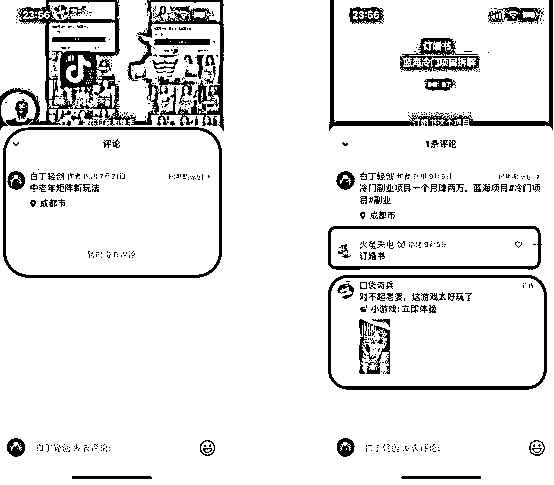
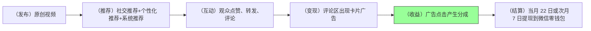
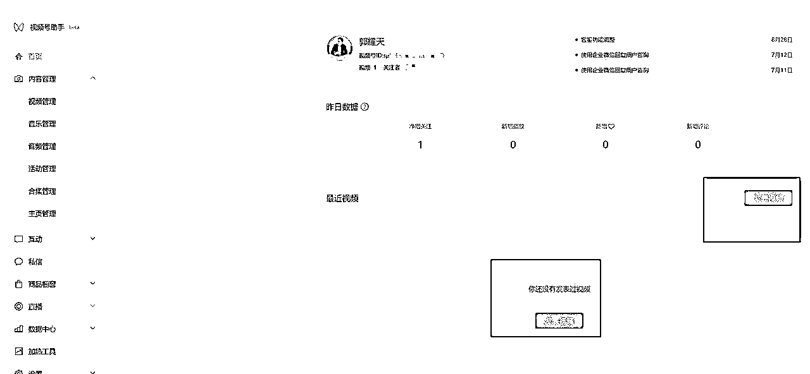
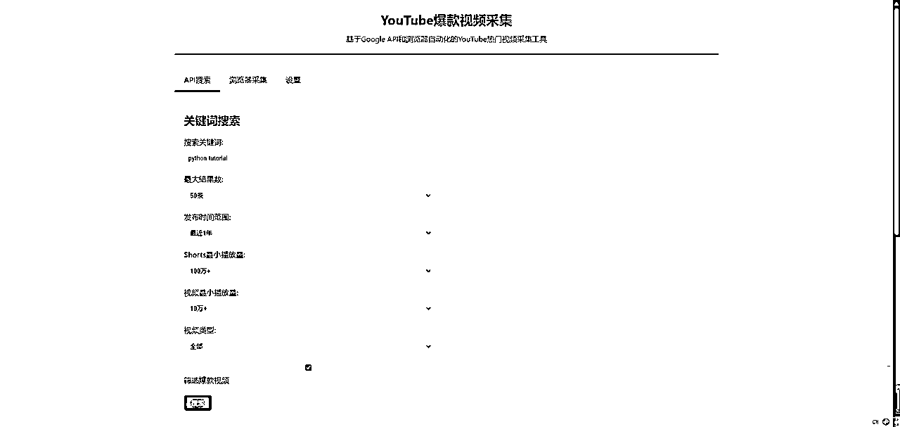
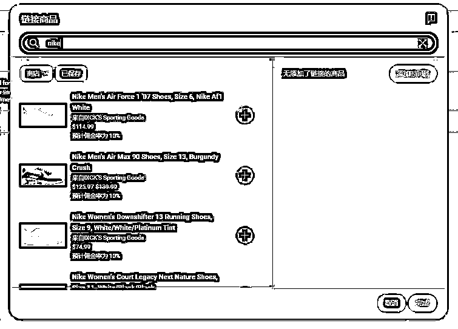
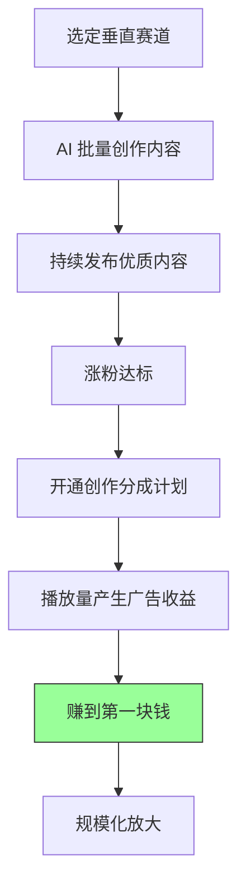

# 第15章 AI 视频在视频号分成计划、YouTube Shorts 等平台的变现

> 本节教读者用 AI 批量创作视频号热门原创内容，快速涨粉达标开通创作分成计划，靠评论区广告点击赚收益，目标是新手"赚到第 1 块钱"；并介绍 YouTube Shorts 冲刺 YPP 广告分成的路径（达标周期从约 2 年缩至最快 1–3 个月，建议按 3–6 个月长期主义准备）。

---

## 15.1 大白话：视频有分成计划，播放有人看就有钱赚

视频号有分成计划，视频播放有人看就有钱赚。AI 帮你批量做视频，你负责选垂直赛道和发布，先挣到第一块钱，再慢慢放大。YouTube Shorts 做得好，广告分成也是不错的美元收入。

> **大白话**：以前做自媒体变现，要么接广告，要么卖货，门槛都不低。现在平台直接给播放量分账，你只要把原创视频发上来，有人看、有广告展示，就有钱进账。AI 视频制作成本低，正适合拿来跑这个“播放量换收益”的闭环。

**一句话总览两个平台**：视频号是“人民币 + 低门槛 + 快结算”，YouTube Shorts 是“美元 + 高门槛 + 单价更高”。先用哪个都行，核心都是把 AI 视频的产量堆上去，用播放量换广告收益。

---

## 15.2 视频号创作分成计划

### 15.2.1 什么是视频号创作分成计划

视频号创作分成计划是🛰️视频号推出的创作者激励计划，创作者通过发布原创视频内容，获得播放量带来的广告分成收益。

**核心逻辑**：视频播放有人看 → 产生广告展示 → 广告点击产生收益 → 收益结算到创作者账户。

**开通条件（新手必须达标）**：

1. 有效关注人数在 100 人及以上（有效关注是指关注你的视频号的正常用户数，不包括可疑的、非正常使用用户，当天新增关注当天不计入）。
2. 账号不是政务号。
3. 暂时仅对中国大陆用户开放，且需🛰️支付绑定身份证实名。

**审核机制与推荐机制**：视频号视频发布后会经过“机器审核+人工复审”的机制，违规内容会被限流或下架，所以文案和画面里避免违禁词、敏感题材。推荐机制分三种：社交推荐（你的🛰️好友看到）、个性化推荐（系统根据用户兴趣推送）、系统推荐（流量池逐级扩大）。播放量好、完播率高、点赞评论多的视频，更容易进入更大的流量池。

> **大白话**：门槛不高，主要就是“100 个粉丝 + 实名认证 + 不是政府类账号”。100 个粉丝对新手来说也不难，一条视频要是运气好爆了，涨粉都是几千上万。

**收益怎么来的**：视频号分成计划的收益来源于评论区的卡片广告。当评论条数较少时，只要有两条以上评论，广告就会出现；评论越多，广告出现的概率和位置越靠前。所以有圈友总结：分成计划的赚钱核心逻辑是**内容 + 评论**。发布完视频后，可以用自己的主号或小号先评论一条，这样能减少收益损失，据说至少能提高 20% 收益。

**收益如何计算**：腾讯没有给出明确的公式，广告分成收入与视频质量、视频播放量、投稿数量、广告行业选择等多方因素有关。你持续创作更多优质原创内容，获得的广告分成就越多。不同领域的收益差别很大——财经、美容、酒类这些有钱主多的领域，广告单价通常更高；泛娱乐领域收益相对较低。

> 图片说明：视频号评论区广告展示对比示意——同为开通分成计划的账号，评论数不同，广告是否出现也不同（素材配图）

**重要提醒**：开通「创作者分成计划」后发布视频一定要记得打上“原创”标签，否则没有收益。有圈友视频爆了 600 多万播放，结果忘了开原创，预计损失 2000 元。前期部分账号可能暂时没有原创声明按钮，这时不强求，有了再打。

**收益提现规则**：

- **查看收益**：在「创作者中心-创作者服务-创作分成计划-创作分成收益」查看每日预计收益。
- **提现时间**：每月结算两次。上半月的收入将于当月 22 日可提现，下半月的收入将于次月 7 日可提现（遇法定节假日顺延）。
- **提现路径**：点击“去提现”按钮，收益提取至个人🛰️零钱包，提现后基本即刻到账。
- **税费**：提现涉及个人所得税扣除，具体税率可参考视频号官方文件；想合理降税的公司通常走 MCN 统一收款，扣点在 3%~6% 左右。

**收益链路 Mermaid 图**：

**分成计划被取消，如何恢复**：如果收到内容整改通知，需要发布至少 10 条平台认可的优质、原创内容，平台审核后恢复权益；如果收到权益取消通知，持续发布原创、优质视频，符合要求后权益会重新激活，届时可通过邀请私信申请加入。若对平台违规判定有疑问，可在通知页面底部点击“申诉”入口，提供相关证明材料。

### 15.2.2 变现路径：AI 批量创作 + 垂直赛道

实操步骤：

1. **选定垂直赛道**：选一个你感兴趣且有市场需求的细分领域（如 AI 工具测评、职场技巧、美食教程、情感语录等），不要什么都发。
2. **AI 批量创作内容**：用 AI 工具生成脚本、生成图片、生成视频，快速产出大量原创内容。
3. **涨粉达标**：持续发布优质内容，积累粉丝和播放量，达到开通分成计划的门槛。
4. **开通分成计划**：达到门槛后申请开通视频号创作分成计划。
5. **靠评论区广告点击赚收益**：视频获得播放后，评论区可能展示广告，用户点击产生收益。

**选赛道的诀窍**：如果想提高收益，选择年轻人比较多的领域，比如科技、娱乐、情感，这些领域用户年轻，广告费更高。做祝福、早安类视频转发量很大，但受众偏年长，投广告的商家少，收入自然就低。

**常见垂直赛道与收益预期**：

| 赛道方向 | 适合人群 | 广告价值 | 大白话点评 |
|---------|---------|---------|-----------|
| AI 工具测评 | 关注效率工具的人 | 较高 | 科技类用户年轻，广告主愿意投 |
| 职场技巧 | 上班族 | 中等 | 泛职场人群稳定，适合新手起步 |
| 情感语录 | 情感类受众 | 中等 | 转发多，但要看评论区是否活跃 |
| 美食教程 | 家庭用户 | 较高 | 食品饮料类广告单价通常不低 |
| 财经理财 | 有理财需求的人 | 很高 | 金主多、单价高，但内容门槛也高 |
| 早安祝福 | 年长用户 | 较低 | 转发量很大，但很少有商家投这类广告 |

**发布方式**：

- **手机端**：发现页发布、我的页面发布、剪同款发布（带特效的视频可以直接通过剪辑同款发布）。
- **电脑端**：登录视频号助手（https://channels.weixin.qq.com/login.html），可以设置定时发布，适合电脑制作的视频直接发布，不用传到手机。

**定时发布的好处**：电脑端发布可以设置定时发布时间，适合批量制作好的视频，按计划自动发布，避免忘记发布或在同一时刻集中发太多导致自我抢流量。

> 图片说明：视频号助手电脑端发布界面示意（素材配图）

**发布技巧**：

- 起号时建议一个账号一天发 5 条，不要连续发布，一两个小时发布一个视频就行。
- 发了五条没有爆款，可以补发一两条。
- 精力充足可多账号运营分散风险，但一个手机号只能注册一个视频号，一个身份证可以认证 2 个视频号，多账号需要多个手机号和🛰️号。
- 建议早上 7 点到晚上 21 点之间发布，太早或太晚流量都差。
- 标题简单明了，标签符合主题，选好封面，愿意的话可以标记位置；在「添加描述」中选择 # 即可添加话题标签。

**防掉广告小技巧**：哪怕是爆款原创视频，也可能出现评论区没有广告匹配的情况（叫“掉广告”）。圈友测试的方法：用剪映导出后，再用🛰️官方的“秒剪”（https://miaojian.weixin.qq.com/）过一下，或者在秒剪里随便加个滤镜、把画质参数调到 10 以下，再导出，据说流量有概率会高一点。这些方法不一定都管用，但不妨一试。

### 15.2.3 目标：新手"赚到第 1 块钱"

对新手来说，最重要的不是赚多少钱，而是验证"AI 视频能赚钱"这个闭环。先挣到第一块钱，再慢慢放大规模。

**里程碑设定**：

- 第 1 个目标：发布 10 条 AI 视频，累计播放量 1 万+
- 第 2 个目标：开通视频号创作分成计划
- 第 3 个目标：月收益超过 100 元
- 第 4 个目标：月收益超过 1000 元

**把目标写进日历**：第一个月只管产出，不看数据；第二个月复盘哪条视频播放最高，把爆款模板固定下来；第三个月起尝试多账号矩阵，把跑通的赛道复制到新号。

**第一个月只做一件事**：别急着研究矩阵、多平台，先把“写脚本 → 生图 → 生视频 → 剪辑 → 发布”这五个动作练熟，做满 30 条再说。

---

## 15.3 YouTube Shorts 冲刺 YPP 广告分成路径

### 15.3.1 什么是 YouTube Shorts YPP

YPP（YouTube Partner Program）是 YouTube 的合作伙伴计划，创作者通过加入 YPP 可以获得视频广告分成收益。

YouTube Shorts 是 YouTube 的短视频功能（类似 TikTok、抖音），时长在 60 秒以内。

> **大白话**：YPP 就像 YouTube 频道的“正式员工卡”，拿到这张卡，你的视频播放前后插播的广告就能给你分账；没有这张卡，播放再多也没广告收入。

**初级 YPP 与高级 YPP**：YouTube 把 YPP 分成两个门槛。初级 YPP 门槛较低，达成后可以加入一些基础变现功能；高级 YPP 是完整门槛，才能获得完整的广告分成权限。高级 YPP 的门槛是：1000 名订阅者，并且过去 12 个月有效公开观看时长达到 4000 小时，或者过去 90 天内 Shorts 播放量达到 1000 万次。初创期建议先冲 Shorts 路径的低门槛（500 订阅 + 3 条公开视频 + 300 万 Shorts 观看），达成后优先申请，再向高级 YPP 发力。

### 15.3.2 达标周期缩短

过去，YouTube 频道要达到 YPP 门槛（1000 订阅 + 4000 小时有效观看时长）大约需要 2 年。但 Shorts 出现后，达标周期大大缩短：

- **过去**：约 2 年
- **现在**：最快 1–3 个月
- **建议**：按 3–6 个月长期主义准备

AI 短视频赛道开通成功率很高，圈友里不少纯英文账号 20 天就开通 YPP，日语+英语账号两百多万播放也能开通；平均开通时间也就在 1–2 个月之间。

**开通 YPP 的前置准备**：申请 YPP 之前必须开启两步验证（二次验证），绑定的手机号建议用自己的主号，一个手机号可以绑多个账号但不要绑太多，避免账号关联。另外，YouTube 有“高级功能”验证，一般选择刷脸或积累历史记录的方式完成，高级功能开通后才可以申请 YPP。刷脸记录保存 60 天，不着急的话可以积累约 15–20 天的持续更新历史。

### 15.3.3 YPP 门槛要求（Shorts 路径）

- 订阅者数：500 个
- 公开上传视频数：3 个（过去 90 天）
- Shorts 观看时长：300 万次（过去 90 天）

或者传统路径：

- 订阅者数：1000 个
- 有效公开观看时长：4000 小时（过去 12 个月）

部分创作者还会参考更高的门槛线，比如 1000 名订阅者加上近 90 天 1000 万次 Shorts 播放，作为冲刺目标，以保险起见。

**开通前必须完成的设置**：开启两步验证（二次验证）是开通 YPP 的前置条件，申请之前必须开启；同时避免收到社区准则警告，因为第一次警示之后就不允许申请 YPP 了。

**千万不要**：不要通过购买粉丝或者播放时长来加入 YPP，这些流量不会带来实际变现，而且如果被 YouTube 官方查出，会降低频道评级。

### 15.3.4 实操建议

1. **选定垂直赛道**：选择海外用户感兴趣的领域（如 AI 工具、英语学习、理财投资、科技评测等）
2. **批量制作 Shorts**：用 AI 工具快速生成 60 秒以内的短视频，每天发布 1–2 条
3. **优化标题和封面**：用英文标题和吸引人的缩略图，提高点击率
4. **持续发布**：建议按 3–6 个月长期主义准备，不要期望短期见效
5. **分析数据**：查看 YouTube Studio 后台数据，了解哪类内容受欢迎，优化后续创作

**收益估算公式**：收益 = 开通 YPP 后的完全获利视频播放量 × RPM（千次有效展示收益）。YouTube 后台数据刷新有 5–7 天延迟，最近爆火的视频收益可能暂时看不到，不要因此慌张。

| 内容类型 | 大概单价（千次播放） | 说明 |
|---------|-------------------|------|
| Shorts（东南亚流量多） | 0.2–0.5 美元 | 无语言障碍的内容容易分到东南亚 |
| Shorts（欧美日韩流量多） | 0.8–1.2 美元 | 欧美发达国家广告单价更高 |
| 长视频（无语言内容） | 0.6–2 美元 | 适合纯画面、纯音乐类视频 |
| 长视频（中文内容） | 1.5–4 美元 | 中文地区广告单价中等 |
| 长视频（英文内容） | 2–6 美元 | 英文受众面最广，广告主也最多 |

开通 YPP 后还可以绑定店铺直接带货，也可以使用 YouTube 官方商单平台（BrandConnect）接商业合作，广告分成只是第一种变现方式。

> 图片说明：YouTube Shopping 联盟营销示意——像联盟分销一样把平台提供的品牌商品插入视频，展示形态更好，但门槛较高（需符合指定地区且大于一万订阅）（素材配图）

**Shorts 推流与常见红线**：Shorts 的推流靠观看时长和滑划率，开头 3 秒抓不住观众，视频就会被划走，所以前 3 秒必须有钩子。平台有几条红线务必避开：不要重复发布同一条视频（重复利用内容不要超过两次，同一条视频不要发七八次，否则可能取消 YPP 或移除频道）；涉及婴儿、儿童、未成年人危险环境的赛道不要做，违反社区准则会导致移除 YPP；不要购买粉丝和播放时长，被查出会降低频道评级；收到社区准则警告后，第一次警示之后就不允许申请 YPP 了。

**英文标题写法示例**（AI 工具赛道）：

| 中文选题 | 英文标题示例 |
|---------|------------|
| 3 个免费 AI 工具 | 3 FREE AI Tools That Will Blow Your Mind |
| 用 AI 做短视频 | How I Make Videos With AI in 5 Minutes |
| AI 会替代这份工作吗 | Will AI Replace Your Job? Watch This First |
| 每天省下 2 小时 | This AI Trick Saves Me 2 Hours Every Day |

标题里带上数字、免费、马上、第一个这类词，更容易被点开。

> 图片说明：用 Manus、Genspark 等 AI 工具采集并分析 YouTube 各赛道数据，辅助选题决策（素材配图）

---

## 15.4 视频号 vs YouTube Shorts 对比

| 维度 | 视频号创作分成 | YouTube Shorts YPP |
|------|-------------|-------------------|
| 平台 | 🛰️生态（国内） | YouTube（国际） |
| 主要收益 | 评论区广告点击 | 视频广告分成 |
| 门槛 | 相对较低 | 500 订阅 + 300 万 Shorts 观看 |
| 达标周期 | 较快 | 最快 1–3 个月 |
| 语言 | 中文 | 主要为英文（也可做中文海外内容） |
| 收益结算 | 人民币 | 美元 |
| 适合人群 | 国内创作者 | 有海外思维的创作者、英语好的人 |

**怎么选平台**：如果你是国内创作者、擅长中文内容、想快速见收益，先从视频号创作分成计划起步，门槛低、结算人民币；如果你有英文基础或想做海外受众、接受美元结算，可以同步做 YouTube Shorts。两个平台不冲突，同一条 AI 视频可以做竖屏版分别发布，把一份内容的流量利用两次。

---

## 15.5 长期主义心态

### 15.5.1 更新 30–50 条前数据可能惨淡

刚开始做 AI 视频自媒体，数据不好很正常。建议先坚持发够 30–50 条，不要期望短期爆发。

### 15.5.2 X 平台主张每天 2 条、坚持发够 28 条

如果你也在 X（推特）等平台运营，可以参考"每天 2 条、坚持发够 28 条"的节奏，通过高频输出积累初始流量。

**X 平台的定位**：X 上的 AI 视频更多是"攒粉丝、攒作品集"的阵地，广告分成不是主角，但高频发布能带动其他平台被发现，形成多平台联动。

### 15.5.3 先挣到第一块钱，再慢慢放大

不要一开始就想做大规模矩阵，先跑通单个账号的"内容创作 → 发布 → 获得收益"闭环，验证可行性后再放大。账号的 80% 收益往往来源于 20% 的视频，只要方向对了，坚持更新总会爆，视频号爆一次就是上千的收益。

**复盘建议**：每周花 30 分钟打开视频号后台或 YouTube Studio，看哪条视频播放最高、哪条评论最多，把爆款的开头钩子、封面风格、发布时间记下来，下一周往这个方向使劲。数据不好的时候不要频繁改赛道，先坚持发够 30–50 条再决定是否调整方向。

**执行纪律**：把“每天发 1–2 条”写进日历提醒，固定时间发布，比灵感更可靠。

**两个平台的常见问题速查**：

- 视频号分成计划收益突然变低：可能是领域广告单价低、播放时段商家预算不足，或评论区广告没匹配上；唯一能做的就是多做视频、选高客单价领域（财经、美容、酒类等）。
- 视频号分成计划被取消：持续发布 10 条以上优质原创内容，权益通常会恢复；也可通过申诉入口申诉。
- YouTube 迟迟不通过 YPP 审核：后台数据有 5–7 天延迟，检查两步验证是否开启、是否有社区准则警告、是否购买过粉丝。
- Shorts 播放量上不去：检查开头 3 秒钩子、标题封面是否英文、发布时间是否符合海外用户作息，并坚持每天 1–2 条。

**一个真实的心态参考**：圈友里有纯英文账号 20 天就开通 YPP，也有做了两三个月才达标的，差别主要在于选赛道是否准、视频开头的钩子够不够强、是否能坚持每天发布。不要拿别人的第一天跟比你的第三天，先把 30–50 条视频做完再说。

---

## 15.6 视频号变现 Mermaid 图

**两个平台可并行**：同一条竖屏 AI 视频，可以分别发布到视频号和 YouTube Shorts，把一份制作成本的内容变成两份流量机会。国内观众看视频号，海外观众看 Shorts，收益分别结算人民币和美元，互不冲突。

**变现先后建议**：先跑通视频号创作分成计划，赚到第一块钱并拿到人民币结算经验；再同步上 YouTube Shorts，积累美元收入和海外账号资产。两者都做，风险也分散了——单个平台规则变动不会让你的收入归零。

---

## 小练习

选定一个垂直赛道，用 AI 生成 3 条短视频脚本并制作 1 条成片，发布到视频号或 YouTube，记录发布后 7 天的播放量与粉丝增量。

> **参考模板**：
>
> | 视频 | 平台 | 垂直赛道 | 播放量 | 粉丝增量 | 发布日期 |
> |------|------|---------|--------|---------|---------|
> | 第 1 条 | 视频号 | AI 工具测评 |  |  |  |
> | 第 2 条 | 视频号 | AI 工具测评 |  |  |  |
> | 第 3 条 | YouTube Shorts | AI 工具测评 |  |  |  |

---

## 本章小结

通过本章，你应该已经了解：

1. **视频号创作分成计划**：播放有人看 → 产生广告展示 → 广告点击产生收益，核心逻辑是“内容 + 评论”，收益来自评论区卡片广告。
2. **开通门槛**：有效关注 100 人以上、不是政务号、中国大陆实名认证；发布时务必打“原创”标签，否则没有收益。
3. **发布与运营**：一天发 5 条左右、不连续发布、上午 7 点到晚上 9 点发布效果较好；电脑端可用视频号助手定时发布；自己先评论一条可提高至少 20% 收益。
4. **新手目标**：先发布 10 条 AI 视频、累计播放量 1 万+，开通分成计划，先赚到第一块钱，再规模化放大。
5. **YouTube Shorts YPP**：Shorts 路径门槛是 500 订阅 + 过去 90 天 3 条公开视频 + 300 万 Shorts 观看（或传统路径 1000 订阅 + 4000 小时）；达标周期从过去约 2 年缩短到最快 1–3 个月，建议按 3–6 个月准备。
6. **YPP 注意事项**：申请前必须开启两步验证，避免社区准则警告，切勿购买粉丝和播放时长；Shorts 收益低于长视频，东南亚约 0.2–0.5 美元/万播，欧美日韩约 0.8–1.2 美元/万播。
7. **长期主义**：前 30–50 条数据惨淡很正常，先跑通单个账号闭环，方向对了再放大矩阵。

至此，AI 视频从“零基础制作”（第 14 章）到“变现落地”（本章）的完整链路就讲完了。下一步，就拿起手机或打开电脑，做出你的第一条 AI 视频并发布出去。
