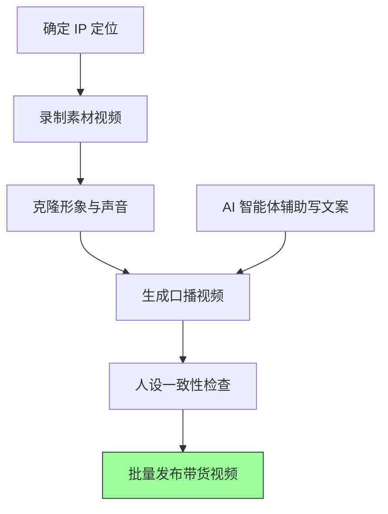

# 第16章 AI 数字人口播 IP 与口播内容量产

> 本节教读者打造 AI 数字人口播 IP：克隆真人形象与声音做口播内容，重点解决口型同步、人设一致性、避免"AI 味"等痛点，并对比国内外平台选性价比工具。适合镜头表现力差但需要量产带货视频的读者。

## 16.1 大白话：数字人就是"虚拟主播"

数字人就是用 AI 克隆一个"虚拟主播"，你不需要自己出镜，它帮你念稿子。适合不爱露脸但要做大量带货视频的人。关键是嘴巴要和声音同步，人设要统一，不然观众一眼就能看出是 AI。

## 16.2 什么是数字人 IP？

### 16.2.1 数字人

在本次课程的语境下，"数字人"指的是主要由 AI 技术驱动的虚拟形象。它可以是根据真人形象生成的数字分身，也可以是完全独立设计的、具有独特外观的虚拟人物。

其核心特征是 AI 驱动。这意味着通过人工智能技术，例如声音克隆或高质量的语音合成，赋予它声音；并通过算法驱动其面部表情和口型，使其能够模拟人类进行信息的表达和内容的播报。

### 16.2.2 IP

IP 是 Intellectual Property（知识产权）的缩写。在内容创作和品牌领域，我们可以将其理解为一个具有独特性和辨识度的"品牌形象"或"个人标识"。

就像一个成功的自媒体账号、一位知名的公众人物，或者一个广受欢迎的品牌，它们都形成了自己独特的风格、定位和用户认知，这就是一种 IP。它代表了一种可识别的价值和影响力，并且通常具有潜在的商业价值。

## 16.3 数字人制作的技术与质量挑战

### 16.3.1 视觉不自然

数字人有时看起来很像真人，但细节上（比如眼神、表情、动作）还是有点不自然。这会让观众觉得别扭。要让数字人更自然，往往需要更高的成本或者更先进的技术。

### 16.3.2 口型同步和音频自然度

有时候我们用 AI 生成数字人口播，嘴型看起来和声音对不上，尤其是说得快或者有情绪变化时。比如你录制了一段激动的讲解，AI 生成的视频里嘴巴还在慢慢张合，但声音已经说到下一句话了。这种情况就会让人觉得不自然。

教程里会教你怎么录制一段口播视频，怎么调整说话节奏、怎么录素材，才能让 AI 生成的嘴型和你的声音更贴合，减少这种尴尬。

### 16.3.3 特定场景表现力局限

目前的 AI 在模拟复杂情感、进行非常规或即兴互动、展现精细的肢体语言方面仍有局限，可能难以胜任所有类型的口播内容。

所以在制作数字人本身原始视频上，航海给大家增加了如何自然的口播和拍摄的练习，让我们克隆出自己数字人也会更加自然和真实。

### 16.3.4 人设一致性与真实感

如何让 AI 生成的内容始终符合预设的人设、语气和状态？如何避免内容同质化、缺乏真情实感，让观众觉得"有灵魂"而不是"AI 味儿"很重？

这需要强大的人类策略和精心的 Prompt 设计，航海中增加了用 AI 训练自己的智能体，让 AI 写出的内容、语气都更加符合我们自己的人设、语感。

## 16.4 制作成本与技术门槛

有同学可能会问，为什么不用市面上免费的 AI 工具？比如有的免费平台，虽然能一键生成数字人视频，但画质差、动作僵硬，声音也不太像自己，付费省时间。

航海中，带大家对比了国内外多个平台，帮你选出性价比高、效果好的工具，避免你踩坑，也省下不少试错的时间和钱。

## 16.5 用 AI 智能体辅助 IP 定位

### 16.5.1 目标

帮你精准找到自己的内容定位，借助 Gemini 明确你的核心优势和沟通风格。

### 16.5.2 工具推荐 Gemini

首先第一步是解决定位问题，我们这里用的工具是 Gemini。如果大家还没有 Gemini 账号，可以看圈友这篇帖子进行注册，或者通过第三方平台购买，实在是解决不了，可以群里问举手提问教练。

为什么用 Gemini？之前我测试过 kimi、豆包、Claude、chatGPT，在其中一个部分，拿我的脚本文案和其他的博主的文案对比，再输出内容，只有 Gemini 的表现最好，所以大家有条件的情况下也可以试试看，当然如果有自己顺手喜欢使用 AI 也可以通用。

### 16.5.3 明确价值与方向

思考你的独特价值是什么？目标受众是谁？初步的商业化想法？

可能有些圈友会想，我能不能直接开始玩工具、做数字人？

我的建议是：先别急。就像建房子需要先有清晰的蓝图一样，打造一个成功的、可持续的数字人 IP，必须先有明确的战略思考。没有方向的努力，往往事倍功半。

在这一小节，我们的目标是引导大家进行初步的思考，帮你梳理清楚三个核心问题：你的 IP 要提供什么核心价值？你的目标受众是谁？以及你初步设想的内容方向和商业可能性是什么？这些初步思考将为你后续更深入的定位和 AI 辅助探索打下坚实基础。

### 16.5.4 如何让 AI 知道你的个人经历？

之前大家接触到的很多 AI 相关的内容，但是读起来就是不像自己，仿佛没有参与到自己的人生，不懂自己，所以写的内容和自己就像贴了一层皮，没有融合性。

所以为了让 AI 更懂我们，就要让 AI 来回答，ta 需要知道我们什么内容？以下的提问均来自 Gemini，核心是让 AI 更了解我们的方向、生活、找到突破口。

## 16.6 国内外平台选型对比

| 平台类型 | 代表平台 | 优点 | 缺点 | 适用场景 |
|---------|---------|------|------|---------|
| 国内平台 | 即梦、海螺、可灵 | 中文支持好，注册简单，免费额度 | 高级功能付费 | 国内自媒体、带货 |
| 国外平台 | HeyGen、D-ID、Synthesia | 质量高，口型同步好 | 贵，需要海外支付 | 海外市场、高端商业 |
| 开源方案 | SadTalker、Wav2Lip | 免费，可私有化部署 | 需要技术配置，质量参差 | 技术人员、二次开发 |

## 16.7 录制素材建议

为了让 AI 生成的数字人更自然，录制素材时注意：

1. **说话节奏**：不要太快，保持自然语速
2. **表情管理**：面部表情要自然，不过度夸张
3. **光线环境**：光线均匀，避免背光和阴影
4. **背景简洁**：背景不要太杂乱，突出人物
5. **录音质量**：使用麦克风，减少背景噪音

## 16.8 数字人 IP Mermaid 图

## 小练习

在一个 AI 数字人平台上使用公共模板生成一段 30 秒口播视频，替换为你自己的文案，观察口型同步效果并记录需要人工修正的地方。
