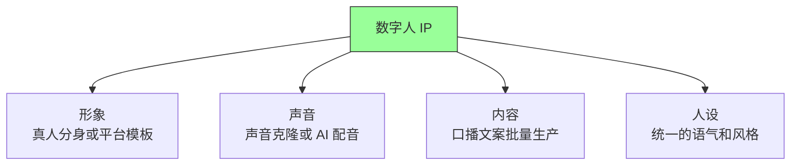
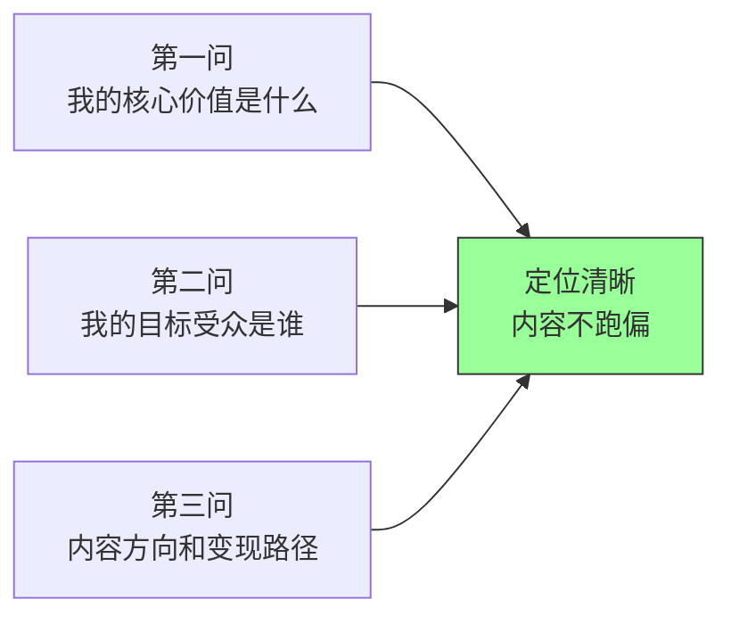
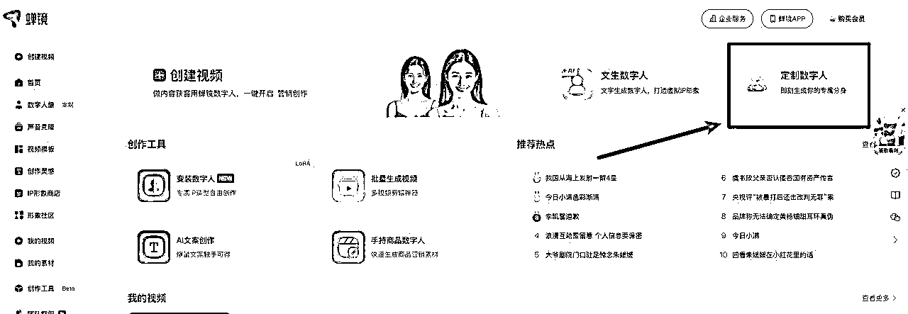
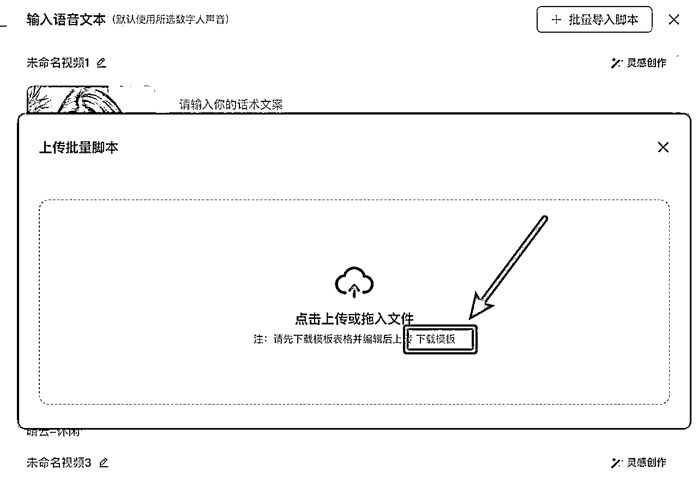
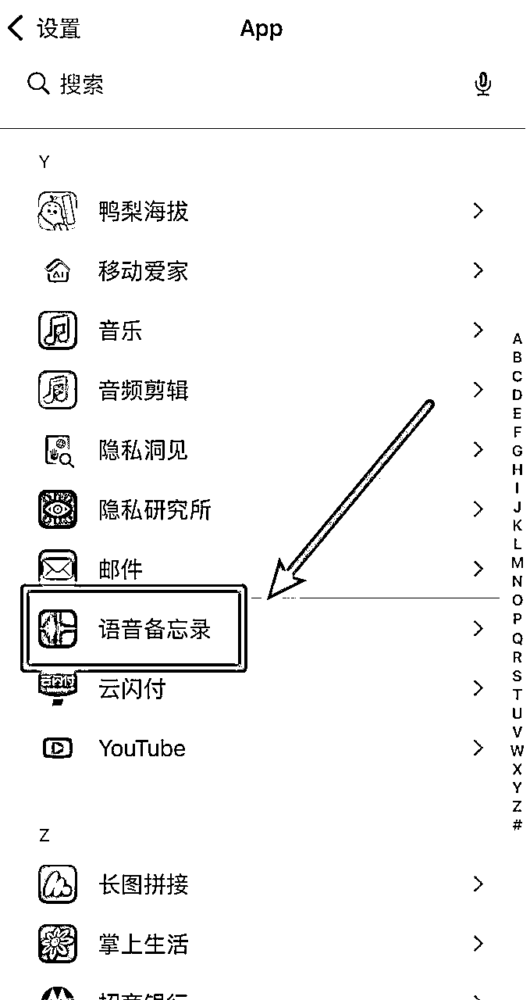
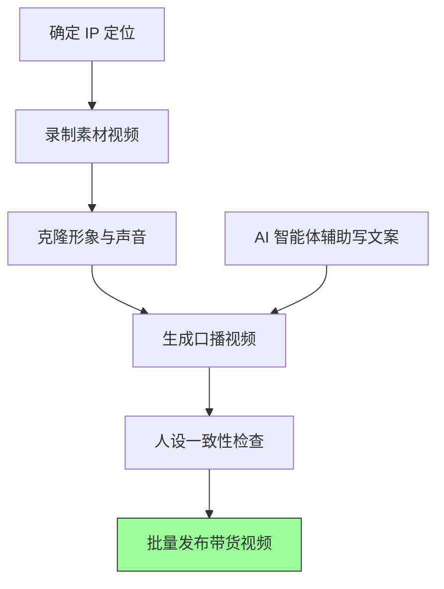
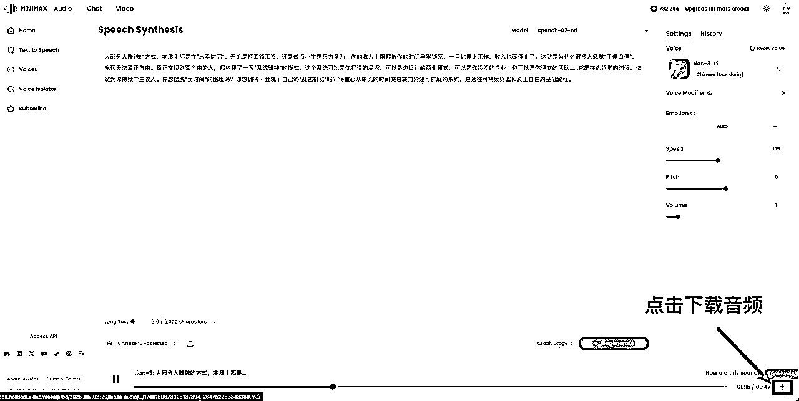
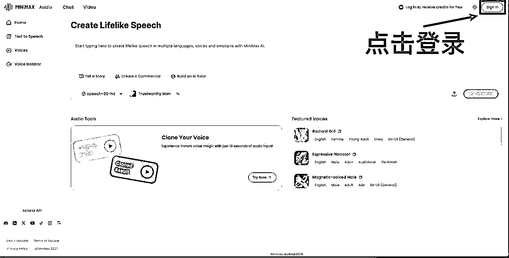
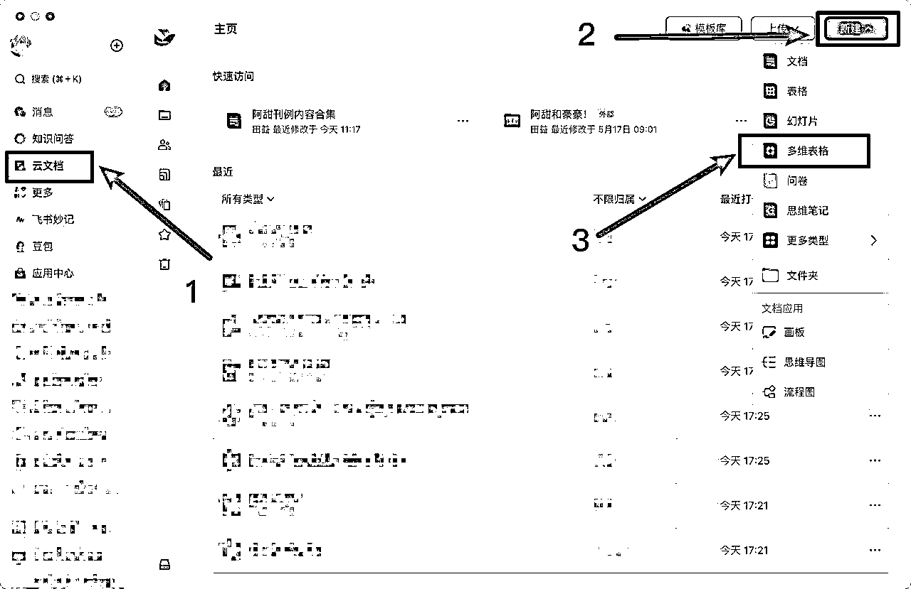

# 第16章 AI 数字人口播 IP 与口播内容量产

> 本节教读者打造 AI 数字人口播 IP：克隆真人形象与声音做口播内容，重点解决口型同步、人设一致性、避免"AI 味"等痛点，并对比国内外平台选性价比工具。适合镜头表现力差但需要量产带货视频的读者。

在正式动手之前，先说两句"废话"宽宽心：这一章不需要你会摄影、会剪辑、更不需要你会编程。你要做的只是——用手机录几段素材，把素材交给 AI，再把 AI 写的文案贴给数字人工具，一条看起来像你本人出镜的口播视频就生成了。我们会把"克隆""口型同步""声音克隆"这些听起来很玄的词，全部用大白话讲清楚，并把每一步的操作掰开揉碎给你演示。

---

## 16.1 大白话：数字人就是"虚拟主播"

数字人就是用 AI 克隆一个"虚拟主播"，你不需要自己出镜，它帮你念稿子。适合不爱露脸但要做大量带货视频的人。关键是嘴巴要和声音同步，人设要统一，不然观众一眼就能看出是 AI。

> **大白话**：数字人就像给自己请了一个"替身演员"。你去影楼拍一套照片、录几段视频，这个"替身"就诞生了。以后不管你是在上班、带娃还是睡觉，它都能坐在镜头前替你念稿子、讲产品，而且永远精神饱满、永远不抱怨。

再打个更生活化的比方：你有没有见过商场里的导购机器人？你问它问题，它会张嘴回答你。数字人干的就是这件事，只不过它长得更像人、声音更像人、内容更像人。你给它一段文字稿，它就能用自己的"嘴"把这段稿子讲出来，配上表情和动作，乍一看跟真人录的视频没两样。

为什么这么多人想做数字人口播？素材书《AI-超级个体：打造不可替代的个人品牌》里总结了虚拟形象解决的三大痛点，说得非常到位：

1. **隐私保护**：不想被熟人认出来。很多宝妈、上班族想做自媒体，但又不想让老板、亲戚刷到自己，数字人帮你把"脸"和"账号"解绑。
2. **形象管理**：永远保持最佳状态。真人出镜总有一天没睡好、感冒了、胖了，数字人不存在这些问题，它每天都是"精修版"的你。
3. **规模化**：可以 24 小时工作。真人录十条视频就累趴了，数字人只要你把文案喂给它，它能源源不断地产出。

不过，数字人不是随手一点就能乱真的。观众看视频时其实非常挑剔，判断"这是不是真人"往往就在几秒之间。想让它立得住，有三道坎必须迈过去，这也是本章后面反复要解决的问题：

- **嘴巴要和声音同步**（行话叫"口型同步"）：声音说到"苹果"，嘴还张着念"香"字，观众立马出戏；
- **人设要统一**：今天高冷专业、明天插科打诨，观众记不住你，平台算法也不知道该把你推给谁；
- **避免"AI 味"**：那种表情僵硬、语调平平、像机器人念课文的感觉，是掉粉利器。

把"数字人 IP"这件事拆开看，其实就是四个零件拼起来的整体：



后面的小节会一个零件一个零件地带你装好它。

---

## 16.2 什么是数字人 IP？

### 16.2.1 数字人

在本次课程的语境下，"数字人"指的是主要由 AI 技术驱动的虚拟形象。它可以是根据真人形象生成的数字分身，也可以是完全独立设计的、具有独特外观的虚拟人物。

其核心特征是 AI 驱动。这意味着通过人工智能技术，例如声音克隆或高质量的语音合成，赋予它声音；并通过算法驱动其面部表情和口型，使其能够模拟人类进行信息的表达和内容的播报。

> **大白话**：记住一个简单的判断公式——**数字人 = 一张会动的脸 + 一副像人的声音 + AI 驱动的表情口型**。三者缺一不可：只有脸没声音，是壁纸；只有声音没脸，是电台；脸和声音都会动、还同步，这才是数字人。

素材书《用 AI 赚钱》里对数字人的解释更直白：AI 数字人，就是用计算机图形技术和人工智能创造出来的一个虚拟的人物形象。这个人物形象可以采用高度拟真的三维建模，长得像真人，也可以是二次元卡通风格的。最厉害的是，你只需要给它一段文字或音频，它就能用其虚拟的嘴巴和表情，像真人一样把这段内容给"说"出来。

这个领域到底有多热？《AI-超级个体：打造不可替代的个人品牌》里引用了一组公开数据：2024 年中国 AI 数字人市场规模达到 41.2 亿元，相比 2023 年增长 85.3%；其中 2D 数字人市场规模达 28.9 亿元，增长 101.2%——增长速度直接翻倍。京东云言犀数字人在电商"闲时直播"场景里，成本不足真人的 1/10，但转化率提升了 30%；美国一位网红用 2000 小时视频训练出自己的数字人 CarynAI，每分钟向用户收费 1 美元，推出第一周就创收 7.16 万美元。

数字人视频的变现方式，其实和真人出镜的短视频非常相似，主要靠流量和 IP 价值，主要包括流量分成、广告收入、带货收入等（《用 AI 赚钱》）。也就是说，你不需要学一套新的赚钱逻辑，真人博主怎么赚，数字人博主就怎么赚，只是"出镜"这一步被 AI 替你干了。

### 16.2.2 IP

IP 是 Intellectual Property（知识产权）的缩写。在内容创作和品牌领域，我们可以将其理解为一个具有独特性和辨识度的"品牌形象"或"个人标识"。

就像一个成功的自媒体账号、一位知名的公众人物，或者一个广受欢迎的品牌，它们都形成了自己独特的风格、定位和用户认知，这就是一种 IP。它代表了一种可识别的价值和影响力，并且通常具有潜在的商业价值。

> **大白话**：IP 就是"观众闭着眼睛都能认出你"的本事。听到"我没有卖货，我是来交朋友的"，你想到董宇辉；看到汉服、田园、慢镜头，你想到李子柒。这种"一提一个准"的辨识度，就是 IP 的核心资产。

为什么做数字人也必须先做 IP？因为数字人降低了"出镜"的门槛，同时也降低了所有人的门槛——你能做数字人，别人也能做。当平台上的数字人视频铺天盖地时，能让你脱颖而出的不是技术，而是独特的定位和风格，也就是 IP。《AI-超级个体：打造不可替代的个人品牌》举了两个例子：李子柒的视频停更 1217 天，老视频依然持续产生收入，停更期间每月 YouTube 广告分成仍达 78 万元，靠的就是"中国田园+传统文化"这个独一无二的 IP 认知；董宇辉 2024 年带货 102 亿元，靠的是"知识分子+真诚表达"的人设记忆点。数字人可以复制你的脸和声音，但 IP 定位才是让观众持续关注你的灵魂。

数字人 IP 和真人 IP 相比，还有一层特殊的价值：**它可以复制、放大你自己**。《AI-超级个体》里有一句很形象的话——你出差时，你的语音数字人正在主持品牌直播。真人分身乏术，数字分身不会。

---

## 16.3 数字人制作的技术与质量挑战

做数字人不是"一键完美"的。上手之前，先认清四个最常见的坑，心里有数，才不会做了一半就弃坑。

### 16.3.1 视觉不自然

数字人有时看起来很像真人，但细节上（比如眼神、表情、动作）还是有点不自然。这会让观众觉得别扭。要让数字人更自然，往往需要更高的成本或者更先进的技术。

> **大白话**：这种"哪里不对劲"的感觉有个专门的名字，叫"恐怖谷效应"——机器人在"很像人"但"还差一点点"的时候，人反而会觉得最瘆人。就像蜡像馆里的蜡像，五官都对，但你盯着它的眼睛看三秒，还是会起鸡皮疙瘩。

应对办法不是追求百分之百逼真，而是扬长避短：口播视频本来镜头语言就简单（一个人对着镜头讲话），观众注意力主要在"讲得对不对"而不是"皮肤纹理真不真"。素材书《AI-实操：引流变现-8-步法》的作者甚至直言，用视频直接生成的那种数字人"相对比较低端，让人一眼看上去就以为是个假人"，但照样天天用、照样出爆款——因为对带货引流来说，内容价值和稳定产出比画质更重要。当然，预算充足的话，可以选质量更高的平台或用更多照片训练形象，视觉细节会好很多（16.6 节详细对比）。

### 16.3.2 口型同步和音频自然度

有时候我们用 AI 生成数字人口播，嘴型看起来和声音对不上，尤其是说得快或者有情绪变化时。比如你录制了一段激动的讲解，AI 生成的视频里嘴巴还在慢慢张合，但声音已经说到下一句话了。这种情况就会让人觉得不自然。

教程里会教你怎么录制一段口播视频，怎么调整说话节奏、怎么录素材，才能让 AI 生成的嘴型和你的声音更贴合，减少这种尴尬。

> **大白话**：口型同步就像给译制片配国语音。配音员说得再好，如果演员嘴巴还在动、声音却停了，观众马上就会发现"这是配的音"。AI 合成数字人视频时干的就是"配音"的活：它要把你的文字转成语音，再让数字人的嘴巴跟着语音的节奏张合。语速越平稳、句子越规整，AI 对齐得就越好；情绪起伏太大、忽快忽慢，就容易"嘴和声音打架"。

还有一个容易忽略的点：**音频本身要干净**。素材书《AI-视频号创富指南》里专门讲了录音常见问题：表达不流畅、"嗯""啊"等口头禅、停顿太长、背景杂音、音量忽大忽小。好消息是这些现在都能用 AI 一键处理——以剪映为例，把录好的音频导进去，点音频轨道上的"智能剪口播"，AI 会自动标记口头禅，你一键删除就行；它还能去掉多余停顿、消除背景噪声、平衡音量。处理前的音频磕磕巴巴，处理后的音频流畅清晰，整个流程几分钟就能搞定。声音干净了，数字人的口型对齐也会更稳。

### 16.3.3 特定场景表现力局限

目前的 AI 在模拟复杂情感、进行非常规或即兴互动、展现精细的肢体语言方面仍有局限，可能难以胜任所有类型的口播内容。

所以在制作数字人本身原始视频上，航海给大家增加了如何自然的口播和拍摄的练习，让我们克隆出自己数字人也会更加自然和真实。

> **大白话**：现在的数字人适合"照本宣科"型的内容——知识科普、产品介绍、每日资讯，念稿子它最在行。但如果你想让数字人即兴回答观众刁钻的提问、演绎大哭大笑的短剧、或者在直播间里临场带节奏，它就会露馅。一句话：**当演员它还嫩，当播音员它很稳。**

《AI-超级个体》里对数字人直播的商业真相有个很清醒的总结：标准化场景（电商、课程、客服）降本增效是真的，但情感共鸣、延展 IP 影响力却拼不过"活人"——AI 形象带货的成本砍成真人的 1/10，可转化的最终极限仍由信任感决定。所以正确的姿势是"分工"：让数字人承包量大、标准化的口播内容，把需要真情实感的互动留给真人（哪怕真人只在评论区、直播间里露个声）。

### 16.3.4 人设一致性与真实感

如何让 AI 生成的内容始终符合预设的人设、语气和状态？如何避免内容同质化、缺乏真情实感，让观众觉得"有灵魂"而不是"AI 味儿"很重？

这需要强大的人类策略和精心的 Prompt 设计，航海中增加了用 AI 训练自己的智能体，让 AI 写出的内容、语气都更加符合我们自己的人设、语感。

> **大白话**："人设一致性"说穿了就是"别精分"。你的数字人今天讲话像教授，明天像街溜子，观众就会困惑"这账号到底是干嘛的"。《AI-加抖音快手小红书视频号》里举了个朋友圈人设的例子，道理完全通用：如果你是"接地气的美妆测评博主"，就不能给人"高冷"的感觉，要延续"真实、敢说、懂行"的风格——平台人设和日常表现要一致，粉丝才记得住你。

具体怎么保证一致？两个实操动作，本章都会展开：

1. **把人设写成"说明书"喂给 AI**（16.5 节）：让 AI 先充分了解你的经历、语气、口头禅，之后它写的每一条文案都自带你的味道；
2. **发布前做"一致性检查"**（16.8 节）：每条视频发出去之前，问自己三个问题——这段话像不像我会说的？这个形象和上一条是同一套衣服、同一个背景吗？语气和账号里的爆款一致吗？三条都过关再发。

---

## 16.4 制作成本与技术门槛

有同学可能会问，为什么不用市面上免费的 AI 工具？比如有的免费平台，虽然能一键生成数字人视频，但画质差、动作僵硬，声音也不太像自己，付费省时间。

航海中，带大家对比了国内外多个平台，帮你选出性价比高、效果好的工具，避免你踩坑，也省下不少试错的时间和钱。

> **大白话**：免费工具就像免费的健身房体验卡——能用，但处处受限：画质像打了马赛克、动作像木偶、声音像客服机器人。你要清楚自己花钱买的是什么：不是"能生成视频"这个功能，而是"生成出来的视频敢不敢发到平台上"的底气。

不过也要泼一盆冷水：数字人这个赛道已经不冷门了。《AI-超级个体》里算过一笔账：截至 2024 年，中国现存与数字人相关的企业已达 114.4 万家，而市场盘子是 41.2 亿元——平均每家企业只能分到约 3600 元的份额。这是典型的"红海陷阱"：看起来需求很大，实际上竞争惨烈。所以对个人来说，正确的姿势不是"我也做个数字人号"，而是"我用数字人放大我已有的定位"——这也是为什么本章要先讲 IP 定位（16.5 节），再讲工具（16.6 节）。

技术门槛方面，完全不用担心。本章涉及的所有操作——录素材、克隆形象、克隆声音、合成视频、批量写文案——全部在网页或手机 App 里点点鼠标就能完成，不需要写代码。唯一的例外是 16.8 节那段"批量生成文案"的示例代码，那是给想偷懒量产的同学准备的进阶内容，不感兴趣可以跳过，不影响你走完全流程。

---

## 16.5 用 AI 智能体辅助 IP 定位

### 16.5.1 目标

帮你精准找到自己的内容定位，借助 Gemini 明确你的核心优势和沟通风格。

定位这件事，说大不大，说小不小。它要回答的无非是三个问题：



### 16.5.2 工具推荐 Gemini

首先第一步是解决定位问题，我们这里用的工具是 Gemini。如果大家还没有 Gemini 账号，可以看圈友这篇帖子进行注册，或者通过第三方平台购买，实在是解决不了，可以群里问举手提问教练。

为什么用 Gemini？之前我测试过 kimi、豆包、Claude、chatGPT，在其中一个部分，拿我的脚本文案和其他的博主的文案对比，再输出内容，只有 Gemini 的表现最好，所以大家有条件的情况下也可以试试看，当然如果有自己顺手喜欢使用 AI 也可以通用。

> **大白话**：选 AI 就像选理发师——别人吹得天花乱坠没用，剪得合你头型才作数。这里推荐 Gemini 是因为实测它在"对比文案、提炼风格"这个具体任务上表现最好，但它不是唯一选项。如果你用惯了 DeepSeek、豆包，思路完全通用，换工具不换方法。

### 16.5.3 明确价值与方向

思考你的独特价值是什么？目标受众是谁？初步的商业化想法？

可能有些圈友会想，我能不能直接开始玩工具、做数字人？

我的建议是：先别急。就像建房子需要先有清晰的蓝图一样，打造一个成功的、可持续的数字人 IP，必须先有明确的战略思考。没有方向的努力，往往事倍功半。

在这一小节，我们的目标是引导大家进行初步的思考，帮你梳理清楚三个核心问题：你的 IP 要提供什么核心价值？你的目标受众是谁？以及你初步设想的内容方向和商业可能性是什么？这些初步思考将为你后续更深入的定位和 AI 辅助探索打下坚实基础。

> **大白话**：把三个问题翻译成日常语言就是——"我能帮谁解决什么问题？"（核心价值）、"刷到我视频的人是谁？他们缺什么？"（目标受众）、"粉丝多了以后，我打算靠什么赚钱？"（变现路径）。三个问题都答得出来，蓝图就有了；一个都答不出来，就先别急着买工具。

对应到数字人上，定位还决定一个很实际的东西：**数字人长什么样、穿什么、在什么背景前讲话**。知识型 IP 适合书房背景+衬衫形象，好物推荐适合展示台+便装形象。《AI-超级个体》提供了一个"AI 人设画像"提示词，可以直接拿来用（把方括号里的内容换成你自己的情况）：

> 请基于以下个人特质为我设计 IP 形象：职业背景：[你的经历]；内容方向：[你的领域]；目标受众：[你的用户]；个性特点：[你的性格]。请输出：1. 视觉风格建议；2. 性格特征；3. 说话方式；4. 标志性特征；5. 色彩方案。

AI 回答之后，别照单全收，把你觉得"不像我"的条目删掉、觉得"就是我"的条目留下——这份删改后的清单，就是你数字人的"人设说明书"，16.8 节批量生成文案时要反复用到它。

### 16.5.4 如何让 AI 知道你的个人经历？

之前大家接触到的很多 AI 相关的内容，但是读起来就是不像自己，仿佛没有参与到自己的人生，不懂自己，所以写的内容和自己就像贴了一层皮，没有融合性。

所以为了让 AI 更懂我们，就要让 AI 来回答，ta 需要知道我们什么内容？以下的提问均来自 Gemini，核心是让 AI 更了解我们的方向、生活、找到突破口。

> **大白话**：这一步的思路非常妙——别猜 AI 需要什么信息，直接问它："为了帮我定位，你需要知道我哪些情况？"AI 会反过来给你列一张提问清单，你按清单一条条回答，它就彻底"懂"你了。这就像面试前让面试官提前把问题发给你，你还怕答不好吗？

具体操作就三步，也是整个"AI 辅助定位"的精髓：


**第一步：让 AI 反过来提问。** 打开 Gemini（或你顺手的 AI），输入类似这样的话：

> 我想做一个数字人口播 IP，但我不确定定位。请你扮演 IP 定位教练，为了帮我找到方向，你觉得你需要先知道我的哪些信息？请把需要了解的问题一次性列出来。

**第二步：按清单如实交代。** AI 大概率会围绕几个方面提问，你逐条回答，写得越具体越好：

- **方向类**：你过去做过什么工作、擅长什么、拿得出手的成果有哪些？你想深耕哪个领域？
- **生活类**：你的日常生活是什么样的？有没有什么亲身经历是别人没有的（带娃、转行、创业、某个爱好）？
- **表达类**：你平时说话是什么风格？喜欢用什么口头禅？朋友评价你说话有什么特点？
- **资源类**：你有哪些变现渠道或者想法？能拿到什么产品、货源、服务？

**第三步：让 AI 汇总输出。** 信息给完之后，让它输出三样东西：一句话的 IP 定位、三个具体的内容选题方向、以及一段"用你的口吻"写的自我介绍。拿到自我介绍后通读一遍，凡是"这话不像我会说的"句子，直接改掉再喂回去，直到你觉得"这就是我"为止。

做完这三步，你手上就有了两样宝贵资产：一份定位结论，一份"人设说明书"（就是你对 AI 问题的全部回答+AI 的定位输出）。这两样东西后面会一直用：数字人形象照它设计，批量文案照它生成，一致性检查拿它当标尺。

---

## 16.6 国内外平台选型对比

先上对比表，帮你建立全局印象（前几行是航海中对比过的平台类型，整理成了表格方便查阅）：

| 平台类型 | 代表平台 | 优点 | 缺点 | 适用场景 |
|---------|---------|------|------|---------|
| 国内平台 | 即梦、海螺、可灵 | 中文支持好，注册简单，免费额度 | 高级功能付费 | 国内自媒体、带货 |
| 国内数字人平台 | 蝉镜、腾讯智影、剪映数字人 | 中文口型自然，模板多，操作简单 | 克隆专属形象等高级功能多需付费 | 国内口播、知识分享、带货 |
| 国外平台 | HeyGen、D-ID、Synthesia | 质量高，口型同步好 | 贵，需要海外支付 | 海外市场、高端商业 |
| 开源方案 | SadTalker、Wav2Lip | 免费，可私有化部署 | 需要技术配置，质量参差 | 技术人员、二次开发 |
| 声音克隆工具 | ElevenLabs、海螺AI、讯飞 | 一小段录音即可克隆，自然度高 | 部分收费，中文效果各异 | 定制数字人声音、配音 |

对零基础读者，选型建议就一句话：**人在国内、内容发国内平台，就从"国内数字人平台"列里挑一个开始**——注册简单、不用海外支付、中文口型也调得更自然。下面以蝉镜为例，把"从登录到出片"的完整流程走一遍（流程来自《用 AI 赚钱》第 3.10 节，配图即取自该书）。

蝉镜是现在热门的 AI 数字人视频创作工具，能够快速生成真实自然的数字人口播视频，特别适合想做视频内容但不方便真人出镜的博主使用（《AI-视频号创富指南》）。你想做知识分享、产品介绍类视频，但因为时间、形象或隐私原因不想真人出镜，只需要录制一段自己的视频素材，蝉镜就能复刻出你的数字分身，让这个数字人替你完成视频拍摄。

**第一步：确定 IP 定位和内容方向。** 也就是明确你的数字人要扮演一个什么样的角色。比如科普某个领域知识的大咖、介绍家居好物的产品推荐官……你的定位越清晰，越容易吸引到垂直领域的粉丝。这一步就是 16.5 节做完的定位功课。

**第二步：确定数字人形象。** 若要克隆你自己的真人形象，需要拍摄 3～5 分钟的正视镜头高清视频，上传至对应系统训练 AI 模型，生成和你真人高度相似的数字虚拟人（拍摄要求见 16.7 节）。当然这些 AI 平台内也有着丰富的模板，你也可直接选用平台自带的 2.5D/3D 虚拟形象模板，如蝉镜、腾讯智影、HeyGen 等，你还能调整服装、发型等细节。不想露脸的同学，选模板形象就完全够用。

**第三步：生成视频内容。** 打开文案生成工具，比如 DeepSeek，输入主题及要求，生成口播文案，并手动优化。接着，利用场景生成工具，如即梦 AI，输入提示词生成场景图片和视频，下载备用。

**第四步：登录数字人工具制作视频。** 登录数字人定制工具，例如蝉镜，根据之前生成的形象描述提示词，创建数字人形象。进入创建视频功能，选好数字人，复制口播文案，挑选合适的配音并试听调整，无误后点击生成视频。



> **图片说明**：蝉镜的数字人视频创作界面（图源：《用 AI 赚钱》图 3-6）。在这个界面里选好数字人形象、粘贴口播文案、挑选配音，就能提交生成数字人口播视频。



> **图片说明**：蝉镜的数字人制作功能界面（图源：《用 AI 赚钱》图 3-7）。点击生成前可以先试听配音、预览效果，确认无误再出片，避免浪费生成额度。

**第五步：后期优化。** 将生成的视频导入剪映等视频编辑软件，添加字幕提升可读性，加入背景音乐、音效增强氛围感，调整画面比例适配平台，按需添加贴纸、特效，选好封面后，导出最终成片。

如果你连专门的平台都不想注册，剪映里就自带"数字人"功能，五步出片（《AI-视频号创富指南》）：

1. 在剪映首页找到"数字人"功能；
2. 选择数字人形象：有男有女、有年轻有成熟、有商务风有亲和风，根据你的内容定位选择合适的形象；
3. 输入播报文案：把你的口播脚本粘贴进去；
4. 调整声音和语速：选择配音类型（温柔、激昂、专业等），调整语速；
5. 点击"生成"按钮，等待几分钟，数字人播报视频就做好了。

> **安全提醒（很重要）**：克隆形象和声音涉及"肖像权"和"声音权"。《AI-实操：引流变现-8-步法》里特意注明：真人制作的数字人，在制作前必须经过对方的授权——克隆你自己的形象声音没问题，但克隆同事、家人、明星，必须先拿到对方明确同意；用别人的声音同理。另外，数字人视频的发布必须遵守投放平台的规则，部分平台要求对 AI 生成内容做标注。

国外平台怎么用？以 HeyGen 为例，《AI-实操：引流变现-8-步法》介绍过两种玩法：一是直接把自己拍的视频上传到 HeyGen，软件把它生成数字人；二是先用 Midjourney 生成 400～800 张不同状态、不同角度的照片，再合成数字人，因为素材较多，这种数字人更加形象生动、更加真实。作者本人就是两种结合：先让 Midjourney 生成了 800 张照片（包含开心的、生气的、各个角度的），再融合成一个视频上传 HeyGen。当然，日常商用不需要这么麻烦，用其中一个软件再优化，基本就能满足需求。

---

## 16.7 录制素材建议

为了让 AI 生成的数字人更自然，录制素材时注意：

1. **说话节奏**：不要太快，保持自然语速
2. **表情管理**：面部表情要自然，不过度夸张
3. **光线环境**：光线均匀，避免背光和阴影
4. **背景简洁**：背景不要太杂乱，突出人物
5. **录音质量**：使用麦克风，减少背景噪音

这五条是"考试大纲"，下面逐条展开成可照抄的"答题步骤"。素材主要来自《AI-视频号创富指南》第四章——那本书的"方比比先生"账号矩阵靠这套拍摄方法论，一个月拿下了超过 1 亿的播放量，方法经过实战验证。

**1. 说话节奏：稳字当头。** 克隆用的素材视频里，语速保持你平时的自然语速即可，别赶稿。句子之间留出短暂停顿，段落之间换口气——这些自然停顿会一起被克隆进数字人里，成片会显得从容。避免"背稿感"：与其逐字念稿，不如列好要点用自己的话讲，讲错了重录那一句就行。

**2. 表情管理：自然+适度的手势。** 对着镜头讲话时表情放松，讲到重点时可以配合手势。带货话术里就常用这种设计，比如《AI-加抖音快手小红书视频号》的防晒霜口播示范里，写到结尾时会提示主播"（看着镜头，做出总结手势）"——手势和话术同步，是真人主播的标配，克隆素材里有这些细节，你的数字人也会继承。

**3. 光线环境：让脸亮起来，别背光。** 灯光布置的核心作用是让人物面部光线均匀、柔和、自然（《AI-视频号创富指南》）。白天拍摄可以利用自然光：人物面朝窗户坐，让光从正面或侧面 45 度照过来，上午 9:00～11:00、下午 15:00～17:00 的自然光线最柔和。条件允许的话，按专业方案布三组灯：主光照亮人脸；轮廓光打在人物侧后方，让人物和背景分离；对面酌情补一个辅光，避免人脸出现死黑区域；最后用背景光单独提亮背景。


> **图片说明**：拍摄灯光布置示意（图源：《AI-视频号创富指南》）。核心思路是分层次打光——主光负责人物面部明亮，轮廓光负责人物与背景分离，辅光补足阴影，背景光单独提亮背景，画面才有了"高级感"的光线层次。

**4. 背景简洁：突出人物，留出景深。** 搭建拍摄场景的核心原则是"背景越简洁，主体越突出"。人物和背景之间要有距离，大约 0.5～1 米，不要贴墙站，拉开距离才有景深，画面才立体。背景可以保留适当的装饰元素——绿植、图书、花束，作用是点缀，数量不要太多。幕布颜色可以匹配内容情绪：绝大多数情况下，暖黄色是相对通用的选择（《AI-视频号创富指南》）。

**5. 录音质量：设备可以简陋，声音不能将就。** 收音设备建议使用无线领夹麦克风，夹在领口位置，能有效提升人声清晰度（《AI-视频号创富指南》）。如果暂时没有麦克风，用手机收音时人物要尽量靠近手机，距离保持在 1 米以内，同时关闭环境中的噪音源，比如空调、风扇。

**设备方面，一部手机就够起步。** 以 iPhone 为例，打开相机设置，将视频录制参数调整为 4K、30 帧，画面清晰度会有明显提升；同时建议关闭 HDR 模式，手机的 HDR 模式会影响画质。其他手机的操作也类似，在相机设置中找到分辨率选项，选择最高的清晰度即可（《AI-视频号创富指南》）。



> **图片说明**：iPhone 手机视频录制参数设置（图源：《AI-视频号创富指南》图 4-7）。把"录制视频"设为 4K、30 帧，并关闭 HDR 模式，一部普通手机就能拍出清晰素材。

最后再配一个三脚架保证画面稳定（落地款适用场景最广，缩短后还能当桌面支架），你的"克隆素材录制间"就齐了。

**开录前的状态检查清单**（照着打勾再按录制键）：

| 检查项 | 合格标准 | 常见翻车 |
|-------|---------|---------|
| 说话节奏 | 自然语速，句间有停顿 | 像抢答，一口气不带喘 |
| 表情手势 | 放松自然，重点处配手势 | 全程扑克脸或表情用力过猛 |
| 光线 | 面部均匀明亮，无背光阴影 | 对着窗户坐成"剪影" |
| 背景 | 简洁，人物与背景留 0.5～1 米 | 贴墙站、杂物堆满背景 |
| 收音 | 领夹麦或 1 米内收音，环境安静 | 空调声、风扇声全录进去 |
| 设备参数 | 4K/30 帧，关闭 HDR | 默认参数、HDR 发灰 |
| 机位 | 三脚架固定，正视镜头 | 手持抖动，眼神飘忽 |

《AI-视频号创富指南》里有一句话值得贴在墙上："设备是为内容服务的，先把场景、灯光、构图做到位，设备带来的差异在短视频平台上并没有想象中那么大。"——别陷进"再买个镜头"的无底洞，先把手头的手机用明白。

另外一个小建议：正式拍摄之前可以先用手机试拍一段看效果，检查脸部亮度是否合适（《AI-视频号创富指南》）。试拍 30 秒回看一遍，比录完 5 分钟发现背光要省事得多。

---

## 16.8 数字人 IP Mermaid 图

走到这里，所有零件都备齐了。把整个"数字人 IP 打造流程"画成一张图，以后迷路了就回来看这张图：



这张图对应本章的全部小节：**确定 IP 定位**是 16.5 节（Gemini 三问+个人经历喂给 AI）；**录制素材视频**是 16.7 节（五条建议+状态清单）；**克隆形象与声音**是 16.6 节（蝉镜/HeyGen/ElevenLabs）；**生成口播视频**与**人设一致性检查**是本节要讲的重点；最后**批量发布**是量产环节。下面把最后两个环节展开。

**声音克隆：让数字人说"你的话"。** 形象克隆好了，声音可以二选一：用平台自带配音（快，但像别人），或者克隆你自己的声音（多花几分钟，但"人设一致性"直接拉满）。《AI-实操：引流变现-8-步法》介绍了 ElevenLabs 的玩法：想定制自己的声音，打开软件大概说上 1 分钟的话，软件就会在很短的时间内生成我们的声音——最终你就有了一个拥有定制声音的数字人。不想折腾海外工具的话，国内的替代品是海螺AI。

海螺AI 是 MiniMax 推出的多模态 AI 产品，是一款功能强大的 AI 配音工具，能够将文字快速转换成自然流畅的语音，特别适合不想真人出镜或录音条件有限的短视频创作者使用。它的核心优势是声音的真实度和情感表达能力——生成的语音不像传统配音软件那样机械呆板，而是能够准确还原真人说话的自然节奏，包括合理的停顿、语气的起伏、情绪的变化，让配音听起来更有人情味（《AI-视频号创富指南》）。写配音提示词时记住它的公式：**情绪基调+语速要求+适用场景+特殊要求**，例如"沉稳专业，语速中等，适合知识科普，重点词汇需要停顿强调"。



> **图片说明**：海螺AI 的工具入口（图源：《AI-视频号创富指南》）。海螺AI 是 MiniMax 推出的多模态 AI 产品，文字转语音是它的强项，网页和手机端都能用。



> **图片说明**：用海螺AI 把文字转成自然语音的操作界面（图源：《AI-视频号创富指南》）。输入文案、设定情绪基调与语速，生成的语音可以保留合理的停顿和语气起伏，直接给数字人当配音用。

**量产口播：从"做一条"到"做一批"。** 数字人真正的威力在于复制。《AI-实操：引流变现-8-步法》的作者团队用"AI 写文案+数字人出镜"的模式，10 秒钟就可以生成一条文案，一天可以生成 2000 条视频，靠数量"跑"出爆款——爆款带来流量费、广告费，还能引流到直播间带货变现。企业端的玩法更成熟：给每位孵化的网红达人配 1～3 个数字人，真人员工需要休息，数字人可以实现 24 小时在线。他们优化文案的两个办法也值得抄作业：一是用付费版 AI 工具（ChatGPT、Claude 或国内集成软件）优化文案质量；二是找对标账号的爆款文案，提取关键词后做"微创新"——比如做火锅生意，就在抖音搜"小肥羊火锅"、按最多点赞找出历史爆款视频，用工具把链接转成文字，再用 AI 植入自己的关键词重新生成。

量产的完整流水线长这样：


当一天产出几十条视频时，"哪条发过、哪条爆了、哪条待改"就没法靠脑子记了。这时候可以用飞书多维表格（可以理解成"在线 Excel，但更擅长挂流程"）做内容台账：《3 天吃透智能体+OpenClaw》里演示过用 Coze 工作流把批量生成的内容自动写入飞书多维表格——所有生成的内容（文案、配图链接、发布状态）会被自动写成一行行标准记录，不仅便于管理和复盘，也为后续的数据分析和优化提供了宝贵的数据资产。



> **图片说明**：Coze 工作流中"飞书多维表格-添加记录"节点的参数配置面板（图源：《3 天吃透智能体+OpenClaw》）。批量生成的内容按表头字段自动写入多维表格存档，哪条视频处于什么状态一目了然。

**想偷懒量产文案？给你一段完整代码（进阶，可跳过）。** 下面这段 Python 程序调用 DeepSeek 的 API（接口与 OpenAI 格式兼容，用法和第 1 章介绍过的一样），按你的"人设说明书"批量生成一周的口播文案，一条存成一个 txt 文件。运行前需要：电脑装好 Python；命令行执行 `pip install openai` 安装依赖库；在 DeepSeek 开放平台创建 API 密钥（密钥就是你的"取餐暗号"，千万别外传）。

```python
# ===== 程序作用：批量生成一周的数字人口播文案，一条存一个 txt 文件 =====

# 第 1 步：导入 OpenAI 官方库
# DeepSeek 的接口和 OpenAI 格式兼容，所以直接用 OpenAI 的库即可
from openai import OpenAI

# 第 2 步：创建客户端连接
#   api_key：你在开放平台创建的密钥（相当于取餐暗号，注意保密）
#   base_url：告诉程序去 DeepSeek 的服务器取结果，而不是 OpenAI 的
client = OpenAI(
    api_key="sk-在这里填入你自己的API密钥",
    base_url="https://api.deepseek.com"
)

# 第 3 步：定义"人设说明书"（内容来自 16.5 节你对 AI 提问的回答）
# 这段文字决定了每条文案的"味道"，写得越像你，文案越不像 AI 味
SYSTEM_PROMPT = """你是一位口播文案写手，请始终按以下人设写作：
我的人设：一位有十年经验的宝妈营养师，亲切、爱举自家厨房的例子。
我的目标受众：25-40 岁关注家人饮食健康的上班族。
我的语气风格：口语化，短句多，常用"其实""你猜怎么着"，偶尔自嘲。
禁止：使用"赋能""闭环""综上所述"等书面腔词汇。"""

# 第 4 步：准备一周的选题清单（换成你自己的选题即可）
topics = [
    "上班族早餐别再吃这两样",
    "孩子挑食，一个蒸蛋就能解决",
    "超市买酸奶，看这一行字就够了",
    "熬夜后第二天吃什么补救",
    "减脂期主食怎么吃才不饿",
]

# 第 5 步：循环处理每个选题
#   enumerate(topics, start=1) 会同时给出序号 i（从 1 开始）和选题 topic
for i, topic in enumerate(topics, start=1):
    # 调用 AI 生成文案：system 放人设说明书，user 放本次任务
    response = client.chat.completions.create(
        model="deepseek-chat",
        messages=[
            {"role": "system", "content": SYSTEM_PROMPT},
            {"role": "user", "content": (
                f"请围绕「{topic}」写一条 60 秒的口播文案。"
                "要求：开头 3 秒必须有钩子；中间分 3 个要点，"
                "每个要点先讲结论再给理由；结尾引导关注。"
            )}
        ]
    )
    # 从返回结果里取出文案正文（固定写法）
    script = response.choices[0].message.content

    # 把文案存成文件，文件名带序号和选题，方便对应
    filename = f"口播文案_{i:02d}_{topic}.txt"
    # encoding="utf-8" 保证中文不乱码
    with open(filename, "w", encoding="utf-8") as f:
        f.write(script)
    print(f"已生成：{filename}")

print("全部完成！请逐条检查，把不像你说话风格的地方手动改一改再喂给数字人。")
```

程序跑完，文件夹里会出现 5 个 txt 文件。**切记最后一行提示：AI 写完只算初稿，人工改稿这一步不能省**——把不像你的句子改成你的口头禅，把太"顺滑"的段落加一点"废话"和自嘲，这就是去掉"AI 味"的关键动作，也是 16.3.4 节说的"人设一致性检查"落到实处。

---

## 小练习

在一个 AI 数字人平台上使用公共模板生成一段 30 秒口播视频，替换为你自己的文案，观察口型同步效果并记录需要人工修正的地方。

> **复盘参考**：
> - **形象**：选公共模板形象即可，注意模板的性别、年龄、着装风格是否和你的定位相符（16.5 节的人设说明书）。
> - **文案**：用 16.5 节的方法先让 AI 按你的人设写一条 30 秒文案（大约 80～100 字），手动改掉不像你的句子。
> - **口型观察**：重点听三处——语速快的时候嘴型跟不跟得上？有停顿的地方嘴巴会不会"还在动"？语气有起伏时表情有没有跟着变？把出问题的时刻记下来（比如"第 12 秒左右嘴型滞后"）。
> - **修正记录**：常见的人工修正手段包括：把长句改短句、降低语速、在停顿处加标点、重新选择配音的语速档位。记录下来，这些就是你下一条视频的"避坑清单"。
>
> 做完这个练习，你就把本章"克隆→合成→质检"的最小闭环走通了。之后每多录一次素材、多改一次稿，你的数字人都会更自然一点。

---

## 本章小结

通过本章，你应该已经掌握：

1. **数字人是什么**：数字人 = 会动的脸 + 像人的声音 + AI 驱动的表情口型；它解决真人出镜的三大痛点——隐私保护、形象管理、规模化，能 24 小时替你"上班"。
2. **数字人 IP 的门槛在定位**：工具人人都有，定位才是护城河。先回答三问（核心价值/目标受众/变现路径），再让 AI 反过来提问、把你的个人经历喂给它，得到贴合你语感的定位和文案。
3. **四大质量挑战及对策**：视觉不自然→扬长避短，内容价值优先；口型不同步→稳语速、干净音频（剪映"智能剪口播"一键去口头禅）；表现力局限→数字人做标准化口播，情感互动留给真人；人设不一致→人设说明书+发布前一致性检查。
4. **平台怎么选**：国内起步选蝉镜、剪映数字人等，注册简单、中文口型自然；质量优先看 HeyGen；声音克隆用 ElevenLabs（说 1 分钟话）或海螺AI；记得形象和声音必须经本人授权。
5. **素材录制五要素**：稳节奏、自然表情配手势、均匀光线（主光+轮廓光+辅光+背景光）、简洁背景留景深、领夹麦收音；一部手机设 4K/30 帧关 HDR 就够起步。
6. **量产的姿势**：AI 批量写文案（附了完整 Python 代码）→人工改稿去 AI 味→数字人合成→质检→排期发布→数据回流，用飞书多维表格管台账，对标爆款做微创新。

下一章，我们将学习 Claude Code / Cursor 对话式编程入门——让 AI 帮你写代码做软件。如果说本章的数字人替你"出镜"，下一章的 AI 就是替你"干活"。
