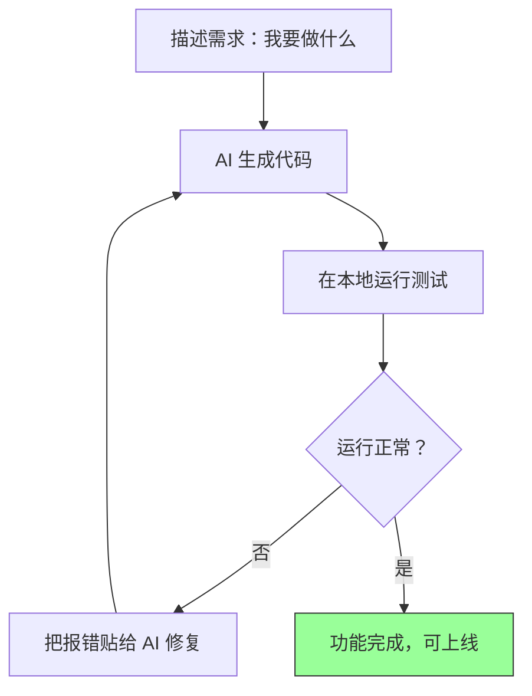

# 第17章 Claude Code / Cursor 对话式编程入门

> 本节教读者安装 Claude Code（或 Cursor），学习与 AI 高效对话的技巧（对话式编程而非独白式编程），理解代理的部分原理，从而更好地与 AI 协作。平替方案包括 DeepSeek、Qwen3-Coder、GLM-4.5。

## 17.1 大白话：对话式编程就是用人话写代码

对话式编程就是你用人话告诉 AI "我想做个什么"，它帮你写代码。你不需要懂语法，只需要描述清楚需求，出错了把报错贴给它让它修复。就像点外卖，你只需要说想吃什么，厨师（AI）负责做。

## 17.2 什么是 Claude Code？

### 17.2.1 智能编程助手

简单讲，它就是你电脑里的智能编程助手。你只要告诉它你想做什么，它就能帮你实现：

- "给我做个个人网页，放上我的照片和简介" → 几分钟后，你的网页上线了。
- "每天整理的这个表格，能自动完成吗？" → 它直接给你写好自动化程序。

你完全不用担心自己不懂技术。就像你用美图秀秀不需要懂 PS，用高德地图不需要懂 GPS，使用 Claude Code，你也不需要懂编程。你唯一要做的，就是把想要的东西描述清楚。

本次航海专为技术零基础的新手设计，全程没有复杂的编程术语，我们会教你如何通过对话，让 Claude Code 帮你轻松实现需求。

21 天后，你就能做出：
- 一张惊艳的个人数字名片
- 实用的小工具（比如批量改名、图片压缩）
- 简单的小型业务系统（预约管理、记账工具等）

### 17.2.2 项目完整操作思路

Claude Code 安装 > 学习与 Claude Code 高效对话的技巧（关键） > 实战开发效率工具与 Web 应用（关键） > 探索全栈开发与需求挖掘

### 17.2.3 新手入门建议&避坑指南

**完全不懂编程能学会吗？**
答：完全可以。Claude Code 的核心是自然语言交互，你只需要会清楚地描述需求。就像用美图秀秀不需要懂 PS 原理，用 Claude Code 也不需要懂编程原理。航海会提供大量对话模板和实例。

**Claude Code 和 Cursor 有什么区别？**
答：Claude Code 直接在终端运行，能理解整个代码库并自主执行任务，更像一个能干活的程序员；Cursor 更像代码补全工具。据实测反馈，Claude Code 在处理复杂任务时表现明显优于 Cursor。

**需要付费订阅吗？成本高吗？**
答：官方订阅 Pro 版 20 美元/月，Max 版 100 美元/月。国内也有 DeepSeek、Qwen 等平替方案。

**生成的代码质量如何？**
答：Claude Code 使用 Opus 4.1 模型，是目前编程能力最强的 AI 模型之一。关键是要学会正确的提问方式和任务拆解，航海会重点训练这些技巧。

## 17.3 Vibe Coding 与 AI 编程新范式

### 17.3.1 什么是 Vibe Coding

你是否也曾有过一个绝妙的点子，却因为实现它的技术门槛太高而卡住，眼看着热情被各种复杂的规则和指令一点点消磨掉？

为了让"创造"这件事回归简单，一种全新的理念——Vibe coding，应运而生。它的核心很简单：让你不再需要死磕每一个技术细节，而是能专注于你的想法本身，成为一个真正的"创造者"。

在本章中，我们将一起弄明白几个有趣的问题：

- Vibe 到底是什么：它背后是一种怎样让"想法"轻松变成现实的思路？
- 它和传统方法有何不同：为什么说，你只需要告诉 AI "做什么"，而不用再操心“怎么做"？
- AI 在其中扮演的角色：AI 是如何从一个冷冰冰的工具，升级为能听懂你想法的"创意伙伴"的？

搞懂这些，能帮你为接下来的所有实践，打下一个全新的认知。这不仅仅是学个新东西，更是升级你用科技实现想法的方式。

OpenAI 联合创始人 Andrej Karpathy 在 2025 年 2 月首次提出，他将其描述为"完全顺着 AI 的节奏去写代码，几乎把'写代码'这件事本身忘掉"。

### 17.3.2 传统编程和氛围编程对比

| 功能 | 传统编程 | 氛围编程 (vibe coding) |
|------|---------|----------------------|
| 代码创建 | 逐行手动编码 | AI 根据自然语言提示生成 |
| 开发者或用户角色 | 架构师、实现者、调试者 | 提示者、引导者、测试者、优化者 |

## 17.4 Cursor 零基础做软件

### 17.4.1 Cursor 是什么？

Cursor 是一款 AI 编程产品，主要功能有代码生成、代码问答、代码运行、debug、插件等，你可以理解是一个一站式的 AI 编程工作台，可以帮助你从完成学习编程知识到写出一个完整的程序的所有流程。

### 17.4.2 Cursor 安装步骤

1. 打开官网 cursor.com，点击右上角的【download】按钮，下载 Cursor 的客户端。
2. 下载好了之后，点击图标安装。
3. 安装好之后，进到初始界面，在【Language for AI】那里输入中文，其它不用管，点击【continue】就行。
4. 如果你的电脑之前安装过【VS Code】，可能会出现这个界面，直接点击【Use Extensions】。
5. 同样，点击【允许】。
6. 这个界面的意思是，你是否愿意贡献你的对话数据给 Cursor 的团队，来帮助他们改善 Cursor 这款产品。选左边的【Help Improve Cursor】；如果你比较介意自己的隐私，可以选择右边的【Privacy Mode】。选左边还是选右边，都不会影响你后面的正常使用。
7. 注册你的 Cursor 账号：点击右边的【Sign UP】，随后会弹出一个网页。

## 17.5 对话式编程工作流 Mermaid 图



## 17.6 小练习

安装 Claude Code 或 Cursor，用自然语言让 AI 生成一个"批量重命名文件"的小脚本，在本地运行并验证能正确重命名测试文件夹中的文件。

**参考提示词**：
```
请帮我写一个 Python 脚本，功能是批量重命名指定文件夹中的所有文件。
要求：
1. 可以自定义文件夹路径
2. 可以自定义重命名规则（比如在文件名前加前缀）
3. 重命名前显示预览，确认后再执行
4. 有错误处理，比如文件夹不存在、权限不足等情况
5. 添加详细的中文注释
```
