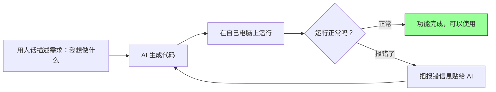
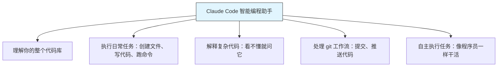
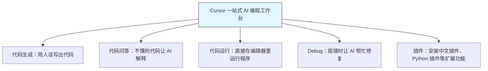
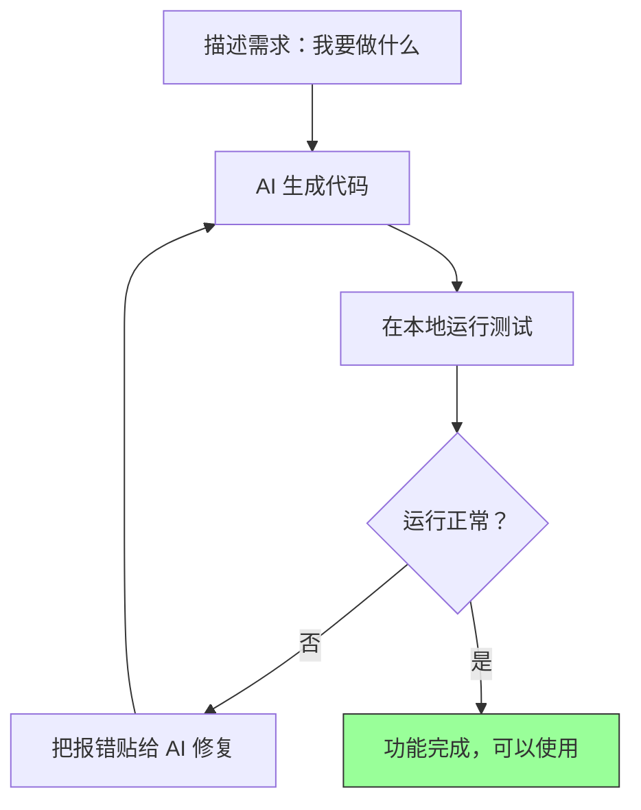

# 第17章 Claude Code / Cursor 对话式编程入门

> 本章教读者安装 Claude Code（或 Cursor），学习与 AI 高效对话的技巧（对话式编程而非独白式编程），理解代理的部分原理，从而更好地与 AI 协作。平替方案包括 DeepSeek、Qwen3-Coder、GLM-4.5。

在正式开始之前，先说两句“废话”宽宽心：本章不需要你有任何计算机专业知识，不需要你会写代码，甚至不需要你以前接触过编程。你只需要会用电脑打开文件夹、会安装软件、会在浏览器里注册账号，就足够读完并动手做完本章的全部内容了。我们会把每一个“听起来很吓人”的名词，都用大白话掰开揉碎讲清楚。

---

## 17.1 大白话：对话式编程就是用人话写代码

对话式编程就是你用人话告诉 AI“我想做个什么”，它帮你写代码。你不需要懂语法，只需要描述清楚需求，出错了把报错贴给它让它修复。就像点外卖，你只需要说想吃什么，厨师（AI）负责做。

传统编程更像“独白式编程”：你一个人对着屏幕，一行行地写代码，调试环境、语法规则、报错信息全靠自己啃，至少要花几个月才能写出能跑起来的东西。而对话式编程，你只需要像跟朋友聊天一样把需求说清楚，AI 把代码写出来，你复制粘贴运行就行。

举几个零基础也能立刻上手的场景：

- “给我做个个人网页，放上我的照片和简介” → 几分钟后，你的网页就能在浏览器里打开了。
- “每天整理的这个表格，能自动完成吗？” → AI 直接给你写好自动化程序，双击运行即可。
- “帮我把这个文件夹里一百张照片都重命名” → 几秒钟生成脚本，运行完一键完成。

你完全不用担心自己不懂技术。就像你用美图秀秀不需要懂 PS 原理，用高德地图不需要懂 GPS，使用对话式编程，你也不需要懂编程原理。你唯一要做的，就是把想要的东西描述清楚，遇到问题时把报错原封不动地贴给 AI，让它帮你修复。

下面这张图展示了“对话式编程”的完整闭环：



> **大白话**：对话式编程就像给自己雇了一个24小时在线的程序员助手。你出主意、提需求、验收成品，AI 负责写代码、改 Bug。你不需要成为程序员，只需要成为一个“会下指令的老板”。

---

## 17.2 什么是 Claude Code？

### 17.2.1 智能编程助手

简单讲，Claude Code 就是你电脑里的智能编程助手。你只要告诉它你想做什么，它就能帮你实现：

- “给我做个个人网页，放上我的照片和简介” → 几分钟后，你的网页上线了。
- “每天整理的这个表格，能自动完成吗？” → 它直接给你写好自动化程序。

它的工作方式和聊天软件很像：你在终端（命令行窗口）里跟它对话，它读懂你的意思，然后在你的项目文件夹里创建或修改代码文件，甚至能直接运行命令帮你测试。

你完全不用担心自己不懂技术。就像你用美图秀秀不需要懂 PS，用高德地图不需要懂 GPS，使用 Claude Code，你也不需要懂编程。你唯一要做的，就是把想要的东西描述清楚。

本次航海专为技术零基础的新手设计，全程没有复杂的编程术语，我们会教你如何通过对话，让 Claude Code 帮你轻松实现需求。

21 天后，你就能做出：

- 一张惊艳的个人数字名片
- 实用的小工具（比如批量改名、图片压缩）
- 简单的小型业务系统（预约管理、记账工具等）

下面这张图展示了 Claude Code 的核心能力范围：



> **大白话**：Claude Code 不是一个只会聊天的机器人，而是一个能真正动手改代码、运行命令的“助手程序员”。它住在你的电脑终端里，随时听你调遣。

### 17.2.2 项目完整操作思路

学习 Claude Code 按照下面这个顺序来，不要跳步：

1. **Claude Code 安装**：先把工具装好，能在终端里打开对话。
2. **学习与 Claude Code 高效对话的技巧（关键）**：这是最重要的一步。会提问的人，AI 能干出好活；不会提问的人，AI 也只能瞎猜。
3. **实战开发效率工具与 Web 应用（关键）**：动手做个批量重命名脚本、一个个人网页，跑通“写代码 → 运行 → 看到结果”的全流程。
4. **探索全栈开发与需求挖掘**：有了基础后，尝试做更复杂的系统，并思考用户真正需要什么。


> **大白话**：这就像学开车，先是考科目一（安装工具），然后是练习怎么跟教练沟通（高效对话），接着是实际上路开车（实战开发），最后才是考虑去哪里旅行、怎么规划路线（全栈开发与需求挖掘）。步骤不能颠倒，否则很容易挫败。

### 17.2.3 新手入门建议&避坑指南

**完全不懂编程能学会吗？**

答：完全可以。Claude Code 的核心是自然语言交互，你只需要会清楚地描述需求。就像用美图秀秀不需要懂 PS 原理，用 Claude Code 也不需要懂编程原理。航海会提供大量对话模板和实例，你照着练就能上手。

**Claude Code 和 Cursor 有什么区别？**

答：Claude Code 直接在终端运行，能理解整个代码库并自主执行任务，更像一个能干活的程序员；Cursor 更像代码补全工具，以图形界面为主，适合在编辑器里点点点就能修改代码。据实测反馈，Claude Code 在处理复杂任务时表现明显优于 Cursor。零基础新手两个都可以尝试，选一个顺手的即可。

**需要付费订阅吗？成本高吗？**

答：官方订阅 Pro 版 20 美元/月，Max 版 100 美元/月。如果你不想付费，国内也有 DeepSeek、Qwen3-Coder、GLM-4.5 等平替方案，成本可以压得很低。下表是常见方案的对比：

| 方案 | 费用 | 优点 | 缺点 |
|------|------|------|------|
| Claude Code 官方 Pro | 20 美元/月 | 编程能力最强，直接在终端运行 | 需要海外网络和信用卡 |
| Claude Code 官方 Max | 100 美元/月 | 更高的使用额度，适合重度用户 | 价格较贵 |
| 国内平替（DeepSeek/Qwen/GLM） | 较低甚至免费 | 中文友好，注册简单 | 编程能力可能稍弱，需自己配置客户端 |

**生成的代码质量如何？**

答：Claude Code 使用 Opus 4.1 模型，是目前编程能力最强的 AI 模型之一。但关键是要学会正确的提问方式和任务拆解，航海会重点训练这些技巧。AI 生成的代码不一定百分之百正确，第一次运行报错是非常正常的，把报错信息复制给 AI，让它修复，通常一两轮就能跑通。

**新手避坑小贴士：**

1. **不要一次性要求太多功能**。比如不要直接说“帮我做一个电商网站”，而要先说“帮我做一个能显示商品列表的页面”，跑通了再加购物车、再加下单功能。
2. **把报错原封不动地贴给 AI**。不要自己猜测哪里错了，直接把终端里的红色报错信息复制过去，AI 通常能一眼定位问题。
3. **每生成一段代码就保存一次**。不要忘了按 Ctrl+S 保存，否则修改可能丢失，下次运行还是旧代码。
4. **不要盲目相信 AI**。AI 有时候会“自信地胡说八道”，生成的代码看起来很像那么回事，但运行起来可能有问题。关键逻辑（尤其是涉及金钱、个人隐私的部分）一定要自己亲自测试验证。

---

## 17.3 Vibe Coding 与 AI 编程新范式

### 17.3.1 什么是 Vibe Coding

你是否也曾有过一个绝妙的点子，却因为实现它的技术门槛太高而卡住，眼看着热情被各种复杂的规则和指令一点点消磨掉？

为了让“创造”这件事回归简单，一种全新的理念——Vibe coding，应运而生。它的核心很简单：让你不再需要死磕每一个技术细节，而是能专注于你的想法本身，成为一个真正的“创造者”。

OpenAI 联合创始人 Andrej Karpathy 在 2025 年 2 月首次提出 Vibe Coding，他将其描述为“完全顺着 AI 的节奏去写代码，几乎把‘写代码’这件事本身忘掉”。

换句话说，Vibe Coding 的意思是：你不需要关心代码写在哪个文件里、不需要关心用什么编程语言、不需要关心怎么调试环境，你只需要跟 AI 说“我想做个什么”，它帮你把一切都搞定。你的注意力全部放在“想要什么”上，而不是“怎么实现”上。

在本章中，我们将一起弄明白几个有趣的问题：

- Vibe 到底是什么：它背后是一种怎样让“想法”轻松变成现实的思路？
- 它和传统方法有何不同：为什么说，你只需要告诉 AI“做什么”，而不用再操心“怎么做”？
- AI 在其中扮演的角色：AI 是如何从一个冷冰冰的工具，升级为能听懂你想法的“创意伙伴”的？

下面这张图展示了 Vibe Coding 的核心流程：


> **大白话**：传统编程像是在盖房子，你得自己会打地基、砌墙、铺电线；Vibe Coding 像是在跟室内设计师聊天，你说“我想要一个温馨的卧室”，设计师帮你把一切都搞定。你不需要懂水泥和电线，只需要懂自己想要什么样的生活。

### 17.3.2 传统编程和氛围编程对比

为了让你更直观地理解 Vibe Coding（也叫“氛围编程”）和传统编程的区别，下表做了详细对比：

| 维度 | 传统编程 | 氛围编程（Vibe Coding） |
|------|---------|----------------------|
| 代码创建 | 逐行手动编码，需要记住语法规则 | AI 根据自然语言提示生成代码 |
| 开发者或用户角色 | 架构师、实现者、调试者 | 提示者、引导者、测试者、优化者 |
| 需要具备编码专业知识 | 较高（编程语言和语法知识） | 较低（了解所需的功能即可） |
| 主要输入 | 精确的代码语句 | 自然语言提示和反馈 |
| 开发速度 | 通常较慢，有条不紊 | 可能更快，特别是对于原型设计和简单任务 |
| 错误处理 | 根据代码理解进行手动调试 | 通过对话式反馈，把报错贴给 AI 修复 |
| 学习曲线 | 往往很陡，需要数月才能上手 | 可能降低进入门槛，零基础当天见成果 |
| 代码可维护性 | 依赖于代码质量、开发者技能和既定实践 | 可能严重依赖 AI 输出质量和用户的评价能力 |
| 适合人群 | 专业程序员、计算机专业学生 | 零基础新手、产品经理、个体创业者、普通上班族 |

> **大白话**：传统编程像是学做菜，你得认识每种食材、掌握火候、懂得调味比例；氛围编程像是点外卖，你只需要告诉商家“我要吃清淡一点的”，剩下的交给厨师。两者各有优劣，但对零基础的新手来说，氛围编程能让你更快尝到“创造”的甜头。

---

## 17.4 Cursor 零基础做软件

### 17.4.1 Cursor 是什么？

Cursor 是一款 AI 编程产品，主要功能有代码生成、代码问答、代码运行、debug、插件等，你可以理解是一个一站式的 AI 编程工作台，可以帮助你从完成学习编程知识到写出一个完整的程序的所有流程。

和 Claude Code 直接在终端运行不同，Cursor 是一个带图形界面的编辑器（类似 VS Code），你在里面写代码，右侧有 AI 对话框，可以随时选中代码问 AI 问题，也可以让 AI 帮你生成新文件、修改现有代码。

下面这张图展示了 Cursor 的主要功能模块：



> **大白话**：你可以把 Cursor 想象成一个“自带 AI 助手的记事本”。你在记事本里写东西，旁边坐着一个懂编程的助手，随时帮你写代码、改错误、答疑解惑。

### 17.4.2 Cursor 安装步骤

Cursor 的安装过程分为以下 7 步，每一步下面都说明了界面上会出现什么，照着做即可。

**步骤 1：下载客户端**

打开浏览器，访问 Cursor 官网 `cursor.com`，点击右上角的【Download】按钮，下载 Cursor 的客户端安装包。

下载完成后，你会得到一个安装文件（Windows 是 `.exe`，Mac 是 `.dmg`）。

**步骤 2：安装程序**

双击下载好的安装包图标，按照提示点击“下一步”完成安装。安装过程和装普通软件（如🛰️、浏览器）一样，不需要任何编程知识。

**步骤 3：设置 AI 语言**

安装好之后，打开 Cursor，进入初始设置界面。在【Language for AI】（AI 语言）那里输入“中文”，其它选项不用管，直接点击【Continue】继续。

**步骤 4：处理 VS Code 扩展（如有）**

如果你的电脑之前安装过 VS Code，可能会出现一个询问界面，直接点击【Use Extensions】，然后点击【允许】。这一步是让 Cursor 导入你之前的编辑器设置，不选也不会影响使用。

**步骤 5：选择隐私模式**

会出现一个询问界面，问你是否愿意贡献对话数据给 Cursor 团队来帮助改进产品。如果你不介意，选左边的【Help Improve Cursor】；如果你比较介意隐私，选右边的【Privacy Mode】。选左边还是选右边，都不会影响你后面的正常使用。

**步骤 6：注册账号**

点击右边的【Sign UP】，随后会弹出一个网页注册页面。你可以选择用 Google 账号、GitHub 账号注册，或是直接用你的邮箱注册。Cursor 对注册比较宽松，国内邮箱通常也可以注册。

完成注册之后，界面会提示选择【Yes, Log in】，并选择【Open Cursor】。

**步骤 7：打开代码文件夹**

登录成功后，Cursor 会让你选择一个文件夹来存放代码文件。作为新手，建议在桌面新建一个名为【Code】的文件夹，专门用来放你写的代码。回到 Cursor 里，点击【Open a folder】，选择这个文件夹。之后你写的所有代码文件都会保存在这个文件夹里。

安装完成后，你可以在 Cursor 里新建文件、写代码、运行程序了。

下面三张图分别展示了 Cursor 官网首页、AI 语言设置界面和账号注册界面，你可以对照着看：

![asset/img/ch17-01-cursor-home.png]

> 图片说明：Cursor 官网首页，右上角有【Download】下载按钮，点击即可下载客户端安装包。

![asset/img/ch17-02-cursor-language.png]

> 图片说明：Cursor 初始设置界面，在【Language for AI】处输入中文，点击【Continue】继续。

![asset/img/ch17-03-cursor-signup.png]

> 图片说明：Cursor 账号注册界面，可选择 Google、GitHub 或邮箱注册。

### 使用 Cursor 时新手需要了解的 4 个 AI 特点

在学习 AI 编程时，比起编程基础，更多的人需要担心的是自己“使用 AI 的能力”。以下是几个你在使用 Cursor 编程时最需要理解的 AI 特点：

1. **随机性**：大模型本质是预测下一个词，并且带有一定随机性。所以你跟着教程练习时，发现生成的结果和示例不同是很常见的；同一个目标，获得两个完全不同的解决方案也很正常。如果你想要结果更稳定，就通过更明确的要求去限定 AI 的输出范围。

2. **平庸性**：AI 是由大量互联网数据训练而来，它倾向于提供“平均水平”的结果，而不是最好的结果。如果你对设计不满意，可以要求 Cursor 按某个特定标准（比如“按苹果设计师的标准”）来提供设计，或者提供你偏好的风格参考。

3. **上下文限制**：AI 能记住的内容有上限。一个项目动辄几十上百个代码文件，很容易超出 AI 的记忆范围，导致它“忘记”之前说的话。所以你需要及时让 AI 将项目进度记录到 README.md 等文档中，在对话里 @ 引用相关文件，帮助 AI 恢复记忆。

4. **系统一思考的局限**：Cursor 正常情况下会直接满足你的要求，要它写代码就写代码，要它改 Bug 就改 Bug。但复杂的 Bug 有时候凭“直觉”改不好，就像人类需要“深思熟虑”一样。遇到反复出现的错误，你可以让 AI 停下来，梳理“问题是什么”“有哪些解决思路”“各方案优缺点”“该选哪个”，再动手修改，效果会好很多。

---

## 17.5 对话式编程工作流 Mermaid 图

对话式编程的核心是一个不断循环的工作流：描述需求 → AI 生成代码 → 本地运行测试 → 如果不正常，把报错贴给 AI 修复 → 重新生成 → 直到正常 → 功能完成。

下面这张图是本章最核心的一张图，建议你截图保存，每次跟 AI 写代码时都对照着走一遍：



**每一步详细说明：**

- **第一步：描述需求**。用清晰的中文告诉 AI 你想做什么，越具体越好。比如不要只说“帮我做个网页”，而要说“帮我做一个单页个人网站，包含导航栏、自我介绍、作品展示和联系方式，用中文，风格简洁现代”。
- **第二步：AI 生成代码**。AI 会根据你的描述写出代码文件。在 Cursor 里，你通常需要点击“Apply”按钮，把生成的代码应用到文件中，然后按 Ctrl+S 保存。
- **第三步：在本地运行测试**。如果是网页代码，直接用浏览器打开 HTML 文件就能看到效果；如果是 Python 脚本，在终端里运行即可。
- **第四步：判断运行是否正常**。如果页面显示正常、脚本运行没有报错，就进入下一步；如果有报错或效果不对，进入第五步。
- **第五步：把报错贴给 AI 修复**。把运行时的报错信息完整复制，发给 AI，说“运行报错了，这是报错内容，请帮我修复”。AI 会给出修改后的代码，回到第二步重复。
- **第六步：功能完成**。当你看到想要的效果已经实现，功能可以正常使用，就是完成了。

**对话示例（参考）：**

```
你：请帮我写一个 Python 脚本，功能是把桌面“测试文件夹”里所有以 .txt 结尾的文件，在文件名前加上前缀“backup_”。重命名前先显示预览，确认后再执行。

AI：(生成代码……)
你：运行报错了，错误是：PermissionError: [Errno 13] Permission denied
AI：(分析原因，给出修复后的代码，并说明可能是文件被占用或路径不对)
你：运行成功了，文件都重命名好了。
```

> **大白话**：跟 AI 写代码不是“一次性下单就完事”，而是一个“说 → 做 → 试 → 改 → 再试”的循环。不要害怕报错，报错就是 AI 修改代码的线索，报错越多，你跟 AI 配合得越熟练。

---

## 17.6 小练习

安装 Claude Code 或 Cursor，用自然语言让 AI 生成一个“批量重命名文件”的小脚本，在本地运行并验证能正确重命名测试文件夹中的文件。

**参考提示词：**

```
请帮我写一个 Python 脚本，功能是批量重命名指定文件夹中的所有文件。
要求：
1. 可以自定义文件夹路径
2. 可以自定义重命名规则（比如在文件名前加前缀）
3. 重命名前显示预览，确认后再执行
4. 有错误处理，比如文件夹不存在、权限不足等情况
5. 添加详细的中文注释
```

**完整示例代码（可直接复制运行）：**

```python
# ============================================================
# 程序名称：批量重命名文件脚本
# 功能说明：给指定文件夹内的所有文件批量加上自定义前缀
# 适用人群：零基础新手，只需要安装 Python 即可运行
# 使用方法：将下面的 folder_path 改成你自己的文件夹路径，然后运行脚本
# ============================================================

import os  # 导入操作系统模块，用于处理文件和文件夹


def batch_rename_files(folder_path, prefix="backup_"):
    """
    批量重命名文件夹中的所有文件，在文件名前加上指定前缀。

    参数：
        folder_path：要处理的文件夹路径，例如 r"C:\Users\张三\Desktop\测试文件夹"
        prefix：要添加的前缀，默认是 "backup_"
    """

    # 第一步：检查文件夹是否存在
    # os.path.exists() 用来判断路径是否真实存在
    if not os.path.exists(folder_path):
        print(f"错误：文件夹路径不存在，请检查路径是否正确：{folder_path}")
        return  # 路径不存在，直接结束函数

    # 第二步：获取文件夹里所有文件的名字
    # os.listdir() 返回文件夹内所有文件和子文件夹的名称列表
    files = os.listdir(folder_path)

    # 如果文件夹是空的，提示用户并结束
    if len(files) == 0:
        print("提示：文件夹里没有任何文件，无需重命名。")
        return

    # 第三步：显示重命名预览
    # 先不真正重命名，只列出“原名 → 新名”的对应关系，让用户确认
    print("=" * 50)
    print("重命名预览（以下是即将发生的变化，尚未真正执行）：")
    print("=" * 50)

    rename_list = []  # 用来暂存需要重命名的文件对，每个元素是 (旧完整路径, 新完整路径)

    for file_name in files:
        # 构造文件的完整路径，例如 C:\...\测试文件夹\a.txt
        old_full_path = os.path.join(folder_path, file_name)

        # 如果是子文件夹而不是文件，就跳过，只重命名文件
        if not os.path.isfile(old_full_path):
            continue

        # 构造新的文件名：前缀 + 原文件名
        new_file_name = prefix + file_name
        new_full_path = os.path.join(folder_path, new_file_name)

        # 把这一对路径存起来，稍后统一执行
        rename_list.append((old_full_path, new_full_path))

        # 打印预览行，例如：a.txt  -->  backup_a.txt
        print(f"{file_name}  -->  {new_file_name}")

    print("=" * 50)

    # 第四步：询问用户是否确认执行
    confirm = input("是否确认执行重命名？输入 y 确认，其他任意键取消：")
    if confirm.strip().lower() != "y":
        print("操作已取消，没有文件被重命名。")
        return

    # 第五步：真正执行重命名，并加上错误处理
    success_count = 0
    fail_count = 0

    for old_path, new_path in rename_list:
        try:
            # os.rename() 是真正执行重命名的函数
            os.rename(old_path, new_path)
            success_count += 1
        except PermissionError:
            # 权限不够：文件可能正被其他程序占用
            print(f"跳过（权限不足）：{os.path.basename(old_path)}")
            fail_count += 1
        except FileExistsError:
            # 新文件名已经存在，避免覆盖
            print(f"跳过（文件已存在）：{os.path.basename(new_path)}")
            fail_count += 1
        except Exception as e:
            # 其他未预料的错误，打印出来方便排查
            print(f"跳出（未知错误）：{os.path.basename(old_path)}，原因：{e}")
            fail_count += 1

    # 第六步：显示执行结果统计
    print("=" * 50)
    print(f"重命名完成！成功：{success_count} 个，失败：{fail_count} 个")
    print("=" * 50)


# ============================================================
# 脚本入口：直接运行此文件时会执行下面的代码
# ============================================================
if __name__ == "__main__":
    # ========== 请在这里修改你的文件夹路径 ==========
    # Windows 路径建议在引号前加 r，例如 r"C:\Users\你的名字\Desktop\测试文件夹"
    # Mac 路径示例：r"/Users/你的名字/Desktop/测试文件夹"
    folder_path = r"C:\Users\你的名字\Desktop\测试文件夹"

    # 也可以自定义前缀，比如 "2026_" 或 "我的文件_"
    prefix = "backup_"

    # 调用函数开始执行
    batch_rename_files(folder_path, prefix)
    # ==================================================
```

**使用步骤（零基础版）：**

1. 在电脑桌面新建一个文件夹，命名为“测试文件夹”，里面放几个你不重要的文件（比如几个记事本文件），用来做实验，避免误改重要文件。
2. 把上面的代码完整复制，粘贴到记事本里，保存为 `rename.py`（后缀名必须是 `.py`）。
3. 修改代码里的 `folder_path` 为你自己“测试文件夹”的真实路径。
4. 安装 Python（如果电脑还没有），在终端或命令行里运行 `python rename.py` 即可。
5. 按照脚本提示查看预览，输入 `y` 确认，观察文件夹里的文件是否都加上了前缀。

如果运行过程中出现任何红色报错，直接把报错信息复制下来，贴给 Claude Code 或 Cursor，说“帮我修复这个报错”，它会给出修改后的代码。
```
