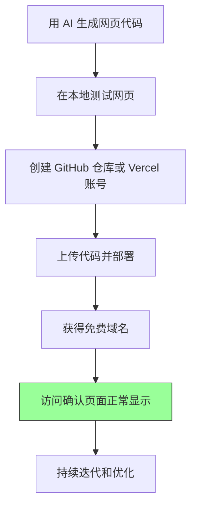

# 第18章 零基础上线 iOS App 与 Web 网站

> 本节分两条路线：iOS 路线教 21 天从零基础上线首个 iOS App 并尝试付费/订阅变现（需 Apple 开发者账号 99 美元/年）；Web 路线主张"先上线一百个网站"，从游戏站、导航站入手，靠 Google AdSense 广告流量收益赚美元，出海网站是变现天花板最高领域之一。

---

## 30.1 大白话：做网站比做 App 简单很多

做网站比做 App 简单很多，不需要审核，不用交 99 美元，代码丢到 GitHub Pages 或 Vercel 就能上线。新手建议先从"个人数字名片"单页网站开始，跑通"写代码 → 上线 → 访问"的全流程，再往复杂网站走。

> **大白话**：做网站比做 App 简单得多。App 要审核，要交 99 美元开发者年费，还需要 Mac 电脑；网站只要代码丢到 GitHub Pages 或 Vercel 就能上线，不花钱，不需要审核，不需要 Mac。

---

## 30.2 iOS 路线：21 天零基础上线首个 App

### 32.2.1 适用人群

想要做出正式上架产品、在 App Store 被用户下载使用的读者。

### 30.2.2 必要条件

- Apple 开发者账号：99 美元/年
- 一台 Mac 电脑（用于运行 Xcode）
- AI 编程工具（Claude Code 或 Cursor）

### 30.2.3 21 天学习路线

| 天数 | 学习内容 |
|------|---------|
| 第 1-3 天 | 学习 Swift 语法基础，理解 iOS 项目结构 |
| 第 4-7 天 | 用 AI 生成简单界面，在模拟器中运行 |
| 第 8-14 天 | 开发核心功能，添加交互逻辑 |
| 第 15-18 天 | 测试修复 Bug，优化界面 |
| 第 19-21 天 | 提交 App Store 审核，上架发布 |

### 32.2.4 为什么选择开发 iOS App？

iOS 应用市场的优势：
- 审核简单速度快，上架就可以直接分发全球，对个人开发者友好
- 用户付费意愿较强，且 iOS 生态成熟，订阅、内购、付费多种模式
- 多数 App 上架时不用 icp 备案、App 备案，也不用办理软著（安卓 App 上架必备，200-300/张，周期 3-4 周）
- 开发者只收取 99 美元（688 元）年费，上架越多边际成本越低
- 具有一定准入门槛：Mac 设备、iPhone 手机、99 美元/年开发者年费

### 30.2.5 为什么要借助 AI？

- 不需要懂一行代码，也能够使用 AI 开发出 iOS App
- 降低了学习的门槛，把精力集中在了解用户需求、功能设计与产品思路上
- 大幅缩短了开发的周期，短至 2-3 小时就能快速开发一个 demo 在市场上验证想法

---

## 30.3 Web 路线：先上线一百个网站

### 30.3.1 核心理念

Web 路线主张"先上线一百个网站"，从游戏站、导航站入手，靠 Google AdSense 广告流量收益赚美元，出海网站是变现天花板最高领域之一。

> **大白话**：做网站的核心逻辑是"找到需求，满足需求"。过去做网站要会写代码，只有程序员能做；现在有了 AI，不需要懂编程，普通人也能做网站。只要找到用户需求，用 AI 满足需求，就能赚钱。

### 32.3.2 为什么做海外工具站？

相比于国内的卷度，海外竞争要小很多，流量池也更大。海外还是非常依赖谷歌的搜索流量，短期没什么大的危机，做好了工具站，能力可以迁移到下一个工具需求再来一遍。

如亦仁不止一次在星球建议有产品开发搞流量能力的圈友去做海外的产品，并且也说自己不做生财有术，就去做英文工具站。

需要着重说明的是，做海外工具站是无法一步到位的，想要快速的验证需求，拿到用户真实反馈，需要我们从挖需求开始到网站上线宣传整个过程，都要有 MVP 意识和 SEO 的思维。

---

## 30.4 iOS vs Web 对比

| 维度 | iOS App | Web 网站 |
|------|---------|---------|
| 开发者费用 | 99 美元/年 | 免费 |
| 审核流程 | 有 App Store 审核 | 无审核，直接上线 |
| 所需设备 | Mac 电脑 | 任意电脑 |
| 上线速度 | 慢（需审核） | 快（当天可见） |
| 用户获取 | App Store 搜索 | 搜索引擎、链接分享 |
| 变现方式 | 付费下载、内购、订阅 | 广告、订阅、赞助 |

---

## 30.5 微信小程序开发全流程 Mermaid 图



---

## 小练习

用 AI 编程工具生成一个简单的个人数字名片单页网站，部署到 GitHub Pages 或 Vercel，并访问链接确认页面正常显示。

**参考提示词**：
```
请帮我写一个简单的个人数字名片单页网站，包含：
1. 顶部导航栏（首页、关于我、作品、联系）
2. 英雄区域（个人头像、姓名、职业标签、一句话简介）
3. 关于我部分（文字介绍，适当段落）
4. 作品展示部分（3 个作品卡片，每个包含图片占位符、标题、简短描述）
5. 联系方式部分（邮箱、微信、GitHub 链接）
6. 底部版权信息

要求：
- 使用 HTML5 + CSS3，单文件结构（CSS 写在 style 标签内）
- 响应式设计，手机端也能正常显示
- 风格简洁现代，使用柔和的配色方案
- 添加中文注释说明各部分功能
```
