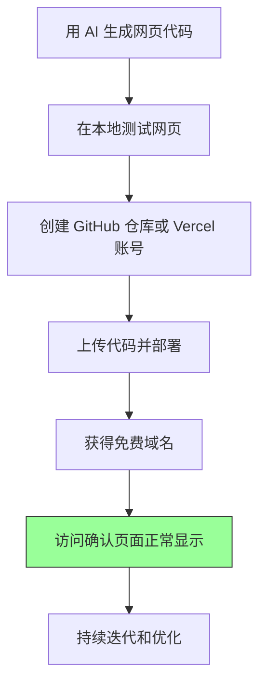

# 第18章 零基础上线 iOS App 与 Web 网站

> 本节分两条路线：iOS 路线教 21 天从零基础上线首个 iOS App 并尝试付费/订阅变现（需 Apple 开发者账号 99 美元/年）；Web 路线主张"先上线一百个网站"，从游戏站、导航站入手，靠 Google AdSense 广告流量收益赚美元，出海网站是变现天花板最高领域之一。

## 18.1 大白话：做网站比做 App 简单很多

做网站比做 App 简单很多，不需要审核，不用交 99 美元，代码丢到 GitHub Pages 或 Vercel 就能上线。新手建议先从"个人数字名片"单页网站开始，跑通"写代码 → 上线 → 访问"的全流程，再往复杂网站走。

## 18.2 iOS 路线：21 天零基础上线首个 App

### 18.2.1 适用人群

想要做出正式上架产品、在 App Store 被用户下载使用的读者。

### 18.2.2 必要条件

- Apple 开发者账号：99 美元/年
- 一台 Mac 电脑（用于运行 Xcode）
- AI 编程工具（Claude Code 或 Cursor）

### 18.2.3 21 天学习路线

| 天数 | 学习内容 |
|------|---------|
| 第 1-3 天 | 学习 Swift 语法基础，理解 iOS 项目结构 |
| 第 4-7 天 | 用 AI 生成简单界面，在模拟器中运行 |
| 第 8-14 天 | 开发核心功能，添加交互逻辑 |
| 第 15-18 天 | 测试修复 Bug，优化界面 |
| 第 19-21 天 | 提交 App Store 审核，上架发布 |

## 18.3 Web 路线：先上线一百个网站

### 18.3.1 核心理念

Web 路线主张"先上线一百个网站"，从游戏站、导航站入手，靠 Google AdSense 广告流量收益赚美元，出海网站是变现天花板最高领域之一。

### 18.3.2 为什么先做单页网站

- 不需要审核，代码丢到 GitHub Pages 或 Vercel 就能上线
- 不用交 99 美元开发者费用
- 不需要 Mac 电脑，Windows 也可以
- 上线速度快，当天就能看到成品

### 18.3.3 第一个项目：个人数字名片单页网站

建议新手从"个人数字名片"单页网站开始，跑通"写代码 → 上线 → 访问"的全流程。

**页面包含**：
- 个人头像和姓名
- 简短自我介绍
- 技能标签
- 联系方式（邮箱、微信、社交媒体）
- 简单的作品展示

### 18.3.4 部署方式

**GitHub Pages**：
1. 创建 GitHub 仓库
2. 上传 HTML/CSS/JS 文件
3. 开启 Pages 功能，获得免费域名（你的用户名.github.io）

**Vercel**：
1. 注册 Vercel 账号
2. 连接 GitHub 仓库或直接上传文件
3. 自动部署，获得免费域名

## 18.4 iOS vs Web 对比

| 维度 | iOS App | Web 网站 |
|------|---------|---------|
| 开发者费用 | 99 美元/年 | 免费 |
| 审核流程 | 有 App Store 审核 | 无审核，直接上线 |
| 所需设备 | Mac 电脑 | 任意电脑 |
| 上线速度 | 慢（需审核） | 快（当天可见） |
| 用户获取 | App Store 搜索 | 搜索引擎、链接分享 |
| 变现方式 | 付费下载、内购、订阅 | 广告、订阅、赞助 |

## 18.5 Mermaid 图：Web 网站上线流程



## 小练习

用 AI 编程工具生成一个简单的个人数字名片单页网站，部署到 GitHub Pages 或 Vercel，并访问链接确认页面正常显示。

**参考提示词**：
```
请帮我写一个简单的个人数字名片单页网站，包含：
1. 顶部导航栏（首页、关于我、作品、联系）
2. 英雄区域（个人头像、姓名、职业标签、一句话简介）
3. 关于我部分（文字介绍，适当段落）
4. 作品展示部分（3 个作品卡片，每个包含图片占位符、标题、简短描述）
5. 联系方式部分（邮箱、微信、GitHub 链接）
6. 底部版权信息

要求：
- 使用 HTML5 + CSS3，单文件结构（CSS 写在 style 标签内）
- 响应式设计，手机端也能正常显示
- 风格简洁现代，使用柔和的配色方案
- 添加中文注释说明各部分功能
```
