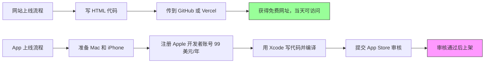
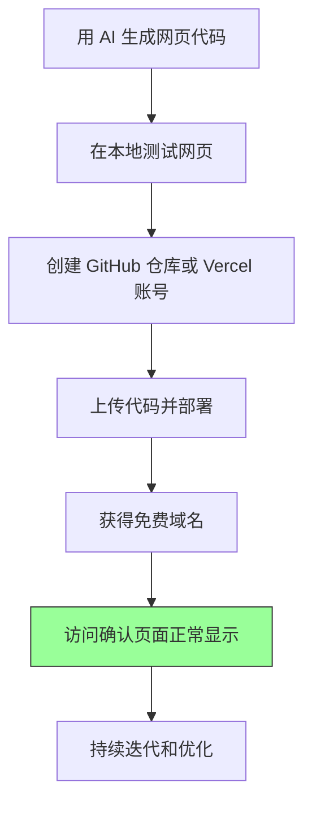

# 第18章 零基础上线 iOS App 与 Web 网站

> 本节分两条路线：iOS 路线教 21 天从零基础上线首个 iOS App 并尝试付费/订阅变现（需 Apple 开发者账号 99 美元/年）；Web 路线主张“先上线一百个网站”，从游戏站、导航站入手，靠 Google AdSense 广告流量收益赚美元，出海网站是变现天花板最高领域之一。

在正式开始之前，先说两句“废话”宽宽心：本章不需要你有任何编程基础，不需要你有 Mac 电脑（除非你想走 iOS 路线），不需要你懂服务器、域名、备案这些概念。你只需要会使用浏览器、会注册账号、会复制粘贴代码，就能跟着本章把一个网站或 App 真正“上线”到互联网上，让全世界都能访问。

---

## 30.1 大白话：做网站比做 App 简单很多

做网站比做 App 简单很多，不需要审核，不用交 99 美元，代码丢到 GitHub Pages 或 Vercel 就能上线。新手建议先从“个人数字名片”单页网站开始，跑通“写代码 → 上线 → 访问”的全流程，再往复杂网站走。

> **大白话**：做网站比做 App 简单得多。App 要审核，要交 99 美元开发者年费，还需要 Mac 电脑；网站只要代码丢到 GitHub Pages 或 Vercel 就能上线，不花钱，不需要审核，不需要 Mac。

你可以把“做网站”想象成在网上开一家小店：你只需要把店面装修好（写网页代码），然后把店面摆在大街上（部署到 Vercel 或 GitHub Pages），任何人通过网址都能进来逛逛。而“做 App”更像是在商场里租一个专柜：你得先申请入驻资格（Apple 开发者账号、99 美元/年）、得有专门的装修队伍（Mac 电脑 + Xcode）、还得通过商场的审核（App Store 审核）才能开张，流程长得多，成本也高得多。

下面这张图直观对比了两者的上线流程：



> **大白话**：网站上线像是发朋友圈，写完就能发，全世界都能看；App 上线像是办营业执照，要交钱、要审核、要等待，周期长得多。所以如果你是第一次尝试，强烈建议先做网站，跑通“上线”这件事，再考虑做 App。

---

## 30.2 iOS 路线：21 天零基础上线首个 App

如果你想做出一个能在 App Store 被用户下载使用的正式产品，可以走 iOS 路线。本路线教你 21 天从零基础到上线首个 iOS App，并尝试付费/订阅变现。

### 32.2.1 适用人群

想要做出正式上架产品、在 App Store 被用户下载使用的读者。适合有一台 Mac 电脑、愿意投入 99 美元/年开发者年费、希望把作品变成真正产品的新手。

### 30.2.2 必要条件

开发 iOS App 之前，你需要准备以下三样东西：

1. **Apple 开发者账号**：99 美元/年（约合人民币 688 元）。没有这个账号，你只能在 Xcode 模拟器里测试，无法把 App 编译到真正的 iPhone 上，也无法提交上架 App Store。
2. **一台 Mac 电脑**：用于运行 Xcode。建议能安装最新 Xcode（当前是 Xcode 16+），最好是 M 系列的 MacBook 或 Mac mini，最低 M1 芯片就够用。如果暂时不想买，可以考虑 Mac mini M4（教育价或国补后价格更亲民），或者支付宝租机，大约 300-400 元/月，3 个月起租。
3. **AI 编程工具**：Claude Code 或 Cursor，用来跟 AI 对话生成代码。

下面是必要条件的对比表，帮你一目了然：

| 必要条件 | 具体要求 | 大概费用 | 备注 |
|---------|---------|---------|------|
| Apple 开发者账号 | 99 美元/年 | 每年约 688 元人民币 | 必须，否则无法真机调试和上架 |
| Mac 电脑 | M1 及以上，能装 Xcode 16+ | 数千元至上万元 | 也可租机，约 300-400 元/月 |
| iPhone 手机 | iOS 15.6 以上，配原装数据线 | 自有 | 用于真机调试，模拟器体验较差 |
| AI 编程工具 | Claude Code 或 Cursor | 有免费额度，也可订阅 | 辅助生成代码，降低门槛 |

**开发工具安装：**

- **Cursor**：官网 https://www.cursor.com/cn/downloads 下载客户端。建议下载 0.45 版本，不要下载 0.46 版本（据反馈 0.46 版本不好用）。安装后选择中文界面，注册账号，打开你的代码文件夹即可开始。
- **Xcode**：从 Mac App Store 免费下载安装。安装完成后，点击“Create New Project”创建新项目，选择默认的应用类型，输入项目名称（拼音或英文），Organization Identifier 填写反写的域名，例如你注册了域名 cuanxue.com，就可以填 `com.cuanxue.yuyin3`，这个信息后续上架 App 时会用到。

**Xcode 与 AI 编程工具联动开发 App 的基本流程：**

1. 在 Xcode 创建好项目后，打开 Cursor，选择项目根目录下的子目录作为工作目录，Cursor 后续创建的代码文件都写在这个目录下，打包编译时才会生效。
2. Xcode 创建项目后会自动生成 `ContentView.swift` 文件，这是 App 的主视图，可以简单理解为打开 App 时看到的第一个页面。在 Cursor 的 Composer 模式下，首次生成代码时要用 `@` 引用 `ContentView.swift` 文件，让 AI 了解你要修改哪个文件。
3. Xcode 真机编译：在 Mac 设置中搜索“开发者模式”并打开，用数据线把 iPhone 连到 Mac，连接后选择“信任”。在 Xcode 中选择已连接的手机，填写 Display name（应用名称），点击运行按钮，App 就会安装到手机上。

![asset/img/ch18-01-xcode-real-device.png]

> 图片说明：Xcode 将 App 编译到真机运行的界面截图，展示了选择已连接 iPhone 并进行真机调试的过程。

### 30.2.3 21 天学习路线

iOS 路线的 21 天学习安排如下表，每天建议投入 2-4 小时，循序渐进：

| 天数 | 学习内容 |
|------|---------|
| 第 1-3 天 | 学习 Swift 语法基础，理解 iOS 项目结构 |
| 第 4-7 天 | 用 AI 生成简单界面，在模拟器中运行 |
| 第 8-14 天 | 开发核心功能，添加交互逻辑 |
| 第 15-18 天 | 测试修复 Bug，优化界面 |
| 第 19-21 天 | 提交 App Store 审核，上架发布 |

> **大白话**：21 天并不是要让你成为专业 iOS 工程师，而是帮你“跑通”一次从零到上架的完整流程。前三天先认识 Swift，中间两周用 AI 生成界面和功能，最后三天集中测试、修 Bug、提交审核。只要把流程跑通一次，以后做第二个 App 就会快得多。

### 32.2.4 为什么选择开发 iOS App？

iOS 应用市场的优势主要体现在以下几个方面：

- **审核简单速度快**：上架后可以直接分发到全球，对个人开发者比较友好。
- **用户付费意愿较强**：iOS 生态成熟，支持订阅、内购、付费下载等多种变现模式。
- **备案门槛低**：多数 App 上架时不需要 ICP 备案、App 备案，也不需要办理软著（安卓 App 上架必须办理软著，200-300 元/张，周期 3-4 周）。
- **边际成本低**：开发者只需缴纳 99 美元（约 688 元）年费，上架的 App 越多，每个 App 的边际成本越低。
- **准入门槛**：需要 Mac 设备、iPhone 手机、99 美元/年开发者年费，这反而筛选掉了一部分随意上架的低质 App。
- **开发环境简单**：开发过程不需要安装复杂的环境和依赖， Xcode 一装就能用。

### 30.2.5 为什么要借助 AI？

借助 AI 开发 iOS App 的好处主要有三点：

- **不需要懂一行代码**：完全不懂编程也能够使用 AI 开发出 iOS App。
- **降低学习门槛**：把精力集中在了解用户需求、功能设计与产品思路上，而不是纠结语法和语句。
- **大幅缩短开发周期**：短至 2-3 小时就能快速开发一个 demo 在市场上验证想法。

开发时建议保持以下心态和方法：

1. **小步迭代**：先做最小可用版本（MVP），不贪多求全。
2. **分模块开发**：功能复杂后，拆分多个 Composer/Chat 对话框，逐步实现，避免上下文混乱。
3. **AI + 人工结合**：不要盲目听从 AI，关键逻辑和 Bug 修复依然需要你亲自测试、判断、反思。

> **大白话**：AI 就像一个经验丰富的 iOS 开发助手，能帮你写代码、改 Bug，但它不懂你的产品到底想解决什么问题。你作为产品负责人，负责定需求、做决策、把关质量，AI 负责把代码写出来。两者配合，效率最高。

---

## 30.3 Web 路线：先上线一百个网站

Web 路线主张“先上线一百个网站”，从游戏站、导航站入手，靠 Google AdSense 广告流量收益赚美元，出海网站是变现天花板最高领域之一。

### 30.3.1 核心理念

做网站的核心逻辑是“找到需求，满足需求”。过去做网站要会写代码，只有程序员能做；现在有了 AI，不需要懂编程，普通人也能做网站。只要找到用户需求，用 AI 满足需求，就能赚钱。

新手不要试图一次做出完美网站，而要带着 MVP（最小可行产品）意识和 SEO 思维，从挖需求开始，到网站上线、宣传，整个过程都要快速验证。哪怕很简陋的网站，只要满足了真实需求，也能赚到钱。不执行不上站，没有 MVP 就无法验证需求，也就赚不到钱。

新手的初期重点任务是熟悉如何把网站上线，即域名注册、网站托管、代码托管这三类平台。

**域名注册：** 域名就是网站的地址，比如 baidu.com。推荐在 Cloudflare（简称 CF）上购买，对开发网站最方便。也可以在 Spaceship.com 等平台注册，支持支付宝付款。域名可以用 `.online` 等后缀，第一年很便宜，其他任何后缀都可以，前期不必纠结，任意可注册的长名字就可以练手。

**网站托管：** 用户访问代码形成的网页，需要在网站托管平台上。推荐 Cloudflare.com，大多数平台的部署步骤很相似：注册账号、上传网站文件或关联 GitHub 仓库、一键部署后获得访问网址、如有自定义域名可在后台绑定。

**代码托管：** 网站相关的所有代码默认放在 GitHub.com 上。GitHub 和 Cloudflare 账户建议用同一个邮箱注册。

![asset/img/ch18-03-domain-register.png]

> 图片说明：域名注册界面截图，在 Spaceship.com 等平台搜索并注册域名，支持支付宝付款。

![asset/img/ch18-02-cf-binding.png]

> 图片说明：Cloudflare 绑定域名并托管网站的界面截图，选择 FREE 免费套餐即可。

### 32.3.2 为什么做海外工具站？

相比于国内的竞争，海外竞争要小很多，流量池也更大。海外还是非常依赖谷歌的搜索流量，短期没有太大的危机，做好了工具站，能力可以迁移到下一个工具需求，再来一遍。

行业内有成功经验建议有产品开发和搞流量能力的圈友去做海外产品，做英文工具站。做海外工具站无法一步到位，想要快速验证需求、拿到用户真实反馈，需要从挖需求到网站上线宣传全过程都有 MVP 意识和 SEO 的思维。

变现渠道主要包括：
- **广告收入**：接入 Google AdSense 或其他广告联盟，在页面展示广告，流量带来美元收入。
- **会员制度**：提供无广告体验或独家内容的付费会员服务。
- **游戏内购**：与开发者合作，分享游戏内购买收益。
- **推广佣金**：为其他平台导流，获取推广佣金。
- **定制服务**：为企业客户提供品牌定制服务。

---

## 30.4 iOS vs Web 对比

| 维度 | iOS App | Web 网站 |
|------|---------|---------|
| 开发者费用 | 99 美元/年 | 免费 |
| 审核流程 | 有 App Store 审核 | 无审核，直接上线 |
| 所需设备 | Mac 电脑 | 任意电脑 |
| 上线速度 | 慢（需审核） | 快（当天可见） |
| 用户获取 | App Store 搜索 | 搜索引擎、链接分享 |
| 变现方式 | 付费下载、内购、订阅 | 广告、订阅、赞助 |
| 备案要求 | 多数无需 ICP/软著 | 国内服务器需 ICP 备案，海外服务器免备案 |

> **大白话**：如果你手头有 Mac、有 iPhone、愿意交 99 美元年费，并且想做一个能在 App Store 上架、用户愿意付费的产品，走 iOS 路线；如果你想零成本、当天就能上线、靠广告赚美元，走 Web 路线。大多数零基础新手建议先走 Web 路线，跑通上线流程后再决定是否做 App。

---

## 30.5 🛰️小程序开发全流程 Mermaid 图

下面这张图展示了从 AI 生成网页代码到网站上线访问的完整流程，虽然标题写的是“🛰️小程序开发全流程”，但其中的步骤对做 Web 网站同样适用：



**每个步骤的大白话说明：**

1. **用 AI 生成网页代码**：把你想要的页面描述发给 AI（比如“帮我做一个个人数字名片单页网站”），AI 生成 HTML 和 CSS 代码。
2. **在本地测试网页**：把代码保存为 `.html` 文件，用浏览器打开，检查页面显示是否正常。
3. **创建 GitHub 仓库或 Vercel 账号**：在 GitHub 上新建一个代码仓库，或者注册 Vercel 账号，用来托管你的网站代码。
4. **上传代码并部署**：把代码上传到 GitHub 仓库（可以拖拽文件，也可以复制粘贴代码），然后在 Vercel 或 Cloudflare 上一键部署。
5. **获得免费域名**：部署完成后，平台会给你一个免费的网址，任何人都能通过这个网址访问你的网站。
6. **访问确认页面正常显示**：用手机或电脑打开网址，确认页面在不同设备上都能正常显示。
7. **持续迭代和优化**：根据访问体验不断改进页面，添加新功能。

---

## 小练习

用 AI 编程工具生成一个简单的个人数字名片单页网站，部署到 GitHub Pages 或 Vercel，并访问链接确认页面正常显示。

**参考提示词：**

```
请帮我写一个简单的个人数字名片单页网站，包含：
1. 顶部导航栏（首页、关于我、作品、联系）
2. 英雄区域（个人头像、姓名、职业标签、一句话简介）
3. 关于我部分（文字介绍，适当段落）
4. 作品展示部分（3 个作品卡片，每个包含图片占位符、标题、简短描述）
5. 联系方式部分（邮箱、微信、GitHub 链接）
6. 底部版权信息

要求：
- 使用 HTML5 + CSS3，单文件结构（CSS 写在 style 标签内）
- 响应式设计，手机端也能正常显示
- 风格简洁现代，使用柔和的配色方案
- 添加中文注释说明各部分功能
```

**完整示例代码（可直接复制保存为 .html 文件，用浏览器打开查看效果）：**

```html
<!DOCTYPE html>
<!-- 个人数字名片单页网站示例 -->
<!-- 零基础新手可直接复制保存为 .html 文件，用浏览器打开即可查看效果 -->
<html lang="zh-CN">
<head>
    <meta charset="UTF-8">
    <meta name="viewport" content="width=device-width, initial-scale=1.0">
    <title>我的个人数字名片</title>
    <style>
        /* ========== 全局样式 ========== */
        * {
            margin: 0;
            padding: 0;
            box-sizing: border-box;
        }

        body {
            font-family: "Microsoft YaHei", "PingFang SC", sans-serif;
            background: linear-gradient(135deg, #f5f7fa 0%, #c3cfe2 100%);
            color: #333;
            line-height: 1.6;
        }

        /* ========== 导航栏 ========== */
        nav {
            background: rgba(255, 255, 255, 0.9);
            padding: 1rem 2rem;
            position: sticky;
            top: 0;
            z-index: 100;
            box-shadow: 0 2px 10px rgba(0,0,0,0.1);
        }

        nav ul {
            list-style: none;
            display: flex;
            gap: 2rem;
        }

        nav a {
            text-decoration: none;
            color: #333;
            font-weight: 500;
        }

        nav a:hover {
            color: #667eea;
        }

        /* ========== 英雄区域（首屏主视图） ========== */
        .hero {
            text-align: center;
            padding: 4rem 1rem;
            background: white;
        }

        .avatar {
            width: 120px;
            height: 120px;
            border-radius: 50%;
            background: #ccc;
            margin-bottom: 1rem;
            /* 这里可以替换成你自己的头像图片地址 */
        }

        h1 {
            font-size: 2.5rem;
            margin-bottom: 0.5rem;
            color: #333;
        }

        .tagline {
            font-size: 1.2rem;
            color: #667eea;
            margin-bottom: 1rem;
        }

        .badge {
            display: inline-block;
            padding: 0.4rem 1rem;
            background: #667eea;
            color: white;
            border-radius: 20px;
            font-size: 0.9rem;
        }

        /* ========== 通用区块样式 ========== */
        section {
            padding: 3rem 1rem;
            max-width: 800px;
            margin: 0 auto;
        }

        h2 {
            font-size: 1.8rem;
            margin-bottom: 1.5rem;
            color: #333;
            border-left: 4px solid #667eea;
            padding-left: 1rem;
        }

        /* ========== 关于我 ========== */
        .about p {
            margin-bottom: 1rem;
            color: #555;
        }

        /* ========== 作品展示 ========== */
        .works {
            display: flex;
            flex-wrap: wrap;
            gap: 1.5rem;
            justify-content: center;
        }

        .card {
            background: white;
            border-radius: 12px;
            padding: 1.5rem;
            width: 220px;
            box-shadow: 0 4px 15px rgba(0,0,0,0.1);
            transition: transform 0.3s;
        }

        .card:hover {
            transform: translateY(-5px);
        }

        .card-img {
            width: 100%;
            height: 140px;
            background: #e2e8f0;
            border-radius: 8px;
            margin-bottom: 1rem;
            /* 图片占位符，实际使用时替换成真实图片地址 */
        }

        .card h3 {
            font-size: 1.2rem;
            margin-bottom: 0.5rem;
        }

        .card p {
            font-size: 0.9rem;
            color: #666;
        }

        /* ========== 联系方式 ========== */
        .contact {
            background: white;
            border-radius: 12px;
            padding: 2rem;
            text-align: center;
        }

        .contact a {
            color: #667eea;
            text-decoration: none;
            margin: 0 1rem;
        }

        .contact a:hover {
            text-decoration: underline;
        }

        /* ========== 底部版权 ========== */
        footer {
            text-align: center;
            padding: 1.5rem;
            color: #888;
            font-size: 0.9rem;
        }

        /* ========== 响应式：手机端适配 ========== */
        @media (max-width: 600px) {
            h1 {
                font-size: 1.8rem;
            }

            nav ul {
                flex-direction: column;
                gap: 0.8rem;
                align-items: center;
            }

            .card {
                width: 90%;
            }
        }
    </style>
</head>
<body>

    <!-- 顶部导航栏 -->
    <nav>
        <ul>
            <li><a href="#home">首页</a></li>
            <li><a href="#about">关于我</a></li>
            <li><a href="#works">作品</a></li>
            <li><a href="#contact">联系</a></li>
        </ul>
    </nav>

    <!-- 英雄区域 -->
    <section id="home" class="hero">
        <div class="avatar"></div>
        <h1>张三</h1>
        <div class="tagline">产品经理 · AI 应用开发者</div>
        <span class="badge">欢迎访问我的数字名片</span>
    </section>

    <!-- 关于我 -->
    <section id="about" class="about">
        <h2>关于我</h2>
        <p>你好，我是张三，一名热爱互联网产品的产品经理。喜欢用 AI 工具快速把想法变成实际可用的产品。</p>
        <p>在这个数字名片里，你可以了解我的背景、查看我的作品，并通过联系方式与我取得联系。</p>
    </section>

    <!-- 作品展示 -->
    <section id="works">
        <h2>作品展示</h2>
        <div class="works">
            <div class="card">
                <div class="card-img"></div>
                <h3>个人博客网站</h3>
                <p>使用 AI 生成的静态博客，支持文章发布和阅读。</p>
            </div>
            <div class="card">
                <div class="card-img"></div>
                <h3>批量文件重命名工具</h3>
                <p>Python 脚本，一键重命名文件夹内所有文件。</p>
            </div>
            <div class="card">
                <div class="card-img"></div>
                <h3>简单记账小程序</h3>
                <p>记录每日收支，生成月度报表。</p>
            </div>
        </div>
    </section>

    <!-- 联系方式 -->
    <section id="contact" class="contact">
        <h2>联系我</h2>
        <p>邮箱：example@example.com</p>
        <p>微信：wechat_id</p>
        <p><a href="https://github.com" target="_blank">GitHub 主页</a></p>
    </section>

    <!-- 底部版权 -->
    <footer>
        <p>© 2026 张三的个人数字名片。本页面由 AI 生成，仅供学习示例。</p>
    </footer>

</body>
</html>
```

**部署上线步骤（零基础版）：**

1. 把上面的代码完整复制，保存为 `index.html`（文件名必须是 index.html，很多托管平台默认认这个名字为首页）。
2. 用浏览器打开 `index.html`，检查页面显示是否正常，手机和电脑上都试一遍。
3. 在 GitHub.com 新建一个仓库（比如取名 `my-card`），把 `index.html` 上传进去。
4. 注册 Vercel.com（或 Cloudflare Pages）账号，关联你的 GitHub 仓库，点击“部署”，几分钟后就会获得一个免费网址（比如 `https://my-card.vercel.app`）。
5. 用手机或电脑打开这个网址，确认页面正常显示，就算“上线”成功了。

把这个链接发给朋友，他们也能访问你的个人数字名片了。
