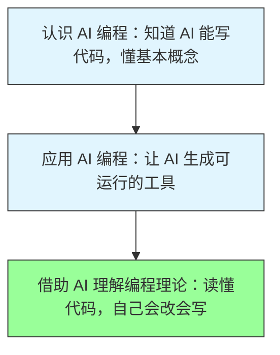
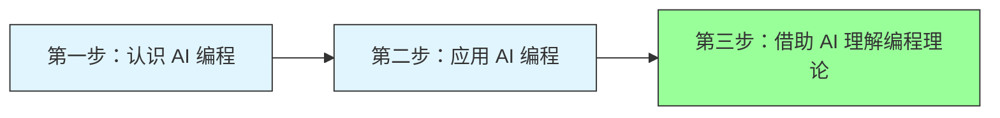
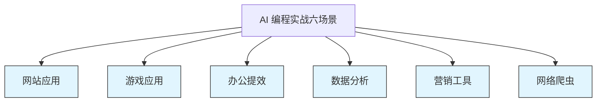
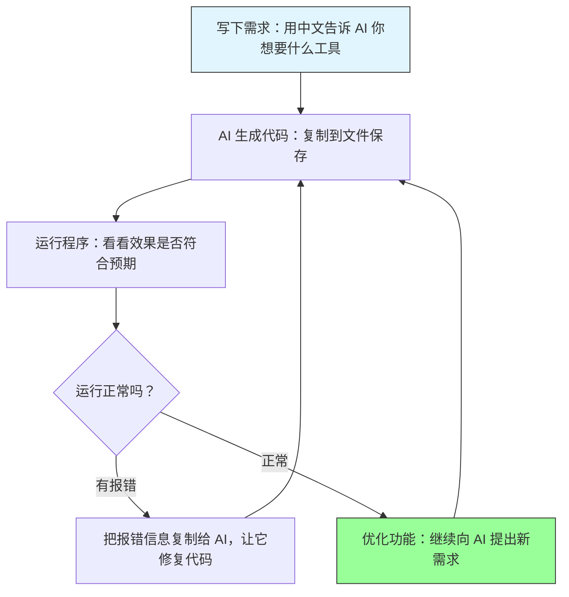

# 第19章 AI 编程实战六场景：网站、游戏、办公提效、数据分析、营销工具、爬虫

> 本节以 21 天六大场景实操为主线，教读者借助 AI 编程工具写出可运行的产品工具，路径为“认识 AI 编程 → 应用 AI 编程 → 借助 AI 理解编程理论”，分必修篇（应用 + 基础语法）与选修篇（高级语法、更多应用）。

废话先说在前面：这一章不需要你有任何编程基础，不需要你搞懂什么是变量、什么是函数，甚至不需要你安装过什么开发软件。你只需要会用电脑打开文件夹、会复制粘贴、会在浏览器里打开网页，就足够读完本章并动手做出好几个能用的小工具了。我们会把每一个“听起来很吓人”的编程名词，都用大白话掰开揉碎讲清楚。

编程是更好认识互联网世界的钥匙。编程技能往往门槛高，AI 的出现恰好能大大降低学习的门槛，普通人借助 AI 可以快速上手写出代码并实现使用。

以前学编程，新手往往第一关就是“配环境”：安装特定版本的 Python、配环境变量、装数据库、端口被占用……一堆报错像潮水一样淹没热情，很多人还没写出第一行代码就放弃了。这就像你想学做菜，结果被要求先学搭灶台、铺水管、拉燃气管。AI 编程完全不同：你不需要亲手搭灶台，AI 当你的厨师，你只要说清楚想吃什么，它就能帮你把菜做出来；等你吃惯了好菜，自然会想进厨房学几手刀功。

下面的六个场景，每一个都能独立成章，你不需要按顺序全部学完，先挑一个你最想要的场景（比如帮自己整理文件的办公工具），用 AI 把它做出来，用起来爽了，你自然就会想了解更多编程知识。

## 30.1 大白话：选一个你最需要的场景

不要试图一次学完所有编程知识，先选一个你最需要的场景（比如帮自己整理文件的办公工具），用 AI 把它做出来，用起来爽了，你自然就会想了解更多编程知识。

> **大白话**：编程不需要一次性全部学会，先选一个你最需要的场景，用 AI 把它做出来，用起来爽了，你自然就会想了解更多编程知识。

你可以把学编程比作攀岩。传统学法是让你从悬崖底部开始练习，先学打结、系绳索、认岩石，爬了半天可能还没碰到岩壁；AI 编程就像有人给你搭好了一个攀岩墙，你直接爬上去体验“到达顶端”的感觉，爬腻了再回头研究那些绳结到底怎么打。

具体怎么选？看看你日常最讨厌哪项重复工作：
- 每天给几十个文件一个个改名字；
- 把表格里的数据一个个加总、画图表；
- 想发朋友圈的文案绞尽脑汁写不出来；
- 想有个自己的网页，但不懂怎么做。

选其中一个，先用 AI 做出一个“能跑”的小原型，哪怕功能很简陋也没关系。能亲手用上的东西，比看十本编程书都有成就感，成就感会带着你继续往下走。



图中就是本章的学习航线：先知道 AI 能干什么，再让 AI 替你干，最后借助 AI 把“干了什么”搞懂。

## 32.2 学习路径：认识 → 应用 → 理解

手册整体的步骤顺序是按照从认识 AI（编程）到应用 AI（编程）再到借助 AI 理解编程理论进行的，可以参考下面的航线图，按顺序开始实操。

下面逐层拆开讲：

1. **认识 AI 编程**：先明白 AI 编程是什么。它不是让机器完全代替你思考，而是让你用自然语言（中文）描述需求，AI 生成代码，你复制粘贴运行就能得到结果。这一阶段重点是“敢于尝试”，不用担心写错。
2. **应用 AI 编程**：动手让 AI 给你生成代码，运行起来，发现问题再把报错信息发给 AI 让它修复。这一阶段重点是“用起来爽”，先让工具为你服务。
3. **借助 AI 理解编程理论**：当你用过几次后，代码里的 if、for、函数这些词就不再陌生。这时候再请 AI 解释代码的原理，你就能读懂代码，甚至自己动手改几行。



### 32.2.1 必修篇

学习 AI 编程的应用和理解代码基础语法，即航线图对应的行动路径。如果你还在前期摸索，想先跟着步骤熟悉掌握，建议从必修篇开始认真阅读和实操，不在玩法选择上纠结。

必修篇的核心就是六个场景（网站、游戏、办公提效、数据分析、营销工具、网络爬虫），每个场景里都会给出可以直接复制运行的完整代码。你不需要看懂每一行，先“跑通”再说。

### 32.2.2 选修篇

借助 AI 学习编程的高级语法、更多编程应用等相关内容。如果你已经掌握了 AI 编程的爬虫应用和基础语法，想进一步了解它的更多可能，获得灵感，选修篇不要错过。

选修篇可以往深了钻：学习怎么让网页连上数据库、怎么让爬虫每天自动运行、怎么把工具发布到互联网上让别人也能用。这些内容在后面章节或更多的实践中慢慢积累。

## 32.3 六大场景实战

21 天内借助 AI 写出六个应用场景的产品工具代码，并能正常运行使用。

### 32.3.1 网站应用

做出可访问的网页产品，如个人数字名片、导航站、游戏站等。

> **大白话**：网站就是放在互联网上、别人用浏览器能打开的页面。以前做网站要学 HTML、CSS、JavaScript，还要买服务器、备案域名；现在有 AI 工具，你只要用人话描述想要的页面，AI 就能帮你生成代码，连发布上线都能一键完成。

**免费低成本的工具箱。** 按照“节俭全栈”的思路，你不需要购买任何服务器，唯一的投入是你的时间和创造力。常用工具包括：
- 免费或低成本的应用构建器：Figma Make、v0.dev、Trickle、Lovable 等，几分钟内就能把创意变成可访问的网页应用，全程无须编写一行代码；
- 免费的 AI 编程助手：DeepSeek、Kimi、ChatGPT、Gemini 等，帮你生成代码片段、解释技术概念、规划应用架构；
- 免费托管：Netlify、Vercel 等平台支持一键把网页发布到互联网，生成一个别人也能访问的链接。

**动手做一个“个人数字名片”网页。** 这是最适合新手的第一个网站：一张页面，上面写着你的名字、简介、联系方式，还可以放一张照片。下面是可以直接保存运行的完整代码，所有部分都加了中文注释，你可以把它复制到记事本里，保存为 `index.html`，然后双击用浏览器打开。

```html
<!DOCTYPE html>
<html lang="zh-CN">
<head>
    <!-- 声明使用 UTF-8 编码，避免中文乱码 -->
    <meta charset="UTF-8">
    <!-- 让页面在手机和电脑上都能自适应显示 -->
    <meta name="viewport" content="width=device-width, initial-scale=1.0">
    <title>我的个人数字名片</title>
    <style>
        /* 下面是 CSS 样式，用来控制页面的外观 */
        body {
            font-family: "Microsoft YaHei", sans-serif;
            background: linear-gradient(135deg, #667eea 0%, #764ba2 100%);
            margin: 0;
            padding: 0;
            min-height: 100vh;
            display: flex;
            justify-content: center;
            align-items: center;
        }
        .card {
            background: white;
            border-radius: 20px;
            box-shadow: 0 10px 40px rgba(0,0,0,0.2);
            padding: 40px;
            max-width: 400px;
            text-align: center;
        }
        .avatar {
            width: 100px;
            height: 100px;
            border-radius: 50%;
            margin-bottom: 20px;
        }
        h1 {
            color: #333;
            margin-bottom: 10px;
            font-size: 24px;
        }
        .subtitle {
            color: #666;
            font-size: 16px;
            margin-bottom: 25px;
        }
        .info {
            margin: 15px 0;
            color: #444;
            font-size: 15px;
        }
        .info strong {
            color: #667eea;
        }
        .button {
            display: inline-block;
            margin-top: 25px;
            padding: 12px 25px;
            background: #667eea;
            color: white;
            text-decoration: none;
            border-radius: 8px;
            font-weight: bold;
        }
        .button:hover {
            background: #5568d3;
        }
    </style>
</head>
<body>
    <!-- 页面主体是一个卡片容器 -->
    <div class="card">
        <!-- 这里放头像图片，没有图片可以先不写 src 属性 -->
        
        <h1>张三</h1>
        <div class="subtitle">AI 学习者 · 办公自动化爱好者</div>
        <div class="info"><strong>微信：</strong> zhangsan_wx</div>
        <div class="info"><strong>邮箱：</strong> zhangsan@example.com</div>
        <div class="info"><strong>擅长：</strong> 用 AI 提升工作效率</div>
        <a href="mailto:zhangsan@example.com" class="button">联系我</a>
    </div>
</body>
</html>
```

**怎么运行：** 把上面代码完整复制，粘贴到电脑的“记事本”里，另存为 `index.html`（注意后缀名是 `.html` 而不是 `.txt`），双击这个文件，就会用浏览器打开，看到你的个人数字名片。如果想让别人也能访问，可以把这个文件上传到 Netlify 或 Vercel 等免费托管平台，它们会给你一个公开的网址链接。

如果你想让网页变得更漂亮或增加新功能（比如加一个留言板、一个计算器），只需要把需求告诉 AI：“帮我在上面的个人名片页面里加一个‘给我留言’的表单，点击提交后弹出谢谢留言的提示”，AI 就会给出修改后的代码，你再复制替换保存即可。


### 32.3.2 游戏应用

写出可玩的小游戏，如猜数字、拼图、简单的 H5 游戏等。

> **大白话**：游戏本质上也是一种程序，只不过是“会玩”的程序。以前做游戏要学游戏引擎、精灵动画、碰撞检测；现在有 AI，你只要说“我想做一个猜数字小游戏，电脑随机选一个 1 到 100 的数字，我来猜，猜错的话提示大了或小了”，AI 就能帮你写出完整可运行的游戏代码。

适合新手入门的小游戏包括：
- **猜数字**：电脑随机选数字，玩家猜测并收到大了/小了提示；
- **拼图游戏**：把图片切成几块，玩家拖拽还原；
- **简单 H5 游戏**：在浏览器里运行的小游戏，比如躲避障碍物的方块游戏、打地鼠等。

下面是一个完整的“猜数字”小游戏，保存为 HTML 文件后双击即可在浏览器中玩耍。所有逻辑都用中文注释标注出来了。

```html
<!DOCTYPE html>
<html lang="zh-CN">
<head>
    <meta charset="UTF-8">
    <title>猜数字小游戏</title>
    <style>
        body { font-family: "Microsoft YaHei", sans-serif; background: #f0f2f5; display: flex; justify-content: center; align-items: center; min-height: 100vh; margin: 0; }
        .game { background: white; padding: 30px; border-radius: 16px; box-shadow: 0 8px 24px rgba(0,0,0,0.15); text-align: center; max-width: 340px; }
        h1 { color: #4a90e2; margin-top: 0; }
        input { padding: 10px; font-size: 16px; width: 120px; margin: 10px 0; border: 1px solid #ccc; border-radius: 6px; }
        button { padding: 10px 24px; font-size: 16px; background: #4a90e2; color: white; border: none; border-radius: 6px; cursor: pointer; }
        button:hover { background: #357abd; }
        #message { margin-top: 15px; font-size: 16px; min-height: 22px; }
        .success { color: #2ecc71; font-weight: bold; }
        .error { color: #e74c3c; font-weight: bold; }
    </style>
</head>
<body>
    <div class="game">
        <h1>猜数字游戏</h1>
        <p>我已经想好了一个 1 到 100 之间的数字，你猜是多少？</p>
        <input type="number" id="guessInput" min="1" max="100" placeholder="输入数字">
        <button onclick="checkGuess()">猜一猜</button>
        <div id="message"></div>
        <button onclick="resetGame()" style="margin-top:12px; background:#888;">重新开始</button>
    </div>
    <script>
        // 下面是 JavaScript 代码，控制游戏的逻辑
        // 生成一个 1 到 100 之间的随机整数作为答案
        var secretNumber = Math.floor(Math.random() * 100) + 1;
        // 记录已经猜了多少次
        var attempts = 0;

        // 点击“猜一猜”按钮时执行的函数
        function checkGuess() {
            // 从输入框读取玩家输入的数字，并转成数字类型
            var guess = parseInt(document.getElementById("guessInput").value);
            var messageDiv = document.getElementById("message");

            // 如果输入为空或不是有效数字，提示重新输入
            if (isNaN(guess) || guess < 1 || guess > 100) {
                messageDiv.className = "error";
                messageDiv.textContent = "请输入 1 到 100 之间的有效数字";
                return;
            }

            attempts = attempts + 1;

            if (guess === secretNumber) {
                messageDiv.className = "success";
                messageDiv.textContent = "恭喜，答对了！答案就是 " + secretNumber + "，你一共猜了 " + attempts + " 次";
            } else if (guess < secretNumber) {
                messageDiv.className = "error";
                messageDiv.textContent = "太小了，再大一点";
            } else {
                messageDiv.className = "error";
                messageDiv.textContent = "太大了，再小一点";
            }
        }

        // 点击“重新开始”按钮时执行的函数
        function resetGame() {
            // 再次生成新的随机答案
            secretNumber = Math.floor(Math.random() * 100) + 1;
            attempts = 0;
            document.getElementById("guessInput").value = "";
            document.getElementById("message").textContent = "";
        }
    </script>
</body>
</html>
```

**怎么跟 AI 对话做游戏：** 你可以直接这样提示 AI：“请帮我写一个网页版的猜数字游戏，要求：电脑随机生成 1 到 100 的数字，玩家输入猜测，点击按钮后提示太大或太小，猜对了显示恭喜并告诉用户用了多少次，页面要有好看的颜色，所有代码写在一个 HTML 文件里，中文注释。” 把 AI 返回的代码保存为 `.html` 文件，双击即可游玩。


### 32.3.3 办公提效

批量改名、图片压缩等效率工具，解决日常重复性办公问题。

> **大白话**：办公工作里最烦的往往是重复的体力活，比如给一百张照片一个个改名字、把几十张图片一个个压缩小。以前这些得手动点个不停，现在用 AI 写一个 Python 脚本，几秒钟就能全部搞定，而且绝对不会漏掉或者改错。

办公提效工具常见的例子包括：
- 批量重命名文件夹里的图片或文档；
- 批量压缩图片、转换图片格式；
- 合并多个 Excel 表格、拆分大表格；
- 自动生成重复格式的合同或发票。

下面是一个“批量重命名图片文件”的 Python 脚本，可以直接复制运行。它只使用 Python 自带的标准库，无须安装任何第三方库，新手装好 Python 后就能跑。

```python
# ===== 批量重命名图片文件脚本 =====
# 功能：在指定文件夹里，把所有 .jpg 和 .png 图片前面加上日期前缀
# 例如：照片.jpg 重命名为 20260115_照片.jpg
# 执行前会先显示预览列表，等用户确认后才真正执行重命名

import os          # os 模块用于操作文件和文件夹
import datetime    # datetime 模块用于获取当前日期

def batch_rename_images(folder_path):
    # 检查文件夹是否存在，如果不存在就提示用户并退出
    if not os.path.exists(folder_path):
        print("错误：文件夹路径不存在，请检查路径是否正确。")
        return

    # 获取文件夹里所有文件的名字列表
    all_files = os.listdir(folder_path)

    # 筛选出后缀名是 .jpg 或 .png 的图片文件（不区分大小写）
    image_files = []
    for file_name in all_files:
        if file_name.lower().endswith((".jpg", ".png")):
            image_files.append(file_name)

    # 如果没有找到图片文件，提示用户并退出
    if len(image_files) == 0:
        print("在该文件夹里没有找到 .jpg 或 .png 图片文件。")
        return

    # 生成今天的日期前缀，格式如 20260115
    today = datetime.datetime.now().strftime("%Y%m%d")

    # 构建重命名预览列表：每项是 (原来的名字, 新的名字)
    preview_list = []
    for file_name in image_files:
        new_name = today + "_" + file_name
        preview_list.append((file_name, new_name))

    # 显示预览列表，让用户先看一遍再决定是否执行
    print("即将重命名的图片文件（共 {} 个）：".format(len(preview_list)))
    for old_name, new_name in preview_list:
        print("  {}  -->  {}".format(old_name, new_name))

    # 询问用户是否确认执行
    confirm = input("确认执行重命名吗？输入 y 确认，其他任意键取消：")
    if confirm.lower() != "y":
        print("已取消重命名操作。")
        return

    # 正式执行重命名，并加上错误处理，防止因权限问题导致程序崩溃
    success_count = 0
    for old_name, new_name in preview_list:
        old_path = os.path.join(folder_path, old_name)
        new_path = os.path.join(folder_path, new_name)
        try:
            os.rename(old_path, new_path)
            success_count = success_count + 1
        except Exception as e:
            print("重命名失败 {}：{}".format(old_name, e))

    print("重命名完成，成功处理 {} 个文件。".format(success_count))

# 脚本的入口：直接运行该文件时，下面的代码会执行
if __name__ == "__main__":
    # 让用户输入要处理的文件夹路径
    folder_path = input("请输入图片所在的文件夹路径：").strip()
    # 去掉路径两端可能带的引号（有些系统复制路径会带引号）
    folder_path = folder_path.strip('"').strip("'")
    batch_rename_images(folder_path)
    input("按回车键退出……")
```

**怎么运行：** 把代码保存为 `rename_images.py`，在命令行（或 PowerShell）里执行 `python rename_images.py`，然后输入图片所在的文件夹路径，程序就会先列出预览，你确认后再执行重命名。

如果你想给文件加别的前缀（比如项目名称），或者只处理特定后缀的文件，直接把需求告诉 AI：“帮我改上面的脚本，把日期前缀改成项目名称，并且只处理 .pdf 文件”，AI 会给出修改后的代码。


### 32.3.4 数据分析

处理和分析数据表格，生成图表和报告。

> **大白话**：Excel 能做的表格计算和图表，Python 也能做，而且 Python 的优势是能一次性处理几十个、几百个文件，还能自动画出好看的图表保存成图片，非常适合做定期的数据报告。

数据分析常用的 Python 工具包括：
- pandas：用来读取和处理 Excel、CSV 表格，能做求和、平均值、分组统计等操作；
- matplotlib：用来画柱状图、折线图、饼图等，并保存为图片文件。

下面是一个完整的数据分析脚本，读取销售数据表格，计算总销售额、平均订单额、各商品销量，最后生成一张柱状图保存为图片。

```python
# ===== 销售数据分析脚本 =====
# 功能：读取 sales.csv 销售数据，计算统计指标，绘制各商品销量柱状图
# 需要先安装第三方库：pip install pandas matplotlib

import pandas as pd       # pandas 用于表格数据处理
import matplotlib.pyplot as plt  # matplotlib 用于绘图

# 设置 matplotlib 显示中文，避免图表里的中文变成方块
plt.rcParams["font.sans-serif"] = ["SimHei", "Microsoft YaHei"]
plt.rcParams["axes.unicode_minus"] = False

def analyze_sales(csv_file):
    # 尝试读取 CSV 文件，如果文件不存在则提示并退出
    try:
        df = pd.read_csv(csv_file)
    except FileNotFoundError:
        print("错误：找不到文件 {}，请确认文件名和路径是否正确。".format(csv_file))
        return

    # 打印表格的前几行，让用户先了解数据长什么样
    print("数据前几行预览：")
    print(df.head())

    # 计算总销售额（假设表格里有 “销售额” 列）
    total_sales = df["销售额"].sum()
    # 计算平均订单额
    avg_order = df["销售额"].mean()
    # 统计各商品的总销量（假设表格里有 “商品” 和 “数量” 列）
    product_sales = df.groupby("商品")["数量"].sum().sort_values(ascending=False)

    print("\n=== 分析结果 ===")
    print("总销售额：{:.2f} 元".format(total_sales))
    print("平均订单额：{:.2f} 元".format(avg_order))
    print("\n各商品销量排名：")
    print(product_sales)

    # 绘制各商品销量柱状图
    plt.figure(figsize=(8, 5))
    plt.bar(product_sales.index, product_sales.values, color="#4a90e2")
    plt.title("各商品销量统计")
    plt.xlabel("商品")
    plt.ylabel("销量")
    plt.xticks(rotation=30)
    plt.tight_layout()
    # 将图表保存为图片文件
    plt.savefig("商品销量统计.png")
    print("\n图表已保存为：商品销量统计.png")

if __name__ == "__main__":
    # 用户可以修改这里的文件名，指向自己的数据表格
    analyze_sales("sales.csv")
```

**怎么准备数据：** 在脚本同一个文件夹里建立一个 `sales.csv` 文件，内容示例如下（用记事本即可编辑）：

```
订单ID,商品,数量,销售额
1001,笔记本电脑,2,12000
1002,鼠标,5,350
1003,键盘,3,900
1004,笔记本电脑,1,6000
1005,显示器,2,4000
```

运行命令：`python sales_analysis.py`，程序会在控制台打印分析结果，并在同目录下生成 `商品销量统计.png` 图片。

如果你的数据是 Excel 文件（`.xlsx`），只需要把 `pd.read_csv("sales.csv")` 改成 `pd.read_excel("sales.xlsx")`，其他代码基本不变。不懂怎么改时，直接把报错信息复制给 AI 让它修复即可。


### 32.3.5 营销工具

营销相关的辅助工具，如文案生成、标题优化、数据监控等。

> **大白话**：写小红书标题、朋友圈文案、广告语，以前要绞尽脑汁，现在交给 AI，一分钟就能生成十几个候选，你挑最合眼缘的一个稍微微调就能用。营销工具就是把这种“AI 生成文案”的能力包装成一个可反复使用的小程序。

常见的营销工具包括：
- 文案生成：输入产品卖点，生成多条不同风格的推广文案；
- 标题优化：输入一条平淡标题，生成更有吸引力的爆款标题；
- 数据监控：定期抓取竞品价格、销量等信息，整理成表格。

下面是一个本地运行的“文案优化小助手” Python 脚本。它读取你写好的原始文案，按照简单的规则自动生成优化后的版本（加入表情符号、分段、话题标签），无须联网，也无须 API 密钥，新手放心运行。

```python
# ===== 文案优化小助手 =====
# 功能：读取 raw_copy.txt 里的原始营销文案，生成优化版本
# 优化内容：加入表情符号、分段排版、添加话题标签
# 运行前请在同目录下准备 raw_copy.txt 文件

def optimize_copy(raw_text):
    # 定义常用的营销表情符号，会根据关键词自动添加
    emoji_map = {
        "折扣": "💰",
        "优惠": "🎁",
        "新品": "✨",
        "限时": "⏰",
        "免费": "🆓",
        "抢购": "🔥",
    }

    lines = raw_text.splitlines()
    optimized_lines = []

    for line in lines:
        line = line.strip()
        if not line:
            # 空行保留，用于分段
            optimized_lines.append("")
            continue

        # 如果这一行里包含上面的关键词，就在行尾加上对应的表情
        for keyword, emoji in emoji_map.items():
            if keyword in line:
                line = line + " " + emoji
                break  # 一行只加一个表情，避免太花哨

        optimized_lines.append(line)

    # 把所有行重新拼接，中间加上换行，形成分段后的正文
    body = "\n".join(optimized_lines)

    # 在末尾添加通用的话题标签，方便社交平台传播
    hashtags = "\n\n#好物推荐 #种草 #优惠分享 #实用好物"

    return body + hashtags

if __name__ == "__main__":
    input_file = "raw_copy.txt"
    output_file = "optimized_copy.txt"

    # 检查输入文件是否存在
    try:
        with open(input_file, "r", encoding="utf-8") as f:
            raw_text = f.read()
    except FileNotFoundError:
        print("错误：找不到 {}，请先在同目录下创建该文件，并把原始文案贴进去。".format(input_file))
        # 创建一个示例文件，方便新手立刻体验
        with open(input_file, "w", encoding="utf-8") as f:
            f.write("本周末全店满减活动开始了，所有商品第二件半价，数量有限，先到先得。")
        print("已为你创建示例文件 raw_copy.txt，你可以编辑它后再次运行本脚本。")
    else:
        result = optimize_copy(raw_text)
        with open(output_file, "w", encoding="utf-8") as f:
            f.write(result)
        print("优化完成，结果已保存到 {}".format(output_file))
        print("\n========== 优化后的文案 ==========")
        print(result)
```

**怎么运行：** 把代码保存为 `copy_optimizer.py`，在同目录下新建 `raw_copy.txt` 并把你要优化的文案粘贴进去，然后执行 `python copy_optimizer.py`，优化后的文案会显示在屏幕上，同时保存到 `optimized_copy.txt`。

如果你想让文案更聪明、更有“感觉”，可以请 AI 把这个脚本升级为调用 DeepSeek API 的版本：只需要在代码里加入对 DeepSeek 接口的调用，把原始文案发给 AI，让它重写成小红书风格或朋友圈风格。AI 会教你怎么申请 API 密钥、怎么写调用代码。


### 32.3.6 网络爬虫

采集网络数据的脚本，如抓取网页内容、监控价格变化等。

> **大白话**：爬虫就是派一个“自动浏览员”去网页上把你想要的信息抄下来，存成表格或文本。你可以每天定时运行一次爬虫，监控商品价格变化、抓取新闻标题、汇总招聘信息，再也不用一个一个网页去手动复制了。

**重要提醒：** 只爬取公开的、允许采集的信息；不要频繁请求别人的服务器（每次请求之间稍作停顿）；遵守网站的使用规则和相关法律法规，把抓取到的数据用于个人学习，不要用于违法用途或大规模商业采集。

常见的爬虫用途包括：
- 抓取网页标题、链接、正文内容；
- 监控电商页面的价格变化；
- 定时抓取天气、新闻、招聘信息。

下面是一个完整的网页信息抓取脚本，使用 Python 的 `requests` 库下载网页，`BeautifulSoup` 库解析网页，提取页面里的标题和链接，最后保存为 CSV 表格。新手可以先把它对准一个自己做的本地 HTML 文件练习，熟练后再抓取真实网页。

```python
# ===== 简单网页信息抓取脚本 =====
# 功能：抓取指定网页的标题和所有链接，保存到 results.csv
# 运行前需要安装第三方库：pip install requests beautifulsoup4

import requests          # requests 用于发送网络请求，下载网页内容
from bs4 import BeautifulSoup  # BeautifulSoup 用于解析网页 HTML
import csv               # csv 用于把结果保存成表格文件
import time              # time 用于在请求之间稍作停顿，礼貌地对待服务器

def crawl_page(url):
    # 设置 User-Agent，告诉网站我们是用浏览器访问的，避免被一些网站拦截
    headers = {
        "User-Agent": "Mozilla/5.0 (Windows NT 10.0; Win64; x64) AppleWebKit/537.36"
    }

    try:
        # 发送 GET 请求，下载网页内容，timeout=10 表示最多等待 10 秒
        response = requests.get(url, headers=headers, timeout=10)
        # 如果服务器返回错误（比如 404 找不到页面），这里会抛出异常
        response.raise_for_status()
    except Exception as e:
        print("抓取失败：{}".format(e))
        return

    # 用 BeautifulSoup 解析下载下来的 HTML 内容
    soup = BeautifulSoup(response.text, "html.parser")

    # 提取页面标题
    page_title = soup.title.string if soup.title else "无标题"
    print("页面标题：{}".format(page_title))

    # 提取页面里所有的 <a> 链接标签
    links = []
    for a_tag in soup.find_all("a"):
        href = a_tag.get("href")
        text = a_tag.get_text(strip=True)
        if href:
            links.append({"文本": text, "链接": href})

    print("共找到 {} 个链接。".format(len(links)))

    # 把结果保存到 CSV 文件，用 Excel 就能打开
    with open("results.csv", "w", encoding="utf-8-sig", newline="") as f:
        writer = csv.DictWriter(f, fieldnames=["文本", "链接"])
        writer.writeheader()
        for link in links:
            writer.writerow(link)

    print("结果已保存到 results.csv")

if __name__ == "__main__":
    # 把下面的网址换成你想抓取的页面地址
    target_url = input("请输入要抓取的网页地址（以 http 或 https 开头）：").strip()
    crawl_page(target_url)
    # 抓取完后稍微停顿一下，养成良好的爬虫习惯
    time.sleep(1)
```

**怎么运行：** 先在命令行执行 `pip install requests beautifulsoup4` 安装两个依赖库，然后把代码保存为 `crawler.py`，运行 `python crawler.py`，输入要抓取的网页地址，结果会保存为 `results.csv`，用 Excel 打开即可查看。

如果你想抓取需要“实时数据”的页面（比如今天的新闻、今天的股价），建议配合能联网搜索的 AI 工具（类似 New Bing），否则 AI 的知识有截止日期，得到的结果可能不够新鲜。如果遇到需要登录、滑块验证等复杂页面，可以请 AI 教你使用 Playwright 等自动化浏览器的工具，它们能像真人一样操作浏览器点击、输入、截图。


## 32.4 六大场景 Mermaid 图

下面用一张图把本章六个实战场景的关系展示出来，帮你建立整体印象：



再看一个通用的“AI 编程落地全流程”，适用于本章任何一个场景：



## 小练习

从六个场景中选一个（如办公提效工具），用 AI 生成可运行的原型，运行后记录该工具解决了什么具体问题、耗时多少。

> **参考模板**：
>
> | 场景 | 工具名称 | 解决问题 | 耗时 | 生成次数 |
> |------|---------|---------|------|---------|
> | 办公提效 | 批量重命名脚本 | 重命名 100 个文件 | 30 分钟 | 2 次 |
> | 网站应用 | 个人数字名片 | 展示个人信息 | 1 小时 | 1 次 |
> | 游戏应用 | 猜数字游戏 | 简单娱乐 | 45 分钟 | 3 次 |

> **推荐第一个场景：办公提效工具**
>
> 比如“批量重命名文件”脚本，代码简单、立即可见效，适合新手开始。
>
> **参考提示词**：
> ```
> 请帮我写一个 Python 脚本，批量重命名指定文件夹中的所有图片文件。
> 要求：
> 1. 用户可以指定文件夹路径
> 2. 重命名规则：在原文件名前加上日期前缀（如 20260115_）
> 3. 只处理 .jpg、.png 后缀的文件
> 4. 重命名前显示预览列表，要求用户确认后再执行
> 5. 有错误处理，如文件夹不存在、无权限等情况
> 6. 添加详细的中文注释
> ```

把生成的代码保存为 `.py` 文件，在自己的电脑上跑通，并记录下上面的表格，就是本章最重要的第一步成果。

---

## 本章小结

通过本章，你应该已经掌握：

1. **学习路径**：认识 AI 编程 → 应用 AI 编程 → 借助 AI 理解编程理论。不用一口气学完所有编程知识，先选一个最需要的场景做出能跑的工具，成就感会带着你继续往下走。
2. **AI 编程的通用工作流**：写需求 → AI 生成代码 → 运行测试 → 有报错就复制给 AI 修复 → 继续加功能。这套循环适用于本章全部六个场景。
3. **网站应用**：用 AI 生成单文件 HTML 网页，双击即可预览；要让别人访问，可用 Netlify、Vercel 等免费平台一键发布。
4. **游戏应用**：AI 能直接产出可玩的 HTML 小游戏，猜数字、拼图、H5 小游戏都适合入门。
5. **办公提效**：批量重命名等重复体力活，交给 Python 脚本几秒钟搞定，脚本要带预览确认和错误处理。
6. **数据分析**：用 pandas 处理表格、matplotlib 自动出图，CSV 和 Excel 都能读。
7. **营销工具**：文案生成、标题优化这类需求，本地规则脚本先跑通，再请 AI 升级为调用大模型 API。
8. **网络爬虫**：用 requests + BeautifulSoup 抓取公开网页信息并保存成 CSV，只采公开信息、遵守规则、别给服务器添乱。

下一部分，我们会把视角从"写工具"转向"搭系统"，看看 AI 自动化工作流如何把重复劳动真正交给"数字员工"。
