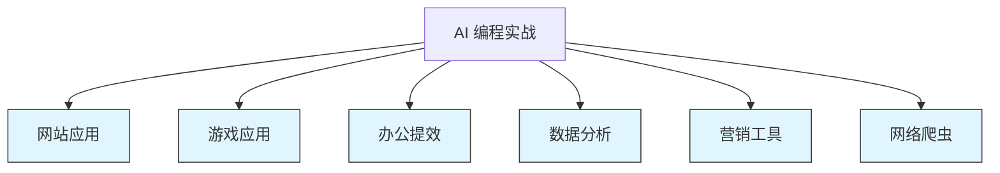

# 第19章 AI 编程实战六场景：网站、游戏、办公提效、数据分析、营销工具、爬虫

> 本节以 21 天六大场景实操为主线，教读者借助 AI 编程工具写出可运行的产品工具，路径为"认识 AI 编程 → 应用 AI 编程 → 借助 AI 理解编程理论"，分必修篇（应用 + 基础语法）与选修篇（高级语法、更多应用）。

## 19.1 大白话：选一个你最需要的场景

不要试图一次学完所有编程知识，先选一个你最需要的场景（比如帮自己整理文件的办公工具），用 AI 把它做出来，用起来爽了，你自然就会想了解更多编程知识。

## 19.2 学习路径：认识 → 应用 → 理解

手册整体的步骤顺序是按照从认识 AI（编程）到应用 AI（编程）再到借助 AI 理解编程理论进行的，可以参考航线图，按顺序开始实操。

编程是更好认识互联网世界的钥匙。编程技能往往门槛高，AI 的出现恰好能大大降低学习的门槛，普通人借助 AI 可以快速上手写出代码并实现使用。

### 19.2.1 必修篇

学习 AI 编程的应用和理解代码基础语法，即航线图对应的行动路径。如果你还在前期摸索，想先跟着步骤熟悉掌握，建议从必修篇开始认真阅读和实操，不在玩法选择上纠结。

### 19.2.2 选修篇

借助 AI 学习编程的高级语法、更多编程应用等相关内容。如果你已经掌握了 AI 编程的爬虫应用和基础语法，想进一步了解它的更多可能，获得灵感，选修篇不要错过。

## 19.3 六大场景实战

21 天内借助 AI 写出六个应用场景的产品工具代码，并能正常运行使用。

### 19.3.1 网站应用

做出可访问的网页产品，如个人数字名片、导航站、游戏站等。

### 19.3.2 游戏应用

写出可玩的小游戏，如猜数字、拼图、简单的 H5 游戏等。

### 19.3.3 办公提效

批量改名、图片压缩等效率工具，解决日常重复性办公问题。

### 19.3.4 数据分析

处理和分析数据表格，生成图表和报告。

### 19.3.5 营销工具

营销相关的辅助工具，如文案生成、标题优化、数据监控等。

### 19.3.6 网络爬虫

采集网络数据的脚本，如抓取网页内容、监控价格变化等。

## 19.4 六大场景 Mermaid 图



## 小练习

从六个场景中选一个（如办公提效工具），用 AI 生成可运行的原型，运行后记录该工具解决了什么具体问题、耗时多少。

**参考模板**：

| 场景 | 工具名称 | 解决问题 | 耗时 | 生成次数 |
|------|---------|---------|------|---------|
| 办公提效 | 批量重命名脚本 | 重命名 100 个文件 | 30 分钟 | 2 次 |
| 网站应用 | 个人数字名片 | 展示个人信息 | 1 小时 | 1 次 |
| 游戏应用 | 猜数字游戏 | 简单娱乐 | 45 分钟 | 3 次 |

**推荐第一个场景：办公提效工具**

比如"批量重命名文件"脚本，代码简单、立即可见效，适合新手开始。

**参考提示词**：
```
请帮我写一个 Python 脚本，批量重命名指定文件夹中的所有图片文件。
要求：
1. 用户可以指定文件夹路径
2. 重命名规则：在原文件名前加上日期前缀（如 20260115_）
3. 只处理 .jpg、.png 后缀的文件
4. 重命名前显示预览列表，要求用户确认后再执行
5. 有错误处理，如文件夹不存在、无权限等情况
6. 添加详细的中文注释
```
