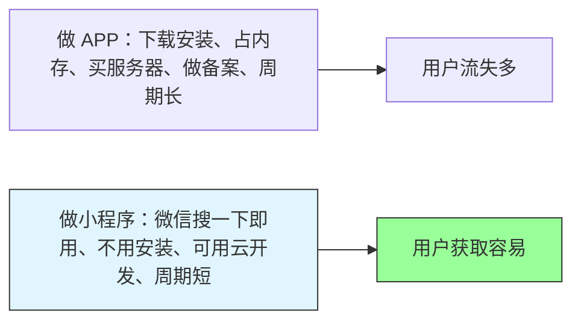
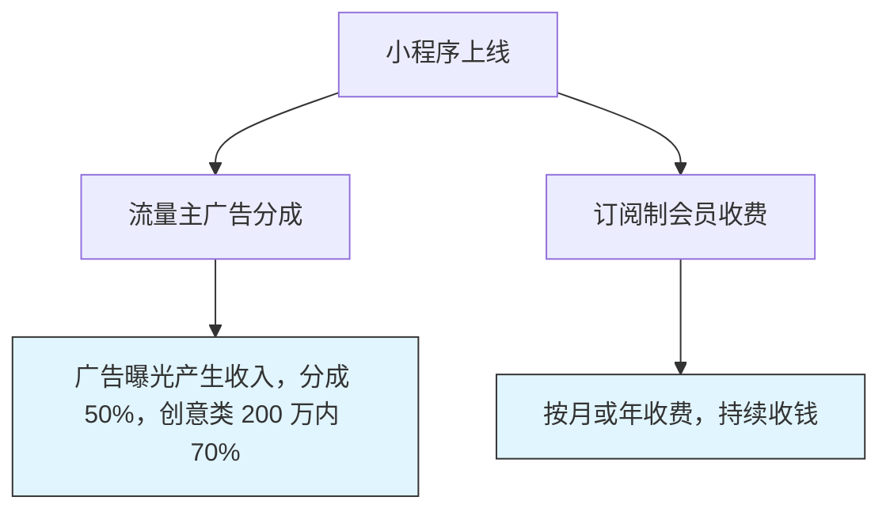
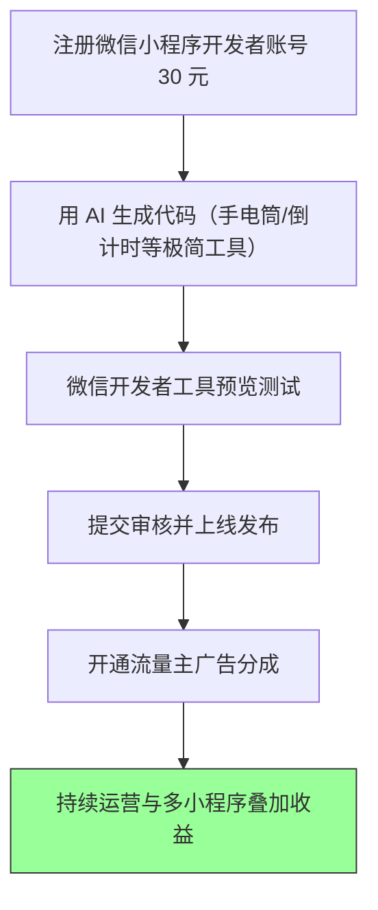

# 第20章 微信小程序 AI 产品 0-1 打造与变现

> 本节教个人开发者借微信 13 亿月活生态与 2026 AI 小程序成长计划扶持（免费云开发 + 1 亿混元 Token），用 AI 低成本批量做小程序，走流量主广告分成或订阅制变现。案例包括某开发者 15 个小程序月入 2 万+、一篇笔记带来 650+ 用户。

废话先说在前面：这一章不需要你懂前端开发，不需要你会写 JavaScript，不需要你买服务器，甚至不需要你注册过公司。你只需要会用微信、会在电脑上安装软件、会复制粘贴代码，就能跟着本章走通一个小程序从“注册、开发、上线、开广告”的全流程。

微信有 13 亿月活用户，小程序依托这个生态，天然拥有多个免费流量入口。你不需要花钱买流量，用户在微信搜索、首页下拉、好友分享、公众号和视频号里都可能发现你的小程序。更重要的是，现在微信还有 AI 小程序成长计划，报名后可以免费获得 6 个月云开发环境、1 亿混元 Token 和 1 万张生图资源包，活动持续到 2026 年 6 月 30 日。

下面先用大白话把“小程序是什么、为什么现在做、怎么赚钱”讲清楚，再带你动手做第一个小程序，最后讲怎么上线和赚钱。

## 20.1 大白话：微信小程序不用下载安装，搜一下就能用

微信小程序不用下载安装，搜一下就能用，用户基数巨大。现在微信还有 AI 小程序扶持计划，给免费服务器和 Token。新手可以做个“手电筒”“倒计时”这种极简工具，先跑通“注册 → 开发 → 上线 → 开流量主”的全流程。

> **大白话**：小程序就像微信里的“即用型应用”，你不用去应用商店下载安装，在微信里搜一下或者从聊天窗口打开就能用，用完就走，不占手机内存。以前做一个 APP 要找产品经理、UI 设计师、前端、后端、测试，还要买服务器、做备案，动辄几个月几十万；现在有 AI 工具辅助，零代码基础的个人开发者也能在一周内做出一个小程序并上线，甚至开始赚广告钱。

小程序和 APP 的最大区别，可以用“超市里的食品”来类比：APP 像包装好的食品，你得去超市（应用商店）专门挑选、下载、安装，吃完还占着冰箱位置；小程序像超市里的试吃摊，你走到面前（在微信里搜一下）就能尝一口，尝完离开就没了，不占地方。用户链路短得多，转化也更容易。

下面这张图对比了做小程序和做 APP 的不同：



## 20.2 为什么当下做微信小程序产品打造？

### 20.2.1 微信小程序生态优势与激励计划

微信有 13 亿月活用户，小程序依托这个生态，天然拥有多个免费流量入口。微信搜索、首页下拉列表、发现页分类、好友分享、公众号和视频号导流——这些都是不花钱就能获得用户的渠道。和做 APP 不同，小程序不需要下载安装，用户搜一下就能用，用完就走，链路极短。

平台激励方面，目前有几个值得关注的政策：

1. **广告分成**：流量主可获得广告收入的 50%（创意类小程序 200 万以内可拿 70%）。也就是说，广告主付 100 元广告费，小程序所有者能分到 50 元，创意类小程序在 200 万流量以内还能分到 70 元。
2. **AI 小程序成长计划**：2026 年新推出的官方扶持，报名后可以免费获得 6 个月云开发环境、1 亿混元 Token 和 1 万张生图资源包，活动持续到 2026 年 6 月 30 日，报名入口在微信公众平台→行业能力→AI 小程序成长计划（官方文档）。
3. **免开发智能接入**：系统自动往你的小程序里插入广告组件，新手不用写广告代码也能变现。

平台在持续完善开发者变现通道，对个人开发者来说目前仍处于值得入场的窗口期。


### 20.2.2 低技术门槛和上线成本，快速验证想法

做小程序的启动成本低到什么程度？

- **个人主体注册费**：30 元，在微信公众平台注册即可；
- **服务器**：不需要（最简单的小程序纯前端，不需要后端服务器；如果需要保存数据，可以用免费的微信云开发）；
- **微信开发者工具**：免费，下载安装即可使用；
- **代码零基础友好**：用 Trae、Cursor、ChatGPT、DeepSeek 这类 AI 工具可以直接生成完整的小程序代码，不会写代码也没关系。

开发过程也不复杂。把需求告诉 AI（比如做一个手电筒小程序），AI 生成代码和页面，遇到报错直接复制给 AI 修复，最后用开发者工具预览测试，没问题就提交上线。以前要花一个月的事，现在一周搞定。这个效率意味着试错成本极低——想到一个需求就快速验证，做不起来就换下一个。把每个小程序当成一次低成本的需求实验，而不是一个要长期打磨的产品。

### 20.2.3 小程序变现模式

**流量主变现**：小程序上线后，只要有用户在使用、产生广告曝光，收益就自动结算到账。每天上午 8-10 点更新前日数据，腾讯代扣个税后 15 个工作日内打款。最关键的一点：不需要持续维护。实测停更半年以上的小程序，收入依然在跑。

收益还能叠加——单个小程序每天赚 10 元看似不起眼，但做到 5 个、10 个效果就完全不同。单个收益难免有波动，多个账号叠加后，整体收入会更稳定、更平滑。

**订阅制变现**：用户通过付费开通小程序会员，主要按月或年收费，到期续费。做一个产品，持续收钱。优势：产品是一个品牌化的产品，不是一次性的内容。只要切中痛点，解决用户的需求，一个产品可以做很久，经历花在打磨产品和迭代，不需要做多个产品。产品好，会持续找到付费用户，喜欢的用户每年都会续费，用户越多，产品价值越高，是比较长期主义的方向。

参考：配音神奇小程序，免费会员每日有少量功能使用额度，额度使用完后会提醒升级会员，获取更高权限。

下面这张图把两种变现模式对比一下：



## 20.3 项目完整操作思路

整个项目的操作链路：**注册账号 > 挖掘与验证需求 > 产品开发 > 上线发布 > 推广引流 > 商业变现**

### 20.3.1 新手入门建议&避坑指南

- **先完整跑通一个项目**：不管多简单，先做一个小程序走完从注册到开通流量主的全流程。手电筒、倒计时、单位换算都行。目的是建立体感而不是做爆款，第一个跑完了后面再做就快很多。
- **先上线再优化**：很多人总觉得还不够好，一拖就是一个月还没上线。先发出去，有了真实用户反馈再迭代，比自己闷头打磨高效得多。
- **善用 AI，但自己要做产品决策**：整个开发过程就是自己当产品经理，AI 当程序员——自己提需求、做决策，AI 写代码、改 bug。你只需要在遇到报错以后直接复制给 AI 让它修复，不需要看懂代码。

几个容易踩的坑：

- **选了红海赛道**：做之前先在微信里搜一下，有头部产品的类目不碰。
- **功能贪多**：别搞全家桶，一个小程序只解决一个问题。
- **不主动推广**：上线后必须主动引流，小红书是最快的渠道。
- **忘了开封面广告**：开通流量主后第一时间确认，这个设置直接影响收入。
- **数据不好还死磕**：2-3 个月没起色就果断放弃，做下一个。


## 20.4 需求挖掘与定位

### 20.4.1 需求挖掘方法

在微信里搜索相关关键词，看看已有哪些小程序，用户评价如何，找出可以改进的地方。也可以在小红书、公众号上搜索“小程序需求”，看看用户在吐槽什么。

选需求有个简单的窍门：找那些“大家每天都要做、但现有工具太复杂或者收费太贵”的小需求。比如单位换算、随机数生成、倒计时提醒、生日纪念日计算、水喝够提醒，这些功能简单但真有人天天用。你不需要创造一个从来没有过的新品类，把一个已有需求做得更简单、更好用，就有机会。

### 20.4.2 明确功能与 MVP 构思

一个小程序只解决一个问题。不要贪多，先做最小可行性产品（MVP），验证需求后再迭代。

MVP 的核心思想是“做减法”：只保留核心功能，把花哨的都先砍掉。比如做一个“倒计时小程序”，MVP 只需要“输入时间、开始/暂停/重置、时间到提醒”这几个功能，不需要一开始就加用户登录、云同步、主题商店这些功能。等真有用户在用了，再根据他们的反馈逐步加功能。

## 20.5 账号注册与环境搭建

### 20.5.1 微信小程序开发者账号

个人主体注册费 30 元，在微信公众平台注册。

注册步骤大白话版：

1. 打开微信公众平台官网，点击“立即注册”，选择“小程序”类型；
2. 选择“个人”主体，填入你的姓名和身份证号，完成微信认证（绑定你常用的微信号）；
3. 支付 30 元认证费用（这是微信官方收取的一次性费用，不是每年都要交）；
4. 注册完成后登录小程序后台，你就得到了一个 AppID（小程序的唯一身份标识，后面开发、提交审核、上线都要用到）。

注意：注册时用的手机号和微信号要是你自己的，因为后续登录、提现都要用到。30 元费用支付后，小程序后台才会真正属于你。

### 20.5.2 代码开发与云端存储账号

微信云开发提供免费的云函数、数据库、存储，适合新手使用。

最简单的小程序可以纯前端运行，不需要任何服务器；如果你需要保存用户数据（比如倒计时记录、用户设置、会员信息），就可以用微信云开发。云开发的免费额度对个人开发者已经足够，新手不需要另买服务器、不需要配域名、不需要写服务器端代码。

开通云开发：在微信开发者工具里点击“云开发”按钮，按提示开通即可，几分钟就能得到一个云环境 ID，之后在代码里调用云函数或数据库就能保存数据。

### 20.5.3 AI 编程辅助工具账号

注册 Claude Code、Cursor 或 DeepSeek 等 AI 编程工具账号，用于生成代码。

建议新手先从一个免费的 AI 对话工具开始（比如 DeepSeek 官网或 App），把需求描述清楚，让 AI 生成小程序代码；遇到运行报错，直接把报错信息和代码一起发给 AI，让它帮你修复。整个过程你不需要自己写代码，只需要当“产品经理”下指令、做决定，AI 当“程序员”写代码、改 Bug 即可。

## 20.6 小程序开发实战

微信小程序的代码主要由四类文件组成：

- **WXML**：页面结构，有点像网页的 HTML，用 `<view>`、`<text>`、`<button>` 等标签搭界面；
- **WXSS**：页面样式，有点像网页的 CSS，用来控制颜色、字体、布局；
- **JS**：页面逻辑，处理点击、计时、数据请求等；
- **JSON**：页面配置，比如导航栏标题、是否显示分享按钮等。

下面两个实战，一个是“电子木鱼”，一个是“消灭拖延症倒计时器”，代码都可以直接复制到微信开发者工具里运行。

### 20.6.1 实战一：电子木鱼小程序

极简功能：点击屏幕敲木鱼，累计次数，显示功德数值。

这是一个最适合新手的第一个小程序：屏幕中间一个大大的木鱼区域，用户点击一次，功德数加一，屏幕上显示累计功德。

```xml
<!-- pages/muyu/muyu.wxml：页面结构，相当于网页的 HTML -->
<view class="container">
  <view class="title">电子木鱼</view>
  
  <!-- 木鱼区域，用户点击后触发 tapWoodFish 事件 -->
  <view class="woodfish" bindtap="tapWoodFish">
    <text class="count">{{ count }}</text>
    <image src="/assets/woodfish.png" class="woodfish-img"></image>
  </view>
  
  <view class="tip">功德累计，点击木鱼增加功德</view>
</view>
```

```css
/* pages/muyu/muyu.wxss：页面样式，相当于网页的 CSS */
.container {
  display: flex;
  flex-direction: column;
  align-items: center;
  justify-content: center;
  height: 100%;
  background: #f5e6d3;
}
.title {
  font-size: 36rpx;
  font-weight: bold;
  color: #8b4513;
  margin-bottom: 40rpx;
}
.woodfish {
  width: 700rpx;
  height: 700rpx;
  background: #8b4513;
  border-radius: 50%;
  display: flex;
  flex-direction: column;
  align-items: center;
  justify-content: center;
  box-shadow: 0 20rpx 40rpx rgba(0, 0, 0, 0.2);
}
.woodfish-img {
  width: 80%;
  height: 80%;
}
.count {
  position: absolute;
  font-size: 96rpx;
  font-weight: bold;
  color: #fff;
  text-shadow: 2rpx 2rpx 4rpx rgba(0, 0, 0, 0.3);
}
.tip {
  margin-top: 60rpx;
  font-size: 28rpx;
  color: #666;
}
```

```javascript
// pages/muyu/muyu.js：页面逻辑，处理点击和计数
Page({
  data: {
    count: 0, // 功德数，初始为 0
  },

  // 点击木鱼区域时触发的事件函数
  tapWoodFish: function () {
    // 把功德数加 1，并通知页面重新渲染
    this.setData({
      count: this.data.count + 1,
    });
  },
});
```

```json
{
  "usingComponents": {}
}
```

**怎么运行：** 下载安装“微信开发者工具”（微信公众平台免费下载），用你的 AppID 创建小程序项目，在项目的 `pages` 目录下新建 `muyu` 文件夹，把上面四个文件放进去；在 `app.json` 的 `pages` 数组里加入 `"pages/muyu/muyu"`；点击“编译”，左侧模拟器就能看到电子木鱼。用鼠标点击木鱼，功德数字就会一路往上涨——这就是你亲手做的第一个能跑的小程序。

如果没有 `woodfish.png` 图片，可以把 `` 标签换成一个 `<text>敲我</text>` 的按钮文本，功能不受影响。


### 20.6.2 实战二：消灭拖延症任务拆解小程序（倒计时器）

功能：输入任务时间，设置倒计时，开始、暂停、重置，时间到弹出提示。

这个稍微多一点交互，但仍然非常适合新手：用户输入倒计时秒数，点击“开始”后屏幕上的大数字每秒减 1，时间到时弹出提示框，提醒用户任务完成或该休息了。

```xml
<!-- pages/countdown/countdown.wxml：倒计时器页面结构 -->
<view class="container">
  <view class="title">消灭拖延症倒计时</view>
  
  <view class="input-area">
    <input class="time-input" placeholder="输入秒数" value="{{ seconds }}" bindinput="onInput"></input>
    <button class="set-btn" bindtap="setTime">设定时间</button>
  </view>
  
  <!-- 倒计时大数字显示 -->
  <view class="display">{{ formattedTime }}</view>
  
  <view class="btn-area">
    <button class="btn primary" bindtap="startTimer" disabled="{{ isRunning }}">开始</button>
    <button class="btn" bindtap="pauseTimer" disabled="{{ !isRunning }}">暂停</button>
    <button class="btn" bindtap="resetTimer">重置</button>
  </view>
  
  <view class="status">{{ statusText }}</view>
</view>
```

```css
/* pages/countdown/countdown.wxss：倒计时器页面样式 */
.container {
  padding: 40rpx;
  display: flex;
  flex-direction: column;
  align-items: center;
}
.title {
  font-size: 40rpx;
  font-weight: bold;
  margin-bottom: 60rpx;
  color: #333;
}
.input-area {
  display: flex;
  margin-bottom: 60rpx;
  gap: 20rpx;
}
.time-input {
  width: 260rpx;
  height: 80rpx;
  font-size: 32rpx;
  border: 2rpx solid #ddd;
  border-radius: 16rpx;
  text-align: center;
  padding: 0 20rpx;
}
.set-btn {
  width: 180rpx;
  height: 80rpx;
  background: #4a90e2;
  color: #fff;
  border-radius: 16rpx;
}
.display {
  font-size: 160rpx;
  font-weight: bold;
  color: #333;
  margin-bottom: 60rpx;
  font-family: monospace;
}
.btn-area {
  display: flex;
  gap: 30rpx;
  margin-bottom: 40rpx;
}
.btn {
  width: 200rpx;
  height: 90rpx;
  font-size: 32rpx;
  border-radius: 20rpx;
}
.primary {
  background: #4a90e2;
  color: #fff;
}
.btn[disabled] {
  background: #ccc;
  color: #999;
}
.status {
  font-size: 30rpx;
  color: #666;
}
```

```javascript
// pages/countdown/countdown.js：倒计时器页面逻辑
Page({
  data: {
    seconds: 0,       // 用户输入的总秒数
    remaining: 0,     // 剩余秒数
    isRunning: false, // 计时器是否在运行
    timer: null,      // 定时器句柄
    statusText: "准备就绪",
  },

  // 输入框内容变化时记录用户输入的秒数
  onInput: function (e) {
    var val = parseInt(e.detail.value) || 0;
    this.setData({ seconds: val });
  },

  // 点击“设定时间”按钮
  setTime: function () {
    this.setData({
      remaining: this.data.seconds,
      statusText: "时间已设定，点击开始",
    });
  },

  // 点击“开始”按钮，启动每秒减 1 的定时器
  startTimer: function () {
    if (this.data.remaining <= 0) {
      this.setData({ statusText: "请先设定时间" });
      return;
    }
    this.setData({ isRunning: true, statusText: "倒计时进行中" });

    var that = this;
    // 每 1000 毫秒执行一次，把剩余秒数减 1
    this.data.timer = setInterval(function () {
      var remaining = that.data.remaining - 1;
      that.setData({ remaining: remaining });
      if (remaining <= 0) {
        clearInterval(that.data.timer);
        that.setData({
          isRunning: false,
          statusText: "时间到！任务完成，可以休息了",
        });
        // 时间到时弹出系统提示框
        wx.showToast({ title: "倒计时结束", icon: "success" });
      }
    }, 1000);
  },

  // 点击“暂停”按钮
  pauseTimer: function () {
    clearInterval(this.data.timer);
    this.setData({ isRunning: false, statusText: "已暂停" });
  },

  // 点击“重置”按钮
  resetTimer: function () {
    clearInterval(this.data.timer);
    this.setData({
      isRunning: false,
      remaining: this.data.seconds,
      statusText: "已重置",
    });
  },

  // 页面卸载时清理定时器，避免内存泄漏
  onUnload: function () {
    clearInterval(this.data.timer);
  },
});
```

```json
{
  "usingComponents": {}
}
```

**格式化时间的小技巧：** 上面的 `formattedTime` 直接显示剩余秒数。如果你想把秒数换算成“分:秒”格式（比如 125 秒显示为 02:05），可以把需求告诉 AI：“帮我把上面的倒计时秒数格式化成 分:秒 的显示，并在 WXML 里使用”，AI 会给你补充计算代码和 WXML 修改。

**把 AI 生成的代码装进开发者工具的步骤：**

1. 下载并安装“微信开发者工具”（微信公众平台下载，免费）；
2. 用你的 AppID 创建小程序项目，选择小程序类型；
3. 把 AI 生成的 `.wxml`/`.wxss`/`.js`/`.json` 文件放到项目 `pages` 目录下对应的文件夹里；
4. 在 `app.json` 的 `pages` 数组里注册页面，比如 `"pages/countdown/countdown"`；
5. 点击“编译”，左侧模拟器就能看到运行效果；也可以点击“预览”生成二维码，用手机微信扫码在真机上试用。

## 20.7 备案与认证

### 20.7.1 完整备案流程

小程序上线前需要完成 ICP 备案，按照微信官方文档的指引逐步完成。

**ICP 备案大白话：** 在中国大陆境内提供网络服务的网站和小程序，都需要向工信部备案，相当于给你的互联网服务办个“身份证”，表明运营者是谁。个人小程序也可以备案，备案号办好后填在小程序后台，否则可能影响上架。备案通常需要准备身份证、个人手持照片、小程序名称等信息，审核时间因省份而异，一般几个工作日到几周不等，建议在开发小程序的同时就开始准备备案材料。

具体流程：在微信公众平台后台找到“备案”入口，按提示填写主体信息和网站信息，提交后等待管局审核，审核通过后会得到一个备案号（如 粤ICP备xxxxxxxx号），填入小程序后台即可。

## 20.8 上传、审核与发布

### 20.8.1 上传、审核与发布全流程

1. **使用微信开发者工具预览测试**：在开发者工具里点击“预览”，生成二维码，用微信扫码在自己手机上试用，确认按钮能点、倒计时准、没有崩溃；
2. **提交代码到微信公众平台**：在开发者工具里点击“上传”，填写版本号（如 1.0.0）和项目备注，上传代码包；
3. **等待审核（通常 1-3 个工作日）**：微信官方会对你的小程序进行内容和安全审核，审核中可以在后台查看进度；
4. **审核通过后发布上线**：审核通过后点击“发布”，你的小程序就能被微信用户搜索到并使用了。

如果审核没通过，后台会给出退回原因（比如功能无法使用、页面空白等），把退回原因和代码复制给 AI 让它帮你修改，重新上传审核即可。

## 20.9 流量获取与商业变现

### 20.9.1 流量获取-小红书引流

上线后必须主动引流，小红书是最快的渠道。在小红书上发布小程序使用教程、效果演示，引导用户搜索小程序名称。

引流小贴士：

- **小程序名称要好搜索、好记**：尽量包含用户可能搜的关键词，比如“单位换算助手”“考试倒计时器”；
- **小红书笔记配上实际效果截图**：标题写清楚解决什么问题，比如“每天倒计时，拖延症治好了”，正文里注明小程序名称，引导用户在微信里搜索；
- **多发几条笔记测试**：看哪条带来的用户最多，再往那个方向加力；
- **关注用户评论**：用户在评论区提什么需求，就优先把那个需求做成下一个版本的功能。

### 20.9.2 小程序商业变现

开通流量主后，第一时间确认开启封面广告设置，这个设置直接影响收入。

**流量主开通：** 通常需要小程序达到一定的访问量（具体要求以微信公众平台公布为准），开通后在“流量主”模块开启广告，封面广告、插屏广告、视频广告等形式可供选择。新手可以用“免开发智能接入”，系统自动往小程序里插入广告组件，不用写广告代码。

**订阅制变现：** 适合功能较强、用户有持续使用需求的小程序。比如高级单位换算、去除广告、云端同步等付费会员权益，按月或按年收费。参考：配音神奇小程序，免费会员每日有少量功能使用额度，额度使用完后会提醒升级会员，获取更高权限。

## 20.10 微信小程序开发全流程 Mermaid 图

下面用一张图把“从注册到变现”的全流程串起来，帮你建立整体印象：



## 小练习

注册微信小程序开发者账号，用 AI 生成一个“手电筒/倒计时”级的极简小程序，完整跑通“开发 → 上线发布”的全流程，无需上架即可。

**参考提示词**：
```
请帮我写一个微信小程序，功能是一个简单的倒计时器。
要求：
1. 页面显示当前倒计时时间（时：分：秒）
2. 有开始、暂停、重置三个按钮
3. 用户可以自定义倒计时时长（输入小时、分钟、秒）
4. 倒计时结束时弹出提示框
5. 使用 WXML + WXSS + JS 开发
6. 添加中文注释说明代码功能
7. 界面简洁美观，适合在微信小程序中运行
```

建议按下面的步骤来做：

1. 在微信公众平台注册个人小程序账号（30 元），拿到 AppID；
2. 安装微信开发者工具，创建项目，把 AI 生成的代码放进去编译；
3. 在模拟器里测试倒计时是否准确、按钮是否好用；
4. 如果想体验发布流程，可以走到“提交审核”那一步，看看审核流程长什么样，不一定要马上上线。

练习完成后，你就掌握了“用 AI 做小程序”的完整闭环：注册账号、用 AI 生成代码、开发者工具测试、提交审核发布、开通流量主变现。后面做别的小程序（比如单位换算、水喝够提醒、生日倒计时），就重复这个流程即可，甚至可以批量做几个小程序叠加收益。

---

## 本章小结

通过本章，你应该已经了解：

1. **小程序是什么**：不用下载安装、微信里搜一下即用的轻应用，链路短、免费流量入口多，比做 APP 更适合个人开发者起步。
2. **为什么现在做**：微信 13 亿月活用户托底，AI 小程序成长计划提供 6 个月云开发、1 亿混元 Token 和 1 万张生图资源包（到 2026-06-30），个人主体注册费只要 30 元。
3. **两种变现模式**：流量主广告分成（50%，创意类 200 万以内 70%，数据每日 8-10 点更新，15 个工作日内打款）；订阅制会员按月或按年收费，更长期主义。两者可以叠加。
4. **完整操作链路**：注册账号 > 挖掘与验证需求 > 产品开发 > 上线发布 > 推广引流 > 商业变现。
5. **新手避坑**：先跑通一个再复制、不贪功能、先上线再优化、自己做产品决策别全交给 AI、别碰红海类目、上线后主动去小红书引流、开通流量主后第一件事确认封面广告。
6. **技术要点**：小程序由 WXML（结构）、WXSS（样式）、JS（逻辑）、JSON（配置）四类文件组成，用微信开发者工具预览测试，提交后通常 1-3 个工作日审核通过。
7. **必须记住的合规动作**：上线前完成 ICP 备案；只做合规产品，不碰违规类目。

有了这套完整闭环，你就可以开始批量做自己的小产品矩阵了。
