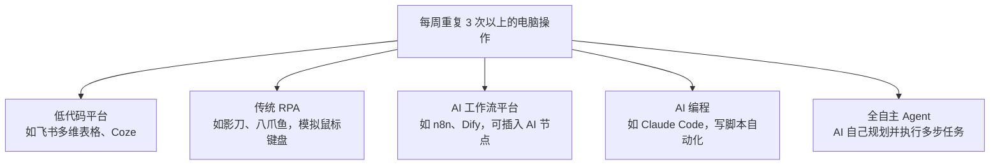
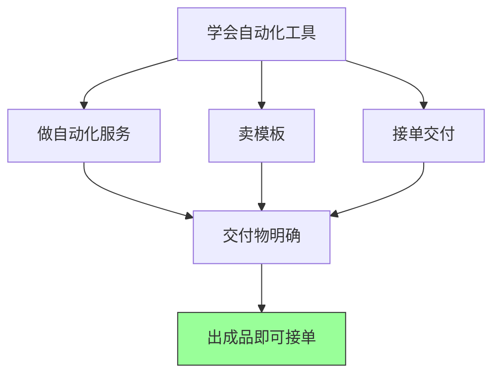

# 第21章 AI 零代码自动化五类工具盘点

> 本节系统介绍五类自动化工具及其适用场景，帮助读者判断"自己手头的重复工作该用哪一类工具"，并给出商业变现路径（做自动化服务、卖模板、接单交付）。

## 21.1 大白话：自动化工具就像"数字员工"

自动化工具就像"数字员工"，不同工具擅长不同的活。简单重复的用低代码平台，需要 AI 思考的用 AI 工作流平台，会写代码的用 AI 编程，最复杂的用全自主 Agent。先看你每周重复做几次什么工作，再对号入座。

## 21.2 五类自动化工具选型 Mermaid 图

## 21.3 五类工具详细对比

| 工具类别 | 代表工具 | 适用场景 | 优势 | 劣势 | 典型费用 |
|---------|---------|---------|------|------|---------|
| 低代码平台 | 飞书多维表格、Coze | 批量表格处理、自动通知、简单审批 | 无需编程，上手快 | 复杂逻辑受限 | 免费层或月付 |
| 传统 RPA | 影刀、八爪鱼 | 模拟鼠标键盘，老旧软件操作 | 可操作任意软件 | 配置复杂，易破坏 | 付费 |
| AI 工作流平台 | n8n、Dify | 采集→AI 处理→分发，智能自动化 | 可插入 AI 节点，灵活 | 有一定学习成本 | 免费层或月付 |
| AI 编程 | Claude Code、Cursor | 写自动化脚本，灵活度最高 | 完全可定制 | 需要基础编程能力 | 订阅 |
| 全自主 Agent | WorkBuddy、Hermes | AI 自己规划并执行多步任务 | 最高级自动化 | 配置调试复杂 | 免费层或订阅 |

## 21.4 如何判断用哪类工具？

### 21.4.1 第一步：列出每周重复 3 次以上的电脑操作

比如整理表格、发周报、备份文件、采集数据、发送邮件等。

### 21.4.2 第二步：分析操作复杂度

- 简单重复（复制粘贴、格式转换）→ 低代码平台
- 需要模拟人工操作（无 API 的老旧软件）→ 传统 RPA
- 需要 AI 思考（内容总结、情感分析）→ AI 工作流平台
- 需要高度定制（复杂逻辑、特殊格式）→ AI 编程
- 需要自主决策（多步任务规划）→ 全自主 Agent

### 21.4.3 第三步：选择对应工具并开始实践

先选一个最简单的场景跑通，验证可行性后再扩展。

## 21.5 商业变现路径

学会自动化工具后，可以走三条变现路径：

1. **做自动化服务**：帮其他人或公司搭建自动化流程，收取服务费
2. **卖模板**：将自己搭建好的工作流模板出售给需要的人
3. **接单交付**：在平台上接自动化相关的单子，交付明确的成品

交付物明确、决策门槛低，出成品即可接单。

## 21.6 商业变现路径 Mermaid 图

## 小练习

列出你每周重复做 3 次以上的电脑操作（如整理表格、发周报、备份文件），为每个操作标注归属的五类工具中的一种。

**参考模板**：

| 重复操作 | 频率 | 复杂度 | 推荐工具类别 | 具体工具 |
|---------|------|--------|-------------|---------|
| 整理每周报表 | 每周 1 次 | 简单 | 低代码平台 | 飞书多维表格 |
| 采集竞品价格 | 每周 3 次 | 中等 | AI 工作流平台 | n8n |
| 备份重要文件 | 每周 1 次 | 简单 | AI 编程 | Claude Code 脚本 |
