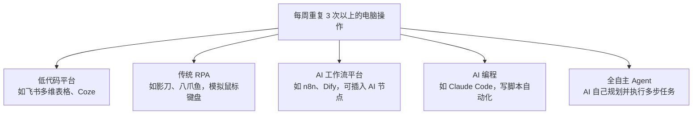
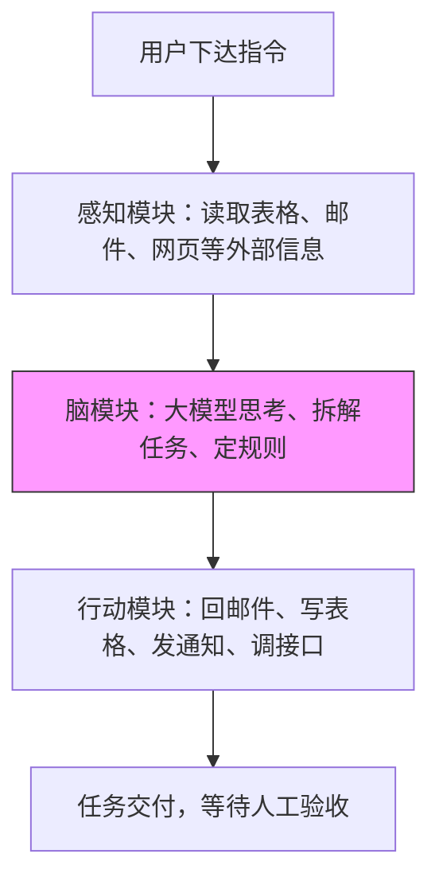
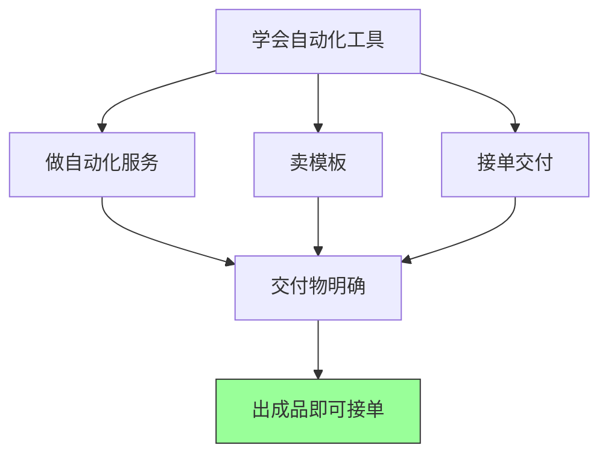

# 第21章 AI 零代码自动化五类工具盘点

> 本节系统介绍五类自动化工具及其适用场景，帮助读者判断“自己手头的重复工作该用哪一类工具”，并给出商业变现路径（做自动化服务、卖模板、接单交付）。

---

## 32.1 大白话：自动化工具就像"数字员工"

自动化工具就像"数字员工"，不同工具擅长不同的活。简单重复的用低代码平台，需要 AI 思考的用 AI 工作流平台，会写代码的用 AI 编程，最复杂的用全自主 Agent。先看你每周重复做几次什么工作，再对号入座。

什么是“自动化”？用大白话说，就是让机器替人干那些重复得让人发慌的活儿。比如每周五早上，你要把上周的销售数据从一个表格里复制出来，粘贴到另一个表格里，再做个图，最后发给老板。如果你一年 52 周都这么干，那就是 52 次纯粹的体力活，还容易在复制的时候漏掉一行、复错一列。自动化工具能把这一套动作“录”下来，以后你按一下按钮，或者甚至不用按按钮，机器就自己跑完整个流程，你只需要在结果出来之前喝杯咖啡、检查一下就行。

> **大白话**：自动化就是用技术代替人手，把重复劳动交给机器，而我们只需要动脑子做更有价值的事。用好自动化+AI，就相当于给我们的团队招了个"数字员工"，它会变成一个超级杠杆，成倍放大业务的价值。

这个“数字员工”有什么特点？首先，它不吃不喝不睡觉，一年 365 天随时待命；其次，它不情绪化，做一万次同样的事也不会烦躁、不会打折扣；再次，它非常守规矩——你教它怎么做，它就严格按步骤来，不走神、不漏步、不抄错数据。当然，它也有短板：只会你教过的事，遇到没见过的情况就懵了，这时候就需要人出面拍板。

不同的数字员工擅长的活儿不一样。有的擅长在软件之间搬数据（低代码平台），有的擅长像人一样点鼠标、敲键盘（传统 RPA），有的擅长一边干活一边动脑子思考（AI 工作流平台），有的需要你会写代码才能定制（AI 编程），最先进的能自己规划任务并一步步执行（全自主 Agent）。下面我们就逐类拆开来看，帮你把手头的重复工作对号入座到合适的工具上。

---

## 32.2 五类自动化工具选型 Mermaid 图



---

## 32.3 五类工具详细对比

| 工具类别 | 代表工具 | 适用场景 | 优势 | 劣势 | 典型费用 |
|---------|---------|---------|------|------|---------|
| 低代码平台 | 飞书多维表格、Coze | 批量表格处理、自动通知、简单审批 | 无需编程，上手快 | 复杂逻辑受限 | 免费层或月付 |
| 传统 RPA | 影刀、八爪鱼 | 模拟鼠标键盘，老旧软件操作 | 可操作任意软件 | 配置复杂，易破坏 | 付费 |
| AI 工作流平台 | n8n、Dify | 采集→AI 处理→分发，智能自动化 | 可插入 AI 节点，灵活 | 有一定学习成本 | 免费层或月付 |
| AI 编程 | Claude Code、Cursor | 写自动化脚本，灵活度最高 | 完全可定制 | 需要基础编程能力 | 订阅 |
| 全自主 Agent | WorkBuddy、Hermes | AI 自己规划并执行多步任务 | 最高级自动化 | 配置调试复杂 | 免费层或订阅 |

这张表是全章最重要的“选型指南”。选工具的时候，不要先想工具好不好，先问自己一个问题：我每周要重复做什么？如果是“每周五把销售表复制粘贴一遍”，那就是简单重复，低代码平台就够用；如果是“每天早上打开三个老旧网站，把数据抄下来”，那可能得上传统 RPA；如果是“把采集到的新闻交给 AI 总结成周报”，那就是需要 AI 思考，用 AI 工作流平台；如果是“要处理奇奇怪怪的文件格式，现有工具都搞不定”，那就考虑 AI 编程写脚本；如果是“随便下个指令，AI 自己拆任务、找工具、干完活交结果”，那就是全自主 Agent。

---

## 32.3.1 第一类：低代码平台（如 Zapier、n8n、Make）

首先是低代码的应用集成自动化平台，比如 Zapier、n8n、Make，它们通过触发器和动作，把不同应用串起来，比如，我在 Notion 写了一篇笔记，它自动帮我同步到 Twitter。

这里的“触发器”和“动作”用大白话说就是：“什么事情发生的时候”开始干活，以及“然后去干什么”。比如触发器是“飞书多维表格里新增了一条任务记录”，动作是“用 AI 把任务描述总结成一句话，再写回表格”。整个流程就像搭积木：把“触发”积木和“动作”积木拼在一起，连上线，自动化就跑起来了。

低代码平台的优点就是上手快，门槛低，几乎零代码，适合个人或小团队处理简单的跨平台联动任务，缺点是作为国外的平台，对国内工具的生态支持不完美，同时也很难通过预设模板的形式支持复杂的业务工作量，这个我们要根据实际的应用场景来决定。

在国内，低代码自动化更常见的代表是飞书多维表格和 Coze（扣子）。它们都有可视化的操作界面，不需要你写一行代码，就能完成“新增表格记录时自动通知”“定时抓取网页内容”这类常见场景。对于只会电脑基础操作的入门者来说，这往往是第一个该尝试的工具类别。

---

## 32.3.2 第二类：传统 RPA

接下来就是传统的 RPA，比如八爪鱼 RPA、影刀 RPA，通过可视化的指令拖拽实现一个自动化流程。

RPA 的全称是“机器人流程自动化”。你可以把它想象成一个会按你录制好的步骤，在电脑上“戴上手套”点鼠标、敲键盘的机器人。它的优点是基于本地运行，会接管键盘鼠标来模拟人类进行操作完成整个的自动化流程。还有一点，上手门槛低，半天就可上手入门。这意味着哪怕你完全不会编程，也可以通过录制自己的操作，让电脑帮你重复完成“打开软件→登录→点某个按钮→导出报表”这类老套路。

缺点是一些情况下的运行可能存在不稳定，同时自定义的调度比较困难，不容易集成到现有的工作用，但总体上它是一种最均衡、最平衡的自动化方式。更具体地说，如果某个老旧软件根本不提供 API（应用程序接口，就是软件给外部程序留的“取餐窗口”），低代码平台连不上它，但 RPA 可以模拟人工去点它的界面，所以它适合处理没有开放接口的老旧软件和网页操作。

---

## 32.3.3 第三类：AI 工作流平台

下一种在线的工作流平台，通过拖拽的形式把不同的模块链接。

什么是“工作流”？用大白话说，就是一件事情从开始到结束要经过哪些步骤，步骤之间怎么衔接。素材书里用卖西瓜汁来比喻：顾客点了一杯西瓜汁，奶茶店的交付流程就是“购买西瓜—榨果汁—购买空杯并装杯—冻冰块并加冰块—装袋交付”。从接单到西瓜汁送到顾客手里的整个过程，就是一个完整的工作流，每一步都环环相扣，缺一不可。AI 工作流平台就是把这种“步骤串联”的思路搬到了电脑里：你在画布上拖出几个模块，用连线把数据一个接一个地传下去，最终完成一件事。

比如在一个示例中，输入一个链接或一篇文章，自动生成不同风格调性的文案，去生成你所需要的内容等等，最后串联起来，这种自动化方式适合在一些内容创作上的自动化，但这类平台个性化需求的实现成本依然很高，而且对复杂逻辑的支持有限，多工作流协同能力较差，并发场景稳定性存在一定问题，可以说是一个入门级应用轻量使用。

代表工具是 n8n、Dify，它们都可以在工作流里插入 AI 节点（比如大模型节点、图片理解节点），实现“采集 → AI 处理 → 分发”的智能自动化。简单的个人自动化可以从这里入手，但如果业务逻辑很复杂、每天要跑几千次，就要小心评估稳定性了。

---

## 32.3.4 第四类：AI 编程

AI 编程类的自动化工具，主要是利用 AI 编程，来实现脚本化或者产品化的自动化。

什么是 AI 编程？简单说，就是借助 AI 来编写程序，自动化解决日常工作和学习中的各种问题。素材书里把它比喻成一个 24 小时待命的“智能助手”，可以帮你整理文件、分析数据、规划学习计划、管理日程提醒。它的核心能力是把“自然语言”变成“代码”：你像和朋友聊天一样告诉 AI 你想要什么，它就自动生成代码，还能帮你找错、改错、优化。DeepSeek、通义灵码、ChatGPT 都可以当 AI 编程助手，DeepSeek 特别适合多语言开发和跨语言转换，通义灵码更偏企业级开发，ChatGPT 对零基础用户比较友好，能详细解释代码逻辑。

AI 编程工具的“超能力”主要有四个：第一是代码生成，说出需求就写出代码；第二是错误检测与调试，代码里有 Bug 时能提示哪里错了并给修复建议；第三是代码优化，让程序跑得更快、更省资源；第四是多语言支持，Python、JavaScript、Java 等常见语言都能写，实现跨平台开发。

比如用 Cursor 这样的 AI IDE 自己编写自动化脚本。这种方式的灵活性极强，可以根据需求定制复杂自动化工作流，比如我用 AI 编程实现同时采集不同平台的数据，再用 AI 分析趋势、生成内容并分发。

它的优势是高度可定制化的，可以应对各种复杂业务场景，但需要一定的编程能力，对初学者不太友好。当然他最重要的特点，他可以稳定地支持大规模的并行处理，可以在短时间内高强度密集执行任务。

为了让你有个具体感受，下面是一段完整可运行的 Python 示例代码：自动整理“下载”文件夹，把文件按类型（文档、图片、音视频、安装包、其它）移动到对应的子文件夹里。每一行都写了中文注释，跟着看一遍就能懂。运行前需要在电脑上装好 Python（3.x 版本，安装时记得勾选“Add Python to PATH”）。

```python
# ===== 自动整理“下载”文件夹：按文件类型把文件移到对应子文件夹里 =====
# 适合完全不会编程的新手：把这段代码保存为 .py 文件，双击或在命令行运行即可

# 第 1 步：导入需要用到的标准库
from pathlib import Path          # 用来处理文件路径，比老式的 os.path 更直观
import shutil                     # 用来移动文件

# 第 2 步：定义“文件后缀名 -> 目标文件夹名”的映射表
# key 是文件后缀（统一小写），value 是我们想把它移进去的文件夹名字
TYPE_MAP = {
    # 文档类
    ".pdf": "文档",
    ".doc": "文档",
    ".docx": "文档",
    ".xls": "文档",
    ".xlsx": "文档",
    ".ppt": "文档",
    ".pptx": "文档",
    ".txt": "文档",
    ".md": "文档",
    # 图片类
    ".jpg": "图片",
    ".jpeg": "图片",
    ".png": "图片",
    ".gif": "图片",
    ".bmp": "图片",
    ".webp": "图片",
    # 音视频类
    ".mp3": "音视频",
    ".wav": "音视频",
    ".mp4": "音视频",
    ".mov": "音视频",
    ".avi": "音视频",
    # 安装包和压缩包类
    ".exe": "安装包",
    ".msi": "安装包",
    ".dmg": "安装包",
    ".zip": "安装包",
    ".rar": "安装包",
    ".7z": "安装包",
}

# 第 3 步：主函数，负责把一个文件夹里的文件逐个归类
def organize_folder(folder_path):
    # 把传入的字符串路径转成 Path 对象，方便后续拼接路径和判断
    folder = Path(folder_path)

    # 安全检查：路径必须存在，且必须是一个文件夹
    if not folder.exists():
        print(f"错误：文件夹不存在：{folder_path}")
        return
    if not folder.is_dir():
        print(f"错误：这不是一个文件夹：{folder_path}")
        return

    print(f"开始整理：{folder}")

    # 第 4 步：遍历文件夹里的每一个条目
    for item in folder.iterdir():
        # 只处理文件，跳过子文件夹，避免把文件夹本身误移进去
        if not item.is_file():
            continue

        # 取出文件的后缀名，并统一转成小写，比如 ".JPG" 变成 ".jpg"
        suffix = item.suffix.lower()

        # 第 5 步：根据后缀名决定目标文件夹名；如果找不到对应类型，就归入“其它”
        target_name = TYPE_MAP.get(suffix, "其它")

        # 第 6 步：在原文件夹里建立目标子文件夹（如果已经存在就不报错，继续往下走）
        target_dir = folder / target_name
        target_dir.mkdir(parents=True, exist_ok=True)

        # 第 7 步：移动文件。如果目标位置已有同名文件，加个“_副本”后缀避免覆盖
        target_file = target_dir / item.name
        if target_file.exists():
            stem = item.stem   # 文件名不含后缀，比如 "报告"
            target_file = target_dir / f"{stem}_副本{item.suffix}"

        shutil.move(str(item), str(target_file))
        print(f"已移动：{item.name} -> {target_name}/")

    print("整理完成！")


# 第 8 步：程序入口。直接运行这个文件时，就会整理当前用户的“下载”文件夹
if __name__ == "__main__":
    # Path.home() 代表当前用户的主目录，/ "Downloads" 就是下载文件夹
    download_folder = Path.home() / "Downloads"
    organize_folder(download_folder)
```

运行步骤（新手版）：

1. 在电脑上安装 Python，安装界面里一定要勾选“Add Python to PATH”，这样命令行才认识 `python` 命令。
2. 打开记事本（或任意文本编辑器），把上面全部代码复制进去，另存为 `organize_downloads.py`，保存位置随便选，比如放在桌面。
3. 按下键盘上的 `Win + R` 组合键，输入 `cmd`，回车，就会打开命令提示符（黑窗口）。
4. 在黑窗口里输入 `cd 桌面` 回车，再输入 `python organize_downloads.py` 回车。
5. 脚本会在你的“下载”文件夹里自动建立 `文档`、`图片`、`音视频`、`安装包`、`其它` 子文件夹，并把零散的文件归类进去。运行完后打开文件夹看一眼，就能明白 AI 编程自动化是怎么回事了。

---

## 32.3.5 第五类：全自主 Agent

我认为未来自动化最终形态可能类似 manus 型的，全自主 Agent 的形式，我们只需要下达指令，它会自动地进行任务拆解，调用不同的工具去完成任务，最终交付结果。

这里的 Agent（智能体）和前面第六章、第七章讲的聊天机器人不一样。素材书里引用复旦大学研究团队的定义：智能体是“能够感知环境、做出决策并主动采取行动的人工智能实体”。它有五大核心特质：第一，自主决策，能在无须人工干预的情况下独立完成任务；第二，环境响应，能实时感知并灵活适应环境变化；第三，目标驱动，能主动规划行动以实现预定目标；第四，协作能力，能和其他智能体或人类高效协同；第五，持续进化，能通过不断积累经验优化自身表现。

一个完整的智能体由三大核心部分组成：脑模块、感知模块和行动模块。脑模块是智能体的“大脑”，负责知识存储、信息处理、决策和规划；感知模块是智能体的“感官”，扩展了从单一文本到多模态信息的理解能力，让它能更精准地感知复杂环境；行动模块是智能体的“手和脚”，把决策和感知结果转化为具体行为，确保任务能被有效执行。

![asset/img/ch21-agent-three-modules.png]

> **图片说明**：智能体（数字员工）的三大核心模块示意（图源：《智能体一本通：打造你的全能助手》）。脑模块负责思考和规划，感知模块负责了解外界发生了什么，行动模块负责把决定落地为实际操作。

智能体还有一个很关键的能力叫“任务规划与分解”。你给它一个抽象任务，比如“帮我策划一场产品发布会”，它不会盲目开写，而是会自动识别关键环节——场地选择、嘉宾邀请、流程设计、宣传推广——拆成子任务，还为每个环节设定时间和依赖关系。它还能调用工具，相当于为 AI 配备了“数字双手”：在办公场景里，它可以自动调用文档撰写插件写报告、用数据分析插件分析数据、通过搜索插件上网查信息，还能在不同软件之间传递和转换数据。

举个全自主 Agent 的例子：我告诉它去找给我提供一个 RPA 相关调研的 PPT，他会很快的反馈给我们结果，不需要去提前去编排流程，非常简单，而且它会自动扩展不同的平台自动提供的信息。这就是“AI 打工人”的样子：你下达指令，它自己拆任务、调工具、干完活交结果。

缺点是可控性和成熟度上存在一些问题，但相信随着大模型能力上升和产品的不断迭代，这些问题最终都会被解决掉。

下面这张图用来帮你理解一个全自主 Agent 干活时的内部流程：



---

## 32.3.6 五类工具选型决策表

| 场景 | 推荐工具类别 | 具体工具示例 |
|------|---------|---------|
| 简单重复（复制粘贴、格式转换） | 低代码平台 | 飞书多维表格、Zapier、n8n |
| 需要模拟人工操作（无 API 的老旧软件） | 传统 RPA | 影刀、八爪鱼 |
| 需要 AI 思考（内容总结、情感分析） | AI 工作流平台 | Dify、Coze |
| 需要高度定制（复杂逻辑、特殊格式） | AI 编程 | Claude Code、Cursor |
| 需要自主决策（多步任务规划） | 全自主 Agent | WorkBuddy、Hermes |

这张表可以直接当“查字典”用。手头有个重复工作，对着场景列找一找，就知道该优先试哪一类工具，再去对应的具体工具示例里挑一个上手。

---

## 32.3.7 商业变现路径

学会自动化工具后，可以走三条变现路径：

1. **做自动化服务**：帮其他人或公司搭建自动化流程，收取服务费
2. **卖模板**：将自己搭建好的工作流模板出售给需要的人
3. **接单交付**：在平台上接自动化相关的单子，交付明确的成品

交付物明确、决策门槛低，出成品即可接单。

再补充一点背景：素材书里提到，扣子平台已经构建了比较完善的商业化基础设施，包括插件交易市场、模板购买服务和定制解决方案三大盈利模式。开发者可以在官方市场发布付费插件及付费模板，平台提供交易结算、版权保护和推广支持；企业用户则可以按需定制开发智能体。也就是说，除了自己给客户做服务，你还可以把自己积累下来的自动化流程打包成模板或插件，放在平台的市场里卖，这也是不错的被动收入方向。

---

## 32.4 商业变现路径 Mermaid 图



---

## 小练习

列出你每周重复做 3 次以上的电脑操作（如整理表格、发周报、备份文件），为每个操作标注归属的五类工具中的一种。

> **参考模板**：
>
> | 重复操作 | 频率 | 复杂度 | 推荐工具类别 | 具体工具 |
> |---------|------|--------|-------------|---------|
> | 整理每周报表 | 每周 1 次 | 简单 | 低代码平台 | 飞书多维表格 |
> | 采集竞品价格 | 每周 3 次 | 中等 | AI 工作流平台 | n8n |
> | 备份重要文件 | 每周 1 次 | 简单 | AI 编程 | Claude Code 脚本 |

---

## 本章小结

通过本章，你应该已经了解：

1. **什么是自动化**：用技术代替人手处理重复劳动，把“数字员工”招进来，让自己腾出手去做更有价值的事。
2. **五类自动化工具**：低代码平台（无需编程，上手快，适合跨平台搬数据）、传统 RPA（模拟鼠标键盘，适合老旧无接口软件）、AI 工作流平台（可插 AI 节点，适合采集→处理→分发）、AI 编程（灵活度最高，但需要编程基础）、全自主 Agent（AI 自己规划执行多步任务，是自动化最高形态）。
3. **怎么选工具**：先看每周重复做几次什么工作，对着“五类工具选型决策表”对号入座，不要为选工具而选工具。
4. **AI 编程示例**：掌握了一段可运行的 Python 自动整理文件脚本，知道运行 Python 脚本的基本步骤（安装 Python、保存 .py 文件、命令行运行）。
5. **商业变现**：学会自动化工具后，可以做自动化服务、卖模板、接单交付，交付物明确、决策门槛低，出成品即可接单。

下一章，我们将进入第六部分的第二节，用 Coze 工作流和飞书多维表格，手把手搭建一个真正能跑的自动化案例——新增任务时自动生成总结并填入表格，不需要你写一行代码。
